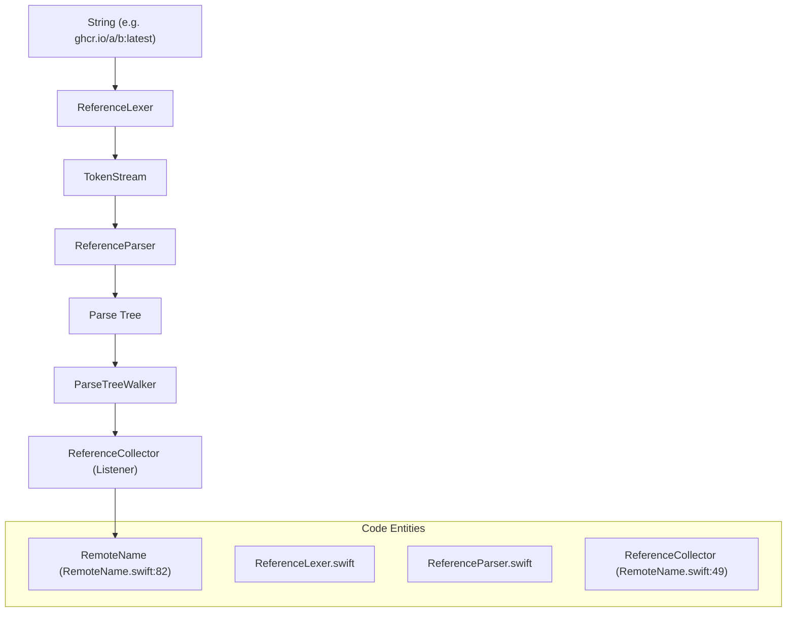
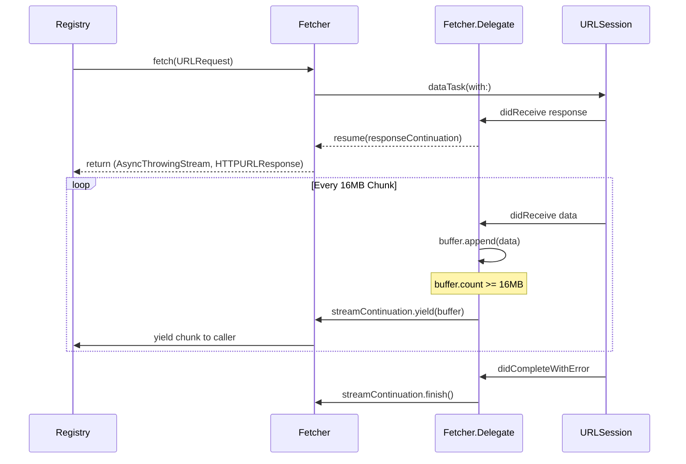

<!-- source: DeepWiki mcp.deepwiki.com · repo openai/tart · page 3.1 Registry Client and Networking · fetched 2026-10-26 -->

# Registry Client and Networking

Relevant source files

The following files were used as context for generating this wiki page:

- [Sources/tart/Fetcher.swift](Sources/tart/Fetcher.swift)
- [Sources/tart/OCI/Authentication.swift](Sources/tart/OCI/Authentication.swift)
- [Sources/tart/OCI/AuthenticationKeeper.swift](Sources/tart/OCI/AuthenticationKeeper.swift)
- [Sources/tart/OCI/Reference/Generated/Reference.interp](Sources/tart/OCI/Reference/Generated/Reference.interp)
- [Sources/tart/OCI/Reference/Generated/Reference.tokens](Sources/tart/OCI/Reference/Generated/Reference.tokens)
- [Sources/tart/OCI/Reference/Generated/ReferenceBaseListener.swift](Sources/tart/OCI/Reference/Generated/ReferenceBaseListener.swift)
- [Sources/tart/OCI/Reference/Generated/ReferenceLexer.interp](Sources/tart/OCI/Reference/Generated/ReferenceLexer.interp)
- [Sources/tart/OCI/Reference/Generated/ReferenceLexer.swift](Sources/tart/OCI/Reference/Generated/ReferenceLexer.swift)
- [Sources/tart/OCI/Reference/Generated/ReferenceLexer.tokens](Sources/tart/OCI/Reference/Generated/ReferenceLexer.tokens)
- [Sources/tart/OCI/Reference/Generated/ReferenceListener.swift](Sources/tart/OCI/Reference/Generated/ReferenceListener.swift)
- [Sources/tart/OCI/Reference/Generated/ReferenceParser.swift](Sources/tart/OCI/Reference/Generated/ReferenceParser.swift)
- [Sources/tart/OCI/Reference/Reference.g4](Sources/tart/OCI/Reference/Reference.g4)
- [Sources/tart/OCI/Registry.swift](Sources/tart/OCI/Registry.swift)
- [Sources/tart/OCI/RemoteName.swift](Sources/tart/OCI/RemoteName.swift)
- [Sources/tart/OCI/URL+Absolutize.swift](Sources/tart/OCI/URL+Absolutize.swift)
- [Tests/TartTests/RemoteNameTests.swift](Tests/TartTests/RemoteNameTests.swift)
- [Tests/TartTests/TokenResponseTests.swift](Tests/TartTests/TokenResponseTests.swift)
- [Tests/TartTests/URLAbsolutizationTests.swift](Tests/TartTests/URLAbsolutizationTests.swift)

The `Registry` class serves as the primary interface for interacting with OCI-compatible registries. It implements the OCI Distribution Specification to facilitate VM image distribution through manifest management and blob transfers. This subsystem handles complex networking tasks including streaming data via a custom `Fetcher` layer, managing OCI-specific authentication flows, and parsing remote image identifiers using a formal grammar.

## Remote Name Parsing

Tart uses a formal ANTLR4 grammar defined in `Reference.g4` to parse remote image identifiers (e.g., `ghcr.io/namespace/image:tag`). The `RemoteName` struct encapsulates the resulting host, namespace, and reference (tag or digest).

### Implementation Details
- **Grammar**: The parser distinguishes between host components, ports, namespaces, and references [Sources/tart/OCI/Reference/Generated/ReferenceParser.swift:24-32]().
- **Reference Types**: Supports both `Tag` (prefixed with `:`) and `Digest` (prefixed with `@`) [Sources/tart/OCI/RemoteName.swift:5-8]().
- **Validation**: Only ASCII letters are supported for host and namespace components [Sources/tart/OCI/RemoteName.swift:145-150](); local image names without a registry host are rejected [Tests/TartTests/RemoteNameTests.swift:36-38]().

### Parsing Flow
The following diagram illustrates how a string is transformed into a structured `RemoteName` object.

**Remote Name Parsing Architecture**

**Sources:** [Sources/tart/OCI/RemoteName.swift:82-128](), [Sources/tart/OCI/Reference/Generated/ReferenceParser.swift:108-155]().

## Registry Client

The `Registry` class manages the high-level OCI operations. It is initialized with a base URL, a namespace, and a chain of credential providers [Sources/tart/OCI/Registry.swift:129-136]().

### Key Functions
| Function | Description |
| :--- | :--- |
| `pullManifest(reference:)` | Retrieves an OCI manifest and its raw JSON data [Sources/tart/OCI/Registry.swift:181-192](). |
| `pushManifest(reference:manifest:)` | Uploads a manifest and returns its SHA256 digest [Sources/tart/OCI/Registry.swift:167-179](). |
| `ping()` | Validates connectivity and API version compatibility [Sources/tart/OCI/Registry.swift:160-165](). |

### Internal Helpers
The `Registry` class includes utilities for managing registry-specific URL construction and response parsing:
- **`uploadLocationFromResponse`**: Extracts the `Location` header from a registry response and absolutizes it against the base URL to handle relative redirects [Sources/tart/OCI/Registry.swift:194-204]().
- **`endpointURL`**: Appends the OCI version path and namespace to the base URL [Sources/tart/OCI/Registry.swift:170]().

**Sources:** [Sources/tart/OCI/Registry.swift:113-205]().

## Networking and Streaming

The `Fetcher` class provides a streaming abstraction over `URLSession`. It is designed to handle large VM disk layers efficiently by yielding data chunks through an `AsyncThrowingStream`.

### Fetcher Architecture
The `Fetcher` utilizes a private `Delegate` implementing `URLSessionDataDelegate` to manage backpressure and buffering. It explicitly disables cookie handling to prevent issues with registries like Harbor that expect CSRF tokens when session cookies are present [Sources/tart/Fetcher.swift:6-14]().

**Fetcher Data Flow**

### Buffer Management
To optimize memory usage, the `Delegate` uses a `bufferFlushSize` of 16 MB [Sources/tart/Fetcher.swift:44](). It pre-initializes the buffer capacity based on the `expectedContentLength` from the server response to minimize reallocations [Sources/tart/Fetcher.swift:53-56]().

**Sources:** [Sources/tart/Fetcher.swift:19-37](), [Sources/tart/Fetcher.swift:39-97]().

## Authentication

Tart supports OCI Bearer and Basic authentication. Authentication is coordinated by the `AuthenticationKeeper`, which caches tokens and handles the `401 Unauthorized` challenge-response flow.

### Token Handling
- **Token Parsing**: The `TokenResponse` struct decodes registry tokens using a custom JSON decoder that handles snake_case conversion and ISO8601 dates [Sources/tart/OCI/Registry.swift:65-80](). It supports both `token` and `access_token` fields [Sources/tart/OCI/Registry.swift:58-60]().
- **Expiration**: Tokens default to a 60-second lifespan if the `expires_in` field is missing, per Docker registry spec compatibility [Sources/tart/OCI/Registry.swift:90-102]().
- **Validation**: The `isValid()` method checks if the current time is before `tokenExpiresAt` [Sources/tart/OCI/Registry.swift:108-110]().

### Request Interception
The `Registry` class utilizes an `AuthenticationKeeper` to manage session state [Sources/tart/OCI/Registry.swift:117](). When a request is made, the registry injects the appropriate `Authorization` header obtained from the keeper [Sources/tart/OCI/Registry.swift:104-106]().

**Sources:** [Sources/tart/OCI/Registry.swift:58-111](), [Sources/tart/OCI/AuthenticationKeeper.swift](), [Tests/TartTests/TokenResponseTests.swift:5-40]().

---

