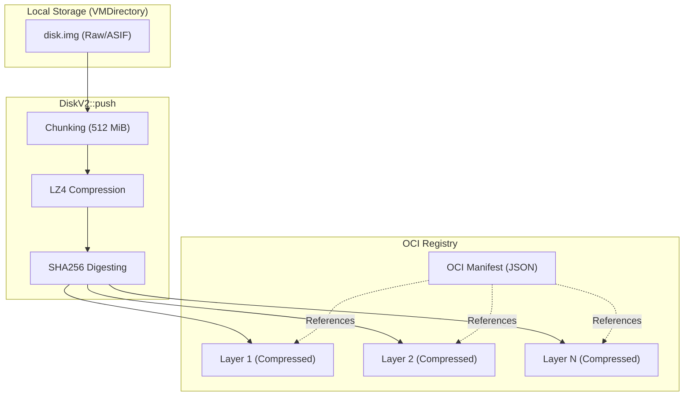
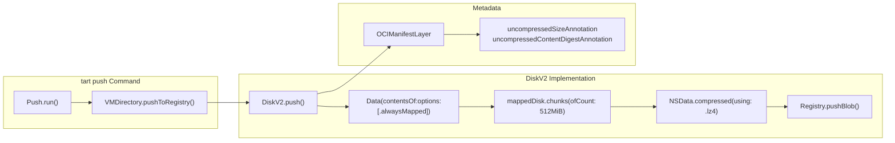

<!-- source: DeepWiki mcp.deepwiki.com · repo openai/tart · page 3.2 Disk Layerization (DiskV2) · fetched 2026-10-26 -->

# Disk Layerization (DiskV2)

Relevant source files

The following files were used as context for generating this wiki page:

- [Sources/tart/Commands/Push.swift](Sources/tart/Commands/Push.swift)
- [Sources/tart/LocalLayerCache.swift](Sources/tart/LocalLayerCache.swift)
- [Sources/tart/OCI/Digest.swift](Sources/tart/OCI/Digest.swift)
- [Sources/tart/OCI/Layerizer/Disk.swift](Sources/tart/OCI/Layerizer/Disk.swift)
- [Sources/tart/OCI/Layerizer/DiskV2.swift](Sources/tart/OCI/Layerizer/DiskV2.swift)
- [Sources/tart/OCI/Manifest.swift](Sources/tart/OCI/Manifest.swift)
- [Sources/tart/Prunable.swift](Sources/tart/Prunable.swift)
- [Sources/tart/URL+Prunable.swift](Sources/tart/URL+Prunable.swift)
- [Sources/tart/VMDirectory+OCI.swift](Sources/tart/VMDirectory+OCI.swift)
- [Sources/tart/VMStorageHelper.swift](Sources/tart/VMStorageHelper.swift)
- [Tests/TartTests/LayerizerTests.swift](Tests/TartTests/LayerizerTests.swift)
- [Tests/TartTests/RegistryTests.swift](Tests/TartTests/RegistryTests.swift)

The Disk Layerization (DiskV2) subsystem is responsible for transforming large, monolithic VM disk images into a series of OCI-compatible layers. This process enables efficient network transfers via deduplication, compression, and parallelization.

## Overview

Tart uses a custom disk layerization format (DiskV2) to overcome the limitations of pushing multi-gigabyte files to OCI registries. Instead of uploading a single massive blob, Tart splits the disk into fixed-size chunks, compresses them using LZ4, and uploads them as individual layers [Sources/tart/OCI/Layerizer/DiskV2.swift:7-9](). This approach allows for:

*   **Resumable Uploads/Downloads:** Only failed or missing layers need to be re-transferred. `DiskV2.pull` checks for existing files to resume interrupted transfers [Sources/tart/OCI/Layerizer/DiskV2.swift:95-96]().
*   **Parallelism:** Multiple layers are processed and uploaded/downloaded concurrently using Swift Concurrency's `withThrowingTaskGroup` [Sources/tart/OCI/Layerizer/DiskV2.swift:40-41]().
*   **Deduplication:** Identical disk chunks (e.g., zeroed blocks) across different VMs can be reused if the registry supports content-addressable storage.
*   **Sparse File Support:** Tart maintains disk sparsity on the host during pulls by truncating the file to the target size and potentially skipping zeroed blocks [Sources/tart/OCI/Layerizer/DiskV2.swift:122-126]().

## Data Flow: Push and Pull

The following diagram illustrates the transformation of a local `disk.img` into OCI layers during a `tart push` and the reconstruction during a `tart pull`.

### DiskV2 Layerization Process

Sources: [Sources/tart/OCI/Layerizer/DiskV2.swift:25-92](), [Sources/tart/VMDirectory+OCI.swift:156-169]()

### Code Entity Mapping: Push Workflow
The `DiskV2` class implements the `Disk` protocol to handle the heavy lifting of disk I/O and compression.

Sources: [Sources/tart/Commands/Push.swift:81-87](), [Sources/tart/VMDirectory+OCI.swift:156-168](), [Sources/tart/OCI/Layerizer/DiskV2.swift:25-92](), [Sources/tart/OCI/Manifest.swift:21-23]()

## Implementation Details

### Chunking and Compression
`DiskV2` splits the disk into chunks of exactly 512 MiB (`layerLimitBytes`) [Sources/tart/OCI/Layerizer/DiskV2.swift:8](). Each chunk is compressed independently using the LZ4 algorithm [Sources/tart/OCI/Layerizer/DiskV2.swift:51](). This ensures that the registry layers remain a manageable size while providing high-speed decompression during pulls.

### Sparse File Handling and Zero-Skipping
During a `pull` operation, Tart optimizes for disk space. It first determines the filesystem block size using `stat(2)` [Sources/tart/OCI/Layerizer/DiskV2.swift:129-135](). 

*   **Hole Granularity:** 4 MiB (`holeGranularityBytes`) [Sources/tart/OCI/Layerizer/DiskV2.swift:22]().
*   **Performance Optimization:** Tart compares data against a pre-allocated `zeroChunk` of 4 MiB, which is significantly faster than byte-by-byte comparison [Sources/tart/OCI/Layerizer/DiskV2.swift:19-23]().

### LocalLayerCache Deduplication
When pulling a VM that shares layers with an existing local VM, Tart can use a `LocalLayerCache`. If `deduplicate` is enabled:
1.  Tart clones the disk of a "base" VM using APFS copy-on-write via `FileManager.default.copyItem` [Sources/tart/OCI/Layerizer/DiskV2.swift:99-102]().
2.  The `LocalLayerCache` records the ranges of disk layers listed in a manifest [Sources/tart/LocalLayerCache.swift:27-43]().
3.  During the pull, it uses an offset hint to efficiently find matching digests [Sources/tart/LocalLayerCache.swift:46-52]().
4.  If a match is found, the `deduplicatedBytes` are tracked via extended attributes on the disk URL [Sources/tart/URL+Prunable.swift:30-33]().

### OCI Manifest Annotations
To reconstruct the disk correctly, Tart stores metadata in the OCI Manifest's layer annotations [Sources/tart/OCI/Manifest.swift:21-26]().

| Annotation Key | Purpose |
| :--- | :--- |
| `org.cirruslabs.tart.uncompressed-size` | The size of the chunk after decompression [Sources/tart/OCI/Manifest.swift:22](). |
| `org.cirruslabs.tart.uncompressed-content-digest` | SHA256 of the raw data for local verification [Sources/tart/OCI/Manifest.swift:23](). |
| `org.cirruslabs.tart.uncompressed-disk-size` | Total size of the final `disk.img` file [Sources/tart/OCI/Manifest.swift:14](). |
| `org.cirruslabs.tart.disk-file-content-digest` | Digest of the whole reconstructed disk file [Sources/tart/OCI/Manifest.swift:24](). |

Sources: [Sources/tart/OCI/Manifest.swift:13-26](), [Sources/tart/OCI/Layerizer/DiskV2.swift:72-78]()

## Key Classes and Functions

### `DiskV2` (Class)
The primary engine for layerization, inheriting from the `Disk` protocol [Sources/tart/OCI/Layerizer/Disk.swift:3-6]().
*   `push(diskURL:registry:...)`: Maps the disk into memory using `.alwaysMapped`, chunks it, compresses via LZ4, and uploads blobs in parallel [Sources/tart/OCI/Layerizer/DiskV2.swift:25-85]().
*   `pull(registry:diskLayers:...)`: Concurrently fetches compressed blobs, verifies digests, and reconstructs the disk file [Sources/tart/OCI/Layerizer/DiskV2.swift:94-173]().

### `LocalLayerCache` (Struct)
Manages a mapping of OCI digests to byte ranges within a local disk image using `mmap(2)` [Sources/tart/LocalLayerCache.swift:3-24]().
*   `findInfo(digest:offsetHint:)`: Locates the disk range for a given layer digest, using the offset as a hint for better accuracy [Sources/tart/LocalLayerCache.swift:46-52]().

### `VMDirectory+OCI` (Extension)
High-level orchestration of the push/pull workflow.
*   `pullFromRegistry(...)`: Handles pulling the config, disk chunks (via `DiskV2.pull`), and NVRAM [Sources/tart/VMDirectory+OCI.swift:15-113]().
*   `pullDiskFile(...)`: Reconstructs one complete immutable base disk or ASIF overlay, utilizing a `ContentStore` and `FileLock` to handle concurrent access [Sources/tart/VMDirectory+OCI.swift:118-154]().

Sources: [Sources/tart/OCI/Layerizer/DiskV2.swift:1-173](), [Sources/tart/VMDirectory+OCI.swift:1-169](), [Sources/tart/LocalLayerCache.swift:1-57]()

---

