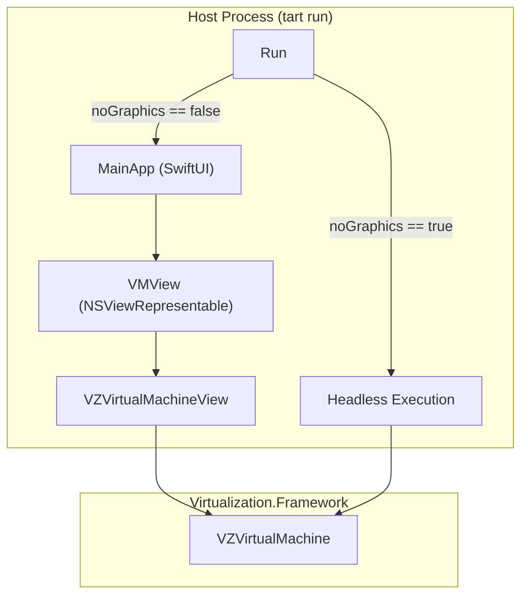

<!-- source: DeepWiki mcp.deepwiki.com · repo openai/tart · page 4 VNC and Display · fetched 2026-10-26 -->

# VNC and Display

<details>
<summary>Relevant source files</summary>

The following files were used as context for generating this wiki page:

- [Sources/tart/Commands/Run.swift](Sources/tart/Commands/Run.swift)
- [Sources/tart/VM.swift](Sources/tart/VM.swift)
- [Sources/tart/VNC/FullFledgedVNC.swift](Sources/tart/VNC/FullFledgedVNC.swift)
- [Sources/tart/VNC/ScreenSharingVNC.swift](Sources/tart/VNC/ScreenSharingVNC.swift)
- [Sources/tart/VNC/VNC.swift](Sources/tart/VNC/VNC.swift)

</details>


Tart provides multiple ways to interact with a virtual machine's graphical output, ranging from a native SwiftUI-based window to various VNC (Virtual Network Computing) implementations and a "headless" mode for automation.

### Graphical Interaction Overview

When running a VM via the `tart run` command, the display behavior is determined by the flags provided. By default, Tart attempts to open a native macOS window using `VZVirtualMachineView`. However, users can opt for VNC-based access or disable the GUI entirely.

| Mode | Command Flag | Implementation Class | Use Case |
| :--- | :--- | :--- | :--- |
| **Native UI** | (Default) | `VMView` / `MainApp` | Standard interactive use with optimal performance. |
| **Screen Sharing** | `--vnc` | `ScreenSharingVNC` | Native macOS Screen Sharing features (drag-and-drop). |
| **Full VNC** | `--vnc-experimental` | `FullFledgedVNC` | Recovery mode access and installation screens. |
| **Headless** | `--no-graphics` | N/A | CI/CD pipelines, SSH-only access, or background tasks. |

Sources: [Sources/tart/Commands/Run.swift:71-117]()

---

### VNC Implementations

Tart abstracts VNC functionality through the `VNC` protocol, which defines how to retrieve a connection URL and how to terminate the server.

```mermaid
classDiagram
    class "VNC" {
        <<protocol>>
        +waitForURL(netBridged Bool) URL
        +stop()
    }
    class "ScreenSharingVNC" {
        +vmConfig VMConfig
        +waitForURL(netBridged Bool) URL
        +stop()
    }
    class "FullFledgedVNC" {
        -vnc Dynamic
        +password String
        +waitForURL(netBridged Bool) URL
        +stop()
    }
    "VNC" <|.. "ScreenSharingVNC"
    "VNC" <|.. "FullFledgedVNC"
```

*   **`ScreenSharingVNC`**: Relies on the guest OS's built-in VNC server (e.g., macOS Screen Sharing). It resolves the guest's IP address using `IP.resolveIP` [Sources/tart/VNC/ScreenSharingVNC.swift:14-14]() and returns a standard `vnc://` URL.
*   **`FullFledgedVNC`**: Uses private `Virtualization.Framework` APIs (`_VZVNCServer`) to host a VNC server directly from the host process [Sources/tart/VNC/FullFledgedVNC.swift:11-15](). This is particularly useful for viewing the VM before the guest OS has fully booted or when in recovery mode. It generates a random password using `PassphraseGenerator` [Sources/tart/VNC/FullFledgedVNC.swift:10-10]().

For details, see [VNC Implementations](#4.1).

Sources: [Sources/tart/VNC/VNC.swift:3-6](), [Sources/tart/VNC/ScreenSharingVNC.swift:5-26](), [Sources/tart/VNC/FullFledgedVNC.swift:5-38]()

---

### SwiftUI App and Headless Mode

The primary graphical interface for Tart is a SwiftUI application. When a user runs a VM without the `--no-graphics` flag, the `Run` command initializes the `MainApp` and displays the `VMView`.

*   **`VMView`**: A wrapper around `VZVirtualMachineView` (via `NSViewRepresentable`) that renders the VM's framebuffer and captures keyboard/mouse input.
*   **Headless Mode**: Triggered by the `--no-graphics` flag [Sources/tart/Commands/Run.swift:71-74](). In this mode, the VM runs as a background process without any local window or VNC server. Users typically interact with these VMs via `tart exec` or SSH.



For details, see [SwiftUI App and Headless Mode](#4.2).

Sources: [Sources/tart/Commands/Run.swift:71-74](), [Sources/tart/VM.swift:25-86]()

---

### Display Configuration and Constraints

The display characteristics are managed through the `VM` class and its underlying `VZVirtualMachineConfiguration`.

*   **Configuration**: The `VM` class initializes the `VZVirtualMachine` with hardware configurations including audio and clipboard sharing, which can be toggled via `Run` command flags like `--no-audio` or `--no-clipboard` [Sources/tart/Commands/Run.swift:90-97]().
*   **Architecture**: Certain display features, such as the experimental VNC server, are specific to `arm64` (Apple Silicon) hosts [Sources/tart/Commands/Run.swift:111-117]().
*   **Recovery Mode**: Accessing the macOS recovery partition (via the `--recovery` flag) requires specific display handling, often necessitating the experimental VNC server to see the pre-boot environment [Sources/tart/Commands/Run.swift:98-101]().

Sources: [Sources/tart/VM.swift:43-86](), [Sources/tart/Commands/Run.swift:90-117]()

---

