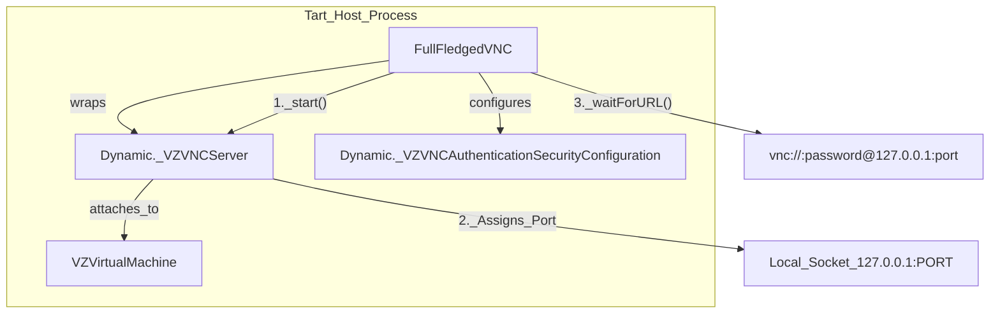
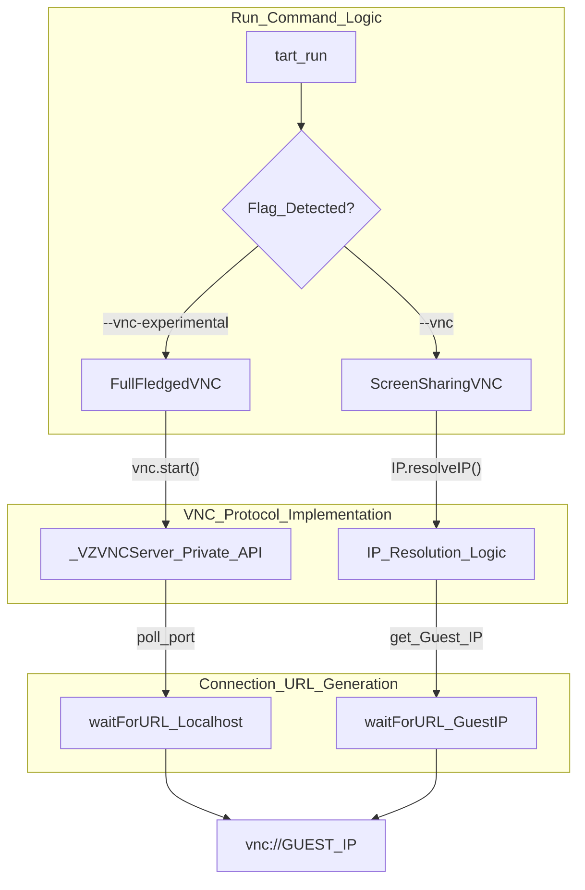

<!-- source: DeepWiki mcp.deepwiki.com · repo openai/tart · page 4.1 VNC Implementations · fetched 2026-10-26 -->

# VNC Implementations

Relevant source files

The following files were used as context for generating this wiki page:

- [Sources/tart/Commands/Run.swift](Sources/tart/Commands/Run.swift)
- [Sources/tart/VM.swift](Sources/tart/VM.swift)
- [Sources/tart/VNC/FullFledgedVNC.swift](Sources/tart/VNC/FullFledgedVNC.swift)
- [Sources/tart/VNC/ScreenSharingVNC.swift](Sources/tart/VNC/ScreenSharingVNC.swift)
- [Sources/tart/VNC/VNC.swift](Sources/tart/VNC/VNC.swift)

Tart provides graphical access to virtual machines through the VNC (Virtual Network Computing) protocol. Depending on the guest operating system and the desired connectivity, Tart employs different strategies to expose the VM's display. These strategies are unified under a common protocol abstraction.

## VNC Protocol Abstraction

The `VNC` protocol defines the standard interface for any VNC implementation within Tart. This abstraction allows the `Run` command and the UI components to interact with different VNC servers (internal or external) without needing to know the underlying implementation details.

| Method | Description |
| :--- | :--- |
| `waitForURL(netBridged: Bool)` | Asynchronously resolves and returns the VNC connection URL (e.g., `vnc://127.0.0.1:5900`). |
| `stop()` | Terminates the VNC server or cleans up associated resources. |

**Sources:**
- [Sources/tart/VNC/VNC.swift:3-6]()

## FullFledgedVNC

The `FullFledgedVNC` class implements a complete VNC server that runs within the Tart host process. It utilizes private APIs within Apple's `Virtualization.framework` to bridge the VM's framebuffer directly to a network socket. This implementation is particularly useful for macOS installation and recovery mode where guest-side services are not yet available [Sources/tart/Commands/Run.swift:112-117]().

### Implementation Details
- **Private API Usage**: It uses `Dynamic` to access `_VZVNCServer` and `_VZVNCAuthenticationSecurityConfiguration`, which are not part of the public `Virtualization.framework` headers [Sources/tart/VNC/FullFledgedVNC.swift:11-14]().
- **Security**: Upon initialization, it generates a random 4-segment password using a `PassphraseGenerator` [Sources/tart/VNC/FullFledgedVNC.swift:10-10]().
- **Port Allocation**: The server is initialized with port `0`, allowing the OS to assign an available ephemeral port [Sources/tart/VNC/FullFledgedVNC.swift:12-13]().
- **URL Resolution**: The `waitForURL` implementation polls the `vnc.port` property until the OS assigns a non-zero port, then constructs a local loopback URL containing the credentials [Sources/tart/VNC/FullFledgedVNC.swift:19-29]().

### Data Flow: FullFledgedVNC Initialization
The following diagram shows how `FullFledgedVNC` interfaces with the private Virtualization entities.

"Code Entity Space: FullFledgedVNC"

**Sources:**
- [Sources/tart/VNC/FullFledgedVNC.swift:5-16]()
- [Sources/tart/VNC/FullFledgedVNC.swift:22-23]()

## ScreenSharingVNC

`ScreenSharingVNC` is used primarily for macOS guests where the native "Screen Sharing" service is already running inside the guest OS. Unlike `FullFledgedVNC`, it does not start a server on the host; instead, it acts as a discovery mechanism to find the guest's IP address. This mode is preferred for standard macOS usage as it supports advanced features like drag-and-drop [Sources/tart/Commands/Run.swift:104-107]().

### Implementation Details
- **IP Resolution**: It retrieves the VM's MAC address from the `VMConfig` and uses `IP.resolveIP` to find the guest's IP address [Sources/tart/VNC/ScreenSharingVNC.swift:13-14]().
- **Resolution Strategies**:
    - If `netBridged` is true, it uses the `arp` strategy.
    - Otherwise, it defaults to the `dhcp` strategy [Sources/tart/VNC/ScreenSharingVNC.swift:14-14]().
- **URL Construction**: Once the IP is resolved, it returns a standard `vnc://` URL pointing directly to the guest [Sources/tart/VNC/ScreenSharingVNC.swift:16-18]().

**Sources:**
- [Sources/tart/VNC/ScreenSharingVNC.swift:5-21]()

## Integration with the Run Workflow

The VNC implementation selection happens during the `Run` command execution based on CLI flags.

### CLI Configuration Flags
- `--vnc`: Triggers the use of `ScreenSharingVNC` [Sources/tart/Commands/Run.swift:109-109]().
- `--vnc-experimental`: Triggers the use of `FullFledgedVNC` [Sources/tart/Commands/Run.swift:117-117]().

### Logic Flow: VNC Setup and Connection

"Natural Language Space to Code Entity Space: VNC Integration"

**Sources:**
- [Sources/tart/Commands/Run.swift:104-117]()
- [Sources/tart/VNC/FullFledgedVNC.swift:12-15]()
- [Sources/tart/VNC/ScreenSharingVNC.swift:12-14]()

### Summary of Differences

| Feature | `FullFledgedVNC` | `ScreenSharingVNC` |
| :--- | :--- | :--- |
| **Server Location** | Host Process (via `Virtualization.framework`) | Guest OS (Native Service) |
| **Target OS** | Linux and macOS (Experimental) | macOS |
| **Network Access** | Localhost (127.0.0.1) | Guest IP Address |
| **Authentication** | Randomly generated by Tart | Managed by Guest OS |
| **Implementation** | `Dynamic` Private APIs | IP Discovery Logic |

**Sources:**
- [Sources/tart/VNC/FullFledgedVNC.swift:5-16]()
- [Sources/tart/VNC/ScreenSharingVNC.swift:5-21]()
- [Sources/tart/Commands/Run.swift:104-117]()

---

