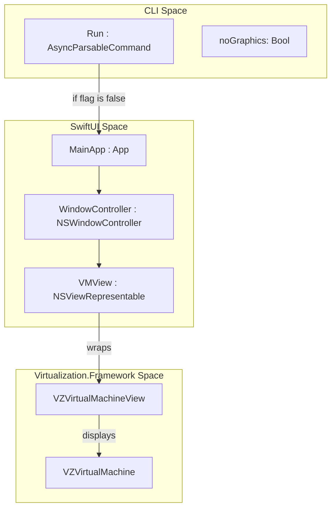
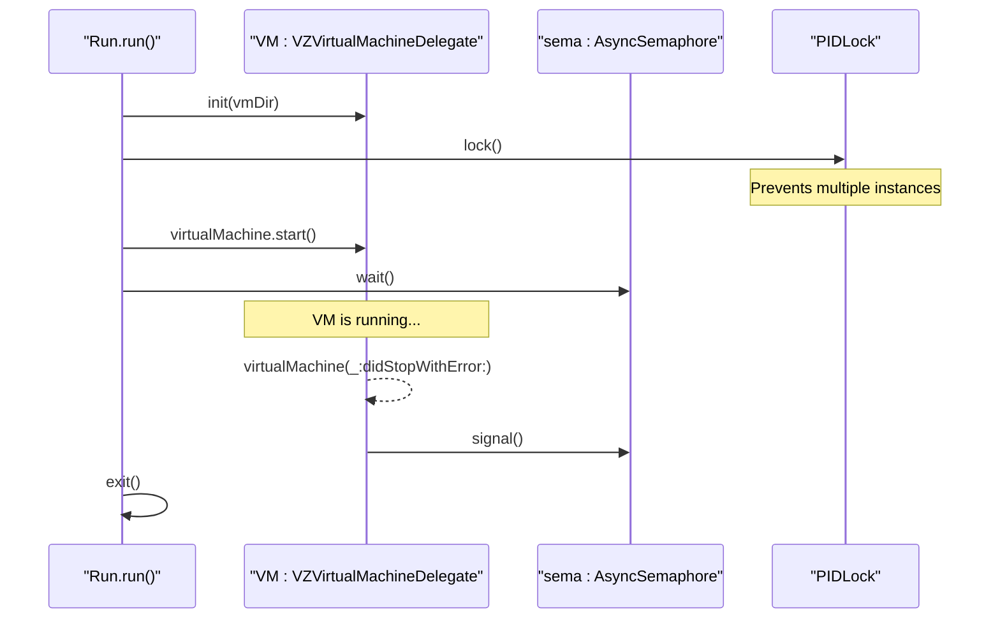

<!-- source: DeepWiki mcp.deepwiki.com · repo openai/tart · page 4.2 SwiftUI App and Headless Mode · fetched 2026-10-26 -->

# SwiftUI App and Headless Mode

Relevant source files

The following files were used as context for generating this wiki page:

- [Sources/tart/Commands/Run.swift](Sources/tart/Commands/Run.swift)
- [Sources/tart/Commands/Stop.swift](Sources/tart/Commands/Stop.swift)
- [Sources/tart/Commands/Suspend.swift](Sources/tart/Commands/Suspend.swift)
- [Sources/tart/PIDLock.swift](Sources/tart/PIDLock.swift)
- [Sources/tart/VM.swift](Sources/tart/VM.swift)

This section provides a technical deep dive into the graphical and non-graphical execution paths of Tart. It covers the SwiftUI-based `MainApp`, the integration of Apple's `Virtualization.Framework` UI components via `NSViewRepresentable`, and the headless execution logic used for automation and remote environments.

## The MainApp and SwiftUI Lifecycle

When Tart is executed with a graphical interface (the default behavior for macOS guests), it initializes a SwiftUI application lifecycle. The entry point for the graphical interface is managed within the `Run` command, which determines whether to start a standard macOS app instance.

### Implementation Details
The application uses `NSViewRepresentable` to bridge the AppKit-based `VZVirtualMachineView` into the SwiftUI view hierarchy. This is encapsulated in `VMView`.

| Entity | Description | File Path |
| :--- | :--- | :--- |
| `MainApp` | The top-level SwiftUI `App` structure. | [Sources/tart/App/MainApp.swift:10-10]() |
| `VMView` | A `NSViewRepresentable` wrapping `VZVirtualMachineView`. | [Sources/tart/App/VMView.swift:6-6]() |
| `WindowController` | Manages the `NSWindow` and its associated `VM` instance. | [Sources/tart/App/WindowController.swift:7-7]() |

### Data Flow: CLI to SwiftUI
The `Run` command acts as the dispatcher. If `noGraphics` is false [Sources/tart/Commands/Run.swift:71-74]() and no experimental VNC modes are selected [Sources/tart/Commands/Run.swift:109-117](), it transitions from the command-line environment to the AppKit run loop.

### Code Entity Relationship: CLI to UI
The following diagram maps the command-line argument processing to the initialization of the SwiftUI application and its corresponding view components.

Sources: [Sources/tart/Commands/Run.swift:65-117](), [Sources/tart/App/MainApp.swift:10-25](), [Sources/tart/App/VMView.swift:6-35](), [Sources/tart/VM.swift:25-86]()

## VMView and User Interaction

The `VMView` is the primary container for the virtual machine's display. It configures the `VZVirtualMachineView` to handle keyboard and mouse input.

### Key Functions
- **`makeNSView(context:)`**: Initializes the `VZVirtualMachineView` and assigns the `virtualMachine` from the `VM` object [Sources/tart/App/VMView.swift:13-20]().
- **`updateNSView(_:context:)`**: Updates the view if the underlying `VM` instance changes [Sources/tart/App/VMView.swift:22-24]().
- **Capturing Input**: The view automatically captures input when focused, provided the `VM` configuration includes pointing and keyboard devices [Sources/tart/VM.swift:43-86]().

### Menu Bar Controls
The application provides standard virtualization controls (Start, Stop, Suspend) via the macOS menu bar and window delegates. These interact directly with the `VZVirtualMachine` state via the `VM` class.

Sources: [Sources/tart/App/VMView.swift:6-35](), [Sources/tart/VM.swift:25-86]()

## Headless Mode (`--no-graphics`)

Headless mode is triggered by the `--no-graphics` flag [Sources/tart/Commands/Run.swift:71-74](). In this mode, Tart does not initialize `NSApplication` or any SwiftUI views.

### Execution Path
1. **Command Parsing**: The `Run` struct captures `noGraphics: Bool` [Sources/tart/Commands/Run.swift:74-74]().
2. **VM Initialization**: The `VM` object is created normally, but no `VZVirtualMachineView` is attached to it [Sources/tart/VM.swift:43-86]().
3. **Lifecycle Management**: The process stays alive by waiting on an `AsyncSemaphore` within the `VM` class, which is used to communicate with the `VZVirtualMachineDelegate` [Sources/tart/VM.swift:33-33]().
4. **Console Output**: If `--serial` is enabled, the guest's serial output is redirected to the host's standard I/O or a specified path via `serialPath` [Sources/tart/Commands/Run.swift:76-86]().

### Use Cases
- **CI/CD Pipelines**: Running automated tests without requiring a window server.
- **Remote Servers**: Executing VMs on headless macOS instances (e.g., AWS EC2 Mac).
- **Automation**: Using `tart ip` to retrieve the guest IP and connecting via SSH or external VNC [Sources/tart/Commands/Run.swift:73-74]().

### Code Entity Relationship: Headless Lifecycle
This diagram illustrates the signaling and locking mechanisms used to manage a VM's lifecycle when no graphical window is present.

Sources: [Sources/tart/Commands/Run.swift:65-89](), [Sources/tart/VM.swift:25-42](), [Sources/tart/VM.swift:136-143](), [Sources/tart/PIDLock.swift:4-39]()

## External Lifecycle Controls (Stop and Suspend)

Tart allows external control of running VMs through the `stop` and `suspend` commands. These commands interact with the running `tart run` process using POSIX signals.

### Stop Command
The `stop` command first attempts a graceful termination by sending `SIGINT` to the process ID (PID) stored in the VM's lock file [Sources/tart/Commands/Stop.swift:35-51](). If the VM does not terminate within the specified `timeout` (default 30 seconds), it issues a `SIGKILL` [Sources/tart/Commands/Stop.swift:57-73]().

### Suspend Command
The `suspend` command sends a `SIGUSR1` signal to the `tart run` process [Sources/tart/Commands/Suspend.swift:23-26](). The `tart run` process is responsible for handling this signal and invoking the `VZVirtualMachine.saveMachineState` API.

Sources: [Sources/tart/Commands/Stop.swift:6-75](), [Sources/tart/Commands/Suspend.swift:6-28](), [Sources/tart/PIDLock.swift:35-39]()

## Interaction with Virtualization.Framework

The relationship between the Tart `VM` wrapper and the system's `VZVirtualMachine` is critical for both UI and headless modes.

| Tart Entity | Virtualization.Framework Entity | Role |
| :--- | :--- | :--- |
| `VM` | `VZVirtualMachine` | Lifecycle and state management [Sources/tart/VM.swift:27-27](). |
| `VM.configuration` | `VZVirtualMachineConfiguration` | Hardware definition (CPU, RAM, Display) [Sources/tart/VM.swift:30-30](). |
| `VMView` | `VZVirtualMachineView` | Rendering the guest framebuffer to an NSView [Sources/tart/App/VMView.swift:14-14](). |

### Recovery Mode
Tart supports booting into macOS Recovery mode via the `--recovery` flag [Sources/tart/Commands/Run.swift:98-101](). This sets the start options of the `VZVirtualMachine` to boot from the recovery partition rather than the main OS.

Sources: [Sources/tart/Commands/Run.swift:98-101](), [Sources/tart/VM.swift:82-86]()

---

