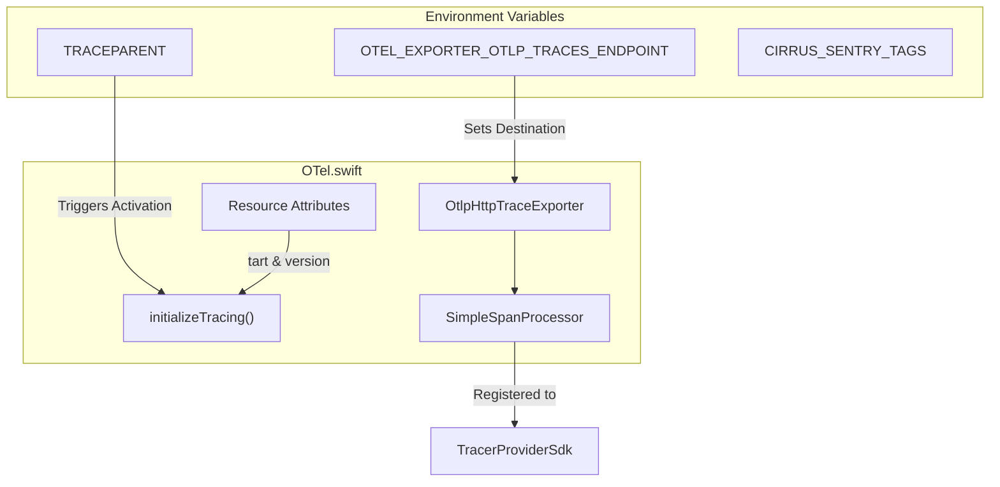
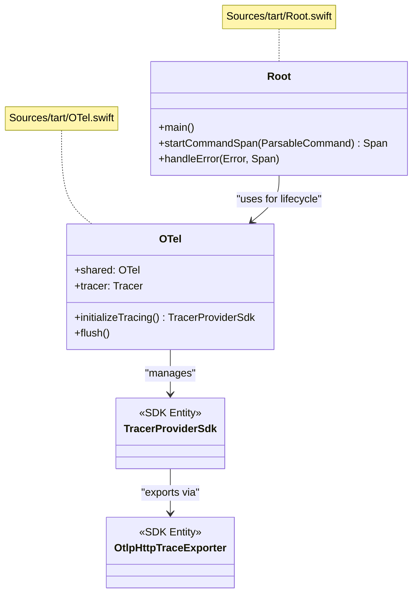

<!-- source: DeepWiki mcp.deepwiki.com · repo openai/tart · page 5.1 OpenTelemetry Integration · fetched 2026-10-26 -->

# OpenTelemetry Integration

Relevant source files

The following files were used as context for generating this wiki page:

- [.editorconfig](.editorconfig)
- [Package.resolved](Package.resolved)
- [Package.swift](Package.swift)
- [Sources/tart/OTel.swift](Sources/tart/OTel.swift)
- [Sources/tart/Root.swift](Sources/tart/Root.swift)
- [integration-tests/go.mod](integration-tests/go.mod)
- [integration-tests/go.sum](integration-tests/go.sum)
- [integration-tests/opentelemetry_test.go](integration-tests/opentelemetry_test.go)

Tart implements OpenTelemetry (OTel) to provide distributed tracing and observability for CLI operations. This allows users and CI/CD systems to monitor the performance and lifecycle of VM operations, such as pulls, pushes, and execution, by exporting telemetry data to OTLP-compatible collectors.

## The OTel Singleton

The core of the telemetry implementation is the `OTel` class [Sources/tart/OTel.swift:7-64](), which acts as a singleton manager for the OpenTelemetry SDK. It handles the initialization of the tracer provider, resource attribution, and the lifecycle of spans.

### Initialization and Activation
Tracing is not active by default. The `OTel.initializeTracing()` function checks for the presence of the `TRACEPARENT` environment variable [Sources/tart/OTel.swift:19-21](). If this variable is missing, the tracer provider is not initialized, and no spans are exported.

When active, the system:
1.  **Sets Service Metadata**: Configures the service name as `tart` and attaches the version from `CI.version` [Sources/tart/OTel.swift:25-28]().
2.  **Configures Exporter**: Uses `OtlpHttpTraceExporter` [Sources/tart/OTel.swift:33-35](). It defaults to the standard OTLP endpoint or uses the value provided in `OTEL_EXPORTER_OTLP_TRACES_ENDPOINT` [Sources/tart/OTel.swift:31-32]().
3.  **Registers Provider**: The resulting `TracerProviderSdk` is registered globally via `OpenTelemetry.registerTracerProvider` [Sources/tart/OTel.swift:43]().

### Data Flow: Initialization to Export

The following diagram illustrates how the `OTel` singleton configures the telemetry pipeline based on the environment.

**OTel Configuration and Data Flow**

Sources: [Sources/tart/OTel.swift:7-46]()

## Span Lifecycle and Command Integration

Tart follows the W3C Trace Context specification for propagation. By utilizing the `TRACEPARENT` variable, Tart can join an existing trace initiated by a parent process (like a CI runner).

### Command-Level Spans
Every Tart command is wrapped in a root span within the `Root` entry point. The `startCommandSpan(for:)` function creates a span named after the command (e.g., "list", "run") [Sources/tart/Root.swift:132-133](). 

The span lifecycle is managed in `runOnMainThread` [Sources/tart/Root.swift:94-109]() and `runInBackground` [Sources/tart/Root.swift:111-129]():
1.  **Start**: `startCommandSpan` is called before command execution [Sources/tart/Root.swift:112]().
2.  **Enrich**: The span is populated with command-line arguments [Sources/tart/Root.swift:137-140]() and environment-based tags.
3.  **End**: The span is closed after the command finishes [Sources/tart/Root.swift:126](), followed by a call to `OTel.shared.flush()` [Sources/tart/Root.swift:127]().

### Resource Enrichment
Tart enriches spans with additional metadata:
-   **Service Identity**: Spans are tagged with `service.name` ("tart") and `service.version` [Sources/tart/OTel.swift:25-28]().
-   **Cirrus Sentry Tags**: If the `CIRRUS_SENTRY_TAGS` environment variable is present (formatted as `key=value,key=value`), these are parsed by `splitEnvironmentVariable` and added as attributes to the span [Sources/tart/Root.swift:143-147](), [Sources/tart/Root.swift:188-195]().
-   **Error Recording**: If a command fails, `handleError` records the exception into the active span using `recordException(error)` [Sources/tart/Root.swift:172]().

### Flushing and Termination
Because Tart is a CLI tool, spans must be explicitly flushed before the process exits. The `OTel.flush()` method:
1.  Ends the currently active span [Sources/tart/OTel.swift:49]().
2.  Calls `forceFlush()` on the `tracerProvider` [Sources/tart/OTel.swift:56]().
3.  Implements a 100ms sleep workaround [Sources/tart/OTel.swift:62]() to address known issues in the `opentelemetry-swift` SDK where traces may not flush immediately before process termination [Sources/tart/OTel.swift:58-61]().

## Implementation Mapping

The following diagram bridges the natural language concepts of "Telemetry" to the specific entities in the `tart` codebase.

**Code Entity Mapping**

Sources: [Sources/tart/OTel.swift:1-16](), [Sources/tart/Root.swift:93-150]()

## Integration Testing

The OTel integration is verified using a Go-based mock collector in the integration test suite.

| Test Component | Purpose |
| :--- | :--- |
| `TestOpenTelemetry` | Starts an `httptest.NewServer` to act as a mock OTLP collector [integration-tests/opentelemetry_test.go:20-24](). |
| `ExportTraceServiceRequest` | Protobuf message used to capture traces sent by Tart [integration-tests/opentelemetry_test.go:25](). |
| `t.Setenv` | Configures `TRACEPARENT` and `OTEL_EXPORTER_OTLP_TRACES_ENDPOINT` to point to the mock server [integration-tests/opentelemetry_test.go:62-64](). |
| `hex.EncodeToString` | Used to verify that `TraceId` and `ParentSpanId` are correctly propagated from the environment [integration-tests/opentelemetry_test.go:97-98](). |

Sources: [integration-tests/opentelemetry_test.go:20-99](), [integration-tests/go.mod:1-10]()

---

