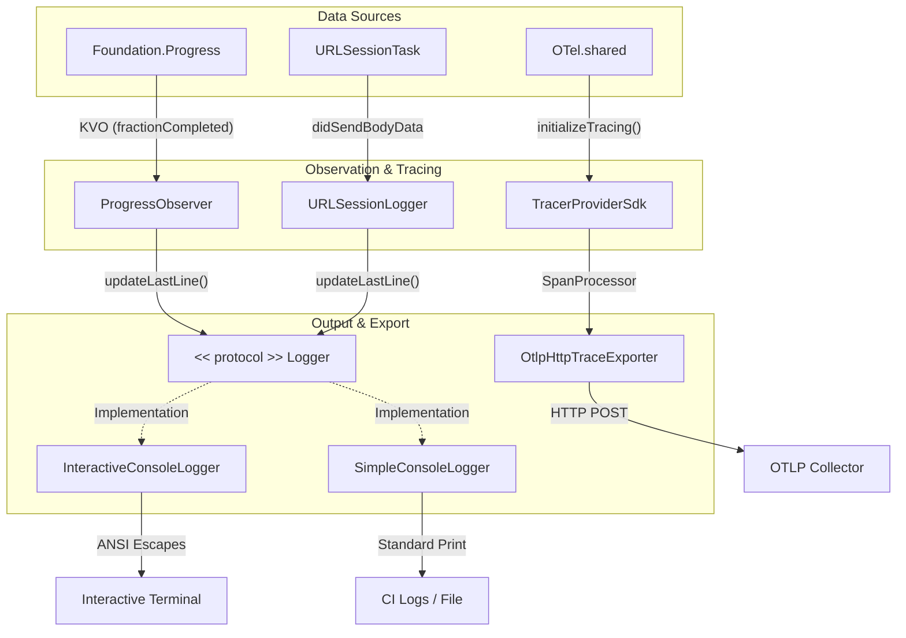
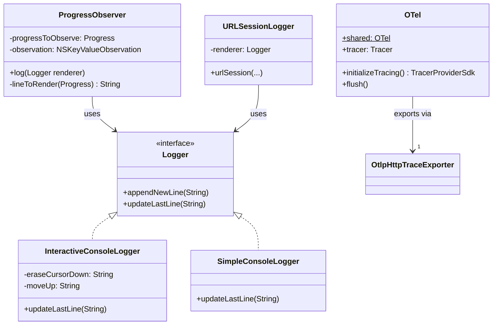

<!-- source: DeepWiki mcp.deepwiki.com · repo openai/tart · page 5.2 Logging and Progress Reporting · fetched 2026-10-26 -->

# Logging and Progress Reporting

Relevant source files

The following files were used as context for generating this wiki page:

- [.editorconfig](.editorconfig)
- [Sources/tart/Logging/Logger.swift](Sources/tart/Logging/Logger.swift)
- [Sources/tart/Logging/ProgressObserver.swift](Sources/tart/Logging/ProgressObserver.swift)
- [Sources/tart/Logging/URLSessionLogger.swift](Sources/tart/Logging/URLSessionLogger.swift)
- [Sources/tart/OTel.swift](Sources/tart/OTel.swift)
- [integration-tests/go.mod](integration-tests/go.mod)
- [integration-tests/go.sum](integration-tests/go.sum)
- [integration-tests/opentelemetry_test.go](integration-tests/opentelemetry_test.go)

Tart provides a specialized logging and progress reporting infrastructure designed to handle both interactive terminal environments and non-interactive Continuous Integration (CI) environments. The system focuses on providing real-time feedback for long-running operations like VM image downloads and uploads while maintaining a clean output log.

## Architecture Overview

The logging system is built around a central `Logger` protocol that abstracts the terminal output mechanism. Higher-level observers then use these loggers to report progress from `Foundation.Progress` objects or `URLSession` tasks. Additionally, Tart integrates with OpenTelemetry for distributed tracing, allowing for deep observability of command execution.

### Core Entities and Data Flow

The following diagram illustrates how progress data flows from a background task (such as an OCI blob download) to the user's console, and how telemetry data is exported.

**Progress Reporting and Telemetry Data Flow**

**Sources:**
- `Sources/tart/Logging/Logger.swift:3-6`()
- `Sources/tart/Logging/ProgressObserver.swift:3-36`()
- `Sources/tart/Logging/URLSessionLogger.swift:3-17`()
- `Sources/tart/OTel.swift:7-46`()

---

## Logger Implementations

The `Logger` protocol [Sources/tart/Logging/Logger.swift:3-6]() defines two primary methods: `appendNewLine(_:)` for adding new information and `updateLastLine(_:)` for modifying the most recently printed line (useful for spinning progress percentages).

### Selection Logic
Tart automatically selects a logger implementation at runtime based on the environment [Sources/tart/Logging/Logger.swift:8-14]():
- **CI Environment**: If the `CI` environment variable is detected, `SimpleConsoleLogger` is used [Sources/tart/Logging/Logger.swift:9-10]().
- **Local Environment**: Otherwise, `InteractiveConsoleLogger` is used [Sources/tart/Logging/Logger.swift:12-13]().

### Implementation Details

| Class | Behavior | Implementation Details |
| :--- | :--- | :--- |
| `InteractiveConsoleLogger` | Updates the same line in-place. | Uses ANSI escape codes: `\u{001B}[1A` (move up), `\r` (carriage return), and `\u{001B}[J` (erase cursor down) [Sources/tart/Logging/Logger.swift:16-32](). |
| `SimpleConsoleLogger` | Appends updates as new lines. | Simply calls `print()` with a newline for every update, ensuring logs are preserved in non-TTY environments [Sources/tart/Logging/Logger.swift:34-46](). |

**Sources:**
- `Sources/tart/Logging/Logger.swift:8-46`()

---

## Progress Tracking

### ProgressObserver
The `ProgressObserver` class is used to monitor `Foundation.Progress` objects, which are ubiquitous in the OCI registry client for tracking disk layerization and transfers.

- **KVO Monitoring**: It uses Key-Value Observation (KVO) on the `fractionCompleted` property of the observed `Progress` object [Sources/tart/Logging/ProgressObserver.swift:17-17]().
- **Throttling**: To avoid overwhelming the terminal, it throttles updates to once per second unless the operation is finished [Sources/tart/Logging/ProgressObserver.swift:19-20]().
- **Deduplication**: It compares the rendered string (e.g., "45%") with the `lastRenderedLine` to prevent redundant output in non-interactive logs [Sources/tart/Logging/ProgressObserver.swift:23-27]().

### URLSessionLogger
The `URLSessionLogger` implements `URLSessionTaskDelegate` to provide progress reporting specifically for HTTP body transfers [Sources/tart/Logging/URLSessionLogger.swift:3-17]().

- **Hook**: It overrides `urlSession(_:task:didSendBodyData:totalBytesSent:totalBytesExpectedToSend:)` [Sources/tart/Logging/URLSessionLogger.swift:10-12]().
- **Mapping**: It maps the internal `task.progress` to a percentage string via `lineToRender` and pushes it to the configured `Logger` [Sources/tart/Logging/URLSessionLogger.swift:11-16]().

**Sources:**
- `Sources/tart/Logging/ProgressObserver.swift:13-31`()
- `Sources/tart/Logging/URLSessionLogger.swift:10-16`()

---

## OpenTelemetry Integration

Tart uses the `OTel` singleton to manage distributed tracing. This is primarily activated when the `TRACEPARENT` environment variable is present [Sources/tart/OTel.swift:18-21]().

### Initialization and Configuration
- **Endpoint**: Traces are exported via HTTP. The destination is determined by the `OTEL_EXPORTER_OTLP_TRACES_ENDPOINT` environment variable, defaulting to standard OTLP paths if not set [Sources/tart/OTel.swift:31-36]().
- **Resource Attributes**: Every trace includes service metadata, such as the service name ("tart") and the version [Sources/tart/OTel.swift:25-28]().
- **Flushing**: Because Tart is a CLI tool, it must explicitly flush spans before exiting. The `flush()` method includes a 100ms sleep to work around known issues in the OpenTelemetry Swift SDK regarding background export [Sources/tart/OTel.swift:48-63]().

### Integration Testing
The telemetry implementation is verified via Go-based integration tests that spin up a mock OTLP collector [integration-tests/opentelemetry_test.go:24-56](). These tests ensure that:
- Service name and version are correctly set [integration-tests/opentelemetry_test.go:78-79]().
- Span names match the executed CLI command (e.g., "list") [integration-tests/opentelemetry_test.go:89-89]().
- Environment tags like `CIRRUS_SENTRY_TAGS` are propagated as span attributes [integration-tests/opentelemetry_test.go:91-94]().
- W3C Trace Context (TraceID and ParentSpanID) is correctly parsed and propagated from the environment [integration-tests/opentelemetry_test.go:96-98]().

**Sources:**
- `Sources/tart/OTel.swift:7-64`()
- `integration-tests/opentelemetry_test.go:20-99`()

---

## Logging Class Relationships

The following diagram shows the relationship between the high-level observers, the telemetry singleton, and the output strategies.

**Logging and Telemetry Class Relationships**

**Sources:**
- `Sources/tart/Logging/Logger.swift:3-46`()
- `Sources/tart/Logging/ProgressObserver.swift:3-36`()
- `Sources/tart/Logging/URLSessionLogger.swift:3-17`()
- `Sources/tart/OTel.swift:7-64`()

---

