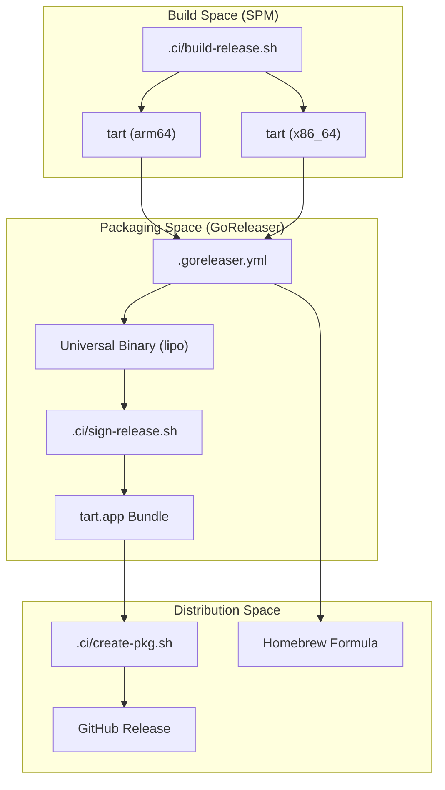
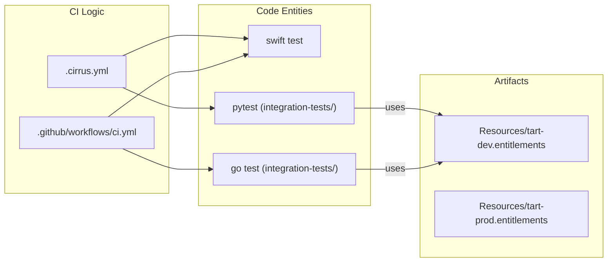

<!-- source: DeepWiki mcp.deepwiki.com · repo openai/tart · page 6 Build, CI/CD, and Release · fetched 2026-10-26 -->

# Build, CI/CD, and Release

Relevant source files

The following files were used as context for generating this wiki page:

- [.ci/build-release.sh](.ci/build-release.sh)
- [.ci/create-pkg.sh](.ci/create-pkg.sh)
- [.ci/set-version.sh](.ci/set-version.sh)
- [.ci/sign-release.sh](.ci/sign-release.sh)
- [.cirrus.yml](.cirrus.yml)
- [.github/workflows/build.yml](.github/workflows/build.yml)
- [.github/workflows/ci.yml](.github/workflows/ci.yml)
- [.github/workflows/release.yml](.github/workflows/release.yml)
- [.goreleaser.yml](.goreleaser.yml)
- [Resources/embedded.provisionprofile](Resources/embedded.provisionprofile)
- [Resources/tart-dev.entitlements](Resources/tart-dev.entitlements)
- [Resources/tart-prod.entitlements](Resources/tart-prod.entitlements)
- [Sources/tart/CI/CI.swift](Sources/tart/CI/CI.swift)

This page provides a high-level overview of the Tart build pipeline, the automated CI/CD infrastructure powered by Cirrus CI and GitHub Actions, and the release process for macOS and Linux. Tart's build system is designed to produce universal binaries and notarized macOS installers.

## Build Pipeline Overview

Tart is primarily a Swift project that leverages the Swift Package Manager (SPM) for compilation. The build process targets Apple Silicon (`arm64`) and Intel (`x86_64`) architectures to support the full range of modern macOS hardware.

### Compilation and Architecture Matrix
The core `tart` executable is built using `swift build` with specific architecture flags. In the CI environment, these are built separately to verify compatibility across both architectures before being merged into a universal binary.

*   **Architecture Matrix:** CI tasks run parallel builds for `arm64` and `x86_64` [.cirrus.yml:53-64]().
*   **Release Configuration:** Production builds use the `--configuration release` flag and target the `tart` product [.ci/build-release.sh:9-14]().
*   **Version Injection:** The version string is injected into `Sources/tart/CI/CI.swift` during the build process via a shell script [.ci/set-version.sh:7-9]().

### Development Workflow
For local development, developers can build and sign the binary locally using ad-hoc signing (`-`) and the `tart-dev.entitlements` file [.cirrus.yml:18-18](). This entitlement configuration allows for `get-task-allow` which is necessary for debugging [Resources/tart-dev.entitlements:7-8]().

Sources: [.cirrus.yml:11-19](), [.ci/build-release.sh:1-24](), [.ci/set-version.sh:1-11](), [Sources/tart/CI/CI.swift:1-11]()

## CI/CD Infrastructure

Tart uses a combination of **Cirrus CI** and **GitHub Actions** to automate testing, linting, and releases.

### Pipeline Stages
| Stage | Description | Code Reference |
| :--- | :--- | :--- |
| **Lint** | Runs `swiftformat` for Swift style and `markdownlint` for docs. | [.cirrus.yml:31-50]() |
| **Test** | Executes Swift unit tests and Python/Go integration tests. | [.cirrus.yml:3-30](), [.github/workflows/ci.yml:15-37]() |
| **Build** | Compiles binaries for both `arm64` and `x86_64`. | [.cirrus.yml:51-65](), [.github/workflows/build.yml:9-37]() |
| **Release** | Handles signing, notarization, and artifact distribution. | [.github/workflows/release.yml:13-84]() |

For a detailed breakdown of the CI task definitions and environment configuration, see **[CI Pipeline (Cirrus CI)](#6.1)**.

Sources: [.cirrus.yml:1-78](), [.github/workflows/ci.yml:1-37](), [.github/workflows/release.yml:1-111]()

## Release and Packaging

The release process transforms the compiled Swift binaries into user-ready distributions, including a Homebrew formula and a macOS `.pkg` installer.

### Packaging Workflow
Tart utilizes **GoReleaser** to orchestrate the final stages of the release. This includes:
1.  **Universal Binary Creation:** Combining the `arm64` and `x86_64` binaries into a single "fat" binary [.goreleaser.yml:24-26]().
2.  **App Bundle Structure:** Constructing the `tart.app` directory and copying resources like `embedded.provisionprofile` and `Info.plist` [.goreleaser.yml:29-32]().
3.  **Code Signing & Notarization:** Production releases are signed with a Developer ID Application certificate and submitted to Apple via `notarytool` [.ci/sign-release.sh:15-24](), [.ci/sign-release.sh:33-37]().
4.  **Installer Creation:** The `create-pkg.sh` script uses `pkgbuild` to create a signed `.pkg` installer for distribution [.ci/create-pkg.sh:12-16]().

### Distribution Channels
*   **Homebrew:** GoReleaser updates the `openai/homebrew-tools` tap with the new version and checksum [.goreleaser.yml:54-63]().
*   **GitHub Releases:** Binaries and the `.pkg` installer are attached to the GitHub release tag.
*   **Documentation:** MkDocs documentation is automatically deployed to GitHub Pages upon merges to `main` [.cirrus.yml:66-78]().

For details on entitlements, provisioning profiles, and the notarization configuration, see **[Release Packaging and Code Signing](#6.2)**.

Sources: [.goreleaser.yml:1-86](), [.ci/create-pkg.sh:1-18](), [.ci/sign-release.sh:1-41]()

## Build and Release Mapping

The following diagrams bridge the conceptual release steps to the specific files and tools used in the Tart repository.

### Release Process Map

Sources: [.goreleaser.yml:5-34](), [.ci/build-release.sh:9-14](), [.ci/create-pkg.sh:8-16]()

### CI Task Entity Relationship

Sources: [.cirrus.yml:11-26](), [.github/workflows/ci.yml:27-37](), [Resources/tart-dev.entitlements:1-10]()

---

