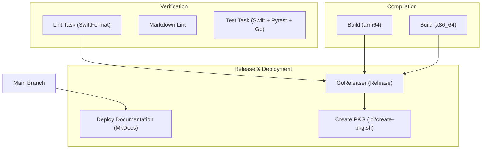
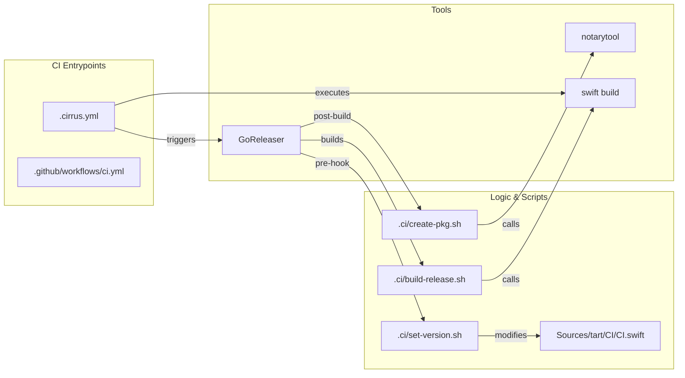

<!-- source: DeepWiki mcp.deepwiki.com · repo openai/tart · page 6.1 CI Pipeline (Cirrus CI) · fetched 2026-10-26 -->

# CI Pipeline (Cirrus CI)

Relevant source files

The following files were used as context for generating this wiki page:

- [.ci/build-release.sh](.ci/build-release.sh)
- [.ci/create-pkg.sh](.ci/create-pkg.sh)
- [.ci/set-version.sh](.ci/set-version.sh)
- [.cirrus.yml](.cirrus.yml)
- [.github/workflows/build.yml](.github/workflows/build.yml)
- [.github/workflows/ci.yml](.github/workflows/ci.yml)
- [.goreleaser.yml](.goreleaser.yml)
- [Sources/tart/CI/CI.swift](Sources/tart/CI/CI.swift)

The Tart project utilizes **Cirrus CI** as its primary automation platform for continuous integration and delivery. The pipeline is designed to handle macOS-specific requirements, such as Apple Silicon virtualization and code signing, using a combination of persistent workers and ephemeral macOS instances.

## Pipeline Overview

The CI pipeline is defined in `.cirrus.yml` [[.cirrus.yml:1-79]](). It encompasses linting, unit and integration testing, cross-platform builds, and a release process that includes notarization and documentation deployment. Additionally, GitHub Actions are used for cached builds and basic unit test verification [[.github/workflows/ci.yml:1-38]]().

### Execution Flow

The following diagram illustrates the data flow and task dependencies within the CI environment:

**Diagram: CI Task Dependencies and Data Flow**

**Sources:** [[.cirrus.yml:3-79]](), [[.goreleaser.yml:5-35]]()

---

## Task Definitions

### 1. Verification (Test & Lint)
Verification ensures code quality and functional correctness across Swift, Python, and Go components.

*   **Test Task**: Executed on a `persistent_worker` labeled `dev-mini` [[.cirrus.yml:6-8]]().
    *   **Swift Tests**: Runs `swift test` with `/usr/sbin` added to `PATH` to ensure `diskutil` availability [[.cirrus.yml:14-16]]().
    *   **Integration Tests**: Uses a self-signed binary with `Resources/tart-dev.entitlements` [[.cirrus.yml:18]](). It executes a Python `pytest` suite and Go-based integration tests [[.cirrus.yml:25-26]]().
*   **Lint Task**: Uses the `swiftformat` package plugin to enforce styling [[.cirrus.yml:40-45]]().
*   **Markdown Lint**: Runs a Node.js container to validate documentation using `markdownlint-cli` [[.cirrus.yml:32-37]]().

**Sources:** [[.cirrus.yml:3-50]](), [[.github/workflows/ci.yml:15-38]]()

### 2. Build Matrix
The build task generates debug binaries for both Apple Silicon and Intel architectures.

*   **Matrix Configuration**: Defines `BUILD_ARCH` as `arm64` and `x86_64` [[.cirrus.yml:54-56]]().
*   **Signing**: Every build is ad-hoc signed using `codesign --sign -` and the development entitlements [[.cirrus.yml:62]]().
*   **Artifacts**: The resulting `tart` binary is exported as a CI artifact [[.cirrus.yml:63-64]]().

**Sources:** [[.cirrus.yml:51-65]]()

### 3. Release & Distribution
The release process is managed via **GoReleaser** and custom shell scripts.

*   **Version Management**: `.ci/set-version.sh` updates `Sources/tart/CI/CI.swift` and `Resources/Info.plist` with the release version [[.ci/set-version.sh:1-12]](). The `CI` struct provides the version string to the application [[Sources/tart/CI/CI.swift:1-11]]().
*   **GoReleaser Workflow**:
    1.  Calls `.ci/build-release.sh` for both `arm64` and `x86_64` [[.goreleaser.yml:8-9]]().
    2.  Creates a universal binary and assembles the `tart.app` structure [[.goreleaser.yml:24-32]]().
    3.  Invokes `.ci/sign-release.sh` for final signing [[.goreleaser.yml:33]]().
*   **Package Creation**: `.ci/create-pkg.sh` uses `pkgbuild` to create a signed `.pkg` installer [[.ci/create-pkg.sh:12-16]]().
*   **Notarization**: The `.pkg` is submitted to Apple's notarization service via `xcrun notarytool` and stapled [[.ci/create-pkg.sh:17-18]]().
*   **Homebrew**: Automatically updates the `openai/homebrew-tools` tap with the new version and DHCP caveats [[.goreleaser.yml:54-70]]().

**Sources:** [[.goreleaser.yml:1-87]](), [[.ci/create-pkg.sh:1-19]](), [[.ci/set-version.sh:1-12]](), [[Sources/tart/CI/CI.swift:1-11]]()

---

## Documentation Deployment

Documentation is managed via **MkDocs** and deployed to GitHub Pages.

*   **Container**: Uses `ghcr.io/squidfunk/mkdocs-material:latest` [[.cirrus.yml:70]]().
*   **Logic**: Triggered only on the `main` branch [[.cirrus.yml:68]]().
*   **Command**: Executes `mkdocs gh-deploy` to push the rendered site to the `gh-pages` branch [[.cirrus.yml:78]]().

**Sources:** [[.cirrus.yml:66-79]]()

---

## Code Entity Mapping

The following diagram maps CI configuration concepts to the specific scripts and tools used in the pipeline.

**Diagram: Pipeline Entity Map**

### Key Integration Points

| Feature | Implementation | File Reference |
| :--- | :--- | :--- |
| **Version Injection** | `perl` regex in `set-version.sh` | [[.ci/set-version.sh:8]]() |
| **Release Build** | `swift build --configuration release` | [[.ci/build-release.sh:9-14]]() |
| **Universal Binary** | `universal_binaries` in GoReleaser | [[.goreleaser.yml:24-35]]() |
| **PKG Identifier** | `com.github.cirruslabs.tart` | [[.ci/create-pkg.sh:12]]() |
| **Homebrew Tap** | `openai/homebrew-tools` | [[.goreleaser.yml:58-59]]() |

**Sources:** [[.cirrus.yml:1-79]](), [[.goreleaser.yml:1-87]](), [[.ci/create-pkg.sh:1-19]](), [[.ci/set-version.sh:1-12]]()

---

