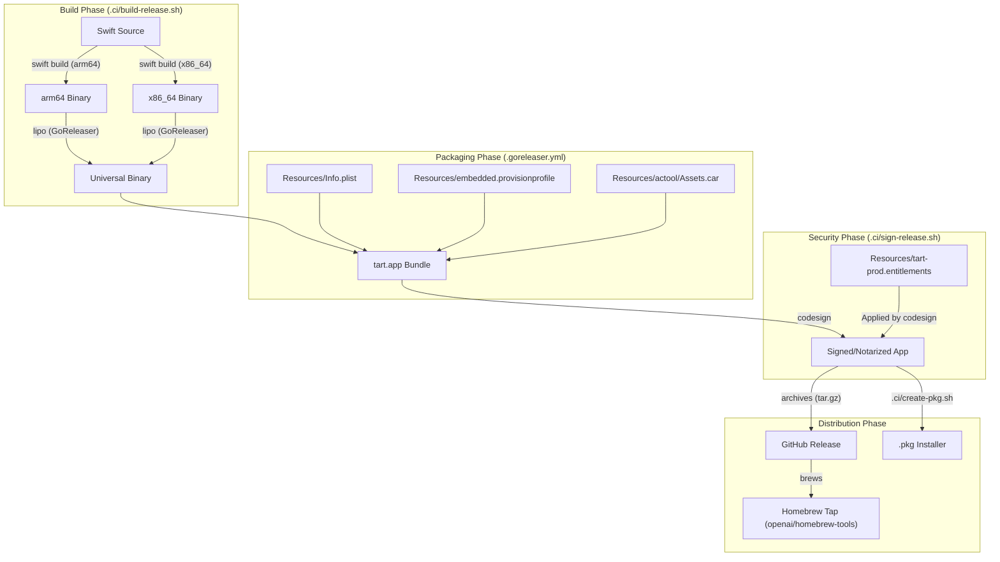
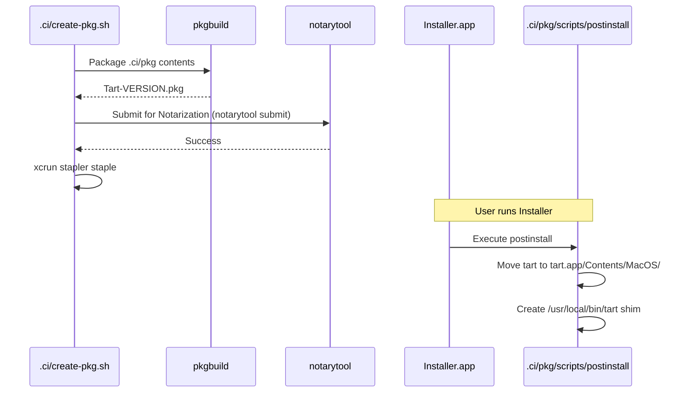

<!-- source: DeepWiki mcp.deepwiki.com · repo openai/tart · page 6.2 Release Packaging and Code Signing · fetched 2026-10-26 -->

# Release Packaging and Code Signing

Relevant source files

The following files were used as context for generating this wiki page:

- [.ci/create-pkg.sh](.ci/create-pkg.sh)
- [.ci/pkg/scripts/postinstall](.ci/pkg/scripts/postinstall)
- [.ci/sign-release.sh](.ci/sign-release.sh)
- [.cirrus.yml](.cirrus.yml)
- [.github/workflows/release.yml](.github/workflows/release.yml)
- [.goreleaser.yml](.goreleaser.yml)
- [Resources/Info.plist](Resources/Info.plist)
- [Resources/embedded.provisionprofile](Resources/embedded.provisionprofile)
- [Resources/tart-dev.entitlements](Resources/tart-dev.entitlements)
- [Resources/tart-prod.entitlements](Resources/tart-prod.entitlements)
- [scripts/run-signed.sh](scripts/run-signed.sh)

This page describes the automated release pipeline for Tart, focusing on the creation of universal macOS binaries, code signing with Apple Developer IDs, notarization for Gatekeeper compliance, and the generation of various distribution formats including Homebrew formulae and macOS installer packages (`.pkg`).

## Release Workflow Overview

Tart utilizes **GoReleaser** as the primary orchestration tool for the release process. The pipeline is triggered by the presence of a Git tag and executes within a GitHub Actions or Cirrus CI environment on macOS runners to access the necessary Apple signing tools.

### Build and Packaging Sequence

1.  **Binary Compilation**: Swift binaries are built for both `arm64` and `x86_64` architectures using `.ci/build-release.sh` [ .goreleaser.yml:8-9 ]().
2.  **Universal Binary Creation**: GoReleaser merges these into a single universal binary using `lipo` [ .goreleaser.yml:24-26 ]().
3.  **App Bundle Assembly**: The binary is placed into a minimal `.app` structure (`tart.app/Contents/MacOS/tart`) along with required metadata [ .goreleaser.yml:20-22 ]().
4.  **Resource Injection**: Essential files like the `Info.plist`, `embedded.provisionprofile`, and the icon catalog (`Assets.car`) are copied into the bundle [ .goreleaser.yml:29-32 ]().
5.  **Signing & Notarization**: The `.ci/sign-release.sh` script signs the bundle and submits it to Apple's Notarization Service [ .goreleaser.yml:33-34 ]().

### Data Flow: From Source to Signed Artifact

The following diagram illustrates the transformation of source code and resources into a notarized distribution.

**Release Artifact Data Flow**

Sources: [ .goreleaser.yml:1-50 ](), [ .ci/create-pkg.sh:1-16 ](), [ .ci/sign-release.sh:1-24 ]()

---

## Code Signing and Notarization

Tart requires specific Apple entitlements to utilize the `Virtualization.framework`. These are managed through two distinct entitlement files depending on the build context.

### Entitlements: Dev vs. Prod
*   **Development**: `Resources/tart-dev.entitlements` is used during CI testing and local development builds [ .cirrus.yml:18 ](), [ .cirrus.yml:62 ](). It includes `com.apple.security.get-task-allow` for debugging [ Resources/tart-dev.entitlements:7-8 ]().
*   **Production**: `Resources/tart-prod.entitlements` is used for official releases [ .ci/sign-release.sh:22 ](). It includes `com.apple.vm.networking` for bridged/shared networking [ Resources/tart-prod.entitlements:7-8 ]().

### Notarization Workflow
The project uses `xcrun notarytool` to handle notarization. The process is automated in `.ci/sign-release.sh`:
*   **Identity**: "Developer ID Application: Cirrus Labs, Inc. (9M2P8L4D89)" [ .ci/sign-release.sh:18 ]().
*   **Credentials**: A keychain profile named "notarytool" must be pre-configured on the runner [ .ci/sign-release.sh:34 ]().
*   **Bundle ID**: `com.github.cirruslabs.tart` [ Resources/Info.plist:10 ]().

### Provisioning Profile Requirement
Because Tart uses the `com.apple.vm.networking` entitlement, Apple requires the binary to be bundled with an `embedded.provisionprofile` [ .goreleaser.yml:30 ](). This profile, which contains the `com.apple.vm.networking` key [ Resources/embedded.provisionprofile:33-34 ](), must be present in the `Contents` directory of the app bundle for the OS to permit the use of virtualization APIs.

Sources: [ .ci/sign-release.sh:29-41 ](), [ Resources/tart-dev.entitlements:1-10 ](), [ Resources/tart-prod.entitlements:1-10 ](), [ Resources/embedded.provisionprofile:1-50 ]()

---

## Installer Package (.pkg)

In addition to the raw `.app` bundle, Tart is distributed as a macOS `.pkg` installer for easier system-wide installation. This is generated by the `.ci/create-pkg.sh` script.

### Implementation Details
The script uses `pkgbuild` to create a component package:
*   **Install Location**: Files are initially placed in `/Library/Application Support/Tart` [ .ci/create-pkg.sh:14 ]().
*   **Signing**: The package itself is signed with a "Developer ID Installer" certificate [ .ci/create-pkg.sh:15 ]().
*   **Notarization**: The script explicitly calls `notarytool` and `stapler` to ensure the package can be installed without Gatekeeper warnings [ .ci/create-pkg.sh:17-18 ]().

### Post-Install Logic
The `postinstall` script [ .ci/pkg/scripts/postinstall:1-16 ]() performs the final system integration:
1.  **Structure Correction**: Moves the raw binary and resources into a proper `tart.app` structure within the installation directory [ .ci/pkg/scripts/postinstall:6-10 ]().
2.  **CLI Shim**: Creates a shell script at `/usr/local/bin/tart` that executes the binary inside the app bundle [ .ci/pkg/scripts/postinstall:12-15 ]().

**Installer Packaging Logic**

Sources: [ .ci/create-pkg.sh:1-19 ](), [ .ci/pkg/scripts/postinstall:1-16 ]()

---

## Homebrew Distribution

GoReleaser is configured to automatically update the `openai/homebrew-tools` tap upon a successful release [ .goreleaser.yml:54-61 ]().

### Formula Configuration
The Homebrew formula includes specific logic for Tart's unique requirements:
*   **Universal Support**: It installs the entire app bundle into `libexec` [ .goreleaser.yml:78 ]().
*   **Binary Shim**: It uses `bin.write_exec_script` to point to the binary within the app bundle [ .goreleaser.yml:79 ]().
*   **Completions**: Shell completions are generated by calling the binary with `--generate-completion-script` during the `post_install` phase [ .goreleaser.yml:84-86 ]().
*   **Dependencies**: It lists `openai/tools/softnet` as a dependency for user-mode networking [ .goreleaser.yml:75-76 ]().

### System Optimization
The formula provides a caveat advising users to reduce the macOS DHCP lease time [ .goreleaser.yml:64-70 ](). This prevents IP address exhaustion when frequently creating and destroying VMs, which is common in CI environments.

Sources: [ .goreleaser.yml:54-87 ]()

---

