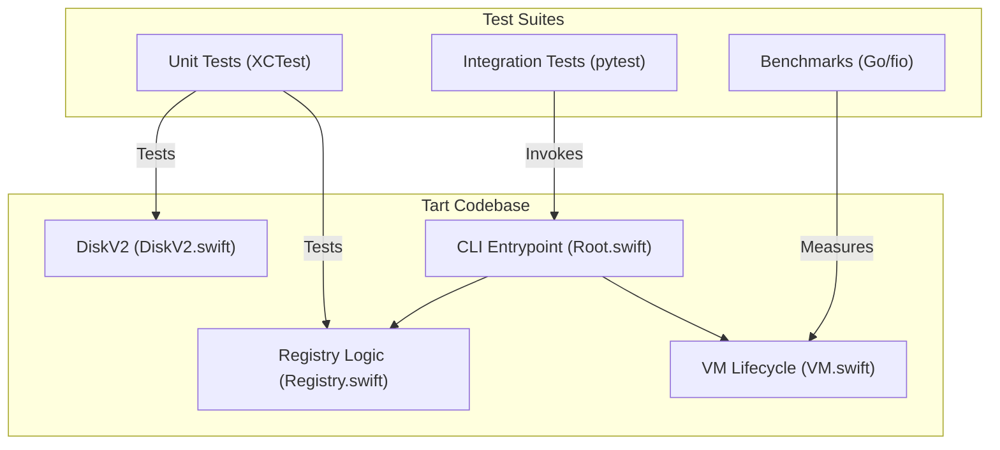
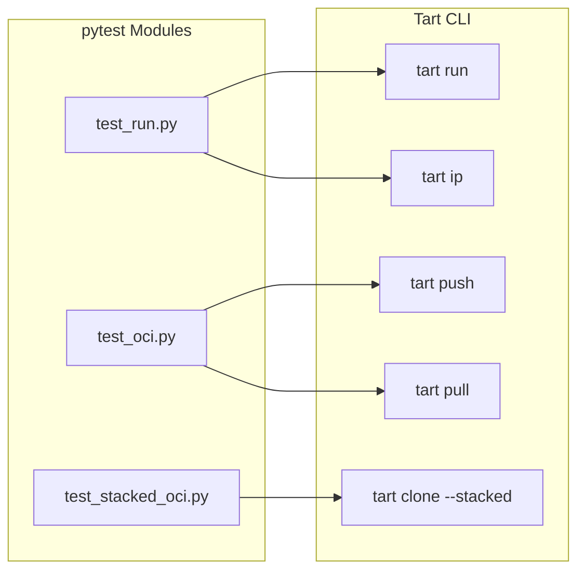

<!-- source: DeepWiki mcp.deepwiki.com · repo openai/tart · page 7 Testing · fetched 2026-10-26 -->

# Testing

Relevant source files

The following files were used as context for generating this wiki page:

- [Sources/tart/OCI/Digest.swift](Sources/tart/OCI/Digest.swift)
- [Sources/tart/OCI/Layerizer/Disk.swift](Sources/tart/OCI/Layerizer/Disk.swift)
- [Sources/tart/OCI/Layerizer/DiskV2.swift](Sources/tart/OCI/Layerizer/DiskV2.swift)
- [Tests/TartTests/LayerizerTests.swift](Tests/TartTests/LayerizerTests.swift)
- [Tests/TartTests/RegistryTests.swift](Tests/TartTests/RegistryTests.swift)
- [benchmark/README.md](benchmark/README.md)
- [benchmark/internal/command/root.go](benchmark/internal/command/root.go)
- [benchmark/internal/command/stackedoci/stackedoci.go](benchmark/internal/command/stackedoci/stackedoci.go)
- [integration-tests/conftest.py](integration-tests/conftest.py)
- [integration-tests/docker_registry.py](integration-tests/docker_registry.py)
- [integration-tests/requirements.txt](integration-tests/requirements.txt)
- [integration-tests/tart.py](integration-tests/tart.py)
- [integration-tests/test_clone.py](integration-tests/test_clone.py)
- [integration-tests/test_create.py](integration-tests/test_create.py)
- [integration-tests/test_delete.py](integration-tests/test_delete.py)
- [integration-tests/test_oci.py](integration-tests/test_oci.py)
- [integration-tests/test_rename.py](integration-tests/test_rename.py)
- [integration-tests/test_run.py](integration-tests/test_run.py)
- [integration-tests/test_stacked_oci.py](integration-tests/test_stacked_oci.py)

Tart employs a multi-layered testing strategy to ensure the reliability of its virtualization engine and OCI distribution logic. This includes Swift-based unit tests for core logic, Python-based integration tests for CLI workflows, and Go-based benchmarks for performance validation.

## Testing Strategy Overview

The testing architecture is designed to validate components from low-level data structures to high-level CLI interactions. The suite ensures that features like **DiskV2** layerization [Sources/tart/OCI/Layerizer/DiskV2.swift:6-92]() and OCI registry communication [Sources/tart/OCI/Layerizer/Disk.swift:3-6]() function correctly across different macOS versions.

### Component Relationship Diagram

This diagram illustrates how different testing layers interact with the `tart` binary and its internal components.

"Testing Architecture Overview"

Sources: [Tests/TartTests/RegistryTests.swift:4-5]() | [integration-tests/test_run.py:8-15]() | [Sources/tart/OCI/Layerizer/DiskV2.swift:6-25]()

## Unit Tests

Unit tests are implemented using the `XCTest` framework and focus on the internal logic of Swift components. They cover critical areas such as OCI registry communication, disk chunking (Layerization), and configuration parsing.

Key test classes include:
*   `LayerizerTests`: Validates the `DiskV2` implementation by pushing random data to a local registry and verifying the hash after pulling it back [Tests/TartTests/LayerizerTests.swift:27-53](). It uses `Digest.hash` to ensure data integrity [Tests/TartTests/LayerizerTests.swift:52-52]().
*   `RegistryTests`: Exercises the `Registry` class, testing small and large blob uploads (chunked), as well as OCI manifest pushing and pulling [Tests/TartTests/RegistryTests.swift:27-88]().
*   `MACAddressResolverTests`: Validates the logic for resolving hardware addresses.
*   `RemoteNameTests`: Tests the ANTLR4-based parsing of OCI image references.

For details, see [Unit Tests](#7.1).

Sources: [Tests/TartTests/LayerizerTests.swift:4-76]() | [Tests/TartTests/RegistryTests.swift:4-89]() | [Sources/tart/OCI/Digest.swift:9-31]()

## Integration Tests

Integration tests are written in Python using `pytest`. These tests treat `tart` as a black box, invoking the binary via a helper class and asserting on stdout, stderr, and exit codes.

### CLI Integration Mapping

The following diagram maps Python test modules to the CLI commands they exercise, specifically highlighting the use of `SSHClient` for guest interaction.

"Integration Test Mapping"

Sources: [integration-tests/test_run.py:7-32]() | [integration-tests/test_oci.py:13-31]() | [integration-tests/test_stacked_oci.py:48-88]()

Key features of the integration suite:
*   **Tart Helper**: A `Tart` class in `tart.py` manages a temporary `TART_HOME` for each test run to ensure isolation.
*   **OCI Testing**: Uses a `DockerRegistry` fixture to test `push` and `pull` speeds and reliability [integration-tests/test_oci.py:15-30]().
*   **Stacked Images**: `test_stacked_oci.py` validates the round-trip of ASIF-based stacked images, ensuring guest writes in `overlay.asif` persist after a push/pull cycle [integration-tests/test_stacked_oci.py:70-88]().
*   **End-to-End Workflows**: `test_run.py` clones a real macOS image, boots it, retrieves the IP, and connects via `SSHClient` to perform a clean shutdown [integration-tests/test_run.py:12-28]().

For details, see [Integration Tests](#7.2).

Sources: [integration-tests/test_run.py:1-32]() | [integration-tests/test_stacked_oci.py:48-94]() | [integration-tests/requirements.txt:1-6]()

## Benchmarks

Benchmarks are located in the `benchmark/` directory and are primarily written in Go using the `cobra` framework [benchmark/internal/command/root.go:10-24](). They focus on measuring the performance overhead of the virtualization layer and OCI operations.

*   **I/O Performance**: Uses `fio` (Flexible I/O tester) to measure disk throughput and latency within the VM compared to the host [benchmark/README.md:3-5]().
*   **Stacked OCI Benchmarks**: The `stacked-oci` command compares "empty" vs "prewarmed" `TART_HOME` scenarios to measure the efficiency of local base layer reuse [benchmark/internal/command/stackedoci/stackedoci.go:25-33]().
*   **Real-world Workloads**: Includes Xcode build benchmarks to compare performance across different hardware (e.g., Apple M1 Pro vs M2 Pro) [benchmark/README.md:53-75]().
*   **Disk Options**: Benchmarks validate the impact of different root disk options such as `sync=none` and `caching=cached` [benchmark/README.md:93-95]().

For details, see [Benchmarks](#7.3).

Sources: [benchmark/README.md:1-109]() | [benchmark/internal/command/root.go:1-24]() | [benchmark/internal/command/stackedoci/stackedoci.go:1-126]()

---

