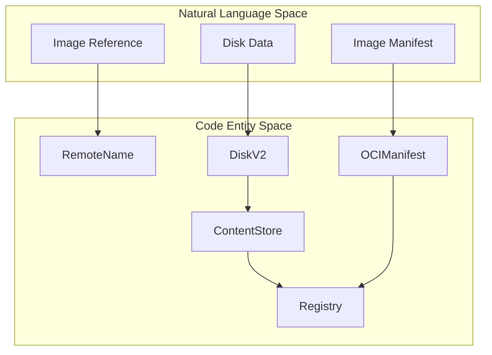
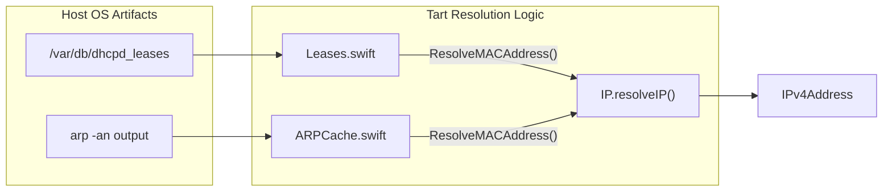

<!-- source: DeepWiki mcp.deepwiki.com · repo openai/tart · page 7.1 Unit Tests · fetched 2026-10-26 -->

# Unit Tests

Relevant source files

The following files were used as context for generating this wiki page:

- [Sources/tart/Commands/IP.swift](Sources/tart/Commands/IP.swift)
- [Sources/tart/Commands/Set.swift](Sources/tart/Commands/Set.swift)
- [Sources/tart/ContentStore.swift](Sources/tart/ContentStore.swift)
- [Sources/tart/DiskImageFormat.swift](Sources/tart/DiskImageFormat.swift)
- [Sources/tart/Diskutil.swift](Sources/tart/Diskutil.swift)
- [Sources/tart/FileLock.swift](Sources/tart/FileLock.swift)
- [Sources/tart/IPSWCache.swift](Sources/tart/IPSWCache.swift)
- [Sources/tart/MACAddressResolver/ARPCache.swift](Sources/tart/MACAddressResolver/ARPCache.swift)
- [Sources/tart/MACAddressResolver/Lease.swift](Sources/tart/MACAddressResolver/Lease.swift)
- [Sources/tart/MACAddressResolver/Leases.swift](Sources/tart/MACAddressResolver/Leases.swift)
- [Sources/tart/MACAddressResolver/MACAddress.swift](Sources/tart/MACAddressResolver/MACAddress.swift)
- [Sources/tart/OCI/Digest.swift](Sources/tart/OCI/Digest.swift)
- [Sources/tart/OCI/Layerizer/Disk.swift](Sources/tart/OCI/Layerizer/Disk.swift)
- [Sources/tart/OCI/Layerizer/DiskV2.swift](Sources/tart/OCI/Layerizer/DiskV2.swift)
- [Sources/tart/VMConfig.swift](Sources/tart/VMConfig.swift)
- [Sources/tart/VMDirectory+DiskImageStack.swift](Sources/tart/VMDirectory+DiskImageStack.swift)
- [Tests/TartTests/CommandBehaviorTests.swift](Tests/TartTests/CommandBehaviorTests.swift)
- [Tests/TartTests/ContentStoreTests.swift](Tests/TartTests/ContentStoreTests.swift)
- [Tests/TartTests/DigestTests.swift](Tests/TartTests/DigestTests.swift)
- [Tests/TartTests/DirecotryShareTests.swift](Tests/TartTests/DirecotryShareTests.swift)
- [Tests/TartTests/DiskImageFormatTests.swift](Tests/TartTests/DiskImageFormatTests.swift)
- [Tests/TartTests/DiskutilTests.swift](Tests/TartTests/DiskutilTests.swift)
- [Tests/TartTests/DockerConfigTests.swift](Tests/TartTests/DockerConfigTests.swift)
- [Tests/TartTests/FileLockTests.swift](Tests/TartTests/FileLockTests.swift)
- [Tests/TartTests/LayerizerTests.swift](Tests/TartTests/LayerizerTests.swift)
- [Tests/TartTests/LeaseTest.swift](Tests/TartTests/LeaseTest.swift)
- [Tests/TartTests/LeasesTests.swift](Tests/TartTests/LeasesTests.swift)
- [Tests/TartTests/MACAddressResolverTests.swift](Tests/TartTests/MACAddressResolverTests.swift)
- [Tests/TartTests/OCIManifestTests.swift](Tests/TartTests/OCIManifestTests.swift)
- [Tests/TartTests/RegistryTests.swift](Tests/TartTests/RegistryTests.swift)
- [Tests/TartTests/VMConfigTests.swift](Tests/TartTests/VMConfigTests.swift)
- [Tests/TartTests/VMStorageOCITests.swift](Tests/TartTests/VMStorageOCITests.swift)
- [docs/assets/images/faq/tart-run-recovery-options.png](docs/assets/images/faq/tart-run-recovery-options.png)
- [docs/assets/images/faq/tart-run-recovery-terminal.png](docs/assets/images/faq/tart-run-recovery-terminal.png)

The Tart Swift unit test suite provides validation for core logic, including configuration serialization, OCI registry communication, disk image handling, and guest IP resolution. These tests are executed via `swift test` and are integrated into the CI pipeline [Sources/tart/Commands/Set.swift:8-9]().

## Core Configuration and Metadata Tests

These tests ensure that the VM configuration state is correctly managed, serialized, and validated against platform-specific constraints.

### VMConfigTests
Validates the `VMConfig` struct, ensuring that JSON serialization and deserialization maintain data integrity. It checks that mandatory fields like `macAddress`, `cpuCount`, and `memorySize` are correctly handled [Sources/tart/VMConfig.swift:56-69](). It also verifies resource constraints, such as the minimum CPU and memory requirements enforced by `setCPU` and `setMemory` [Sources/tart/VMConfig.swift:164-190]().

### DirectoryShareTests
Tests the parsing logic for Virtio-FS directory sharing strings. It validates various formats, including named shares, read-only flags, and custom mount tags.

**Key Parsing Patterns Tested:**
| Input Format | Resulting `DirectoryShare` properties |
| :--- | :--- |
| `build:/src` | `name: "build"`, `path: "/src"`, `readOnly: false` |
| `/src:ro` | `name: nil`, `path: "/src"`, `readOnly: true` |
| `/src:tag=foo` | `mountTag: "foo"` |

Sources: [Sources/tart/VMConfig.swift:56-143](), [Sources/tart/Commands/Set.swift:52-82](), [Sources/tart/VMConfig.swift:164-190]()

## OCI Registry and Layerization Tests

These tests verify the implementation of the OCI Distribution Spec and the custom disk chunking logic used for efficient VM image distribution.

### RegistryTests
Uses a `RegistryRunner` to spin up a local registry instance for end-to-end testing of the `Registry` client [Tests/TartTests/RegistryTests.swift:5-25]().
*   **Small/Huge Blobs:** Tests `pushBlob` and `pullBlob` with varying data sizes and chunked uploads (e.g., 768 MiB blobs with 10 MiB chunks) [Tests/TartTests/RegistryTests.swift:27-61]().
*   **Manifests:** Validates pushing and pulling `OCIManifest` objects by both tag and digest [Tests/TartTests/RegistryTests.swift:63-88]().

### LayerizerTests (DiskV2)
Tests the `DiskV2` implementation which splits large disk images into 512 MiB OCI-compatible layers [Sources/tart/OCI/Layerizer/DiskV2.swift:8-8]().
*   **Data Integrity:** Generates random data using `/dev/urandom`, pushes it as layers to a registry, pulls it back, and verifies the SHA256 digest matches the original [Tests/TartTests/LayerizerTests.swift:27-53]().
*   **Concurrency:** Validates that multi-threaded pushing (4 concurrent tasks) and pulling (16 concurrent tasks) does not corrupt the final disk image [Tests/TartTests/LayerizerTests.swift:39-49]().

### OCIManifestTests
Validates the `tartDiskRepresentation()` logic, ensuring the manifest correctly identifies `.flat` vs `.stacked` disk layouts [Tests/TartTests/OCIManifestTests.swift:5-22](). It enforces strict validation rules, such as requiring whole-file content digests for stacked base disks [Tests/TartTests/OCIManifestTests.swift:51-59]().

### ContentStoreTests
Tests the `ContentStore` which manages immutable, digest-addressed files in `~/.tart/cache/content` [Sources/tart/ContentStore.swift:13-23]().
*   **Integrity:** Ensures corrupt cache entries are treated as misses [Tests/TartTests/ContentStoreTests.swift:26-35]().
*   **Concurrency:** Validates `install()` under concurrent load using `DispatchQueue.concurrentPerform` to ensure atomic file moves and lock stability [Tests/TartTests/ContentStoreTests.swift:144-172]().

**OCI Entity Mapping**

Sources: [Tests/TartTests/RegistryTests.swift:27-88](), [Tests/TartTests/LayerizerTests.swift:27-53](), [Sources/tart/OCI/Layerizer/DiskV2.swift:25-92](), [Tests/TartTests/ContentStoreTests.swift:5-84](), [Tests/TartTests/OCIManifestTests.swift:5-59]()

## Network and IP Resolution Tests

These tests ensure Tart can accurately resolve guest IP addresses by inspecting host-side network artifacts.

### MACAddressResolverTests & LeasesTests
Validates the parsing of `/var/db/dhcpd_leases`. The `Leases` class parses the Apple-proprietary DHCP lease format to map a `VZMACAddress` to an `IPv4Address` [Sources/tart/MACAddressResolver/Leases.swift:19-52]().
*   **Format Handling:** Tests the state machine that processes the brace-delimited (`{ ... }`) lease blocks [Sources/tart/MACAddressResolver/Leases.swift:57-113]().
*   **Resolution:** Ensures that if multiple leases exist for the same MAC, the newest (non-expired) one is preferred [Sources/tart/MACAddressResolver/Leases.swift:48-51]().

### ARPCache Tests
Validates the parsing of `arp -an` output. The `ARPCache` executes the system utility and uses `NSRegularExpression` to extract IP/MAC pairs [Sources/tart/MACAddressResolver/ARPCache.swift:41-105]().

**IP Resolution Data Flow**

Sources: [Sources/tart/MACAddressResolver/Leases.swift:57-113](), [Sources/tart/MACAddressResolver/ARPCache.swift:71-105](), [Sources/tart/Commands/IP.swift:53-89]()

## Utility and Filesystem Tests

### DiskImageFormatTests & DiskutilTests
Validates support for different disk formats (`.raw` vs. `.asif`). `DiskutilTests` verify interactions with system utilities for resizing and inspecting disk images [Sources/tart/VMConfig.swift:68-69]().

### FileLockTests
Tests the `FileLock` implementation, ensuring that inter-process locking on the filesystem (using `flock`) behaves as expected. This is critical for the `ContentStore` and `VMStorageOCI` to prevent race conditions during image population [Sources/tart/ContentStore.swift:37-43]().

### VMStorageOCITests
Verifies how OCI-backed VMs are stored and managed.
*   **Standalone vs Stacked:** Tests that `populate()` correctly caches disks and manifests [Tests/TartTests/VMStorageOCITests.swift:10-24]().
*   **Reuse Logic:** Validates `reuseStandaloneDiskForStackedBaseIfPossible()`, which optimizes storage by moving existing standalone disks into the `ContentStore` for use as stacked bases [Tests/TartTests/VMStorageOCITests.swift:128-149]().

Sources: [Sources/tart/ContentStore.swift:149-176](), [Tests/TartTests/VMStorageOCITests.swift:10-154](), [Sources/tart/Commands/Set.swift:84-95]()

---

