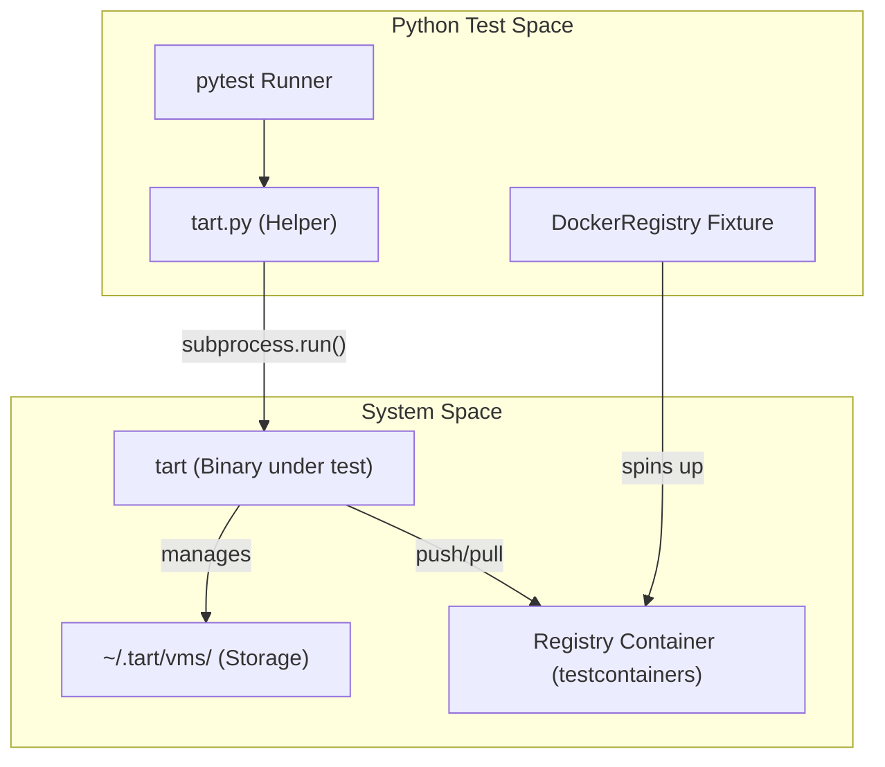
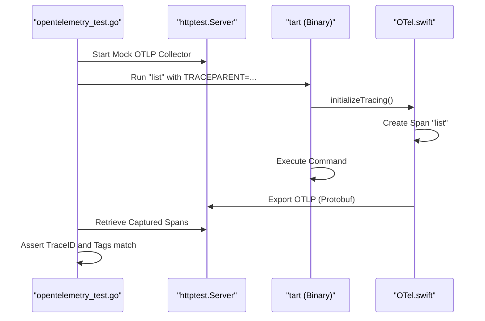
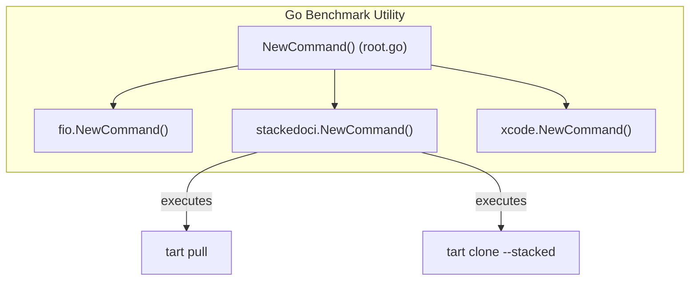

<!-- source: DeepWiki mcp.deepwiki.com · repo openai/tart · page 7.2 Integration Tests · fetched 2026-10-26 -->

# Integration Tests

Relevant source files

The following files were used as context for generating this wiki page:

- [.editorconfig](.editorconfig)
- [Sources/tart/OTel.swift](Sources/tart/OTel.swift)
- [benchmark/README.md](benchmark/README.md)
- [benchmark/internal/command/root.go](benchmark/internal/command/root.go)
- [benchmark/internal/command/stackedoci/stackedoci.go](benchmark/internal/command/stackedoci/stackedoci.go)
- [integration-tests/conftest.py](integration-tests/conftest.py)
- [integration-tests/docker_registry.py](integration-tests/docker_registry.py)
- [integration-tests/go.mod](integration-tests/go.mod)
- [integration-tests/go.sum](integration-tests/go.sum)
- [integration-tests/opentelemetry_test.go](integration-tests/opentelemetry_test.go)
- [integration-tests/requirements.txt](integration-tests/requirements.txt)
- [integration-tests/tart.py](integration-tests/tart.py)
- [integration-tests/tart/tart.go](integration-tests/tart/tart.go)
- [integration-tests/test_clone.py](integration-tests/test_clone.py)
- [integration-tests/test_create.py](integration-tests/test_create.py)
- [integration-tests/test_delete.py](integration-tests/test_delete.py)
- [integration-tests/test_oci.py](integration-tests/test_oci.py)
- [integration-tests/test_rename.py](integration-tests/test_rename.py)
- [integration-tests/test_run.py](integration-tests/test_run.py)
- [integration-tests/test_stacked_oci.py](integration-tests/test_stacked_oci.py)

Tart's integration testing suite ensures the end-to-end correctness of the CLI, VM lifecycle management, OCI registry interactions, and telemetry propagation. The suite is primarily written in Python using the `pytest` framework, supplemented by Go-based tests for specialized observability verification and performance benchmarking.

## Overview and CI Execution

Integration tests are executed as part of the `Test` task in the Cirrus CI pipeline `[.cirrus.yml:3-30]()`. Before running tests, the `tart` binary is built and signed with development entitlements `[.cirrus.yml:18-19]()`.

The environment setup involves:
1. Creating a Python virtual environment `[.cirrus.yml:22-23]()`.
2. Installing dependencies from `integration-tests/requirements.txt`, which includes `pytest`, `testcontainers`, `paramiko` (for SSH), and `bitmath` `[integration-tests/requirements.txt:1-6]()`.
3. Running `pytest` for functional and performance tests.
4. Running `go test` for OpenTelemetry integration tests `[.cirrus.yml:26-26]()`.

Sources: `[.cirrus.yml:3-30]()`, `[integration-tests/requirements.txt:1-6]()`

## Python Integration Suite

The Python suite leverages a `tart.py` helper (acting as a wrapper around the `tart` binary) and several `pytest` fixtures to manage state.

### Test Architecture

The following diagram illustrates the relationship between the test runner, the `tart` binary under test, and external dependencies like OCI registries.

**Tart Integration Test Data Flow**

Sources: `[integration-tests/test_run.py:8-32]()`, `[integration-tests/test_oci.py:13-31]()`

### Key Test Modules

| File | Purpose | Key Functionality |
| :--- | :--- | :--- |
| `test_run.py` | VM Execution | Clones a macOS base, starts it, waits for IP, and shuts down via SSH `[integration-tests/test_run.py:8-32]()`. |
| `test_oci.py` | Registry Ops | Benchmarks `push` and `pull` speeds using a local registry fixture `[integration-tests/test_oci.py:13-31]()`. |
| `test_stacked_oci.py` | Stacked Images | Verifies round-trip `push`/`pull` and boot for ASIF-based stacked VMs `[integration-tests/test_stacked_oci.py:48-94]()`. |
| `test_create.py` | Creation | Verifies `tart create` for different OS types. |
| `test_clone.py` | Cloning | Tests APFS copy-on-write cloning efficiency. |
| `test_delete.py` | Deletion | Ensures VM directories are purged correctly. |
| `test_rename.py` | Renaming | Validates directory and config updates during rename. |

### OCI and Stacked Disk Testing
The `TestOCI` class ensures image transfers meet a minimum performance threshold (100 Mb/s) `[integration-tests/test_oci.py:9-10]()`. It uses a `vm_with_random_disk` fixture to bypass LZ4 compression benefits during benchmarks `[integration-tests/test_oci.py:38-53]()`. 

For stacked images, `test_stacked_oci.py` validates the `overlay.asif` and `manifest.json` structure `[integration-tests/test_stacked_oci.py:70-73]()`, ensuring that a restored stacked VM can still boot and retain data written to the overlay `[integration-tests/test_stacked_oci.py:88-88]()`.

Sources: `[integration-tests/test_oci.py:9-53]()`, `[integration-tests/test_stacked_oci.py:48-94]()`

## OpenTelemetry Integration Tests

Specialized Go-based tests verify that `tart` correctly propagates telemetry data. This is necessary because the `OTel.swift` implementation relies on environment variables like `TRACEPARENT` and `OTEL_EXPORTER_OTLP_TRACES_ENDPOINT` `[Sources/tart/OTel.swift:19-36]()`.

### Implementation
The `TestOpenTelemetry` function in `integration-tests/opentelemetry_test.go` performs the following:
1. **Mock Collector**: Starts an `httptest.NewServer` that accepts OTLP protobuf payloads `[integration-tests/opentelemetry_test.go:21-56]()`.
2. **Environment Setup**: Configures `TRACEPARENT` and `CIRRUS_SENTRY_TAGS` `[integration-tests/opentelemetry_test.go:62-64]()`.
3. **Execution**: Runs `tart list` via a Go wrapper `[integration-tests/opentelemetry_test.go:66-66]()`.
4. **Validation**: Decodes the received protobuf and asserts that:
    - The Service Name is "tart" `[integration-tests/opentelemetry_test.go:78-78]()`.
    - The Span Name matches the command ("list") `[integration-tests/opentelemetry_test.go:89-89]()`.
    - Sentry tags and Trace IDs are correctly propagated `[integration-tests/opentelemetry_test.go:93-98]()`.

**OTel Verification Flow**

Sources: `[integration-tests/opentelemetry_test.go:20-99]()`, `[Sources/tart/OTel.swift:7-46]()`

## Benchmarking Utility

Tart includes a Go-based benchmarking utility in the `benchmark/` directory to compare host ("local") and guest ("Tart") performance `[benchmark/README.md:1-3]()`.

### FIO and Stacked OCI Benchmarks
- **FIO**: Measures I/O bandwidth and IOPS using Flexible I/O tester workloads `[benchmark/README.md:16-17]()`.
- **Stacked OCI**: Specifically measures the time saved by reusing local base layers during `pull` and `clone` operations `[benchmark/internal/command/stackedoci/stackedoci.go:26-33]()`. It compares an "empty" `TART_HOME` against a "prewarmed" one where the base image is already present `[benchmark/internal/command/stackedoci/stackedoci.go:91-123]()`.

**Benchmark Command Structure**

Sources: `[benchmark/internal/command/root.go:10-24]()`, `[benchmark/internal/command/stackedoci/stackedoci.go:25-44]()`, `[benchmark/README.md:40-49]()`

---

