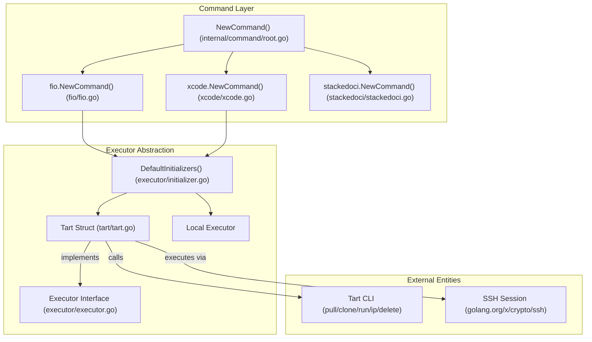
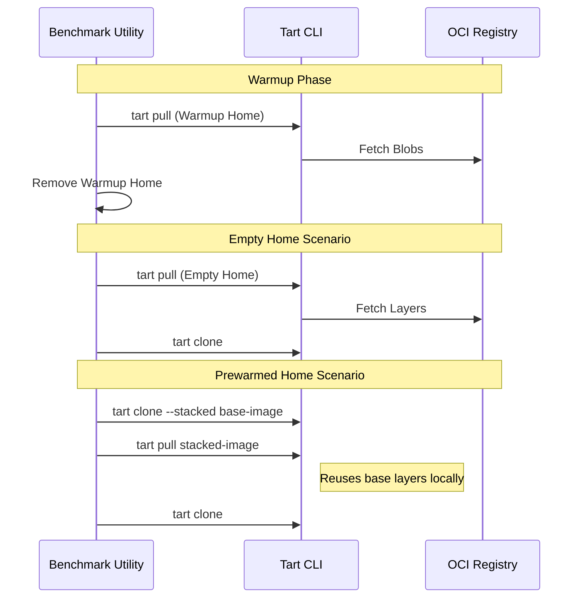

<!-- source: DeepWiki mcp.deepwiki.com · repo openai/tart · page 7.3 Benchmarks · fetched 2026-10-26 -->

# Benchmarks

<details>
<summary>Relevant source files</summary>

The following files were used as context for generating this wiki page:

- [PROFILING.md](PROFILING.md)
- [benchmark/README.md](benchmark/README.md)
- [benchmark/go.mod](benchmark/go.mod)
- [benchmark/go.sum](benchmark/go.sum)
- [benchmark/internal/command/fio/benchmark.go](benchmark/internal/command/fio/benchmark.go)
- [benchmark/internal/command/fio/fio.go](benchmark/internal/command/fio/fio.go)
- [benchmark/internal/command/fio/json.go](benchmark/internal/command/fio/json.go)
- [benchmark/internal/command/root.go](benchmark/internal/command/root.go)
- [benchmark/internal/command/stackedoci/stackedoci.go](benchmark/internal/command/stackedoci/stackedoci.go)
- [benchmark/internal/command/xcode/benchmarks.go](benchmark/internal/command/xcode/benchmarks.go)
- [benchmark/internal/command/xcode/output.go](benchmark/internal/command/xcode/output.go)
- [benchmark/internal/command/xcode/output_test.go](benchmark/internal/command/xcode/output_test.go)
- [benchmark/internal/command/xcode/xcode.go](benchmark/internal/command/xcode/xcode.go)
- [benchmark/internal/executor/executor.go](benchmark/internal/executor/executor.go)
- [benchmark/internal/executor/initializer.go](benchmark/internal/executor/initializer.go)
- [benchmark/internal/executor/tart/tart.go](benchmark/internal/executor/tart/tart.go)
- [benchmark/internal/executor/tart/tart_test.go](benchmark/internal/executor/tart/tart_test.go)
- [integration-tests/test_stacked_oci.py](integration-tests/test_stacked_oci.py)

</details>


Tart includes a dedicated Go-based benchmarking utility located in the `benchmark/` directory [benchmark/README.md:1-3](). This utility allows for performance comparisons between the host (local) and guest (Tart VM) environments across different I/O, build, and OCI distribution workloads.

## Architecture and Implementation

The benchmark utility is built using the [Cobra](https://github.com/spf13/cobra) CLI framework [benchmark/internal/command/root.go:6-14](). It abstracts execution environments through an `Executor` interface, allowing the same benchmark logic to run natively on the host or inside a Tart VM.

### Executor Abstraction

The `Executor` interface defines the contract for running commands and cleaning up resources [benchmark/internal/executor/executor.go:7-10]().

*   **Local Executor**: Runs commands directly on the host using standard OS process execution.
*   **Tart Executor**: Manages a full VM lifecycle. It pulls a specified image, clones it to a temporary name, configures CPU/Memory based on host availability, and executes commands via SSH [benchmark/internal/executor/tart/tart.go:29-58]().

### Tart Executor Workflow

The `Tart` struct manages the VM lifecycle and an `ssh.Client` for command execution [benchmark/internal/executor/tart/tart.go:22-27]().

1.  **Initialization**: `tart.New()` pulls the image, clones it, and uses `tart set` to match host resources (CPU count and total RAM) [benchmark/internal/executor/tart/tart.go:29-58]().
2.  **Execution**: The VM is started with `--no-graphics` [benchmark/internal/executor/tart/tart.go:64](). The executor waits for an IP address using `tart ip --wait 60` [benchmark/internal/executor/tart/tart.go:71]().
3.  **Connectivity**: It retries SSH connections to the VM (default user `admin`, password `admin`) until the guest agent/SSH server is ready [benchmark/internal/executor/tart/tart.go:76-103]().
4.  **Cleanup**: `Close()` cancels the VM context, closes the SSH session, and deletes the temporary VM via `tart delete` [benchmark/internal/executor/tart/tart.go:150-159]().

### Code Entity Relationship

The following diagram illustrates how the benchmark commands interact with the executor abstractions to run workloads.

**Benchmark Execution Flow**

Sources: [benchmark/internal/command/root.go:9-22](), [benchmark/internal/executor/executor.go:7-10](), [benchmark/internal/executor/tart/tart.go:22-30](), [benchmark/internal/executor/tart/tart.go:118-122](), [benchmark/internal/command/stackedoci/stackedoci.go:25-33]().

## Supported Workloads

### Flexible I/O (fio)
The `fio` command runs various I/O patterns to measure bandwidth, IOPS, and latency [benchmark/internal/command/fio/fio.go:20-25](). It automatically installs `fio` via Homebrew on the executor before running [benchmark/internal/command/fio/fio.go:82-87]().

The utility parses the JSON output from `fio` into a `Result` struct [benchmark/internal/command/fio/json.go:8-17]() to display:
*   Read/Write Bandwidth (B/W)
*   I/O Operations Per Second (IOPS)
*   Mean Latency with Standard Deviation [benchmark/internal/command/fio/json.go:30-35]()

### Xcode Benchmarks
The `xcode` command runs the [XcodeBenchmark](https://github.com/devMEremenko/XcodeBenchmark) suite [benchmark/internal/command/xcode/benchmarks.go:8-13](). It clones the repository, resets to a specific commit, and executes `benchmark.sh` [benchmark/internal/command/xcode/benchmarks.go:11](). The duration is calculated by parsing the start and end times from the benchmark output [benchmark/internal/command/xcode/xcode.go:87-92]().

### Stacked OCI Pulls
The `stacked-oci` command compares the performance of pulling a stacked image into an empty `TART_HOME` versus a "prewarmed" `TART_HOME` where the immutable base layer is already present [benchmark/internal/command/stackedoci/stackedoci.go:25-33]().

**Stacked OCI Logic Flow**

Sources: [benchmark/internal/command/stackedoci/stackedoci.go:84-122](), [benchmark/README.md:39-50]().

## Running Benchmarks

Benchmarks require `go` 1.23+ and passwordless `sudo` for host-side preparation commands like `sudo purge` [benchmark/README.md:5-17]().

### Basic Usage
```shell
# Run FIO benchmarks
go run cmd/main.go fio --image ghcr.io/cirruslabs/macos-sonoma-base:latest

# Run Xcode benchmarks
go run cmd/main.go xcode --image ghcr.io/cirruslabs/macos-tahoe-xcode:latest

# Run Stacked OCI benchmarks
go run cmd/main.go stacked-oci --base-image <BASE> --image <STACKED>
```
Sources: [benchmark/README.md:16](), [benchmark/README.md:40-43](), [benchmark/internal/command/fio/fio.go:28](), [benchmark/internal/command/xcode/xcode.go:26]().

### Configuration Flags
| Flag | Description | Default |
| :--- | :--- | :--- |
| `--image` | The OCI image to use for the Tart executor | Varies by command |
| `--prepare` | Shell command to run before every benchmark (e.g., `sync`) | `""` |
| `--debug` | Enable verbose logging for the benchmark utility | `false` |
| `--concurrency` | Network concurrency for pull/clone (stacked-oci only) | `4` |

Sources: [benchmark/internal/command/fio/fio.go:25-30](), [benchmark/internal/command/xcode/xcode.go:25-28](), [benchmark/internal/command/stackedoci/stackedoci.go:35-39]().

## Performance Profiling

Beyond the Go utility, Tart supports standard macOS profiling tools for performance analysis [PROFILING.md:1-2]().

### System-level Profiling
Using `/usr/bin/time -l` provides high-level metrics including maximum resident set size (memory) and context switches [PROFILING.md:10-15](). This is useful for identifying if a process is I/O bound (where `real` time is significantly higher than `user` + `sys` time) [PROFILING.md:40-41]().

### CPU Profiling with xctrace
For deep analysis of function-level performance, `xctrace` can record Tart's execution for the macOS Instruments app [PROFILING.md:42-45]().

```shell
xctrace record --template "CPU Profiler" --target-stdout - --launch -- /opt/homebrew/bin/tart pull <image>
```
Sources: [PROFILING.md:51]()

## Historical Results

### Apple M2 Pro (Mar 2024)
*   **Host**: Mac mini (M2 Pro, 32 GB RAM, `Mac14,12`)
*   **Guest**: macOS Sonoma 14.4.1

| Workload | Executor | Bandwidth | I/O operations |
| :--- | :--- | :--- | :--- |
| Random writing 1MB | local | 2.6 GB/s | 649.35 kIOPS |
| Random writing 1MB | Tart | 2.5 GB/s | 620.22 kIOPS |
| Random writing 1000MB | local | 1.7 GB/s | 414.89 kIOPS |
| Random writing 1000MB | Tart | 1.1 GB/s | 287.4 kIOPS |

Sources: [benchmark/README.md:53-75]().

### Apple M1 Pro (Dec 2024)
Detailed tests compared standard Tart disks against various disk options like `sync=none` and `caching=cached` [benchmark/README.md:90-109]().

| Workload | Executor | B/W (Write) | Latency (Write) |
| :--- | :--- | :--- | :--- |
| 4KiB random write | local | 19 MB/s | 203.418µs |
| 4KiB random write | Tart | 18 MB/s | 213.655µs |
| 4KiB random write | Tart (`caching=cached`) | 24 MB/s | 158.07µs |
| 16 parallel 64KiB | local | 18 GB/s | 323.423µs |
| 16 parallel 64KiB | Tart | 16 GB/s | 335.086µs |

Sources: [benchmark/README.md:77-100]().

---

