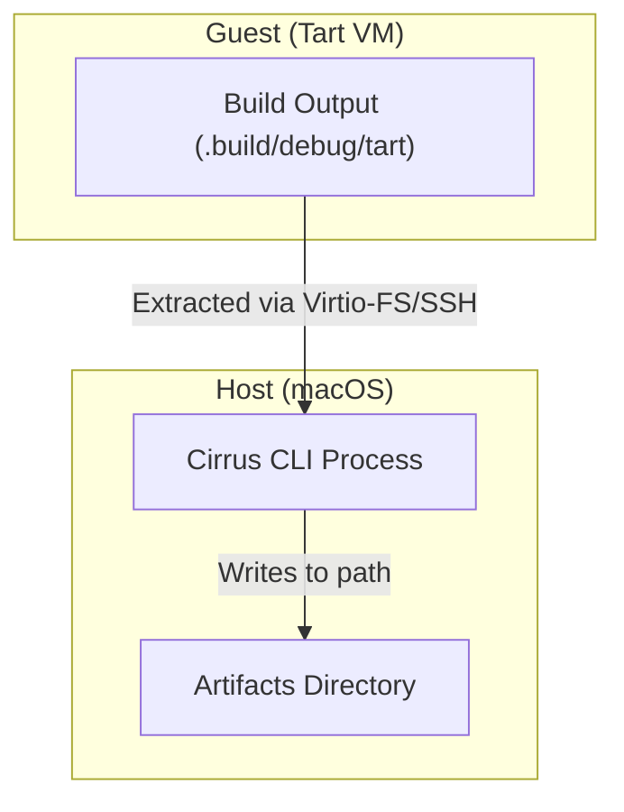
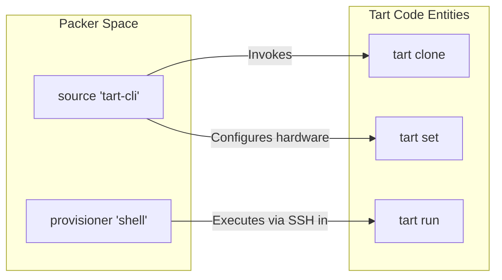
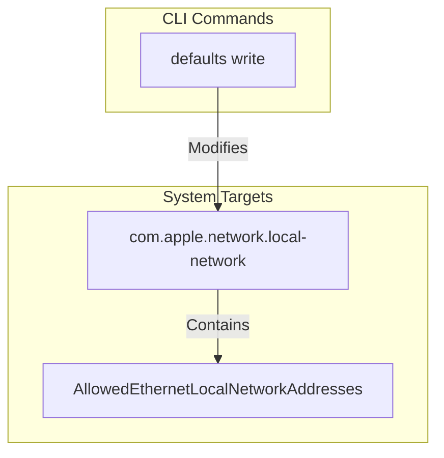
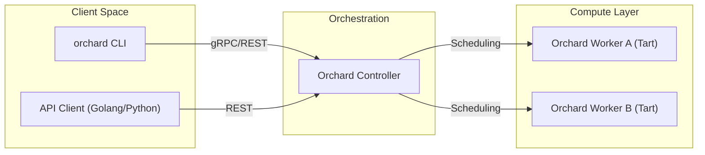

<!-- source: DeepWiki mcp.deepwiki.com · repo openai/tart · page 8.1 CI/CD Integrations · fetched 2026-10-26 -->

# CI/CD Integrations

<details>
<summary>Relevant source files</summary>

The following files were used as context for generating this wiki page:

- [.ci/create-pkg.sh](.ci/create-pkg.sh)
- [.cirrus.yml](.cirrus.yml)
- [.goreleaser.yml](.goreleaser.yml)
- [docs/faq.md](docs/faq.md)
- [docs/integrations/buildkite.md](docs/integrations/buildkite.md)
- [docs/integrations/cirrus-cli.md](docs/integrations/cirrus-cli.md)
- [docs/integrations/gitlab-runner.md](docs/integrations/gitlab-runner.md)
- [docs/integrations/packer.md](docs/integrations/packer.md)
- [docs/orchard/deploying-workers.md](docs/orchard/deploying-workers.md)
- [docs/orchard/integration-guide.md](docs/orchard/integration-guide.md)
- [docs/orchard/quick-start.md](docs/orchard/quick-start.md)

</details>


The purpose of this page is to detail how Tart integrates with modern CI/CD ecosystems. Tart is designed to be a building block for automated workflows, providing ephemeral, isolated environments for macOS and Linux tasks. It integrates with major CI providers through specialized executors, plugins, and CLI wrappers.

## Cirrus CLI

Tart support is natively built into [Cirrus CLI](https://github.com/cirruslabs/cirrus-cli), which allows users to execute CI tasks locally or in remote environments using a unified YAML configuration [docs/integrations/cirrus-cli.md:8-11]().

### Configuration (.cirrus.yml)
The `.cirrus.yml` file defines a `task` that specifies a `macos_instance`. The `image` field can point to either a local Tart VM or a remote OCI image [docs/integrations/cirrus-cli.md:16-27]().

```yaml
task:
  name: example_task
  macos_instance:
    image: ghcr.io/cirruslabs/macos-tahoe-base:latest
  test_script:
    - echo "Running in Tart VM"
```

### Artifact Retrieval
Cirrus CLI can extract files from the VM after execution using the `artifacts` instruction. When running with the `--artifacts-dir` flag, the CLI retrieves specified paths and saves them to the host [docs/integrations/cirrus-cli.md:43-60]().

**Data Flow: Artifact Extraction**

Sources: [docs/integrations/cirrus-cli.md:43-66]()

## GitLab Runner

Tart integrates with GitLab via the [Tart Executor](https://github.com/cirruslabs/gitlab-tart-executor), which leverages GitLab Runner's "Custom Executor" feature [docs/integrations/gitlab-runner.md:8-9]().

### Implementation Details
The integration requires the `gitlab-tart-executor` binary. The GitLab Runner's `config.toml` is configured to map specific lifecycle stages (prepare, run, cleanup) to the Tart executor [docs/integrations/gitlab-runner.md:13-38]().

| Stage | Command | Purpose |
| :--- | :--- | :--- |
| `prepare_exec` | `gitlab-tart-executor prepare` | Pulls the OCI image and clones a fresh ephemeral VM. |
| `run_exec` | `gitlab-tart-executor run` | Executes the CI script inside the VM. |
| `cleanup_exec` | `gitlab-tart-executor cleanup` | Stops and deletes the ephemeral VM. |

Sources: [docs/integrations/gitlab-runner.md:21-38]()

## Buildkite

The [Tart Buildkite Plugin](https://github.com/cirruslabs/tart-buildkite-plugin) allows pipeline steps to run in isolated Tart VMs. The plugin handles the cloning of the base image and the execution of the `command` defined in the step [docs/integrations/buildkite.md:8-10]().

**Example Step:**
```yaml
steps:
- command: "swift test"
  plugins:
  - cirruslabs/tart#main:
      image: ghcr.io/cirruslabs/macos-tahoe-base:latest
```
Sources: [docs/integrations/buildkite.md:16-22]()

## Packer (VM Image Building)

For automated image creation, the [Tart Packer Plugin](https://github.com/cirruslabs/packer-plugin-tart) uses the `tart-cli` builder. This allows users to define "Infrastructure as Code" templates to provision Tart images with specific software and configurations [docs/integrations/packer.md:6-7]().

### Packer Template Structure
The template uses HCL (HashiCorp Configuration Language) to define the base image, hardware resources (CPU, Memory, Disk), and provisioners like shell scripts [docs/integrations/packer.md:9-39]().

**Code Entity Relationship: Packer to Tart**

Sources: [docs/integrations/packer.md:19-38]()

## Headless CI Environment Requirements

When running Tart in headless CI environments (e.g., Mac minis in a rack), specific macOS security constraints apply, particularly starting with macOS 15 (Sequoia).

### Keychain Unlock
The `Virtualization.Framework` requires an unlocked `login.keychain` to generate keypairs for the VM [docs/faq.md:10-12](). In CI scripts, this must be handled non-interactively:
```shell
security unlock-keychain -p 'password' login.keychain
```
Sources: [docs/faq.md:29-31]()

### Network Permissions
To avoid the "Local Network" permission pop-up in macOS 15+, which can block CI processes from connecting to the VM, the host's network privacy preferences should be pre-configured to allow RFC 1918 ranges [docs/faq.md:80-91]().

**Command Entity Space: Network Permissions**

Sources: [docs/faq.md:88-91]()

## Orchard Cluster Orchestration

For large-scale deployments across multiple hosts, [Orchard](https://github.com/openai/orchard) acts as the orchestrator. It provides a REST API and a CLI to manage a pool of Tart workers [docs/orchard/quick-start.md:1-7]().

- **Controller**: Manages scheduling and API requests [docs/orchard/quick-start.md:16]().
- **Worker**: A host running Tart that provides `org.cirruslabs.tart-vms` resources [docs/orchard/integration-guide.md:186]().
- **API**: Follows OpenAPI spec for creating VMs, retrieving logs, and deleting resources [docs/orchard/integration-guide.md:1-3]().

### Resource Scheduling
Orchard uses specific resource labels to schedule tasks. A typical worker provides `org.cirruslabs.tart-vms` slots, which are consumed by VM creation requests [docs/orchard/integration-guide.md:180-187]().

**Orchard System Architecture**

Sources: [docs/orchard/quick-start.md:1-22](), [docs/orchard/integration-guide.md:180-187]()

---

