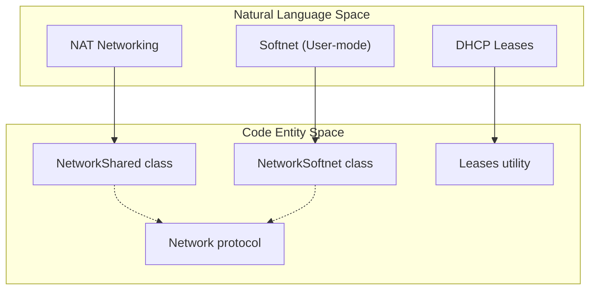
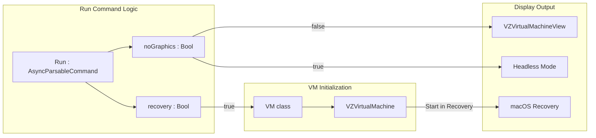

<!-- source: DeepWiki mcp.deepwiki.com · repo openai/tart · page 8.3 FAQ and Troubleshooting · fetched 2026-10-26 -->

# FAQ and Troubleshooting

<details>
<summary>Relevant source files</summary>

The following files were used as context for generating this wiki page:

- [Sources/tart/Commands/Run.swift](Sources/tart/Commands/Run.swift)
- [Sources/tart/VM.swift](Sources/tart/VM.swift)
- [docs/faq.md](docs/faq.md)
- [docs/integrations/packer.md](docs/integrations/packer.md)

</details>


This page provides technical solutions for common issues encountered when running Tart, covering headless machine configurations, crash analysis, networking constraints, and display management.

## Headless Machine Keychain Requirements

Starting with macOS 15 (Sequoia), Apple's `Virtualization.Framework` (which Tart wraps via the `VM` class [[Sources/tart/VM.swift:82-82]()]) requires an unlocked `login.keychain` to initialize a VM [[docs/faq.md:8-10]()]. Failure to provide an unlocked keychain results in security server interaction errors or keypair generation failures [[docs/faq.md:12-17]()].

### Workarounds for Remote/CI Hosts
To resolve this on headless machines, you must ensure a keychain is available and unlocked.

| Method | Implementation |
| :--- | :--- |
| **GUI Login** | Log in once via Screen Sharing to initialize the `login.keychain`. Enable automatic login to maintain the session across reboots [[docs/faq.md:20-28]()]. |
| **Terminal Unlock** | Use `security unlock-keychain -p <password> login.keychain` to unlock an existing keychain via SSH [[docs/faq.md:29-31]()]. |
| **Automated Creation** | Create and set a new login keychain via terminal: `security create-keychain -p '' login.keychain` followed by `security login-keychain -s login.keychain` [[docs/faq.md:32-40]()]. |

**Sources:**
- [[docs/faq.md:8-40]()]
- [[Sources/tart/VM.swift:82-82]()]

## Troubleshooting and Logs

When the `tart` executable crashes or behaves unexpectedly, logs can be collected from both the Tart process and the underlying macOS Virtualization subsystem using the `log` stream command [[docs/faq.md:44-46]()].

```shell
log stream --predicate='process=="tart" OR process CONTAINS "Virtualization"' > tart.log
```
*Capture logs while reproducing the issue, then terminate with `Ctrl+C` [[docs/faq.md:49-52]()].*

### VM Data Flow and Storage Locations
Understanding where Tart persists data is critical for manual cleanup or disk space troubleshooting. Tart utilizes the `Config` and `VMDirectory` classes to manage these paths.

| Entity | Path | Description |
| :--- | :--- | :--- |
| **Local VMs** | `~/.tart/vms/` | Directory containing VM bundles (config, disk images, NVRAM) [[docs/faq.md:54-56]()]. |
| **OCI Cache** | `~/.tart/cache/OCIs/` | Storage for pulled remote image layers and manifests [[docs/faq.md:57-57]()]. |
| **Temporary Files** | `~/.tart/tmp/` | Used during IPSW downloads and processing [[Sources/tart/VM.swift:111-111]()]. |

**Sources:**
- [[docs/faq.md:44-57]()]
- [[Sources/tart/VM.swift:111-111]()]

## Networking Troubleshooting

### Connecting to Host Services
To access a service running on the host from within a VM, the service must be bound to `0.0.0.0` [[docs/faq.md:64-67]()].
*   **NAT Mode:** Access the host via the router's IP address (the default gateway). This is the behavior of the `NetworkShared` implementation [[Sources/tart/VM.swift:44-44](), [docs/faq.md:69-75]()].
*   **Softnet Mode:** Host access is restricted due to stricter network isolation in user-mode networking [[docs/faq.md:76-78]()].

### Configuration Tweaks
Common networking adjustments for high-density environments:

*   **DHCP Exhaustion:** macOS defaults to a 24-hour lease. For high-churn environments, reduce this to 10 minutes by modifying `com.apple.InternetSharing.default.plist` [[docs/faq.md:111-119]()].
*   **Subnet Modification:** Change the default `vmnet` NAT subnet (e.g., to `192.168.77.1`) via `com.apple.vmnet.plist` [[docs/faq.md:95-101]()].
*   **Local Network Permissions:** On macOS 15+, avoid GUI pop-ups by pre-authorizing RFC 1918 ranges in `com.apple.network.local-network` [[docs/faq.md:80-91]()].

### Networking Architecture and Code Entities
The following diagram maps networking concepts to the codebase implementation.

**Title: Networking Implementation Mapping**


**Sources:**
- [[docs/faq.md:64-128]()]
- [[Sources/tart/VM.swift:41-44]()]

## Display and Virtualization Features

### Nested Virtualization
Nested virtualization is supported only on **M3 or M4 Apple Silicon** running **macOS 15+** and is restricted to **Linux guests** [[docs/faq.md:59-62]()]. This is enabled via the `nested` parameter in the `VM` initializer [[Sources/tart/VM.swift:49-49]()] and the `--nested` flag in the `Run` command.

### Recovery Mode and Headless Execution
The `Run` command provides several flags to control the VM boot state and display:
*   `--recovery`: Boots the VM into the macOS Recovery OS [[Sources/tart/Commands/Run.swift:99-101]()].
*   `--no-graphics`: Disables the GUI window, useful for CI integrations [[Sources/tart/Commands/Run.swift:71-74]()].
*   `--vnc`: Uses macOS Screen Sharing instead of the built-in UI [[Sources/tart/Commands/Run.swift:104-109]()].

**Title: Boot Flow for Recovery and Graphics**


### Disk Synchronization and Performance
For performance-critical workloads, Tart allows configuring how the guest synchronizes data with the host disk via `VZDiskImageSynchronizationMode` [[Sources/tart/Commands/Run.swift:31-46]()]. Using `sync=none` in the `--disk` option disables strict data synchronization, increasing performance at the cost of potential data loss [[Sources/tart/Commands/Run.swift:133-134]()].

**Sources:**
- [[docs/faq.md:59-63]()]
- [[Sources/tart/Commands/Run.swift:31-46]()]
- [[Sources/tart/Commands/Run.swift:71-74]()]
- [[Sources/tart/Commands/Run.swift:99-109]()]
- [[Sources/tart/Commands/Run.swift:133-134]()]
- [[Sources/tart/VM.swift:49-49]()]

---

