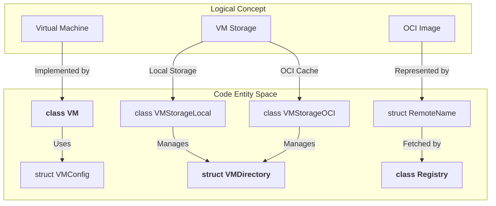
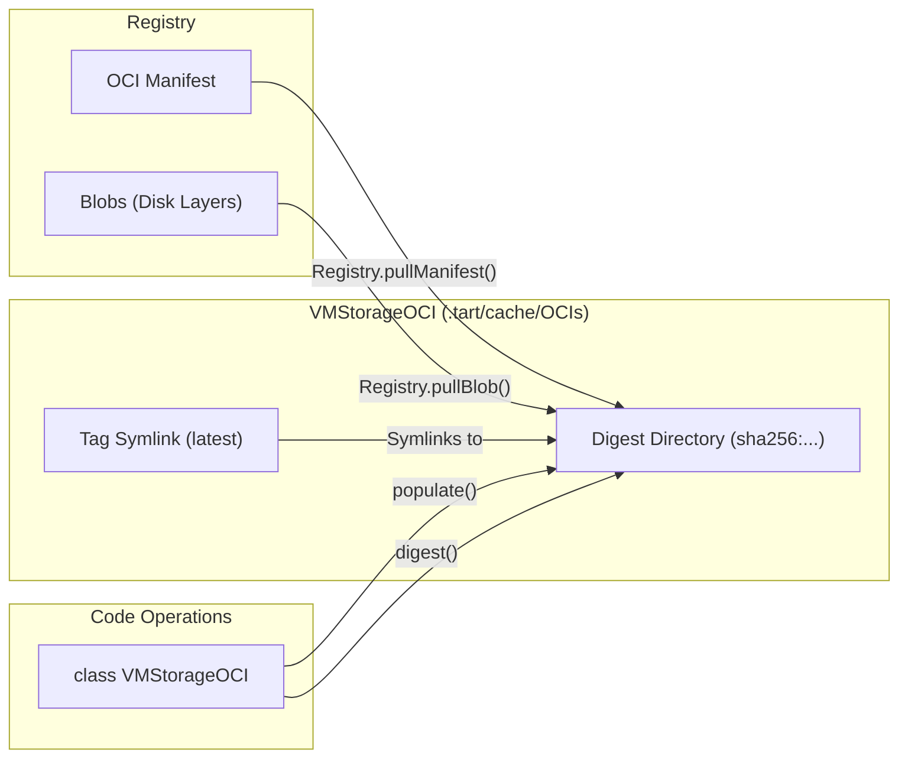

<!-- source: DeepWiki mcp.deepwiki.com · repo openai/tart · page 9 Glossary · fetched 2026-10-26 -->

# Glossary

Relevant source files

The following files were used as context for generating this wiki page:

- [Package.resolved](Package.resolved)
- [Package.swift](Package.swift)
- [README.md](README.md)
- [Sources/tart/Commands/Run.swift](Sources/tart/Commands/Run.swift)
- [Sources/tart/Fetcher.swift](Sources/tart/Fetcher.swift)
- [Sources/tart/OCI/Authentication.swift](Sources/tart/OCI/Authentication.swift)
- [Sources/tart/OCI/Registry.swift](Sources/tart/OCI/Registry.swift)
- [Sources/tart/Platform/Architecture.swift](Sources/tart/Platform/Architecture.swift)
- [Sources/tart/Platform/Darwin.swift](Sources/tart/Platform/Darwin.swift)
- [Sources/tart/Platform/Linux.swift](Sources/tart/Platform/Linux.swift)
- [Sources/tart/Platform/OS.swift](Sources/tart/Platform/OS.swift)
- [Sources/tart/Platform/Platform.swift](Sources/tart/Platform/Platform.swift)
- [Sources/tart/Root.swift](Sources/tart/Root.swift)
- [Sources/tart/VM.swift](Sources/tart/VM.swift)
- [Sources/tart/VMDirectory.swift](Sources/tart/VMDirectory.swift)
- [Sources/tart/VMStorageOCI.swift](Sources/tart/VMStorageOCI.swift)
- [Tests/TartTests/TokenResponseTests.swift](Tests/TartTests/TokenResponseTests.swift)
- [docs/faq.md](docs/faq.md)
- [docs/integrations/packer.md](docs/integrations/packer.md)
- [docs/quick-start.md](docs/quick-start.md)

This page provides definitions for codebase-specific terminology, domain concepts, and technical jargon used throughout the Tart project. It serves as a reference for engineers to understand the implementation details and data structures associated with these terms.

## Core Concepts

### VMDirectory
The standard filesystem representation of a Tart virtual machine. A `VMDirectory` is a wrapper around a local URL that provides structured access to the files required by `Virtualization.Framework`. It supports multiple layouts including `standalone`, `stackedLocal`, and `stackedOCIRecord` [Sources/tart/VMDirectory.swift:100-116]().

*   **config.json**: Serialized `VMConfig` containing hardware and platform metadata [Sources/tart/VMDirectory.swift:14-16]().
*   **disk.img**: The primary storage for the guest OS in standalone VMs [Sources/tart/VMDirectory.swift:17-19]().
*   **nvram.bin**: Non-volatile RAM storage for EFI/Bootloader state [Sources/tart/VMDirectory.swift:20-22]().
*   **state.vzvmsave**: A file containing the saved state of a suspended VM [Sources/tart/VMDirectory.swift:23-25]().
*   **overlay.asif**: A writable overlay used in "stacked" VM layouts to store changes relative to immutable base layers [Sources/tart/VMDirectory.swift:29-31]().

**Code Pointers:**
*   `VMDirectory` struct definition: [Sources/tart/VMDirectory.swift:5-43]()
*   Initialization and validation: [Sources/tart/VMDirectory.swift:163-191]()
*   Layout detection: [Sources/tart/VMDirectory.swift:118-139]()

### RemoteName
A structured representation of an OCI image reference, used to identify VMs in remote registries. It is parsed from strings like `ghcr.io/cirruslabs/macos-sequoia-base:latest` using an ANTLR4-based grammar.

**Code Pointers:**
*   Parsing and Registry initialization: [Sources/tart/OCI/Registry.swift:138-158]()
*   Usage in OCI Storage: [Sources/tart/VMStorageOCI.swift:12-32]()

### IPSW (iPhone/iPad Software)
In the context of Apple Silicon Macs, `*.ipsw` files are restore images used to install macOS. Tart can fetch these from Apple's servers or use local files to create new VMs.

**Code Pointers:**
*   IPSW retrieval and caching: [Sources/tart/VM.swift:88-134]()
*   Loading restore images: [Sources/tart/VM.swift:169-177]()

---

## Data Flow & System Mapping

The following diagrams illustrate how natural language concepts map to specific code entities and how data flows between them.

### Mapping: Virtual Machine Concepts to Code Entities

This diagram bridges the gap between the logical concept of a "VM" and the Swift classes/files that implement them.

**Sources:** [Sources/tart/VM.swift:25-86](), [Sources/tart/VMDirectory.swift:5-12](), [Sources/tart/VMStorageOCI.swift:5-10](), [Sources/tart/OCI/Registry.swift:113-136]()

### Data Flow: OCI Pull and Storage Linking

This diagram shows how a remote OCI image is transformed into a local `VMDirectory` and how symlinks are used for tagging.

**Sources:** [Sources/tart/VMStorageOCI.swift:121-129](), [Sources/tart/VMStorageOCI.swift:153-190](), [Sources/tart/OCI/Registry.swift:167-192]()

---

## Technical Glossary

| Term | Definition | Implementation Detail |
| :--- | :--- | :--- |
| **Pruning** | The process of reclaiming disk space by deleting old or unused OCI image layers. | `PrunableStorage` and `Config.gc()` trigger cleanup. [Sources/tart/Root.swift:153-161](), [Sources/tart/VMStorageOCI.swift:5-5]() |
| **Control Socket** | A Unix Domain Socket used for host-to-guest communication, specifically for the guest agent. | Path defined as `control.sock` inside the `VMDirectory`. [Sources/tart/VMDirectory.swift:32-34]() |
| **Headless Mode** | Running a VM without an AppKit window or SwiftUI view. | Triggered by the `--no-graphics` flag in the `Run` command. [Sources/tart/Commands/Run.swift:71-74]() |
| **ECID** | Exclusive Chip ID, a unique identifier for Apple Silicon hardware. | Encoded in the `Darwin` platform configuration for hardware identity. [Sources/tart/Platform/Darwin.swift:11-18]() |
| **Hardware Model** | Metadata describing the specific Apple Silicon hardware capabilities. | Stored in `VZMacHardwareModel` within the `Darwin` platform. [Sources/tart/Platform/Darwin.swift:13-13]() |
| **MainThreadCommand** | A protocol for commands that must own the AppKit run loop (e.g., `run`). | Defines `runOnMainThread()` to bypass Swift's default async executor. [Sources/tart/Root.swift:198-203]() |
| **TokenResponse** | The structure used to handle OCI registry authentication tokens. | Parses Bearer/Access tokens from registry auth endpoints. [Sources/tart/OCI/Registry.swift:58-88]() |

## Platform Implementations

Tart abstracts the differences between guest operating systems through the `Platform` protocol:

1.  **Darwin (macOS)**: Handles `VZMacMachineIdentifier` (ECID), hardware models, and `VZMacOSBootLoader`. It supports specific macOS features like trackpads and Mac keyboards [Sources/tart/Platform/Darwin.swift:11-143]().
2.  **Linux**: Configures `VZLinuxBootLoader` and supports nested virtualization on compatible hardware [Sources/tart/Commands/Run.swift:146-160](), [docs/faq.md:59-63]().

**Sources:**
- [Sources/tart/VM.swift:1-187]()
- [Sources/tart/VMDirectory.swift:1-209]()
- [Sources/tart/Root.swift:1-200]()
- [Sources/tart/OCI/Registry.swift:1-205]()
- [Sources/tart/VMStorageOCI.swift:1-190]()
- [Sources/tart/Commands/Run.swift:1-170]()
- [Sources/tart/Platform/Darwin.swift:1-143]()
- [docs/faq.md:1-122]()