# Page: Overview

# Overview

<details>
<summary>Relevant source files</summary>

The following files were used as context for generating this wiki page:

- [Package.resolved](Package.resolved)
- [Package.swift](Package.swift)
- [README.md](README.md)
- [Sources/tart/Root.swift](Sources/tart/Root.swift)
- [docs/index.md](docs/index.md)
- [docs/layouts/custom.yml](docs/layouts/custom.yml)
- [docs/quick-start.md](docs/quick-start.md)

</details>


Tart is a virtualization toolset designed to build, run, and manage macOS and Linux virtual machines (VMs) on Apple Silicon [README.md:3-4](). It leverages Apple's `Virtualization.Framework` to provide near-native performance while introducing modern DevOps workflows, such as using OCI-compatible container registries for VM image distribution [README.md:6-7]().

The system is designed for high-performance CI/CD automation, offering features like directory sharing via Virtio-FS, automated VM creation via a Packer plugin, and a gRPC-based guest agent for remote execution [README.md:8-9]().

### High-Level Architecture

The Tart codebase is organized around a central CLI entry point defined in `Root.swift` that dispatches commands to various subsystems including storage managers, OCI registry clients, and the virtualization engine [Sources/tart/Root.swift:9-33]().

**System Context: Natural Language to Code Entities**

```mermaid
graph TD
    subgraph "Natural_Language_Space"
        [User_CLI_Command]
        [VM_Storage]
        [Remote_Registry]
    end

    subgraph "Code_Entity_Space"
        [User_CLI_Command] --> ["Root: AsyncParsableCommand"]
        ["Root: AsyncParsableCommand"] --> ["Create, Run, Pull, etc."]
        [VM_Storage] --> ["VMStorageLocal / VMStorageOCI"]
        ["VMStorageLocal / VMStorageOCI"] --> ["VMDirectory"]
        [Remote_Registry] --> ["Registry: OCI Distribution Client"]
    end

    subgraph "Hardware_/_OS_Interface"
        ["Create, Run, Pull, etc."] --> ["Virtualization.Framework"]
        ["VMDirectory"] --> ["APFS / Local Filesystem"]
    end
```
Sources: [Sources/tart/Root.swift:9-33](), [README.md:6-7](), [Package.swift:33-51]()

### Key Capabilities

Tart bridges the gap between traditional virtualization and container-like workflows:

*   **OCI Integration**: VMs are treated as OCI images. You can `push` and `pull` entire VM states to registries like GitHub Packages (GHCR) [README.md:54-55]().
*   **Performance**: By using `Virtualization.Framework`, Tart avoids the overhead of traditional emulation [README.md:6]().
*   **Automation-First**: Includes native support for headless execution, gRPC guest agents for command execution (`tart exec`), and IP resolution for SSH access [docs/quick-start.md:90-104]().
*   **Platform Support**: Supports macOS (Monterey through Sequoia/macOS 15 and Tahoe/macOS 16) and major Linux distributions (Ubuntu, Debian, Fedora) [docs/quick-start.md:33-68]().

### Subsystem Relationships

The diagram below illustrates how the major internal components interact during a typical VM lifecycle (Pull -> Run -> Exec). The `Root` entry point manages the lifecycle, deciding whether to run a command on the `MainActor` (required for SwiftUI/AppKit UI) or in a detached background task [Sources/tart/Root.swift:68-91]().

**Component Interaction Map**

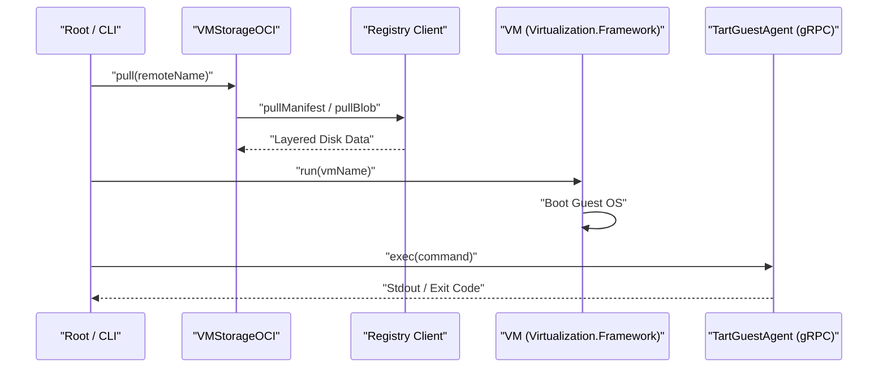
Sources: [Sources/tart/Root.swift:13-33](), [Sources/tart/Root.swift:68-91](), [docs/quick-start.md:12-13](), [Package.swift:27]()

---

### Getting Started
To begin using Tart, you can install it via Homebrew or manually from a release archive [docs/quick-start.md:11-20](). The development workflow involves building from source and requires specific code signing (via `embedded.provisionprofile`) to access elevated virtualization privileges [docs/quick-start.md:26-28]().

For details, see [Getting Started](#1.1).

Sources: [README.md:52-56](), [docs/quick-start.md:10-28]()

### CLI Command Reference
Tart provides a comprehensive set of commands for local VM management (`create`, `run`, `set`, `delete`) and remote distribution (`pull`, `push`, `login`, `logout`) [Sources/tart/Root.swift:13-33](). Specialized commands like `exec` and `ip` facilitate automation by interacting with the guest environment, while `suspend` is available on macOS 14+ [Sources/tart/Root.swift:22-23](), [Sources/tart/Root.swift:44-46]().

For details, see [CLI Command Reference](#1.2).

Sources: [Sources/tart/Root.swift:13-33](), [docs/quick-start.md:152-180]()

---

# Page: Getting Started

# Getting Started

<details>
<summary>Relevant source files</summary>

The following files were used as context for generating this wiki page:

- [.ci/pkg/scripts/postinstall](.ci/pkg/scripts/postinstall)
- [README.md](README.md)
- [Resources/Info.plist](Resources/Info.plist)
- [docs/quick-start.md](docs/quick-start.md)
- [scripts/build-docs.sh](scripts/build-docs.sh)
- [scripts/run-signed.sh](scripts/run-signed.sh)
- [scripts/start-docs.sh](scripts/start-docs.sh)

</details>


Tart is a virtualization toolset designed specifically for Apple Silicon, leveraging Apple's `Virtualization.Framework` to build, run, and manage macOS and Linux virtual machines (VMs) with near-native performance [README.md:3-6](). This page covers the installation methods, initial setup, and the development workflow for building Tart from source.

## Installation

Tart can be installed via Homebrew, a manual release archive, or built from source.

### Homebrew (Recommended)
The simplest way to install Tart on macOS 13.0 (Ventura) or later is via the official tap:

```bash
brew install openai/tools/tart
```
[README.md:50-53](), [docs/quick-start.md:8-11]()

### Manual Installation
You can manually install the `tart` binary from the GitHub releases. Note that for the binary to function correctly with elevated privileges, it must remain within the `.app` bundle structure to correctly reference the `embedded.provisionprofile` [docs/quick-start.md:16-27]().

```bash
curl -LO https://github.com/openai/tart/releases/latest/download/tart.tar.gz
tar -xzvf tart.tar.gz
./tart.app/Contents/MacOS/tart clone ghcr.io/cirruslabs/macos-tahoe-base:latest tahoe-base
./tart.app/Contents/MacOS/tart run tahoe-base
```
[docs/quick-start.md:20-24]()

## First-Run Setup

To verify your installation, you can pull and run a pre-built macOS image. Note that downloading a full macOS image typically requires ~25 GB of disk space [docs/quick-start.md:8-14]().

```bash
# Clone a remote image to a local VM named "tahoe-base"
tart clone ghcr.io/cirruslabs/macos-tahoe-base:latest tahoe-base

# Run the VM
tart run tahoe-base
```
[README.md:54-55](), [docs/quick-start.md:12-13]()

### Default Credentials
Standard images provided by Cirrus Labs use the following credentials for GUI, SSH, and console access:
- **Username:** `admin`
- **Password:** `admin`

[docs/quick-start.md:81-86]()

## Building from Source

### Prerequisites
- Apple Silicon Mac
- macOS 13.0 or newer [docs/quick-start.md:8-8]()
- Swift toolchain

### Development Workflow: `run-signed.sh`
Tart requires specific entitlements and a provisioning profile to interact with the `Virtualization.Framework` [docs/quick-start.md:26-28](). The `scripts/run-signed.sh` script automates the process of building the Swift package, assembling a minimal `.app` bundle, and signing it with developer entitlements [scripts/run-signed.sh:1-19]().

#### Execution Flow
The `run-signed.sh` script performs the following steps:
1. **Build**: Compiles the `tart` product using `swift build --product tart` [scripts/run-signed.sh:8-8]().
2. **Assemble**: Creates a directory structure at `.build/tart.app/` and copies the binary, `Info.plist`, and `embedded.provisionprofile` [scripts/run-signed.sh:10-14]().
3. **Sign**: Applies `Resources/tart-dev.entitlements` to the bundle using `codesign --sign -` [scripts/run-signed.sh:17-17]().
4. **Execute**: Runs the signed binary with any arguments passed to the script [scripts/run-signed.sh:19-19]().

```bash
# Example: List VMs using a locally built and signed binary
./scripts/run-signed.sh list
```
[scripts/run-signed.sh:4-4]()

### Code Entity Mapping: Build and Sign
The following diagram illustrates how the development script bridges the gap between the source code and a functional, entitled macOS process.

**Build and Signing Data Flow**
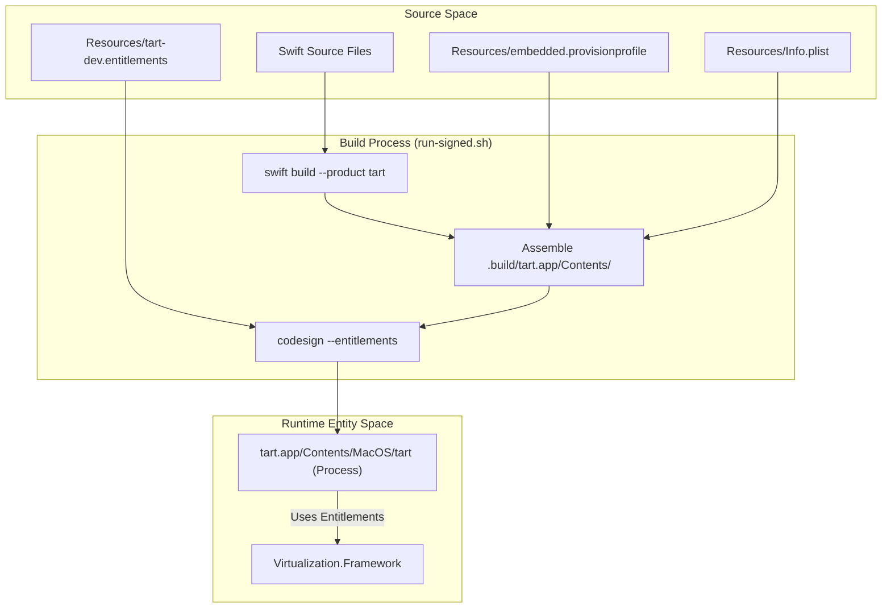
Sources: [scripts/run-signed.sh:8-19](), [Resources/Info.plist:1-29]()

## Packaging and Post-Installation
When Tart is installed via the `.pkg` installer, a post-install script ensures the correct `.app` bundle structure is maintained while providing a convenient symlink in the user's path [ .ci/pkg/scripts/postinstall:1-16]().

**Post-Install File Relocation**
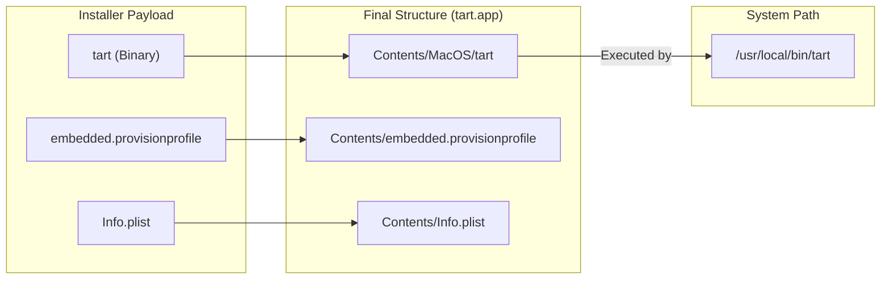
Sources: [.ci/pkg/scripts/postinstall:5-15]()

### Implementation Details
The `postinstall` script performs these key actions:
- Creates the required directory structure: `tart.app/Contents/MacOS` and `tart.app/Resources` [.ci/pkg/scripts/postinstall:6-6]().
- Moves the raw binary and metadata files into their respective bundle locations [.ci/pkg/scripts/postinstall:7-10]().
- Creates a wrapper script at `/usr/local/bin/tart` that uses `exec` to call the bundled binary, ensuring macOS recognizes the provisioning profile [.ci/pkg/scripts/postinstall:12-15]().

Sources: [README.md:1-59](), [docs/quick-start.md:1-172](), [scripts/run-signed.sh:1-19](), [.ci/pkg/scripts/postinstall:1-15](), [Resources/Info.plist:1-29]()

---

# Page: CLI Command Reference

# CLI Command Reference

<details>
<summary>Relevant source files</summary>

The following files were used as context for generating this wiki page:

- [Package.resolved](Package.resolved)
- [Package.swift](Package.swift)
- [Sources/tart/Commands/Create.swift](Sources/tart/Commands/Create.swift)
- [Sources/tart/Commands/Delete.swift](Sources/tart/Commands/Delete.swift)
- [Sources/tart/Commands/Export.swift](Sources/tart/Commands/Export.swift)
- [Sources/tart/Commands/FQN.swift](Sources/tart/Commands/FQN.swift)
- [Sources/tart/Commands/Get.swift](Sources/tart/Commands/Get.swift)
- [Sources/tart/Commands/Import.swift](Sources/tart/Commands/Import.swift)
- [Sources/tart/Commands/List.swift](Sources/tart/Commands/List.swift)
- [Sources/tart/Commands/Rename.swift](Sources/tart/Commands/Rename.swift)
- [Sources/tart/Commands/Stop.swift](Sources/tart/Commands/Stop.swift)
- [Sources/tart/Commands/Suspend.swift](Sources/tart/Commands/Suspend.swift)
- [Sources/tart/DiskImageStack.swift](Sources/tart/DiskImageStack.swift)
- [Sources/tart/Formatter/HumanReadableByteCount.swift](Sources/tart/Formatter/HumanReadableByteCount.swift)
- [Sources/tart/PIDLock.swift](Sources/tart/PIDLock.swift)
- [Sources/tart/Root.swift](Sources/tart/Root.swift)
- [Sources/tart/ShellCompletions/ShellCompletions.swift](Sources/tart/ShellCompletions/ShellCompletions.swift)
- [Sources/tart/VMDirectory+Archive.swift](Sources/tart/VMDirectory+Archive.swift)
- [Tests/TartTests/DiskImageStackTests.swift](Tests/TartTests/DiskImageStackTests.swift)
- [Tests/TartTests/HumanReadableByteCountTests.swift](Tests/TartTests/HumanReadableByteCountTests.swift)
- [Tests/TartTests/VMDirectoryDiskImageStackTests.swift](Tests/TartTests/VMDirectoryDiskImageStackTests.swift)
- [Tests/TartTests/VMDirectoryLayoutTests.swift](Tests/TartTests/VMDirectoryLayoutTests.swift)
- [integration-tests/clone_lock_darwin_test.go](integration-tests/clone_lock_darwin_test.go)

</details>


This page provides a comprehensive technical reference for the Tart Command Line Interface (CLI). The CLI is built using the `swift-argument-parser` library, which handles command routing, argument validation, and help generation.

## Command Architecture and Dispatch

The CLI entry point is the `Root` struct (the root command), which dispatches to individual `ParsableCommand` or `AsyncParsableCommand` implementations [Sources/tart/Root.swift:9-33](). 

### Threading Model and Dispatch
Tart employs a specific threading model to accommodate the requirements of Apple's `Virtualization.Framework` and `SwiftUI`.
- **Main Thread Commands**: Commands that drive a UI or run loop (like `run`) implement `MainThreadCommand` and are executed on the main actor to prevent blocking the Dispatch main queue [Sources/tart/Root.swift:68-73]().
- **Background Commands**: Most management commands (like `list`, `delete`) run in a detached task using `runInBackground` [Sources/tart/Root.swift:78-80]().
- **Signal Handling**: The `Root` command manages `SIGINT` (Ctrl+C) by capturing it via a `DispatchSource` and cancelling the active task [Sources/tart/Root.swift:83-87]().

### Command Execution Flow

The following diagram illustrates how a command transitions from a user string to code execution within the system.

**Natural Language to Code Entity Space: Execution Flow**
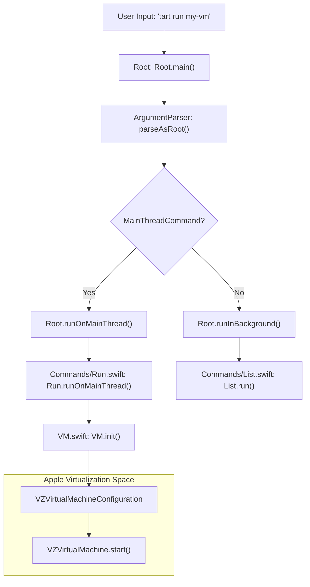
Sources: [Sources/tart/Root.swift:42-91](), [Sources/tart/Commands/List.swift:37-75](), [Sources/tart/Root.swift:111-129]()

---

## Core VM Management

### create
Creates a new VM bundle from an operating system source.
- **Implementation**: For macOS, it fetches the latest supported IPSW via `VZMacOSRestoreImage.fetchLatestSupported()` or uses a provided path/URL [Sources/tart/Commands/Create.swift:53-62](). For Linux, it calls `VM.linux()` [Sources/tart/Commands/Create.swift:74]().
- **Data Flow**: Creates a temporary directory via `VMDirectory.temporary()`, applies a `FileLock` to prevent garbage collection during creation, and moves it to local storage upon completion [Sources/tart/Commands/Create.swift:42-81]().
- **Key Options**:
    - `--from-ipsw`: Path, URL, or `latest` [Sources/tart/Commands/Create.swift:13-14]().
    - `--linux`: Flag for Linux VMs [Sources/tart/Commands/Create.swift:16-17]().
    - `--disk-format`: Supports `raw` or `asif`. `asif` requires macOS 15+ (Tahoe) [Sources/tart/Commands/Create.swift:22-23]().

### run
Starts a virtual machine.
- **Implementation**: Instantiates a `VM` object. It handles window management via SwiftUI unless `--no-graphics` is passed.
- **Key Logic**: 
    - Enters the run loop on the main thread [Sources/tart/Root.swift:101]().
    - Triggers garbage collection before execution unless it's a pull/clone command [Sources/tart/Root.swift:153-161]().

### get
Retrieves configuration and status of a local VM.
- **Implementation**: Opens `VMStorageLocal`, decodes the `config.json` into a `VMConfig` object, and queries the `VMDirectory` for disk usage and state [Sources/tart/Commands/Get.swift:25-42]().
- **Output**: Returns OS type, CPU count, Memory size, Disk format, and current state (`Running`, `Stopped`, `Suspended`) [Sources/tart/Commands/Get.swift:4-14]().

### list
Enumerates local and OCI-cached VMs.
- **Implementation**: Queries `VMStorageLocal` and `VMStorageOCI` [Sources/tart/Commands/List.swift:40-66]().
- **Filtering**: Supports filtering by `--source` (local or oci) [Sources/tart/Commands/List.swift:18-19]().
- **Output**: Supports `text` and `json` formats via `Format.renderList` [Sources/tart/Commands/List.swift:21-22]().

### stop / suspend / delete / rename
- **stop**: Attempts graceful termination via `SIGINT` to the VM process, falling back to `SIGKILL` after a timeout (default 30s) [Sources/tart/Commands/Stop.swift:12-13, 51-68]().
- **suspend**: Saves the VM state to `state.vzvmsave`. Only available on macOS 14+ [Sources/tart/Root.swift:44-46]().
- **delete**: Removes the VM bundle from disk.
- **rename**: Uses `VMStorageLocal.rename()` after verifying the target name doesn't exist and acquiring a lock on `TART_HOME` [Sources/tart/Commands/Rename.swift:19-34]().

---

## Networking and Interaction

### ip
Resolves the IP address of a running VM.
- **Implementation**: Uses a multi-strategy approach including DHCP lease parsing, ARP table lookups, and the `TartGuestAgent` [Sources/tart/Commands/IP.swift:62-82]().

### exec
Executes a command inside the guest OS.
- **Implementation**: Communicates with `TartGuestAgent` via gRPC over a Unix Domain Socket (UDS) [Sources/tart/Commands/Exec.swift:36-50]().
- **Exit Codes**: If the guest command fails, `exec` returns the specific exit code via `ExecCustomExitCodeError` [Sources/tart/Root.swift:165-169]().

---

## OCI Registry Operations

Tart treats OCI registries as a distribution backend.

**OCI Integration Mapping**
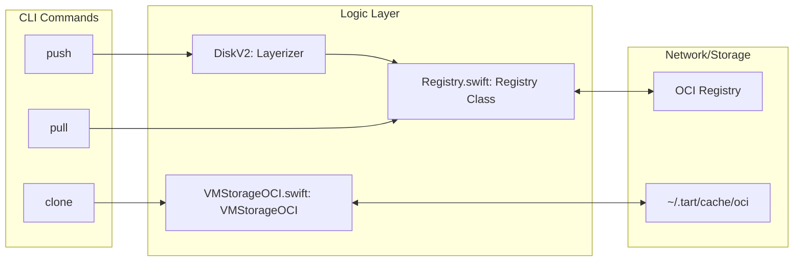
Sources: [Sources/tart/Commands/Push.swift](), [Sources/tart/Commands/Pull.swift](), [Sources/tart/Commands/Clone.swift]()

### pull / push
- **pull**: Downloads OCI manifests and layers to the local cache.
- **push**: Splits the VM disk into layers (DiskV2) and uploads them to a remote registry [Sources/tart/Commands/Push.swift]().

### login / logout
- **Implementation**: Persists registry credentials using the macOS Keychain or standard OCI config files [Sources/tart/Root.swift:20-21]().

---

## Maintenance and Utilities

### prune
Reclaims disk space by deleting unused OCI cached layers and VMs.
- **Logic**: Invokes `Config().gc()` which is also called automatically before most commands [Sources/tart/Root.swift:153-161]().

### import / export
- **export**: Compresses a VM bundle into a `.tvm` archive.
- **import**: Extracts a `.tvm` archive into a local VM bundle. It automatically regenerates the MAC address if a collision is detected in local storage [Sources/tart/Commands/Import.swift:45-48]().

### fqn
- **Purpose**: Resolves and prints the Fully Qualified Name (FQN) of a VM [Sources/tart/Root.swift:32]().

| Command | Primary Class | Key Implementation |
| :--- | :--- | :--- |
| `create` | `Create` | `VM.init` / `VM.linux` |
| `list` | `List` | `VMStorageLocal.list` / `VMStorageOCI.list` |
| `stop` | `Stop` | `kill(pid, SIGINT/SIGKILL)` |
| `import` | `Import` | `VMDirectory.importFromArchive` |
| `rename` | `Rename` | `VMStorageLocal.rename` |

Sources: [Sources/tart/Commands/Create.swift](), [Sources/tart/Commands/List.swift](), [Sources/tart/Commands/Stop.swift](), [Sources/tart/Commands/Import.swift](), [Sources/tart/Commands/Rename.swift]()

---

# Page: Core Architecture

# Core Architecture

<details>
<summary>Relevant source files</summary>

The following files were used as context for generating this wiki page:

- [Package.resolved](Package.resolved)
- [Package.swift](Package.swift)
- [Sources/tart/Commands/Run.swift](Sources/tart/Commands/Run.swift)
- [Sources/tart/Root.swift](Sources/tart/Root.swift)
- [Sources/tart/VM.swift](Sources/tart/VM.swift)

</details>


Tart is a virtualization tool built on top of Apple's `Virtualization.framework`. Its architecture is designed to bridge the gap between high-level OCI (Open Container Initiative) image distribution and low-level macOS virtualization primitives.

## System Entrypoint and Dispatch

The `Root` struct serves as the main entrypoint for the `tart` executable. It uses `Swift Argument Parser` to manage a wide array of subcommands including `create`, `run`, `pull`, and `push` [Sources/tart/Root.swift:8-33]().

Tart employs a specialized dispatch mechanism to handle the requirements of the macOS main run loop. Commands that require a graphical interface or specific AppKit/SwiftUI event loops (like `tart run`) implement the `MainThreadCommand` protocol and are executed directly on the main thread using `MainActor.assumeIsolated` [Sources/tart/Root.swift:68-73](). All other commands are executed in a detached background task [Sources/tart/Root.swift:78-80]().

### Command Dispatch Architecture

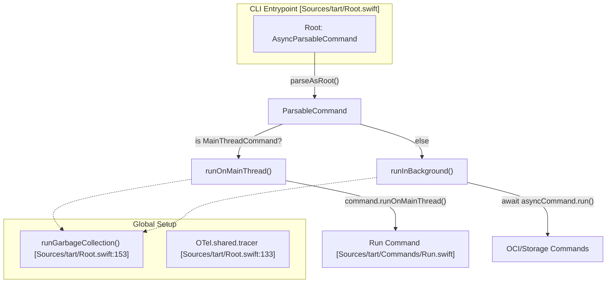
**Sources:** [Sources/tart/Root.swift:42-129](), [Sources/tart/Root.swift:132-161]()

---

## VM Lifecycle and Configuration

The core of Tart's VM management is the `VM` class, which orchestrates the `Virtualization.framework` objects. The `VM` class initializes a `VZVirtualMachine` using a `VZVirtualMachineConfiguration` generated by `craftConfiguration` [Sources/tart/VM.swift:25-86](). The lifecycle is driven by the `VMConfig`, which defines hardware characteristics such as CPU count, memory, and display resolution.

For details, see [VM Lifecycle and Configuration](#2.1).

---

## Platform Abstraction

Tart provides a unified interface for different guest operating systems through the `Platform` protocol. This allows the system to abstract away the differences between macOS (Darwin) and Linux guests, such as bootloaders (`VZBootLoader`), graphics devices, and hardware identifiers.

### Platform Class Hierarchy

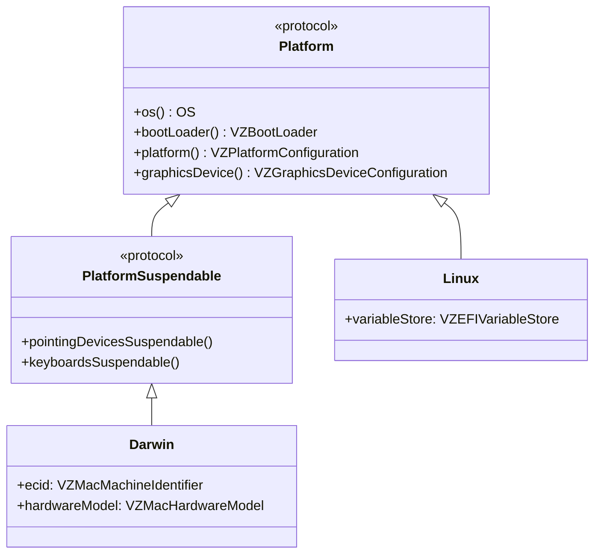
**Sources:** [Sources/tart/VM.swift:41-82](), [Sources/tart/Commands/Run.swift:98-117]()

For details, see [Platform Abstraction (Darwin and Linux)](#2.2).

---

## VM Storage and OCI Backends

Tart manages VMs as directories on the local filesystem, encapsulated by the `VMDirectory` struct. It supports local storage and OCI-compatible backends where images are stored in a content-addressed cache.

### Storage Layout and Entity Mapping

| Entity | Code Implementation | Purpose |
| :--- | :--- | :--- |
| **VM Directory** | `VMDirectory` | Represents the folder containing all VM assets. |
| **Config** | `config.json` | Serialized `VMConfig` including hardware specs [Sources/tart/VM.swift:59](). |
| **Disk Image** | `disk.img` | The actual guest filesystem image [Sources/tart/VM.swift:183](). |
| **NVRAM** | `nvram.bin` | Non-volatile RAM for EFI/macOS boot variables [Sources/tart/VM.swift:180](). |
| **State** | `state.vzvmsave` | Saved memory state for suspended VMs [Sources/tart/VM.swift:138-140](). |

For details, see [VM Storage: Local and OCI Backends](#2.3).

---

## Networking

Tart implements multiple networking stacks to balance performance and ease of use. This includes `NetworkShared` (NAT) and `NetworkBridged` for standard macOS virtualization networking [Sources/tart/VM.swift:41-44](). It also supports advanced features like Virtio-FS directory sharing and Rosetta 2 acceleration for Linux guests [Sources/tart/Commands/Run.swift:147-169]().

For details, see [Networking](#2.4).

---

## Guest Agent and Communication

To enable commands like `tart exec`, Tart establishes a communication channel between the host and the guest. This involves a `ControlSocket` proxy on the host and a gRPC-based agent running inside the guest VM, utilizing the `cirruslabs_tart-guest-agent_grpc_swift` package [Package.swift:27-47]().

For details, see [Guest Agent and Host-Guest Communication](#2.5).

---

## Subsystems Overview

| Subsystem | Key Files | Responsibility |
| :--- | :--- | :--- |
| **CLI Root** | `Root.swift` | Argument parsing and main thread management [Sources/tart/Root.swift:8-33](). |
| **VM Engine** | `VM.swift` | Wrapping `Virtualization.framework` and managing guest state [Sources/tart/VM.swift:25-86](). |
| **Commands** | `Run.swift` | Handling the complex logic of booting and displaying VMs [Sources/tart/Commands/Run.swift:65-170](). |
| **Dependencies** | `Package.swift` | Managing external libraries like OTel, gRPC, and ANTLR [Package.swift:12-31](). |

**Sources:** [Sources/tart/Root.swift:8-33](), [Sources/tart/VM.swift:25-86](), [Sources/tart/Commands/Run.swift:65-170](), [Package.swift:1-62]()

---

# Page: VM Lifecycle and Configuration

# VM Lifecycle and Configuration

<details>
<summary>Relevant source files</summary>

The following files were used as context for generating this wiki page:

- [Sources/tart/Commands/Create.swift](Sources/tart/Commands/Create.swift)
- [Sources/tart/Commands/Rename.swift](Sources/tart/Commands/Rename.swift)
- [Sources/tart/Commands/Run.swift](Sources/tart/Commands/Run.swift)
- [Sources/tart/Commands/Set.swift](Sources/tart/Commands/Set.swift)
- [Sources/tart/Commands/Stop.swift](Sources/tart/Commands/Stop.swift)
- [Sources/tart/Commands/Suspend.swift](Sources/tart/Commands/Suspend.swift)
- [Sources/tart/DiskImageFormat.swift](Sources/tart/DiskImageFormat.swift)
- [Sources/tart/PIDLock.swift](Sources/tart/PIDLock.swift)
- [Sources/tart/VM+Recovery.swift](Sources/tart/VM+Recovery.swift)
- [Sources/tart/VM.swift](Sources/tart/VM.swift)
- [Sources/tart/VMConfig.swift](Sources/tart/VMConfig.swift)
- [Tests/TartTests/DiskImageFormatTests.swift](Tests/TartTests/DiskImageFormatTests.swift)
- [Tests/TartTests/VMConfigTests.swift](Tests/TartTests/VMConfigTests.swift)
- [docs/assets/images/faq/tart-run-recovery-options.png](docs/assets/images/faq/tart-run-recovery-options.png)
- [docs/assets/images/faq/tart-run-recovery-terminal.png](docs/assets/images/faq/tart-run-recovery-terminal.png)
- [integration-tests/clone_lock_darwin_test.go](integration-tests/clone_lock_darwin_test.go)

</details>


This section describes the lifecycle of a Tart virtual machine, from initial creation and configuration to execution, suspension, and termination. Tart leverages Apple's `Virtualization.Framework` while providing a management layer for persistent configuration, storage, and state.

## VM Configuration and Serialization

The `VMConfig` struct is the primary data structure for defining a VM's hardware and software characteristics. It is serialized as a `config.json` file within the VM's directory [Sources/tart/VMConfig.swift:56-69]().

### Key Configuration Properties
| Property | Type | Description |
| :--- | :--- | :--- |
| `version` | `Int` | Configuration schema version [Sources/tart/VMConfig.swift:57](). |
| `os` | `OS` | Guest operating system (Darwin or Linux) [Sources/tart/VMConfig.swift:58](). |
| `arch` | `Architecture` | Target CPU architecture (arm64 or x86_64) [Sources/tart/VMConfig.swift:59](). |
| `cpuCount` | `Int` | Number of virtual CPUs [Sources/tart/VMConfig.swift:62](). |
| `memorySize` | `UInt64` | RAM size in bytes [Sources/tart/VMConfig.swift:64](). |
| `macAddress` | `VZMACAddress` | Virtual MAC address for the primary interface [Sources/tart/VMConfig.swift:65](). |
| `display` | `VMDisplayConfig` | Resolution and unit (pt vs px) [Sources/tart/VMConfig.swift:66](). |
| `diskFormat` | `DiskImageFormat` | Format of the primary disk (`raw` or `asif`) [Sources/tart/VMConfig.swift:68](). |

### Serialization Logic
`VMConfig` implements `Codable` to handle JSON conversion [Sources/tart/VMConfig.swift:106-162](). During decoding, it polymorphically handles platform-specific data:
* **Darwin**: Includes `ecid` and `hardwareModel` [Sources/tart/VMConfig.swift:115]().
* **Linux**: Uses standard EFI boot parameters [Sources/tart/VMConfig.swift:123]().

**Sources:** [Sources/tart/VMConfig.swift:1-191](), [Sources/tart/DiskImageFormat.swift:4-33]()

---

## VM Lifecycle Flow

The lifecycle is managed by the `VM` class, which acts as a wrapper around `VZVirtualMachine` [Sources/tart/VM.swift:25-27]().

### 1. Creation (`tart create`)
The `Create` command initializes a new VM directory [Sources/tart/Commands/Create.swift:42]().
* **macOS**: Fetches or uses a local `.ipsw` restore image [Sources/tart/Commands/Create.swift:50-62](). It then calls `VM.retrieveIPSW` to cache the image [Sources/tart/VM.swift:88-103]().
* **Linux**: Initializes a Linux-specific configuration [Sources/tart/Commands/Create.swift:74]().
* **Storage**: Creates a disk image of a specified size (default 50GB) and format [Sources/tart/Commands/Create.swift:20-23]().

### 2. Modification (`tart set`)
The `Set` command allows modifying a stopped VM's configuration [Sources/tart/Commands/Set.swift:40-88]().
* **Resource Scaling**: Updates `cpuCount` and `memorySize` in `config.json` [Sources/tart/Commands/Set.swift:52-59]().
* **Disk Resizing**: Increases the size of `disk.img` [Sources/tart/Commands/Set.swift:92-94](). It supports both `raw` and `asif` formats via the `VMDirectory.resizeDisk` helper.

### 3. Execution (`tart run`)
The `Run` command instantiates the `VM` class and starts the virtualization engine [Sources/tart/Commands/Run.swift:65]().
* **Configuration Crafting**: The `VM.craftConfiguration` method converts `VMConfig` and CLI flags into a `VZVirtualMachineConfiguration` [Sources/tart/VM.swift:67-81]().
* **Recovery Mode**: macOS VMs can be booted into recovery using private `Virtualization.Framework` options [Sources/tart/VM+Recovery.swift:15-28]().

### 4. Suspension and Stopping
* **Suspension**: The `Suspend` command sends a `SIGUSR1` signal to the `tart run` process [Sources/tart/Commands/Suspend.swift:23-26](). This triggers the VM to save its state to a `state.vzvmsave` file.
* **Stopping**: The `Stop` command attempts a graceful termination by sending `SIGINT` to the process [Sources/tart/Commands/Stop.swift:51](). If it fails to terminate within the timeout, it sends `SIGKILL` [Sources/tart/Commands/Stop.swift:68]().
* **PID Locking**: Tart uses a `PIDLock` (based on `fcntl` locks) to ensure only one process manages a specific VM at a time [Sources/tart/PIDLock.swift:4-57]().

### VM Lifecycle State Transitions
Title: "VM State Transitions and Code Entities"
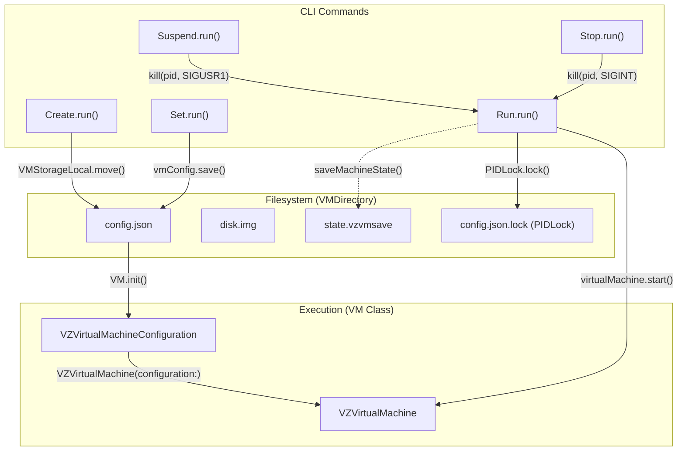
**Sources:** [Sources/tart/VM.swift:82](), [Sources/tart/Commands/Create.swift:81](), [Sources/tart/Commands/Set.swift:82](), [Sources/tart/Commands/Stop.swift:51-68](), [Sources/tart/Commands/Suspend.swift:23](), [Sources/tart/PIDLock.swift:4-57]().

---

## Disk Formats

Tart supports two primary disk formats for the `disk.img` file:

| Format | Implementation | Characteristics |
| :--- | :--- | :--- |
| **RAW** | Sparse file | Default format. |
| **ASIF** | Apple Sparse Image Format | Higher performance. Requires macOS 15+ (Tahoe) [Sources/tart/DiskImageFormat.swift:24-28](). |

### Disk Synchronization and Caching
The `Run` command provides granular control over how `Virtualization.Framework` handles disk I/O:
* **Synchronization Mode**: `none`, `fsync`, or `full` [Sources/tart/Commands/Run.swift:16-46]().
* **Caching Mode**: `automatic`, `cached`, or `uncached` [Sources/tart/Commands/Run.swift:48-63]().

**Sources:** [Sources/tart/DiskImageFormat.swift:4-33](), [Sources/tart/Commands/Run.swift:16-63](), [Tests/TartTests/DiskImageFormatTests.swift:1-63]().

---

## Implementation Mapping

The following diagram maps high-level lifecycle concepts to the internal Swift classes and `Virtualization.Framework` components.

Title: "VM Implementation Mapping"
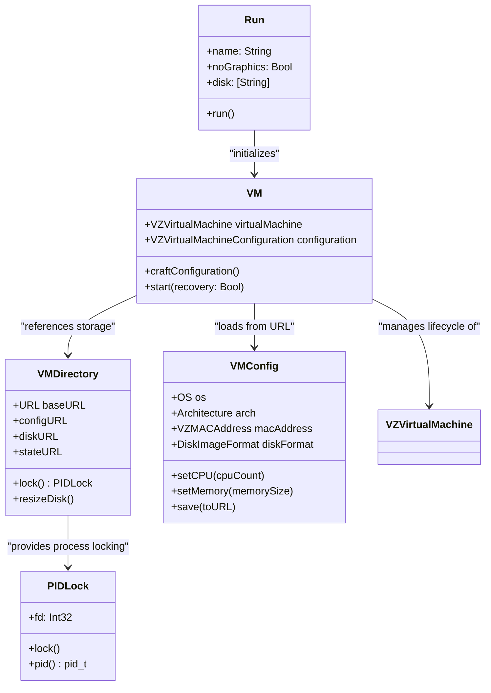
**Sources:** [Sources/tart/VM.swift:25-57](), [Sources/tart/VMConfig.swift:56-69](), [Sources/tart/Commands/Run.swift:65-110](), [Sources/tart/PIDLock.swift:4-16]().

---
**Sources:**
* `Sources/tart/VM.swift`
* `Sources/tart/VMConfig.swift`
* `Sources/tart/Commands/Run.swift`
* `Sources/tart/Commands/Create.swift`
* `Sources/tart/Commands/Set.swift`
* `Sources/tart/Commands/Stop.swift`
* `Sources/tart/Commands/Suspend.swift`
* `Sources/tart/DiskImageFormat.swift`
* `Sources/tart/PIDLock.swift`
* `Sources/tart/VM+Recovery.swift`
* `Tests/TartTests/DiskImageFormatTests.swift`

---

# Page: Platform Abstraction (Darwin and Linux)

# Platform Abstraction (Darwin and Linux)

<details>
<summary>Relevant source files</summary>

The following files were used as context for generating this wiki page:

- [Sources/tart/Commands/Set.swift](Sources/tart/Commands/Set.swift)
- [Sources/tart/Platform/Architecture.swift](Sources/tart/Platform/Architecture.swift)
- [Sources/tart/Platform/Darwin.swift](Sources/tart/Platform/Darwin.swift)
- [Sources/tart/Platform/Linux.swift](Sources/tart/Platform/Linux.swift)
- [Sources/tart/Platform/OS.swift](Sources/tart/Platform/OS.swift)
- [Sources/tart/Platform/Platform.swift](Sources/tart/Platform/Platform.swift)
- [Sources/tart/VMConfig.swift](Sources/tart/VMConfig.swift)
- [Tests/TartTests/VMConfigTests.swift](Tests/TartTests/VMConfigTests.swift)
- [docs/assets/images/faq/tart-run-recovery-options.png](docs/assets/images/faq/tart-run-recovery-options.png)
- [docs/assets/images/faq/tart-run-recovery-terminal.png](docs/assets/images/faq/tart-run-recovery-terminal.png)

</details>


Tart abstracts the differences between macOS (Darwin) and Linux guest operating systems using a protocol-oriented design. This allows the core VM lifecycle logic to remain platform-agnostic while delegating hardware-specific configurations—such as bootloaders, graphics devices, and input methods—to specialized implementations.

## The Platform Protocol

The foundation of Tart's platform abstraction is the `Platform` protocol. It defines the interface for generating the necessary `Virtualization.framework` configurations based on the target OS.

| Method | Purpose |
| :--- | :--- |
| `os()` | Returns the `OS` enum (`.darwin` or `.linux`). |
| `bootLoader(nvramURL:)` | Returns a `VZBootLoader` (e.g., `VZMacOSBootLoader` or `VZEFIBootLoader`). |
| `platform(nvramURL:needsNestedVirtualization:)` | Configures the platform-specific hardware (e.g., machine identifiers for Mac). |
| `graphicsDevice(vmConfig:)` | Configures the display device (Virtio for Linux, MacGraphics for Darwin). |
| `keyboards()` | Returns a list of supported keyboard configurations. |
| `pointingDevices()` | Returns a list of supported pointing devices (Mouse/Trackpad). |

For VMs that support suspension, the `PlatformSuspendable` protocol extends `Platform` to provide configurations compatible with state saving [Sources/tart/Platform/Platform.swift:13-16]().

### Platform Hierarchy Diagram

This diagram illustrates how the `Platform` protocol bridges the high-level `VMConfig` to the specific Apple `Virtualization` framework entities.

```mermaid
classDiagram
    class Platform {
        <<protocol>>
        +os() OS
        +bootLoader(nvramURL) VZBootLoader
        +platform(nvramURL, nested) VZPlatformConfiguration
        +graphicsDevice(vmConfig) VZGraphicsDeviceConfiguration
    }

    class PlatformSuspendable {
        <<protocol>>
        +pointingDevicesSuspendable()
        +keyboardsSuspendable()
    }

    class Darwin {
        +ecid: VZMacMachineIdentifier
        +hardwareModel: VZMacHardwareModel
        +init(from decoder)
        +encode(to encoder)
    }

    class Linux {
        +os() OS
    }

    Platform <|-- PlatformSuspendable : [Sources/tart/Platform/Platform.swift:13-13]()
    PlatformSuspendable <|-- Darwin : [Sources/tart/Platform/Darwin.swift:11-11]()
    Platform <|-- Linux : [Sources/tart/Platform/Linux.swift:4-4]()

    Darwin ..> VZMacOSBootLoader : [Sources/tart/Platform/Darwin.swift:58-58]()
    Darwin ..> VZMacPlatformConfiguration : [Sources/tart/Platform/Darwin.swift:66-66]()
    Linux ..> VZEFIBootLoader : [Sources/tart/Platform/Linux.swift:10-10]()
    Linux ..> VZGenericPlatformConfiguration : [Sources/tart/Platform/Linux.swift:18-18]()
```
**Sources:** [Sources/tart/Platform/Platform.swift:3-16](), [Sources/tart/Platform/Darwin.swift:11-143](), [Sources/tart/Platform/Linux.swift:4-50]()

---

## Darwin (macOS) Implementation

The `Darwin` implementation handles the strict hardware identity requirements of Apple Silicon macOS guests.

### Hardware Identity (ECID and Hardware Model)
macOS guests require a unique machine identifier (ECID) and a specific hardware model to boot. Tart stores these in the VM's `config.json` as Base64-encoded data representations of `VZMacMachineIdentifier` and `VZMacHardwareModel` [Sources/tart/Platform/Darwin.swift:46-51]().

*   **ECID:** Represented by `ecid` [Sources/tart/Platform/Darwin.swift:12-12](). During decoding, Tart recreates the `VZMacMachineIdentifier` from its data representation [Sources/tart/Platform/Darwin.swift:29-33]().
*   **Hardware Model:** Represented by `hardwareModel` [Sources/tart/Platform/Darwin.swift:13-13](). Tart checks `hardwareModel.isSupported` during platform initialization to ensure the host OS can run the specified hardware model, otherwise throwing an `UnsupportedHostOSError` [Sources/tart/Platform/Darwin.swift:71-77]().
*   **Randomization:** The `tart set --random-serial` command allows generating a new `VZMacMachineIdentifier` while preserving the existing `hardwareModel` [Sources/tart/Commands/Set.swift:77-79]().

### Graphics and Input
*   **Graphics:** Uses `VZMacGraphicsDeviceConfiguration` [Sources/tart/Platform/Darwin.swift:83-83](). If the display unit is set to `point`, Tart uses `NSScreen.main` to configure the display size [Sources/tart/Platform/Darwin.swift:85-89](). Otherwise, it defaults to a pixel-based configuration with 72 PPI [Sources/tart/Platform/Darwin.swift:94-102]().
*   **Input:** Supports both `VZUSBKeyboardConfiguration` and `VZMacKeyboardConfiguration` (for guests on macOS 14+) [Sources/tart/Platform/Darwin.swift:107-114](). Pointing devices include both the standard USB mouse and `VZMacTrackpadConfiguration` [Sources/tart/Platform/Darwin.swift:125-128]().

**Sources:** [Sources/tart/Platform/Darwin.swift:11-143](), [Sources/tart/Commands/Set.swift:77-79]()

---

## Linux Implementation

The `Linux` implementation provides a generic virtualization environment using standard Virtio devices and EFI.

### Boot and Platform Configuration
*   **EFI Boot:** Linux guests use `VZEFIBootLoader` [Sources/tart/Platform/Linux.swift:10-10](). The EFI variable store (NVRAM) is persisted to a file via `VZEFIVariableStore(url: nvramURL)` [Sources/tart/Platform/Linux.swift:12-12]().
*   **Platform:** Uses `VZGenericPlatformConfiguration` [Sources/tart/Platform/Linux.swift:18-18]().

### Nested Virtualization
Starting with macOS 15, Tart supports nested virtualization for Linux guests. This is toggled via the `needsNestedVirtualization` flag passed to `platform(...)`, which sets `isNestedVirtualizationEnabled` on the `VZGenericPlatformConfiguration` [Sources/tart/Platform/Linux.swift:19-22](). 

> **Note:** Darwin guests do not support nested virtualization and will throw a `VMConfigurationError` if requested [Sources/tart/Platform/Darwin.swift:61-64]().

### Graphics and Input
*   **Graphics:** Uses `VZVirtioGraphicsDeviceConfiguration` with a single scanout [Sources/tart/Platform/Linux.swift:26-35]().
*   **Input:** Limited to standard USB devices (`VZUSBKeyboardConfiguration` and `VZUSBScreenCoordinatePointingDeviceConfiguration`) [Sources/tart/Platform/Linux.swift:38-44](). Unlike Darwin, Linux pointing devices do not include trackpad support in Tart [Sources/tart/Platform/Linux.swift:46-49]().

**Sources:** [Sources/tart/Platform/Linux.swift:1-50]()

---

## Data Flow: Platform Configuration

The following sequence diagram shows how Tart transforms a `VMConfig` into a runnable `VZVirtualMachineConfiguration`.

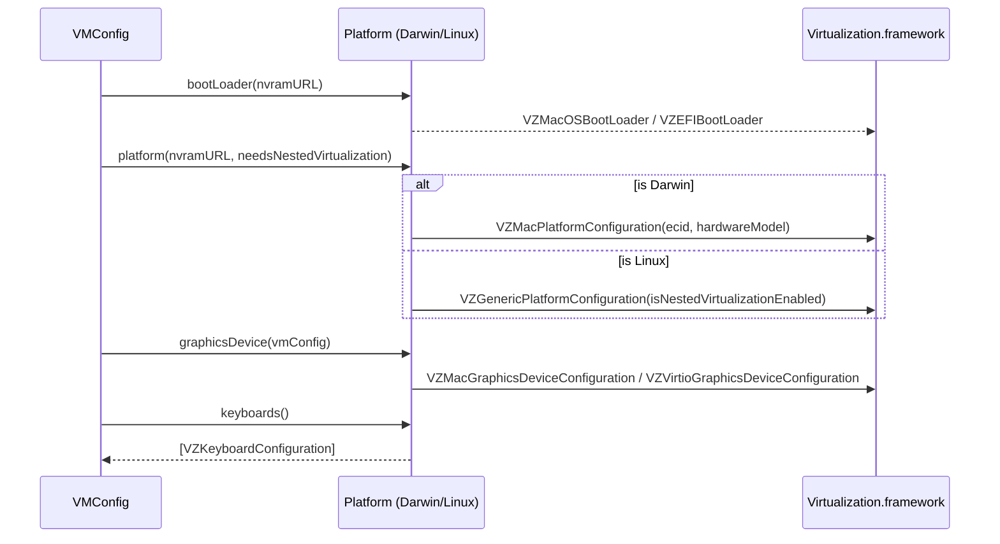

### Key Logic Comparison

| Feature | Darwin (`Darwin.swift`) | Linux (`Linux.swift`) |
| :--- | :--- | :--- |
| **Bootloader** | `VZMacOSBootLoader` [58]() | `VZEFIBootLoader` [10]() |
| **Platform Config** | `VZMacPlatformConfiguration` [66]() | `VZGenericPlatformConfiguration` [18]() |
| **Graphics** | `VZMacGraphicsDeviceConfiguration` [83]() | `VZVirtioGraphicsDeviceConfiguration` [26]() |
| **Nested Virt** | Unsupported (throws error) [63]() | Supported on macOS 15+ [20]() |
| **Trackpad** | Supported (`VZMacTrackpadConfiguration`) [127]() | Unsupported [47]() |
| **Default Display Unit** | Points (`pt`) [Sources/tart/Commands/Set.swift:17-18]() | Pixels (`px`) [Sources/tart/Commands/Set.swift:17-18]() |

**Sources:** [Sources/tart/Platform/Darwin.swift:57-143](), [Sources/tart/Platform/Linux.swift:9-50](), [Sources/tart/Commands/Set.swift:17-18]()

---

# Page: VM Storage: Local and OCI Backends

# VM Storage: Local and OCI Backends

<details>
<summary>Relevant source files</summary>

The following files were used as context for generating this wiki page:

- [Sources/tart/Commands/Prune.swift](Sources/tart/Commands/Prune.swift)
- [Sources/tart/Config.swift](Sources/tart/Config.swift)
- [Sources/tart/ContentStore.swift](Sources/tart/ContentStore.swift)
- [Sources/tart/FileLock.swift](Sources/tart/FileLock.swift)
- [Sources/tart/IPSWCache.swift](Sources/tart/IPSWCache.swift)
- [Sources/tart/LocalLayerCache.swift](Sources/tart/LocalLayerCache.swift)
- [Sources/tart/Prunable.swift](Sources/tart/Prunable.swift)
- [Sources/tart/URL+AccessDate.swift](Sources/tart/URL+AccessDate.swift)
- [Sources/tart/URL+Prunable.swift](Sources/tart/URL+Prunable.swift)
- [Sources/tart/VMDirectory+DiskImageStack.swift](Sources/tart/VMDirectory+DiskImageStack.swift)
- [Sources/tart/VMDirectory.swift](Sources/tart/VMDirectory.swift)
- [Sources/tart/VMStorageLocal.swift](Sources/tart/VMStorageLocal.swift)
- [Sources/tart/VMStorageOCI.swift](Sources/tart/VMStorageOCI.swift)
- [Tests/TartTests/CommandBehaviorTests.swift](Tests/TartTests/CommandBehaviorTests.swift)
- [Tests/TartTests/ContentStoreTests.swift](Tests/TartTests/ContentStoreTests.swift)
- [Tests/TartTests/FileLockTests.swift](Tests/TartTests/FileLockTests.swift)
- [Tests/TartTests/OCIManifestTests.swift](Tests/TartTests/OCIManifestTests.swift)
- [Tests/TartTests/VMStorageOCITests.swift](Tests/TartTests/VMStorageOCITests.swift)

</details>


Tart manages Virtual Machine storage through two primary backends: **Local** and **OCI**. Local storage handles VMs created or imported on the host, while OCI storage manages images pulled from remote registries. Both backends utilize a standardized directory structure for the VM assets themselves.

## VMDirectory: The On-Disk Layout

The `VMDirectory` struct represents a single VM's bundle on disk. It encapsulates the paths and state for all necessary files required by Apple's `Virtualization.framework`.

### File Structure
A VM directory supports multiple layouts, including **standalone** (single disk) and **stacked** (layered disks) [Sources/tart/VMDirectory.swift:100-116]().

| File | Purpose | Code Reference |
| :--- | :--- | :--- |
| `config.json` | VM configuration (CPU, RAM, MAC address, etc.) | [Sources/tart/VMDirectory.swift:14-16]() |
| `disk.img` | The main disk image (used in standalone layout) | [Sources/tart/VMDirectory.swift:17-19]() |
| `nvram.bin` | Non-volatile RAM storage for EFI variables | [Sources/tart/VMDirectory.swift:20-22]() |
| `state.vzvmsave` | Saved execution state (present only if suspended) | [Sources/tart/VMDirectory.swift:23-25]() |
| `manifest.json` | OCI manifest describing layers and metadata | [Sources/tart/VMDirectory.swift:26-28]() |
| `overlay.asif` | Writable overlay for stacked VMs | [Sources/tart/VMDirectory.swift:29-31]() |
| `control.sock` | Unix domain socket for guest agent communication | [Sources/tart/VMDirectory.swift:32-34]() |

### State Management
The `VMDirectory` determines the VM's state based on the presence of specific files and process locks:
- **Running**: Detected by attempting to acquire a `PIDLock` on the `config.json`. If the lock is held by another process, the VM is considered running [Sources/tart/VMDirectory.swift:48-63]().
- **Suspended**: Detected if the VM is not running and the `state.vzvmsave` file exists [Sources/tart/VMDirectory.swift:68-69]().
- **Stopped**: The default state when no lock exists and no save state is present [Sources/tart/VMDirectory.swift:70-72]().

Sources: [Sources/tart/VMDirectory.swift:5-155]()

## Storage Backends

Tart implements the `PrunableStorage` protocol across different storage types to manage VM lifecycles.

### VMStorageLocal
This backend manages VMs located in the user's home directory. By default, these are stored in `~/.tart/vms/` [Sources/tart/VMStorageLocal.swift:6-8]().
- **Listing**: Iterates through the `vms` directory, returning only those that are properly initialized [Sources/tart/VMStorageLocal.swift:74-87]().
- **Renaming/Moving**: Uses `FileManager.default.replaceItemAt`. If the VM uses a stacked layout, it acquires a `ContentStore` prune lock to ensure shared layers aren't collected during the move [Sources/tart/VMStorageLocal.swift:49-68]().

### VMStorageOCI
This backend manages the local cache of remote images in `~/.tart/cache/OCIs/` [Sources/tart/VMStorageOCI.swift:8-10]().
- **Symlink-based Tagging**: OCI storage uses a content-addressable scheme. Digest-addressed images (e.g., `sha256:...`) are stored as actual directories. Tag-based names are implemented as **symbolic links** pointing to the specific digest directory [Sources/tart/VMStorageOCI.swift:121-129]().
- **Stacked Image Support**: Unlike standalone images, stacked images in the OCI cache do not contain a writable overlay and are not runnable until cloned [Sources/tart/VMDirectory.swift:109-111](). They rely on a shared `ContentStore` for immutable disk files [Sources/tart/VMStorageOCI.swift:24-53]().

### Storage Interaction Diagram
The following diagram illustrates how Tart identifies and accesses VM storage.

**VM Storage Entity Map**
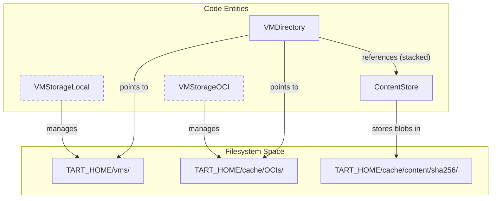
Sources: [Sources/tart/VMStorageLocal.swift:3-8](), [Sources/tart/VMStorageOCI.swift:5-10](), [Sources/tart/ContentStore.swift:21-29](), [Sources/tart/VMDirectory.swift:5-12]()

## ContentStore: Shared Immutable Layers

The `ContentStore` is an opaque content-addressed storage for immutable disk files, primarily used by stacked VMs [Sources/tart/ContentStore.swift:8-13](). 

- **Deduplication**: Files are stored by their SHA256 digest in `~/.tart/cache/content/sha256/` [Sources/tart/ContentStore.swift:57-63]().
- **Verification**: When installing new content, Tart verifies the file's hash against the expected digest [Sources/tart/ContentStore.swift:153-157]().
- **Concurrency Control**: A `FileLock` at `.gc.lock` serializes reference publication and garbage collection [Sources/tart/ContentStore.swift:35-43]().

Sources: [Sources/tart/ContentStore.swift:1-176](), [Tests/TartTests/ContentStoreTests.swift:13-24]()

## Configuration and Environment

The `Config` struct initializes the directory structure used by Tart. It respects the `TART_HOME` environment variable for portability [Sources/tart/Config.swift:11-18]().

| Directory | Default Path | Purpose |
| :--- | :--- | :--- |
| `tartHomeDir` | `~/.tart/` | Root for all Tart data |
| `tartCacheDir` | `~/.tart/cache/` | Cache for OCI images and IPSW files |
| `tartTmpDir` | `~/.tart/tmp/` | Temporary space for downloads and locks |

Sources: [Sources/tart/Config.swift:3-26]()

## Garbage Collection and Pruning

Tart provides a `prune` command to manage disk usage by removing old or large entries [Sources/tart/Commands/Prune.swift:7-16]().

### Pruning Strategies
1. **Age-based**: Removes entries last accessed more than $N$ days ago [Sources/tart/Commands/Prune.swift:77-81]().
2. **Space Budget**: Shrinks the cache to a target size (in GB) by evicting the least recently used (LRU) entries [Sources/tart/Commands/Prune.swift:83-112]().
3. **Auto-Pruning**: Commands like `pull` trigger `reclaimIfNeeded` to free space before downloading large images, unless `TART_NO_AUTO_PRUNE` is set [Sources/tart/Commands/Prune.swift:114-153]().

### GC Logic
The `Config.gc()` function cleans up orphaned temporary directories in `~/.tart/tmp/`. It attempts to acquire a `FileLock` on each entry; if successful, it means no process is currently using that temporary VM, and it is safe to delete [Sources/tart/Config.swift:28-40]().

**Pruning and GC Flow**
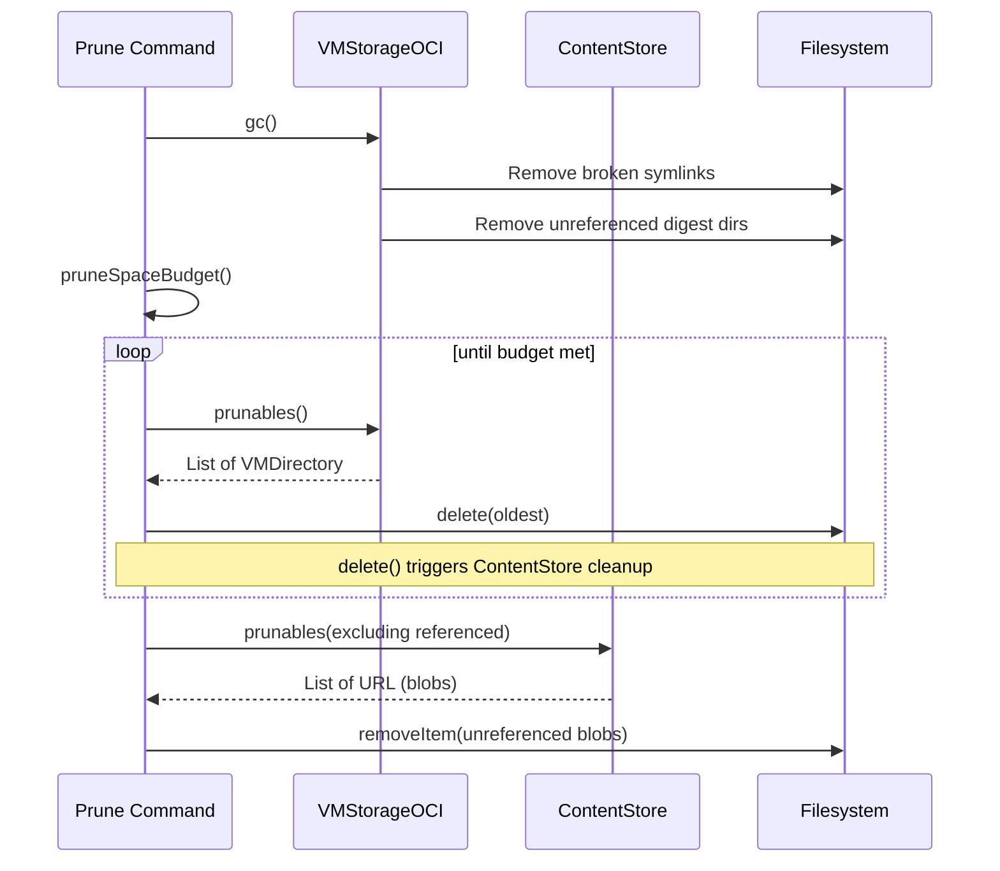
Sources: [Sources/tart/Commands/Prune.swift:46-75](), [Sources/tart/Config.swift:28-40](), [Sources/tart/ContentStore.swift:124-147]()

---

# Page: Networking

# Networking

<details>
<summary>Relevant source files</summary>

The following files were used as context for generating this wiki page:

- [Sources/tart/Commands/Run.swift](Sources/tart/Commands/Run.swift)
- [Sources/tart/Network/Network.swift](Sources/tart/Network/Network.swift)
- [Sources/tart/Network/NetworkBridged.swift](Sources/tart/Network/NetworkBridged.swift)
- [Sources/tart/Network/NetworkShared.swift](Sources/tart/Network/NetworkShared.swift)
- [Sources/tart/Network/Softnet.swift](Sources/tart/Network/Softnet.swift)
- [Sources/tart/VM.swift](Sources/tart/VM.swift)
- [Tests/TartTests/DirecotryShareTests.swift](Tests/TartTests/DirecotryShareTests.swift)
- [Tests/TartTests/SoftnetControlFDTests.swift](Tests/TartTests/SoftnetControlFDTests.swift)

</details>


Tart provides several networking modes to facilitate communication between the host and the guest VM, as well as external network access. These modes are abstracted via the `Network` protocol, allowing the VM lifecycle to manage network attachments and external helper processes uniformly.

## Networking Modes

Tart supports three primary networking modes, each corresponding to a specific implementation of the `Network` protocol defined in [Sources/tart/Network/Network.swift:4-8]().

### NAT (Shared Networking)
This is the default mode. It uses Apple's `VZNATNetworkDeviceAttachment` to provide the guest with access to the host's network connection via Network Address Translation (NAT).

*   **Implementation:** `NetworkShared` [Sources/tart/Network/NetworkShared.swift:5-17]().
*   **Behavior:** The guest is placed behind a virtual NAT, receiving an IP address usually in the `192.168.64.x` range. It returns a `VZNATNetworkDeviceAttachment` in its `attachments()` method [Sources/tart/Network/NetworkShared.swift:6-8]().

### Bridged Networking
In bridged mode, the VM appears as a distinct physical device on the same local network as the host.

*   **Implementation:** `NetworkBridged` [Sources/tart/Network/NetworkBridged.swift:5-23]().
*   **Configuration:** It utilizes an array of `VZBridgedNetworkInterface` to attach directly to physical or virtual network interfaces on the host [Sources/tart/Network/NetworkBridged.swift:12-14]().

### Softnet (User-mode Networking)
Softnet is a specialized user-mode networking stack used to provide advanced networking features or to bypass certain system limitations. It involves running an external `softnet` process that communicates with the VM via a socket pair.

*   **Implementation:** `Softnet` [Sources/tart/Network/Softnet.swift:12-126]().
*   **Data Flow:**
    1.  A Unix domain `socketpair` is created with `AF_UNIX` and `SOCK_DGRAM` [Sources/tart/Network/Softnet.swift:33]().
    2.  One file descriptor (`vmFD`) is used to create a `VZFileHandleNetworkDeviceAttachment` [Sources/tart/Network/Softnet.swift:147-150]().
    3.  The other descriptor (`softnetFD`) is passed to the `softnet` child process via its `standardInput` [Sources/tart/Network/Softnet.swift:46]().
    4.  The `softnet` process handles the actual packet routing and translation.

#### Control Socket Support
Softnet supports an optional control channel for policy management. This is passed via a `controlFD` which must be a connected Unix stream socket (`SOCK_STREAM`) [Sources/tart/Network/Softnet.swift:19-29](). The validity of this descriptor is checked using `getsockopt` and `getpeername` [Sources/tart/Network/Softnet.swift:54-85]().

#### SUID Bit Configuration
To perform certain network operations, the `softnet` binary may require elevated privileges. Tart includes logic in `configureSUIDBitIfNeeded()` to check if the SUID bit is set or if passwordless `sudo` is configured for the binary [Sources/tart/Network/Softnet.swift:152-181]().

### Networking Architecture

The following diagram illustrates the relationship between the `VM` class, the `Network` protocol, and the various concrete implementations.

**Networking Entity Map**
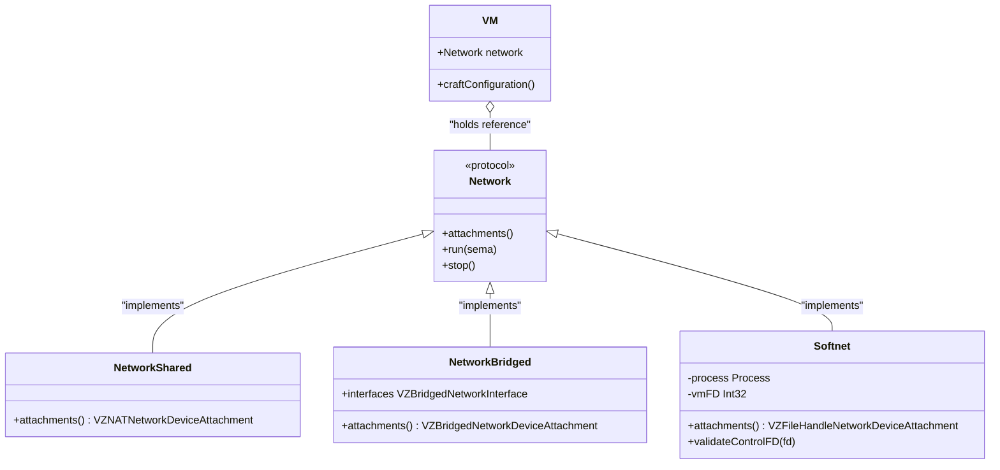
Sources: [Sources/tart/VM.swift:41](), [Sources/tart/Network/Network.swift:4-8](), [Sources/tart/Network/NetworkShared.swift:5](), [Sources/tart/Network/NetworkBridged.swift:5](), [Sources/tart/Network/Softnet.swift:12]()

## Data Flow: Softnet Communication

Softnet relies on a high-performance communication channel established during the `init` phase of the `Softnet` class. Tart optimizes this by setting large socket buffers (1 MiB) for both ends of the pair [Sources/tart/Network/Softnet.swift:41-42]().

**Softnet Initialization and Execution**
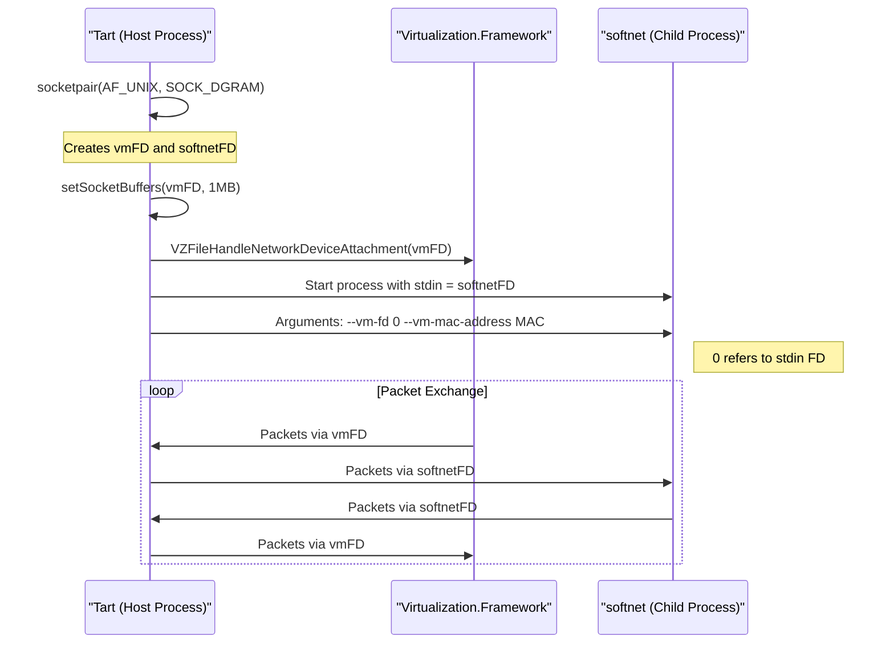
Sources: [Sources/tart/Network/Softnet.swift:31-51](), [Sources/tart/Network/Softnet.swift:128-145](), [Sources/tart/Network/Softnet.swift:147-150]()

## Virtio-FS Directory Sharing

While not strictly "networking" in the TCP/IP sense, Tart uses the Virtio-FS protocol to share directories between the host and guest, which serves as a primary data transfer mechanism.

### Configuration
Directory shares are configured via the `--dir` flag in the `run` command [Sources/tart/Commands/Run.swift:162-170](). These are converted into `VZDirectorySharingDeviceConfiguration` objects and passed to the `VM` initializer [Sources/tart/VM.swift:46]().

### Key Features
*   **Mount Tags:** By default, the `com.apple.virtio-fs.automount` tag is used, which macOS guests recognize for automatic mounting [Sources/tart/Commands/Run.swift:169]().
*   **Read-Only Access:** Shares can be restricted to read-only mode using the `:ro` suffix [Sources/tart/Commands/Run.swift:167]().
*   **Rosetta Sharing:** For Linux guests on Apple Silicon, a specialized Rosetta share can be attached via the `--rosetta` flag to allow the execution of Intel binaries within the ARM guest [Sources/tart/Commands/Run.swift:147-160]().

### Implementation Detail
The `VM.craftConfiguration` static method integrates these sharing devices into the final `VZVirtualMachineConfiguration` [Sources/tart/VM.swift:67-81](). Parsing logic for these shares supports both local paths and URLs, with optional names and mount tags [Tests/TartTests/DirecotryShareTests.swift:7-73]().

Sources: [Sources/tart/Commands/Run.swift:162-170](), [Sources/tart/VM.swift:46](), [Sources/tart/VM.swift:67-81](), [Tests/TartTests/DirecotryShareTests.swift:7-73]()

---

# Page: Guest Agent and Host-Guest Communication

# Guest Agent and Host-Guest Communication

<details>
<summary>Relevant source files</summary>

The following files were used as context for generating this wiki page:

- [Sources/tart/Commands/Exec.swift](Sources/tart/Commands/Exec.swift)
- [Sources/tart/Commands/IP.swift](Sources/tart/Commands/IP.swift)
- [Sources/tart/ControlSocket.swift](Sources/tart/ControlSocket.swift)
- [Sources/tart/GuestAgentChannel.swift](Sources/tart/GuestAgentChannel.swift)
- [Sources/tart/MACAddressResolver/ARPCache.swift](Sources/tart/MACAddressResolver/ARPCache.swift)
- [Sources/tart/MACAddressResolver/AgentResolver.swift](Sources/tart/MACAddressResolver/AgentResolver.swift)
- [Sources/tart/MACAddressResolver/Lease.swift](Sources/tart/MACAddressResolver/Lease.swift)
- [Sources/tart/MACAddressResolver/Leases.swift](Sources/tart/MACAddressResolver/Leases.swift)
- [Sources/tart/MACAddressResolver/MACAddress.swift](Sources/tart/MACAddressResolver/MACAddress.swift)
- [Sources/tart/Term.swift](Sources/tart/Term.swift)
- [Sources/tart/Utils.swift](Sources/tart/Utils.swift)
- [Tests/TartTests/ControlSocketTests.swift](Tests/TartTests/ControlSocketTests.swift)
- [Tests/TartTests/LeaseTest.swift](Tests/TartTests/LeaseTest.swift)
- [Tests/TartTests/LeasesTests.swift](Tests/TartTests/LeasesTests.swift)
- [Tests/TartTests/MACAddressResolverTests.swift](Tests/TartTests/MACAddressResolverTests.swift)
- [docs/.markdownlint.yml](docs/.markdownlint.yml)
- [docs/blog/images/tart-guest-agent-grpc-protocol.png](docs/blog/images/tart-guest-agent-grpc-protocol.png)
- [docs/blog/posts/2023-11-03-cirrus-runners-dashboard.md](docs/blog/posts/2023-11-03-cirrus-runners-dashboard.md)
- [docs/blog/posts/2025-06-01-tart-guest-agent.md](docs/blog/posts/2025-06-01-tart-guest-agent.md)

</details>


This page describes the mechanisms Tart uses to communicate with running virtual machines. This includes the Control Socket proxy for gRPC-based interactions, the execution of remote commands via `tart exec`, and the various strategies for resolving a guest's IP address.

## Overview of Communication Architecture

Tart facilitates host-to-guest communication through a layered architecture. At the lowest level, Tart uses `virtio-serial` or socket devices provided by `Virtualization.Framework`. For high-level commands like `exec`, Tart proxies a Unix Domain Socket (UDS) on the host to a specific port inside the guest (defaulting to 8080) where the `tart-guest-agent` listens.

### Code Entity Relationship: Control Socket and Guest Agent

The following diagram illustrates how the host-side `ControlSocket` class interacts with the gRPC client and the VM.

**Host-Guest Communication Flow**
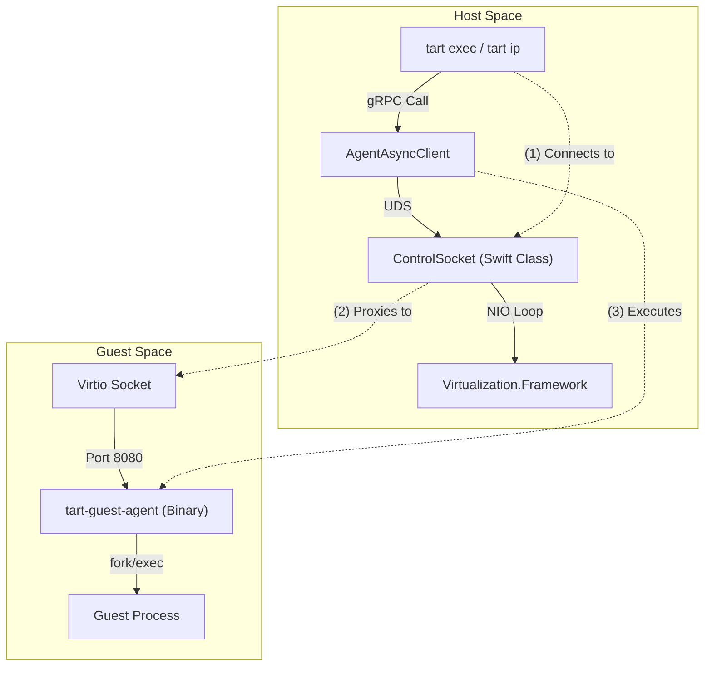
Sources: [Sources/tart/ControlSocket.swift:8-17](), [Sources/tart/Commands/Exec.swift:75-78](), [Sources/tart/ControlSocket.swift:52-96](), [docs/blog/posts/2025-06-01-tart-guest-agent.md:40-48]()

## ControlSocket Proxy

The `ControlSocket` class [Sources/tart/ControlSocket.swift:8-17]() manages a Unix Domain Socket on the host that serves as a bridge to the VM.

- **Initialization**: It takes a `controlSocketURL` (usually pointing to `control.sock` inside the VM directory) and a `vmPort` (default 8080) [Sources/tart/ControlSocket.swift:14-17]().
- **Path Length Workaround**: To avoid the 104-character limitation for Unix Domain Sockets, the class changes the current working directory to the VM's base directory before binding [Sources/tart/ControlSocket.swift:27-33]().
- **Data Flow**: It uses `SwiftNIO` to bootstrap a server [Sources/tart/ControlSocket.swift:36-43](). When a client (like the `tart` CLI) connects, it dials the VM's internal socket using `vm?.connect(toPort:)` [Sources/tart/ControlSocket.swift:69-71]() and pipes data bidirectionally between the client and the VM using `NIOAsyncChannel` [Sources/tart/ControlSocket.swift:83-98]().

Sources: [Sources/tart/ControlSocket.swift:1-107]()

## Remote Execution (tart exec)

The `exec` command allows users to run commands inside a VM that has the `tart-guest-agent` installed [Sources/tart/Commands/Exec.swift:11-15](). It is only available on macOS 14 or newer [Sources/tart/Commands/Exec.swift:31-33]().

### Implementation Details
The command is implemented in `Exec.swift` [Sources/tart/Commands/Exec.swift:10-29]().

1.  **gRPC Stream**: It establishes a gRPC bidirectional stream using `AgentAsyncClient.makeExecCall()` [Sources/tart/Commands/Exec.swift:76-77]().
2.  **Interactive Mode**: If the `--interactive` (`-i`) flag is set, Tart reads from the host's `stdin` [Sources/tart/Commands/Exec.swift:101-143]() and sends it as `standardInput` events to the agent [Sources/tart/Commands/Exec.swift:145-160]().
3.  **Terminal Handling (PTY)**: If `--tty` (`-t`) is requested, Tart:
    *   Places the host terminal into raw mode using `Term.MakeRaw()` [Sources/tart/Commands/Exec.swift:54-56]().
    *   Sends initial terminal dimensions [Sources/tart/Commands/Exec.swift:85-92]().
    *   Listens for `SIGWINCH` signals on the host using `DispatchSource.makeSignalSource` [Sources/tart/Commands/Exec.swift:164-166]() to detect window resizing and propagates updates via `terminalResize` events [Sources/tart/Commands/Exec.swift:175-184]().
4.  **Output**: Data received from the agent's `responseStream` is processed to handle `standardOutput` and `standardError` [Sources/tart/Commands/Exec.swift:189-191]().

Sources: [Sources/tart/Commands/Exec.swift:1-191](), [docs/blog/posts/2025-06-01-tart-guest-agent.md:40-48]()

## IP Resolution Strategies

The `tart ip` command supports three distinct strategies for discovering a VM's IP address, defined by `IPResolutionStrategy` [Sources/tart/Commands/IP.swift:6-10]().

| Strategy | Implementation Class | Mechanism | Best Use Case |
| :--- | :--- | :--- | :--- |
| **DHCP** | `Leases` | Parses `/var/db/dhcpd_leases` on the host [Sources/tart/MACAddressResolver/Leases.swift:23](). | NAT networking (default). Fast and reliable. |
| **ARP** | `ARPCache` | Parses output of host `/usr/sbin/arp -an` [Sources/tart/MACAddressResolver/ARPCache.swift:46-47](). | Bridged networking. Requires guest network activity. |
| **Agent**| `AgentResolver` | Queries the `tart-guest-agent` via gRPC `ResolveIP` call [Sources/tart/MACAddressResolver/AgentResolver.swift:21](). | Works for all network types; requires agent in guest. |

### DHCP Lease Parsing
The `Leases` class parses the Apple-specific DHCP lease file format [Sources/tart/MACAddressResolver/Leases.swift:57-113](). It iterates through the file, extracting `ip_address`, `hw_address` (MAC), and `lease` expiration times. It filters out expired leases and prefers the newest entry if duplicates exist [Sources/tart/MACAddressResolver/Leases.swift:40-52]().

### ARP Cache Parsing
The `ARPCache` class executes the system `arp` command [Sources/tart/MACAddressResolver/ARPCache.swift:45-54]() and uses a regular expression `^.* \((?<ip>.*)\) at (?<mac>.*) on (?<interface>.*) .*$` to map MAC addresses to IPs found in the host's ARP table [Sources/tart/MACAddressResolver/ARPCache.swift:71-105]().

### Agent-based Resolution
The `AgentResolver` uses the `withGuestAgentChannel` helper to connect to the control socket and invoke the `ResolveIP()` gRPC method on the guest agent [Sources/tart/MACAddressResolver/AgentResolver.swift:16-27]().

**IP Resolution Logic**
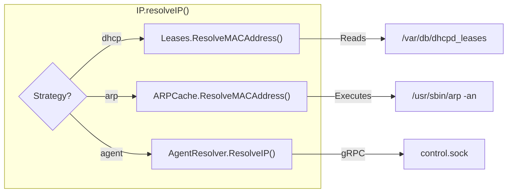
Sources: [Sources/tart/Commands/IP.swift:53-89](), [Sources/tart/MACAddressResolver/Leases.swift:19-24](), [Sources/tart/MACAddressResolver/ARPCache.swift:41-48](), [Sources/tart/MACAddressResolver/AgentResolver.swift:7-14]()

## Technical Components Summary

### gRPC Integration
Tart utilizes `grpc-swift` and pre-generated Swift code (`Cirruslabs_TartGuestAgent_Grpc_Swift`) for agent communication [Sources/tart/Commands/Exec.swift:3-4](). The `withGuestAgentChannel` utility provides a standardized way to open a `GRPCChannel` over a Unix Domain Socket for any guest-bound request [Sources/tart/GuestAgentChannel.swift:10-28]().

### Control Socket Management
The `ControlSocket` implementation handles the lifecycle of the host-side socket file, ensuring it is removed before binding to avoid "address already in use" errors [Sources/tart/ControlSocket.swift:23-25](). It leverages `MultiThreadedEventLoopGroup` for efficient asynchronous I/O [Sources/tart/ControlSocket.swift:20-21]().

Sources: [Sources/tart/ControlSocket.swift:1-107](), [Sources/tart/GuestAgentChannel.swift:1-28](), [Sources/tart/Commands/Exec.swift:1-191]()

---

# Page: OCI Registry Integration

# OCI Registry Integration

<details>
<summary>Relevant source files</summary>

The following files were used as context for generating this wiki page:

- [Sources/tart/Commands/Push.swift](Sources/tart/Commands/Push.swift)
- [Sources/tart/Fetcher.swift](Sources/tart/Fetcher.swift)
- [Sources/tart/OCI/Authentication.swift](Sources/tart/OCI/Authentication.swift)
- [Sources/tart/OCI/Manifest.swift](Sources/tart/OCI/Manifest.swift)
- [Sources/tart/OCI/Registry.swift](Sources/tart/OCI/Registry.swift)
- [Sources/tart/VMDirectory+OCI.swift](Sources/tart/VMDirectory+OCI.swift)
- [Sources/tart/VMStorageHelper.swift](Sources/tart/VMStorageHelper.swift)
- [Tests/TartTests/TokenResponseTests.swift](Tests/TartTests/TokenResponseTests.swift)

</details>


Tart leverages OCI-compatible registries (such as GitHub Container Registry, AWS ECR, and Docker Hub) as a distribution mechanism for virtual machine images. Unlike traditional container images, Tart VM images consist of a configuration file, an NVRAM state, and a large disk image, which are mapped to OCI layers using specific media types.

The integration is built upon the [OCI Distribution Spec](https://github.com/opencontainers/distribution-spec), allowing Tart to treat VM images as first-class citizens in the container ecosystem.

### Registry Integration Overview

The following diagram illustrates how high-level CLI commands interact with the internal Registry client and storage layers to facilitate image distribution.

**Registry Workflow Architecture**
```mermaid
graph TD
    subgraph "CLI Layer"
        [Push.swift] --> |"calls pushToRegistry()"| [VMDirectory_OCI]
        [Pull.swift] --> |"calls open()"| [VMStorageHelper]
        [Clone.swift] --> |"calls open()"| [VMStorageHelper]
        [VMStorageHelper] --> |"instantiates"| [VMStorageOCI]
    end

    subgraph "Registry Logic"
        [VMStorageOCI] --> [Registry.swift]
        [VMDirectory_OCI] --> [Registry.swift]
        [Registry.swift] --> [Fetcher.swift]
    end

    subgraph "Data Handling"
        [VMDirectory_OCI] --> |"DiskV2.pull/push"| [DiskV2.swift]
        [Registry.swift] --> |"Auth"| [CredentialsProvider]
        [Registry.swift] --> |"Token/Basic"| [Authentication]
    end

    [Fetcher.swift] --> |"HTTPS/OCI Distribution Spec"| RemoteRegistry["Remote OCI Registry"]
```
Sources: [Sources/tart/Commands/Push.swift:81-88](), [Sources/tart/VMStorageHelper.swift:3-12](), [Sources/tart/VMDirectory+OCI.swift:15-31](), [Sources/tart/OCI/Registry.swift:113-136]()

### Component Relationship

The integration is divided into several specialized subsystems that handle networking, disk optimization, security, and high-level workflows.

| Subsystem | Key Responsibility | Primary Entities |
| :--- | :--- | :--- |
| **Registry Client** | Implementation of OCI manifest and blob protocols. | `Registry`, `OCIManifest`, `Fetcher` |
| **Disk Layerization** | Splitting and compressing large disks into OCI-friendly layers. | `DiskV2`, `TartDiskFileGroup` |
| **Authentication** | Managing credentials across Keychain, Docker config, and Env. | `CredentialsProvider`, `TokenResponse`, `Authentication` |
| **Workflow Management** | Orchestrating pull/push sequences and local cache. | `Push`, `Pull`, `VMDirectory+OCI` |

**Code Entity Mapping**
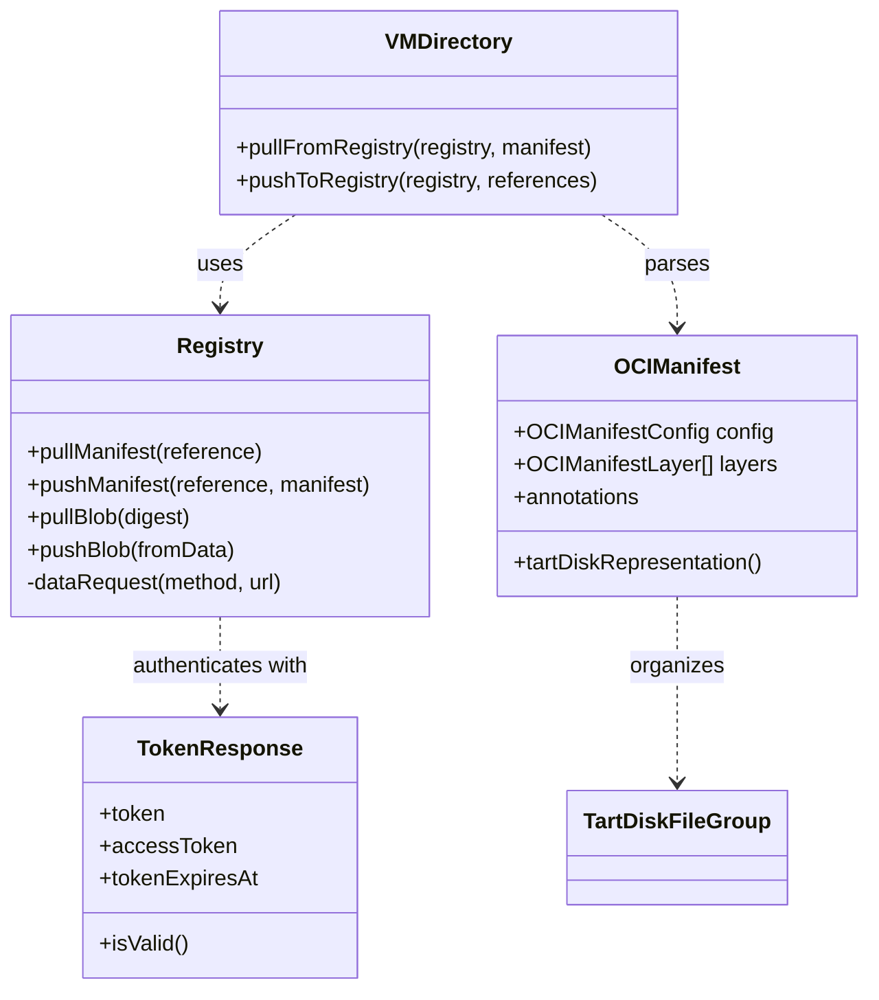
Sources: [Sources/tart/OCI/Registry.swift:113-206](), [Sources/tart/OCI/Manifest.swift:70-117](), [Sources/tart/VMDirectory+OCI.swift:15-156](), [Sources/tart/OCI/Registry.swift:58-111]()

---

### [Registry Client and Networking](#3.1)
The `Registry` class serves as the core client for interacting with OCI APIs. It handles the low-level HTTP mechanics of pulling and pushing manifests and blobs, supporting both monolithic and chunked uploads. It utilizes `Fetcher`, a wrapper around `URLSession`, to stream data efficiently using `AsyncThrowingStream` to avoid loading large blobs into memory.
* For details, see [Registry Client and Networking](#3.1).

Sources: [Sources/tart/OCI/Registry.swift:113-136](), [Sources/tart/Fetcher.swift:19-37](), [Sources/tart/OCI/Registry.swift:167-192]()

### [Disk Layerization (DiskV2)](#3.2)
To handle large VM disks (often 20GB+), Tart employs `DiskV2` logic to split disks into manageable chunks. These chunks are compressed and uploaded as individual OCI layers with specific media types like `application/vnd.cirruslabs.tart.disk.v2`. The system supports "stacked" images using ASIF overlays, allowing for efficient delta updates.
* For details, see [Disk Layerization (DiskV2)](#3.2).

Sources: [Sources/tart/VMDirectory+OCI.swift:37-45](), [Sources/tart/OCI/Manifest.swift:8-11](), [Sources/tart/OCI/Manifest.swift:27-58]()

### [Authentication and Credentials](#3.3)
Tart supports multiple authentication methods through a chain of `CredentialsProvider` implementations. It handles Bearer token negotiation via `TokenResponse` and Basic auth via `BasicAuthentication`. Credentials can be sourced from the macOS Keychain, standard Docker `config.json` files, or environment variables.
* For details, see [Authentication and Credentials](#3.3).

Sources: [Sources/tart/OCI/Registry.swift:131-136](), [Sources/tart/OCI/Registry.swift:58-111](), [Sources/tart/OCI/Authentication.swift:8-21]()

### [Pull, Push, Clone, and Prune](#3.4)
High-level commands coordinate the registry client with local storage. `Push` supports a "lightweight" mode that avoids re-uploading blobs if they already exist in the registry. `VMDirectory` manages the orchestration of pulling configuration, NVRAM, and disk layers into the local filesystem structure.
* For details, see [Pull, Push, Clone, and Prune](#3.4).

Sources: [Sources/tart/Commands/Push.swift:105-120](), [Sources/tart/VMDirectory+OCI.swift:15-113](), [Sources/tart/VMStorageHelper.swift:3-12]()

---

# Page: Registry Client and Networking

# Registry Client and Networking

<details>
<summary>Relevant source files</summary>

The following files were used as context for generating this wiki page:

- [Sources/tart/Fetcher.swift](Sources/tart/Fetcher.swift)
- [Sources/tart/OCI/Authentication.swift](Sources/tart/OCI/Authentication.swift)
- [Sources/tart/OCI/AuthenticationKeeper.swift](Sources/tart/OCI/AuthenticationKeeper.swift)
- [Sources/tart/OCI/Reference/Generated/Reference.interp](Sources/tart/OCI/Reference/Generated/Reference.interp)
- [Sources/tart/OCI/Reference/Generated/Reference.tokens](Sources/tart/OCI/Reference/Generated/Reference.tokens)
- [Sources/tart/OCI/Reference/Generated/ReferenceBaseListener.swift](Sources/tart/OCI/Reference/Generated/ReferenceBaseListener.swift)
- [Sources/tart/OCI/Reference/Generated/ReferenceLexer.interp](Sources/tart/OCI/Reference/Generated/ReferenceLexer.interp)
- [Sources/tart/OCI/Reference/Generated/ReferenceLexer.swift](Sources/tart/OCI/Reference/Generated/ReferenceLexer.swift)
- [Sources/tart/OCI/Reference/Generated/ReferenceLexer.tokens](Sources/tart/OCI/Reference/Generated/ReferenceLexer.tokens)
- [Sources/tart/OCI/Reference/Generated/ReferenceListener.swift](Sources/tart/OCI/Reference/Generated/ReferenceListener.swift)
- [Sources/tart/OCI/Reference/Generated/ReferenceParser.swift](Sources/tart/OCI/Reference/Generated/ReferenceParser.swift)
- [Sources/tart/OCI/Reference/Reference.g4](Sources/tart/OCI/Reference/Reference.g4)
- [Sources/tart/OCI/Registry.swift](Sources/tart/OCI/Registry.swift)
- [Sources/tart/OCI/RemoteName.swift](Sources/tart/OCI/RemoteName.swift)
- [Sources/tart/OCI/URL+Absolutize.swift](Sources/tart/OCI/URL+Absolutize.swift)
- [Tests/TartTests/RemoteNameTests.swift](Tests/TartTests/RemoteNameTests.swift)
- [Tests/TartTests/TokenResponseTests.swift](Tests/TartTests/TokenResponseTests.swift)
- [Tests/TartTests/URLAbsolutizationTests.swift](Tests/TartTests/URLAbsolutizationTests.swift)

</details>


The `Registry` class serves as the primary interface for interacting with OCI-compatible registries. It implements the OCI Distribution Specification to facilitate VM image distribution through manifest management and blob transfers. This subsystem handles complex networking tasks including streaming data via a custom `Fetcher` layer, managing OCI-specific authentication flows, and parsing remote image identifiers using a formal grammar.

## Remote Name Parsing

Tart uses a formal ANTLR4 grammar defined in `Reference.g4` to parse remote image identifiers (e.g., `ghcr.io/namespace/image:tag`). The `RemoteName` struct encapsulates the resulting host, namespace, and reference (tag or digest).

### Implementation Details
- **Grammar**: The parser distinguishes between host components, ports, namespaces, and references [Sources/tart/OCI/Reference/Generated/ReferenceParser.swift:24-32]().
- **Reference Types**: Supports both `Tag` (prefixed with `:`) and `Digest` (prefixed with `@`) [Sources/tart/OCI/RemoteName.swift:5-8]().
- **Validation**: Only ASCII letters are supported for host and namespace components [Sources/tart/OCI/RemoteName.swift:145-150](); local image names without a registry host are rejected [Tests/TartTests/RemoteNameTests.swift:36-38]().

### Parsing Flow
The following diagram illustrates how a string is transformed into a structured `RemoteName` object.

**Remote Name Parsing Architecture**
```mermaid
graph TD
    Input["String (e.g. ghcr.io/a/b:latest)"] --> Lexer["ReferenceLexer"]
    Lexer --> Tokens["TokenStream"]
    Tokens --> Parser["ReferenceParser"]
    Parser --> Tree["Parse Tree"]
    Tree --> Walker["ParseTreeWalker"]
    Walker --> Collector["ReferenceCollector (Listener)"]
    Collector --> RemoteName["RemoteName Struct"]

    subgraph "Code Entities"
        ReferenceLexer["ReferenceLexer.swift"]
        ReferenceParser["ReferenceParser.swift"]
        ReferenceCollector["ReferenceCollector (RemoteName.swift:49)"]
        RemoteName["RemoteName (RemoteName.swift:82)"]
    end
```
**Sources:** [Sources/tart/OCI/RemoteName.swift:82-128](), [Sources/tart/OCI/Reference/Generated/ReferenceParser.swift:108-155]().

## Registry Client

The `Registry` class manages the high-level OCI operations. It is initialized with a base URL, a namespace, and a chain of credential providers [Sources/tart/OCI/Registry.swift:129-136]().

### Key Functions
| Function | Description |
| :--- | :--- |
| `pullManifest(reference:)` | Retrieves an OCI manifest and its raw JSON data [Sources/tart/OCI/Registry.swift:181-192](). |
| `pushManifest(reference:manifest:)` | Uploads a manifest and returns its SHA256 digest [Sources/tart/OCI/Registry.swift:167-179](). |
| `ping()` | Validates connectivity and API version compatibility [Sources/tart/OCI/Registry.swift:160-165](). |

### Internal Helpers
The `Registry` class includes utilities for managing registry-specific URL construction and response parsing:
- **`uploadLocationFromResponse`**: Extracts the `Location` header from a registry response and absolutizes it against the base URL to handle relative redirects [Sources/tart/OCI/Registry.swift:194-204]().
- **`endpointURL`**: Appends the OCI version path and namespace to the base URL [Sources/tart/OCI/Registry.swift:170]().

**Sources:** [Sources/tart/OCI/Registry.swift:113-205]().

## Networking and Streaming

The `Fetcher` class provides a streaming abstraction over `URLSession`. It is designed to handle large VM disk layers efficiently by yielding data chunks through an `AsyncThrowingStream`.

### Fetcher Architecture
The `Fetcher` utilizes a private `Delegate` implementing `URLSessionDataDelegate` to manage backpressure and buffering. It explicitly disables cookie handling to prevent issues with registries like Harbor that expect CSRF tokens when session cookies are present [Sources/tart/Fetcher.swift:6-14]().

**Fetcher Data Flow**
```mermaid
sequenceDiagram
    participant R as Registry
    participant F as Fetcher
    participant D as Fetcher.Delegate
    participant S as URLSession

    R->>F: fetch(URLRequest)
    F->>S: dataTask(with:)
    S->>D: didReceive response
    D-->>F: resume(responseContinuation)
    F-->>R: return (AsyncThrowingStream, HTTPURLResponse)
    
    loop Every 16MB Chunk
        S->>D: didReceive data
        D->>D: buffer.append(data)
        Note over D: buffer.count >= 16MB
        D->>F: streamContinuation.yield(buffer)
        F->>R: yield chunk to caller
    end
    
    S->>D: didCompleteWithError
    D->>F: streamContinuation.finish()
```

### Buffer Management
To optimize memory usage, the `Delegate` uses a `bufferFlushSize` of 16 MB [Sources/tart/Fetcher.swift:44](). It pre-initializes the buffer capacity based on the `expectedContentLength` from the server response to minimize reallocations [Sources/tart/Fetcher.swift:53-56]().

**Sources:** [Sources/tart/Fetcher.swift:19-37](), [Sources/tart/Fetcher.swift:39-97]().

## Authentication

Tart supports OCI Bearer and Basic authentication. Authentication is coordinated by the `AuthenticationKeeper`, which caches tokens and handles the `401 Unauthorized` challenge-response flow.

### Token Handling
- **Token Parsing**: The `TokenResponse` struct decodes registry tokens using a custom JSON decoder that handles snake_case conversion and ISO8601 dates [Sources/tart/OCI/Registry.swift:65-80](). It supports both `token` and `access_token` fields [Sources/tart/OCI/Registry.swift:58-60]().
- **Expiration**: Tokens default to a 60-second lifespan if the `expires_in` field is missing, per Docker registry spec compatibility [Sources/tart/OCI/Registry.swift:90-102]().
- **Validation**: The `isValid()` method checks if the current time is before `tokenExpiresAt` [Sources/tart/OCI/Registry.swift:108-110]().

### Request Interception
The `Registry` class utilizes an `AuthenticationKeeper` to manage session state [Sources/tart/OCI/Registry.swift:117](). When a request is made, the registry injects the appropriate `Authorization` header obtained from the keeper [Sources/tart/OCI/Registry.swift:104-106]().

**Sources:** [Sources/tart/OCI/Registry.swift:58-111](), [Sources/tart/OCI/AuthenticationKeeper.swift](), [Tests/TartTests/TokenResponseTests.swift:5-40]().

---

# Page: Disk Layerization (DiskV2)

# Disk Layerization (DiskV2)

<details>
<summary>Relevant source files</summary>

The following files were used as context for generating this wiki page:

- [Sources/tart/Commands/Push.swift](Sources/tart/Commands/Push.swift)
- [Sources/tart/LocalLayerCache.swift](Sources/tart/LocalLayerCache.swift)
- [Sources/tart/OCI/Digest.swift](Sources/tart/OCI/Digest.swift)
- [Sources/tart/OCI/Layerizer/Disk.swift](Sources/tart/OCI/Layerizer/Disk.swift)
- [Sources/tart/OCI/Layerizer/DiskV2.swift](Sources/tart/OCI/Layerizer/DiskV2.swift)
- [Sources/tart/OCI/Manifest.swift](Sources/tart/OCI/Manifest.swift)
- [Sources/tart/Prunable.swift](Sources/tart/Prunable.swift)
- [Sources/tart/URL+Prunable.swift](Sources/tart/URL+Prunable.swift)
- [Sources/tart/VMDirectory+OCI.swift](Sources/tart/VMDirectory+OCI.swift)
- [Sources/tart/VMStorageHelper.swift](Sources/tart/VMStorageHelper.swift)
- [Tests/TartTests/LayerizerTests.swift](Tests/TartTests/LayerizerTests.swift)
- [Tests/TartTests/RegistryTests.swift](Tests/TartTests/RegistryTests.swift)

</details>


The Disk Layerization (DiskV2) subsystem is responsible for transforming large, monolithic VM disk images into a series of OCI-compatible layers. This process enables efficient network transfers via deduplication, compression, and parallelization.

## Overview

Tart uses a custom disk layerization format (DiskV2) to overcome the limitations of pushing multi-gigabyte files to OCI registries. Instead of uploading a single massive blob, Tart splits the disk into fixed-size chunks, compresses them using LZ4, and uploads them as individual layers [Sources/tart/OCI/Layerizer/DiskV2.swift:7-9](). This approach allows for:

*   **Resumable Uploads/Downloads:** Only failed or missing layers need to be re-transferred. `DiskV2.pull` checks for existing files to resume interrupted transfers [Sources/tart/OCI/Layerizer/DiskV2.swift:95-96]().
*   **Parallelism:** Multiple layers are processed and uploaded/downloaded concurrently using Swift Concurrency's `withThrowingTaskGroup` [Sources/tart/OCI/Layerizer/DiskV2.swift:40-41]().
*   **Deduplication:** Identical disk chunks (e.g., zeroed blocks) across different VMs can be reused if the registry supports content-addressable storage.
*   **Sparse File Support:** Tart maintains disk sparsity on the host during pulls by truncating the file to the target size and potentially skipping zeroed blocks [Sources/tart/OCI/Layerizer/DiskV2.swift:122-126]().

## Data Flow: Push and Pull

The following diagram illustrates the transformation of a local `disk.img` into OCI layers during a `tart push` and the reconstruction during a `tart pull`.

### DiskV2 Layerization Process
```mermaid
graph TD
    subgraph "Local Storage (VMDirectory)"
        A["disk.img (Raw/ASIF)"]
    end

    subgraph "DiskV2::push"
        B["Chunking (512 MiB)"]
        C["LZ4 Compression"]
        D["SHA256 Digesting"]
    end

    subgraph "OCI Registry"
        E["Layer 1 (Compressed)"]
        F["Layer 2 (Compressed)"]
        G["Layer N (Compressed)"]
        H["OCI Manifest (JSON)"]
    end

    A --> B
    B --> C
    C --> D
    D --> E
    D --> F
    D --> G
    H -.->|"References"| E
    H -.->|"References"| F
    H -.->|"References"| G
```
Sources: [Sources/tart/OCI/Layerizer/DiskV2.swift:25-92](), [Sources/tart/VMDirectory+OCI.swift:156-169]()

### Code Entity Mapping: Push Workflow
The `DiskV2` class implements the `Disk` protocol to handle the heavy lifting of disk I/O and compression.

```mermaid
graph LR
    subgraph "tart push Command"
        Push["Push.run()"] --> VMDir["VMDirectory.pushToRegistry()"]
    end

    subgraph "DiskV2 Implementation"
        VMDir --> DV2Push["DiskV2.push()"]
        DV2Push --> Mapped["Data(contentsOf:options:[.alwaysMapped])"]
        Mapped --> Chunks["mappedDisk.chunks(ofCount: 512MiB)"]
        Chunks --> LZ4["NSData.compressed(using: .lz4)"]
        LZ4 --> BlobPush["Registry.pushBlob()"]
    end

    subgraph "Metadata"
        DV2Push --> Manifest["OCIManifestLayer"]
        Manifest --> Annotations["uncompressedSizeAnnotation<br/>uncompressedContentDigestAnnotation"]
    end
```
Sources: [Sources/tart/Commands/Push.swift:81-87](), [Sources/tart/VMDirectory+OCI.swift:156-168](), [Sources/tart/OCI/Layerizer/DiskV2.swift:25-92](), [Sources/tart/OCI/Manifest.swift:21-23]()

## Implementation Details

### Chunking and Compression
`DiskV2` splits the disk into chunks of exactly 512 MiB (`layerLimitBytes`) [Sources/tart/OCI/Layerizer/DiskV2.swift:8](). Each chunk is compressed independently using the LZ4 algorithm [Sources/tart/OCI/Layerizer/DiskV2.swift:51](). This ensures that the registry layers remain a manageable size while providing high-speed decompression during pulls.

### Sparse File Handling and Zero-Skipping
During a `pull` operation, Tart optimizes for disk space. It first determines the filesystem block size using `stat(2)` [Sources/tart/OCI/Layerizer/DiskV2.swift:129-135](). 

*   **Hole Granularity:** 4 MiB (`holeGranularityBytes`) [Sources/tart/OCI/Layerizer/DiskV2.swift:22]().
*   **Performance Optimization:** Tart compares data against a pre-allocated `zeroChunk` of 4 MiB, which is significantly faster than byte-by-byte comparison [Sources/tart/OCI/Layerizer/DiskV2.swift:19-23]().

### LocalLayerCache Deduplication
When pulling a VM that shares layers with an existing local VM, Tart can use a `LocalLayerCache`. If `deduplicate` is enabled:
1.  Tart clones the disk of a "base" VM using APFS copy-on-write via `FileManager.default.copyItem` [Sources/tart/OCI/Layerizer/DiskV2.swift:99-102]().
2.  The `LocalLayerCache` records the ranges of disk layers listed in a manifest [Sources/tart/LocalLayerCache.swift:27-43]().
3.  During the pull, it uses an offset hint to efficiently find matching digests [Sources/tart/LocalLayerCache.swift:46-52]().
4.  If a match is found, the `deduplicatedBytes` are tracked via extended attributes on the disk URL [Sources/tart/URL+Prunable.swift:30-33]().

### OCI Manifest Annotations
To reconstruct the disk correctly, Tart stores metadata in the OCI Manifest's layer annotations [Sources/tart/OCI/Manifest.swift:21-26]().

| Annotation Key | Purpose |
| :--- | :--- |
| `org.cirruslabs.tart.uncompressed-size` | The size of the chunk after decompression [Sources/tart/OCI/Manifest.swift:22](). |
| `org.cirruslabs.tart.uncompressed-content-digest` | SHA256 of the raw data for local verification [Sources/tart/OCI/Manifest.swift:23](). |
| `org.cirruslabs.tart.uncompressed-disk-size` | Total size of the final `disk.img` file [Sources/tart/OCI/Manifest.swift:14](). |
| `org.cirruslabs.tart.disk-file-content-digest` | Digest of the whole reconstructed disk file [Sources/tart/OCI/Manifest.swift:24](). |

Sources: [Sources/tart/OCI/Manifest.swift:13-26](), [Sources/tart/OCI/Layerizer/DiskV2.swift:72-78]()

## Key Classes and Functions

### `DiskV2` (Class)
The primary engine for layerization, inheriting from the `Disk` protocol [Sources/tart/OCI/Layerizer/Disk.swift:3-6]().
*   `push(diskURL:registry:...)`: Maps the disk into memory using `.alwaysMapped`, chunks it, compresses via LZ4, and uploads blobs in parallel [Sources/tart/OCI/Layerizer/DiskV2.swift:25-85]().
*   `pull(registry:diskLayers:...)`: Concurrently fetches compressed blobs, verifies digests, and reconstructs the disk file [Sources/tart/OCI/Layerizer/DiskV2.swift:94-173]().

### `LocalLayerCache` (Struct)
Manages a mapping of OCI digests to byte ranges within a local disk image using `mmap(2)` [Sources/tart/LocalLayerCache.swift:3-24]().
*   `findInfo(digest:offsetHint:)`: Locates the disk range for a given layer digest, using the offset as a hint for better accuracy [Sources/tart/LocalLayerCache.swift:46-52]().

### `VMDirectory+OCI` (Extension)
High-level orchestration of the push/pull workflow.
*   `pullFromRegistry(...)`: Handles pulling the config, disk chunks (via `DiskV2.pull`), and NVRAM [Sources/tart/VMDirectory+OCI.swift:15-113]().
*   `pullDiskFile(...)`: Reconstructs one complete immutable base disk or ASIF overlay, utilizing a `ContentStore` and `FileLock` to handle concurrent access [Sources/tart/VMDirectory+OCI.swift:118-154]().

Sources: [Sources/tart/OCI/Layerizer/DiskV2.swift:1-173](), [Sources/tart/VMDirectory+OCI.swift:1-169](), [Sources/tart/LocalLayerCache.swift:1-57]()

---

# Page: Authentication and Credentials

# Authentication and Credentials

<details>
<summary>Relevant source files</summary>

The following files were used as context for generating this wiki page:

- [.swiftformat](.swiftformat)
- [Sources/tart/Commands/Login.swift](Sources/tart/Commands/Login.swift)
- [Sources/tart/Commands/Logout.swift](Sources/tart/Commands/Logout.swift)
- [Sources/tart/Credentials/CredentialsProvider.swift](Sources/tart/Credentials/CredentialsProvider.swift)
- [Sources/tart/Credentials/DockerConfigCredentialsProvider.swift](Sources/tart/Credentials/DockerConfigCredentialsProvider.swift)
- [Sources/tart/Credentials/EnvironmentCredentialsProvider.swift](Sources/tart/Credentials/EnvironmentCredentialsProvider.swift)
- [Sources/tart/Credentials/KeychainCredentialsProvider.swift](Sources/tart/Credentials/KeychainCredentialsProvider.swift)
- [Sources/tart/Credentials/StdinCredentials.swift](Sources/tart/Credentials/StdinCredentials.swift)
- [Sources/tart/Fetcher.swift](Sources/tart/Fetcher.swift)
- [Sources/tart/OCI/Authentication.swift](Sources/tart/OCI/Authentication.swift)
- [Sources/tart/OCI/Registry.swift](Sources/tart/OCI/Registry.swift)
- [Tests/TartTests/TokenResponseTests.swift](Tests/TartTests/TokenResponseTests.swift)
- [Tests/TartTests/Util/RegistryRunner.swift](Tests/TartTests/Util/RegistryRunner.swift)

</details>


Tart provides a flexible authentication system for interacting with OCI-compatible registries. It supports a variety of credential sources ranging from local macOS Keychains to Docker configuration files and environment variables.

## CredentialsProvider Chain

Authentication is managed through the `CredentialsProvider` protocol [Sources/tart/Credentials/CredentialsProvider.swift:7-11](). This protocol defines methods for retrieving and storing credentials based on a registry host.

Tart evaluates several implementations to find valid credentials for a given registry:

| Provider | Role | Storage Mechanism |
| :--- | :--- | :--- |
| `KeychainCredentialsProvider` | Primary local storage | macOS Keychain (Internet Passwords) [Sources/tart/Credentials/KeychainCredentialsProvider.swift:3-84]() |
| `DockerConfigCredentialsProvider` | Interoperability | `~/.docker/config.json` and Credential Helpers [Sources/tart/Credentials/DockerConfigCredentialsProvider.swift:3-69]() |
| `EnvironmentCredentialsProvider` | CI/CD Integration | Environment variables [Sources/tart/Credentials/EnvironmentCredentialsProvider.swift:3-22]() |
| `StdinCredentials` | Interactive Login | Interactive terminal prompts using `readpassphrase` [Sources/tart/Credentials/StdinCredentials.swift:8-33]() |

### Credentials Data Flow

The following diagram illustrates how the system resolves credentials for a specific registry host.

**Registry Credential Resolution Flow**
```mermaid
graph TD
    subgraph "Natural Language Space"
        "User Command" --> "Registry Auth"
    end

    subgraph "Code Entity Space"
        Registry["Registry (Sources/tart/OCI/Registry.swift)"] -- "calls" --> CP["CredentialsProvider Chain"]
        
        CP --> Env["EnvironmentCredentialsProvider (Sources/tart/Credentials/EnvironmentCredentialsProvider.swift)"]
        CP --> Keychain["KeychainCredentialsProvider (Sources/tart/Credentials/KeychainCredentialsProvider.swift)"]
        CP --> Docker["DockerConfigCredentialsProvider (Sources/tart/Credentials/DockerConfigCredentialsProvider.swift)"]
        
        Docker -- "reads" --> Config["~/.docker/config.json"]
        Docker -- "executes" --> Helper["docker-credential-helper (Sources/tart/Credentials/DockerConfigCredentialsProvider.swift:17)"]
        
        Keychain -- "SecItemCopyMatching" --> MacOSKeychain["macOS Keychain Services"]
    end
```
**Sources:** [Sources/tart/Credentials/CredentialsProvider.swift:7-11](), [Sources/tart/Credentials/EnvironmentCredentialsProvider.swift:3-22](), [Sources/tart/Credentials/KeychainCredentialsProvider.swift:3-84](), [Sources/tart/Credentials/DockerConfigCredentialsProvider.swift:3-69]()

## Login and Logout Commands

The `login` and `logout` commands provide the CLI interface for managing persistent credentials.

### Login Workflow
The `Login` command [Sources/tart/Commands/Login.swift:5]() supports two modes:
1.  **Interactive**: Prompts the user for a username and password via `StdinCredentials.retrieve()` [Sources/tart/Commands/Login.swift:45]().
2.  **Piped/Standard Input**: Uses `--username` and `--password-stdin` flags to read the password from `FileHandle.standardInput` [Sources/tart/Commands/Login.swift:14-15, 39-40]().

Unless the `--no-validate` flag is used, Tart performs a "ping" against the registry to verify credentials before saving them [Sources/tart/Commands/Login.swift:51-60](). Successful credentials are stored in the macOS Keychain [Sources/tart/Commands/Login.swift:62]().

### Logout Workflow
The `Logout` command [Sources/tart/Commands/Logout.swift:5]() simply removes the corresponding internet password entry from the macOS Keychain for the specified host [Sources/tart/Commands/Logout.swift:12]().

**Sources:** [Sources/tart/Commands/Login.swift:5-64](), [Sources/tart/Commands/Logout.swift:5-14]()

## Docker Interoperability

Tart provides deep integration with existing Docker setups via the `DockerConfigCredentialsProvider` [Sources/tart/Credentials/DockerConfigCredentialsProvider.swift:3]().

### Credential Helpers
If `~/.docker/config.json` specifies a `credHelper` or `credsStore`, Tart will attempt to execute the corresponding binary (e.g., `docker-credential-osxkeychain`) [Sources/tart/Credentials/DockerConfigCredentialsProvider.swift:16-17](). It communicates with these helpers via standard input/output, passing the host and parsing the resulting JSON [Sources/tart/Credentials/DockerConfigCredentialsProvider.swift:23-64]().

### Wildcard Host Matching
Unlike standard Docker behavior, Tart supports wildcard matching for `credHelpers` [Sources/tart/Credentials/DockerConfigCredentialsProvider.swift:76-77](). It uses the `Regex` engine to match the registry host against patterns defined in the `DockerConfig` [Sources/tart/Credentials/DockerConfigCredentialsProvider.swift:83-91]().

**Sources:** [Sources/tart/Credentials/DockerConfigCredentialsProvider.swift:3-94]()

## Environment Variables

For non-interactive environments like CI/CD, Tart checks for specific environment variables in `EnvironmentCredentialsProvider`:
*   `TART_REGISTRY_HOSTNAME`: (Optional) Restricts the credentials to a specific host [Sources/tart/Credentials/EnvironmentCredentialsProvider.swift:7-8]().
*   `TART_REGISTRY_USERNAME`: The username for authentication [Sources/tart/Credentials/EnvironmentCredentialsProvider.swift:12]().
*   `TART_REGISTRY_PASSWORD`: The password or token for authentication [Sources/tart/Credentials/EnvironmentCredentialsProvider.swift:13]().

**Sources:** [Sources/tart/Credentials/EnvironmentCredentialsProvider.swift:1-22]()

## Keychain Implementation

The `KeychainCredentialsProvider` utilizes the macOS `Security` framework to store credentials as `kSecClassInternetPassword` items [Sources/tart/Credentials/KeychainCredentialsProvider.swift:7](). 

**Credential Storage Architecture**
```mermaid
sequenceDiagram
    participant CLI as "Login (Sources/tart/Commands/Login.swift)"
    participant KCP as "KeychainCredentialsProvider (Sources/tart/Credentials/KeychainCredentialsProvider.swift)"
    participant Sec as "macOS Security Services"

    CLI->>KCP: "store(host:user:password:)"
    KCP->>Sec: "SecItemCopyMatching"
    alt "Item Exists"
        Sec-->>KCP: "errSecSuccess"
        KCP->>Sec: "SecItemUpdate"
    else "Item Missing"
        Sec-->>KCP: "errSecItemNotFound"
        KCP->>Sec: "SecItemAdd"
    end
    KCP-->>CLI: "Success/Failure"
```

Items are labeled as "Tart Credentials" [Sources/tart/Credentials/KeychainCredentialsProvider.swift:13]() and use `kSecAttrProtocolHTTPS` by default [Sources/tart/Credentials/KeychainCredentialsProvider.swift:8]().

**Sources:** [Sources/tart/Credentials/KeychainCredentialsProvider.swift:3-84]()

## OCI Token Authentication

When interacting with a registry, Tart handles Bearer token authentication via `TokenResponse` [Sources/tart/OCI/Registry.swift:58](). 

*   **Token Expiration**: The `tokenExpiresAt` property is calculated using the `issuedAt` date and the `expiresIn` value (defaulting to 60 seconds if omitted) [Sources/tart/OCI/Registry.swift:90-102]().
*   **Validation**: The `isValid()` function checks if the current date is before the expiration [Sources/tart/OCI/Registry.swift:108-110]().
*   **Authorization Header**: The `header()` function generates the standard `Authorization: Bearer <token>` header [Sources/tart/OCI/Registry.swift:104-106]().

**Sources:** [Sources/tart/OCI/Registry.swift:58-111](), [Sources/tart/OCI/Authentication.swift:3-21]()

---

# Page: Pull, Push, Clone, and Prune

# Pull, Push, Clone, and Prune

<details>
<summary>Relevant source files</summary>

The following files were used as context for generating this wiki page:

- [Sources/tart/Commands/Clone.swift](Sources/tart/Commands/Clone.swift)
- [Sources/tart/Commands/Prune.swift](Sources/tart/Commands/Prune.swift)
- [Sources/tart/Commands/Pull.swift](Sources/tart/Commands/Pull.swift)
- [Sources/tart/Commands/Push.swift](Sources/tart/Commands/Push.swift)
- [Sources/tart/Config.swift](Sources/tart/Config.swift)
- [Sources/tart/OCI/Manifest.swift](Sources/tart/OCI/Manifest.swift)
- [Sources/tart/VMDirectory+OCI.swift](Sources/tart/VMDirectory+OCI.swift)
- [Sources/tart/VMDirectory.swift](Sources/tart/VMDirectory.swift)
- [Sources/tart/VMStorageHelper.swift](Sources/tart/VMStorageHelper.swift)
- [Sources/tart/VMStorageLocal.swift](Sources/tart/VMStorageLocal.swift)
- [Sources/tart/VMStorageOCI.swift](Sources/tart/VMStorageOCI.swift)
- [benchmark/README.md](benchmark/README.md)
- [benchmark/internal/command/root.go](benchmark/internal/command/root.go)
- [benchmark/internal/command/stackedoci/stackedoci.go](benchmark/internal/command/stackedoci/stackedoci.go)
- [integration-tests/test_stacked_oci.py](integration-tests/test_stacked_oci.py)

</details>


This section describes the high-level workflows for distributing and managing VM images. It covers the interaction between local storage and OCI registries, the mechanics of APFS-based cloning, and the automatic maintenance of local disk space via the pruning subsystem.

## Image Distribution Workflows

Tart utilizes OCI-compatible registries as its primary distribution mechanism. The logic for managing these remote-sourced images is encapsulated in `VMStorageOCI` [Sources/tart/VMStorageOCI.swift:5](), which handles a cache of images organized by their registry host and namespace.

### Pull Flow

The `Pull` command [Sources/tart/Commands/Pull.swift:5]() serves as the entry point for fetching remote VMs.

1.  **Validation**: It first checks if the name refers to an existing local VM in `VMStorageLocal` [Sources/tart/Commands/Pull.swift:38-42]().
2.  **Registry Interaction**: It initializes a `Registry` client and invokes `VMStorageOCI.pull()` [Sources/tart/Commands/Pull.swift:44-49]().
3.  **Manifest Fetching**: `VMStorageOCI` fetches the OCI manifest to determine the image's content hash (digest) and validates the layout [Sources/tart/VMStorageOCI.swift:155-158](), [Sources/tart/OCI/Manifest.swift:117-127]().
4.  **Locking**: To prevent race conditions during concurrent pulls of the same image, Tart acquires a `FileLock` on the host-specific directory within the OCI cache [Sources/tart/VMStorageOCI.swift:81-82]().
5.  **Optimistic Cache Check**: If the digest-based image already exists and is complete (including all stacked disk groups if applicable), the pull exits early [Sources/tart/VMStorageOCI.swift:83-94]().
6.  **Automatic Pruning**: Before downloading layers, Tart calculates the `requiredDiskStorageBytes` from the manifest and attempts to reclaim space if the host disk is nearly full [Sources/tart/VMStorageOCI.swift:99-119](), [Sources/tart/Commands/Prune.swift:114-153]().

### Push Flow

The `Push` command [Sources/tart/Commands/Push.swift:6]() allows local VMs to be uploaded to OCI registries. 

*   **Lightweight Push**: If the user pushes an image that is already present in the local OCI cache (i.e., a previously pulled image), Tart performs a `lightweightPushToRegistry` [Sources/tart/Commands/Push.swift:105-120](). This only uploads the manifest to the new reference, avoiding redundant blob uploads [Sources/tart/Commands/Push.swift:74-79]().
*   **Standard Push**: For local VMs, `VMDirectory.pushToRegistry` [Sources/tart/VMDirectory+OCI.swift:156]() layerizes the disk using `DiskV2`, skipping zero-blocks and applying LZ4 compression [Sources/tart/VMDirectory+OCI.swift:32-35]().
*   **Cache Population**: If the `--populate-cache` flag is used, Tart materializes the digest-addressed image in the local OCI cache immediately after a successful push [Sources/tart/Commands/Push.swift:91-93](), [Sources/tart/VMStorageOCI.swift:155-190]().

### Data Flow: Registry to Local Cache

The following diagram illustrates the data flow and key code entities involved in the OCI-to-local transition.

**OCI Pull and Storage Entity Mapping**

```mermaid
graph TD
    subgraph "OCI Registry"
        Manifest["OCIManifest (JSON)"]
        Blobs["OCI Layers (disk.v2, asif.overlay)"]
    end

    subgraph "Tart Command Space"
        PullCmd["Pull.run()"]
        RegistryClient["Registry.pullManifest()"]
        RegistryBlobs["Registry.pullBlob()"]
    end

    subgraph "Storage Management"
        OCIStorage["VMStorageOCI.pull()"]
        VMDirOCI["VMDirectory.pullFromRegistry()"]
        ContentStore["ContentStore.install()"]
        PruneLogic["Prune.reclaimIfNeeded()"]
    end

    subgraph "Local Filesystem (~/.tart/cache/OCIs/)"
        TagLink["Tag Symlink (RemoteName)"]
        DigestDir["Digest Directory (sha256:...)"]
        SharedStore["Shared Content Store (blobs/)"]
    end

    PullCmd --> RegistryClient
    RegistryClient -.-> Manifest
    PullCmd --> OCIStorage
    OCIStorage --> PruneLogic
    OCIStorage --> VMDirOCI
    VMDirOCI --> RegistryBlobs
    RegistryBlobs -.-> Blobs
    VMDirOCI --> ContentStore
    ContentStore --> SharedStore
    OCIStorage --> TagLink
    TagLink --> DigestDir
```

**Sources:**
* [Sources/tart/Commands/Pull.swift:35-50]()
* [Sources/tart/VMStorageOCI.swift:59-94]()
* [Sources/tart/VMDirectory+OCI.swift:15-113]()
* [Sources/tart/Commands/Prune.swift:114-153]()

---

## Cloning and APFS Copy-on-Write

The `Clone` command [Sources/tart/Commands/Clone.swift:5]() creates a new local VM from either a remote source or an existing local VM.

### Implementation Details
*   **Remote Resolution**: If the source is a `RemoteName` not present in the OCI cache, Tart automatically triggers a `pull` operation [Sources/tart/Commands/Clone.swift:62-84]().
*   **Copy-on-Write (CoW)**: Tart relies on Apple File System (APFS) cloning. When `VMDirectory.clone()` is called, it performs a file-level copy using `FileManager.default.copyItem`, which on APFS does not immediately consume additional disk space [Sources/tart/Commands/Clone.swift:11-12](), [Sources/tart/VMDirectory.swift:207-209]().
*   **Stacked Cloning**: If `--stacked` is used, Tart creates a new VM that uses the source image as an immutable base, creating a small `overlay.asif` instead of copying the full disk [Sources/tart/Commands/Clone.swift:105-112]().
*   **MAC Address Management**: Tart checks if the source VM's MAC address is already in use by another local VM. If so, and the source is not suspended, it generates a new MAC address for the clone to prevent conflicts [Sources/tart/Commands/Clone.swift:102-104]().
*   **Post-Clone Pruning**: Because CoW hides true future space requirements, Tart calculates the difference between the virtual disk size and currently allocated blocks and runs `Prune.reclaimIfNeeded()` [Sources/tart/Commands/Clone.swift:132-149]().

**Sources:**
* [Sources/tart/Commands/Clone.swift:50-153]()
* [Sources/tart/VMDirectory.swift:207-209]()
* [Sources/tart/VMStorageLocal.swift:101-103]()

---

## Automatic Pruning and Space Budgets

Tart manages disk space automatically through the `Prune` subsystem [Sources/tart/Commands/Prune.swift:7]().

### Pruning Strategies
1.  **LRU Eviction**: When space is needed, Tart identifies "prunable" items (OCI cache entries and IPSW files) and sorts them by their last access date [Sources/tart/Commands/Prune.swift:159-164]().
2.  **Space Budget**: Users can enforce a global limit (e.g., `--space-budget=50`) which removes the least recently used entries until the total size fits within the budget [Sources/tart/Commands/Prune.swift:21-24](), [Sources/tart/Commands/Prune.swift:83-112]().
3.  **Retention Policy**: The `--older-than` flag allows pruning based on the number of days since an image was last accessed [Sources/tart/Commands/Prune.swift:13-16](), [Sources/tart/Commands/Prune.swift:77-81]().
4.  **Automatic Reclaim**: Triggered during `pull` or `clone`, this checks `volumeAvailableCapacityForImportantUsageKey` and deletes old cache entries if the required bytes exceed available capacity [Sources/tart/Commands/Prune.swift:114-153]().

### Implementation Entity Bridge

The following diagram maps the high-level pruning concepts to the internal classes and methods that execute them.

**Pruning Implementation Mapping**

```mermaid
graph LR
    subgraph "Triggers"
        PullFlow["Pull/Clone Flow"]
        ManualPrune["tart prune --space-budget"]
        ConfigGC["Config.gc() (Tmp Clean)"]
    end

    subgraph "Logic (Prune.swift)"
        Reclaim["Prune.reclaimIfNeeded()"]
        Budget["Prune.pruneSpaceBudget()"]
        Age["Prune.pruneOlderThan()"]
    end

    subgraph "Entities (VMStorageOCI.swift / IPSWCache.swift)"
        PStorage["PrunableStorage Protocol"]
        OCIStore["VMStorageOCI"]
        IPSW["IPSWCache"]
        LocalStore["VMStorageLocal"]
    end

    PullFlow --> Reclaim
    ManualPrune --> Budget
    ManualPrune --> Age
    ConfigGC --> TmpDir["VMDirectory (Temporary)"]

    Reclaim --> PStorage
    Budget --> PStorage
    Age --> PStorage

    PStorage <|-- OCIStore
    PStorage <|-- IPSW
    PStorage <|-- LocalStore
```

**Sources:**
* [Sources/tart/Commands/Prune.swift:7-112]()
* [Sources/tart/VMStorageOCI.swift:5]()
* [Sources/tart/Config.swift:28-40]()

### Space Calculation
Tart uses `volumeAvailableCapacityForImportantUsageKey` to determine the true available space on the macOS volume [Sources/tart/Commands/Prune.swift:125-132](). If the environment variable `TART_NO_AUTO_PRUNE` is set, all automatic reclaiming logic is bypassed [Sources/tart/Commands/Prune.swift:115-117]().

**Sources:**
* [Sources/tart/Commands/Prune.swift:114-153]()
* [Sources/tart/Config.swift:11-18]()

---

# Page: VNC and Display

# VNC and Display

<details>
<summary>Relevant source files</summary>

The following files were used as context for generating this wiki page:

- [Sources/tart/Commands/Run.swift](Sources/tart/Commands/Run.swift)
- [Sources/tart/VM.swift](Sources/tart/VM.swift)
- [Sources/tart/VNC/FullFledgedVNC.swift](Sources/tart/VNC/FullFledgedVNC.swift)
- [Sources/tart/VNC/ScreenSharingVNC.swift](Sources/tart/VNC/ScreenSharingVNC.swift)
- [Sources/tart/VNC/VNC.swift](Sources/tart/VNC/VNC.swift)

</details>


Tart provides multiple ways to interact with a virtual machine's graphical output, ranging from a native SwiftUI-based window to various VNC (Virtual Network Computing) implementations and a "headless" mode for automation.

### Graphical Interaction Overview

When running a VM via the `tart run` command, the display behavior is determined by the flags provided. By default, Tart attempts to open a native macOS window using `VZVirtualMachineView`. However, users can opt for VNC-based access or disable the GUI entirely.

| Mode | Command Flag | Implementation Class | Use Case |
| :--- | :--- | :--- | :--- |
| **Native UI** | (Default) | `VMView` / `MainApp` | Standard interactive use with optimal performance. |
| **Screen Sharing** | `--vnc` | `ScreenSharingVNC` | Native macOS Screen Sharing features (drag-and-drop). |
| **Full VNC** | `--vnc-experimental` | `FullFledgedVNC` | Recovery mode access and installation screens. |
| **Headless** | `--no-graphics` | N/A | CI/CD pipelines, SSH-only access, or background tasks. |

Sources: [Sources/tart/Commands/Run.swift:71-117]()

---

### VNC Implementations

Tart abstracts VNC functionality through the `VNC` protocol, which defines how to retrieve a connection URL and how to terminate the server.

```mermaid
classDiagram
    class "VNC" {
        <<protocol>>
        +waitForURL(netBridged Bool) URL
        +stop()
    }
    class "ScreenSharingVNC" {
        +vmConfig VMConfig
        +waitForURL(netBridged Bool) URL
        +stop()
    }
    class "FullFledgedVNC" {
        -vnc Dynamic
        +password String
        +waitForURL(netBridged Bool) URL
        +stop()
    }
    "VNC" <|.. "ScreenSharingVNC"
    "VNC" <|.. "FullFledgedVNC"
```

*   **`ScreenSharingVNC`**: Relies on the guest OS's built-in VNC server (e.g., macOS Screen Sharing). It resolves the guest's IP address using `IP.resolveIP` [Sources/tart/VNC/ScreenSharingVNC.swift:14-14]() and returns a standard `vnc://` URL.
*   **`FullFledgedVNC`**: Uses private `Virtualization.Framework` APIs (`_VZVNCServer`) to host a VNC server directly from the host process [Sources/tart/VNC/FullFledgedVNC.swift:11-15](). This is particularly useful for viewing the VM before the guest OS has fully booted or when in recovery mode. It generates a random password using `PassphraseGenerator` [Sources/tart/VNC/FullFledgedVNC.swift:10-10]().

For details, see [VNC Implementations](#4.1).

Sources: [Sources/tart/VNC/VNC.swift:3-6](), [Sources/tart/VNC/ScreenSharingVNC.swift:5-26](), [Sources/tart/VNC/FullFledgedVNC.swift:5-38]()

---

### SwiftUI App and Headless Mode

The primary graphical interface for Tart is a SwiftUI application. When a user runs a VM without the `--no-graphics` flag, the `Run` command initializes the `MainApp` and displays the `VMView`.

*   **`VMView`**: A wrapper around `VZVirtualMachineView` (via `NSViewRepresentable`) that renders the VM's framebuffer and captures keyboard/mouse input.
*   **Headless Mode**: Triggered by the `--no-graphics` flag [Sources/tart/Commands/Run.swift:71-74](). In this mode, the VM runs as a background process without any local window or VNC server. Users typically interact with these VMs via `tart exec` or SSH.

```mermaid
graph TD
    subgraph "Host Process (tart run)"
        RUN["Run"] -->|noGraphics == false| APP["MainApp (SwiftUI)"]
        RUN -->|noGraphics == true| HEADLESS["Headless Execution"]
        
        APP --> VIEW["VMView (NSViewRepresentable)"]
        VIEW --> VZVIEW["VZVirtualMachineView"]
    end

    subgraph "Virtualization.Framework"
        VZVIEW --> VM_CORE["VZVirtualMachine"]
        HEADLESS --> VM_CORE
    end
```

For details, see [SwiftUI App and Headless Mode](#4.2).

Sources: [Sources/tart/Commands/Run.swift:71-74](), [Sources/tart/VM.swift:25-86]()

---

### Display Configuration and Constraints

The display characteristics are managed through the `VM` class and its underlying `VZVirtualMachineConfiguration`.

*   **Configuration**: The `VM` class initializes the `VZVirtualMachine` with hardware configurations including audio and clipboard sharing, which can be toggled via `Run` command flags like `--no-audio` or `--no-clipboard` [Sources/tart/Commands/Run.swift:90-97]().
*   **Architecture**: Certain display features, such as the experimental VNC server, are specific to `arm64` (Apple Silicon) hosts [Sources/tart/Commands/Run.swift:111-117]().
*   **Recovery Mode**: Accessing the macOS recovery partition (via the `--recovery` flag) requires specific display handling, often necessitating the experimental VNC server to see the pre-boot environment [Sources/tart/Commands/Run.swift:98-101]().

Sources: [Sources/tart/VM.swift:43-86](), [Sources/tart/Commands/Run.swift:90-117]()

---

# Page: VNC Implementations

# VNC Implementations

<details>
<summary>Relevant source files</summary>

The following files were used as context for generating this wiki page:

- [Sources/tart/Commands/Run.swift](Sources/tart/Commands/Run.swift)
- [Sources/tart/VM.swift](Sources/tart/VM.swift)
- [Sources/tart/VNC/FullFledgedVNC.swift](Sources/tart/VNC/FullFledgedVNC.swift)
- [Sources/tart/VNC/ScreenSharingVNC.swift](Sources/tart/VNC/ScreenSharingVNC.swift)
- [Sources/tart/VNC/VNC.swift](Sources/tart/VNC/VNC.swift)

</details>


Tart provides graphical access to virtual machines through the VNC (Virtual Network Computing) protocol. Depending on the guest operating system and the desired connectivity, Tart employs different strategies to expose the VM's display. These strategies are unified under a common protocol abstraction.

## VNC Protocol Abstraction

The `VNC` protocol defines the standard interface for any VNC implementation within Tart. This abstraction allows the `Run` command and the UI components to interact with different VNC servers (internal or external) without needing to know the underlying implementation details.

| Method | Description |
| :--- | :--- |
| `waitForURL(netBridged: Bool)` | Asynchronously resolves and returns the VNC connection URL (e.g., `vnc://127.0.0.1:5900`). |
| `stop()` | Terminates the VNC server or cleans up associated resources. |

**Sources:**
- [Sources/tart/VNC/VNC.swift:3-6]()

## FullFledgedVNC

The `FullFledgedVNC` class implements a complete VNC server that runs within the Tart host process. It utilizes private APIs within Apple's `Virtualization.framework` to bridge the VM's framebuffer directly to a network socket. This implementation is particularly useful for macOS installation and recovery mode where guest-side services are not yet available [Sources/tart/Commands/Run.swift:112-117]().

### Implementation Details
- **Private API Usage**: It uses `Dynamic` to access `_VZVNCServer` and `_VZVNCAuthenticationSecurityConfiguration`, which are not part of the public `Virtualization.framework` headers [Sources/tart/VNC/FullFledgedVNC.swift:11-14]().
- **Security**: Upon initialization, it generates a random 4-segment password using a `PassphraseGenerator` [Sources/tart/VNC/FullFledgedVNC.swift:10-10]().
- **Port Allocation**: The server is initialized with port `0`, allowing the OS to assign an available ephemeral port [Sources/tart/VNC/FullFledgedVNC.swift:12-13]().
- **URL Resolution**: The `waitForURL` implementation polls the `vnc.port` property until the OS assigns a non-zero port, then constructs a local loopback URL containing the credentials [Sources/tart/VNC/FullFledgedVNC.swift:19-29]().

### Data Flow: FullFledgedVNC Initialization
The following diagram shows how `FullFledgedVNC` interfaces with the private Virtualization entities.

"Code Entity Space: FullFledgedVNC"
```mermaid
graph TD
    subgraph "Tart_Host_Process"
        A["FullFledgedVNC"] -- "wraps" --> B["Dynamic._VZVNCServer"]
        A -- "configures" --> C["Dynamic._VZVNCAuthenticationSecurityConfiguration"]
        B -- "attaches_to" --> D["VZVirtualMachine"]
    end

    A -- "1._start()" --> B
    B -- "2._Assigns_Port" --> E["Local_Socket_127.0.0.1:PORT"]
    A -- "3._waitForURL()" --> F["vnc://:password@127.0.0.1:port"]
```
**Sources:**
- [Sources/tart/VNC/FullFledgedVNC.swift:5-16]()
- [Sources/tart/VNC/FullFledgedVNC.swift:22-23]()

## ScreenSharingVNC

`ScreenSharingVNC` is used primarily for macOS guests where the native "Screen Sharing" service is already running inside the guest OS. Unlike `FullFledgedVNC`, it does not start a server on the host; instead, it acts as a discovery mechanism to find the guest's IP address. This mode is preferred for standard macOS usage as it supports advanced features like drag-and-drop [Sources/tart/Commands/Run.swift:104-107]().

### Implementation Details
- **IP Resolution**: It retrieves the VM's MAC address from the `VMConfig` and uses `IP.resolveIP` to find the guest's IP address [Sources/tart/VNC/ScreenSharingVNC.swift:13-14]().
- **Resolution Strategies**:
    - If `netBridged` is true, it uses the `arp` strategy.
    - Otherwise, it defaults to the `dhcp` strategy [Sources/tart/VNC/ScreenSharingVNC.swift:14-14]().
- **URL Construction**: Once the IP is resolved, it returns a standard `vnc://` URL pointing directly to the guest [Sources/tart/VNC/ScreenSharingVNC.swift:16-18]().

**Sources:**
- [Sources/tart/VNC/ScreenSharingVNC.swift:5-21]()

## Integration with the Run Workflow

The VNC implementation selection happens during the `Run` command execution based on CLI flags.

### CLI Configuration Flags
- `--vnc`: Triggers the use of `ScreenSharingVNC` [Sources/tart/Commands/Run.swift:109-109]().
- `--vnc-experimental`: Triggers the use of `FullFledgedVNC` [Sources/tart/Commands/Run.swift:117-117]().

### Logic Flow: VNC Setup and Connection

"Natural Language Space to Code Entity Space: VNC Integration"
```mermaid
graph TD
    subgraph "Run_Command_Logic"
        START["tart_run"] --> FLAG{"Flag_Detected?"}
        FLAG -- "--vnc-experimental" --> FULL["FullFledgedVNC"]
        FLAG -- "--vnc" --> SCREEN["ScreenSharingVNC"]
    end

    subgraph "VNC_Protocol_Implementation"
        FULL -- "vnc.start()" --> VZ_SERVER["_VZVNCServer_Private_API"]
        SCREEN -- "IP.resolveIP()" --> RESOLVER["IP_Resolution_Logic"]
    end

    subgraph "Connection_URL_Generation"
        VZ_SERVER -- "poll_port" --> URL1["waitForURL_Localhost"]
        RESOLVER -- "get_Guest_IP" --> URL2["waitForURL_GuestIP"]
    end

    URL1 --> OPEN["vnc://127.0.0.1:PORT"]
    URL2 --> OPEN["vnc://GUEST_IP"]
```

**Sources:**
- [Sources/tart/Commands/Run.swift:104-117]()
- [Sources/tart/VNC/FullFledgedVNC.swift:12-15]()
- [Sources/tart/VNC/ScreenSharingVNC.swift:12-14]()

### Summary of Differences

| Feature | `FullFledgedVNC` | `ScreenSharingVNC` |
| :--- | :--- | :--- |
| **Server Location** | Host Process (via `Virtualization.framework`) | Guest OS (Native Service) |
| **Target OS** | Linux and macOS (Experimental) | macOS |
| **Network Access** | Localhost (127.0.0.1) | Guest IP Address |
| **Authentication** | Randomly generated by Tart | Managed by Guest OS |
| **Implementation** | `Dynamic` Private APIs | IP Discovery Logic |

**Sources:**
- [Sources/tart/VNC/FullFledgedVNC.swift:5-16]()
- [Sources/tart/VNC/ScreenSharingVNC.swift:5-21]()
- [Sources/tart/Commands/Run.swift:104-117]()

---

# Page: SwiftUI App and Headless Mode

# SwiftUI App and Headless Mode

<details>
<summary>Relevant source files</summary>

The following files were used as context for generating this wiki page:

- [Sources/tart/Commands/Run.swift](Sources/tart/Commands/Run.swift)
- [Sources/tart/Commands/Stop.swift](Sources/tart/Commands/Stop.swift)
- [Sources/tart/Commands/Suspend.swift](Sources/tart/Commands/Suspend.swift)
- [Sources/tart/PIDLock.swift](Sources/tart/PIDLock.swift)
- [Sources/tart/VM.swift](Sources/tart/VM.swift)

</details>


This section provides a technical deep dive into the graphical and non-graphical execution paths of Tart. It covers the SwiftUI-based `MainApp`, the integration of Apple's `Virtualization.Framework` UI components via `NSViewRepresentable`, and the headless execution logic used for automation and remote environments.

## The MainApp and SwiftUI Lifecycle

When Tart is executed with a graphical interface (the default behavior for macOS guests), it initializes a SwiftUI application lifecycle. The entry point for the graphical interface is managed within the `Run` command, which determines whether to start a standard macOS app instance.

### Implementation Details
The application uses `NSViewRepresentable` to bridge the AppKit-based `VZVirtualMachineView` into the SwiftUI view hierarchy. This is encapsulated in `VMView`.

| Entity | Description | File Path |
| :--- | :--- | :--- |
| `MainApp` | The top-level SwiftUI `App` structure. | [Sources/tart/App/MainApp.swift:10-10]() |
| `VMView` | A `NSViewRepresentable` wrapping `VZVirtualMachineView`. | [Sources/tart/App/VMView.swift:6-6]() |
| `WindowController` | Manages the `NSWindow` and its associated `VM` instance. | [Sources/tart/App/WindowController.swift:7-7]() |

### Data Flow: CLI to SwiftUI
The `Run` command acts as the dispatcher. If `noGraphics` is false [Sources/tart/Commands/Run.swift:71-74]() and no experimental VNC modes are selected [Sources/tart/Commands/Run.swift:109-117](), it transitions from the command-line environment to the AppKit run loop.

### Code Entity Relationship: CLI to UI
The following diagram maps the command-line argument processing to the initialization of the SwiftUI application and its corresponding view components.

```mermaid
graph TD
    subgraph "CLI Space"
        RUN["Run : AsyncParsableCommand"]
        FLAG["noGraphics: Bool"]
    end

    subgraph "SwiftUI Space"
        APP["MainApp : App"]
        WC["WindowController : NSWindowController"]
        VMV["VMView : NSViewRepresentable"]
    end

    subgraph "Virtualization.Framework Space"
        VZVMV["VZVirtualMachineView"]
        VZVM["VZVirtualMachine"]
    end

    RUN -- "if flag is false" --> APP
    APP --> WC
    WC --> VMV
    VMV -- "wraps" --> VZVMV
    VZVMV -- "displays" --> VZVM
```

Sources: [Sources/tart/Commands/Run.swift:65-117](), [Sources/tart/App/MainApp.swift:10-25](), [Sources/tart/App/VMView.swift:6-35](), [Sources/tart/VM.swift:25-86]()

## VMView and User Interaction

The `VMView` is the primary container for the virtual machine's display. It configures the `VZVirtualMachineView` to handle keyboard and mouse input.

### Key Functions
- **`makeNSView(context:)`**: Initializes the `VZVirtualMachineView` and assigns the `virtualMachine` from the `VM` object [Sources/tart/App/VMView.swift:13-20]().
- **`updateNSView(_:context:)`**: Updates the view if the underlying `VM` instance changes [Sources/tart/App/VMView.swift:22-24]().
- **Capturing Input**: The view automatically captures input when focused, provided the `VM` configuration includes pointing and keyboard devices [Sources/tart/VM.swift:43-86]().

### Menu Bar Controls
The application provides standard virtualization controls (Start, Stop, Suspend) via the macOS menu bar and window delegates. These interact directly with the `VZVirtualMachine` state via the `VM` class.

Sources: [Sources/tart/App/VMView.swift:6-35](), [Sources/tart/VM.swift:25-86]()

## Headless Mode (`--no-graphics`)

Headless mode is triggered by the `--no-graphics` flag [Sources/tart/Commands/Run.swift:71-74](). In this mode, Tart does not initialize `NSApplication` or any SwiftUI views.

### Execution Path
1. **Command Parsing**: The `Run` struct captures `noGraphics: Bool` [Sources/tart/Commands/Run.swift:74-74]().
2. **VM Initialization**: The `VM` object is created normally, but no `VZVirtualMachineView` is attached to it [Sources/tart/VM.swift:43-86]().
3. **Lifecycle Management**: The process stays alive by waiting on an `AsyncSemaphore` within the `VM` class, which is used to communicate with the `VZVirtualMachineDelegate` [Sources/tart/VM.swift:33-33]().
4. **Console Output**: If `--serial` is enabled, the guest's serial output is redirected to the host's standard I/O or a specified path via `serialPath` [Sources/tart/Commands/Run.swift:76-86]().

### Use Cases
- **CI/CD Pipelines**: Running automated tests without requiring a window server.
- **Remote Servers**: Executing VMs on headless macOS instances (e.g., AWS EC2 Mac).
- **Automation**: Using `tart ip` to retrieve the guest IP and connecting via SSH or external VNC [Sources/tart/Commands/Run.swift:73-74]().

### Code Entity Relationship: Headless Lifecycle
This diagram illustrates the signaling and locking mechanisms used to manage a VM's lifecycle when no graphical window is present.

```mermaid
sequenceDiagram
    participant RUN as "Run.run()"
    participant VM as "VM : VZVirtualMachineDelegate"
    participant SEM as "sema : AsyncSemaphore"
    participant LOCK as "PIDLock"

    RUN->>VM: init(vmDir)
    RUN->>LOCK: lock()
    Note over LOCK: Prevents multiple instances
    RUN->>VM: virtualMachine.start()
    RUN->>SEM: wait()
    
    Note over VM: VM is running...
    
    VM-->>VM: virtualMachine(_:didStopWithError:)
    VM->>SEM: signal()
    
    RUN->>RUN: exit()
```

Sources: [Sources/tart/Commands/Run.swift:65-89](), [Sources/tart/VM.swift:25-42](), [Sources/tart/VM.swift:136-143](), [Sources/tart/PIDLock.swift:4-39]()

## External Lifecycle Controls (Stop and Suspend)

Tart allows external control of running VMs through the `stop` and `suspend` commands. These commands interact with the running `tart run` process using POSIX signals.

### Stop Command
The `stop` command first attempts a graceful termination by sending `SIGINT` to the process ID (PID) stored in the VM's lock file [Sources/tart/Commands/Stop.swift:35-51](). If the VM does not terminate within the specified `timeout` (default 30 seconds), it issues a `SIGKILL` [Sources/tart/Commands/Stop.swift:57-73]().

### Suspend Command
The `suspend` command sends a `SIGUSR1` signal to the `tart run` process [Sources/tart/Commands/Suspend.swift:23-26](). The `tart run` process is responsible for handling this signal and invoking the `VZVirtualMachine.saveMachineState` API.

Sources: [Sources/tart/Commands/Stop.swift:6-75](), [Sources/tart/Commands/Suspend.swift:6-28](), [Sources/tart/PIDLock.swift:35-39]()

## Interaction with Virtualization.Framework

The relationship between the Tart `VM` wrapper and the system's `VZVirtualMachine` is critical for both UI and headless modes.

| Tart Entity | Virtualization.Framework Entity | Role |
| :--- | :--- | :--- |
| `VM` | `VZVirtualMachine` | Lifecycle and state management [Sources/tart/VM.swift:27-27](). |
| `VM.configuration` | `VZVirtualMachineConfiguration` | Hardware definition (CPU, RAM, Display) [Sources/tart/VM.swift:30-30](). |
| `VMView` | `VZVirtualMachineView` | Rendering the guest framebuffer to an NSView [Sources/tart/App/VMView.swift:14-14](). |

### Recovery Mode
Tart supports booting into macOS Recovery mode via the `--recovery` flag [Sources/tart/Commands/Run.swift:98-101](). This sets the start options of the `VZVirtualMachine` to boot from the recovery partition rather than the main OS.

Sources: [Sources/tart/Commands/Run.swift:98-101](), [Sources/tart/VM.swift:82-86]()

---

# Page: Observability and Telemetry

# Observability and Telemetry

<details>
<summary>Relevant source files</summary>

The following files were used as context for generating this wiki page:

- [.editorconfig](.editorconfig)
- [Sources/tart/Logging/Logger.swift](Sources/tart/Logging/Logger.swift)
- [Sources/tart/Logging/ProgressObserver.swift](Sources/tart/Logging/ProgressObserver.swift)
- [Sources/tart/Logging/URLSessionLogger.swift](Sources/tart/Logging/URLSessionLogger.swift)
- [Sources/tart/OTel.swift](Sources/tart/OTel.swift)
- [integration-tests/go.mod](integration-tests/go.mod)
- [integration-tests/go.sum](integration-tests/go.sum)
- [integration-tests/opentelemetry_test.go](integration-tests/opentelemetry_test.go)

</details>


Tart incorporates several mechanisms for production monitoring, tracing, and progress reporting. This observability stack allows operators to track VM lifecycle events, diagnose network performance issues, and collect distributed traces across CI/CD pipelines.

The system is built around two primary pillars:
1.  **Distributed Tracing:** Leveraging the OpenTelemetry standard to export execution data to remote collectors.
2.  **Progress Reporting:** A localized logging system that provides real-time feedback for long-running operations like image downloads and uploads.

### OpenTelemetry Integration

Tart uses the `OTel` singleton [Sources/tart/OTel.swift:7-11]() to manage distributed tracing. Tracing is not active by default; it is triggered by the presence of a `TRACEPARENT` environment variable [Sources/tart/OTel.swift:19-21](). When active, Tart exports spans using the OTLP HTTP protocol via `OtlpHttpTraceExporter` [Sources/tart/OTel.swift:33-35]().

The instrumentation captures:
*   **Service Metadata:** The service name is set to `"tart"` and the version is pulled from the `CI.version` [Sources/tart/OTel.swift:25-28]().
*   **Context Propagation:** It supports W3C Trace Context, allowing Tart to participate in parent traces initiated by CI systems like Cirrus CI [integration-tests/opentelemetry_test.go:64-67](), [integration-tests/opentelemetry_test.go:96-99]().
*   **Tag Enrichment:** Attributes can be injected via the `CIRRUS_SENTRY_TAGS` environment variable, which are then mapped to span attributes for correlation [integration-tests/opentelemetry_test.go:91-95]().

For details, see [OpenTelemetry Integration](#5.1).

### Logging and Progress Reporting

For user-facing feedback, Tart utilizes a `Logger` protocol [Sources/tart/Logging/Logger.swift:3-6]() that abstracts the difference between interactive terminals and CI environments.

*   **InteractiveConsoleLogger:** Uses ANSI escape codes like `\u{001B}[J` (erase cursor down) to overwrite the last line, providing a clean progress effect [Sources/tart/Logging/Logger.swift:16-32]().
*   **SimpleConsoleLogger:** Used in CI environments (detected via the `CI` environment variable), printing each update on a new line to preserve history [Sources/tart/Logging/Logger.swift:34-46]().

Progress is tracked via the `ProgressObserver`, which uses Key-Value Observation (KVO) on Foundation `Progress` objects [Sources/tart/Logging/ProgressObserver.swift:3-17](). This is specifically used to monitor disk layer transfers. Additionally, `URLSessionLogger` provides specialized hooks for monitoring `URLSession` task progress during OCI registry interactions by implementing `urlSession(_:task:didSendBodyData:totalBytesSent:totalBytesExpectedToSend:)` [Sources/tart/Logging/URLSessionLogger.swift:3-12]().

For details, see [Logging and Progress Reporting](#5.2).

### Telemetry Architecture

The following diagram illustrates how telemetry flows from the Tart CLI to external collectors and the user's terminal.

**Telemetry Data Flow**
```mermaid
graph TD
    subgraph "Tart Process"
        direction TB
        [RootCommand] --> [OTel.shared]
        [OTel.shared] --> [TracerProviderSdk]
        [RegistryClient] --> [ProgressObserver]
        [RegistryClient] --> [URLSessionLogger]
    end

    subgraph "Code Entities"
        [OTel.shared] -- "initializes" --> [OtlpHttpTraceExporter]
        [ProgressObserver] -- "updates" --> [Logger]
        [URLSessionLogger] -- "updates" --> [Logger]
    end

    [OtlpHttpTraceExporter] -- "OTLP/HTTP" --> [Remote_OTEL_Collector]
    [Logger] -- "ANSI/Stdout" --> [User_Terminal]

    style [OTel.shared] stroke-dasharray: 5 5
```
Sources: [Sources/tart/OTel.swift:7-16](), [Sources/tart/Logging/Logger.swift:3-6](), [Sources/tart/Logging/ProgressObserver.swift:13-17](), [Sources/tart/Logging/URLSessionLogger.swift:3-12]()

### Trace Lifecycle and Propagation

Tart's tracing lifecycle is tied to the command execution. The `OTel.flush()` method ensures that all spans are sent before the process exits, including a `Thread.sleep` to work around known issues in the `opentelemetry-swift` SDK regarding asynchronous flushing [Sources/tart/OTel.swift:48-63]().

**Trace Propagation Mapping**
| Concept | Code Entity / Environment Variable | Purpose |
| :--- | :--- | :--- |
| **Trace Activation** | `TRACEPARENT` | Activates tracing and sets parent context [Sources/tart/OTel.swift:19-21]() |
| **Exporter Endpoint** | `OTEL_EXPORTER_OTLP_TRACES_ENDPOINT` | Configures where to send OTLP data [Sources/tart/OTel.swift:31-33]() |
| **Metadata** | `CI.version` | Sets the `service.version` resource attribute [Sources/tart/OTel.swift:27-28]() |
| **Custom Tags** | `CIRRUS_SENTRY_TAGS` | Propagated as span attributes for filtering [integration-tests/opentelemetry_test.go:91-95]() |

**Code to System Mapping**
```mermaid
graph LR
    subgraph "Natural Language Space"
        "Trace Context"
        "HTTP Progress"
        "Console Output"
    end

    subgraph "Code Entity Space"
        "Trace Context" -.-> [OTel.swift]
        "HTTP Progress" -.-> [URLSessionLogger.swift]
        "Console Output" -.-> [InteractiveConsoleLogger]
    end

    [OTel.swift] -- "uses" --> [OpenTelemetryApi]
    [URLSessionLogger.swift] -- "observes" --> [URLSessionTask]
    [InteractiveConsoleLogger] -- "implements" --> [Logger]
```
Sources: [Sources/tart/OTel.swift:1-15](), [Sources/tart/Logging/URLSessionLogger.swift:3-10](), [Sources/tart/Logging/Logger.swift:16-19]()

Sources:
* [Sources/tart/OTel.swift:1-64]()
* [Sources/tart/Logging/Logger.swift:1-46]()
* [Sources/tart/Logging/ProgressObserver.swift:1-36]()
* [Sources/tart/Logging/URLSessionLogger.swift:1-17]()
* [integration-tests/opentelemetry_test.go:20-99]()

---

# Page: OpenTelemetry Integration

# OpenTelemetry Integration

<details>
<summary>Relevant source files</summary>

The following files were used as context for generating this wiki page:

- [.editorconfig](.editorconfig)
- [Package.resolved](Package.resolved)
- [Package.swift](Package.swift)
- [Sources/tart/OTel.swift](Sources/tart/OTel.swift)
- [Sources/tart/Root.swift](Sources/tart/Root.swift)
- [integration-tests/go.mod](integration-tests/go.mod)
- [integration-tests/go.sum](integration-tests/go.sum)
- [integration-tests/opentelemetry_test.go](integration-tests/opentelemetry_test.go)

</details>


Tart implements OpenTelemetry (OTel) to provide distributed tracing and observability for CLI operations. This allows users and CI/CD systems to monitor the performance and lifecycle of VM operations, such as pulls, pushes, and execution, by exporting telemetry data to OTLP-compatible collectors.

## The OTel Singleton

The core of the telemetry implementation is the `OTel` class [Sources/tart/OTel.swift:7-64](), which acts as a singleton manager for the OpenTelemetry SDK. It handles the initialization of the tracer provider, resource attribution, and the lifecycle of spans.

### Initialization and Activation
Tracing is not active by default. The `OTel.initializeTracing()` function checks for the presence of the `TRACEPARENT` environment variable [Sources/tart/OTel.swift:19-21](). If this variable is missing, the tracer provider is not initialized, and no spans are exported.

When active, the system:
1.  **Sets Service Metadata**: Configures the service name as `tart` and attaches the version from `CI.version` [Sources/tart/OTel.swift:25-28]().
2.  **Configures Exporter**: Uses `OtlpHttpTraceExporter` [Sources/tart/OTel.swift:33-35](). It defaults to the standard OTLP endpoint or uses the value provided in `OTEL_EXPORTER_OTLP_TRACES_ENDPOINT` [Sources/tart/OTel.swift:31-32]().
3.  **Registers Provider**: The resulting `TracerProviderSdk` is registered globally via `OpenTelemetry.registerTracerProvider` [Sources/tart/OTel.swift:43]().

### Data Flow: Initialization to Export

The following diagram illustrates how the `OTel` singleton configures the telemetry pipeline based on the environment.

**OTel Configuration and Data Flow**
```mermaid
graph TD
    subgraph Environment["Environment Variables"]
        TP["TRACEPARENT"]
        EP["OTEL_EXPORTER_OTLP_TRACES_ENDPOINT"]
        ST["CIRRUS_SENTRY_TAGS"]
    end

    subgraph OTelClass["OTel.swift"]
        Init["initializeTracing()"]
        Res["Resource Attributes"]
        Exp["OtlpHttpTraceExporter"]
        Proc["SimpleSpanProcessor"]
    end

    TP -->|"Triggers Activation"| Init
    EP -->|"Sets Destination"| Exp
    Res -->|"tart & version"| Init
    Exp --> Proc
    Proc -->|"Registered to"| TracerProvider["TracerProviderSdk"]
```
Sources: [Sources/tart/OTel.swift:7-46]()

## Span Lifecycle and Command Integration

Tart follows the W3C Trace Context specification for propagation. By utilizing the `TRACEPARENT` variable, Tart can join an existing trace initiated by a parent process (like a CI runner).

### Command-Level Spans
Every Tart command is wrapped in a root span within the `Root` entry point. The `startCommandSpan(for:)` function creates a span named after the command (e.g., "list", "run") [Sources/tart/Root.swift:132-133](). 

The span lifecycle is managed in `runOnMainThread` [Sources/tart/Root.swift:94-109]() and `runInBackground` [Sources/tart/Root.swift:111-129]():
1.  **Start**: `startCommandSpan` is called before command execution [Sources/tart/Root.swift:112]().
2.  **Enrich**: The span is populated with command-line arguments [Sources/tart/Root.swift:137-140]() and environment-based tags.
3.  **End**: The span is closed after the command finishes [Sources/tart/Root.swift:126](), followed by a call to `OTel.shared.flush()` [Sources/tart/Root.swift:127]().

### Resource Enrichment
Tart enriches spans with additional metadata:
-   **Service Identity**: Spans are tagged with `service.name` ("tart") and `service.version` [Sources/tart/OTel.swift:25-28]().
-   **Cirrus Sentry Tags**: If the `CIRRUS_SENTRY_TAGS` environment variable is present (formatted as `key=value,key=value`), these are parsed by `splitEnvironmentVariable` and added as attributes to the span [Sources/tart/Root.swift:143-147](), [Sources/tart/Root.swift:188-195]().
-   **Error Recording**: If a command fails, `handleError` records the exception into the active span using `recordException(error)` [Sources/tart/Root.swift:172]().

### Flushing and Termination
Because Tart is a CLI tool, spans must be explicitly flushed before the process exits. The `OTel.flush()` method:
1.  Ends the currently active span [Sources/tart/OTel.swift:49]().
2.  Calls `forceFlush()` on the `tracerProvider` [Sources/tart/OTel.swift:56]().
3.  Implements a 100ms sleep workaround [Sources/tart/OTel.swift:62]() to address known issues in the `opentelemetry-swift` SDK where traces may not flush immediately before process termination [Sources/tart/OTel.swift:58-61]().

## Implementation Mapping

The following diagram bridges the natural language concepts of "Telemetry" to the specific entities in the `tart` codebase.

**Code Entity Mapping**
```mermaid
classDiagram
    class Root {
        +main()
        +startCommandSpan(ParsableCommand) Span
        +handleError(Error, Span)
    }
    class OTel {
        +shared: OTel
        +tracer: Tracer
        +initializeTracing() TracerProviderSdk
        +flush()
    }
    class TracerProviderSdk {
        <<SDK Entity>>
    }
    class OtlpHttpTraceExporter {
        <<SDK Entity>>
    }
    
    Root --> OTel : "uses for lifecycle"
    OTel --> TracerProviderSdk : "manages"
    TracerProviderSdk --> OtlpHttpTraceExporter : "exports via"
    
    note for OTel "Sources/tart/OTel.swift"
    note for Root "Sources/tart/Root.swift"
```
Sources: [Sources/tart/OTel.swift:1-16](), [Sources/tart/Root.swift:93-150]()

## Integration Testing

The OTel integration is verified using a Go-based mock collector in the integration test suite.

| Test Component | Purpose |
| :--- | :--- |
| `TestOpenTelemetry` | Starts an `httptest.NewServer` to act as a mock OTLP collector [integration-tests/opentelemetry_test.go:20-24](). |
| `ExportTraceServiceRequest` | Protobuf message used to capture traces sent by Tart [integration-tests/opentelemetry_test.go:25](). |
| `t.Setenv` | Configures `TRACEPARENT` and `OTEL_EXPORTER_OTLP_TRACES_ENDPOINT` to point to the mock server [integration-tests/opentelemetry_test.go:62-64](). |
| `hex.EncodeToString` | Used to verify that `TraceId` and `ParentSpanId` are correctly propagated from the environment [integration-tests/opentelemetry_test.go:97-98](). |

Sources: [integration-tests/opentelemetry_test.go:20-99](), [integration-tests/go.mod:1-10]()

---

# Page: Logging and Progress Reporting

# Logging and Progress Reporting

<details>
<summary>Relevant source files</summary>

The following files were used as context for generating this wiki page:

- [.editorconfig](.editorconfig)
- [Sources/tart/Logging/Logger.swift](Sources/tart/Logging/Logger.swift)
- [Sources/tart/Logging/ProgressObserver.swift](Sources/tart/Logging/ProgressObserver.swift)
- [Sources/tart/Logging/URLSessionLogger.swift](Sources/tart/Logging/URLSessionLogger.swift)
- [Sources/tart/OTel.swift](Sources/tart/OTel.swift)
- [integration-tests/go.mod](integration-tests/go.mod)
- [integration-tests/go.sum](integration-tests/go.sum)
- [integration-tests/opentelemetry_test.go](integration-tests/opentelemetry_test.go)

</details>


Tart provides a specialized logging and progress reporting infrastructure designed to handle both interactive terminal environments and non-interactive Continuous Integration (CI) environments. The system focuses on providing real-time feedback for long-running operations like VM image downloads and uploads while maintaining a clean output log.

## Architecture Overview

The logging system is built around a central `Logger` protocol that abstracts the terminal output mechanism. Higher-level observers then use these loggers to report progress from `Foundation.Progress` objects or `URLSession` tasks. Additionally, Tart integrates with OpenTelemetry for distributed tracing, allowing for deep observability of command execution.

### Core Entities and Data Flow

The following diagram illustrates how progress data flows from a background task (such as an OCI blob download) to the user's console, and how telemetry data is exported.

**Progress Reporting and Telemetry Data Flow**

```mermaid
graph TD
    subgraph "Data Sources"
        A["Foundation.Progress"]
        B["URLSessionTask"]
        OT["OTel.shared"]
    end

    subgraph "Observation & Tracing"
        C["ProgressObserver"]
        D["URLSessionLogger"]
        E["TracerProviderSdk"]
    end

    subgraph "Output & Export"
        F["<< protocol >> Logger"]
        G["InteractiveConsoleLogger"]
        H["SimpleConsoleLogger"]
        I["OtlpHttpTraceExporter"]
    end

    A -->|"KVO (fractionCompleted)"| C
    B -->|"didSendBodyData"| D
    OT -->|"initializeTracing()"| E
    C -->|"updateLastLine()"| F
    D -->|"updateLastLine()"| F
    F -.->|"Implementation"| G
    F -.->|"Implementation"| H
    E -->|"SpanProcessor"| I
    G -->|"ANSI Escapes"| J["Interactive Terminal"]
    H -->|"Standard Print"| K["CI Logs / File"]
    I -->|"HTTP POST"| L["OTLP Collector"]
```

**Sources:**
- `Sources/tart/Logging/Logger.swift:3-6`()
- `Sources/tart/Logging/ProgressObserver.swift:3-36`()
- `Sources/tart/Logging/URLSessionLogger.swift:3-17`()
- `Sources/tart/OTel.swift:7-46`()

---

## Logger Implementations

The `Logger` protocol [Sources/tart/Logging/Logger.swift:3-6]() defines two primary methods: `appendNewLine(_:)` for adding new information and `updateLastLine(_:)` for modifying the most recently printed line (useful for spinning progress percentages).

### Selection Logic
Tart automatically selects a logger implementation at runtime based on the environment [Sources/tart/Logging/Logger.swift:8-14]():
- **CI Environment**: If the `CI` environment variable is detected, `SimpleConsoleLogger` is used [Sources/tart/Logging/Logger.swift:9-10]().
- **Local Environment**: Otherwise, `InteractiveConsoleLogger` is used [Sources/tart/Logging/Logger.swift:12-13]().

### Implementation Details

| Class | Behavior | Implementation Details |
| :--- | :--- | :--- |
| `InteractiveConsoleLogger` | Updates the same line in-place. | Uses ANSI escape codes: `\u{001B}[1A` (move up), `\r` (carriage return), and `\u{001B}[J` (erase cursor down) [Sources/tart/Logging/Logger.swift:16-32](). |
| `SimpleConsoleLogger` | Appends updates as new lines. | Simply calls `print()` with a newline for every update, ensuring logs are preserved in non-TTY environments [Sources/tart/Logging/Logger.swift:34-46](). |

**Sources:**
- `Sources/tart/Logging/Logger.swift:8-46`()

---

## Progress Tracking

### ProgressObserver
The `ProgressObserver` class is used to monitor `Foundation.Progress` objects, which are ubiquitous in the OCI registry client for tracking disk layerization and transfers.

- **KVO Monitoring**: It uses Key-Value Observation (KVO) on the `fractionCompleted` property of the observed `Progress` object [Sources/tart/Logging/ProgressObserver.swift:17-17]().
- **Throttling**: To avoid overwhelming the terminal, it throttles updates to once per second unless the operation is finished [Sources/tart/Logging/ProgressObserver.swift:19-20]().
- **Deduplication**: It compares the rendered string (e.g., "45%") with the `lastRenderedLine` to prevent redundant output in non-interactive logs [Sources/tart/Logging/ProgressObserver.swift:23-27]().

### URLSessionLogger
The `URLSessionLogger` implements `URLSessionTaskDelegate` to provide progress reporting specifically for HTTP body transfers [Sources/tart/Logging/URLSessionLogger.swift:3-17]().

- **Hook**: It overrides `urlSession(_:task:didSendBodyData:totalBytesSent:totalBytesExpectedToSend:)` [Sources/tart/Logging/URLSessionLogger.swift:10-12]().
- **Mapping**: It maps the internal `task.progress` to a percentage string via `lineToRender` and pushes it to the configured `Logger` [Sources/tart/Logging/URLSessionLogger.swift:11-16]().

**Sources:**
- `Sources/tart/Logging/ProgressObserver.swift:13-31`()
- `Sources/tart/Logging/URLSessionLogger.swift:10-16`()

---

## OpenTelemetry Integration

Tart uses the `OTel` singleton to manage distributed tracing. This is primarily activated when the `TRACEPARENT` environment variable is present [Sources/tart/OTel.swift:18-21]().

### Initialization and Configuration
- **Endpoint**: Traces are exported via HTTP. The destination is determined by the `OTEL_EXPORTER_OTLP_TRACES_ENDPOINT` environment variable, defaulting to standard OTLP paths if not set [Sources/tart/OTel.swift:31-36]().
- **Resource Attributes**: Every trace includes service metadata, such as the service name ("tart") and the version [Sources/tart/OTel.swift:25-28]().
- **Flushing**: Because Tart is a CLI tool, it must explicitly flush spans before exiting. The `flush()` method includes a 100ms sleep to work around known issues in the OpenTelemetry Swift SDK regarding background export [Sources/tart/OTel.swift:48-63]().

### Integration Testing
The telemetry implementation is verified via Go-based integration tests that spin up a mock OTLP collector [integration-tests/opentelemetry_test.go:24-56](). These tests ensure that:
- Service name and version are correctly set [integration-tests/opentelemetry_test.go:78-79]().
- Span names match the executed CLI command (e.g., "list") [integration-tests/opentelemetry_test.go:89-89]().
- Environment tags like `CIRRUS_SENTRY_TAGS` are propagated as span attributes [integration-tests/opentelemetry_test.go:91-94]().
- W3C Trace Context (TraceID and ParentSpanID) is correctly parsed and propagated from the environment [integration-tests/opentelemetry_test.go:96-98]().

**Sources:**
- `Sources/tart/OTel.swift:7-64`()
- `integration-tests/opentelemetry_test.go:20-99`()

---

## Logging Class Relationships

The following diagram shows the relationship between the high-level observers, the telemetry singleton, and the output strategies.

**Logging and Telemetry Class Relationships**

```mermaid
classDiagram
    class Logger {
        <<interface>>
        +appendNewLine(String)
        +updateLastLine(String)
    }

    class InteractiveConsoleLogger {
        -eraseCursorDown: String
        -moveUp: String
        +updateLastLine(String)
    }

    class SimpleConsoleLogger {
        +updateLastLine(String)
    }

    class ProgressObserver {
        -progressToObserve: Progress
        -observation: NSKeyValueObservation
        +log(Logger renderer)
        -lineToRender(Progress) String
    }

    class URLSessionLogger {
        -renderer: Logger
        +urlSession(...)
    }

    class OTel {
        +shared: OTel$
        +tracer: Tracer
        +initializeTracing() TracerProviderSdk
        +flush()
    }

    Logger <|.. InteractiveConsoleLogger
    Logger <|.. SimpleConsoleLogger
    ProgressObserver --> Logger : uses
    URLSessionLogger --> Logger : uses
    OTel --> "1" OtlpHttpTraceExporter : exports via
```

**Sources:**
- `Sources/tart/Logging/Logger.swift:3-46`()
- `Sources/tart/Logging/ProgressObserver.swift:3-36`()
- `Sources/tart/Logging/URLSessionLogger.swift:3-17`()
- `Sources/tart/OTel.swift:7-64`()

---

# Page: Build, CI/CD, and Release

# Build, CI/CD, and Release

<details>
<summary>Relevant source files</summary>

The following files were used as context for generating this wiki page:

- [.ci/build-release.sh](.ci/build-release.sh)
- [.ci/create-pkg.sh](.ci/create-pkg.sh)
- [.ci/set-version.sh](.ci/set-version.sh)
- [.ci/sign-release.sh](.ci/sign-release.sh)
- [.cirrus.yml](.cirrus.yml)
- [.github/workflows/build.yml](.github/workflows/build.yml)
- [.github/workflows/ci.yml](.github/workflows/ci.yml)
- [.github/workflows/release.yml](.github/workflows/release.yml)
- [.goreleaser.yml](.goreleaser.yml)
- [Resources/embedded.provisionprofile](Resources/embedded.provisionprofile)
- [Resources/tart-dev.entitlements](Resources/tart-dev.entitlements)
- [Resources/tart-prod.entitlements](Resources/tart-prod.entitlements)
- [Sources/tart/CI/CI.swift](Sources/tart/CI/CI.swift)

</details>


This page provides a high-level overview of the Tart build pipeline, the automated CI/CD infrastructure powered by Cirrus CI and GitHub Actions, and the release process for macOS and Linux. Tart's build system is designed to produce universal binaries and notarized macOS installers.

## Build Pipeline Overview

Tart is primarily a Swift project that leverages the Swift Package Manager (SPM) for compilation. The build process targets Apple Silicon (`arm64`) and Intel (`x86_64`) architectures to support the full range of modern macOS hardware.

### Compilation and Architecture Matrix
The core `tart` executable is built using `swift build` with specific architecture flags. In the CI environment, these are built separately to verify compatibility across both architectures before being merged into a universal binary.

*   **Architecture Matrix:** CI tasks run parallel builds for `arm64` and `x86_64` [.cirrus.yml:53-64]().
*   **Release Configuration:** Production builds use the `--configuration release` flag and target the `tart` product [.ci/build-release.sh:9-14]().
*   **Version Injection:** The version string is injected into `Sources/tart/CI/CI.swift` during the build process via a shell script [.ci/set-version.sh:7-9]().

### Development Workflow
For local development, developers can build and sign the binary locally using ad-hoc signing (`-`) and the `tart-dev.entitlements` file [.cirrus.yml:18-18](). This entitlement configuration allows for `get-task-allow` which is necessary for debugging [Resources/tart-dev.entitlements:7-8]().

Sources: [.cirrus.yml:11-19](), [.ci/build-release.sh:1-24](), [.ci/set-version.sh:1-11](), [Sources/tart/CI/CI.swift:1-11]()

## CI/CD Infrastructure

Tart uses a combination of **Cirrus CI** and **GitHub Actions** to automate testing, linting, and releases.

### Pipeline Stages
| Stage | Description | Code Reference |
| :--- | :--- | :--- |
| **Lint** | Runs `swiftformat` for Swift style and `markdownlint` for docs. | [.cirrus.yml:31-50]() |
| **Test** | Executes Swift unit tests and Python/Go integration tests. | [.cirrus.yml:3-30](), [.github/workflows/ci.yml:15-37]() |
| **Build** | Compiles binaries for both `arm64` and `x86_64`. | [.cirrus.yml:51-65](), [.github/workflows/build.yml:9-37]() |
| **Release** | Handles signing, notarization, and artifact distribution. | [.github/workflows/release.yml:13-84]() |

For a detailed breakdown of the CI task definitions and environment configuration, see **[CI Pipeline (Cirrus CI)](#6.1)**.

Sources: [.cirrus.yml:1-78](), [.github/workflows/ci.yml:1-37](), [.github/workflows/release.yml:1-111]()

## Release and Packaging

The release process transforms the compiled Swift binaries into user-ready distributions, including a Homebrew formula and a macOS `.pkg` installer.

### Packaging Workflow
Tart utilizes **GoReleaser** to orchestrate the final stages of the release. This includes:
1.  **Universal Binary Creation:** Combining the `arm64` and `x86_64` binaries into a single "fat" binary [.goreleaser.yml:24-26]().
2.  **App Bundle Structure:** Constructing the `tart.app` directory and copying resources like `embedded.provisionprofile` and `Info.plist` [.goreleaser.yml:29-32]().
3.  **Code Signing & Notarization:** Production releases are signed with a Developer ID Application certificate and submitted to Apple via `notarytool` [.ci/sign-release.sh:15-24](), [.ci/sign-release.sh:33-37]().
4.  **Installer Creation:** The `create-pkg.sh` script uses `pkgbuild` to create a signed `.pkg` installer for distribution [.ci/create-pkg.sh:12-16]().

### Distribution Channels
*   **Homebrew:** GoReleaser updates the `openai/homebrew-tools` tap with the new version and checksum [.goreleaser.yml:54-63]().
*   **GitHub Releases:** Binaries and the `.pkg` installer are attached to the GitHub release tag.
*   **Documentation:** MkDocs documentation is automatically deployed to GitHub Pages upon merges to `main` [.cirrus.yml:66-78]().

For details on entitlements, provisioning profiles, and the notarization configuration, see **[Release Packaging and Code Signing](#6.2)**.

Sources: [.goreleaser.yml:1-86](), [.ci/create-pkg.sh:1-18](), [.ci/sign-release.sh:1-41]()

## Build and Release Mapping

The following diagrams bridge the conceptual release steps to the specific files and tools used in the Tart repository.

### Release Process Map
```mermaid
graph TD
    subgraph "Build Space (SPM)"
        BUILD_SH[".ci/build-release.sh"]
        BIN_ARM["tart (arm64)"]
        BIN_X64["tart (x86_64)"]
    end

    subgraph "Packaging Space (GoReleaser)"
        GR[".goreleaser.yml"]
        UNI["Universal Binary (lipo)"]
        SIGN_SH[".ci/sign-release.sh"]
        APP["tart.app Bundle"]
    end

    subgraph "Distribution Space"
        PKG[".ci/create-pkg.sh"]
        BREW["Homebrew Formula"]
        GHR["GitHub Release"]
    end

    BUILD_SH --> BIN_ARM
    BUILD_SH --> BIN_X64
    BIN_ARM --> GR
    BIN_X64 --> GR
    GR --> UNI
    UNI --> SIGN_SH
    SIGN_SH --> APP
    APP --> PKG
    GR --> BREW
    PKG --> GHR
```
Sources: [.goreleaser.yml:5-34](), [.ci/build-release.sh:9-14](), [.ci/create-pkg.sh:8-16]()

### CI Task Entity Relationship
```mermaid
graph LR
    subgraph "CI Logic"
        CI_YML[".cirrus.yml"]
        GHA_YML[".github/workflows/ci.yml"]
    end

    subgraph "Code Entities"
        UNIT["swift test"]
        INTEG_PY["pytest (integration-tests/)"]
        INTEG_GO["go test (integration-tests/)"]
    end

    subgraph "Artifacts"
        DEB_ENT["Resources/tart-dev.entitlements"]
        PROD_ENT["Resources/tart-prod.entitlements"]
    end

    CI_YML --> UNIT
    CI_YML --> INTEG_PY
    GHA_YML --> UNIT
    GHA_YML --> INTEG_GO
    INTEG_PY -- uses --> DEB_ENT
    INTEG_GO -- uses --> DEB_ENT
```
Sources: [.cirrus.yml:11-26](), [.github/workflows/ci.yml:27-37](), [Resources/tart-dev.entitlements:1-10]()

---

# Page: CI Pipeline (Cirrus CI)

# CI Pipeline (Cirrus CI)

<details>
<summary>Relevant source files</summary>

The following files were used as context for generating this wiki page:

- [.ci/build-release.sh](.ci/build-release.sh)
- [.ci/create-pkg.sh](.ci/create-pkg.sh)
- [.ci/set-version.sh](.ci/set-version.sh)
- [.cirrus.yml](.cirrus.yml)
- [.github/workflows/build.yml](.github/workflows/build.yml)
- [.github/workflows/ci.yml](.github/workflows/ci.yml)
- [.goreleaser.yml](.goreleaser.yml)
- [Sources/tart/CI/CI.swift](Sources/tart/CI/CI.swift)

</details>


The Tart project utilizes **Cirrus CI** as its primary automation platform for continuous integration and delivery. The pipeline is designed to handle macOS-specific requirements, such as Apple Silicon virtualization and code signing, using a combination of persistent workers and ephemeral macOS instances.

## Pipeline Overview

The CI pipeline is defined in `.cirrus.yml` [[.cirrus.yml:1-79]](). It encompasses linting, unit and integration testing, cross-platform builds, and a release process that includes notarization and documentation deployment. Additionally, GitHub Actions are used for cached builds and basic unit test verification [[.github/workflows/ci.yml:1-38]]().

### Execution Flow

The following diagram illustrates the data flow and task dependencies within the CI environment:

**Diagram: CI Task Dependencies and Data Flow**
```mermaid
graph TD
    subgraph "Verification"
        LINT["Lint Task (SwiftFormat)"]
        MD_LINT["Markdown Lint"]
        TEST["Test Task (Swift + Pytest + Go)"]
    end

    subgraph "Compilation"
        BUILD_ARM["Build (arm64)"]
        BUILD_X86["Build (x86_64)"]
    end

    subgraph "Release & Deployment"
        GORELEASER["GoReleaser (Release)"]
        DOCS["Deploy Documentation (MkDocs)"]
        PKG["Create PKG (.ci/create-pkg.sh)"]
    end

    LINT --> GORELEASER
    BUILD_ARM --> GORELEASER
    BUILD_X86 --> GORELEASER
    
    MAIN_BRANCH["Main Branch"] --> DOCS
    GORELEASER --> PKG
```
**Sources:** [[.cirrus.yml:3-79]](), [[.goreleaser.yml:5-35]]()

---

## Task Definitions

### 1. Verification (Test & Lint)
Verification ensures code quality and functional correctness across Swift, Python, and Go components.

*   **Test Task**: Executed on a `persistent_worker` labeled `dev-mini` [[.cirrus.yml:6-8]]().
    *   **Swift Tests**: Runs `swift test` with `/usr/sbin` added to `PATH` to ensure `diskutil` availability [[.cirrus.yml:14-16]]().
    *   **Integration Tests**: Uses a self-signed binary with `Resources/tart-dev.entitlements` [[.cirrus.yml:18]](). It executes a Python `pytest` suite and Go-based integration tests [[.cirrus.yml:25-26]]().
*   **Lint Task**: Uses the `swiftformat` package plugin to enforce styling [[.cirrus.yml:40-45]]().
*   **Markdown Lint**: Runs a Node.js container to validate documentation using `markdownlint-cli` [[.cirrus.yml:32-37]]().

**Sources:** [[.cirrus.yml:3-50]](), [[.github/workflows/ci.yml:15-38]]()

### 2. Build Matrix
The build task generates debug binaries for both Apple Silicon and Intel architectures.

*   **Matrix Configuration**: Defines `BUILD_ARCH` as `arm64` and `x86_64` [[.cirrus.yml:54-56]]().
*   **Signing**: Every build is ad-hoc signed using `codesign --sign -` and the development entitlements [[.cirrus.yml:62]]().
*   **Artifacts**: The resulting `tart` binary is exported as a CI artifact [[.cirrus.yml:63-64]]().

**Sources:** [[.cirrus.yml:51-65]]()

### 3. Release & Distribution
The release process is managed via **GoReleaser** and custom shell scripts.

*   **Version Management**: `.ci/set-version.sh` updates `Sources/tart/CI/CI.swift` and `Resources/Info.plist` with the release version [[.ci/set-version.sh:1-12]](). The `CI` struct provides the version string to the application [[Sources/tart/CI/CI.swift:1-11]]().
*   **GoReleaser Workflow**:
    1.  Calls `.ci/build-release.sh` for both `arm64` and `x86_64` [[.goreleaser.yml:8-9]]().
    2.  Creates a universal binary and assembles the `tart.app` structure [[.goreleaser.yml:24-32]]().
    3.  Invokes `.ci/sign-release.sh` for final signing [[.goreleaser.yml:33]]().
*   **Package Creation**: `.ci/create-pkg.sh` uses `pkgbuild` to create a signed `.pkg` installer [[.ci/create-pkg.sh:12-16]]().
*   **Notarization**: The `.pkg` is submitted to Apple's notarization service via `xcrun notarytool` and stapled [[.ci/create-pkg.sh:17-18]]().
*   **Homebrew**: Automatically updates the `openai/homebrew-tools` tap with the new version and DHCP caveats [[.goreleaser.yml:54-70]]().

**Sources:** [[.goreleaser.yml:1-87]](), [[.ci/create-pkg.sh:1-19]](), [[.ci/set-version.sh:1-12]](), [[Sources/tart/CI/CI.swift:1-11]]()

---

## Documentation Deployment

Documentation is managed via **MkDocs** and deployed to GitHub Pages.

*   **Container**: Uses `ghcr.io/squidfunk/mkdocs-material:latest` [[.cirrus.yml:70]]().
*   **Logic**: Triggered only on the `main` branch [[.cirrus.yml:68]]().
*   **Command**: Executes `mkdocs gh-deploy` to push the rendered site to the `gh-pages` branch [[.cirrus.yml:78]]().

**Sources:** [[.cirrus.yml:66-79]]()

---

## Code Entity Mapping

The following diagram maps CI configuration concepts to the specific scripts and tools used in the pipeline.

**Diagram: Pipeline Entity Map**
```mermaid
graph LR
    subgraph "CI Entrypoints"
        YAML[".cirrus.yml"]
        GHA[".github/workflows/ci.yml"]
    end

    subgraph "Logic & Scripts"
        SET_VER[".ci/set-version.sh"]
        BUILD_REL[".ci/build-release.sh"]
        CREATE_PKG[".ci/create-pkg.sh"]
        CI_SWIFT["Sources/tart/CI/CI.swift"]
    end

    subgraph "Tools"
        GORELEASER["GoReleaser"]
        NOTARY["notarytool"]
        SWIFT["swift build"]
    end

    YAML -- "executes" --> SWIFT
    YAML -- "triggers" --> GORELEASER
    GORELEASER -- "pre-hook" --> SET_VER
    SET_VER -- "modifies" --> CI_SWIFT
    GORELEASER -- "builds" --> BUILD_REL
    BUILD_REL -- "calls" --> SWIFT
    GORELEASER -- "post-build" --> CREATE_PKG
    CREATE_PKG -- "calls" --> NOTARY
```

### Key Integration Points

| Feature | Implementation | File Reference |
| :--- | :--- | :--- |
| **Version Injection** | `perl` regex in `set-version.sh` | [[.ci/set-version.sh:8]]() |
| **Release Build** | `swift build --configuration release` | [[.ci/build-release.sh:9-14]]() |
| **Universal Binary** | `universal_binaries` in GoReleaser | [[.goreleaser.yml:24-35]]() |
| **PKG Identifier** | `com.github.cirruslabs.tart` | [[.ci/create-pkg.sh:12]]() |
| **Homebrew Tap** | `openai/homebrew-tools` | [[.goreleaser.yml:58-59]]() |

**Sources:** [[.cirrus.yml:1-79]](), [[.goreleaser.yml:1-87]](), [[.ci/create-pkg.sh:1-19]](), [[.ci/set-version.sh:1-12]]()

---

# Page: Release Packaging and Code Signing

# Release Packaging and Code Signing

<details>
<summary>Relevant source files</summary>

The following files were used as context for generating this wiki page:

- [.ci/create-pkg.sh](.ci/create-pkg.sh)
- [.ci/pkg/scripts/postinstall](.ci/pkg/scripts/postinstall)
- [.ci/sign-release.sh](.ci/sign-release.sh)
- [.cirrus.yml](.cirrus.yml)
- [.github/workflows/release.yml](.github/workflows/release.yml)
- [.goreleaser.yml](.goreleaser.yml)
- [Resources/Info.plist](Resources/Info.plist)
- [Resources/embedded.provisionprofile](Resources/embedded.provisionprofile)
- [Resources/tart-dev.entitlements](Resources/tart-dev.entitlements)
- [Resources/tart-prod.entitlements](Resources/tart-prod.entitlements)
- [scripts/run-signed.sh](scripts/run-signed.sh)

</details>


This page describes the automated release pipeline for Tart, focusing on the creation of universal macOS binaries, code signing with Apple Developer IDs, notarization for Gatekeeper compliance, and the generation of various distribution formats including Homebrew formulae and macOS installer packages (`.pkg`).

## Release Workflow Overview

Tart utilizes **GoReleaser** as the primary orchestration tool for the release process. The pipeline is triggered by the presence of a Git tag and executes within a GitHub Actions or Cirrus CI environment on macOS runners to access the necessary Apple signing tools.

### Build and Packaging Sequence

1.  **Binary Compilation**: Swift binaries are built for both `arm64` and `x86_64` architectures using `.ci/build-release.sh` [ .goreleaser.yml:8-9 ]().
2.  **Universal Binary Creation**: GoReleaser merges these into a single universal binary using `lipo` [ .goreleaser.yml:24-26 ]().
3.  **App Bundle Assembly**: The binary is placed into a minimal `.app` structure (`tart.app/Contents/MacOS/tart`) along with required metadata [ .goreleaser.yml:20-22 ]().
4.  **Resource Injection**: Essential files like the `Info.plist`, `embedded.provisionprofile`, and the icon catalog (`Assets.car`) are copied into the bundle [ .goreleaser.yml:29-32 ]().
5.  **Signing & Notarization**: The `.ci/sign-release.sh` script signs the bundle and submits it to Apple's Notarization Service [ .goreleaser.yml:33-34 ]().

### Data Flow: From Source to Signed Artifact

The following diagram illustrates the transformation of source code and resources into a notarized distribution.

**Release Artifact Data Flow**
```mermaid
graph TD
    subgraph "Build Phase (.ci/build-release.sh)"
        A["Swift Source"] -- "swift build (arm64)" --> B1["arm64 Binary"]
        A -- "swift build (x86_64)" --> B2["x86_64 Binary"]
        B1 & B2 -- "lipo (GoReleaser)" --> C["Universal Binary"]
    end

    subgraph "Packaging Phase (.goreleaser.yml)"
        C --> D["tart.app Bundle"]
        E["Resources/Info.plist"] --> D
        F["Resources/embedded.provisionprofile"] --> D
        G["Resources/actool/Assets.car"] --> D
    end

    subgraph "Security Phase (.ci/sign-release.sh)"
        D -- "codesign" --> H["Signed/Notarized App"]
        I["Resources/tart-prod.entitlements"] -- "Applied by codesign" --> H
    end

    subgraph "Distribution Phase"
        H -- "archives (tar.gz)" --> J["GitHub Release"]
        H -- ".ci/create-pkg.sh" --> K[".pkg Installer"]
        J -- "brews" --> L["Homebrew Tap (openai/homebrew-tools)"]
    end
```

Sources: [ .goreleaser.yml:1-50 ](), [ .ci/create-pkg.sh:1-16 ](), [ .ci/sign-release.sh:1-24 ]()

---

## Code Signing and Notarization

Tart requires specific Apple entitlements to utilize the `Virtualization.framework`. These are managed through two distinct entitlement files depending on the build context.

### Entitlements: Dev vs. Prod
*   **Development**: `Resources/tart-dev.entitlements` is used during CI testing and local development builds [ .cirrus.yml:18 ](), [ .cirrus.yml:62 ](). It includes `com.apple.security.get-task-allow` for debugging [ Resources/tart-dev.entitlements:7-8 ]().
*   **Production**: `Resources/tart-prod.entitlements` is used for official releases [ .ci/sign-release.sh:22 ](). It includes `com.apple.vm.networking` for bridged/shared networking [ Resources/tart-prod.entitlements:7-8 ]().

### Notarization Workflow
The project uses `xcrun notarytool` to handle notarization. The process is automated in `.ci/sign-release.sh`:
*   **Identity**: "Developer ID Application: Cirrus Labs, Inc. (9M2P8L4D89)" [ .ci/sign-release.sh:18 ]().
*   **Credentials**: A keychain profile named "notarytool" must be pre-configured on the runner [ .ci/sign-release.sh:34 ]().
*   **Bundle ID**: `com.github.cirruslabs.tart` [ Resources/Info.plist:10 ]().

### Provisioning Profile Requirement
Because Tart uses the `com.apple.vm.networking` entitlement, Apple requires the binary to be bundled with an `embedded.provisionprofile` [ .goreleaser.yml:30 ](). This profile, which contains the `com.apple.vm.networking` key [ Resources/embedded.provisionprofile:33-34 ](), must be present in the `Contents` directory of the app bundle for the OS to permit the use of virtualization APIs.

Sources: [ .ci/sign-release.sh:29-41 ](), [ Resources/tart-dev.entitlements:1-10 ](), [ Resources/tart-prod.entitlements:1-10 ](), [ Resources/embedded.provisionprofile:1-50 ]()

---

## Installer Package (.pkg)

In addition to the raw `.app` bundle, Tart is distributed as a macOS `.pkg` installer for easier system-wide installation. This is generated by the `.ci/create-pkg.sh` script.

### Implementation Details
The script uses `pkgbuild` to create a component package:
*   **Install Location**: Files are initially placed in `/Library/Application Support/Tart` [ .ci/create-pkg.sh:14 ]().
*   **Signing**: The package itself is signed with a "Developer ID Installer" certificate [ .ci/create-pkg.sh:15 ]().
*   **Notarization**: The script explicitly calls `notarytool` and `stapler` to ensure the package can be installed without Gatekeeper warnings [ .ci/create-pkg.sh:17-18 ]().

### Post-Install Logic
The `postinstall` script [ .ci/pkg/scripts/postinstall:1-16 ]() performs the final system integration:
1.  **Structure Correction**: Moves the raw binary and resources into a proper `tart.app` structure within the installation directory [ .ci/pkg/scripts/postinstall:6-10 ]().
2.  **CLI Shim**: Creates a shell script at `/usr/local/bin/tart` that executes the binary inside the app bundle [ .ci/pkg/scripts/postinstall:12-15 ]().

**Installer Packaging Logic**
```mermaid
sequenceDiagram
    participant S as .ci/create-pkg.sh
    participant P as pkgbuild
    participant N as notarytool
    participant I as Installer.app
    participant PI as .ci/pkg/scripts/postinstall

    S->>P: Package .ci/pkg contents
    P-->>S: Tart-VERSION.pkg
    S->>N: Submit for Notarization (notarytool submit)
    N-->>S: Success
    S->>S: xcrun stapler staple
    Note over I, PI: User runs Installer
    I->>PI: Execute postinstall
    PI->>PI: Move tart to tart.app/Contents/MacOS/
    PI->>PI: Create /usr/local/bin/tart shim
```

Sources: [ .ci/create-pkg.sh:1-19 ](), [ .ci/pkg/scripts/postinstall:1-16 ]()

---

## Homebrew Distribution

GoReleaser is configured to automatically update the `openai/homebrew-tools` tap upon a successful release [ .goreleaser.yml:54-61 ]().

### Formula Configuration
The Homebrew formula includes specific logic for Tart's unique requirements:
*   **Universal Support**: It installs the entire app bundle into `libexec` [ .goreleaser.yml:78 ]().
*   **Binary Shim**: It uses `bin.write_exec_script` to point to the binary within the app bundle [ .goreleaser.yml:79 ]().
*   **Completions**: Shell completions are generated by calling the binary with `--generate-completion-script` during the `post_install` phase [ .goreleaser.yml:84-86 ]().
*   **Dependencies**: It lists `openai/tools/softnet` as a dependency for user-mode networking [ .goreleaser.yml:75-76 ]().

### System Optimization
The formula provides a caveat advising users to reduce the macOS DHCP lease time [ .goreleaser.yml:64-70 ](). This prevents IP address exhaustion when frequently creating and destroying VMs, which is common in CI environments.

Sources: [ .goreleaser.yml:54-87 ]()

---

# Page: Testing

# Testing

<details>
<summary>Relevant source files</summary>

The following files were used as context for generating this wiki page:

- [Sources/tart/OCI/Digest.swift](Sources/tart/OCI/Digest.swift)
- [Sources/tart/OCI/Layerizer/Disk.swift](Sources/tart/OCI/Layerizer/Disk.swift)
- [Sources/tart/OCI/Layerizer/DiskV2.swift](Sources/tart/OCI/Layerizer/DiskV2.swift)
- [Tests/TartTests/LayerizerTests.swift](Tests/TartTests/LayerizerTests.swift)
- [Tests/TartTests/RegistryTests.swift](Tests/TartTests/RegistryTests.swift)
- [benchmark/README.md](benchmark/README.md)
- [benchmark/internal/command/root.go](benchmark/internal/command/root.go)
- [benchmark/internal/command/stackedoci/stackedoci.go](benchmark/internal/command/stackedoci/stackedoci.go)
- [integration-tests/conftest.py](integration-tests/conftest.py)
- [integration-tests/docker_registry.py](integration-tests/docker_registry.py)
- [integration-tests/requirements.txt](integration-tests/requirements.txt)
- [integration-tests/tart.py](integration-tests/tart.py)
- [integration-tests/test_clone.py](integration-tests/test_clone.py)
- [integration-tests/test_create.py](integration-tests/test_create.py)
- [integration-tests/test_delete.py](integration-tests/test_delete.py)
- [integration-tests/test_oci.py](integration-tests/test_oci.py)
- [integration-tests/test_rename.py](integration-tests/test_rename.py)
- [integration-tests/test_run.py](integration-tests/test_run.py)
- [integration-tests/test_stacked_oci.py](integration-tests/test_stacked_oci.py)

</details>


Tart employs a multi-layered testing strategy to ensure the reliability of its virtualization engine and OCI distribution logic. This includes Swift-based unit tests for core logic, Python-based integration tests for CLI workflows, and Go-based benchmarks for performance validation.

## Testing Strategy Overview

The testing architecture is designed to validate components from low-level data structures to high-level CLI interactions. The suite ensures that features like **DiskV2** layerization [Sources/tart/OCI/Layerizer/DiskV2.swift:6-92]() and OCI registry communication [Sources/tart/OCI/Layerizer/Disk.swift:3-6]() function correctly across different macOS versions.

### Component Relationship Diagram

This diagram illustrates how different testing layers interact with the `tart` binary and its internal components.

"Testing Architecture Overview"
```mermaid
graph TD
    subgraph "Test Suites"
        UT["Unit Tests (XCTest)"]
        IT["Integration Tests (pytest)"]
        BM["Benchmarks (Go/fio)"]
    end

    subgraph "Tart Codebase"
        CLI["CLI Entrypoint (Root.swift)"]
        REG["Registry Logic (Registry.swift)"]
        DISK["DiskV2 (DiskV2.swift)"]
        VM["VM Lifecycle (VM.swift)"]
    end

    UT -->|Tests| REG
    UT -->|Tests| DISK
    IT -->|Invokes| CLI
    BM -->|Measures| VM
    CLI --> VM
    CLI --> REG
```
Sources: [Tests/TartTests/RegistryTests.swift:4-5]() | [integration-tests/test_run.py:8-15]() | [Sources/tart/OCI/Layerizer/DiskV2.swift:6-25]()

## Unit Tests

Unit tests are implemented using the `XCTest` framework and focus on the internal logic of Swift components. They cover critical areas such as OCI registry communication, disk chunking (Layerization), and configuration parsing.

Key test classes include:
*   `LayerizerTests`: Validates the `DiskV2` implementation by pushing random data to a local registry and verifying the hash after pulling it back [Tests/TartTests/LayerizerTests.swift:27-53](). It uses `Digest.hash` to ensure data integrity [Tests/TartTests/LayerizerTests.swift:52-52]().
*   `RegistryTests`: Exercises the `Registry` class, testing small and large blob uploads (chunked), as well as OCI manifest pushing and pulling [Tests/TartTests/RegistryTests.swift:27-88]().
*   `MACAddressResolverTests`: Validates the logic for resolving hardware addresses.
*   `RemoteNameTests`: Tests the ANTLR4-based parsing of OCI image references.

For details, see [Unit Tests](#7.1).

Sources: [Tests/TartTests/LayerizerTests.swift:4-76]() | [Tests/TartTests/RegistryTests.swift:4-89]() | [Sources/tart/OCI/Digest.swift:9-31]()

## Integration Tests

Integration tests are written in Python using `pytest`. These tests treat `tart` as a black box, invoking the binary via a helper class and asserting on stdout, stderr, and exit codes.

### CLI Integration Mapping

The following diagram maps Python test modules to the CLI commands they exercise, specifically highlighting the use of `SSHClient` for guest interaction.

"Integration Test Mapping"
```mermaid
graph LR
    subgraph "pytest Modules"
        T_RUN["test_run.py"]
        T_OCI["test_oci.py"]
        T_STACK["test_stacked_oci.py"]
    end

    subgraph "Tart CLI"
        C_RUN["tart run"]
        C_IP["tart ip"]
        C_PUSH["tart push"]
        C_PULL["tart pull"]
        C_CLONE["tart clone --stacked"]
    end

    T_RUN --> C_RUN
    T_RUN --> C_IP
    T_OCI --> C_PUSH
    T_OCI --> C_PULL
    T_STACK --> C_CLONE
```
Sources: [integration-tests/test_run.py:7-32]() | [integration-tests/test_oci.py:13-31]() | [integration-tests/test_stacked_oci.py:48-88]()

Key features of the integration suite:
*   **Tart Helper**: A `Tart` class in `tart.py` manages a temporary `TART_HOME` for each test run to ensure isolation.
*   **OCI Testing**: Uses a `DockerRegistry` fixture to test `push` and `pull` speeds and reliability [integration-tests/test_oci.py:15-30]().
*   **Stacked Images**: `test_stacked_oci.py` validates the round-trip of ASIF-based stacked images, ensuring guest writes in `overlay.asif` persist after a push/pull cycle [integration-tests/test_stacked_oci.py:70-88]().
*   **End-to-End Workflows**: `test_run.py` clones a real macOS image, boots it, retrieves the IP, and connects via `SSHClient` to perform a clean shutdown [integration-tests/test_run.py:12-28]().

For details, see [Integration Tests](#7.2).

Sources: [integration-tests/test_run.py:1-32]() | [integration-tests/test_stacked_oci.py:48-94]() | [integration-tests/requirements.txt:1-6]()

## Benchmarks

Benchmarks are located in the `benchmark/` directory and are primarily written in Go using the `cobra` framework [benchmark/internal/command/root.go:10-24](). They focus on measuring the performance overhead of the virtualization layer and OCI operations.

*   **I/O Performance**: Uses `fio` (Flexible I/O tester) to measure disk throughput and latency within the VM compared to the host [benchmark/README.md:3-5]().
*   **Stacked OCI Benchmarks**: The `stacked-oci` command compares "empty" vs "prewarmed" `TART_HOME` scenarios to measure the efficiency of local base layer reuse [benchmark/internal/command/stackedoci/stackedoci.go:25-33]().
*   **Real-world Workloads**: Includes Xcode build benchmarks to compare performance across different hardware (e.g., Apple M1 Pro vs M2 Pro) [benchmark/README.md:53-75]().
*   **Disk Options**: Benchmarks validate the impact of different root disk options such as `sync=none` and `caching=cached` [benchmark/README.md:93-95]().

For details, see [Benchmarks](#7.3).

Sources: [benchmark/README.md:1-109]() | [benchmark/internal/command/root.go:1-24]() | [benchmark/internal/command/stackedoci/stackedoci.go:1-126]()

---

# Page: Unit Tests

# Unit Tests

<details>
<summary>Relevant source files</summary>

The following files were used as context for generating this wiki page:

- [Sources/tart/Commands/IP.swift](Sources/tart/Commands/IP.swift)
- [Sources/tart/Commands/Set.swift](Sources/tart/Commands/Set.swift)
- [Sources/tart/ContentStore.swift](Sources/tart/ContentStore.swift)
- [Sources/tart/DiskImageFormat.swift](Sources/tart/DiskImageFormat.swift)
- [Sources/tart/Diskutil.swift](Sources/tart/Diskutil.swift)
- [Sources/tart/FileLock.swift](Sources/tart/FileLock.swift)
- [Sources/tart/IPSWCache.swift](Sources/tart/IPSWCache.swift)
- [Sources/tart/MACAddressResolver/ARPCache.swift](Sources/tart/MACAddressResolver/ARPCache.swift)
- [Sources/tart/MACAddressResolver/Lease.swift](Sources/tart/MACAddressResolver/Lease.swift)
- [Sources/tart/MACAddressResolver/Leases.swift](Sources/tart/MACAddressResolver/Leases.swift)
- [Sources/tart/MACAddressResolver/MACAddress.swift](Sources/tart/MACAddressResolver/MACAddress.swift)
- [Sources/tart/OCI/Digest.swift](Sources/tart/OCI/Digest.swift)
- [Sources/tart/OCI/Layerizer/Disk.swift](Sources/tart/OCI/Layerizer/Disk.swift)
- [Sources/tart/OCI/Layerizer/DiskV2.swift](Sources/tart/OCI/Layerizer/DiskV2.swift)
- [Sources/tart/VMConfig.swift](Sources/tart/VMConfig.swift)
- [Sources/tart/VMDirectory+DiskImageStack.swift](Sources/tart/VMDirectory+DiskImageStack.swift)
- [Tests/TartTests/CommandBehaviorTests.swift](Tests/TartTests/CommandBehaviorTests.swift)
- [Tests/TartTests/ContentStoreTests.swift](Tests/TartTests/ContentStoreTests.swift)
- [Tests/TartTests/DigestTests.swift](Tests/TartTests/DigestTests.swift)
- [Tests/TartTests/DirecotryShareTests.swift](Tests/TartTests/DirecotryShareTests.swift)
- [Tests/TartTests/DiskImageFormatTests.swift](Tests/TartTests/DiskImageFormatTests.swift)
- [Tests/TartTests/DiskutilTests.swift](Tests/TartTests/DiskutilTests.swift)
- [Tests/TartTests/DockerConfigTests.swift](Tests/TartTests/DockerConfigTests.swift)
- [Tests/TartTests/FileLockTests.swift](Tests/TartTests/FileLockTests.swift)
- [Tests/TartTests/LayerizerTests.swift](Tests/TartTests/LayerizerTests.swift)
- [Tests/TartTests/LeaseTest.swift](Tests/TartTests/LeaseTest.swift)
- [Tests/TartTests/LeasesTests.swift](Tests/TartTests/LeasesTests.swift)
- [Tests/TartTests/MACAddressResolverTests.swift](Tests/TartTests/MACAddressResolverTests.swift)
- [Tests/TartTests/OCIManifestTests.swift](Tests/TartTests/OCIManifestTests.swift)
- [Tests/TartTests/RegistryTests.swift](Tests/TartTests/RegistryTests.swift)
- [Tests/TartTests/VMConfigTests.swift](Tests/TartTests/VMConfigTests.swift)
- [Tests/TartTests/VMStorageOCITests.swift](Tests/TartTests/VMStorageOCITests.swift)
- [docs/assets/images/faq/tart-run-recovery-options.png](docs/assets/images/faq/tart-run-recovery-options.png)
- [docs/assets/images/faq/tart-run-recovery-terminal.png](docs/assets/images/faq/tart-run-recovery-terminal.png)

</details>


The Tart Swift unit test suite provides validation for core logic, including configuration serialization, OCI registry communication, disk image handling, and guest IP resolution. These tests are executed via `swift test` and are integrated into the CI pipeline [Sources/tart/Commands/Set.swift:8-9]().

## Core Configuration and Metadata Tests

These tests ensure that the VM configuration state is correctly managed, serialized, and validated against platform-specific constraints.

### VMConfigTests
Validates the `VMConfig` struct, ensuring that JSON serialization and deserialization maintain data integrity. It checks that mandatory fields like `macAddress`, `cpuCount`, and `memorySize` are correctly handled [Sources/tart/VMConfig.swift:56-69](). It also verifies resource constraints, such as the minimum CPU and memory requirements enforced by `setCPU` and `setMemory` [Sources/tart/VMConfig.swift:164-190]().

### DirectoryShareTests
Tests the parsing logic for Virtio-FS directory sharing strings. It validates various formats, including named shares, read-only flags, and custom mount tags.

**Key Parsing Patterns Tested:**
| Input Format | Resulting `DirectoryShare` properties |
| :--- | :--- |
| `build:/src` | `name: "build"`, `path: "/src"`, `readOnly: false` |
| `/src:ro` | `name: nil`, `path: "/src"`, `readOnly: true` |
| `/src:tag=foo` | `mountTag: "foo"` |

Sources: [Sources/tart/VMConfig.swift:56-143](), [Sources/tart/Commands/Set.swift:52-82](), [Sources/tart/VMConfig.swift:164-190]()

## OCI Registry and Layerization Tests

These tests verify the implementation of the OCI Distribution Spec and the custom disk chunking logic used for efficient VM image distribution.

### RegistryTests
Uses a `RegistryRunner` to spin up a local registry instance for end-to-end testing of the `Registry` client [Tests/TartTests/RegistryTests.swift:5-25]().
*   **Small/Huge Blobs:** Tests `pushBlob` and `pullBlob` with varying data sizes and chunked uploads (e.g., 768 MiB blobs with 10 MiB chunks) [Tests/TartTests/RegistryTests.swift:27-61]().
*   **Manifests:** Validates pushing and pulling `OCIManifest` objects by both tag and digest [Tests/TartTests/RegistryTests.swift:63-88]().

### LayerizerTests (DiskV2)
Tests the `DiskV2` implementation which splits large disk images into 512 MiB OCI-compatible layers [Sources/tart/OCI/Layerizer/DiskV2.swift:8-8]().
*   **Data Integrity:** Generates random data using `/dev/urandom`, pushes it as layers to a registry, pulls it back, and verifies the SHA256 digest matches the original [Tests/TartTests/LayerizerTests.swift:27-53]().
*   **Concurrency:** Validates that multi-threaded pushing (4 concurrent tasks) and pulling (16 concurrent tasks) does not corrupt the final disk image [Tests/TartTests/LayerizerTests.swift:39-49]().

### OCIManifestTests
Validates the `tartDiskRepresentation()` logic, ensuring the manifest correctly identifies `.flat` vs `.stacked` disk layouts [Tests/TartTests/OCIManifestTests.swift:5-22](). It enforces strict validation rules, such as requiring whole-file content digests for stacked base disks [Tests/TartTests/OCIManifestTests.swift:51-59]().

### ContentStoreTests
Tests the `ContentStore` which manages immutable, digest-addressed files in `~/.tart/cache/content` [Sources/tart/ContentStore.swift:13-23]().
*   **Integrity:** Ensures corrupt cache entries are treated as misses [Tests/TartTests/ContentStoreTests.swift:26-35]().
*   **Concurrency:** Validates `install()` under concurrent load using `DispatchQueue.concurrentPerform` to ensure atomic file moves and lock stability [Tests/TartTests/ContentStoreTests.swift:144-172]().

**OCI Entity Mapping**
```mermaid
graph TD
    subgraph "Natural Language Space"
        REF["Image Reference"]
        BLOB["Disk Data"]
        MANIFEST["Image Manifest"]
    end

    subgraph "Code Entity Space"
        RN["RemoteName"]
        DV2["DiskV2"]
        OM["OCIManifest"]
        CS["ContentStore"]
        REG["Registry"]
    end

    REF --> RN
    BLOB --> DV2
    MANIFEST --> OM
    DV2 --> CS
    CS --> REG
    OM --> REG
```
Sources: [Tests/TartTests/RegistryTests.swift:27-88](), [Tests/TartTests/LayerizerTests.swift:27-53](), [Sources/tart/OCI/Layerizer/DiskV2.swift:25-92](), [Tests/TartTests/ContentStoreTests.swift:5-84](), [Tests/TartTests/OCIManifestTests.swift:5-59]()

## Network and IP Resolution Tests

These tests ensure Tart can accurately resolve guest IP addresses by inspecting host-side network artifacts.

### MACAddressResolverTests & LeasesTests
Validates the parsing of `/var/db/dhcpd_leases`. The `Leases` class parses the Apple-proprietary DHCP lease format to map a `VZMACAddress` to an `IPv4Address` [Sources/tart/MACAddressResolver/Leases.swift:19-52]().
*   **Format Handling:** Tests the state machine that processes the brace-delimited (`{ ... }`) lease blocks [Sources/tart/MACAddressResolver/Leases.swift:57-113]().
*   **Resolution:** Ensures that if multiple leases exist for the same MAC, the newest (non-expired) one is preferred [Sources/tart/MACAddressResolver/Leases.swift:48-51]().

### ARPCache Tests
Validates the parsing of `arp -an` output. The `ARPCache` executes the system utility and uses `NSRegularExpression` to extract IP/MAC pairs [Sources/tart/MACAddressResolver/ARPCache.swift:41-105]().

**IP Resolution Data Flow**
```mermaid
graph LR
    subgraph "Host OS Artifacts"
        FILE["/var/db/dhcpd_leases"]
        ARP_OUT["arp -an output"]
    end

    subgraph "Tart Resolution Logic"
        LEASES["Leases.swift"]
        AC["ARPCache.swift"]
        IP_CMD["IP.resolveIP()"]
    end

    FILE --> LEASES
    ARP_OUT --> AC
    LEASES -- "ResolveMACAddress()" --> IP_CMD
    AC -- "ResolveMACAddress()" --> IP_CMD
    IP_CMD --> RESULT["IPv4Address"]
```
Sources: [Sources/tart/MACAddressResolver/Leases.swift:57-113](), [Sources/tart/MACAddressResolver/ARPCache.swift:71-105](), [Sources/tart/Commands/IP.swift:53-89]()

## Utility and Filesystem Tests

### DiskImageFormatTests & DiskutilTests
Validates support for different disk formats (`.raw` vs. `.asif`). `DiskutilTests` verify interactions with system utilities for resizing and inspecting disk images [Sources/tart/VMConfig.swift:68-69]().

### FileLockTests
Tests the `FileLock` implementation, ensuring that inter-process locking on the filesystem (using `flock`) behaves as expected. This is critical for the `ContentStore` and `VMStorageOCI` to prevent race conditions during image population [Sources/tart/ContentStore.swift:37-43]().

### VMStorageOCITests
Verifies how OCI-backed VMs are stored and managed.
*   **Standalone vs Stacked:** Tests that `populate()` correctly caches disks and manifests [Tests/TartTests/VMStorageOCITests.swift:10-24]().
*   **Reuse Logic:** Validates `reuseStandaloneDiskForStackedBaseIfPossible()`, which optimizes storage by moving existing standalone disks into the `ContentStore` for use as stacked bases [Tests/TartTests/VMStorageOCITests.swift:128-149]().

Sources: [Sources/tart/ContentStore.swift:149-176](), [Tests/TartTests/VMStorageOCITests.swift:10-154](), [Sources/tart/Commands/Set.swift:84-95]()

---

# Page: Integration Tests

# Integration Tests

<details>
<summary>Relevant source files</summary>

The following files were used as context for generating this wiki page:

- [.editorconfig](.editorconfig)
- [Sources/tart/OTel.swift](Sources/tart/OTel.swift)
- [benchmark/README.md](benchmark/README.md)
- [benchmark/internal/command/root.go](benchmark/internal/command/root.go)
- [benchmark/internal/command/stackedoci/stackedoci.go](benchmark/internal/command/stackedoci/stackedoci.go)
- [integration-tests/conftest.py](integration-tests/conftest.py)
- [integration-tests/docker_registry.py](integration-tests/docker_registry.py)
- [integration-tests/go.mod](integration-tests/go.mod)
- [integration-tests/go.sum](integration-tests/go.sum)
- [integration-tests/opentelemetry_test.go](integration-tests/opentelemetry_test.go)
- [integration-tests/requirements.txt](integration-tests/requirements.txt)
- [integration-tests/tart.py](integration-tests/tart.py)
- [integration-tests/tart/tart.go](integration-tests/tart/tart.go)
- [integration-tests/test_clone.py](integration-tests/test_clone.py)
- [integration-tests/test_create.py](integration-tests/test_create.py)
- [integration-tests/test_delete.py](integration-tests/test_delete.py)
- [integration-tests/test_oci.py](integration-tests/test_oci.py)
- [integration-tests/test_rename.py](integration-tests/test_rename.py)
- [integration-tests/test_run.py](integration-tests/test_run.py)
- [integration-tests/test_stacked_oci.py](integration-tests/test_stacked_oci.py)

</details>


Tart's integration testing suite ensures the end-to-end correctness of the CLI, VM lifecycle management, OCI registry interactions, and telemetry propagation. The suite is primarily written in Python using the `pytest` framework, supplemented by Go-based tests for specialized observability verification and performance benchmarking.

## Overview and CI Execution

Integration tests are executed as part of the `Test` task in the Cirrus CI pipeline `[.cirrus.yml:3-30]()`. Before running tests, the `tart` binary is built and signed with development entitlements `[.cirrus.yml:18-19]()`.

The environment setup involves:
1. Creating a Python virtual environment `[.cirrus.yml:22-23]()`.
2. Installing dependencies from `integration-tests/requirements.txt`, which includes `pytest`, `testcontainers`, `paramiko` (for SSH), and `bitmath` `[integration-tests/requirements.txt:1-6]()`.
3. Running `pytest` for functional and performance tests.
4. Running `go test` for OpenTelemetry integration tests `[.cirrus.yml:26-26]()`.

Sources: `[.cirrus.yml:3-30]()`, `[integration-tests/requirements.txt:1-6]()`

## Python Integration Suite

The Python suite leverages a `tart.py` helper (acting as a wrapper around the `tart` binary) and several `pytest` fixtures to manage state.

### Test Architecture

The following diagram illustrates the relationship between the test runner, the `tart` binary under test, and external dependencies like OCI registries.

**Tart Integration Test Data Flow**
```mermaid
graph TD
    subgraph "Python Test Space"
        PYTEST["pytest Runner"]
        TART_HELPER["tart.py (Helper)"]
        DOCKER_REG_FIX["DockerRegistry Fixture"]
    end

    subgraph "System Space"
        TART_BIN["tart (Binary under test)"]
        VM_DIR["~/.tart/vms/ (Storage)"]
        REGISTRY_CONT["Registry Container (testcontainers)"]
    end

    PYTEST --> TART_HELPER
    TART_HELPER -- "subprocess.run()" --> TART_BIN
    TART_BIN -- "manages" --> VM_DIR
    DOCKER_REG_FIX -- "spins up" --> REGISTRY_CONT
    TART_BIN -- "push/pull" --> REGISTRY_CONT
```
Sources: `[integration-tests/test_run.py:8-32]()`, `[integration-tests/test_oci.py:13-31]()`

### Key Test Modules

| File | Purpose | Key Functionality |
| :--- | :--- | :--- |
| `test_run.py` | VM Execution | Clones a macOS base, starts it, waits for IP, and shuts down via SSH `[integration-tests/test_run.py:8-32]()`. |
| `test_oci.py` | Registry Ops | Benchmarks `push` and `pull` speeds using a local registry fixture `[integration-tests/test_oci.py:13-31]()`. |
| `test_stacked_oci.py` | Stacked Images | Verifies round-trip `push`/`pull` and boot for ASIF-based stacked VMs `[integration-tests/test_stacked_oci.py:48-94]()`. |
| `test_create.py` | Creation | Verifies `tart create` for different OS types. |
| `test_clone.py` | Cloning | Tests APFS copy-on-write cloning efficiency. |
| `test_delete.py` | Deletion | Ensures VM directories are purged correctly. |
| `test_rename.py` | Renaming | Validates directory and config updates during rename. |

### OCI and Stacked Disk Testing
The `TestOCI` class ensures image transfers meet a minimum performance threshold (100 Mb/s) `[integration-tests/test_oci.py:9-10]()`. It uses a `vm_with_random_disk` fixture to bypass LZ4 compression benefits during benchmarks `[integration-tests/test_oci.py:38-53]()`. 

For stacked images, `test_stacked_oci.py` validates the `overlay.asif` and `manifest.json` structure `[integration-tests/test_stacked_oci.py:70-73]()`, ensuring that a restored stacked VM can still boot and retain data written to the overlay `[integration-tests/test_stacked_oci.py:88-88]()`.

Sources: `[integration-tests/test_oci.py:9-53]()`, `[integration-tests/test_stacked_oci.py:48-94]()`

## OpenTelemetry Integration Tests

Specialized Go-based tests verify that `tart` correctly propagates telemetry data. This is necessary because the `OTel.swift` implementation relies on environment variables like `TRACEPARENT` and `OTEL_EXPORTER_OTLP_TRACES_ENDPOINT` `[Sources/tart/OTel.swift:19-36]()`.

### Implementation
The `TestOpenTelemetry` function in `integration-tests/opentelemetry_test.go` performs the following:
1. **Mock Collector**: Starts an `httptest.NewServer` that accepts OTLP protobuf payloads `[integration-tests/opentelemetry_test.go:21-56]()`.
2. **Environment Setup**: Configures `TRACEPARENT` and `CIRRUS_SENTRY_TAGS` `[integration-tests/opentelemetry_test.go:62-64]()`.
3. **Execution**: Runs `tart list` via a Go wrapper `[integration-tests/opentelemetry_test.go:66-66]()`.
4. **Validation**: Decodes the received protobuf and asserts that:
    - The Service Name is "tart" `[integration-tests/opentelemetry_test.go:78-78]()`.
    - The Span Name matches the command ("list") `[integration-tests/opentelemetry_test.go:89-89]()`.
    - Sentry tags and Trace IDs are correctly propagated `[integration-tests/opentelemetry_test.go:93-98]()`.

**OTel Verification Flow**
```mermaid
sequenceDiagram
    participant GoTest as "opentelemetry_test.go"
    participant MockSrv as "httptest.Server"
    participant Tart as "tart (Binary)"
    participant OTelSwift as "OTel.swift"

    GoTest->>MockSrv: Start Mock OTLP Collector
    GoTest->>Tart: Run "list" with TRACEPARENT=...
    Tart->>OTelSwift: initializeTracing()
    OTelSwift->>OTelSwift: Create Span "list"
    Tart->>Tart: Execute Command
    OTelSwift->>MockSrv: Export OTLP (Protobuf)
    GoTest->>MockSrv: Retrieve Captured Spans
    GoTest->>GoTest: Assert TraceID and Tags match
```
Sources: `[integration-tests/opentelemetry_test.go:20-99]()`, `[Sources/tart/OTel.swift:7-46]()`

## Benchmarking Utility

Tart includes a Go-based benchmarking utility in the `benchmark/` directory to compare host ("local") and guest ("Tart") performance `[benchmark/README.md:1-3]()`.

### FIO and Stacked OCI Benchmarks
- **FIO**: Measures I/O bandwidth and IOPS using Flexible I/O tester workloads `[benchmark/README.md:16-17]()`.
- **Stacked OCI**: Specifically measures the time saved by reusing local base layers during `pull` and `clone` operations `[benchmark/internal/command/stackedoci/stackedoci.go:26-33]()`. It compares an "empty" `TART_HOME` against a "prewarmed" one where the base image is already present `[benchmark/internal/command/stackedoci/stackedoci.go:91-123]()`.

**Benchmark Command Structure**
```mermaid
graph TD
    subgraph "Go Benchmark Utility"
        ROOT["NewCommand() (root.go)"]
        FIO_CMD["fio.NewCommand()"]
        STACKED_CMD["stackedoci.NewCommand()"]
        XCODE_CMD["xcode.NewCommand()"]
    end

    ROOT --> FIO_CMD
    ROOT --> STACKED_CMD
    ROOT --> XCODE_CMD

    STACKED_CMD -- "executes" --> TART_PULL["tart pull"]
    STACKED_CMD -- "executes" --> TART_CLONE["tart clone --stacked"]
```
Sources: `[benchmark/internal/command/root.go:10-24]()`, `[benchmark/internal/command/stackedoci/stackedoci.go:25-44]()`, `[benchmark/README.md:40-49]()`

---

# Page: Benchmarks

# Benchmarks

<details>
<summary>Relevant source files</summary>

The following files were used as context for generating this wiki page:

- [PROFILING.md](PROFILING.md)
- [benchmark/README.md](benchmark/README.md)
- [benchmark/go.mod](benchmark/go.mod)
- [benchmark/go.sum](benchmark/go.sum)
- [benchmark/internal/command/fio/benchmark.go](benchmark/internal/command/fio/benchmark.go)
- [benchmark/internal/command/fio/fio.go](benchmark/internal/command/fio/fio.go)
- [benchmark/internal/command/fio/json.go](benchmark/internal/command/fio/json.go)
- [benchmark/internal/command/root.go](benchmark/internal/command/root.go)
- [benchmark/internal/command/stackedoci/stackedoci.go](benchmark/internal/command/stackedoci/stackedoci.go)
- [benchmark/internal/command/xcode/benchmarks.go](benchmark/internal/command/xcode/benchmarks.go)
- [benchmark/internal/command/xcode/output.go](benchmark/internal/command/xcode/output.go)
- [benchmark/internal/command/xcode/output_test.go](benchmark/internal/command/xcode/output_test.go)
- [benchmark/internal/command/xcode/xcode.go](benchmark/internal/command/xcode/xcode.go)
- [benchmark/internal/executor/executor.go](benchmark/internal/executor/executor.go)
- [benchmark/internal/executor/initializer.go](benchmark/internal/executor/initializer.go)
- [benchmark/internal/executor/tart/tart.go](benchmark/internal/executor/tart/tart.go)
- [benchmark/internal/executor/tart/tart_test.go](benchmark/internal/executor/tart/tart_test.go)
- [integration-tests/test_stacked_oci.py](integration-tests/test_stacked_oci.py)

</details>


Tart includes a dedicated Go-based benchmarking utility located in the `benchmark/` directory [benchmark/README.md:1-3](). This utility allows for performance comparisons between the host (local) and guest (Tart VM) environments across different I/O, build, and OCI distribution workloads.

## Architecture and Implementation

The benchmark utility is built using the [Cobra](https://github.com/spf13/cobra) CLI framework [benchmark/internal/command/root.go:6-14](). It abstracts execution environments through an `Executor` interface, allowing the same benchmark logic to run natively on the host or inside a Tart VM.

### Executor Abstraction

The `Executor` interface defines the contract for running commands and cleaning up resources [benchmark/internal/executor/executor.go:7-10]().

*   **Local Executor**: Runs commands directly on the host using standard OS process execution.
*   **Tart Executor**: Manages a full VM lifecycle. It pulls a specified image, clones it to a temporary name, configures CPU/Memory based on host availability, and executes commands via SSH [benchmark/internal/executor/tart/tart.go:29-58]().

### Tart Executor Workflow

The `Tart` struct manages the VM lifecycle and an `ssh.Client` for command execution [benchmark/internal/executor/tart/tart.go:22-27]().

1.  **Initialization**: `tart.New()` pulls the image, clones it, and uses `tart set` to match host resources (CPU count and total RAM) [benchmark/internal/executor/tart/tart.go:29-58]().
2.  **Execution**: The VM is started with `--no-graphics` [benchmark/internal/executor/tart/tart.go:64](). The executor waits for an IP address using `tart ip --wait 60` [benchmark/internal/executor/tart/tart.go:71]().
3.  **Connectivity**: It retries SSH connections to the VM (default user `admin`, password `admin`) until the guest agent/SSH server is ready [benchmark/internal/executor/tart/tart.go:76-103]().
4.  **Cleanup**: `Close()` cancels the VM context, closes the SSH session, and deletes the temporary VM via `tart delete` [benchmark/internal/executor/tart/tart.go:150-159]().

### Code Entity Relationship

The following diagram illustrates how the benchmark commands interact with the executor abstractions to run workloads.

**Benchmark Execution Flow**
```mermaid
graph TD
    subgraph "Command Layer"
        ROOT["NewCommand() (internal/command/root.go)"]
        FIO["fio.NewCommand() (fio/fio.go)"]
        XC["xcode.NewCommand() (xcode/xcode.go)"]
        SOCI["stackedoci.NewCommand() (stackedoci/stackedoci.go)"]
    end

    subgraph "Executor Abstraction"
        INIT["DefaultInitializers() (executor/initializer.go)"]
        EXEC_IF["Executor Interface (executor/executor.go)"]
        TART_EXEC["Tart Struct (tart/tart.go)"]
        LOCAL_EXEC["Local Executor"]
    end

    subgraph "External Entities"
        TART_CLI["Tart CLI (pull/clone/run/ip/delete)"]
        SSH["SSH Session (golang.org/x/crypto/ssh)"]
    end

    ROOT --> FIO
    ROOT --> XC
    ROOT --> SOCI
    FIO --> INIT
    XC --> INIT
    INIT --> TART_EXEC
    INIT --> LOCAL_EXEC
    TART_EXEC -- implements --> EXEC_IF
    TART_EXEC -- calls --> TART_CLI
    TART_EXEC -- executes via --> SSH
```
Sources: [benchmark/internal/command/root.go:9-22](), [benchmark/internal/executor/executor.go:7-10](), [benchmark/internal/executor/tart/tart.go:22-30](), [benchmark/internal/executor/tart/tart.go:118-122](), [benchmark/internal/command/stackedoci/stackedoci.go:25-33]().

## Supported Workloads

### Flexible I/O (fio)
The `fio` command runs various I/O patterns to measure bandwidth, IOPS, and latency [benchmark/internal/command/fio/fio.go:20-25](). It automatically installs `fio` via Homebrew on the executor before running [benchmark/internal/command/fio/fio.go:82-87]().

The utility parses the JSON output from `fio` into a `Result` struct [benchmark/internal/command/fio/json.go:8-17]() to display:
*   Read/Write Bandwidth (B/W)
*   I/O Operations Per Second (IOPS)
*   Mean Latency with Standard Deviation [benchmark/internal/command/fio/json.go:30-35]()

### Xcode Benchmarks
The `xcode` command runs the [XcodeBenchmark](https://github.com/devMEremenko/XcodeBenchmark) suite [benchmark/internal/command/xcode/benchmarks.go:8-13](). It clones the repository, resets to a specific commit, and executes `benchmark.sh` [benchmark/internal/command/xcode/benchmarks.go:11](). The duration is calculated by parsing the start and end times from the benchmark output [benchmark/internal/command/xcode/xcode.go:87-92]().

### Stacked OCI Pulls
The `stacked-oci` command compares the performance of pulling a stacked image into an empty `TART_HOME` versus a "prewarmed" `TART_HOME` where the immutable base layer is already present [benchmark/internal/command/stackedoci/stackedoci.go:25-33]().

**Stacked OCI Logic Flow**
```mermaid
sequenceDiagram
    participant B as Benchmark Utility
    participant T as Tart CLI
    participant R as OCI Registry

    Note over B, R: Warmup Phase
    B->>T: tart pull (Warmup Home)
    T->>R: Fetch Blobs
    B->>B: Remove Warmup Home

    Note over B, R: Empty Home Scenario
    B->>T: tart pull (Empty Home)
    T->>R: Fetch Layers
    B->>T: tart clone

    Note over B, R: Prewarmed Home Scenario
    B->>T: tart clone --stacked base-image
    B->>T: tart pull stacked-image
    Note right of T: Reuses base layers locally
    B->>T: tart clone
```
Sources: [benchmark/internal/command/stackedoci/stackedoci.go:84-122](), [benchmark/README.md:39-50]().

## Running Benchmarks

Benchmarks require `go` 1.23+ and passwordless `sudo` for host-side preparation commands like `sudo purge` [benchmark/README.md:5-17]().

### Basic Usage
```shell
# Run FIO benchmarks
go run cmd/main.go fio --image ghcr.io/cirruslabs/macos-sonoma-base:latest

# Run Xcode benchmarks
go run cmd/main.go xcode --image ghcr.io/cirruslabs/macos-tahoe-xcode:latest

# Run Stacked OCI benchmarks
go run cmd/main.go stacked-oci --base-image <BASE> --image <STACKED>
```
Sources: [benchmark/README.md:16](), [benchmark/README.md:40-43](), [benchmark/internal/command/fio/fio.go:28](), [benchmark/internal/command/xcode/xcode.go:26]().

### Configuration Flags
| Flag | Description | Default |
| :--- | :--- | :--- |
| `--image` | The OCI image to use for the Tart executor | Varies by command |
| `--prepare` | Shell command to run before every benchmark (e.g., `sync`) | `""` |
| `--debug` | Enable verbose logging for the benchmark utility | `false` |
| `--concurrency` | Network concurrency for pull/clone (stacked-oci only) | `4` |

Sources: [benchmark/internal/command/fio/fio.go:25-30](), [benchmark/internal/command/xcode/xcode.go:25-28](), [benchmark/internal/command/stackedoci/stackedoci.go:35-39]().

## Performance Profiling

Beyond the Go utility, Tart supports standard macOS profiling tools for performance analysis [PROFILING.md:1-2]().

### System-level Profiling
Using `/usr/bin/time -l` provides high-level metrics including maximum resident set size (memory) and context switches [PROFILING.md:10-15](). This is useful for identifying if a process is I/O bound (where `real` time is significantly higher than `user` + `sys` time) [PROFILING.md:40-41]().

### CPU Profiling with xctrace
For deep analysis of function-level performance, `xctrace` can record Tart's execution for the macOS Instruments app [PROFILING.md:42-45]().

```shell
xctrace record --template "CPU Profiler" --target-stdout - --launch -- /opt/homebrew/bin/tart pull <image>
```
Sources: [PROFILING.md:51]()

## Historical Results

### Apple M2 Pro (Mar 2024)
*   **Host**: Mac mini (M2 Pro, 32 GB RAM, `Mac14,12`)
*   **Guest**: macOS Sonoma 14.4.1

| Workload | Executor | Bandwidth | I/O operations |
| :--- | :--- | :--- | :--- |
| Random writing 1MB | local | 2.6 GB/s | 649.35 kIOPS |
| Random writing 1MB | Tart | 2.5 GB/s | 620.22 kIOPS |
| Random writing 1000MB | local | 1.7 GB/s | 414.89 kIOPS |
| Random writing 1000MB | Tart | 1.1 GB/s | 287.4 kIOPS |

Sources: [benchmark/README.md:53-75]().

### Apple M1 Pro (Dec 2024)
Detailed tests compared standard Tart disks against various disk options like `sync=none` and `caching=cached` [benchmark/README.md:90-109]().

| Workload | Executor | B/W (Write) | Latency (Write) |
| :--- | :--- | :--- | :--- |
| 4KiB random write | local | 19 MB/s | 203.418µs |
| 4KiB random write | Tart | 18 MB/s | 213.655µs |
| 4KiB random write | Tart (`caching=cached`) | 24 MB/s | 158.07µs |
| 16 parallel 64KiB | local | 18 GB/s | 323.423µs |
| 16 parallel 64KiB | Tart | 16 GB/s | 335.086µs |

Sources: [benchmark/README.md:77-100]().

---

# Page: Integrations and Ecosystem

# Integrations and Ecosystem

<details>
<summary>Relevant source files</summary>

The following files were used as context for generating this wiki page:

- [docs/faq.md](docs/faq.md)
- [docs/integrations/buildkite.md](docs/integrations/buildkite.md)
- [docs/integrations/cirrus-cli.md](docs/integrations/cirrus-cli.md)
- [docs/integrations/gitlab-runner.md](docs/integrations/gitlab-runner.md)
- [docs/integrations/packer.md](docs/integrations/packer.md)
- [docs/orchard/architecture-and-security.md](docs/orchard/architecture-and-security.md)
- [docs/orchard/deploying-controller.md](docs/orchard/deploying-controller.md)
- [docs/orchard/deploying-workers.md](docs/orchard/deploying-workers.md)
- [docs/orchard/integration-guide.md](docs/orchard/integration-guide.md)
- [docs/orchard/quick-start.md](docs/orchard/quick-start.md)
- [docs/orchard/using-orchard-cli.md](docs/orchard/using-orchard-cli.md)
- [mkdocs.yml](mkdocs.yml)

</details>


Tart is designed to be a modular component within a larger automation ecosystem. While the core `tart` CLI manages the lifecycle of individual virtual machines on a single host, it integrates with a variety of external tools for CI/CD, image automation, and multi-node orchestration.

### Ecosystem Overview

The Tart ecosystem bridges the gap between local VM management and distributed cloud infrastructure. It leverages standard protocols like OCI for image distribution and SSH/VNC for guest access, allowing it to plug into existing DevOps workflows.

**Conceptual Mapping: Tooling to Code Entities**

```mermaid
graph TD
    subgraph "External Ecosystem"
        [Packer] --> |"uses"| [PackerPluginTart]
        [GitLabRunner] --> |"calls"| [GitLabTartExecutor]
        [CirrusCLI] --> |"parses"| [CirrusYML]
    end

    subgraph "Tart Codebase"
        [PackerPluginTart] --> |"executes"| [TartCLI]
        [GitLabTartExecutor] --> |"executes"| [TartCLI]
        [TartCLI] --> [VMConfig]
        [VMConfig] --> [Virtualization.Framework]
    end

    subgraph "Orchestration Space"
        [OrchardCLI] --> |"gRPC/REST"| [OrchardController]
        [OrchardController] --> |"manages"| [OrchardWorker]
        [OrchardWorker] --> |"wraps"| [TartCLI]
    end
```
**Sources:** [docs/integrations/packer.md:19-28](), [docs/integrations/gitlab-runner.md:8-16](), [docs/orchard/quick-start.md:1-14]()

---

### CI/CD Integrations

Tart is frequently used as a backend for ephemeral CI workers. These integrations typically handle the lifecycle of pulling a base image, running a build script, and cleaning up the VM.

*   **Cirrus CLI:** A tool for running reproducible tasks locally or in CI. It uses a `.cirrus.yml` file to define `macos_instance` tasks that run inside Tart VMs [docs/integrations/cirrus-cli.md:8-27]().
*   **GitLab Runner:** Utilizes a custom executor (`gitlab-tart-executor`) to run GitLab jobs in isolated, ephemeral Tart environments [docs/integrations/gitlab-runner.md:8-10]().
*   **Buildkite:** Uses the `tart-buildkite-plugin` to spin up VMs for pipeline steps [docs/integrations/buildkite.md:8-10]().
*   **Packer:** The `packer-plugin-tart` allows for automated VM image creation, enabling "Infrastructure as Code" for macOS and Linux images [docs/integrations/packer.md:6-16]().

For detailed configuration examples and setup guides, see **[CI/CD Integrations](#8.1)**.

**Sources:** [docs/integrations/cirrus-cli.md:1-40](), [docs/integrations/gitlab-runner.md:1-20](), [docs/integrations/packer.md:1-17]()

---

### Orchard Cluster Orchestration

When scaling beyond a single host, the **Orchard** system provides a controller-worker architecture for managing a fleet of Tart-enabled machines.

*   **Controller:** A central API server responsible for scheduling and resource management. It can be deployed via Docker or Kubernetes [docs/orchard/deploying-controller.md:3-7](), [docs/orchard/architecture-and-security.md:5-7]().
*   **Worker:** A daemon running on macOS hosts that executes Tart commands. Workers automatically report hardware resources like `org.cirruslabs.logical-cores` and `org.cirruslabs.memory-mib` to the controller [docs/orchard/using-orchard-cli.md:81-86](), [docs/orchard/architecture-and-security.md:6-6]().
*   **Security:** Uses a hybrid PKI security model. It defaults to automatic PKI verification for publicly valid certificates but allows manual fingerprint trust for self-signed certificates [docs/orchard/architecture-and-security.md:15-26]().

**System Interaction: Orchard to Tart**

| Orchard Entity | Code/System Equivalent | Role |
| :--- | :--- | :--- |
| `orchard dev` | `OrchardController` + `OrchardWorker` | Local development mode for testing API/CLI [docs/orchard/quick-start.md:9-14]() |
| `org.cirruslabs.tart-vms` | Resource Slot | Scheduling unit for VM capacity (defaults to 2 per worker) [docs/orchard/integration-guide.md:184-187]() |
| `orchard vnc` | `ScreenSharingVNC` | Proxied VNC connection to guest via Controller [docs/orchard/quick-start.md:71-77]() |
| `Bootstrap Token` | `ServiceAccount` Token | Encapsulates Controller trust for non-interactive worker deployment [docs/orchard/architecture-and-security.md:45-51]() |

For details on deploying and managing clusters, see **[Orchard Cluster Orchestration](#8.2)**.

**Sources:** [docs/orchard/quick-start.md:1-80](), [docs/orchard/integration-guide.md:180-187](), [docs/orchard/architecture-and-security.md:1-67]()

---

### FAQ and Troubleshooting

Running Tart in production environments (especially headless ones) introduces specific OS-level requirements and networking challenges.

*   **Headless Mode:** macOS 15 (Sequoia) requires an unlocked `login.keychain` for `Virtualization.Framework` to initialize VMs. Failure results in `SecKeyCreateRandomKey_ios` errors [docs/faq.md:8-17]().
*   **Networking:** Common tasks include changing the default NAT subnet via `com.apple.vmnet.plist` [docs/faq.md:95-103](), managing DHCP lease exhaustion [docs/faq.md:111-120](), and bypassing "Local Network" permission pop-ups [docs/faq.md:80-91]().
*   **Nested Virtualization:** Supported on M3/M4 chips for Linux guests using the `--nested` flag in `tart run` [docs/faq.md:59-63]().
*   **Storage Layout:** Tart stores local VMs in `~/.tart/vms/` and remote OCI cache in `~/.tart/cache/OCIs/` [docs/faq.md:54-58]().

For a list of common issues and their resolutions, see **[FAQ and Troubleshooting](#8.3)**.

**Sources:** [docs/faq.md:8-32](), [docs/faq.md:54-63](), [docs/faq.md:80-120]()

---

# Page: CI/CD Integrations

# CI/CD Integrations

<details>
<summary>Relevant source files</summary>

The following files were used as context for generating this wiki page:

- [.ci/create-pkg.sh](.ci/create-pkg.sh)
- [.cirrus.yml](.cirrus.yml)
- [.goreleaser.yml](.goreleaser.yml)
- [docs/faq.md](docs/faq.md)
- [docs/integrations/buildkite.md](docs/integrations/buildkite.md)
- [docs/integrations/cirrus-cli.md](docs/integrations/cirrus-cli.md)
- [docs/integrations/gitlab-runner.md](docs/integrations/gitlab-runner.md)
- [docs/integrations/packer.md](docs/integrations/packer.md)
- [docs/orchard/deploying-workers.md](docs/orchard/deploying-workers.md)
- [docs/orchard/integration-guide.md](docs/orchard/integration-guide.md)
- [docs/orchard/quick-start.md](docs/orchard/quick-start.md)

</details>


The purpose of this page is to detail how Tart integrates with modern CI/CD ecosystems. Tart is designed to be a building block for automated workflows, providing ephemeral, isolated environments for macOS and Linux tasks. It integrates with major CI providers through specialized executors, plugins, and CLI wrappers.

## Cirrus CLI

Tart support is natively built into [Cirrus CLI](https://github.com/cirruslabs/cirrus-cli), which allows users to execute CI tasks locally or in remote environments using a unified YAML configuration [docs/integrations/cirrus-cli.md:8-11]().

### Configuration (.cirrus.yml)
The `.cirrus.yml` file defines a `task` that specifies a `macos_instance`. The `image` field can point to either a local Tart VM or a remote OCI image [docs/integrations/cirrus-cli.md:16-27]().

```yaml
task:
  name: example_task
  macos_instance:
    image: ghcr.io/cirruslabs/macos-tahoe-base:latest
  test_script:
    - echo "Running in Tart VM"
```

### Artifact Retrieval
Cirrus CLI can extract files from the VM after execution using the `artifacts` instruction. When running with the `--artifacts-dir` flag, the CLI retrieves specified paths and saves them to the host [docs/integrations/cirrus-cli.md:43-60]().

**Data Flow: Artifact Extraction**
```mermaid
graph TD
    subgraph "Guest (Tart VM)"
        A["Build Output (.build/debug/tart)"]
    end
    subgraph "Host (macOS)"
        B["Cirrus CLI Process"]
        C["Artifacts Directory"]
    end
    A -- "Extracted via Virtio-FS/SSH" --> B
    B -- "Writes to path" --> C
```
Sources: [docs/integrations/cirrus-cli.md:43-66]()

## GitLab Runner

Tart integrates with GitLab via the [Tart Executor](https://github.com/cirruslabs/gitlab-tart-executor), which leverages GitLab Runner's "Custom Executor" feature [docs/integrations/gitlab-runner.md:8-9]().

### Implementation Details
The integration requires the `gitlab-tart-executor` binary. The GitLab Runner's `config.toml` is configured to map specific lifecycle stages (prepare, run, cleanup) to the Tart executor [docs/integrations/gitlab-runner.md:13-38]().

| Stage | Command | Purpose |
| :--- | :--- | :--- |
| `prepare_exec` | `gitlab-tart-executor prepare` | Pulls the OCI image and clones a fresh ephemeral VM. |
| `run_exec` | `gitlab-tart-executor run` | Executes the CI script inside the VM. |
| `cleanup_exec` | `gitlab-tart-executor cleanup` | Stops and deletes the ephemeral VM. |

Sources: [docs/integrations/gitlab-runner.md:21-38]()

## Buildkite

The [Tart Buildkite Plugin](https://github.com/cirruslabs/tart-buildkite-plugin) allows pipeline steps to run in isolated Tart VMs. The plugin handles the cloning of the base image and the execution of the `command` defined in the step [docs/integrations/buildkite.md:8-10]().

**Example Step:**
```yaml
steps:
- command: "swift test"
  plugins:
  - cirruslabs/tart#main:
      image: ghcr.io/cirruslabs/macos-tahoe-base:latest
```
Sources: [docs/integrations/buildkite.md:16-22]()

## Packer (VM Image Building)

For automated image creation, the [Tart Packer Plugin](https://github.com/cirruslabs/packer-plugin-tart) uses the `tart-cli` builder. This allows users to define "Infrastructure as Code" templates to provision Tart images with specific software and configurations [docs/integrations/packer.md:6-7]().

### Packer Template Structure
The template uses HCL (HashiCorp Configuration Language) to define the base image, hardware resources (CPU, Memory, Disk), and provisioners like shell scripts [docs/integrations/packer.md:9-39]().

**Code Entity Relationship: Packer to Tart**
```mermaid
graph LR
    subgraph "Packer Space"
        P_SRC["source 'tart-cli'"]
        P_PROV["provisioner 'shell'"]
    end
    subgraph "Tart Code Entities"
        T_CLONE["tart clone"]
        T_RUN["tart run"]
        T_SET["tart set"]
    end
    P_SRC -- "Invokes" --> T_CLONE
    P_SRC -- "Configures hardware" --> T_SET
    P_PROV -- "Executes via SSH in" --> T_RUN
```
Sources: [docs/integrations/packer.md:19-38]()

## Headless CI Environment Requirements

When running Tart in headless CI environments (e.g., Mac minis in a rack), specific macOS security constraints apply, particularly starting with macOS 15 (Sequoia).

### Keychain Unlock
The `Virtualization.Framework` requires an unlocked `login.keychain` to generate keypairs for the VM [docs/faq.md:10-12](). In CI scripts, this must be handled non-interactively:
```shell
security unlock-keychain -p 'password' login.keychain
```
Sources: [docs/faq.md:29-31]()

### Network Permissions
To avoid the "Local Network" permission pop-up in macOS 15+, which can block CI processes from connecting to the VM, the host's network privacy preferences should be pre-configured to allow RFC 1918 ranges [docs/faq.md:80-91]().

**Command Entity Space: Network Permissions**
```mermaid
graph TD
    subgraph "CLI Commands"
        D_WRITE["defaults write"]
    end
    subgraph "System Targets"
        PLIST["com.apple.network.local-network"]
        KEY["AllowedEthernetLocalNetworkAddresses"]
    end
    D_WRITE -- "Modifies" --> PLIST
    PLIST -- "Contains" --> KEY
```
Sources: [docs/faq.md:88-91]()

## Orchard Cluster Orchestration

For large-scale deployments across multiple hosts, [Orchard](https://github.com/openai/orchard) acts as the orchestrator. It provides a REST API and a CLI to manage a pool of Tart workers [docs/orchard/quick-start.md:1-7]().

- **Controller**: Manages scheduling and API requests [docs/orchard/quick-start.md:16]().
- **Worker**: A host running Tart that provides `org.cirruslabs.tart-vms` resources [docs/orchard/integration-guide.md:186]().
- **API**: Follows OpenAPI spec for creating VMs, retrieving logs, and deleting resources [docs/orchard/integration-guide.md:1-3]().

### Resource Scheduling
Orchard uses specific resource labels to schedule tasks. A typical worker provides `org.cirruslabs.tart-vms` slots, which are consumed by VM creation requests [docs/orchard/integration-guide.md:180-187]().

**Orchard System Architecture**
```mermaid
graph LR
    subgraph "Client Space"
        CLI["orchard CLI"]
        API_C["API Client (Golang/Python)"]
    end
    subgraph "Orchestration"
        CONTROLLER["Orchard Controller"]
    end
    subgraph "Compute Layer"
        WORKER1["Orchard Worker A (Tart)"]
        WORKER2["Orchard Worker B (Tart)"]
    end
    CLI -- "gRPC/REST" --> CONTROLLER
    API_C -- "REST" --> CONTROLLER
    CONTROLLER -- "Scheduling" --> WORKER1
    CONTROLLER -- "Scheduling" --> WORKER2
```
Sources: [docs/orchard/quick-start.md:1-22](), [docs/orchard/integration-guide.md:180-187]()

---

# Page: Orchard Cluster Orchestration

# Orchard Cluster Orchestration

<details>
<summary>Relevant source files</summary>

The following files were used as context for generating this wiki page:

- [docs/assets/images/orchard/orchard-api-documentation-browser.png](docs/assets/images/orchard/orchard-api-documentation-browser.png)
- [docs/integrations/buildkite.md](docs/integrations/buildkite.md)
- [docs/integrations/cirrus-cli.md](docs/integrations/cirrus-cli.md)
- [docs/integrations/gitlab-runner.md](docs/integrations/gitlab-runner.md)
- [docs/orchard/architecture-and-security.md](docs/orchard/architecture-and-security.md)
- [docs/orchard/deploying-controller.md](docs/orchard/deploying-controller.md)
- [docs/orchard/deploying-workers.md](docs/orchard/deploying-workers.md)
- [docs/orchard/integration-guide.md](docs/orchard/integration-guide.md)
- [docs/orchard/managing-cluster.md](docs/orchard/managing-cluster.md)
- [docs/orchard/quick-start.md](docs/orchard/quick-start.md)
- [docs/orchard/using-orchard-cli.md](docs/orchard/using-orchard-cli.md)
- [mkdocs.yml](mkdocs.yml)

</details>


The Orchard system is a specialized orchestration layer designed to manage clusters of Tart-capable hosts. While Tart excels at managing virtual machines on a single macOS host, Orchard enables the scaling of these workloads across multiple machines, providing a centralized API for VM lifecycle management, resource scheduling, and secure remote access.

## Architecture and Components

An Orchard cluster consists of three primary architectural components: the **Controller**, the **Worker**, and the **Client**.

### Component Roles

| Component | Role | Platform Support |
| :--- | :--- | :--- |
| **Controller** | The central brain of the cluster. It manages the state database (BadgerDB), handles VM scheduling, and authenticates all requests. | macOS, Linux (Container-ready) |
| **Worker** | The execution node. It runs the actual Tart VMs and reports resource availability back to the Controller. | macOS (requires Virtualization.Framework) |
| **Client** | Any consumer of the Orchard API, typically the `orchard` CLI or custom integrations (Python/Go). | Cross-platform |

### Data Flow and Networking
The Controller acts as the single point of entry for the cluster. In terms of networking requirements, only the Controller needs to be directly accessible from Workers and Clients. Workers and Clients can operate behind NAT or strict firewalls, as they initiate outbound connections to the Controller [docs/orchard/architecture-and-security.md:1-12]().

#### System Architecture Diagram
The following diagram illustrates the relationship between Orchard components and the underlying Tart engine.

```mermaid
graph TD
    subgraph "Client Space"
        CLI["orchard CLI"]
        SDK["Go/Python SDK"]
    end

    subgraph "Control Plane"
        Controller["Orchard Controller"]
        DB[("BadgerDB (~/.orchard/)")]
    end

    subgraph "Data Plane (macOS Workers)"
        Worker1["Orchard Worker A"]
        Worker2["Orchard Worker B"]
        Tart1["Tart Engine"]
        Tart2["Tart Engine"]
        VM1["macOS/Linux VM"]
        VM2["macOS/Linux VM"]
    end

    CLI -- "REST API (HTTPS/6120)" --> Controller
    SDK -- "REST API (HTTPS/6120)" --> Controller
    Controller -- "State Persistence" --> DB
    Worker1 -- "Register & Heartbeat" --> Controller
    Worker2 -- "Register & Heartbeat" --> Controller
    Worker1 -- "Executes" --> Tart1
    Worker2 -- "Executes" --> Tart2
    Tart1 -- "Manages" --> VM1
    Tart2 -- "Manages" --> VM2
```
Sources: [docs/orchard/architecture-and-security.md:1-12](), [docs/orchard/managing-cluster.md:1-6]()

## Security and PKI Model

Orchard enforces security by default. All API interactions are authenticated via service accounts, and connections are secured using TLS [docs/orchard/deploying-controller.md:7-9]().

### Certificate Handling
Orchard uses a hybrid approach to establish trust:
1.  **Publicly Valid Certificates:** If `--controller-cert` and `--controller-key` are provided, standard PKI validation is used [docs/orchard/architecture-and-security.md:21-22]().
2.  **Self-Signed Certificates:** On the first run, the Controller automatically generates a self-signed certificate. Clients use a "trust on first use" (TOFU) model, where the certificate fingerprint is verified interactively during `orchard context create` [docs/orchard/architecture-and-security.md:23-37]().

### Authentication
*   **Service Accounts:** All requests must include credentials. A `bootstrap-admin` account is created automatically during the first Controller start [docs/orchard/deploying-controller.md:7-9]().
*   **Bootstrap Tokens:** To join a Worker to the cluster, a Bootstrap Token must be generated via the CLI. This token contains the Controller's address and, if using self-signed certs, the certificate itself to establish an immediate secure channel [docs/orchard/architecture-and-security.md:45-50]().

Sources: [docs/orchard/architecture-and-security.md:13-67](), [docs/orchard/deploying-controller.md:7-15]()

## Resource Scheduling

Orchard includes a scheduler that places VMs on Workers based on available resources and constraints.

### Well-Known Resources
Workers automatically report host capabilities to the Controller [docs/orchard/using-orchard-cli.md:79-86]():
*   `org.cirruslabs.tart-vms`: Available VM slots (default is 2 per worker) [docs/orchard/integration-guide.md:181-187]().
*   `org.cirruslabs.logical-cores`: Host CPU count.
*   `org.cirruslabs.memory-mib`: Host RAM in MiB.

### Scheduling Constraints
Users can influence placement using two mechanisms in the `orchard create vm` command:
*   **Labels:** Key-value pairs (e.g., `model=macstudio`) that must match between the VM request and the Worker [docs/orchard/using-orchard-cli.md:41-56]().
*   **Resources:** Finite numerical values (e.g., `bandwidth-mbps=7500`). The scheduler decrements these values on the Worker when a VM is assigned and restores them when the VM terminates [docs/orchard/using-orchard-cli.md:58-78]().

Sources: [docs/orchard/using-orchard-cli.md:41-86](), [docs/orchard/integration-guide.md:181-187]()

## Deployment and Management

### Controller Deployment
The Controller can be deployed as a binary or a container.
*   **Container:** `ghcr.io/cirruslabs/orchard:latest` is provided for Kubernetes or cloud environments [docs/orchard/deploying-controller.md:5-6]().
*   **Persistence:** The directory `~/.orchard/` (or `$ORCHARD_HOME`) must be persisted as it contains the BadgerDB database and TLS keys [docs/orchard/managing-cluster.md:1-6]().
*   **SSH Proxy:** The Controller can act as an SSH jump host, allowing users to connect to VMs via `ssh -J <user>@<controller> <vm-name>` [docs/orchard/deploying-controller.md:34-44]().

### Worker Management
Workers are typically deployed on macOS hosts via `launchd` or Ansible [docs/orchard/deploying-workers.md:25-100]().
1.  Generate a token: `orchard get bootstrap-token <service-account>` [docs/orchard/deploying-workers.md:9-13]().
2.  Run the worker: `orchard worker run --bootstrap-token <token> <controller-url>` [docs/orchard/deploying-workers.md:60-65]().

### CLI Usage Reference
The Orchard CLI manages contexts and cluster resources.

| Command Group | Description |
| :--- | :--- |
| `orchard context` | Manage Controller connections (create, list, default) [docs/orchard/using-orchard-cli.md:11-20](). |
| `orchard create vm` | Provision a new VM from an OCI image [docs/orchard/quick-start.md:24-30](). |
| `orchard ssh vm` | Securely proxy SSH into a running VM [docs/orchard/quick-start.md:46-52](). |
| `orchard vnc vm` | Open a Screen Sharing session to a VM [docs/orchard/quick-start.md:71-77](). |
| `orchard dev` | Run a local-only Controller + Worker in one process [docs/orchard/quick-start.md:9-18](). |

#### Entity Relationship Diagram
This diagram maps CLI operations to the underlying API resources and state.

```mermaid
erDiagram
    "orchard_context" ||--o{ "ServiceAccount" : "authenticates_with"
    "Orchard_Controller" ||--o{ "Worker" : "manages"
    "Orchard_Controller" ||--o{ "VM" : "schedules"
    "Worker" ||--o{ "VM" : "hosts"
    
    "VM" {
        string name
        string image_fqn
        int cpu_count
        int memory_mib
        map labels
    }
    
    "Worker" {
        string id
        map resources_available
        map labels
    }
```
Sources: [docs/orchard/integration-guide.md:142-153](), [docs/orchard/using-orchard-cli.md:11-86](), [docs/orchard/architecture-and-security.md:1-12]()

## Observability
Orchard components export OpenTelemetry (OTel) metrics with the `org.cirruslabs.orchard` prefix. These include resource utilization and scheduling latency. By default, metrics are sent to `localhost:4317` (gRPC) or `localhost:4318` (HTTP), configurable via the `OTEL_EXPORTER_OTLP_ENDPOINT` environment variable [docs/orchard/managing-cluster.md:15-24]().

Sources: [docs/orchard/managing-cluster.md:15-30]()

---

# Page: FAQ and Troubleshooting

# FAQ and Troubleshooting

<details>
<summary>Relevant source files</summary>

The following files were used as context for generating this wiki page:

- [Sources/tart/Commands/Run.swift](Sources/tart/Commands/Run.swift)
- [Sources/tart/VM.swift](Sources/tart/VM.swift)
- [docs/faq.md](docs/faq.md)
- [docs/integrations/packer.md](docs/integrations/packer.md)

</details>


This page provides technical solutions for common issues encountered when running Tart, covering headless machine configurations, crash analysis, networking constraints, and display management.

## Headless Machine Keychain Requirements

Starting with macOS 15 (Sequoia), Apple's `Virtualization.Framework` (which Tart wraps via the `VM` class [[Sources/tart/VM.swift:82-82]()]) requires an unlocked `login.keychain` to initialize a VM [[docs/faq.md:8-10]()]. Failure to provide an unlocked keychain results in security server interaction errors or keypair generation failures [[docs/faq.md:12-17]()].

### Workarounds for Remote/CI Hosts
To resolve this on headless machines, you must ensure a keychain is available and unlocked.

| Method | Implementation |
| :--- | :--- |
| **GUI Login** | Log in once via Screen Sharing to initialize the `login.keychain`. Enable automatic login to maintain the session across reboots [[docs/faq.md:20-28]()]. |
| **Terminal Unlock** | Use `security unlock-keychain -p <password> login.keychain` to unlock an existing keychain via SSH [[docs/faq.md:29-31]()]. |
| **Automated Creation** | Create and set a new login keychain via terminal: `security create-keychain -p '' login.keychain` followed by `security login-keychain -s login.keychain` [[docs/faq.md:32-40]()]. |

**Sources:**
- [[docs/faq.md:8-40]()]
- [[Sources/tart/VM.swift:82-82]()]

## Troubleshooting and Logs

When the `tart` executable crashes or behaves unexpectedly, logs can be collected from both the Tart process and the underlying macOS Virtualization subsystem using the `log` stream command [[docs/faq.md:44-46]()].

```shell
log stream --predicate='process=="tart" OR process CONTAINS "Virtualization"' > tart.log
```
*Capture logs while reproducing the issue, then terminate with `Ctrl+C` [[docs/faq.md:49-52]()].*

### VM Data Flow and Storage Locations
Understanding where Tart persists data is critical for manual cleanup or disk space troubleshooting. Tart utilizes the `Config` and `VMDirectory` classes to manage these paths.

| Entity | Path | Description |
| :--- | :--- | :--- |
| **Local VMs** | `~/.tart/vms/` | Directory containing VM bundles (config, disk images, NVRAM) [[docs/faq.md:54-56]()]. |
| **OCI Cache** | `~/.tart/cache/OCIs/` | Storage for pulled remote image layers and manifests [[docs/faq.md:57-57]()]. |
| **Temporary Files** | `~/.tart/tmp/` | Used during IPSW downloads and processing [[Sources/tart/VM.swift:111-111]()]. |

**Sources:**
- [[docs/faq.md:44-57]()]
- [[Sources/tart/VM.swift:111-111]()]

## Networking Troubleshooting

### Connecting to Host Services
To access a service running on the host from within a VM, the service must be bound to `0.0.0.0` [[docs/faq.md:64-67]()].
*   **NAT Mode:** Access the host via the router's IP address (the default gateway). This is the behavior of the `NetworkShared` implementation [[Sources/tart/VM.swift:44-44](), [docs/faq.md:69-75]()].
*   **Softnet Mode:** Host access is restricted due to stricter network isolation in user-mode networking [[docs/faq.md:76-78]()].

### Configuration Tweaks
Common networking adjustments for high-density environments:

*   **DHCP Exhaustion:** macOS defaults to a 24-hour lease. For high-churn environments, reduce this to 10 minutes by modifying `com.apple.InternetSharing.default.plist` [[docs/faq.md:111-119]()].
*   **Subnet Modification:** Change the default `vmnet` NAT subnet (e.g., to `192.168.77.1`) via `com.apple.vmnet.plist` [[docs/faq.md:95-101]()].
*   **Local Network Permissions:** On macOS 15+, avoid GUI pop-ups by pre-authorizing RFC 1918 ranges in `com.apple.network.local-network` [[docs/faq.md:80-91]()].

### Networking Architecture and Code Entities
The following diagram maps networking concepts to the codebase implementation.

**Title: Networking Implementation Mapping**
```mermaid
graph TD
    subgraph "Natural Language Space"
        NAT["NAT Networking"]
        Softnet["Softnet (User-mode)"]
        DHCP["DHCP Leases"]
    end

    subgraph "Code Entity Space"
        NetworkProtocol["Network protocol"]
        NetworkShared["NetworkShared class"]
        SoftnetImpl["NetworkSoftnet class"]
        LeasesParser["Leases utility"]
    end

    NAT --> NetworkShared
    Softnet --> SoftnetImpl
    DHCP --> LeasesParser
    NetworkShared -.-> NetworkProtocol
    SoftnetImpl -.-> NetworkProtocol
```

**Sources:**
- [[docs/faq.md:64-128]()]
- [[Sources/tart/VM.swift:41-44]()]

## Display and Virtualization Features

### Nested Virtualization
Nested virtualization is supported only on **M3 or M4 Apple Silicon** running **macOS 15+** and is restricted to **Linux guests** [[docs/faq.md:59-62]()]. This is enabled via the `nested` parameter in the `VM` initializer [[Sources/tart/VM.swift:49-49]()] and the `--nested` flag in the `Run` command.

### Recovery Mode and Headless Execution
The `Run` command provides several flags to control the VM boot state and display:
*   `--recovery`: Boots the VM into the macOS Recovery OS [[Sources/tart/Commands/Run.swift:99-101]()].
*   `--no-graphics`: Disables the GUI window, useful for CI integrations [[Sources/tart/Commands/Run.swift:71-74]()].
*   `--vnc`: Uses macOS Screen Sharing instead of the built-in UI [[Sources/tart/Commands/Run.swift:104-109]()].

**Title: Boot Flow for Recovery and Graphics**
```mermaid
graph LR
    subgraph "Run Command Logic"
        RunCmd["Run : AsyncParsableCommand"]
        RecoveryFlag["recovery : Bool"]
        NoGraphicsFlag["noGraphics : Bool"]
    end

    subgraph "VM Initialization"
        VMClass["VM class"]
        VZVM["VZVirtualMachine"]
    end

    subgraph "Display Output"
        VZView["VZVirtualMachineView"]
        Headless["Headless Mode"]
        RecoveryUI["macOS Recovery"]
    end

    RunCmd --> RecoveryFlag
    RunCmd --> NoGraphicsFlag
    RecoveryFlag -- "true" --> VMClass
    VMClass --> VZVM
    VZVM -- "Start in Recovery" --> RecoveryUI
    NoGraphicsFlag -- "true" --> Headless
    NoGraphicsFlag -- "false" --> VZView
```

### Disk Synchronization and Performance
For performance-critical workloads, Tart allows configuring how the guest synchronizes data with the host disk via `VZDiskImageSynchronizationMode` [[Sources/tart/Commands/Run.swift:31-46]()]. Using `sync=none` in the `--disk` option disables strict data synchronization, increasing performance at the cost of potential data loss [[Sources/tart/Commands/Run.swift:133-134]()].

**Sources:**
- [[docs/faq.md:59-63]()]
- [[Sources/tart/Commands/Run.swift:31-46]()]
- [[Sources/tart/Commands/Run.swift:71-74]()]
- [[Sources/tart/Commands/Run.swift:99-109]()]
- [[Sources/tart/Commands/Run.swift:133-134]()]
- [[Sources/tart/VM.swift:49-49]()]

---

# Page: Glossary

# Glossary

<details>
<summary>Relevant source files</summary>

The following files were used as context for generating this wiki page:

- [Package.resolved](Package.resolved)
- [Package.swift](Package.swift)
- [README.md](README.md)
- [Sources/tart/Commands/Run.swift](Sources/tart/Commands/Run.swift)
- [Sources/tart/Fetcher.swift](Sources/tart/Fetcher.swift)
- [Sources/tart/OCI/Authentication.swift](Sources/tart/OCI/Authentication.swift)
- [Sources/tart/OCI/Registry.swift](Sources/tart/OCI/Registry.swift)
- [Sources/tart/Platform/Architecture.swift](Sources/tart/Platform/Architecture.swift)
- [Sources/tart/Platform/Darwin.swift](Sources/tart/Platform/Darwin.swift)
- [Sources/tart/Platform/Linux.swift](Sources/tart/Platform/Linux.swift)
- [Sources/tart/Platform/OS.swift](Sources/tart/Platform/OS.swift)
- [Sources/tart/Platform/Platform.swift](Sources/tart/Platform/Platform.swift)
- [Sources/tart/Root.swift](Sources/tart/Root.swift)
- [Sources/tart/VM.swift](Sources/tart/VM.swift)
- [Sources/tart/VMDirectory.swift](Sources/tart/VMDirectory.swift)
- [Sources/tart/VMStorageOCI.swift](Sources/tart/VMStorageOCI.swift)
- [Tests/TartTests/TokenResponseTests.swift](Tests/TartTests/TokenResponseTests.swift)
- [docs/faq.md](docs/faq.md)
- [docs/integrations/packer.md](docs/integrations/packer.md)
- [docs/quick-start.md](docs/quick-start.md)

</details>


This page provides definitions for codebase-specific terminology, domain concepts, and technical jargon used throughout the Tart project. It serves as a reference for engineers to understand the implementation details and data structures associated with these terms.

## Core Concepts

### VMDirectory
The standard filesystem representation of a Tart virtual machine. A `VMDirectory` is a wrapper around a local URL that provides structured access to the files required by `Virtualization.Framework`. It supports multiple layouts including `standalone`, `stackedLocal`, and `stackedOCIRecord` [Sources/tart/VMDirectory.swift:100-116]().

*   **config.json**: Serialized `VMConfig` containing hardware and platform metadata [Sources/tart/VMDirectory.swift:14-16]().
*   **disk.img**: The primary storage for the guest OS in standalone VMs [Sources/tart/VMDirectory.swift:17-19]().
*   **nvram.bin**: Non-volatile RAM storage for EFI/Bootloader state [Sources/tart/VMDirectory.swift:20-22]().
*   **state.vzvmsave**: A file containing the saved state of a suspended VM [Sources/tart/VMDirectory.swift:23-25]().
*   **overlay.asif**: A writable overlay used in "stacked" VM layouts to store changes relative to immutable base layers [Sources/tart/VMDirectory.swift:29-31]().

**Code Pointers:**
*   `VMDirectory` struct definition: [Sources/tart/VMDirectory.swift:5-43]()
*   Initialization and validation: [Sources/tart/VMDirectory.swift:163-191]()
*   Layout detection: [Sources/tart/VMDirectory.swift:118-139]()

### RemoteName
A structured representation of an OCI image reference, used to identify VMs in remote registries. It is parsed from strings like `ghcr.io/cirruslabs/macos-sequoia-base:latest` using an ANTLR4-based grammar.

**Code Pointers:**
*   Parsing and Registry initialization: [Sources/tart/OCI/Registry.swift:138-158]()
*   Usage in OCI Storage: [Sources/tart/VMStorageOCI.swift:12-32]()

### IPSW (iPhone/iPad Software)
In the context of Apple Silicon Macs, `*.ipsw` files are restore images used to install macOS. Tart can fetch these from Apple's servers or use local files to create new VMs.

**Code Pointers:**
*   IPSW retrieval and caching: [Sources/tart/VM.swift:88-134]()
*   Loading restore images: [Sources/tart/VM.swift:169-177]()

---

## Data Flow & System Mapping

The following diagrams illustrate how natural language concepts map to specific code entities and how data flows between them.

### Mapping: Virtual Machine Concepts to Code Entities

This diagram bridges the gap between the logical concept of a "VM" and the Swift classes/files that implement them.

```mermaid
graph TD
    subgraph "Logical Concept"
        A["Virtual Machine"]
        B["VM Storage"]
        C["OCI Image"]
    end

    subgraph "Code Entity Space"
        A -->|"Implemented by"| D["class VM"]
        D -->|"Uses"| E["struct VMConfig"]
        
        B -->|"Local Storage"| F["class VMStorageLocal"]
        B -->|"OCI Cache"| G["class VMStorageOCI"]
        
        F -->|"Manages"| H["struct VMDirectory"]
        G -->|"Manages"| H
        
        C -->|"Represented by"| I["struct RemoteName"]
        I -->|"Fetched by"| J["class Registry"]
    end

    style D font-weight:bold
    style H font-weight:bold
    style J font-weight:bold
```
**Sources:** [Sources/tart/VM.swift:25-86](), [Sources/tart/VMDirectory.swift:5-12](), [Sources/tart/VMStorageOCI.swift:5-10](), [Sources/tart/OCI/Registry.swift:113-136]()

### Data Flow: OCI Pull and Storage Linking

This diagram shows how a remote OCI image is transformed into a local `VMDirectory` and how symlinks are used for tagging.

```mermaid
graph LR
    subgraph "Registry"
        M["OCI Manifest"]
        B["Blobs (Disk Layers)"]
    end

    subgraph "VMStorageOCI (.tart/cache/OCIs)"
        D["Digest Directory (sha256:...)"]
        T["Tag Symlink (latest)"]
    end

    M -->|"Registry.pullManifest()"| D
    B -->|"Registry.pullBlob()"| D
    T -->|"Symlinks to"| D
    
    subgraph "Code Operations"
        P["class VMStorageOCI"]
        P -->|"populate()"| D
        P -->|"digest()"| D
    end
```
**Sources:** [Sources/tart/VMStorageOCI.swift:121-129](), [Sources/tart/VMStorageOCI.swift:153-190](), [Sources/tart/OCI/Registry.swift:167-192]()

---

## Technical Glossary

| Term | Definition | Implementation Detail |
| :--- | :--- | :--- |
| **Pruning** | The process of reclaiming disk space by deleting old or unused OCI image layers. | `PrunableStorage` and `Config.gc()` trigger cleanup. [Sources/tart/Root.swift:153-161](), [Sources/tart/VMStorageOCI.swift:5-5]() |
| **Control Socket** | A Unix Domain Socket used for host-to-guest communication, specifically for the guest agent. | Path defined as `control.sock` inside the `VMDirectory`. [Sources/tart/VMDirectory.swift:32-34]() |
| **Headless Mode** | Running a VM without an AppKit window or SwiftUI view. | Triggered by the `--no-graphics` flag in the `Run` command. [Sources/tart/Commands/Run.swift:71-74]() |
| **ECID** | Exclusive Chip ID, a unique identifier for Apple Silicon hardware. | Encoded in the `Darwin` platform configuration for hardware identity. [Sources/tart/Platform/Darwin.swift:11-18]() |
| **Hardware Model** | Metadata describing the specific Apple Silicon hardware capabilities. | Stored in `VZMacHardwareModel` within the `Darwin` platform. [Sources/tart/Platform/Darwin.swift:13-13]() |
| **MainThreadCommand** | A protocol for commands that must own the AppKit run loop (e.g., `run`). | Defines `runOnMainThread()` to bypass Swift's default async executor. [Sources/tart/Root.swift:198-203]() |
| **TokenResponse** | The structure used to handle OCI registry authentication tokens. | Parses Bearer/Access tokens from registry auth endpoints. [Sources/tart/OCI/Registry.swift:58-88]() |

## Platform Implementations

Tart abstracts the differences between guest operating systems through the `Platform` protocol:

1.  **Darwin (macOS)**: Handles `VZMacMachineIdentifier` (ECID), hardware models, and `VZMacOSBootLoader`. It supports specific macOS features like trackpads and Mac keyboards [Sources/tart/Platform/Darwin.swift:11-143]().
2.  **Linux**: Configures `VZLinuxBootLoader` and supports nested virtualization on compatible hardware [Sources/tart/Commands/Run.swift:146-160](), [docs/faq.md:59-63]().

**Sources:**
- [Sources/tart/VM.swift:1-187]()
- [Sources/tart/VMDirectory.swift:1-209]()
- [Sources/tart/Root.swift:1-200]()
- [Sources/tart/OCI/Registry.swift:1-205]()
- [Sources/tart/VMStorageOCI.swift:1-190]()
- [Sources/tart/Commands/Run.swift:1-170]()
- [Sources/tart/Platform/Darwin.swift:1-143]()
- [docs/faq.md:1-122]()