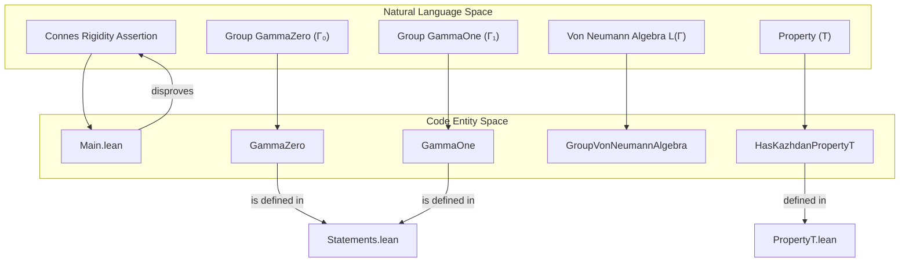
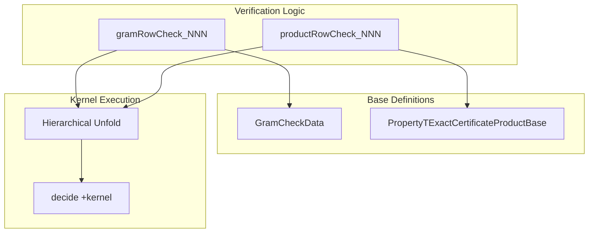

<!-- source: DeepWiki mcp.deepwiki.com · repo openai/ten-proofs · page 1.1 The Connes Rigidity Conjecture and Its Disproof · fetched 2026-10-26 -->

# 1.1. The Connes Rigidity Conjecture and Its Disproof

Relevant source files

The following files were used as context for generating this wiki page:

- [ConnesRigidity/PropertyTExactCertificateGramRows/Row019.lean](ConnesRigidity/PropertyTExactCertificateGramRows/Row019.lean)
- [ConnesRigidity/PropertyTExactCertificateGramRows/Row020.lean](ConnesRigidity/PropertyTExactCertificateGramRows/Row020.lean)
- [ConnesRigidity/PropertyTExactCertificateGramRows/Row021.lean](ConnesRigidity/PropertyTExactCertificateGramRows/Row021.lean)
- [ConnesRigidity/PropertyTExactCertificateGramRows/Row024.lean](ConnesRigidity/PropertyTExactCertificateGramRows/Row024.lean)
- [ConnesRigidity/PropertyTExactCertificateGramRows/Row031.lean](ConnesRigidity/PropertyTExactCertificateGramRows/Row031.lean)
- [ConnesRigidity/PropertyTExactCertificateGramRows/Row037.lean](ConnesRigidity/PropertyTExactCertificateGramRows/Row037.lean)
- [ConnesRigidity/PropertyTExactCertificateGramRows/Row039.lean](ConnesRigidity/PropertyTExactCertificateGramRows/Row039.lean)
- [ConnesRigidity/PropertyTExactCertificateGramRows/Row085.lean](ConnesRigidity/PropertyTExactCertificateGramRows/Row085.lean)
- [ConnesRigidity/PropertyTExactCertificateGramRows/Row126.lean](ConnesRigidity/PropertyTExactCertificateGramRows/Row126.lean)
- [ConnesRigidity/PropertyTExactCertificateGramRows/Row212.lean](ConnesRigidity/PropertyTExactCertificateGramRows/Row212.lean)
- [ConnesRigidity/PropertyTExactCertificateGramRows/Row213.lean](ConnesRigidity/PropertyTExactCertificateGramRows/Row213.lean)
- [ConnesRigidity/PropertyTExactCertificateGramRows/Row225.lean](ConnesRigidity/PropertyTExactCertificateGramRows/Row225.lean)
- [ConnesRigidity/PropertyTExactCertificateGramRows/Row270.lean](ConnesRigidity/PropertyTExactCertificateGramRows/Row270.lean)
- [ConnesRigidity/PropertyTExactCertificateGramRows/Row285.lean](ConnesRigidity/PropertyTExactCertificateGramRows/Row285.lean)
- [ConnesRigidity/PropertyTExactCertificateGramRows/Row295.lean](ConnesRigidity/PropertyTExactCertificateGramRows/Row295.lean)
- [ConnesRigidity/PropertyTExactCertificateGramRows/Row296.lean](ConnesRigidity/PropertyTExactCertificateGramRows/Row296.lean)
- [ConnesRigidity/PropertyTExactCertificateGramRows/Row298.lean](ConnesRigidity/PropertyTExactCertificateGramRows/Row298.lean)
- [ConnesRigidity/PropertyTExactCertificateGramRows/Row316.lean](ConnesRigidity/PropertyTExactCertificateGramRows/Row316.lean)
- [ConnesRigidity/PropertyTExactCertificateGramRows/Row328.lean](ConnesRigidity/PropertyTExactCertificateGramRows/Row328.lean)
- [ConnesRigidity/PropertyTExactCertificateGramRows/Row373.lean](ConnesRigidity/PropertyTExactCertificateGramRows/Row373.lean)
- [ConnesRigidity/PropertyTExactCertificateGramRows/Row383.lean](ConnesRigidity/PropertyTExactCertificateGramRows/Row383.lean)
- [ConnesRigidity/PropertyTExactCertificateGramRows/Row393.lean](ConnesRigidity/PropertyTExactCertificateGramRows/Row393.lean)
- [ConnesRigidity/PropertyTExactCertificateGramRows/Row408.lean](ConnesRigidity/PropertyTExactCertificateGramRows/Row408.lean)
- [ConnesRigidity/PropertyTExactCertificateProductRows/Row148.lean](ConnesRigidity/PropertyTExactCertificateProductRows/Row148.lean)
- [ConnesRigidity/PropertyTExactCertificateProductRows/Row219.lean](ConnesRigidity/PropertyTExactCertificateProductRows/Row219.lean)
- [ConnesRigidity/PropertyTExactCertificateProductRows/Row273.lean](ConnesRigidity/PropertyTExactCertificateProductRows/Row273.lean)
- [ConnesRigidity/PropertyTExactCertificateProductRows/Row282.lean](ConnesRigidity/PropertyTExactCertificateProductRows/Row282.lean)
- [ConnesRigidity/PropertyTExactCertificateProductRows/Row306.lean](ConnesRigidity/PropertyTExactCertificateProductRows/Row306.lean)
- [ConnesRigidity/PropertyTExactCertificateProductRows/Row309.lean](ConnesRigidity/PropertyTExactCertificateProductRows/Row309.lean)
- [ConnesRigidity/PropertyTExactCertificateProductRows/Row349.lean](ConnesRigidity/PropertyTExactCertificateProductRows/Row349.lean)
- [ConnesRigidity/PropertyTExactCertificateProductRows/Row355.lean](ConnesRigidity/PropertyTExactCertificateProductRows/Row355.lean)
- [ConnesRigidity/PropertyTExactCertificateProductRows/Row358.lean](ConnesRigidity/PropertyTExactCertificateProductRows/Row358.lean)
- [ConnesRigidity/PropertyTExactCertificateProductRows/Row359.lean](ConnesRigidity/PropertyTExactCertificateProductRows/Row359.lean)
- [ConnesRigidity/PropertyTExactCertificateProductRows/Row368.lean](ConnesRigidity/PropertyTExactCertificateProductRows/Row368.lean)
- [ConnesRigidity/PropertyTExactCertificateProductRows/Row376.lean](ConnesRigidity/PropertyTExactCertificateProductRows/Row376.lean)
- [ConnesRigidity/PropertyTExactCertificateProductRows/Row383.lean](ConnesRigidity/PropertyTExactCertificateProductRows/Row383.lean)
- [ConnesRigidity/PropertyTExactCertificateProductRows/Row406.lean](ConnesRigidity/PropertyTExactCertificateProductRows/Row406.lean)
- [ConnesRigidity/PropertyTExactCertificateProductRows/Row419.lean](ConnesRigidity/PropertyTExactCertificateProductRows/Row419.lean)
- [ConnesRigidity/PropertyTExactCertificateProductRows/Row420.lean](ConnesRigidity/PropertyTExactCertificateProductRows/Row420.lean)
- [ConnesRigidity/PropertyTExactCertificateProductRows/Row421.lean](ConnesRigidity/PropertyTExactCertificateProductRows/Row421.lean)
- [ConnesRigidity/PropertyTExactCertificateProductRows/Row424.lean](ConnesRigidity/PropertyTExactCertificateProductRows/Row424.lean)

This page explains the mathematical statement of the Connes Rigidity Assertion, the construction of the two specific groups $\Gamma_0$ and $\Gamma_1$ used to disprove it, and the high-level formalization strategy in Lean 4. The proof demonstrates that while $\Gamma_0$ and $\Gamma_1$ have isomorphic group von Neumann algebras, the groups themselves are not isomorphic, contradicting the rigidity conjecture for this class of groups.

## The Mathematical Statement

The Connes Rigidity Conjecture (or Assertion) suggested that for certain "rigid" groups (specifically ICC groups with Property (T)), the group von Neumann algebra $L(\Gamma)$ completely remembers the group $\Gamma$. 

The disproof involves two groups:
1.  **$\Gamma_0$**: A specific cocycle extension of $Sp(4, \mathbb{Z})$ by a lattice.
2.  **$\Gamma_1$**: A modified version of $\Gamma_0$ where the cocycle is perturbed.

The codebase formalizes the following pillars of the disproof:
*   **Property T**: $\Gamma_0$ has Kazhdan's Property (T). This is the most computationally intensive part of the proof.
*   **Algebraic Isomorphism**: $L(\Gamma_0) \cong L(\Gamma_1)$.
*   **Group Non-Isomorphism**: $\Gamma_0 \not\cong \Gamma_1$.

### Conceptual Data Flow

The following diagram maps the mathematical concepts to their respective Lean implementations.

**Mathematical to Code Mapping**

**Sources:** `Main.lean`, `Statements.lean`, `PropertyT.lean`.

## High-Level Proof Strategy

The proof is orchestrated in `Main.lean`, which imports the top-level statements from `Statements.lean`. The verification relies on large-scale certificates that are checked by the Lean kernel using `decide +kernel`.

### Verification Components

The proof is broken down into several "Challenges" defined in the `ComparatorChallenges/` directory. These challenges provide JSON configurations for external tools to verify parts of the proof independently.

| Component | Lean File | Purpose |
| :--- | :--- | :--- |
| **Main Proof** | `Main.lean` | Final assembly of the disproof. |
| **Top-Level Statements** | `Statements.lean` | Formal definitions of $\Gamma_0$, $\Gamma_1$, and the main theorem. |
| **External Results** | `ExternalResults.lean` | Bridges between the Lean proof and externally verified data. |
| **Connes Rigidity Config** | `ComparatorChallenges/E_ConnesRigidity.json` | Configuration for verifying the rigidity disproof. |

### The Role of the Lean Kernel

A significant portion of the proof involves checking that a specific element in the group ring (the "customary Laplacian") can be written as a sum of squares. Because the basis for $\Gamma_0$ is large (73,033 elements), this check is partitioned into hundreds of individual row-validation theorems.

For example, the multiplication table is verified row-by-row:
*   `productRowCheck_383` verifies the 383rd row of the multiplication table `[ConnesRigidity/PropertyTExactCertificateProductRows/Row383.lean:12-33]()`.
*   `productRowCheck_282` verifies the 282nd row `[ConnesRigidity/PropertyTExactCertificateProductRows/Row282.lean:12-33]()`.

Similarly, the Gram matrix used for the Property (T) certificate is verified row-by-row:
*   `gramRowCheck_295` checks the factor row and full Gram row encoding for index 295 `[ConnesRigidity/PropertyTExactCertificateGramRows/Row295.lean:14-25]()`.
*   `gramRowCheck_212` performs the same for index 212 `[ConnesRigidity/PropertyTExactCertificateGramRows/Row212.lean:14-25]()`.

### Data Flow for Row Verification

The verification of these rows follows a strict hierarchical unfolding pattern to manage memory and recursion depth in the Lean kernel.

**Row Verification Architecture**

**Sources:** `ConnesRigidity/PropertyTExactCertificateGramRows/Row295.lean`, `ConnesRigidity/PropertyTExactCertificateProductRows/Row383.lean`.

## Key Implementation Details

### Hierarchical Unfolding
To prevent the Lean kernel from hitting recursion limits, theorems use a "first" tactic to attempt multiple levels of unfolding. For instance, in `productRowCheck_383`, the proof unfolds ranges like `productIndexDataRowRange000_425` before reaching the specific `productIndexDataRow383` `[ConnesRigidity/PropertyTExactCertificateProductRows/Row383.lean:16-28]()`.

### Kernel Settings
Due to the scale of the data, specific kernel options are set in every row file:
*   `set_option maxRecDepth 1000000` to allow deep expression trees `[ConnesRigidity/PropertyTExactCertificateGramRows/Row295.lean:10-10]()`.
*   `set_option maxHeartbeats 0` to disable the timeout during the `decide +kernel` call `[ConnesRigidity/PropertyTExactCertificateGramRows/Row295.lean:12-12]()`.

### Certificate Encoding
The Gram matrix rows are not stored as raw integers but are processed through an encoding layer. The function `factorRowEncodingIsValid` checks that the encoded data matches the expected factor coefficients `[ConnesRigidity/PropertyTExactCertificateGramRows/Row295.lean:15-18]()`.

**Sources:**
*   `ConnesRigidity/PropertyTExactCertificateGramRows/Row295.lean`
*   `ConnesRigidity/PropertyTExactCertificateGramRows/Row212.lean`
*   `ConnesRigidity/PropertyTExactCertificateGramRows/Row270.lean`
*   `ConnesRigidity/PropertyTExactCertificateGramRows/Row126.lean`
*   `ConnesRigidity/PropertyTExactCertificateGramRows/Row383.lean`
*   `ConnesRigidity/PropertyTExactCertificateGramRows/Row225.lean`
*   `ConnesRigidity/PropertyTExactCertificateProductRows/Row383.lean`
*   `ConnesRigidity/PropertyTExactCertificateProductRows/Row282.lean`
*   `ConnesRigidity/PropertyTExactCertificateProductRows/Row273.lean`
*   `ConnesRigidity/PropertyTExactCertificateProductRows/Row219.lean`
*   `ConnesRigidity/PropertyTExactCertificateProductRows/Row376.lean`
*   `ConnesRigidity/PropertyTExactCertificateProductRows/Row368.lean`

---

