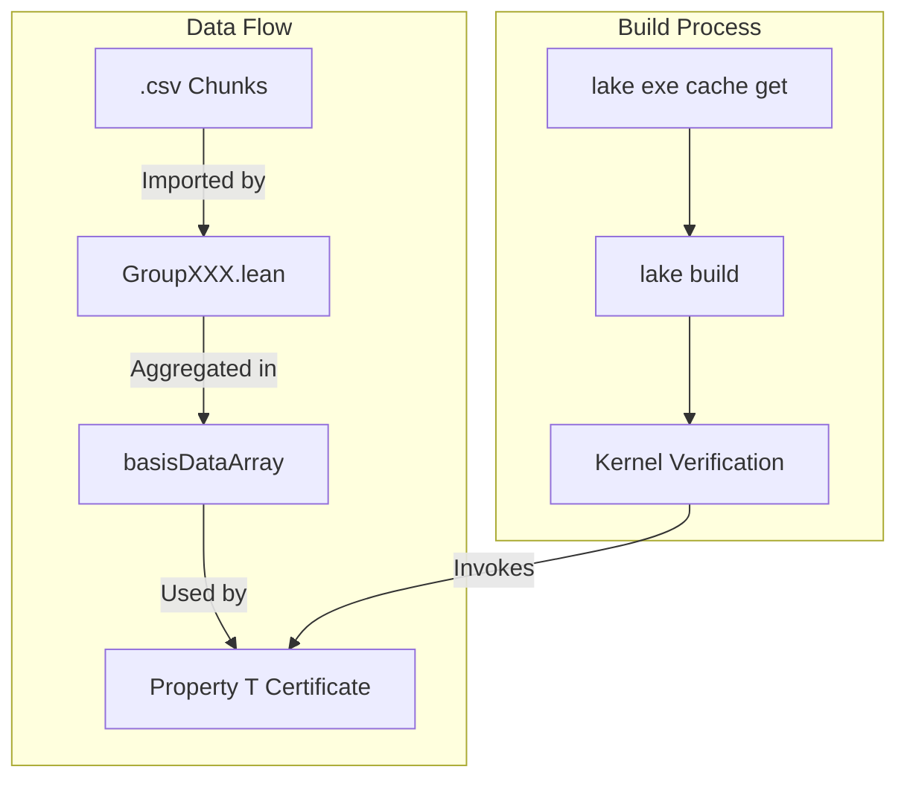
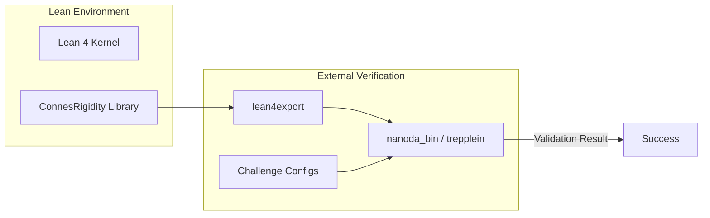

<!-- source: DeepWiki mcp.deepwiki.com · repo openai/ten-proofs · page 1.2 Repository Structure and Build System · fetched 2026-10-26 -->

# Repository Structure and Build System

<details>
<summary>Relevant source files</summary>

The following files were used as context for generating this wiki page:

- [ConnesRigidity/Certificates/AffineSymplectic/Chunks/all_elements_000](ConnesRigidity/Certificates/AffineSymplectic/Chunks/all_elements_000)
- [ConnesRigidity/Certificates/AffineSymplectic/Chunks/all_elements_003](ConnesRigidity/Certificates/AffineSymplectic/Chunks/all_elements_003)
- [ConnesRigidity/Certificates/AffineSymplectic/Chunks/all_elements_005](ConnesRigidity/Certificates/AffineSymplectic/Chunks/all_elements_005)
- [ConnesRigidity/Certificates/AffineSymplectic/Chunks/all_elements_006](ConnesRigidity/Certificates/AffineSymplectic/Chunks/all_elements_006)
- [ConnesRigidity/Certificates/AffineSymplectic/Chunks/all_elements_010](ConnesRigidity/Certificates/AffineSymplectic/Chunks/all_elements_010)
- [ConnesRigidity/Certificates/AffineSymplectic/Chunks/all_elements_011](ConnesRigidity/Certificates/AffineSymplectic/Chunks/all_elements_011)
- [ConnesRigidity/Certificates/AffineSymplectic/Chunks/all_elements_012](ConnesRigidity/Certificates/AffineSymplectic/Chunks/all_elements_012)
- [ConnesRigidity/Certificates/AffineSymplectic/Chunks/all_elements_013](ConnesRigidity/Certificates/AffineSymplectic/Chunks/all_elements_013)
- [ConnesRigidity/Certificates/AffineSymplectic/Chunks/all_elements_015](ConnesRigidity/Certificates/AffineSymplectic/Chunks/all_elements_015)
- [ConnesRigidity/Certificates/AffineSymplectic/Chunks/all_elements_016](ConnesRigidity/Certificates/AffineSymplectic/Chunks/all_elements_016)
- [ConnesRigidity/Certificates/AffineSymplectic/Chunks/all_elements_017](ConnesRigidity/Certificates/AffineSymplectic/Chunks/all_elements_017)
- [ConnesRigidity/Certificates/AffineSymplectic/Chunks/all_elements_018](ConnesRigidity/Certificates/AffineSymplectic/Chunks/all_elements_018)
- [ConnesRigidity/Certificates/AffineSymplectic/Chunks/all_elements_019](ConnesRigidity/Certificates/AffineSymplectic/Chunks/all_elements_019)
- [ConnesRigidity/Certificates/AffineSymplectic/Chunks/all_elements_020](ConnesRigidity/Certificates/AffineSymplectic/Chunks/all_elements_020)
- [ConnesRigidity/Certificates/AffineSymplectic/Chunks/all_elements_023](ConnesRigidity/Certificates/AffineSymplectic/Chunks/all_elements_023)
- [ConnesRigidity/Certificates/AffineSymplectic/Chunks/all_elements_025](ConnesRigidity/Certificates/AffineSymplectic/Chunks/all_elements_025)
- [ConnesRigidity/Certificates/AffineSymplectic/Chunks/all_elements_026](ConnesRigidity/Certificates/AffineSymplectic/Chunks/all_elements_026)
- [ConnesRigidity/Certificates/AffineSymplectic/Chunks/all_elements_027](ConnesRigidity/Certificates/AffineSymplectic/Chunks/all_elements_027)
- [ConnesRigidity/Certificates/AffineSymplectic/Chunks/all_elements_028](ConnesRigidity/Certificates/AffineSymplectic/Chunks/all_elements_028)
- [ConnesRigidity/Certificates/AffineSymplectic/Chunks/all_elements_030](ConnesRigidity/Certificates/AffineSymplectic/Chunks/all_elements_030)
- [ConnesRigidity/Certificates/AffineSymplectic/Chunks/all_elements_031](ConnesRigidity/Certificates/AffineSymplectic/Chunks/all_elements_031)
- [ConnesRigidity/Certificates/AffineSymplectic/Chunks/all_elements_032](ConnesRigidity/Certificates/AffineSymplectic/Chunks/all_elements_032)
- [ConnesRigidity/Certificates/AffineSymplectic/Chunks/all_elements_035](ConnesRigidity/Certificates/AffineSymplectic/Chunks/all_elements_035)
- [ConnesRigidity/Certificates/AffineSymplectic/Chunks/all_elements_038](ConnesRigidity/Certificates/AffineSymplectic/Chunks/all_elements_038)
- [ConnesRigidity/Certificates/AffineSymplectic/Chunks/all_elements_039](ConnesRigidity/Certificates/AffineSymplectic/Chunks/all_elements_039)
- [ConnesRigidity/Certificates/AffineSymplectic/Chunks/all_elements_040](ConnesRigidity/Certificates/AffineSymplectic/Chunks/all_elements_040)
- [ConnesRigidity/Certificates/AffineSymplectic/Chunks/all_elements_041](ConnesRigidity/Certificates/AffineSymplectic/Chunks/all_elements_041)
- [ConnesRigidity/Certificates/AffineSymplectic/Chunks/all_elements_042](ConnesRigidity/Certificates/AffineSymplectic/Chunks/all_elements_042)
- [ConnesRigidity/Certificates/AffineSymplectic/Chunks/all_elements_043](ConnesRigidity/Certificates/AffineSymplectic/Chunks/all_elements_043)
- [ConnesRigidity/Certificates/AffineSymplectic/Chunks/all_elements_044](ConnesRigidity/Certificates/AffineSymplectic/Chunks/all_elements_044)
- [ConnesRigidity/Certificates/AffineSymplectic/Chunks/all_elements_046](ConnesRigidity/Certificates/AffineSymplectic/Chunks/all_elements_046)
- [ConnesRigidity/Certificates/AffineSymplectic/Chunks/all_elements_049](ConnesRigidity/Certificates/AffineSymplectic/Chunks/all_elements_049)
- [ConnesRigidity/Certificates/AffineSymplectic/Chunks/all_elements_050](ConnesRigidity/Certificates/AffineSymplectic/Chunks/all_elements_050)
- [ConnesRigidity/Certificates/AffineSymplectic/Chunks/all_elements_051](ConnesRigidity/Certificates/AffineSymplectic/Chunks/all_elements_051)
- [ConnesRigidity/Certificates/AffineSymplectic/Chunks/all_elements_055](ConnesRigidity/Certificates/AffineSymplectic/Chunks/all_elements_055)
- [ConnesRigidity/Certificates/AffineSymplectic/Chunks/all_elements_057](ConnesRigidity/Certificates/AffineSymplectic/Chunks/all_elements_057)
- [ConnesRigidity/Certificates/AffineSymplectic/Chunks/all_elements_058](ConnesRigidity/Certificates/AffineSymplectic/Chunks/all_elements_058)
- [ConnesRigidity/Certificates/AffineSymplectic/Chunks/all_elements_059](ConnesRigidity/Certificates/AffineSymplectic/Chunks/all_elements_059)
- [ConnesRigidity/Certificates/AffineSymplectic/Chunks/all_elements_060](ConnesRigidity/Certificates/AffineSymplectic/Chunks/all_elements_060)
- [ConnesRigidity/Certificates/AffineSymplectic/Chunks/all_elements_063](ConnesRigidity/Certificates/AffineSymplectic/Chunks/all_elements_063)
- [ConnesRigidity/Certificates/AffineSymplectic/Chunks/all_elements_066](ConnesRigidity/Certificates/AffineSymplectic/Chunks/all_elements_066)
- [ConnesRigidity/Certificates/AffineSymplectic/Chunks/all_elements_068](ConnesRigidity/Certificates/AffineSymplectic/Chunks/all_elements_068)
- [ConnesRigidity/Certificates/AffineSymplectic/Chunks/all_elements_069](ConnesRigidity/Certificates/AffineSymplectic/Chunks/all_elements_069)
- [ConnesRigidity/Certificates/AffineSymplectic/Chunks/all_elements_070](ConnesRigidity/Certificates/AffineSymplectic/Chunks/all_elements_070)
- [ConnesRigidity/Certificates/AffineSymplectic/Chunks/all_elements_071](ConnesRigidity/Certificates/AffineSymplectic/Chunks/all_elements_071)
- [ConnesRigidity/Certificates/AffineSymplectic/Chunks/all_elements_072](ConnesRigidity/Certificates/AffineSymplectic/Chunks/all_elements_072)
- [ConnesRigidity/PropertyTExactCertificateAllElementChunks/Group000.lean](ConnesRigidity/PropertyTExactCertificateAllElementChunks/Group000.lean)
- [ConnesRigidity/PropertyTExactCertificateAllElementChunks/Group001.lean](ConnesRigidity/PropertyTExactCertificateAllElementChunks/Group001.lean)
- [ConnesRigidity/PropertyTExactCertificateAllElementChunks/Group002.lean](ConnesRigidity/PropertyTExactCertificateAllElementChunks/Group002.lean)
- [ConnesRigidity/PropertyTExactCertificateAllElementChunks/Group003.lean](ConnesRigidity/PropertyTExactCertificateAllElementChunks/Group003.lean)
- [ConnesRigidity/PropertyTExactCertificateAllElementChunks/Group004.lean](ConnesRigidity/PropertyTExactCertificateAllElementChunks/Group004.lean)
- [ConnesRigidity/PropertyTExactCertificateAllElementChunks/Group005.lean](ConnesRigidity/PropertyTExactCertificateAllElementChunks/Group005.lean)
- [ConnesRigidity/PropertyTExactCertificateAllElementChunks/Group007.lean](ConnesRigidity/PropertyTExactCertificateAllElementChunks/Group007.lean)
- [ConnesRigidity/PropertyTExactCertificateAllElementChunks/Group008.lean](ConnesRigidity/PropertyTExactCertificateAllElementChunks/Group008.lean)
- [ConnesRigidity/PropertyTExactCertificateAllElementChunks/Group009.lean](ConnesRigidity/PropertyTExactCertificateAllElementChunks/Group009.lean)
- [ConnesRigidity/PropertyTExactCertificateAllElementChunks/Group010.lean](ConnesRigidity/PropertyTExactCertificateAllElementChunks/Group010.lean)
- [ConnesRigidity/PropertyTExactCertificateAllElementChunks/Group011.lean](ConnesRigidity/PropertyTExactCertificateAllElementChunks/Group011.lean)
- [ConnesRigidity/PropertyTExactCertificateAllElementChunks/Group012.lean](ConnesRigidity/PropertyTExactCertificateAllElementChunks/Group012.lean)
- [ConnesRigidity/PropertyTExactCertificateAllElementChunks/Group013.lean](ConnesRigidity/PropertyTExactCertificateAllElementChunks/Group013.lean)
- [ConnesRigidity/PropertyTExactCertificateAllElementChunks/Group014.lean](ConnesRigidity/PropertyTExactCertificateAllElementChunks/Group014.lean)
- [ConnesRigidity/PropertyTExactCertificateAllElementChunks/Group015.lean](ConnesRigidity/PropertyTExactCertificateAllElementChunks/Group015.lean)
- [ConnesRigidity/PropertyTExactCertificateAllElementChunks/Group016.lean](ConnesRigidity/PropertyTExactCertificateAllElementChunks/Group016.lean)
- [ConnesRigidity/PropertyTExactCertificateAllElementChunks/Group017.lean](ConnesRigidity/PropertyTExactCertificateAllElementChunks/Group017.lean)
- [ConnesRigidity/PropertyTExactCertificateAllElementChunks/Group018.lean](ConnesRigidity/PropertyTExactCertificateAllElementChunks/Group018.lean)
- [ConnesRigidity/PropertyTExactCertificateAllElementChunks/Group019.lean](ConnesRigidity/PropertyTExactCertificateAllElementChunks/Group019.lean)
- [ConnesRigidity/PropertyTExactCertificateAllElementChunks/Group020.lean](ConnesRigidity/PropertyTExactCertificateAllElementChunks/Group020.lean)
- [ConnesRigidity/PropertyTExactCertificateAllElementChunks/Group021.lean](ConnesRigidity/PropertyTExactCertificateAllElementChunks/Group021.lean)
- [ConnesRigidity/PropertyTExactCertificateAllElementChunks/Group022.lean](ConnesRigidity/PropertyTExactCertificateAllElementChunks/Group022.lean)
- [ConnesRigidity/PropertyTExactCertificateAllElementChunks/Group023.lean](ConnesRigidity/PropertyTExactCertificateAllElementChunks/Group023.lean)
- [ConnesRigidity/PropertyTExactCertificateAllElementChunks/Group024.lean](ConnesRigidity/PropertyTExactCertificateAllElementChunks/Group024.lean)
- [ConnesRigidity/PropertyTExactCertificateAllElementChunks/Group025.lean](ConnesRigidity/PropertyTExactCertificateAllElementChunks/Group025.lean)
- [ConnesRigidity/PropertyTExactCertificateAllElementChunks/Group026.lean](ConnesRigidity/PropertyTExactCertificateAllElementChunks/Group026.lean)
- [ConnesRigidity/PropertyTExactCertificateAllElementChunks/Group027.lean](ConnesRigidity/PropertyTExactCertificateAllElementChunks/Group027.lean)
- [ConnesRigidity/PropertyTExactCertificateAllElementChunks/Group028.lean](ConnesRigidity/PropertyTExactCertificateAllElementChunks/Group028.lean)
- [ConnesRigidity/PropertyTExactCertificateAllElementChunks/Group029.lean](ConnesRigidity/PropertyTExactCertificateAllElementChunks/Group029.lean)
- [ConnesRigidity/PropertyTExactCertificateAllElementChunks/Group030.lean](ConnesRigidity/PropertyTExactCertificateAllElementChunks/Group030.lean)
- [ConnesRigidity/PropertyTExactCertificateAllElementChunks/Group031.lean](ConnesRigidity/PropertyTExactCertificateAllElementChunks/Group031.lean)
- [ConnesRigidity/PropertyTExactCertificateAllElementChunks/Group032.lean](ConnesRigidity/PropertyTExactCertificateAllElementChunks/Group032.lean)
- [ConnesRigidity/PropertyTExactCertificateAllElementChunks/Group033.lean](ConnesRigidity/PropertyTExactCertificateAllElementChunks/Group033.lean)
- [ConnesRigidity/PropertyTExactCertificateAllElementChunks/Group034.lean](ConnesRigidity/PropertyTExactCertificateAllElementChunks/Group034.lean)
- [ConnesRigidity/PropertyTExactCertificateAllElementChunks/Group035.lean](ConnesRigidity/PropertyTExactCertificateAllElementChunks/Group035.lean)
- [ConnesRigidity/PropertyTExactCertificateAllElementChunks/Group036.lean](ConnesRigidity/PropertyTExactCertificateAllElementChunks/Group036.lean)
- [ConnesRigidity/PropertyTExactCertificateAllElementChunks/Group037.lean](ConnesRigidity/PropertyTExactCertificateAllElementChunks/Group037.lean)
- [ConnesRigidity/PropertyTExactCertificateAllElementChunks/Group038.lean](ConnesRigidity/PropertyTExactCertificateAllElementChunks/Group038.lean)
- [ConnesRigidity/PropertyTExactCertificateAllElementChunks/Group039.lean](ConnesRigidity/PropertyTExactCertificateAllElementChunks/Group039.lean)
- [ConnesRigidity/PropertyTExactCertificateAllElementChunks/Group040.lean](ConnesRigidity/PropertyTExactCertificateAllElementChunks/Group040.lean)
- [ConnesRigidity/PropertyTExactCertificateAllElementChunks/Group041.lean](ConnesRigidity/PropertyTExactCertificateAllElementChunks/Group041.lean)
- [ConnesRigidity/PropertyTExactCertificateAllElementChunks/Group042.lean](ConnesRigidity/PropertyTExactCertificateAllElementChunks/Group042.lean)
- [ConnesRigidity/PropertyTExactCertificateAllElementChunks/Group043.lean](ConnesRigidity/PropertyTExactCertificateAllElementChunks/Group043.lean)
- [ConnesRigidity/PropertyTExactCertificateAllElementChunks/Group044.lean](ConnesRigidity/PropertyTExactCertificateAllElementChunks/Group044.lean)
- [ConnesRigidity/PropertyTExactCertificateAllElementChunks/Group045.lean](ConnesRigidity/PropertyTExactCertificateAllElementChunks/Group045.lean)
- [ConnesRigidity/PropertyTExactCertificateAllElementChunks/Group046.lean](ConnesRigidity/PropertyTExactCertificateAllElementChunks/Group046.lean)
- [ConnesRigidity/PropertyTExactCertificateAllElementChunks/Group047.lean](ConnesRigidity/PropertyTExactCertificateAllElementChunks/Group047.lean)
- [ConnesRigidity/PropertyTExactCertificateAllElementChunks/Group048.lean](ConnesRigidity/PropertyTExactCertificateAllElementChunks/Group048.lean)
- [ConnesRigidity/PropertyTExactCertificateAllElementChunks/Group049.lean](ConnesRigidity/PropertyTExactCertificateAllElementChunks/Group049.lean)
- [ConnesRigidity/PropertyTExactCertificateAllElementChunks/Group050.lean](ConnesRigidity/PropertyTExactCertificateAllElementChunks/Group050.lean)
- [ConnesRigidity/PropertyTExactCertificateAllElementChunks/Group051.lean](ConnesRigidity/PropertyTExactCertificateAllElementChunks/Group051.lean)
- [ConnesRigidity/PropertyTExactCertificateAllElementChunks/Group052.lean](ConnesRigidity/PropertyTExactCertificateAllElementChunks/Group052.lean)
- [ConnesRigidity/PropertyTExactCertificateAllElementChunks/Group053.lean](ConnesRigidity/PropertyTExactCertificateAllElementChunks/Group053.lean)
- [ConnesRigidity/PropertyTExactCertificateAllElementChunks/Group054.lean](ConnesRigidity/PropertyTExactCertificateAllElementChunks/Group054.lean)
- [ConnesRigidity/PropertyTExactCertificateAllElementChunks/Group055.lean](ConnesRigidity/PropertyTExactCertificateAllElementChunks/Group055.lean)
- [ConnesRigidity/PropertyTExactCertificateAllElementChunks/Group056.lean](ConnesRigidity/PropertyTExactCertificateAllElementChunks/Group056.lean)
- [ConnesRigidity/PropertyTExactCertificateAllElementChunks/Group057.lean](ConnesRigidity/PropertyTExactCertificateAllElementChunks/Group057.lean)
- [ConnesRigidity/PropertyTExactCertificateAllElementChunks/Group058.lean](ConnesRigidity/PropertyTExactCertificateAllElementChunks/Group058.lean)
- [ConnesRigidity/PropertyTExactCertificateAllElementChunks/Group059.lean](ConnesRigidity/PropertyTExactCertificateAllElementChunks/Group059.lean)
- [ConnesRigidity/PropertyTExactCertificateAllElementChunks/Group060.lean](ConnesRigidity/PropertyTExactCertificateAllElementChunks/Group060.lean)
- [ConnesRigidity/PropertyTExactCertificateAllElementChunks/Group061.lean](ConnesRigidity/PropertyTExactCertificateAllElementChunks/Group061.lean)
- [ConnesRigidity/PropertyTExactCertificateAllElementChunks/Group062.lean](ConnesRigidity/PropertyTExactCertificateAllElementChunks/Group062.lean)
- [ConnesRigidity/PropertyTExactCertificateAllElementChunks/Group063.lean](ConnesRigidity/PropertyTExactCertificateAllElementChunks/Group063.lean)
- [ConnesRigidity/PropertyTExactCertificateAllElementChunks/Group064.lean](ConnesRigidity/PropertyTExactCertificateAllElementChunks/Group064.lean)
- [ConnesRigidity/PropertyTExactCertificateAllElementChunks/Group065.lean](ConnesRigidity/PropertyTExactCertificateAllElementChunks/Group065.lean)
- [ConnesRigidity/PropertyTExactCertificateAllElementChunks/Group066.lean](ConnesRigidity/PropertyTExactCertificateAllElementChunks/Group066.lean)
- [ConnesRigidity/PropertyTExactCertificateAllElementChunks/Group067.lean](ConnesRigidity/PropertyTExactCertificateAllElementChunks/Group067.lean)
- [ConnesRigidity/PropertyTExactCertificateAllElementChunks/Group068.lean](ConnesRigidity/PropertyTExactCertificateAllElementChunks/Group068.lean)
- [ConnesRigidity/PropertyTExactCertificateAllElementChunks/Group069.lean](ConnesRigidity/PropertyTExactCertificateAllElementChunks/Group069.lean)
- [ConnesRigidity/PropertyTExactCertificateAllElementChunks/Group072.lean](ConnesRigidity/PropertyTExactCertificateAllElementChunks/Group072.lean)

</details>


This section describes the physical organization of the `ten-proofs` repository, the configuration of the Lean 4 build system, and the external verification infrastructure. The repository is structured to manage a large-scale formal proof that combines deep mathematical theory with massive computational certificates.

## Repository Layout

The repository is divided into two primary top-level directories: `ConnesRigidity/`, which contains the formal Lean 4 proof and its supporting data, and `ComparatorChallenges/`, which provides infrastructure for independent verification by external kernels.

### Top-Level Directories

| Directory | Description |
| :--- | :--- |
| `ConnesRigidity/` | The main Lean 4 project containing the proof of the Connes Rigidity Conjecture disproof. |
| `ConnesRigidity/Certificates/` | Raw data files (CSV-like) containing the components of the Property T certificate. |
| `ConnesRigidity/PropertyTExactCertificateAllElementChunks/` | Sharded Lean modules that wrap raw basis element data into `irreducible` definitions. |
| `ComparatorChallenges/` | JSON configurations and scripts for exporting the proof to external checkers like `nanoda_bin`. |

### The `ConnesRigidity/` Directory
The core logic is implemented as a Lean 4 package. It relies on `mathlib4` for foundational mathematics (group theory, linear algebra, and functional analysis).

*   **Source Code**: The `.lean` files in the root of `ConnesRigidity/` define the mathematical structures (e.g., `GammaZero`, `GammaOne`) and the logic for certificate verification.
*   **Data Sharding**: Because the Property T certificate involves a basis of 73,033 elements and a 425x425 Gram matrix, the data is sharded into hundreds of small Lean files to prevent compiler memory exhaustion. For example, basis elements are partitioned into chunks like `Group045.lean` [ConnesRigidity/PropertyTExactCertificateAllElementChunks/Group045.lean:6-11]().

## Build System and Dependencies

The project uses **Lake** (Lean Allocation, Knowledge, and Execution), the standard build system for Lean 4.

### Lake Configuration
The build process is managed by `lakefile.lean` (located in `ConnesRigidity/`). It defines:
1.  **Dependencies**: Specifically `mathlib` and `proofwidgets`.
2.  **Lean Options**: Critical for large proofs, the build often requires increasing `maxHeartbeats` and `maxRecDepth`.
3.  **Library Targets**: The main `ConnesRigidity` library.

### Verification Workflow
To verify the proof, the Lean compiler must check every definition and theorem. The most computationally intensive part is the `decide` tactic used for proof-by-reflection on the Property T certificate.


**Sources:** [ConnesRigidity/PropertyTExactCertificateAllElementChunks/Group045.lean:6-11](), [ConnesRigidity/PropertyTExactCertificateAllElementChunks/Group011.lean:6-11]()

## Certificate Data Layer

The certificate data is stored in `ConnesRigidity/Certificates/AffineSymplectic/Chunks/`. These files contain raw integer vectors representing group elements and matrix coefficients.

### Raw Data Format
Basis elements are stored as 20-column integer vectors. Each row represents an element in the affine symplectic group extension.
*   **File Example**: `all_elements_015` contains rows like `1,0,0,0,1,1,0,0,0,0,1,-1,0,0,0,1,-1,-3,0,0` [ConnesRigidity/Certificates/AffineSymplectic/Chunks/all_elements_015:1-5]().
*   **Indexing**: These raw files are mapped to Lean arrays in the `PropertyTExactCertificateAllElementChunks` directory. For instance, `allElementDataChunk045_000` in `Group045.lean` corresponds to a specific segment of the basis [ConnesRigidity/PropertyTExactCertificateAllElementChunks/Group045.lean:6-11]().

### Data-to-Code Mapping
The following diagram illustrates how raw filesystem data is transformed into Lean 4 entities used in the proof kernel.

```mermaid
classDiagram
    class "Raw CSV Chunk" {
        +all_elements_015
        +all_elements_010
    }
    class "Lean Data Module" {
        +allElementDataChunk045_000
        +allElementDataChunk011_000
    }
    class "Proof Logic" {
        +basisDataArray
        +interpretIntegerTerms()
    }
    
    "Raw CSV Chunk" ..> "Lean Data Module" : "Transcribed into"
    "Lean Data Module" --> "Proof Logic" : "Aggregated into"
```
**Sources:** [ConnesRigidity/Certificates/AffineSymplectic/Chunks/all_elements_015:1-20](), [ConnesRigidity/PropertyTExactCertificateAllElementChunks/Group045.lean:6-11]()

## Comparator Challenges

The `ComparatorChallenges/` directory contains infrastructure for "External Results" validation. This ensures the proof's validity is not solely dependent on the Lean 4 kernel's implementation of specific tactics.

### JSON Challenge Configs
The directory `ComparatorChallenges/E_ConnesRigidity/` contains JSON files that define specific verification tasks. These tasks are designed to be consumed by `lean4export` and verified by independent kernels like `nanoda_bin`.

### Data Flow for External Verification
1.  **Export**: `lean4export` generates a low-level representation of the Lean environment.
2.  **Challenge Mapping**: The JSON configs identify specific goals (e.g., the positivity of the Gram matrix).
3.  **Verification**: External checkers verify the fundamental logic without relying on Lean's high-level automation.


**Sources:** [ConnesRigidity/Certificates/AffineSymplectic/Chunks/all_elements_010:1-10](), [ConnesRigidity/Certificates/AffineSymplectic/Chunks/all_elements_013:1-10]()

Would you like a summary of the next segment, **2. Mathematical Foundations**, which covers the core mathematical objects like $\Gamma_0$ and $\Gamma_1$?

---

