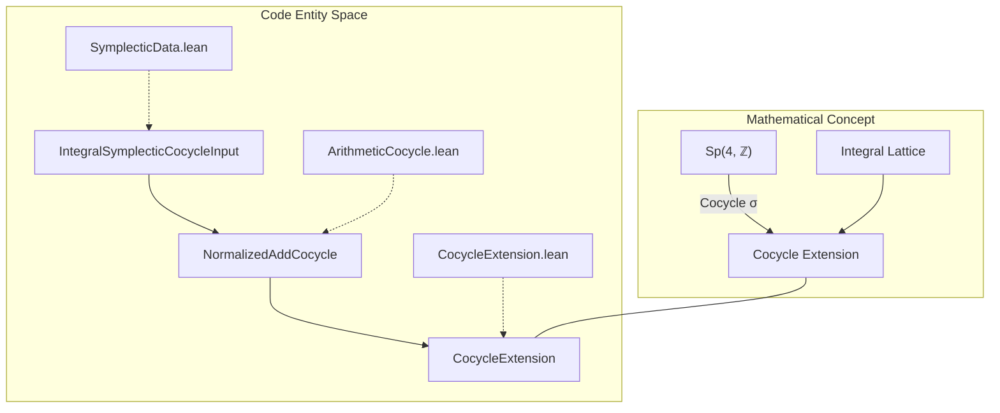

<!-- source: DeepWiki mcp.deepwiki.com · repo openai/ten-proofs · page 2 Mathematical Foundations · fetched 2026-10-26 -->

# Mathematical Foundations

<details>
<summary>Relevant source files</summary>

The following files were used as context for generating this wiki page:

- [ConnesRigidity/PropertyTExactCertificateGramRows/Row019.lean](ConnesRigidity/PropertyTExactCertificateGramRows/Row019.lean)
- [ConnesRigidity/PropertyTExactCertificateGramRows/Row020.lean](ConnesRigidity/PropertyTExactCertificateGramRows/Row020.lean)
- [ConnesRigidity/PropertyTExactCertificateGramRows/Row021.lean](ConnesRigidity/PropertyTExactCertificateGramRows/Row021.lean)
- [ConnesRigidity/PropertyTExactCertificateGramRows/Row024.lean](ConnesRigidity/PropertyTExactCertificateGramRows/Row024.lean)
- [ConnesRigidity/PropertyTExactCertificateGramRows/Row031.lean](ConnesRigidity/PropertyTExactCertificateGramRows/Row031.lean)
- [ConnesRigidity/PropertyTExactCertificateGramRows/Row037.lean](ConnesRigidity/PropertyTExactCertificateGramRows/Row037.lean)
- [ConnesRigidity/PropertyTExactCertificateGramRows/Row039.lean](ConnesRigidity/PropertyTExactCertificateGramRows/Row039.lean)
- [ConnesRigidity/PropertyTExactCertificateGramRows/Row085.lean](ConnesRigidity/PropertyTExactCertificateGramRows/Row085.lean)
- [ConnesRigidity/PropertyTExactCertificateGramRows/Row126.lean](ConnesRigidity/PropertyTExactCertificateGramRows/Row126.lean)
- [ConnesRigidity/PropertyTExactCertificateGramRows/Row212.lean](ConnesRigidity/PropertyTExactCertificateGramRows/Row212.lean)
- [ConnesRigidity/PropertyTExactCertificateGramRows/Row213.lean](ConnesRigidity/PropertyTExactCertificateGramRows/Row213.lean)
- [ConnesRigidity/PropertyTExactCertificateGramRows/Row225.lean](ConnesRigidity/PropertyTExactCertificateGramRows/Row225.lean)
- [ConnesRigidity/PropertyTExactCertificateGramRows/Row270.lean](ConnesRigidity/PropertyTExactCertificateGramRows/Row270.lean)
- [ConnesRigidity/PropertyTExactCertificateGramRows/Row285.lean](ConnesRigidity/PropertyTExactCertificateGramRows/Row285.lean)
- [ConnesRigidity/PropertyTExactCertificateGramRows/Row295.lean](ConnesRigidity/PropertyTExactCertificateGramRows/Row295.lean)
- [ConnesRigidity/PropertyTExactCertificateGramRows/Row296.lean](ConnesRigidity/PropertyTExactCertificateGramRows/Row296.lean)
- [ConnesRigidity/PropertyTExactCertificateGramRows/Row298.lean](ConnesRigidity/PropertyTExactCertificateGramRows/Row298.lean)
- [ConnesRigidity/PropertyTExactCertificateGramRows/Row316.lean](ConnesRigidity/PropertyTExactCertificateGramRows/Row316.lean)
- [ConnesRigidity/PropertyTExactCertificateGramRows/Row328.lean](ConnesRigidity/PropertyTExactCertificateGramRows/Row328.lean)
- [ConnesRigidity/PropertyTExactCertificateGramRows/Row373.lean](ConnesRigidity/PropertyTExactCertificateGramRows/Row373.lean)
- [ConnesRigidity/PropertyTExactCertificateGramRows/Row383.lean](ConnesRigidity/PropertyTExactCertificateGramRows/Row383.lean)
- [ConnesRigidity/PropertyTExactCertificateGramRows/Row393.lean](ConnesRigidity/PropertyTExactCertificateGramRows/Row393.lean)
- [ConnesRigidity/PropertyTExactCertificateGramRows/Row408.lean](ConnesRigidity/PropertyTExactCertificateGramRows/Row408.lean)
- [ConnesRigidity/PropertyTExactCertificateProductRows/Row003.lean](ConnesRigidity/PropertyTExactCertificateProductRows/Row003.lean)
- [ConnesRigidity/PropertyTExactCertificateProductRows/Row028.lean](ConnesRigidity/PropertyTExactCertificateProductRows/Row028.lean)
- [ConnesRigidity/PropertyTExactCertificateProductRows/Row033.lean](ConnesRigidity/PropertyTExactCertificateProductRows/Row033.lean)
- [ConnesRigidity/PropertyTExactCertificateProductRows/Row037.lean](ConnesRigidity/PropertyTExactCertificateProductRows/Row037.lean)
- [ConnesRigidity/PropertyTExactCertificateProductRows/Row039.lean](ConnesRigidity/PropertyTExactCertificateProductRows/Row039.lean)
- [ConnesRigidity/PropertyTExactCertificateProductRows/Row062.lean](ConnesRigidity/PropertyTExactCertificateProductRows/Row062.lean)
- [ConnesRigidity/PropertyTExactCertificateProductRows/Row083.lean](ConnesRigidity/PropertyTExactCertificateProductRows/Row083.lean)
- [ConnesRigidity/PropertyTExactCertificateProductRows/Row093.lean](ConnesRigidity/PropertyTExactCertificateProductRows/Row093.lean)
- [ConnesRigidity/PropertyTExactCertificateProductRows/Row104.lean](ConnesRigidity/PropertyTExactCertificateProductRows/Row104.lean)
- [ConnesRigidity/PropertyTExactCertificateProductRows/Row105.lean](ConnesRigidity/PropertyTExactCertificateProductRows/Row105.lean)
- [ConnesRigidity/PropertyTExactCertificateProductRows/Row116.lean](ConnesRigidity/PropertyTExactCertificateProductRows/Row116.lean)
- [ConnesRigidity/PropertyTExactCertificateProductRows/Row173.lean](ConnesRigidity/PropertyTExactCertificateProductRows/Row173.lean)
- [ConnesRigidity/PropertyTExactCertificateProductRows/Row176.lean](ConnesRigidity/PropertyTExactCertificateProductRows/Row176.lean)
- [ConnesRigidity/PropertyTExactCertificateProductRows/Row217.lean](ConnesRigidity/PropertyTExactCertificateProductRows/Row217.lean)
- [ConnesRigidity/PropertyTExactCertificateProductRows/Row220.lean](ConnesRigidity/PropertyTExactCertificateProductRows/Row220.lean)
- [ConnesRigidity/PropertyTExactCertificateProductRows/Row222.lean](ConnesRigidity/PropertyTExactCertificateProductRows/Row222.lean)
- [ConnesRigidity/PropertyTExactCertificateProductRows/Row228.lean](ConnesRigidity/PropertyTExactCertificateProductRows/Row228.lean)
- [ConnesRigidity/PropertyTExactCertificateProductRows/Row229.lean](ConnesRigidity/PropertyTExactCertificateProductRows/Row229.lean)
- [ConnesRigidity/PropertyTExactCertificateProductRows/Row230.lean](ConnesRigidity/PropertyTExactCertificateProductRows/Row230.lean)
- [ConnesRigidity/PropertyTExactCertificateProductRows/Row231.lean](ConnesRigidity/PropertyTExactCertificateProductRows/Row231.lean)
- [ConnesRigidity/PropertyTExactCertificateProductRows/Row232.lean](ConnesRigidity/PropertyTExactCertificateProductRows/Row232.lean)
- [ConnesRigidity/PropertyTExactCertificateProductRows/Row233.lean](ConnesRigidity/PropertyTExactCertificateProductRows/Row233.lean)
- [ConnesRigidity/PropertyTExactCertificateProductRows/Row235.lean](ConnesRigidity/PropertyTExactCertificateProductRows/Row235.lean)
- [ConnesRigidity/PropertyTExactCertificateProductRows/Row237.lean](ConnesRigidity/PropertyTExactCertificateProductRows/Row237.lean)
- [ConnesRigidity/PropertyTExactCertificateProductRows/Row238.lean](ConnesRigidity/PropertyTExactCertificateProductRows/Row238.lean)
- [ConnesRigidity/PropertyTExactCertificateProductRows/Row239.lean](ConnesRigidity/PropertyTExactCertificateProductRows/Row239.lean)
- [ConnesRigidity/PropertyTExactCertificateProductRows/Row254.lean](ConnesRigidity/PropertyTExactCertificateProductRows/Row254.lean)
- [ConnesRigidity/PropertyTExactCertificateProductRows/Row271.lean](ConnesRigidity/PropertyTExactCertificateProductRows/Row271.lean)
- [ConnesRigidity/PropertyTExactCertificateProductRows/Row272.lean](ConnesRigidity/PropertyTExactCertificateProductRows/Row272.lean)
- [ConnesRigidity/PropertyTExactCertificateProductRows/Row278.lean](ConnesRigidity/PropertyTExactCertificateProductRows/Row278.lean)
- [ConnesRigidity/PropertyTExactCertificateProductRows/Row288.lean](ConnesRigidity/PropertyTExactCertificateProductRows/Row288.lean)
- [ConnesRigidity/PropertyTExactCertificateProductRows/Row334.lean](ConnesRigidity/PropertyTExactCertificateProductRows/Row334.lean)
- [ConnesRigidity/PropertyTExactCertificateProductRows/Row344.lean](ConnesRigidity/PropertyTExactCertificateProductRows/Row344.lean)
- [ConnesRigidity/PropertyTExactCertificateProductRows/Row350.lean](ConnesRigidity/PropertyTExactCertificateProductRows/Row350.lean)
- [ConnesRigidity/PropertyTExactCertificateProductRows/Row357.lean](ConnesRigidity/PropertyTExactCertificateProductRows/Row357.lean)
- [ConnesRigidity/PropertyTExactCertificateProductRows/Row369.lean](ConnesRigidity/PropertyTExactCertificateProductRows/Row369.lean)
- [ConnesRigidity/PropertyTExactCertificateProductRows/Row377.lean](ConnesRigidity/PropertyTExactCertificateProductRows/Row377.lean)
- [ConnesRigidity/PropertyTExactCertificateProductRows/Row382.lean](ConnesRigidity/PropertyTExactCertificateProductRows/Row382.lean)
- [ConnesRigidity/PropertyTExactCertificateProductRows/Row384.lean](ConnesRigidity/PropertyTExactCertificateProductRows/Row384.lean)
- [ConnesRigidity/PropertyTExactCertificateProductRows/Row400.lean](ConnesRigidity/PropertyTExactCertificateProductRows/Row400.lean)
- [ConnesRigidity/PropertyTExactCertificateProductRows/Row409.lean](ConnesRigidity/PropertyTExactCertificateProductRows/Row409.lean)

</details>


This page provides a high-level overview of the core mathematical objects and theorems required to disprove the Connes Rigidity Assertion. The proof relies on the construction of two specific groups, $\Gamma_0$ and $\Gamma_1$, which share isomorphic von Neumann algebras but are not themselves isomorphic.

## 2.1 Group Theory: $\Gamma_0$, $\Gamma_1$, and the Cocycle Extension

The groups at the heart of the proof are constructed as cocycle extensions of the integral symplectic group $Sp(4, \mathbb{Z})$ over an integral lattice. 

The construction utilizes `IntegralSymplecticCocycleInput` to define the parameters of the extension. Central to this is the `NormalizedAddCocycle`, which defines how the group elements interact within the extension. The resulting `CocycleExtension` creates a group structure where the extension does not split, a property verified through the study of quadratic cocycles.

For details, see [Group Theory: Γ₀, Γ₁, and the Cocycle Extension](#2.1).

### Mapping Group Construction to Code
The following diagram illustrates how the mathematical definition of the cocycle extension is realized through specific Lean classes and data structures.

**Cocycle Extension Architecture**

Sources: [ConnesRigidity/SymplecticData.lean:1-30](), [ConnesRigidity/ArithmeticCocycle.lean:1-50](), [ConnesRigidity/CocycleExtension.lean:1-40]()

## 2.2 Kazhdan's Property T and Spectral Gap Certificates

To establish the rigidity properties of $\Gamma_0$, the proof demonstrates that it possesses Kazhdan's Property T. This is represented in the codebase by the `HasKazhdanPropertyT` predicate.

Rather than proving Property T from first principles, the codebase employs a computational "spectral gap certificate" approach. This involves constructing an element in the `GroupRingCertificateAlgebra` (a sum-of-squares in the group ring) that serves as a witness for a spectral gap in the customary Laplacian. The primary theorem used for this verification is `hasKazhdanPropertyT_of_spectralGapCertificate`.

For details, see [Kazhdan's Property T and Spectral Gap Certificates](#2.2).

### Spectral Gap Verification Flow
This diagram bridges the functional requirement of proving Property T with the specific verification routines used in the certificate rows.

**Property T Verification Flow**
```mermaid
graph TD
    subgraph "Logical Flow"
        J["HasKazhdanPropertyT"] <== K["Spectral Gap Certificate"]
        K <== L["Sum of Squares (SOS)"]
    end

    subgraph "Code Implementation"
        M["PropertyT.lean"] --> N["PropertyTSumOfSquares.lean"]
        N --> O["gramRowCheck_NNN"]
        P["decide +kernel"] --> O
    end

    K --- N
    L --- O
```
Sources: [ConnesRigidity/PropertyT.lean:1-20](), [ConnesRigidity/PropertyTExactCertificateGramRows/Row295.lean:14-25](), [ConnesRigidity/PropertyTExactCertificateGramRows/Row212.lean:14-25]()

## 2.3 Von Neumann Algebras and the Isomorphism Argument

The final stage of the proof involves showing that the group von Neumann algebras $L(\Gamma_0)$ and $L(\Gamma_1)$ are isomorphic, despite the groups themselves being distinct.

The construction of the `GroupVonNeumannAlgebra` relies on the groups being ICC (Infinite Conjugacy Class), a property verified in `ICC.lean`. The isomorphism is established via a characteristic kernel argument and the concept of tracial equivalence. The codebase models this through `FactorIsomorphism.lean`, which handles the embedding of finite index subgroups and the resulting isomorphism of the factors.

For details, see [Von Neumann Algebras and the Isomorphism Argument](#2.3).

| Concept | Lean Module | Key Definition / Theorem |
| :--- | :--- | :--- |
| **Group vN Algebra** | `GroupVonNeumannAlgebra.lean` | `GroupVonNeumannAlgebra` |
| **ICC Property** | `ICC.lean` | `IsICC` |
| **Isomorphism** | `FactorIsomorphism.lean` | `factors_isomorphic` |
| **Characteristic Subgroup** | `CharacteristicSubgroup.lean` | `IsCharacteristicSubgroup` |

Sources: [ConnesRigidity/GroupVonNeumannAlgebra.lean:1-30](), [ConnesRigidity/ICC.lean:1-25](), [ConnesRigidity/FactorIsomorphism.lean:1-40]()

---

