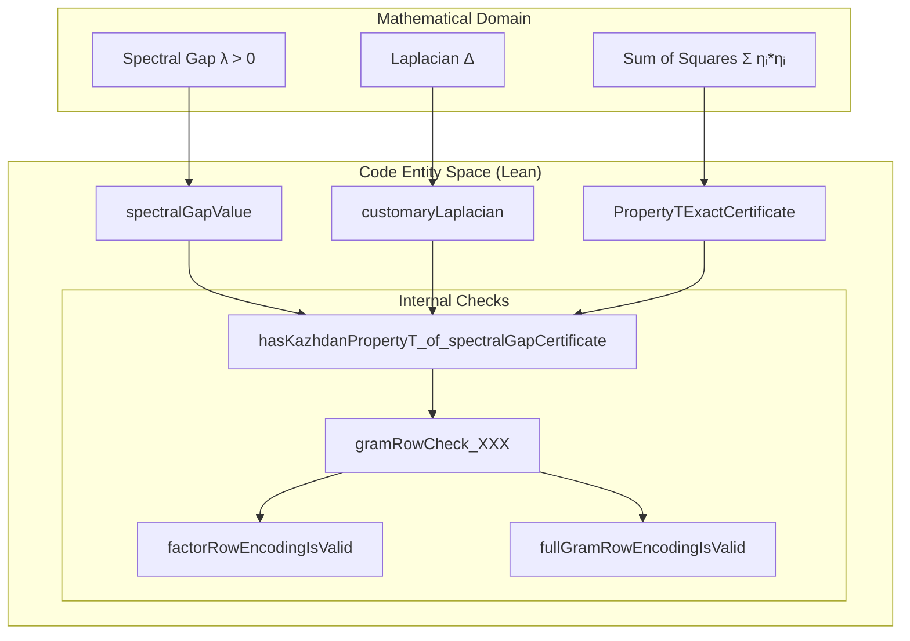
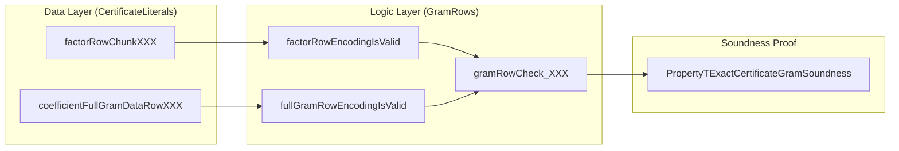

<!-- source: DeepWiki mcp.deepwiki.com · repo openai/ten-proofs · page 2.2 Kazhdan's Property T and Spectral Gap Certificates · fetched 2026-10-26 -->

# Kazhdan's Property T and Spectral Gap Certificates

<details>
<summary>Relevant source files</summary>

The following files were used as context for generating this wiki page:

- [ConnesRigidity/PropertyTExactCertificateGramRows/Row005.lean](ConnesRigidity/PropertyTExactCertificateGramRows/Row005.lean)
- [ConnesRigidity/PropertyTExactCertificateGramRows/Row009.lean](ConnesRigidity/PropertyTExactCertificateGramRows/Row009.lean)
- [ConnesRigidity/PropertyTExactCertificateGramRows/Row010.lean](ConnesRigidity/PropertyTExactCertificateGramRows/Row010.lean)
- [ConnesRigidity/PropertyTExactCertificateGramRows/Row019.lean](ConnesRigidity/PropertyTExactCertificateGramRows/Row019.lean)
- [ConnesRigidity/PropertyTExactCertificateGramRows/Row020.lean](ConnesRigidity/PropertyTExactCertificateGramRows/Row020.lean)
- [ConnesRigidity/PropertyTExactCertificateGramRows/Row021.lean](ConnesRigidity/PropertyTExactCertificateGramRows/Row021.lean)
- [ConnesRigidity/PropertyTExactCertificateGramRows/Row024.lean](ConnesRigidity/PropertyTExactCertificateGramRows/Row024.lean)
- [ConnesRigidity/PropertyTExactCertificateGramRows/Row031.lean](ConnesRigidity/PropertyTExactCertificateGramRows/Row031.lean)
- [ConnesRigidity/PropertyTExactCertificateGramRows/Row037.lean](ConnesRigidity/PropertyTExactCertificateGramRows/Row037.lean)
- [ConnesRigidity/PropertyTExactCertificateGramRows/Row039.lean](ConnesRigidity/PropertyTExactCertificateGramRows/Row039.lean)
- [ConnesRigidity/PropertyTExactCertificateGramRows/Row042.lean](ConnesRigidity/PropertyTExactCertificateGramRows/Row042.lean)
- [ConnesRigidity/PropertyTExactCertificateGramRows/Row056.lean](ConnesRigidity/PropertyTExactCertificateGramRows/Row056.lean)
- [ConnesRigidity/PropertyTExactCertificateGramRows/Row080.lean](ConnesRigidity/PropertyTExactCertificateGramRows/Row080.lean)
- [ConnesRigidity/PropertyTExactCertificateGramRows/Row085.lean](ConnesRigidity/PropertyTExactCertificateGramRows/Row085.lean)
- [ConnesRigidity/PropertyTExactCertificateGramRows/Row106.lean](ConnesRigidity/PropertyTExactCertificateGramRows/Row106.lean)
- [ConnesRigidity/PropertyTExactCertificateGramRows/Row115.lean](ConnesRigidity/PropertyTExactCertificateGramRows/Row115.lean)
- [ConnesRigidity/PropertyTExactCertificateGramRows/Row117.lean](ConnesRigidity/PropertyTExactCertificateGramRows/Row117.lean)
- [ConnesRigidity/PropertyTExactCertificateGramRows/Row126.lean](ConnesRigidity/PropertyTExactCertificateGramRows/Row126.lean)
- [ConnesRigidity/PropertyTExactCertificateGramRows/Row133.lean](ConnesRigidity/PropertyTExactCertificateGramRows/Row133.lean)
- [ConnesRigidity/PropertyTExactCertificateGramRows/Row144.lean](ConnesRigidity/PropertyTExactCertificateGramRows/Row144.lean)
- [ConnesRigidity/PropertyTExactCertificateGramRows/Row146.lean](ConnesRigidity/PropertyTExactCertificateGramRows/Row146.lean)
- [ConnesRigidity/PropertyTExactCertificateGramRows/Row192.lean](ConnesRigidity/PropertyTExactCertificateGramRows/Row192.lean)
- [ConnesRigidity/PropertyTExactCertificateGramRows/Row212.lean](ConnesRigidity/PropertyTExactCertificateGramRows/Row212.lean)
- [ConnesRigidity/PropertyTExactCertificateGramRows/Row213.lean](ConnesRigidity/PropertyTExactCertificateGramRows/Row213.lean)
- [ConnesRigidity/PropertyTExactCertificateGramRows/Row216.lean](ConnesRigidity/PropertyTExactCertificateGramRows/Row216.lean)
- [ConnesRigidity/PropertyTExactCertificateGramRows/Row220.lean](ConnesRigidity/PropertyTExactCertificateGramRows/Row220.lean)
- [ConnesRigidity/PropertyTExactCertificateGramRows/Row223.lean](ConnesRigidity/PropertyTExactCertificateGramRows/Row223.lean)
- [ConnesRigidity/PropertyTExactCertificateGramRows/Row225.lean](ConnesRigidity/PropertyTExactCertificateGramRows/Row225.lean)
- [ConnesRigidity/PropertyTExactCertificateGramRows/Row270.lean](ConnesRigidity/PropertyTExactCertificateGramRows/Row270.lean)
- [ConnesRigidity/PropertyTExactCertificateGramRows/Row274.lean](ConnesRigidity/PropertyTExactCertificateGramRows/Row274.lean)
- [ConnesRigidity/PropertyTExactCertificateGramRows/Row276.lean](ConnesRigidity/PropertyTExactCertificateGramRows/Row276.lean)
- [ConnesRigidity/PropertyTExactCertificateGramRows/Row285.lean](ConnesRigidity/PropertyTExactCertificateGramRows/Row285.lean)
- [ConnesRigidity/PropertyTExactCertificateGramRows/Row288.lean](ConnesRigidity/PropertyTExactCertificateGramRows/Row288.lean)
- [ConnesRigidity/PropertyTExactCertificateGramRows/Row289.lean](ConnesRigidity/PropertyTExactCertificateGramRows/Row289.lean)
- [ConnesRigidity/PropertyTExactCertificateGramRows/Row295.lean](ConnesRigidity/PropertyTExactCertificateGramRows/Row295.lean)
- [ConnesRigidity/PropertyTExactCertificateGramRows/Row296.lean](ConnesRigidity/PropertyTExactCertificateGramRows/Row296.lean)
- [ConnesRigidity/PropertyTExactCertificateGramRows/Row298.lean](ConnesRigidity/PropertyTExactCertificateGramRows/Row298.lean)
- [ConnesRigidity/PropertyTExactCertificateGramRows/Row316.lean](ConnesRigidity/PropertyTExactCertificateGramRows/Row316.lean)
- [ConnesRigidity/PropertyTExactCertificateGramRows/Row328.lean](ConnesRigidity/PropertyTExactCertificateGramRows/Row328.lean)
- [ConnesRigidity/PropertyTExactCertificateGramRows/Row333.lean](ConnesRigidity/PropertyTExactCertificateGramRows/Row333.lean)
- [ConnesRigidity/PropertyTExactCertificateGramRows/Row346.lean](ConnesRigidity/PropertyTExactCertificateGramRows/Row346.lean)
- [ConnesRigidity/PropertyTExactCertificateGramRows/Row349.lean](ConnesRigidity/PropertyTExactCertificateGramRows/Row349.lean)
- [ConnesRigidity/PropertyTExactCertificateGramRows/Row355.lean](ConnesRigidity/PropertyTExactCertificateGramRows/Row355.lean)
- [ConnesRigidity/PropertyTExactCertificateGramRows/Row364.lean](ConnesRigidity/PropertyTExactCertificateGramRows/Row364.lean)
- [ConnesRigidity/PropertyTExactCertificateGramRows/Row373.lean](ConnesRigidity/PropertyTExactCertificateGramRows/Row373.lean)
- [ConnesRigidity/PropertyTExactCertificateGramRows/Row383.lean](ConnesRigidity/PropertyTExactCertificateGramRows/Row383.lean)
- [ConnesRigidity/PropertyTExactCertificateGramRows/Row388.lean](ConnesRigidity/PropertyTExactCertificateGramRows/Row388.lean)
- [ConnesRigidity/PropertyTExactCertificateGramRows/Row393.lean](ConnesRigidity/PropertyTExactCertificateGramRows/Row393.lean)
- [ConnesRigidity/PropertyTExactCertificateGramRows/Row408.lean](ConnesRigidity/PropertyTExactCertificateGramRows/Row408.lean)

</details>


This section describes the formalization of Kazhdan's Property (T) and the computational framework used to prove that a specific group $\Gamma_0$ possesses this property. The approach relies on finding a "spectral gap certificate" within the group ring, which provides a constructive proof of the existence of a Kazhdan constant.

## Overview of Property T in Lean

Property (T) is a rigidity property of groups defined in terms of their unitary representations. In this codebase, the property is defined for a group $G$ as the existence of a compact subset $K \subseteq G$ and a constant $\epsilon > 0$ such that any unitary representation of $G$ with a $(K, \epsilon)$-almost invariant vector must have a non-zero invariant vector.

The implementation utilizes the group ring $\mathbb{Q}[G]$ (or $\mathbb{R}[G]$) to construct a specific element known as the **customary Laplacian**, denoted $\Delta$. If $\Delta$ can be expressed as a sum of squares in the group ring (plus a small spectral gap), then the group $G$ has Property (T).

### Key Definitions and Classes

| Entity | Role | File Reference |
| :--- | :--- | :--- |
| `HasKazhdanPropertyT` | Typeclass asserting a group $G$ has Property (T). | `PropertyT.lean` |
| `KazhdanPair` | A structure containing a finite set $S$ and a constant $\epsilon$ satisfying the Property (T) condition. | `PropertyT.lean` |
| `customaryLaplacian` | The element $\Delta = |S| \cdot 1 - \sum_{s \in S} s$ in the group ring. | `PropertyTSumOfSquares.lean` |
| `hasKazhdanPropertyT_of_spectralGapCertificate` | The main theorem connecting sum-of-squares certificates to Property (T). | `PropertyTSumOfSquares.lean` |

**Sources:** `PropertyT.lean`, `PropertyTSumOfSquares.lean`.

## Spectral Gap Certificate Approach

The proof that $\Gamma_0$ has Property (T) is reduced to a verification problem in the group ring $\mathbb{Q}[\Gamma_0]$. Specifically, we seek a certificate that proves the Laplacian $\Delta$ is "positive" in a sense that implies a spectral gap.

### The Sum of Squares Decomposition
A group $G$ generated by a finite set $S$ has Property (T) if there exists an element $\xi$ in the real group ring $\mathbb{R}[G]$ and a $\lambda > 0$ such that:
$$\Delta^2 - \lambda \Delta = \sum \eta_i^* \eta_i$$
where $\eta_i$ are elements of the group ring. In the codebase, this is handled by `GroupRingCertificateAlgebra.lean`, which defines the algebraic structure necessary to manipulate these sums of squares.

### Verification Flow: Natural Language to Code
The following diagram maps the mathematical requirements for a spectral gap to the specific Lean functions and checks used in the certificate verification.

**Spectral Gap Verification Logic**

**Sources:** `PropertyTSumOfSquares.lean`, `ConnesRigidity/PropertyTExactCertificateGramRows/Row295.lean:14-16`(), `ConnesRigidity/PropertyTExactCertificateGramRows/Row009.lean:14-16`().

## Implementation of Gram Matrix Certificates

The most computationally intensive part of the proof is verifying the Gram matrix $Q$ that represents the sum of squares. Because the basis for $\Gamma_0$ is large (73,033 elements), the Gram matrix is verified row-by-row using **Proof by Reflection**.

### Row-wise Verification
Each row of the Gram matrix is verified in a standalone Lean file (e.g., `Row009.lean`, `Row295.lean`). These files use the `decide +kernel` tactic to verify that the stored coefficients correctly reconstruct the identity $\Delta^2 - \lambda \Delta$.

```lean
-- Example from ConnesRigidity/PropertyTExactCertificateGramRows/Row295.lean
theorem gramRowCheck_295 :
    factorRowEncodingIsValid 295 = true ∧
      fullGramRowEncodingIsValid 295 = true := by
  unfold factorRowEncodingIsValid fullGramRowEncodingIsValid
  unfold factorCoefficientRow factorCoefficientRowOf factorRow
  -- ... unfolding of data chunks ...
  decide +kernel
```
**Sources:** `ConnesRigidity/PropertyTExactCertificateGramRows/Row295.lean:14-25`(), `ConnesRigidity/PropertyTExactCertificateGramRows/Row009.lean:14-25`().

### Data Flow and Architecture
The certificate verification system is split into data-loading and logic-checking layers to manage memory consumption during compilation.

**Certificate Data Flow**

**Sources:** `ConnesRigidity/PropertyTExactCertificateGramRows/Row388.lean:17-25`(), `ConnesRigidity/PropertyTExactCertificateGramRows/Row212.lean:17-25`().

## Key Components

### 1. Customary Laplacian
Defined in `PropertyTSumOfSquares.lean`, the Laplacian is constructed from the generating set of the group. For $\Gamma_0$, this involves the generators of $Sp(4, \mathbb{Z})$ and the lattice elements.

### 2. The Group Ring Certificate Algebra
`GroupRingCertificateAlgebra.lean` provides the formal definition of the involution $x \mapsto x^*$ on the group ring and the definition of positive elements (those that can be written as $\sum x_i^* x_i$).

### 3. Finite Index Inheritance
`PropertyTFiniteIndex.lean` contains the proof that Property (T) passes to finite-index subgroups and is preserved by extensions, which is critical for the overall strategy involving the cocycle extension $\Gamma_0$.

### 4. Computational Soundness
The files in `PropertyTExactCertificateGramRows/` ensure that the massive integer arrays stored in `CertificateLiterals` actually satisfy the algebraic requirements of a spectral gap. The use of `maxRecDepth 1000000` and `maxHeartbeats 0` is necessary to allow the Lean kernel to process these large-scale numerical identities.

**Sources:** `ConnesRigidity/PropertyTExactCertificateGramRows/Row042.lean:10-12`(), `ConnesRigidity/PropertyTExactCertificateGramRows/Row056.lean:10-12`(), `ConnesRigidity/PropertyTExactCertificateGramRows/Row126.lean:10-12`().

---

