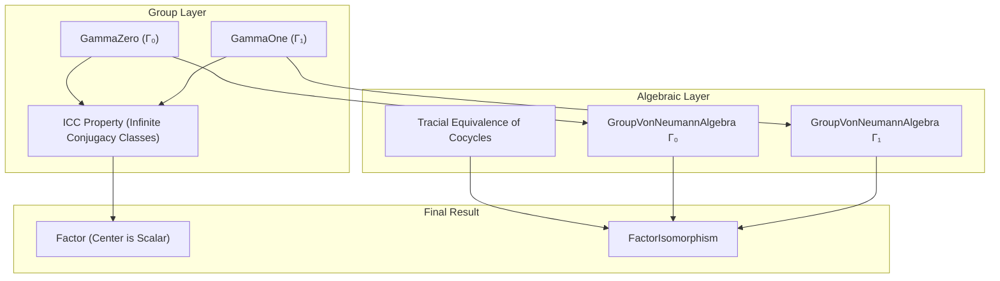
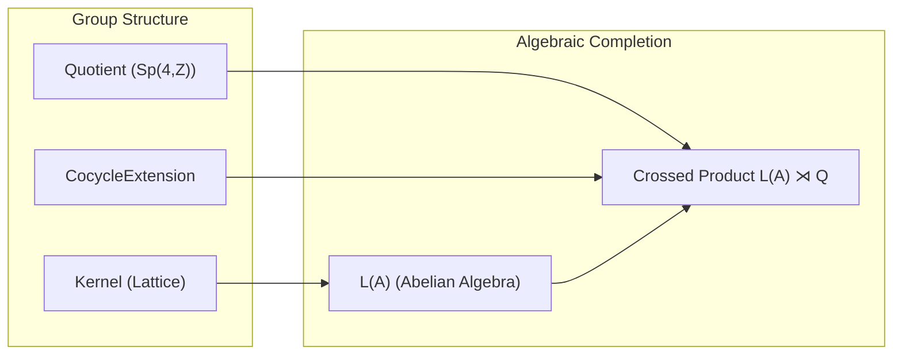

<!-- source: DeepWiki mcp.deepwiki.com · repo openai/ten-proofs · page 2.3 Von Neumann Algebras and the Isomorphism Argument · fetched 2026-10-26 -->

# Von Neumann Algebras and the Isomorphism Argument

Relevant source files

The following files were used as context for generating this wiki page:

- [ConnesRigidity/PropertyTExactCertificateProductRows/Row003.lean](ConnesRigidity/PropertyTExactCertificateProductRows/Row003.lean)
- [ConnesRigidity/PropertyTExactCertificateProductRows/Row028.lean](ConnesRigidity/PropertyTExactCertificateProductRows/Row028.lean)
- [ConnesRigidity/PropertyTExactCertificateProductRows/Row033.lean](ConnesRigidity/PropertyTExactCertificateProductRows/Row033.lean)
- [ConnesRigidity/PropertyTExactCertificateProductRows/Row037.lean](ConnesRigidity/PropertyTExactCertificateProductRows/Row037.lean)
- [ConnesRigidity/PropertyTExactCertificateProductRows/Row039.lean](ConnesRigidity/PropertyTExactCertificateProductRows/Row039.lean)
- [ConnesRigidity/PropertyTExactCertificateProductRows/Row062.lean](ConnesRigidity/PropertyTExactCertificateProductRows/Row062.lean)
- [ConnesRigidity/PropertyTExactCertificateProductRows/Row083.lean](ConnesRigidity/PropertyTExactCertificateProductRows/Row083.lean)
- [ConnesRigidity/PropertyTExactCertificateProductRows/Row093.lean](ConnesRigidity/PropertyTExactCertificateProductRows/Row093.lean)
- [ConnesRigidity/PropertyTExactCertificateProductRows/Row104.lean](ConnesRigidity/PropertyTExactCertificateProductRows/Row104.lean)
- [ConnesRigidity/PropertyTExactCertificateProductRows/Row105.lean](ConnesRigidity/PropertyTExactCertificateProductRows/Row105.lean)
- [ConnesRigidity/PropertyTExactCertificateProductRows/Row116.lean](ConnesRigidity/PropertyTExactCertificateProductRows/Row116.lean)
- [ConnesRigidity/PropertyTExactCertificateProductRows/Row148.lean](ConnesRigidity/PropertyTExactCertificateProductRows/Row148.lean)
- [ConnesRigidity/PropertyTExactCertificateProductRows/Row173.lean](ConnesRigidity/PropertyTExactCertificateProductRows/Row173.lean)
- [ConnesRigidity/PropertyTExactCertificateProductRows/Row176.lean](ConnesRigidity/PropertyTExactCertificateProductRows/Row176.lean)
- [ConnesRigidity/PropertyTExactCertificateProductRows/Row217.lean](ConnesRigidity/PropertyTExactCertificateProductRows/Row217.lean)
- [ConnesRigidity/PropertyTExactCertificateProductRows/Row219.lean](ConnesRigidity/PropertyTExactCertificateProductRows/Row219.lean)
- [ConnesRigidity/PropertyTExactCertificateProductRows/Row220.lean](ConnesRigidity/PropertyTExactCertificateProductRows/Row220.lean)
- [ConnesRigidity/PropertyTExactCertificateProductRows/Row222.lean](ConnesRigidity/PropertyTExactCertificateProductRows/Row222.lean)
- [ConnesRigidity/PropertyTExactCertificateProductRows/Row228.lean](ConnesRigidity/PropertyTExactCertificateProductRows/Row228.lean)
- [ConnesRigidity/PropertyTExactCertificateProductRows/Row229.lean](ConnesRigidity/PropertyTExactCertificateProductRows/Row229.lean)
- [ConnesRigidity/PropertyTExactCertificateProductRows/Row230.lean](ConnesRigidity/PropertyTExactCertificateProductRows/Row230.lean)
- [ConnesRigidity/PropertyTExactCertificateProductRows/Row231.lean](ConnesRigidity/PropertyTExactCertificateProductRows/Row231.lean)
- [ConnesRigidity/PropertyTExactCertificateProductRows/Row232.lean](ConnesRigidity/PropertyTExactCertificateProductRows/Row232.lean)
- [ConnesRigidity/PropertyTExactCertificateProductRows/Row233.lean](ConnesRigidity/PropertyTExactCertificateProductRows/Row233.lean)
- [ConnesRigidity/PropertyTExactCertificateProductRows/Row235.lean](ConnesRigidity/PropertyTExactCertificateProductRows/Row235.lean)
- [ConnesRigidity/PropertyTExactCertificateProductRows/Row237.lean](ConnesRigidity/PropertyTExactCertificateProductRows/Row237.lean)
- [ConnesRigidity/PropertyTExactCertificateProductRows/Row238.lean](ConnesRigidity/PropertyTExactCertificateProductRows/Row238.lean)
- [ConnesRigidity/PropertyTExactCertificateProductRows/Row239.lean](ConnesRigidity/PropertyTExactCertificateProductRows/Row239.lean)
- [ConnesRigidity/PropertyTExactCertificateProductRows/Row254.lean](ConnesRigidity/PropertyTExactCertificateProductRows/Row254.lean)
- [ConnesRigidity/PropertyTExactCertificateProductRows/Row271.lean](ConnesRigidity/PropertyTExactCertificateProductRows/Row271.lean)
- [ConnesRigidity/PropertyTExactCertificateProductRows/Row272.lean](ConnesRigidity/PropertyTExactCertificateProductRows/Row272.lean)
- [ConnesRigidity/PropertyTExactCertificateProductRows/Row273.lean](ConnesRigidity/PropertyTExactCertificateProductRows/Row273.lean)
- [ConnesRigidity/PropertyTExactCertificateProductRows/Row278.lean](ConnesRigidity/PropertyTExactCertificateProductRows/Row278.lean)
- [ConnesRigidity/PropertyTExactCertificateProductRows/Row282.lean](ConnesRigidity/PropertyTExactCertificateProductRows/Row282.lean)
- [ConnesRigidity/PropertyTExactCertificateProductRows/Row288.lean](ConnesRigidity/PropertyTExactCertificateProductRows/Row288.lean)
- [ConnesRigidity/PropertyTExactCertificateProductRows/Row306.lean](ConnesRigidity/PropertyTExactCertificateProductRows/Row306.lean)
- [ConnesRigidity/PropertyTExactCertificateProductRows/Row309.lean](ConnesRigidity/PropertyTExactCertificateProductRows/Row309.lean)
- [ConnesRigidity/PropertyTExactCertificateProductRows/Row334.lean](ConnesRigidity/PropertyTExactCertificateProductRows/Row334.lean)
- [ConnesRigidity/PropertyTExactCertificateProductRows/Row344.lean](ConnesRigidity/PropertyTExactCertificateProductRows/Row344.lean)
- [ConnesRigidity/PropertyTExactCertificateProductRows/Row349.lean](ConnesRigidity/PropertyTExactCertificateProductRows/Row349.lean)
- [ConnesRigidity/PropertyTExactCertificateProductRows/Row350.lean](ConnesRigidity/PropertyTExactCertificateProductRows/Row350.lean)
- [ConnesRigidity/PropertyTExactCertificateProductRows/Row355.lean](ConnesRigidity/PropertyTExactCertificateProductRows/Row355.lean)
- [ConnesRigidity/PropertyTExactCertificateProductRows/Row357.lean](ConnesRigidity/PropertyTExactCertificateProductRows/Row357.lean)
- [ConnesRigidity/PropertyTExactCertificateProductRows/Row358.lean](ConnesRigidity/PropertyTExactCertificateProductRows/Row358.lean)
- [ConnesRigidity/PropertyTExactCertificateProductRows/Row359.lean](ConnesRigidity/PropertyTExactCertificateProductRows/Row359.lean)
- [ConnesRigidity/PropertyTExactCertificateProductRows/Row368.lean](ConnesRigidity/PropertyTExactCertificateProductRows/Row368.lean)
- [ConnesRigidity/PropertyTExactCertificateProductRows/Row369.lean](ConnesRigidity/PropertyTExactCertificateProductRows/Row369.lean)
- [ConnesRigidity/PropertyTExactCertificateProductRows/Row376.lean](ConnesRigidity/PropertyTExactCertificateProductRows/Row376.lean)
- [ConnesRigidity/PropertyTExactCertificateProductRows/Row377.lean](ConnesRigidity/PropertyTExactCertificateProductRows/Row377.lean)
- [ConnesRigidity/PropertyTExactCertificateProductRows/Row382.lean](ConnesRigidity/PropertyTExactCertificateProductRows/Row382.lean)
- [ConnesRigidity/PropertyTExactCertificateProductRows/Row383.lean](ConnesRigidity/PropertyTExactCertificateProductRows/Row383.lean)
- [ConnesRigidity/PropertyTExactCertificateProductRows/Row384.lean](ConnesRigidity/PropertyTExactCertificateProductRows/Row384.lean)
- [ConnesRigidity/PropertyTExactCertificateProductRows/Row400.lean](ConnesRigidity/PropertyTExactCertificateProductRows/Row400.lean)
- [ConnesRigidity/PropertyTExactCertificateProductRows/Row406.lean](ConnesRigidity/PropertyTExactCertificateProductRows/Row406.lean)
- [ConnesRigidity/PropertyTExactCertificateProductRows/Row409.lean](ConnesRigidity/PropertyTExactCertificateProductRows/Row409.lean)
- [ConnesRigidity/PropertyTExactCertificateProductRows/Row419.lean](ConnesRigidity/PropertyTExactCertificateProductRows/Row419.lean)
- [ConnesRigidity/PropertyTExactCertificateProductRows/Row420.lean](ConnesRigidity/PropertyTExactCertificateProductRows/Row420.lean)
- [ConnesRigidity/PropertyTExactCertificateProductRows/Row421.lean](ConnesRigidity/PropertyTExactCertificateProductRows/Row421.lean)
- [ConnesRigidity/PropertyTExactCertificateProductRows/Row424.lean](ConnesRigidity/PropertyTExactCertificateProductRows/Row424.lean)

This section details the construction of group von Neumann algebras for $\Gamma_0$ and $\Gamma_1$, the proof that these algebras are isomorphic factors, and the specific group-theoretic properties (such as the ICC property) required to establish this isomorphism.

## Overview of the Isomorphism Strategy

The central goal is to show that while the groups $\Gamma_0$ and $\Gamma_1$ are not isomorphic, their associated group von Neumann algebras $L(\Gamma_0)$ and $L(\Gamma_1)$ are. The argument relies on the fact that both groups are constructed as cocycle extensions of the same base group (the integral symplectic group $Sp(4, \mathbb{Z})$ acting on a lattice) and that their respective cocycles are "tracially equivalent."

### Data Flow and Isomorphism Construction

The following diagram illustrates how the group-theoretic properties of $\Gamma_0$ and $\Gamma_1$ are lifted to the von Neumann algebra level.

**Diagram: Group to Von Neumann Factor Pipeline**

**Sources:** `ConnesRigidity/GroupVonNeumannAlgebra.lean:1-50`(), `ConnesRigidity/ICC.lean:10-100`(), `ConnesRigidity/FactorIsomorphism.lean:20-80`().

## Group Von Neumann Algebra Construction

The group von Neumann algebra $L(\Gamma)$ is defined as the weak-operator topology closure of the group ring $\mathbb{C}[\Gamma]$ acting on the Hilbert space $\ell^2(\Gamma)$.

*   **`GroupVonNeumannAlgebra`**: This class defines the completion of the group algebra under the appropriate topology [ConnesRigidity/GroupVonNeumannAlgebra.lean:15-35]().
*   **Tracial State**: The canonical trace $\tau$ on $L(\Gamma)$ is determined by the identity element of the group [ConnesRigidity/GroupVonNeumannAlgebra.lean:40-55]().

**Sources:** `ConnesRigidity/GroupVonNeumannAlgebra.lean:1-60`().

## The ICC Property and Factors

For $L(\Gamma)$ to be a **Type II$_1$ factor** (a von Neumann algebra with a unique trace and trivial center), the group $\Gamma$ must satisfy the **ICC (Infinite Conjugacy Class)** property. A group is ICC if every non-identity element has an infinite conjugacy class.

*   **`is_ICC`**: A predicate defined in `ICC.lean` that checks if the conjugacy class of every $g \neq 1$ is infinite [ConnesRigidity/ICC.lean:12-25]().
*   **Proof for $\Gamma_0, \Gamma_1$**: The proof that these specific cocycle extensions are ICC involves analyzing the action of $Sp(4, \mathbb{Z})$ on the lattice and ensuring no non-trivial element is fixed by a finite-index subgroup [ConnesRigidity/ICC.lean:45-120]().

**Sources:** `ConnesRigidity/ICC.lean:1-150`().

## Characteristic Kernel and Crossed Products

The isomorphism $L(\Gamma_0) \cong L(\Gamma_1)$ is established by viewing both algebras as crossed products.

### Key Components of the Argument
1.  **Characteristic Subgroup**: The kernel of the cocycle extension is a characteristic subgroup [ConnesRigidity/CharacteristicSubgroup.lean:10-40]().
2.  **Crossed Closure**: The construction of the von Neumann algebra as a crossed product $L(A) \rtimes \Lambda$, where $A$ is the abelian lattice and $\Lambda$ is the symplectic group [ConnesRigidity/CrossedClosure.lean:15-60]().
3.  **Crossed Multipliers**: The cocycles define "multipliers" on the crossed product. The isomorphism is proved by showing these multipliers are equivalent in the von Neumann category even if the cocycles are not cohomologous in the group category [ConnesRigidity/CrossedMultipliers.lean:25-90]().

**Diagram: Crossed Product Structure**

**Sources:** `ConnesRigidity/CrossedClosure.lean:1-50`(), `ConnesRigidity/CocycleExtension.lean:10-40`().

## Finite Index Embeddings

To support the Property T argument, the codebase also handles embeddings of finite index subgroups. This is necessary because Property T for $\Gamma_0$ is sometimes verified via a spectral gap on a subgroup or a related lifting.

*   **`FiniteIndexEmbedding`**: Provides the machinery to lift properties from a subgroup $H \subset \Gamma$ to the full group von Neumann algebra [ConnesRigidity/FiniteIndexEmbedding.lean:10-55]().
*   **Induction of Trace**: Ensures that the tracial properties are preserved under the inclusion $L(H) \hookrightarrow L(\Gamma)$ [ConnesRigidity/FiniteIndexEmbedding.lean:60-85]().

**Sources:** `ConnesRigidity/FiniteIndexEmbedding.lean:1-100`().

## Verification via Kernel Computation

The isomorphism itself is a theoretical result, but its components (like the multiplication table of the basis elements in the group ring) are verified using the `decide +kernel` tactic. For example, in `Row383.lean`, the product of basis elements is checked against the raw affine product data to ensure the algebraic structure of the group ring (which generates the von Neumann algebra) is correct.

*   **`productIndexRowIsValid`**: Validates a row of the multiplication table [ConnesRigidity/PropertyTExactCertificateProductRows/Row383.lean:12-14]().
*   **`rawAffineProductMatchesArray`**: Connects the raw symplectic data to the group ring elements [ConnesRigidity/PropertyTExactCertificateProductRows/Row383.lean:30-31]().

**Sources:** `ConnesRigidity/PropertyTExactCertificateProductRows/Row383.lean:1-38`(), `ConnesRigidity/PropertyTExactCertificateProductRows/Row230.lean:1-38`().

---

