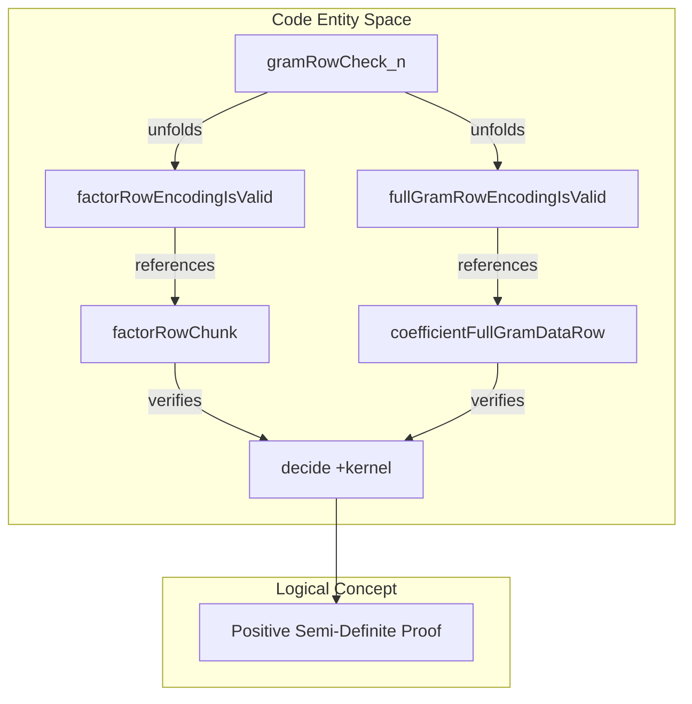
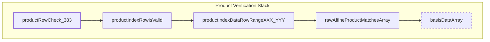

<!-- source: DeepWiki mcp.deepwiki.com · repo openai/ten-proofs · page 3 The Property T Exact Certificate · fetched 2026-10-26 -->

# The Property T Exact Certificate

Relevant source files

The following files were used as context for generating this wiki page:

- [ConnesRigidity/PropertyTExactCertificateCoefficientEdgePackets/Positive112.lean](ConnesRigidity/PropertyTExactCertificateCoefficientEdgePackets/Positive112.lean)
- [ConnesRigidity/PropertyTExactCertificateCoefficientEdgePackets/Positive118.lean](ConnesRigidity/PropertyTExactCertificateCoefficientEdgePackets/Positive118.lean)
- [ConnesRigidity/PropertyTExactCertificateCoefficientEdgePackets/Positive120.lean](ConnesRigidity/PropertyTExactCertificateCoefficientEdgePackets/Positive120.lean)
- [ConnesRigidity/PropertyTExactCertificateCoefficientEdgePackets/Positive130.lean](ConnesRigidity/PropertyTExactCertificateCoefficientEdgePackets/Positive130.lean)
- [ConnesRigidity/PropertyTExactCertificateCoefficientEdgePackets/Positive131.lean](ConnesRigidity/PropertyTExactCertificateCoefficientEdgePackets/Positive131.lean)
- [ConnesRigidity/PropertyTExactCertificateCoefficientEdgePackets/Positive133.lean](ConnesRigidity/PropertyTExactCertificateCoefficientEdgePackets/Positive133.lean)
- [ConnesRigidity/PropertyTExactCertificateCoefficientEdgePackets/Positive148.lean](ConnesRigidity/PropertyTExactCertificateCoefficientEdgePackets/Positive148.lean)
- [ConnesRigidity/PropertyTExactCertificateCoefficientEdgePackets/Positive149.lean](ConnesRigidity/PropertyTExactCertificateCoefficientEdgePackets/Positive149.lean)
- [ConnesRigidity/PropertyTExactCertificateCoefficientEdgePackets/Positive155.lean](ConnesRigidity/PropertyTExactCertificateCoefficientEdgePackets/Positive155.lean)
- [ConnesRigidity/PropertyTExactCertificateCoefficientEdgePackets/Positive156.lean](ConnesRigidity/PropertyTExactCertificateCoefficientEdgePackets/Positive156.lean)
- [ConnesRigidity/PropertyTExactCertificateCoefficientEdgePackets/Positive157.lean](ConnesRigidity/PropertyTExactCertificateCoefficientEdgePackets/Positive157.lean)
- [ConnesRigidity/PropertyTExactCertificateCoefficientEdgePackets/Positive158.lean](ConnesRigidity/PropertyTExactCertificateCoefficientEdgePackets/Positive158.lean)
- [ConnesRigidity/PropertyTExactCertificateCoefficientEdgePackets/Positive159.lean](ConnesRigidity/PropertyTExactCertificateCoefficientEdgePackets/Positive159.lean)
- [ConnesRigidity/PropertyTExactCertificateCoefficientEdgePackets/Positive160.lean](ConnesRigidity/PropertyTExactCertificateCoefficientEdgePackets/Positive160.lean)
- [ConnesRigidity/PropertyTExactCertificateCoefficientEdgePackets/Positive166.lean](ConnesRigidity/PropertyTExactCertificateCoefficientEdgePackets/Positive166.lean)
- [ConnesRigidity/PropertyTExactCertificateCoefficientEdgePackets/Positive168.lean](ConnesRigidity/PropertyTExactCertificateCoefficientEdgePackets/Positive168.lean)
- [ConnesRigidity/PropertyTExactCertificateCoefficientEdgePackets/Positive172.lean](ConnesRigidity/PropertyTExactCertificateCoefficientEdgePackets/Positive172.lean)
- [ConnesRigidity/PropertyTExactCertificateCoefficientEdgePackets/Positive175.lean](ConnesRigidity/PropertyTExactCertificateCoefficientEdgePackets/Positive175.lean)
- [ConnesRigidity/PropertyTExactCertificateCoefficientEdgePackets/Positive176.lean](ConnesRigidity/PropertyTExactCertificateCoefficientEdgePackets/Positive176.lean)
- [ConnesRigidity/PropertyTExactCertificateCoefficientEdgePackets/Positive177.lean](ConnesRigidity/PropertyTExactCertificateCoefficientEdgePackets/Positive177.lean)
- [ConnesRigidity/PropertyTExactCertificateCoefficientEdgePackets/Positive178.lean](ConnesRigidity/PropertyTExactCertificateCoefficientEdgePackets/Positive178.lean)
- [ConnesRigidity/PropertyTExactCertificateCoefficientEdgePackets/Positive194.lean](ConnesRigidity/PropertyTExactCertificateCoefficientEdgePackets/Positive194.lean)
- [ConnesRigidity/PropertyTExactCertificateCoefficientEdgePackets/Positive209.lean](ConnesRigidity/PropertyTExactCertificateCoefficientEdgePackets/Positive209.lean)
- [ConnesRigidity/PropertyTExactCertificateCoefficientEdgePackets/Positive224.lean](ConnesRigidity/PropertyTExactCertificateCoefficientEdgePackets/Positive224.lean)
- [ConnesRigidity/PropertyTExactCertificateCoefficientEdgePackets/Positive229.lean](ConnesRigidity/PropertyTExactCertificateCoefficientEdgePackets/Positive229.lean)
- [ConnesRigidity/PropertyTExactCertificateCoefficientEdgePackets/Positive248.lean](ConnesRigidity/PropertyTExactCertificateCoefficientEdgePackets/Positive248.lean)
- [ConnesRigidity/PropertyTExactCertificateCoefficientEdgePackets/Positive250.lean](ConnesRigidity/PropertyTExactCertificateCoefficientEdgePackets/Positive250.lean)
- [ConnesRigidity/PropertyTExactCertificateCoefficientEdgePackets/Positive251.lean](ConnesRigidity/PropertyTExactCertificateCoefficientEdgePackets/Positive251.lean)
- [ConnesRigidity/PropertyTExactCertificateCoefficientEdgePackets/Positive256.lean](ConnesRigidity/PropertyTExactCertificateCoefficientEdgePackets/Positive256.lean)
- [ConnesRigidity/PropertyTExactCertificateCoefficientEdgePackets/Positive259.lean](ConnesRigidity/PropertyTExactCertificateCoefficientEdgePackets/Positive259.lean)
- [ConnesRigidity/PropertyTExactCertificateCoefficientEdgePackets/Positive260.lean](ConnesRigidity/PropertyTExactCertificateCoefficientEdgePackets/Positive260.lean)
- [ConnesRigidity/PropertyTExactCertificateGramRows/Row019.lean](ConnesRigidity/PropertyTExactCertificateGramRows/Row019.lean)
- [ConnesRigidity/PropertyTExactCertificateGramRows/Row020.lean](ConnesRigidity/PropertyTExactCertificateGramRows/Row020.lean)
- [ConnesRigidity/PropertyTExactCertificateGramRows/Row021.lean](ConnesRigidity/PropertyTExactCertificateGramRows/Row021.lean)
- [ConnesRigidity/PropertyTExactCertificateGramRows/Row024.lean](ConnesRigidity/PropertyTExactCertificateGramRows/Row024.lean)
- [ConnesRigidity/PropertyTExactCertificateGramRows/Row031.lean](ConnesRigidity/PropertyTExactCertificateGramRows/Row031.lean)
- [ConnesRigidity/PropertyTExactCertificateGramRows/Row037.lean](ConnesRigidity/PropertyTExactCertificateGramRows/Row037.lean)
- [ConnesRigidity/PropertyTExactCertificateGramRows/Row039.lean](ConnesRigidity/PropertyTExactCertificateGramRows/Row039.lean)
- [ConnesRigidity/PropertyTExactCertificateGramRows/Row085.lean](ConnesRigidity/PropertyTExactCertificateGramRows/Row085.lean)
- [ConnesRigidity/PropertyTExactCertificateGramRows/Row126.lean](ConnesRigidity/PropertyTExactCertificateGramRows/Row126.lean)
- [ConnesRigidity/PropertyTExactCertificateGramRows/Row212.lean](ConnesRigidity/PropertyTExactCertificateGramRows/Row212.lean)
- [ConnesRigidity/PropertyTExactCertificateGramRows/Row213.lean](ConnesRigidity/PropertyTExactCertificateGramRows/Row213.lean)
- [ConnesRigidity/PropertyTExactCertificateGramRows/Row225.lean](ConnesRigidity/PropertyTExactCertificateGramRows/Row225.lean)
- [ConnesRigidity/PropertyTExactCertificateGramRows/Row270.lean](ConnesRigidity/PropertyTExactCertificateGramRows/Row270.lean)
- [ConnesRigidity/PropertyTExactCertificateGramRows/Row285.lean](ConnesRigidity/PropertyTExactCertificateGramRows/Row285.lean)
- [ConnesRigidity/PropertyTExactCertificateGramRows/Row295.lean](ConnesRigidity/PropertyTExactCertificateGramRows/Row295.lean)
- [ConnesRigidity/PropertyTExactCertificateGramRows/Row296.lean](ConnesRigidity/PropertyTExactCertificateGramRows/Row296.lean)
- [ConnesRigidity/PropertyTExactCertificateGramRows/Row298.lean](ConnesRigidity/PropertyTExactCertificateGramRows/Row298.lean)
- [ConnesRigidity/PropertyTExactCertificateGramRows/Row316.lean](ConnesRigidity/PropertyTExactCertificateGramRows/Row316.lean)
- [ConnesRigidity/PropertyTExactCertificateGramRows/Row328.lean](ConnesRigidity/PropertyTExactCertificateGramRows/Row328.lean)
- [ConnesRigidity/PropertyTExactCertificateGramRows/Row373.lean](ConnesRigidity/PropertyTExactCertificateGramRows/Row373.lean)
- [ConnesRigidity/PropertyTExactCertificateGramRows/Row383.lean](ConnesRigidity/PropertyTExactCertificateGramRows/Row383.lean)
- [ConnesRigidity/PropertyTExactCertificateGramRows/Row393.lean](ConnesRigidity/PropertyTExactCertificateGramRows/Row393.lean)
- [ConnesRigidity/PropertyTExactCertificateGramRows/Row408.lean](ConnesRigidity/PropertyTExactCertificateGramRows/Row408.lean)
- [ConnesRigidity/PropertyTExactCertificateProductRows/Row148.lean](ConnesRigidity/PropertyTExactCertificateProductRows/Row148.lean)
- [ConnesRigidity/PropertyTExactCertificateProductRows/Row219.lean](ConnesRigidity/PropertyTExactCertificateProductRows/Row219.lean)
- [ConnesRigidity/PropertyTExactCertificateProductRows/Row273.lean](ConnesRigidity/PropertyTExactCertificateProductRows/Row273.lean)
- [ConnesRigidity/PropertyTExactCertificateProductRows/Row282.lean](ConnesRigidity/PropertyTExactCertificateProductRows/Row282.lean)
- [ConnesRigidity/PropertyTExactCertificateProductRows/Row306.lean](ConnesRigidity/PropertyTExactCertificateProductRows/Row306.lean)
- [ConnesRigidity/PropertyTExactCertificateProductRows/Row309.lean](ConnesRigidity/PropertyTExactCertificateProductRows/Row309.lean)
- [ConnesRigidity/PropertyTExactCertificateProductRows/Row349.lean](ConnesRigidity/PropertyTExactCertificateProductRows/Row349.lean)
- [ConnesRigidity/PropertyTExactCertificateProductRows/Row355.lean](ConnesRigidity/PropertyTExactCertificateProductRows/Row355.lean)
- [ConnesRigidity/PropertyTExactCertificateProductRows/Row358.lean](ConnesRigidity/PropertyTExactCertificateProductRows/Row358.lean)
- [ConnesRigidity/PropertyTExactCertificateProductRows/Row359.lean](ConnesRigidity/PropertyTExactCertificateProductRows/Row359.lean)
- [ConnesRigidity/PropertyTExactCertificateProductRows/Row368.lean](ConnesRigidity/PropertyTExactCertificateProductRows/Row368.lean)
- [ConnesRigidity/PropertyTExactCertificateProductRows/Row376.lean](ConnesRigidity/PropertyTExactCertificateProductRows/Row376.lean)
- [ConnesRigidity/PropertyTExactCertificateProductRows/Row383.lean](ConnesRigidity/PropertyTExactCertificateProductRows/Row383.lean)
- [ConnesRigidity/PropertyTExactCertificateProductRows/Row406.lean](ConnesRigidity/PropertyTExactCertificateProductRows/Row406.lean)
- [ConnesRigidity/PropertyTExactCertificateProductRows/Row419.lean](ConnesRigidity/PropertyTExactCertificateProductRows/Row419.lean)
- [ConnesRigidity/PropertyTExactCertificateProductRows/Row420.lean](ConnesRigidity/PropertyTExactCertificateProductRows/Row420.lean)
- [ConnesRigidity/PropertyTExactCertificateProductRows/Row421.lean](ConnesRigidity/PropertyTExactCertificateProductRows/Row421.lean)
- [ConnesRigidity/PropertyTExactCertificateProductRows/Row424.lean](ConnesRigidity/PropertyTExactCertificateProductRows/Row424.lean)

This page provides a high-level overview of the computational certificate used to prove that the group $\Gamma_0$ has Kazhdan's Property T. The certificate is a massive collection of formal data and theorems that verify a spectral gap for the group's Laplacian in the group ring. Due to the scale of the data, the verification is decomposed into several specialized subsystems.

### System Overview

The certificate demonstrates that a specific element in the group ring (the Laplacian) can be written as a sum of squares plus an error term, scaled by a large integer denominator. The verification architecture bridges raw integer data stored in Lean files to high-level group ring identities using a "table-and-term" abstraction.

### Certificate Architecture and Proof Strategy
The top-level proof strategy is implemented in `PropertyTExactCertificateProof.lean`. The certificate is structured as a combination of factor squares, negative edge squares, positive edge squares, and diagonal squares. To connect raw data to mathematical objects, the codebase uses `IntegerTableTerm` and `interpretIntegerTerms`.

For details, see [Certificate Architecture and Proof Strategy](#3.1).

**Sources:**
* `ConnesRigidity/PropertyTExactCertificateCoefficientEdgePackets/Positive155.lean:13-15` (Definition of IntegerTableTerm usage)
* `ConnesRigidity/PropertyTExactCertificateGramRows/Row295.lean:14-25` (Verification strategy via `decide +kernel`)

### Gram Matrix Certificate
The core of the positivity proof lies in a 425x425 Gram matrix. This matrix is verified via a Cholesky-like decomposition, where rows are checked individually for consistency. The verification ensures that the Gram matrix is Positive Semi-Definite (PSD) by validating its factor-row encoding.

For details, see [Gram Matrix Certificate](#3.2).

**The Gram Row Verification Workflow**

**Sources:**
* `ConnesRigidity/PropertyTExactCertificateGramRows/Row295.lean:12-25`
* `ConnesRigidity/PropertyTExactCertificateGramRows/Row212.lean:14-25`
* `ConnesRigidity/PropertyTExactCertificateGramRows/Row270.lean:14-25`

### Edge Coefficient Packets
The certificate accounts for the "edges" of the spectral gap through negative and positive edge terms. These coefficients are stored in "packets" (e.g., `coefficientPositivePacketRows155`) to manage memory during compilation. Each packet contains lists of integers representing group ring coefficients.

For details, see [Edge Coefficient Packets](#3.3).

**Sources:**
* `ConnesRigidity/PropertyTExactCertificateCoefficientEdgePackets/Positive155.lean:9-15`
* `ConnesRigidity/PropertyTExactCertificateCoefficientEdgePackets/Positive148.lean:9-15`
* `ConnesRigidity/PropertyTExactCertificateCoefficientEdgePackets/Positive131.lean:9-15`

### Product Index Table
Because the certificate operates on a basis of the group ring, multiplication of basis elements must be strictly verified. The `productIndexDataRow` structure and `productRowCheck` theorems ensure that the multiplication of any two basis elements corresponds correctly to the underlying group operation in $\Gamma_0$. To prevent kernel timeouts, these proofs use a hierarchical range-based unfolding strategy (e.g., `productIndexDataRowRange212_425`).

For details, see [Product Index Table](#3.4).

**Product Verification Hierarchy**

**Sources:**
* `ConnesRigidity/PropertyTExactCertificateProductRows/Row383.lean:12-33`
* `ConnesRigidity/PropertyTExactCertificateProductRows/Row282.lean:12-33`

### Coefficient Encoding and Leaves
To handle the high-dimensional vectors (over 73,000 group elements), coefficients are encoded in a tree-like structure. The `CoefficientEncodingLeaves` store the actual integer values, while the `CoefficientChecker` validates the integrity of the sparse representation. This subsystem allows the Lean kernel to compute group ring sums efficiently.

For details, see [Coefficient Encoding and Leaves](#3.5).

**Sources:**
* `ConnesRigidity/PropertyTExactCertificateCoefficientEdgePackets/Positive155.lean:3-11` (Importing Entry000 data from CertificateLiterals)
* `ConnesRigidity/PropertyTExactCertificateGramRows/Row295.lean:23-25` (Usage of `encodedFactorRows`)

---

