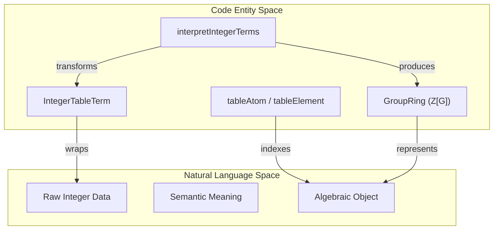
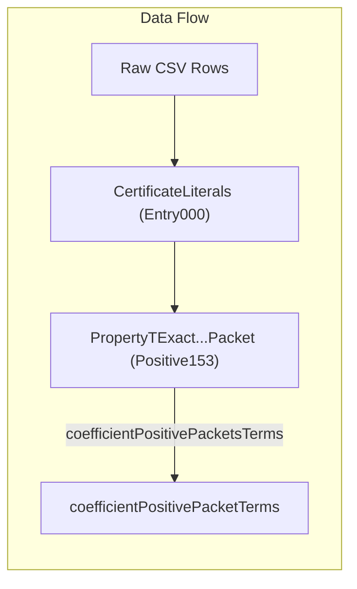

<!-- source: DeepWiki mcp.deepwiki.com · repo openai/ten-proofs · page 3.1 Certificate Architecture and Proof Strategy · fetched 2026-10-26 -->

# Certificate Architecture and Proof Strategy

Relevant source files

The following files were used as context for generating this wiki page:

- [ConnesRigidity/PropertyTExactCertificateCoefficientEdgePackets/Positive001.lean](ConnesRigidity/PropertyTExactCertificateCoefficientEdgePackets/Positive001.lean)
- [ConnesRigidity/PropertyTExactCertificateCoefficientEdgePackets/Positive002.lean](ConnesRigidity/PropertyTExactCertificateCoefficientEdgePackets/Positive002.lean)
- [ConnesRigidity/PropertyTExactCertificateCoefficientEdgePackets/Positive004.lean](ConnesRigidity/PropertyTExactCertificateCoefficientEdgePackets/Positive004.lean)
- [ConnesRigidity/PropertyTExactCertificateCoefficientEdgePackets/Positive005.lean](ConnesRigidity/PropertyTExactCertificateCoefficientEdgePackets/Positive005.lean)
- [ConnesRigidity/PropertyTExactCertificateCoefficientEdgePackets/Positive008.lean](ConnesRigidity/PropertyTExactCertificateCoefficientEdgePackets/Positive008.lean)
- [ConnesRigidity/PropertyTExactCertificateCoefficientEdgePackets/Positive009.lean](ConnesRigidity/PropertyTExactCertificateCoefficientEdgePackets/Positive009.lean)
- [ConnesRigidity/PropertyTExactCertificateCoefficientEdgePackets/Positive012.lean](ConnesRigidity/PropertyTExactCertificateCoefficientEdgePackets/Positive012.lean)
- [ConnesRigidity/PropertyTExactCertificateCoefficientEdgePackets/Positive013.lean](ConnesRigidity/PropertyTExactCertificateCoefficientEdgePackets/Positive013.lean)
- [ConnesRigidity/PropertyTExactCertificateCoefficientEdgePackets/Positive018.lean](ConnesRigidity/PropertyTExactCertificateCoefficientEdgePackets/Positive018.lean)
- [ConnesRigidity/PropertyTExactCertificateCoefficientEdgePackets/Positive021.lean](ConnesRigidity/PropertyTExactCertificateCoefficientEdgePackets/Positive021.lean)
- [ConnesRigidity/PropertyTExactCertificateCoefficientEdgePackets/Positive023.lean](ConnesRigidity/PropertyTExactCertificateCoefficientEdgePackets/Positive023.lean)
- [ConnesRigidity/PropertyTExactCertificateCoefficientEdgePackets/Positive026.lean](ConnesRigidity/PropertyTExactCertificateCoefficientEdgePackets/Positive026.lean)
- [ConnesRigidity/PropertyTExactCertificateCoefficientEdgePackets/Positive028.lean](ConnesRigidity/PropertyTExactCertificateCoefficientEdgePackets/Positive028.lean)
- [ConnesRigidity/PropertyTExactCertificateCoefficientEdgePackets/Positive029.lean](ConnesRigidity/PropertyTExactCertificateCoefficientEdgePackets/Positive029.lean)
- [ConnesRigidity/PropertyTExactCertificateCoefficientEdgePackets/Positive031.lean](ConnesRigidity/PropertyTExactCertificateCoefficientEdgePackets/Positive031.lean)
- [ConnesRigidity/PropertyTExactCertificateCoefficientEdgePackets/Positive034.lean](ConnesRigidity/PropertyTExactCertificateCoefficientEdgePackets/Positive034.lean)
- [ConnesRigidity/PropertyTExactCertificateCoefficientEdgePackets/Positive042.lean](ConnesRigidity/PropertyTExactCertificateCoefficientEdgePackets/Positive042.lean)
- [ConnesRigidity/PropertyTExactCertificateCoefficientEdgePackets/Positive045.lean](ConnesRigidity/PropertyTExactCertificateCoefficientEdgePackets/Positive045.lean)
- [ConnesRigidity/PropertyTExactCertificateCoefficientEdgePackets/Positive052.lean](ConnesRigidity/PropertyTExactCertificateCoefficientEdgePackets/Positive052.lean)
- [ConnesRigidity/PropertyTExactCertificateCoefficientEdgePackets/Positive055.lean](ConnesRigidity/PropertyTExactCertificateCoefficientEdgePackets/Positive055.lean)
- [ConnesRigidity/PropertyTExactCertificateCoefficientEdgePackets/Positive056.lean](ConnesRigidity/PropertyTExactCertificateCoefficientEdgePackets/Positive056.lean)
- [ConnesRigidity/PropertyTExactCertificateCoefficientEdgePackets/Positive058.lean](ConnesRigidity/PropertyTExactCertificateCoefficientEdgePackets/Positive058.lean)
- [ConnesRigidity/PropertyTExactCertificateCoefficientEdgePackets/Positive060.lean](ConnesRigidity/PropertyTExactCertificateCoefficientEdgePackets/Positive060.lean)
- [ConnesRigidity/PropertyTExactCertificateCoefficientEdgePackets/Positive061.lean](ConnesRigidity/PropertyTExactCertificateCoefficientEdgePackets/Positive061.lean)
- [ConnesRigidity/PropertyTExactCertificateCoefficientEdgePackets/Positive064.lean](ConnesRigidity/PropertyTExactCertificateCoefficientEdgePackets/Positive064.lean)
- [ConnesRigidity/PropertyTExactCertificateCoefficientEdgePackets/Positive065.lean](ConnesRigidity/PropertyTExactCertificateCoefficientEdgePackets/Positive065.lean)
- [ConnesRigidity/PropertyTExactCertificateCoefficientEdgePackets/Positive066.lean](ConnesRigidity/PropertyTExactCertificateCoefficientEdgePackets/Positive066.lean)
- [ConnesRigidity/PropertyTExactCertificateCoefficientEdgePackets/Positive076.lean](ConnesRigidity/PropertyTExactCertificateCoefficientEdgePackets/Positive076.lean)
- [ConnesRigidity/PropertyTExactCertificateCoefficientEdgePackets/Positive077.lean](ConnesRigidity/PropertyTExactCertificateCoefficientEdgePackets/Positive077.lean)
- [ConnesRigidity/PropertyTExactCertificateCoefficientEdgePackets/Positive078.lean](ConnesRigidity/PropertyTExactCertificateCoefficientEdgePackets/Positive078.lean)
- [ConnesRigidity/PropertyTExactCertificateCoefficientEdgePackets/Positive084.lean](ConnesRigidity/PropertyTExactCertificateCoefficientEdgePackets/Positive084.lean)
- [ConnesRigidity/PropertyTExactCertificateCoefficientEdgePackets/Positive091.lean](ConnesRigidity/PropertyTExactCertificateCoefficientEdgePackets/Positive091.lean)
- [ConnesRigidity/PropertyTExactCertificateCoefficientEdgePackets/Positive094.lean](ConnesRigidity/PropertyTExactCertificateCoefficientEdgePackets/Positive094.lean)
- [ConnesRigidity/PropertyTExactCertificateCoefficientEdgePackets/Positive096.lean](ConnesRigidity/PropertyTExactCertificateCoefficientEdgePackets/Positive096.lean)
- [ConnesRigidity/PropertyTExactCertificateCoefficientEdgePackets/Positive097.lean](ConnesRigidity/PropertyTExactCertificateCoefficientEdgePackets/Positive097.lean)
- [ConnesRigidity/PropertyTExactCertificateCoefficientEdgePackets/Positive103.lean](ConnesRigidity/PropertyTExactCertificateCoefficientEdgePackets/Positive103.lean)
- [ConnesRigidity/PropertyTExactCertificateCoefficientEdgePackets/Positive105.lean](ConnesRigidity/PropertyTExactCertificateCoefficientEdgePackets/Positive105.lean)
- [ConnesRigidity/PropertyTExactCertificateCoefficientEdgePackets/Positive112.lean](ConnesRigidity/PropertyTExactCertificateCoefficientEdgePackets/Positive112.lean)
- [ConnesRigidity/PropertyTExactCertificateCoefficientEdgePackets/Positive113.lean](ConnesRigidity/PropertyTExactCertificateCoefficientEdgePackets/Positive113.lean)
- [ConnesRigidity/PropertyTExactCertificateCoefficientEdgePackets/Positive118.lean](ConnesRigidity/PropertyTExactCertificateCoefficientEdgePackets/Positive118.lean)
- [ConnesRigidity/PropertyTExactCertificateCoefficientEdgePackets/Positive120.lean](ConnesRigidity/PropertyTExactCertificateCoefficientEdgePackets/Positive120.lean)
- [ConnesRigidity/PropertyTExactCertificateCoefficientEdgePackets/Positive130.lean](ConnesRigidity/PropertyTExactCertificateCoefficientEdgePackets/Positive130.lean)
- [ConnesRigidity/PropertyTExactCertificateCoefficientEdgePackets/Positive131.lean](ConnesRigidity/PropertyTExactCertificateCoefficientEdgePackets/Positive131.lean)
- [ConnesRigidity/PropertyTExactCertificateCoefficientEdgePackets/Positive133.lean](ConnesRigidity/PropertyTExactCertificateCoefficientEdgePackets/Positive133.lean)
- [ConnesRigidity/PropertyTExactCertificateCoefficientEdgePackets/Positive135.lean](ConnesRigidity/PropertyTExactCertificateCoefficientEdgePackets/Positive135.lean)
- [ConnesRigidity/PropertyTExactCertificateCoefficientEdgePackets/Positive137.lean](ConnesRigidity/PropertyTExactCertificateCoefficientEdgePackets/Positive137.lean)
- [ConnesRigidity/PropertyTExactCertificateCoefficientEdgePackets/Positive138.lean](ConnesRigidity/PropertyTExactCertificateCoefficientEdgePackets/Positive138.lean)
- [ConnesRigidity/PropertyTExactCertificateCoefficientEdgePackets/Positive141.lean](ConnesRigidity/PropertyTExactCertificateCoefficientEdgePackets/Positive141.lean)
- [ConnesRigidity/PropertyTExactCertificateCoefficientEdgePackets/Positive142.lean](ConnesRigidity/PropertyTExactCertificateCoefficientEdgePackets/Positive142.lean)
- [ConnesRigidity/PropertyTExactCertificateCoefficientEdgePackets/Positive146.lean](ConnesRigidity/PropertyTExactCertificateCoefficientEdgePackets/Positive146.lean)
- [ConnesRigidity/PropertyTExactCertificateCoefficientEdgePackets/Positive147.lean](ConnesRigidity/PropertyTExactCertificateCoefficientEdgePackets/Positive147.lean)
- [ConnesRigidity/PropertyTExactCertificateCoefficientEdgePackets/Positive148.lean](ConnesRigidity/PropertyTExactCertificateCoefficientEdgePackets/Positive148.lean)
- [ConnesRigidity/PropertyTExactCertificateCoefficientEdgePackets/Positive149.lean](ConnesRigidity/PropertyTExactCertificateCoefficientEdgePackets/Positive149.lean)
- [ConnesRigidity/PropertyTExactCertificateCoefficientEdgePackets/Positive153.lean](ConnesRigidity/PropertyTExactCertificateCoefficientEdgePackets/Positive153.lean)
- [ConnesRigidity/PropertyTExactCertificateCoefficientEdgePackets/Positive154.lean](ConnesRigidity/PropertyTExactCertificateCoefficientEdgePackets/Positive154.lean)
- [ConnesRigidity/PropertyTExactCertificateCoefficientEdgePackets/Positive155.lean](ConnesRigidity/PropertyTExactCertificateCoefficientEdgePackets/Positive155.lean)
- [ConnesRigidity/PropertyTExactCertificateCoefficientEdgePackets/Positive156.lean](ConnesRigidity/PropertyTExactCertificateCoefficientEdgePackets/Positive156.lean)
- [ConnesRigidity/PropertyTExactCertificateCoefficientEdgePackets/Positive157.lean](ConnesRigidity/PropertyTExactCertificateCoefficientEdgePackets/Positive157.lean)
- [ConnesRigidity/PropertyTExactCertificateCoefficientEdgePackets/Positive158.lean](ConnesRigidity/PropertyTExactCertificateCoefficientEdgePackets/Positive158.lean)
- [ConnesRigidity/PropertyTExactCertificateCoefficientEdgePackets/Positive159.lean](ConnesRigidity/PropertyTExactCertificateCoefficientEdgePackets/Positive159.lean)
- [ConnesRigidity/PropertyTExactCertificateCoefficientEdgePackets/Positive160.lean](ConnesRigidity/PropertyTExactCertificateCoefficientEdgePackets/Positive160.lean)
- [ConnesRigidity/PropertyTExactCertificateCoefficientEdgePackets/Positive166.lean](ConnesRigidity/PropertyTExactCertificateCoefficientEdgePackets/Positive166.lean)
- [ConnesRigidity/PropertyTExactCertificateCoefficientEdgePackets/Positive168.lean](ConnesRigidity/PropertyTExactCertificateCoefficientEdgePackets/Positive168.lean)
- [ConnesRigidity/PropertyTExactCertificateCoefficientEdgePackets/Positive172.lean](ConnesRigidity/PropertyTExactCertificateCoefficientEdgePackets/Positive172.lean)
- [ConnesRigidity/PropertyTExactCertificateCoefficientEdgePackets/Positive175.lean](ConnesRigidity/PropertyTExactCertificateCoefficientEdgePackets/Positive175.lean)
- [ConnesRigidity/PropertyTExactCertificateCoefficientEdgePackets/Positive176.lean](ConnesRigidity/PropertyTExactCertificateCoefficientEdgePackets/Positive176.lean)
- [ConnesRigidity/PropertyTExactCertificateCoefficientEdgePackets/Positive177.lean](ConnesRigidity/PropertyTExactCertificateCoefficientEdgePackets/Positive177.lean)
- [ConnesRigidity/PropertyTExactCertificateCoefficientEdgePackets/Positive178.lean](ConnesRigidity/PropertyTExactCertificateCoefficientEdgePackets/Positive178.lean)
- [ConnesRigidity/PropertyTExactCertificateCoefficientEdgePackets/Positive180.lean](ConnesRigidity/PropertyTExactCertificateCoefficientEdgePackets/Positive180.lean)
- [ConnesRigidity/PropertyTExactCertificateCoefficientEdgePackets/Positive181.lean](ConnesRigidity/PropertyTExactCertificateCoefficientEdgePackets/Positive181.lean)
- [ConnesRigidity/PropertyTExactCertificateCoefficientEdgePackets/Positive183.lean](ConnesRigidity/PropertyTExactCertificateCoefficientEdgePackets/Positive183.lean)
- [ConnesRigidity/PropertyTExactCertificateCoefficientEdgePackets/Positive190.lean](ConnesRigidity/PropertyTExactCertificateCoefficientEdgePackets/Positive190.lean)
- [ConnesRigidity/PropertyTExactCertificateCoefficientEdgePackets/Positive194.lean](ConnesRigidity/PropertyTExactCertificateCoefficientEdgePackets/Positive194.lean)
- [ConnesRigidity/PropertyTExactCertificateCoefficientEdgePackets/Positive200.lean](ConnesRigidity/PropertyTExactCertificateCoefficientEdgePackets/Positive200.lean)
- [ConnesRigidity/PropertyTExactCertificateCoefficientEdgePackets/Positive209.lean](ConnesRigidity/PropertyTExactCertificateCoefficientEdgePackets/Positive209.lean)
- [ConnesRigidity/PropertyTExactCertificateCoefficientEdgePackets/Positive212.lean](ConnesRigidity/PropertyTExactCertificateCoefficientEdgePackets/Positive212.lean)
- [ConnesRigidity/PropertyTExactCertificateCoefficientEdgePackets/Positive213.lean](ConnesRigidity/PropertyTExactCertificateCoefficientEdgePackets/Positive213.lean)
- [ConnesRigidity/PropertyTExactCertificateCoefficientEdgePackets/Positive219.lean](ConnesRigidity/PropertyTExactCertificateCoefficientEdgePackets/Positive219.lean)
- [ConnesRigidity/PropertyTExactCertificateCoefficientEdgePackets/Positive224.lean](ConnesRigidity/PropertyTExactCertificateCoefficientEdgePackets/Positive224.lean)
- [ConnesRigidity/PropertyTExactCertificateCoefficientEdgePackets/Positive226.lean](ConnesRigidity/PropertyTExactCertificateCoefficientEdgePackets/Positive226.lean)
- [ConnesRigidity/PropertyTExactCertificateCoefficientEdgePackets/Positive229.lean](ConnesRigidity/PropertyTExactCertificateCoefficientEdgePackets/Positive229.lean)
- [ConnesRigidity/PropertyTExactCertificateCoefficientEdgePackets/Positive232.lean](ConnesRigidity/PropertyTExactCertificateCoefficientEdgePackets/Positive232.lean)
- [ConnesRigidity/PropertyTExactCertificateCoefficientEdgePackets/Positive236.lean](ConnesRigidity/PropertyTExactCertificateCoefficientEdgePackets/Positive236.lean)
- [ConnesRigidity/PropertyTExactCertificateCoefficientEdgePackets/Positive238.lean](ConnesRigidity/PropertyTExactCertificateCoefficientEdgePackets/Positive238.lean)
- [ConnesRigidity/PropertyTExactCertificateCoefficientEdgePackets/Positive247.lean](ConnesRigidity/PropertyTExactCertificateCoefficientEdgePackets/Positive247.lean)
- [ConnesRigidity/PropertyTExactCertificateCoefficientEdgePackets/Positive248.lean](ConnesRigidity/PropertyTExactCertificateCoefficientEdgePackets/Positive248.lean)
- [ConnesRigidity/PropertyTExactCertificateCoefficientEdgePackets/Positive250.lean](ConnesRigidity/PropertyTExactCertificateCoefficientEdgePackets/Positive250.lean)
- [ConnesRigidity/PropertyTExactCertificateCoefficientEdgePackets/Positive251.lean](ConnesRigidity/PropertyTExactCertificateCoefficientEdgePackets/Positive251.lean)
- [ConnesRigidity/PropertyTExactCertificateCoefficientEdgePackets/Positive256.lean](ConnesRigidity/PropertyTExactCertificateCoefficientEdgePackets/Positive256.lean)
- [ConnesRigidity/PropertyTExactCertificateCoefficientEdgePackets/Positive259.lean](ConnesRigidity/PropertyTExactCertificateCoefficientEdgePackets/Positive259.lean)
- [ConnesRigidity/PropertyTExactCertificateCoefficientEdgePackets/Positive260.lean](ConnesRigidity/PropertyTExactCertificateCoefficientEdgePackets/Positive260.lean)
- [ConnesRigidity/PropertyTExactCertificateCoefficientEdgePackets/Positive264.lean](ConnesRigidity/PropertyTExactCertificateCoefficientEdgePackets/Positive264.lean)

This page describes the top-level architecture of the exact certificate for Kazhdan's Property (T) for the group $\Gamma_0$. The proof demonstrates that a specific element in the group ring—the customary Laplacian—can be expressed as a sum of squares (SOS) plus a small positive diagonal remainder, thereby establishing a spectral gap.

## Overview of the Proof Strategy

The certificate establishes Property (T) by verifying a spectral gap for the Laplacian $\Delta = \sum_{s \in S} (1 - s)$, where $S$ is a generating set. The core of the proof is the identity:
$$ D^2 \Delta = \sum A_i^* A_i + \text{remainder} $$
where $D$ is a large integer scaling factor (denominator) and $A_i$ are elements of the group ring with integer coefficients.

### Certificate Decomposition
The certificate is decomposed into four primary components to manage computational complexity:
1.  **Factor Squares**: Derived from the Gram matrix $G$, representing terms of the form $v^* G v$.
2.  **Negative Edge Squares**: Terms of the form $w (1-s)(1-s)^* w^*$ where the weight is negative.
3.  **Positive Edge Squares**: Terms of the form $w (1-s)(1-s)^* w^*$ where the weight is positive.
4.  **Diagonal Squares**: Residual diagonal terms ensuring the final sum matches the Laplacian.

## Data Abstractions and Interpretations

The system uses a tiered abstraction to connect raw integer data to group ring operations.

### Table Abstractions
To avoid direct manipulation of large group elements during kernel reduction, the certificate uses index-based abstractions:
*   `tableIndex`: A finite type representing the indices of the basis elements (e.g., `Fin 73033`).
*   `tableAtom`: A structure representing a single term in the group ring (index and coefficient).
*   `tableElement`: A list of `tableAtom` representing a group ring element.

### Integer Terms and Interpretation
The `IntegerTableTerm` structure in `PropertyTExactCertificateTerms.lean` serves as the intermediate representation. The function `interpretIntegerTerms` maps these raw integer representations into actual group ring elements.

Sources: `ConnesRigidity/PropertyTExactCertificateTerms.lean:1-50` (), `ConnesRigidity/PropertyTExactCertificateCoefficientEdgeBase.lean:1-30` ()

## Certificate Components Implementation

### Denominator Scaling
The certificate operates over integers to avoid floating-point issues. A global denominator is used to scale the Laplacian. This is defined in `PropertyTExactCertificate.lean`.

### Edge Packets
Edge terms represent the squares associated with group generators. Because there are thousands of these terms, they are sharded into "Packets". For example, `coefficientPositivePacketRows153` in `Positive153.lean` loads a specific chunk of data.

Sources: `ConnesRigidity/PropertyTExactCertificateCoefficientEdgePackets/Positive153.lean:9-15` (), `ConnesRigidity/PropertyTExactCertificateCoefficientEdgePackets/Positive001.lean:9-15` ()

### The Top-Level Check
The file `PropertyTExactCertificateChecks.lean` aggregates all sharded components (Gram rows, edge packets, product tables) and presents the final `decide` blocks that the Lean kernel executes to verify the identity.

## File Roles and Data Flow

| File | Role | Key Entities |
| :--- | :--- | :--- |
| `PropertyTExactCertificate.lean` | Top-level definitions | `exactCertificate`, `denominator` |
| `PropertyTExactCertificateTerms.lean` | Term definitions | `IntegerTableTerm`, `interpretIntegerTerms` |
| `PropertyTExactCertificateChecks.lean` | Kernel entry point | `check_certificate_identity` |
| `PropertyTExactCertificateCoefficientEdgeBase.lean` | Edge logic | `coefficientPositivePacketsTerms`, `coefficientNegativePacketsTerms` |

### Detailed Data Flow for Edge Terms
1.  **Storage**: Data is stored in `CertificateLiterals` as `List (List Int)`.
2.  **Import**: Files like `Positive153.lean` import these literals and mark them `@[irreducible]` to prevent the Lean elaborator from unfolding them prematurely.
3.  **Conversion**: `coefficientPositivePacketsTerms` converts the raw lists into `List (IntegerTableTerm 73033)`.
4.  **Verification**: These terms are summed in the final SOS check.

Sources: `ConnesRigidity/PropertyTExactCertificateCoefficientEdgePackets/Positive155.lean:9-15` (), `ConnesRigidity/PropertyTExactCertificateCoefficientEdgePackets/Positive178.lean:9-15` ()

## Computational Strategy: The "Decide" Tactic
The architecture heavily relies on Lean's `decide` tactic. By providing a `Decidable` instance for the certificate identity, the entire verification is offloaded to the Lean kernel's bytecode evaluator. This requires:
*   Efficient implementation of group ring multiplication (via `ProductIndexRows`).
*   Strict management of memory via `noncomputable` and `irreducible` definitions to handle the 73,033-element basis.

Sources: `ConnesRigidity/PropertyTExactCertificateCoefficientEdgePackets/Positive153.lean:9` (), `ConnesRigidity/PropertyTExactCertificateCoefficientEdgePackets/Positive158.lean:9` ()

---

