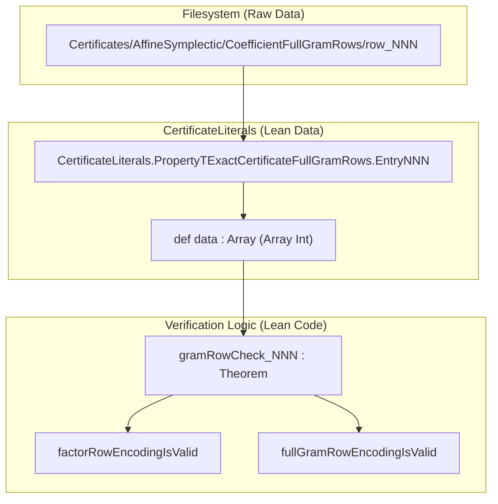
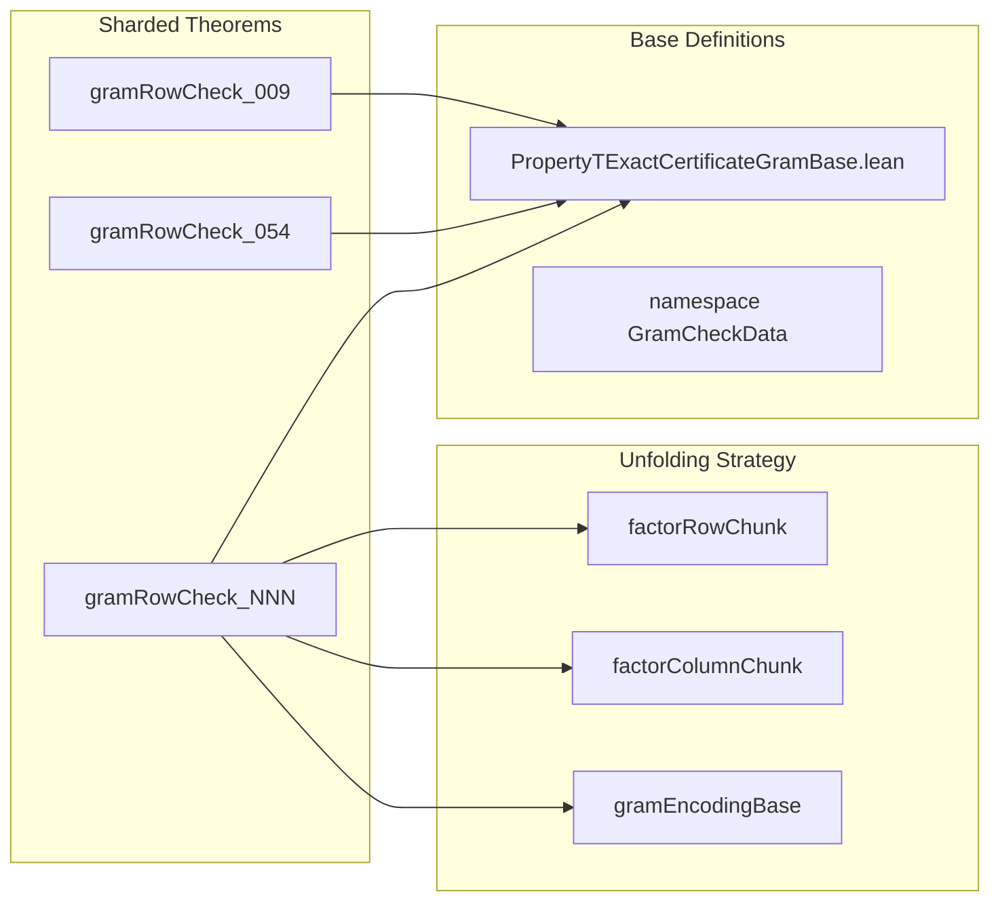

<!-- source: DeepWiki mcp.deepwiki.com · repo openai/ten-proofs · page 3.2 Gram Matrix Certificate · fetched 2026-10-26 -->

# Gram Matrix Certificate

Relevant source files

The following files were used as context for generating this wiki page:

- [ConnesRigidity/CertificateLiterals/PropertyTExactCertificateFullGramRows/Entry013.lean](ConnesRigidity/CertificateLiterals/PropertyTExactCertificateFullGramRows/Entry013.lean)
- [ConnesRigidity/CertificateLiterals/PropertyTExactCertificateFullGramRows/Entry019.lean](ConnesRigidity/CertificateLiterals/PropertyTExactCertificateFullGramRows/Entry019.lean)
- [ConnesRigidity/CertificateLiterals/PropertyTExactCertificateFullGramRows/Entry048.lean](ConnesRigidity/CertificateLiterals/PropertyTExactCertificateFullGramRows/Entry048.lean)
- [ConnesRigidity/CertificateLiterals/PropertyTExactCertificateFullGramRows/Entry055.lean](ConnesRigidity/CertificateLiterals/PropertyTExactCertificateFullGramRows/Entry055.lean)
- [ConnesRigidity/CertificateLiterals/PropertyTExactCertificateFullGramRows/Entry063.lean](ConnesRigidity/CertificateLiterals/PropertyTExactCertificateFullGramRows/Entry063.lean)
- [ConnesRigidity/CertificateLiterals/PropertyTExactCertificateFullGramRows/Entry073.lean](ConnesRigidity/CertificateLiterals/PropertyTExactCertificateFullGramRows/Entry073.lean)
- [ConnesRigidity/CertificateLiterals/PropertyTExactCertificateFullGramRows/Entry074.lean](ConnesRigidity/CertificateLiterals/PropertyTExactCertificateFullGramRows/Entry074.lean)
- [ConnesRigidity/CertificateLiterals/PropertyTExactCertificateFullGramRows/Entry075.lean](ConnesRigidity/CertificateLiterals/PropertyTExactCertificateFullGramRows/Entry075.lean)
- [ConnesRigidity/CertificateLiterals/PropertyTExactCertificateFullGramRows/Entry099.lean](ConnesRigidity/CertificateLiterals/PropertyTExactCertificateFullGramRows/Entry099.lean)
- [ConnesRigidity/CertificateLiterals/PropertyTExactCertificateFullGramRows/Entry100.lean](ConnesRigidity/CertificateLiterals/PropertyTExactCertificateFullGramRows/Entry100.lean)
- [ConnesRigidity/CertificateLiterals/PropertyTExactCertificateFullGramRows/Entry102.lean](ConnesRigidity/CertificateLiterals/PropertyTExactCertificateFullGramRows/Entry102.lean)
- [ConnesRigidity/CertificateLiterals/PropertyTExactCertificateFullGramRows/Entry104.lean](ConnesRigidity/CertificateLiterals/PropertyTExactCertificateFullGramRows/Entry104.lean)
- [ConnesRigidity/CertificateLiterals/PropertyTExactCertificateFullGramRows/Entry108.lean](ConnesRigidity/CertificateLiterals/PropertyTExactCertificateFullGramRows/Entry108.lean)
- [ConnesRigidity/CertificateLiterals/PropertyTExactCertificateFullGramRows/Entry110.lean](ConnesRigidity/CertificateLiterals/PropertyTExactCertificateFullGramRows/Entry110.lean)
- [ConnesRigidity/CertificateLiterals/PropertyTExactCertificateFullGramRows/Entry113.lean](ConnesRigidity/CertificateLiterals/PropertyTExactCertificateFullGramRows/Entry113.lean)
- [ConnesRigidity/CertificateLiterals/PropertyTExactCertificateFullGramRows/Entry115.lean](ConnesRigidity/CertificateLiterals/PropertyTExactCertificateFullGramRows/Entry115.lean)
- [ConnesRigidity/CertificateLiterals/PropertyTExactCertificateFullGramRows/Entry120.lean](ConnesRigidity/CertificateLiterals/PropertyTExactCertificateFullGramRows/Entry120.lean)
- [ConnesRigidity/CertificateLiterals/PropertyTExactCertificateFullGramRows/Entry124.lean](ConnesRigidity/CertificateLiterals/PropertyTExactCertificateFullGramRows/Entry124.lean)
- [ConnesRigidity/CertificateLiterals/PropertyTExactCertificateFullGramRows/Entry128.lean](ConnesRigidity/CertificateLiterals/PropertyTExactCertificateFullGramRows/Entry128.lean)
- [ConnesRigidity/CertificateLiterals/PropertyTExactCertificateFullGramRows/Entry132.lean](ConnesRigidity/CertificateLiterals/PropertyTExactCertificateFullGramRows/Entry132.lean)
- [ConnesRigidity/CertificateLiterals/PropertyTExactCertificateFullGramRows/Entry146.lean](ConnesRigidity/CertificateLiterals/PropertyTExactCertificateFullGramRows/Entry146.lean)
- [ConnesRigidity/CertificateLiterals/PropertyTExactCertificateFullGramRows/Entry148.lean](ConnesRigidity/CertificateLiterals/PropertyTExactCertificateFullGramRows/Entry148.lean)
- [ConnesRigidity/CertificateLiterals/PropertyTExactCertificateFullGramRows/Entry149.lean](ConnesRigidity/CertificateLiterals/PropertyTExactCertificateFullGramRows/Entry149.lean)
- [ConnesRigidity/CertificateLiterals/PropertyTExactCertificateFullGramRows/Entry153.lean](ConnesRigidity/CertificateLiterals/PropertyTExactCertificateFullGramRows/Entry153.lean)
- [ConnesRigidity/CertificateLiterals/PropertyTExactCertificateFullGramRows/Entry159.lean](ConnesRigidity/CertificateLiterals/PropertyTExactCertificateFullGramRows/Entry159.lean)
- [ConnesRigidity/CertificateLiterals/PropertyTExactCertificateFullGramRows/Entry166.lean](ConnesRigidity/CertificateLiterals/PropertyTExactCertificateFullGramRows/Entry166.lean)
- [ConnesRigidity/CertificateLiterals/PropertyTExactCertificateFullGramRows/Entry167.lean](ConnesRigidity/CertificateLiterals/PropertyTExactCertificateFullGramRows/Entry167.lean)
- [ConnesRigidity/CertificateLiterals/PropertyTExactCertificateFullGramRows/Entry173.lean](ConnesRigidity/CertificateLiterals/PropertyTExactCertificateFullGramRows/Entry173.lean)
- [ConnesRigidity/CertificateLiterals/PropertyTExactCertificateFullGramRows/Entry174.lean](ConnesRigidity/CertificateLiterals/PropertyTExactCertificateFullGramRows/Entry174.lean)
- [ConnesRigidity/CertificateLiterals/PropertyTExactCertificateFullGramRows/Entry179.lean](ConnesRigidity/CertificateLiterals/PropertyTExactCertificateFullGramRows/Entry179.lean)
- [ConnesRigidity/CertificateLiterals/PropertyTExactCertificateFullGramRows/Entry181.lean](ConnesRigidity/CertificateLiterals/PropertyTExactCertificateFullGramRows/Entry181.lean)
- [ConnesRigidity/CertificateLiterals/PropertyTExactCertificateFullGramRows/Entry183.lean](ConnesRigidity/CertificateLiterals/PropertyTExactCertificateFullGramRows/Entry183.lean)
- [ConnesRigidity/CertificateLiterals/PropertyTExactCertificateFullGramRows/Entry184.lean](ConnesRigidity/CertificateLiterals/PropertyTExactCertificateFullGramRows/Entry184.lean)
- [ConnesRigidity/CertificateLiterals/PropertyTExactCertificateFullGramRows/Entry188.lean](ConnesRigidity/CertificateLiterals/PropertyTExactCertificateFullGramRows/Entry188.lean)
- [ConnesRigidity/CertificateLiterals/PropertyTExactCertificateFullGramRows/Entry194.lean](ConnesRigidity/CertificateLiterals/PropertyTExactCertificateFullGramRows/Entry194.lean)
- [ConnesRigidity/CertificateLiterals/PropertyTExactCertificateFullGramRows/Entry196.lean](ConnesRigidity/CertificateLiterals/PropertyTExactCertificateFullGramRows/Entry196.lean)
- [ConnesRigidity/CertificateLiterals/PropertyTExactCertificateFullGramRows/Entry214.lean](ConnesRigidity/CertificateLiterals/PropertyTExactCertificateFullGramRows/Entry214.lean)
- [ConnesRigidity/CertificateLiterals/PropertyTExactCertificateFullGramRows/Entry234.lean](ConnesRigidity/CertificateLiterals/PropertyTExactCertificateFullGramRows/Entry234.lean)
- [ConnesRigidity/CertificateLiterals/PropertyTExactCertificateFullGramRows/Entry245.lean](ConnesRigidity/CertificateLiterals/PropertyTExactCertificateFullGramRows/Entry245.lean)
- [ConnesRigidity/CertificateLiterals/PropertyTExactCertificateFullGramRows/Entry256.lean](ConnesRigidity/CertificateLiterals/PropertyTExactCertificateFullGramRows/Entry256.lean)
- [ConnesRigidity/CertificateLiterals/PropertyTExactCertificateFullGramRows/Entry271.lean](ConnesRigidity/CertificateLiterals/PropertyTExactCertificateFullGramRows/Entry271.lean)
- [ConnesRigidity/CertificateLiterals/PropertyTExactCertificateFullGramRows/Entry284.lean](ConnesRigidity/CertificateLiterals/PropertyTExactCertificateFullGramRows/Entry284.lean)
- [ConnesRigidity/CertificateLiterals/PropertyTExactCertificateFullGramRows/Entry287.lean](ConnesRigidity/CertificateLiterals/PropertyTExactCertificateFullGramRows/Entry287.lean)
- [ConnesRigidity/CertificateLiterals/PropertyTExactCertificateFullGramRows/Entry288.lean](ConnesRigidity/CertificateLiterals/PropertyTExactCertificateFullGramRows/Entry288.lean)
- [ConnesRigidity/CertificateLiterals/PropertyTExactCertificateFullGramRows/Entry290.lean](ConnesRigidity/CertificateLiterals/PropertyTExactCertificateFullGramRows/Entry290.lean)
- [ConnesRigidity/CertificateLiterals/PropertyTExactCertificateFullGramRows/Entry292.lean](ConnesRigidity/CertificateLiterals/PropertyTExactCertificateFullGramRows/Entry292.lean)
- [ConnesRigidity/CertificateLiterals/PropertyTExactCertificateFullGramRows/Entry293.lean](ConnesRigidity/CertificateLiterals/PropertyTExactCertificateFullGramRows/Entry293.lean)
- [ConnesRigidity/CertificateLiterals/PropertyTExactCertificateFullGramRows/Entry296.lean](ConnesRigidity/CertificateLiterals/PropertyTExactCertificateFullGramRows/Entry296.lean)
- [ConnesRigidity/CertificateLiterals/PropertyTExactCertificateFullGramRows/Entry302.lean](ConnesRigidity/CertificateLiterals/PropertyTExactCertificateFullGramRows/Entry302.lean)
- [ConnesRigidity/CertificateLiterals/PropertyTExactCertificateFullGramRows/Entry303.lean](ConnesRigidity/CertificateLiterals/PropertyTExactCertificateFullGramRows/Entry303.lean)
- [ConnesRigidity/CertificateLiterals/PropertyTExactCertificateFullGramRows/Entry304.lean](ConnesRigidity/CertificateLiterals/PropertyTExactCertificateFullGramRows/Entry304.lean)
- [ConnesRigidity/CertificateLiterals/PropertyTExactCertificateFullGramRows/Entry305.lean](ConnesRigidity/CertificateLiterals/PropertyTExactCertificateFullGramRows/Entry305.lean)
- [ConnesRigidity/CertificateLiterals/PropertyTExactCertificateFullGramRows/Entry319.lean](ConnesRigidity/CertificateLiterals/PropertyTExactCertificateFullGramRows/Entry319.lean)
- [ConnesRigidity/CertificateLiterals/PropertyTExactCertificateFullGramRows/Entry321.lean](ConnesRigidity/CertificateLiterals/PropertyTExactCertificateFullGramRows/Entry321.lean)
- [ConnesRigidity/CertificateLiterals/PropertyTExactCertificateFullGramRows/Entry327.lean](ConnesRigidity/CertificateLiterals/PropertyTExactCertificateFullGramRows/Entry327.lean)
- [ConnesRigidity/CertificateLiterals/PropertyTExactCertificateFullGramRows/Entry340.lean](ConnesRigidity/CertificateLiterals/PropertyTExactCertificateFullGramRows/Entry340.lean)
- [ConnesRigidity/CertificateLiterals/PropertyTExactCertificateFullGramRows/Entry342.lean](ConnesRigidity/CertificateLiterals/PropertyTExactCertificateFullGramRows/Entry342.lean)
- [ConnesRigidity/CertificateLiterals/PropertyTExactCertificateFullGramRows/Entry343.lean](ConnesRigidity/CertificateLiterals/PropertyTExactCertificateFullGramRows/Entry343.lean)
- [ConnesRigidity/CertificateLiterals/PropertyTExactCertificateFullGramRows/Entry344.lean](ConnesRigidity/CertificateLiterals/PropertyTExactCertificateFullGramRows/Entry344.lean)
- [ConnesRigidity/CertificateLiterals/PropertyTExactCertificateFullGramRows/Entry346.lean](ConnesRigidity/CertificateLiterals/PropertyTExactCertificateFullGramRows/Entry346.lean)
- [ConnesRigidity/CertificateLiterals/PropertyTExactCertificateFullGramRows/Entry356.lean](ConnesRigidity/CertificateLiterals/PropertyTExactCertificateFullGramRows/Entry356.lean)
- [ConnesRigidity/CertificateLiterals/PropertyTExactCertificateFullGramRows/Entry359.lean](ConnesRigidity/CertificateLiterals/PropertyTExactCertificateFullGramRows/Entry359.lean)
- [ConnesRigidity/CertificateLiterals/PropertyTExactCertificateFullGramRows/Entry362.lean](ConnesRigidity/CertificateLiterals/PropertyTExactCertificateFullGramRows/Entry362.lean)
- [ConnesRigidity/CertificateLiterals/PropertyTExactCertificateFullGramRows/Entry372.lean](ConnesRigidity/CertificateLiterals/PropertyTExactCertificateFullGramRows/Entry372.lean)
- [ConnesRigidity/CertificateLiterals/PropertyTExactCertificateFullGramRows/Entry383.lean](ConnesRigidity/CertificateLiterals/PropertyTExactCertificateFullGramRows/Entry383.lean)
- [ConnesRigidity/CertificateLiterals/PropertyTExactCertificateFullGramRows/Entry386.lean](ConnesRigidity/CertificateLiterals/PropertyTExactCertificateFullGramRows/Entry386.lean)
- [ConnesRigidity/CertificateLiterals/PropertyTExactCertificateFullGramRows/Entry387.lean](ConnesRigidity/CertificateLiterals/PropertyTExactCertificateFullGramRows/Entry387.lean)
- [ConnesRigidity/CertificateLiterals/PropertyTExactCertificateFullGramRows/Entry390.lean](ConnesRigidity/CertificateLiterals/PropertyTExactCertificateFullGramRows/Entry390.lean)
- [ConnesRigidity/CertificateLiterals/PropertyTExactCertificateFullGramRows/Entry393.lean](ConnesRigidity/CertificateLiterals/PropertyTExactCertificateFullGramRows/Entry393.lean)
- [ConnesRigidity/CertificateLiterals/PropertyTExactCertificateFullGramRows/Entry394.lean](ConnesRigidity/CertificateLiterals/PropertyTExactCertificateFullGramRows/Entry394.lean)
- [ConnesRigidity/CertificateLiterals/PropertyTExactCertificateFullGramRows/Entry408.lean](ConnesRigidity/CertificateLiterals/PropertyTExactCertificateFullGramRows/Entry408.lean)
- [ConnesRigidity/Certificates/AffineSymplectic/CoefficientEncodingRows/row_000](ConnesRigidity/Certificates/AffineSymplectic/CoefficientEncodingRows/row_000)
- [ConnesRigidity/Certificates/AffineSymplectic/CoefficientEncodingRows/row_002](ConnesRigidity/Certificates/AffineSymplectic/CoefficientEncodingRows/row_002)
- [ConnesRigidity/Certificates/AffineSymplectic/CoefficientEncodingRows/row_004](ConnesRigidity/Certificates/AffineSymplectic/CoefficientEncodingRows/row_004)
- [ConnesRigidity/Certificates/AffineSymplectic/CoefficientEncodingRows/row_010](ConnesRigidity/Certificates/AffineSymplectic/CoefficientEncodingRows/row_010)
- [ConnesRigidity/Certificates/AffineSymplectic/CoefficientEncodingRows/row_012](ConnesRigidity/Certificates/AffineSymplectic/CoefficientEncodingRows/row_012)
- [ConnesRigidity/Certificates/AffineSymplectic/CoefficientEncodingRows/row_026](ConnesRigidity/Certificates/AffineSymplectic/CoefficientEncodingRows/row_026)
- [ConnesRigidity/Certificates/AffineSymplectic/CoefficientEncodingRows/row_026_a](ConnesRigidity/Certificates/AffineSymplectic/CoefficientEncodingRows/row_026_a)
- [ConnesRigidity/Certificates/AffineSymplectic/CoefficientEncodingRows/row_030](ConnesRigidity/Certificates/AffineSymplectic/CoefficientEncodingRows/row_030)
- [ConnesRigidity/Certificates/AffineSymplectic/CoefficientEncodingRows/row_030_a](ConnesRigidity/Certificates/AffineSymplectic/CoefficientEncodingRows/row_030_a)
- [ConnesRigidity/Certificates/AffineSymplectic/CoefficientEncodingRows/row_031](ConnesRigidity/Certificates/AffineSymplectic/CoefficientEncodingRows/row_031)
- [ConnesRigidity/Certificates/AffineSymplectic/CoefficientEncodingRows/row_031_b](ConnesRigidity/Certificates/AffineSymplectic/CoefficientEncodingRows/row_031_b)
- [ConnesRigidity/Certificates/AffineSymplectic/CoefficientEncodingRows/row_032_b](ConnesRigidity/Certificates/AffineSymplectic/CoefficientEncodingRows/row_032_b)
- [ConnesRigidity/Certificates/AffineSymplectic/CoefficientEncodingRows/row_033_a](ConnesRigidity/Certificates/AffineSymplectic/CoefficientEncodingRows/row_033_a)
- [ConnesRigidity/Certificates/AffineSymplectic/CoefficientEncodingRows/row_033_b](ConnesRigidity/Certificates/AffineSymplectic/CoefficientEncodingRows/row_033_b)
- [ConnesRigidity/Certificates/AffineSymplectic/CoefficientEncodingRows/row_036_a](ConnesRigidity/Certificates/AffineSymplectic/CoefficientEncodingRows/row_036_a)
- [ConnesRigidity/Certificates/AffineSymplectic/CoefficientEncodingRows/row_037](ConnesRigidity/Certificates/AffineSymplectic/CoefficientEncodingRows/row_037)
- [ConnesRigidity/Certificates/AffineSymplectic/CoefficientEncodingRows/row_037_b](ConnesRigidity/Certificates/AffineSymplectic/CoefficientEncodingRows/row_037_b)
- [ConnesRigidity/Certificates/AffineSymplectic/CoefficientEncodingRows/row_038](ConnesRigidity/Certificates/AffineSymplectic/CoefficientEncodingRows/row_038)
- [ConnesRigidity/Certificates/AffineSymplectic/CoefficientEncodingRows/row_038_b](ConnesRigidity/Certificates/AffineSymplectic/CoefficientEncodingRows/row_038_b)
- [ConnesRigidity/Certificates/AffineSymplectic/CoefficientEncodingRows/row_039](ConnesRigidity/Certificates/AffineSymplectic/CoefficientEncodingRows/row_039)
- [ConnesRigidity/Certificates/AffineSymplectic/CoefficientEncodingRows/row_039_a](ConnesRigidity/Certificates/AffineSymplectic/CoefficientEncodingRows/row_039_a)
- [ConnesRigidity/Certificates/AffineSymplectic/CoefficientEncodingRows/row_040](ConnesRigidity/Certificates/AffineSymplectic/CoefficientEncodingRows/row_040)
- [ConnesRigidity/Certificates/AffineSymplectic/CoefficientEncodingRows/row_040_a](ConnesRigidity/Certificates/AffineSymplectic/CoefficientEncodingRows/row_040_a)
- [ConnesRigidity/Certificates/AffineSymplectic/CoefficientEncodingRows/row_040_b](ConnesRigidity/Certificates/AffineSymplectic/CoefficientEncodingRows/row_040_b)
- [ConnesRigidity/Certificates/AffineSymplectic/CoefficientEncodingRows/row_041](ConnesRigidity/Certificates/AffineSymplectic/CoefficientEncodingRows/row_041)
- [ConnesRigidity/Certificates/AffineSymplectic/CoefficientEncodingRows/row_041_a](ConnesRigidity/Certificates/AffineSymplectic/CoefficientEncodingRows/row_041_a)
- [ConnesRigidity/Certificates/AffineSymplectic/CoefficientEncodingRows/row_043](ConnesRigidity/Certificates/AffineSymplectic/CoefficientEncodingRows/row_043)
- [ConnesRigidity/Certificates/AffineSymplectic/CoefficientEncodingRows/row_046](ConnesRigidity/Certificates/AffineSymplectic/CoefficientEncodingRows/row_046)
- [ConnesRigidity/Certificates/AffineSymplectic/CoefficientEncodingRows/row_046_a](ConnesRigidity/Certificates/AffineSymplectic/CoefficientEncodingRows/row_046_a)
- [ConnesRigidity/Certificates/AffineSymplectic/CoefficientEncodingRows/row_047](ConnesRigidity/Certificates/AffineSymplectic/CoefficientEncodingRows/row_047)
- [ConnesRigidity/Certificates/AffineSymplectic/CoefficientEncodingRows/row_047_a](ConnesRigidity/Certificates/AffineSymplectic/CoefficientEncodingRows/row_047_a)
- [ConnesRigidity/Certificates/AffineSymplectic/CoefficientEncodingRows/row_047_b](ConnesRigidity/Certificates/AffineSymplectic/CoefficientEncodingRows/row_047_b)
- [ConnesRigidity/Certificates/AffineSymplectic/CoefficientEncodingRows/row_048](ConnesRigidity/Certificates/AffineSymplectic/CoefficientEncodingRows/row_048)
- [ConnesRigidity/Certificates/AffineSymplectic/CoefficientEncodingRows/row_048_a](ConnesRigidity/Certificates/AffineSymplectic/CoefficientEncodingRows/row_048_a)
- [ConnesRigidity/Certificates/AffineSymplectic/CoefficientEncodingRows/row_049](ConnesRigidity/Certificates/AffineSymplectic/CoefficientEncodingRows/row_049)
- [ConnesRigidity/Certificates/AffineSymplectic/CoefficientEncodingRows/row_049_a](ConnesRigidity/Certificates/AffineSymplectic/CoefficientEncodingRows/row_049_a)
- [ConnesRigidity/Certificates/AffineSymplectic/CoefficientEncodingRows/row_049_b](ConnesRigidity/Certificates/AffineSymplectic/CoefficientEncodingRows/row_049_b)
- [ConnesRigidity/Certificates/AffineSymplectic/CoefficientEncodingRows/row_050](ConnesRigidity/Certificates/AffineSymplectic/CoefficientEncodingRows/row_050)
- [ConnesRigidity/Certificates/AffineSymplectic/CoefficientEncodingRows/row_050_a](ConnesRigidity/Certificates/AffineSymplectic/CoefficientEncodingRows/row_050_a)
- [ConnesRigidity/Certificates/AffineSymplectic/CoefficientEncodingRows/row_050_b](ConnesRigidity/Certificates/AffineSymplectic/CoefficientEncodingRows/row_050_b)
- [ConnesRigidity/Certificates/AffineSymplectic/CoefficientEncodingRows/row_051](ConnesRigidity/Certificates/AffineSymplectic/CoefficientEncodingRows/row_051)
- [ConnesRigidity/Certificates/AffineSymplectic/CoefficientEncodingRows/row_051_a](ConnesRigidity/Certificates/AffineSymplectic/CoefficientEncodingRows/row_051_a)
- [ConnesRigidity/Certificates/AffineSymplectic/CoefficientEncodingRows/row_051_b](ConnesRigidity/Certificates/AffineSymplectic/CoefficientEncodingRows/row_051_b)
- [ConnesRigidity/Certificates/AffineSymplectic/CoefficientEncodingRows/row_052](ConnesRigidity/Certificates/AffineSymplectic/CoefficientEncodingRows/row_052)
- [ConnesRigidity/Certificates/AffineSymplectic/CoefficientEncodingRows/row_052_a](ConnesRigidity/Certificates/AffineSymplectic/CoefficientEncodingRows/row_052_a)
- [ConnesRigidity/Certificates/AffineSymplectic/CoefficientEncodingRows/row_052_b](ConnesRigidity/Certificates/AffineSymplectic/CoefficientEncodingRows/row_052_b)
- [ConnesRigidity/Certificates/AffineSymplectic/CoefficientEncodingRows/row_053](ConnesRigidity/Certificates/AffineSymplectic/CoefficientEncodingRows/row_053)
- [ConnesRigidity/Certificates/AffineSymplectic/CoefficientEncodingRows/row_053_a](ConnesRigidity/Certificates/AffineSymplectic/CoefficientEncodingRows/row_053_a)
- [ConnesRigidity/Certificates/AffineSymplectic/CoefficientEncodingRows/row_053_b](ConnesRigidity/Certificates/AffineSymplectic/CoefficientEncodingRows/row_053_b)
- [ConnesRigidity/Certificates/AffineSymplectic/CoefficientEncodingRows/row_054](ConnesRigidity/Certificates/AffineSymplectic/CoefficientEncodingRows/row_054)
- [ConnesRigidity/Certificates/AffineSymplectic/CoefficientEncodingRows/row_054_a](ConnesRigidity/Certificates/AffineSymplectic/CoefficientEncodingRows/row_054_a)
- [ConnesRigidity/Certificates/AffineSymplectic/CoefficientEncodingRows/row_054_b](ConnesRigidity/Certificates/AffineSymplectic/CoefficientEncodingRows/row_054_b)
- [ConnesRigidity/Certificates/AffineSymplectic/CoefficientEncodingRows/row_055](ConnesRigidity/Certificates/AffineSymplectic/CoefficientEncodingRows/row_055)
- [ConnesRigidity/Certificates/AffineSymplectic/CoefficientEncodingRows/row_055_a](ConnesRigidity/Certificates/AffineSymplectic/CoefficientEncodingRows/row_055_a)
- [ConnesRigidity/Certificates/AffineSymplectic/CoefficientEncodingRows/row_055_b](ConnesRigidity/Certificates/AffineSymplectic/CoefficientEncodingRows/row_055_b)
- [ConnesRigidity/Certificates/AffineSymplectic/CoefficientEncodingRows/row_056](ConnesRigidity/Certificates/AffineSymplectic/CoefficientEncodingRows/row_056)
- [ConnesRigidity/Certificates/AffineSymplectic/CoefficientEncodingRows/row_056_a](ConnesRigidity/Certificates/AffineSymplectic/CoefficientEncodingRows/row_056_a)
- [ConnesRigidity/Certificates/AffineSymplectic/CoefficientEncodingRows/row_056_b](ConnesRigidity/Certificates/AffineSymplectic/CoefficientEncodingRows/row_056_b)
- [ConnesRigidity/Certificates/AffineSymplectic/CoefficientEncodingRows/row_057](ConnesRigidity/Certificates/AffineSymplectic/CoefficientEncodingRows/row_057)
- [ConnesRigidity/Certificates/AffineSymplectic/CoefficientEncodingRows/row_057_a](ConnesRigidity/Certificates/AffineSymplectic/CoefficientEncodingRows/row_057_a)
- [ConnesRigidity/Certificates/AffineSymplectic/CoefficientEncodingRows/row_057_b](ConnesRigidity/Certificates/AffineSymplectic/CoefficientEncodingRows/row_057_b)
- [ConnesRigidity/Certificates/AffineSymplectic/CoefficientEncodingRows/row_058](ConnesRigidity/Certificates/AffineSymplectic/CoefficientEncodingRows/row_058)
- [ConnesRigidity/Certificates/AffineSymplectic/CoefficientEncodingRows/row_058_a](ConnesRigidity/Certificates/AffineSymplectic/CoefficientEncodingRows/row_058_a)
- [ConnesRigidity/Certificates/AffineSymplectic/CoefficientEncodingRows/row_058_b](ConnesRigidity/Certificates/AffineSymplectic/CoefficientEncodingRows/row_058_b)
- [ConnesRigidity/Certificates/AffineSymplectic/CoefficientEncodingRows/row_059](ConnesRigidity/Certificates/AffineSymplectic/CoefficientEncodingRows/row_059)
- [ConnesRigidity/Certificates/AffineSymplectic/CoefficientEncodingRows/row_059_a](ConnesRigidity/Certificates/AffineSymplectic/CoefficientEncodingRows/row_059_a)
- [ConnesRigidity/Certificates/AffineSymplectic/CoefficientEncodingRows/row_059_b](ConnesRigidity/Certificates/AffineSymplectic/CoefficientEncodingRows/row_059_b)
- [ConnesRigidity/Certificates/AffineSymplectic/CoefficientEncodingRows/row_060](ConnesRigidity/Certificates/AffineSymplectic/CoefficientEncodingRows/row_060)
- [ConnesRigidity/Certificates/AffineSymplectic/CoefficientEncodingRows/row_060_a](ConnesRigidity/Certificates/AffineSymplectic/CoefficientEncodingRows/row_060_a)
- [ConnesRigidity/Certificates/AffineSymplectic/CoefficientEncodingRows/row_060_b](ConnesRigidity/Certificates/AffineSymplectic/CoefficientEncodingRows/row_060_b)
- [ConnesRigidity/Certificates/AffineSymplectic/CoefficientEncodingRows/row_061](ConnesRigidity/Certificates/AffineSymplectic/CoefficientEncodingRows/row_061)
- [ConnesRigidity/Certificates/AffineSymplectic/CoefficientEncodingRows/row_061_a](ConnesRigidity/Certificates/AffineSymplectic/CoefficientEncodingRows/row_061_a)
- [ConnesRigidity/Certificates/AffineSymplectic/CoefficientEncodingRows/row_061_b](ConnesRigidity/Certificates/AffineSymplectic/CoefficientEncodingRows/row_061_b)
- [ConnesRigidity/Certificates/AffineSymplectic/CoefficientEncodingRows/row_062](ConnesRigidity/Certificates/AffineSymplectic/CoefficientEncodingRows/row_062)
- [ConnesRigidity/Certificates/AffineSymplectic/CoefficientEncodingRows/row_062_a](ConnesRigidity/Certificates/AffineSymplectic/CoefficientEncodingRows/row_062_a)
- [ConnesRigidity/Certificates/AffineSymplectic/CoefficientEncodingRows/row_062_b](ConnesRigidity/Certificates/AffineSymplectic/CoefficientEncodingRows/row_062_b)
- [ConnesRigidity/Certificates/AffineSymplectic/CoefficientEncodingRows/row_063_b](ConnesRigidity/Certificates/AffineSymplectic/CoefficientEncodingRows/row_063_b)
- [ConnesRigidity/Certificates/AffineSymplectic/CoefficientEncodingRows/row_064_a](ConnesRigidity/Certificates/AffineSymplectic/CoefficientEncodingRows/row_064_a)
- [ConnesRigidity/Certificates/AffineSymplectic/CoefficientEncodingRows/row_065](ConnesRigidity/Certificates/AffineSymplectic/CoefficientEncodingRows/row_065)
- [ConnesRigidity/Certificates/AffineSymplectic/CoefficientEncodingRows/row_066](ConnesRigidity/Certificates/AffineSymplectic/CoefficientEncodingRows/row_066)
- [ConnesRigidity/Certificates/AffineSymplectic/CoefficientEncodingRows/row_066_b](ConnesRigidity/Certificates/AffineSymplectic/CoefficientEncodingRows/row_066_b)
- [ConnesRigidity/Certificates/AffineSymplectic/CoefficientEncodingRows/row_067](ConnesRigidity/Certificates/AffineSymplectic/CoefficientEncodingRows/row_067)
- [ConnesRigidity/Certificates/AffineSymplectic/CoefficientEncodingRows/row_068](ConnesRigidity/Certificates/AffineSymplectic/CoefficientEncodingRows/row_068)
- [ConnesRigidity/Certificates/AffineSymplectic/CoefficientEncodingRows/row_068_a](ConnesRigidity/Certificates/AffineSymplectic/CoefficientEncodingRows/row_068_a)
- [ConnesRigidity/Certificates/AffineSymplectic/CoefficientEncodingRows/row_068_b](ConnesRigidity/Certificates/AffineSymplectic/CoefficientEncodingRows/row_068_b)
- [ConnesRigidity/Certificates/AffineSymplectic/CoefficientEncodingRows/row_069_a](ConnesRigidity/Certificates/AffineSymplectic/CoefficientEncodingRows/row_069_a)
- [ConnesRigidity/Certificates/AffineSymplectic/CoefficientEncodingRows/row_070](ConnesRigidity/Certificates/AffineSymplectic/CoefficientEncodingRows/row_070)
- [ConnesRigidity/Certificates/AffineSymplectic/CoefficientEncodingRows/row_070_a](ConnesRigidity/Certificates/AffineSymplectic/CoefficientEncodingRows/row_070_a)
- [ConnesRigidity/Certificates/AffineSymplectic/CoefficientEncodingRows/row_071](ConnesRigidity/Certificates/AffineSymplectic/CoefficientEncodingRows/row_071)
- [ConnesRigidity/Certificates/AffineSymplectic/CoefficientEncodingRows/row_071_a](ConnesRigidity/Certificates/AffineSymplectic/CoefficientEncodingRows/row_071_a)
- [ConnesRigidity/Certificates/AffineSymplectic/CoefficientEncodingRows/row_071_b](ConnesRigidity/Certificates/AffineSymplectic/CoefficientEncodingRows/row_071_b)
- [ConnesRigidity/Certificates/AffineSymplectic/CoefficientEncodingRows/row_072_a](ConnesRigidity/Certificates/AffineSymplectic/CoefficientEncodingRows/row_072_a)
- [ConnesRigidity/Certificates/AffineSymplectic/CoefficientEncodingRows/row_072_b](ConnesRigidity/Certificates/AffineSymplectic/CoefficientEncodingRows/row_072_b)
- [ConnesRigidity/Certificates/AffineSymplectic/CoefficientEncodingRows/row_073_a](ConnesRigidity/Certificates/AffineSymplectic/CoefficientEncodingRows/row_073_a)
- [ConnesRigidity/Certificates/AffineSymplectic/CoefficientEncodingRows/row_073_b](ConnesRigidity/Certificates/AffineSymplectic/CoefficientEncodingRows/row_073_b)
- [ConnesRigidity/Certificates/AffineSymplectic/CoefficientEncodingRows/row_074](ConnesRigidity/Certificates/AffineSymplectic/CoefficientEncodingRows/row_074)
- [ConnesRigidity/Certificates/AffineSymplectic/CoefficientEncodingRows/row_075_a](ConnesRigidity/Certificates/AffineSymplectic/CoefficientEncodingRows/row_075_a)
- [ConnesRigidity/Certificates/AffineSymplectic/CoefficientEncodingRows/row_076](ConnesRigidity/Certificates/AffineSymplectic/CoefficientEncodingRows/row_076)
- [ConnesRigidity/Certificates/AffineSymplectic/CoefficientEncodingRows/row_077](ConnesRigidity/Certificates/AffineSymplectic/CoefficientEncodingRows/row_077)
- [ConnesRigidity/Certificates/AffineSymplectic/CoefficientEncodingRows/row_077_a](ConnesRigidity/Certificates/AffineSymplectic/CoefficientEncodingRows/row_077_a)
- [ConnesRigidity/Certificates/AffineSymplectic/CoefficientEncodingRows/row_078](ConnesRigidity/Certificates/AffineSymplectic/CoefficientEncodingRows/row_078)
- [ConnesRigidity/Certificates/AffineSymplectic/CoefficientEncodingRows/row_078_a](ConnesRigidity/Certificates/AffineSymplectic/CoefficientEncodingRows/row_078_a)
- [ConnesRigidity/Certificates/AffineSymplectic/CoefficientEncodingRows/row_078_b](ConnesRigidity/Certificates/AffineSymplectic/CoefficientEncodingRows/row_078_b)
- [ConnesRigidity/Certificates/AffineSymplectic/CoefficientEncodingRows/row_079](ConnesRigidity/Certificates/AffineSymplectic/CoefficientEncodingRows/row_079)
- [ConnesRigidity/Certificates/AffineSymplectic/CoefficientEncodingRows/row_079_a](ConnesRigidity/Certificates/AffineSymplectic/CoefficientEncodingRows/row_079_a)
- [ConnesRigidity/Certificates/AffineSymplectic/CoefficientEncodingRows/row_080_b](ConnesRigidity/Certificates/AffineSymplectic/CoefficientEncodingRows/row_080_b)
- [ConnesRigidity/Certificates/AffineSymplectic/CoefficientEncodingRows/row_081](ConnesRigidity/Certificates/AffineSymplectic/CoefficientEncodingRows/row_081)
- [ConnesRigidity/Certificates/AffineSymplectic/CoefficientEncodingRows/row_081_001](ConnesRigidity/Certificates/AffineSymplectic/CoefficientEncodingRows/row_081_001)
- [ConnesRigidity/Certificates/AffineSymplectic/CoefficientEncodingRows/row_081_002](ConnesRigidity/Certificates/AffineSymplectic/CoefficientEncodingRows/row_081_002)
- [ConnesRigidity/Certificates/AffineSymplectic/CoefficientFullGramRows/row_002](ConnesRigidity/Certificates/AffineSymplectic/CoefficientFullGramRows/row_002)
- [ConnesRigidity/Certificates/AffineSymplectic/CoefficientFullGramRows/row_003](ConnesRigidity/Certificates/AffineSymplectic/CoefficientFullGramRows/row_003)
- [ConnesRigidity/Certificates/AffineSymplectic/CoefficientFullGramRows/row_012](ConnesRigidity/Certificates/AffineSymplectic/CoefficientFullGramRows/row_012)
- [ConnesRigidity/Certificates/AffineSymplectic/CoefficientFullGramRows/row_013](ConnesRigidity/Certificates/AffineSymplectic/CoefficientFullGramRows/row_013)
- [ConnesRigidity/Certificates/AffineSymplectic/CoefficientFullGramRows/row_019](ConnesRigidity/Certificates/AffineSymplectic/CoefficientFullGramRows/row_019)
- [ConnesRigidity/Certificates/AffineSymplectic/CoefficientFullGramRows/row_020](ConnesRigidity/Certificates/AffineSymplectic/CoefficientFullGramRows/row_020)
- [ConnesRigidity/Certificates/AffineSymplectic/CoefficientFullGramRows/row_023](ConnesRigidity/Certificates/AffineSymplectic/CoefficientFullGramRows/row_023)
- [ConnesRigidity/Certificates/AffineSymplectic/CoefficientFullGramRows/row_025](ConnesRigidity/Certificates/AffineSymplectic/CoefficientFullGramRows/row_025)
- [ConnesRigidity/Certificates/AffineSymplectic/CoefficientFullGramRows/row_026](ConnesRigidity/Certificates/AffineSymplectic/CoefficientFullGramRows/row_026)
- [ConnesRigidity/Certificates/AffineSymplectic/CoefficientFullGramRows/row_029](ConnesRigidity/Certificates/AffineSymplectic/CoefficientFullGramRows/row_029)
- [ConnesRigidity/Certificates/AffineSymplectic/CoefficientFullGramRows/row_030](ConnesRigidity/Certificates/AffineSymplectic/CoefficientFullGramRows/row_030)
- [ConnesRigidity/Certificates/AffineSymplectic/CoefficientFullGramRows/row_036](ConnesRigidity/Certificates/AffineSymplectic/CoefficientFullGramRows/row_036)
- [ConnesRigidity/Certificates/AffineSymplectic/CoefficientFullGramRows/row_042](ConnesRigidity/Certificates/AffineSymplectic/CoefficientFullGramRows/row_042)
- [ConnesRigidity/Certificates/AffineSymplectic/CoefficientFullGramRows/row_049](ConnesRigidity/Certificates/AffineSymplectic/CoefficientFullGramRows/row_049)
- [ConnesRigidity/Certificates/AffineSymplectic/CoefficientFullGramRows/row_052](ConnesRigidity/Certificates/AffineSymplectic/CoefficientFullGramRows/row_052)
- [ConnesRigidity/Certificates/AffineSymplectic/CoefficientFullGramRows/row_054](ConnesRigidity/Certificates/AffineSymplectic/CoefficientFullGramRows/row_054)
- [ConnesRigidity/Certificates/AffineSymplectic/CoefficientFullGramRows/row_055](ConnesRigidity/Certificates/AffineSymplectic/CoefficientFullGramRows/row_055)
- [ConnesRigidity/Certificates/AffineSymplectic/CoefficientFullGramRows/row_057](ConnesRigidity/Certificates/AffineSymplectic/CoefficientFullGramRows/row_057)
- [ConnesRigidity/Certificates/AffineSymplectic/CoefficientFullGramRows/row_076](ConnesRigidity/Certificates/AffineSymplectic/CoefficientFullGramRows/row_076)
- [ConnesRigidity/Certificates/AffineSymplectic/CoefficientFullGramRows/row_095](ConnesRigidity/Certificates/AffineSymplectic/CoefficientFullGramRows/row_095)
- [ConnesRigidity/Certificates/AffineSymplectic/CoefficientFullGramRows/row_105](ConnesRigidity/Certificates/AffineSymplectic/CoefficientFullGramRows/row_105)
- [ConnesRigidity/Certificates/AffineSymplectic/CoefficientFullGramRows/row_107](ConnesRigidity/Certificates/AffineSymplectic/CoefficientFullGramRows/row_107)
- [ConnesRigidity/Certificates/AffineSymplectic/CoefficientFullGramRows/row_132](ConnesRigidity/Certificates/AffineSymplectic/CoefficientFullGramRows/row_132)
- [ConnesRigidity/Certificates/AffineSymplectic/CoefficientFullGramRows/row_135](ConnesRigidity/Certificates/AffineSymplectic/CoefficientFullGramRows/row_135)
- [ConnesRigidity/Certificates/AffineSymplectic/CoefficientFullGramRows/row_137](ConnesRigidity/Certificates/AffineSymplectic/CoefficientFullGramRows/row_137)
- [ConnesRigidity/Certificates/AffineSymplectic/CoefficientFullGramRows/row_145](ConnesRigidity/Certificates/AffineSymplectic/CoefficientFullGramRows/row_145)
- [ConnesRigidity/Certificates/AffineSymplectic/CoefficientFullGramRows/row_152](ConnesRigidity/Certificates/AffineSymplectic/CoefficientFullGramRows/row_152)
- [ConnesRigidity/Certificates/AffineSymplectic/CoefficientFullGramRows/row_155](ConnesRigidity/Certificates/AffineSymplectic/CoefficientFullGramRows/row_155)
- [ConnesRigidity/Certificates/AffineSymplectic/CoefficientFullGramRows/row_163](ConnesRigidity/Certificates/AffineSymplectic/CoefficientFullGramRows/row_163)
- [ConnesRigidity/Certificates/AffineSymplectic/CoefficientFullGramRows/row_172](ConnesRigidity/Certificates/AffineSymplectic/CoefficientFullGramRows/row_172)
- [ConnesRigidity/Certificates/AffineSymplectic/CoefficientFullGramRows/row_187](ConnesRigidity/Certificates/AffineSymplectic/CoefficientFullGramRows/row_187)
- [ConnesRigidity/Certificates/AffineSymplectic/CoefficientFullGramRows/row_196](ConnesRigidity/Certificates/AffineSymplectic/CoefficientFullGramRows/row_196)
- [ConnesRigidity/Certificates/AffineSymplectic/CoefficientFullGramRows/row_202](ConnesRigidity/Certificates/AffineSymplectic/CoefficientFullGramRows/row_202)
- [ConnesRigidity/Certificates/AffineSymplectic/CoefficientFullGramRows/row_212](ConnesRigidity/Certificates/AffineSymplectic/CoefficientFullGramRows/row_212)
- [ConnesRigidity/Certificates/AffineSymplectic/CoefficientFullGramRows/row_213](ConnesRigidity/Certificates/AffineSymplectic/CoefficientFullGramRows/row_213)
- [ConnesRigidity/Certificates/AffineSymplectic/CoefficientFullGramRows/row_214](ConnesRigidity/Certificates/AffineSymplectic/CoefficientFullGramRows/row_214)
- [ConnesRigidity/Certificates/AffineSymplectic/CoefficientFullGramRows/row_223](ConnesRigidity/Certificates/AffineSymplectic/CoefficientFullGramRows/row_223)
- [ConnesRigidity/Certificates/AffineSymplectic/CoefficientFullGramRows/row_231](ConnesRigidity/Certificates/AffineSymplectic/CoefficientFullGramRows/row_231)
- [ConnesRigidity/Certificates/AffineSymplectic/CoefficientFullGramRows/row_232](ConnesRigidity/Certificates/AffineSymplectic/CoefficientFullGramRows/row_232)
- [ConnesRigidity/Certificates/AffineSymplectic/CoefficientFullGramRows/row_237](ConnesRigidity/Certificates/AffineSymplectic/CoefficientFullGramRows/row_237)
- [ConnesRigidity/Certificates/AffineSymplectic/CoefficientFullGramRows/row_245](ConnesRigidity/Certificates/AffineSymplectic/CoefficientFullGramRows/row_245)
- [ConnesRigidity/Certificates/AffineSymplectic/CoefficientFullGramRows/row_246](ConnesRigidity/Certificates/AffineSymplectic/CoefficientFullGramRows/row_246)
- [ConnesRigidity/Certificates/AffineSymplectic/CoefficientFullGramRows/row_248](ConnesRigidity/Certificates/AffineSymplectic/CoefficientFullGramRows/row_248)
- [ConnesRigidity/Certificates/AffineSymplectic/CoefficientFullGramRows/row_258](ConnesRigidity/Certificates/AffineSymplectic/CoefficientFullGramRows/row_258)
- [ConnesRigidity/Certificates/AffineSymplectic/CoefficientFullGramRows/row_271](ConnesRigidity/Certificates/AffineSymplectic/CoefficientFullGramRows/row_271)
- [ConnesRigidity/Certificates/AffineSymplectic/CoefficientFullGramRows/row_272](ConnesRigidity/Certificates/AffineSymplectic/CoefficientFullGramRows/row_272)
- [ConnesRigidity/Certificates/AffineSymplectic/CoefficientFullGramRows/row_274](ConnesRigidity/Certificates/AffineSymplectic/CoefficientFullGramRows/row_274)
- [ConnesRigidity/Certificates/AffineSymplectic/CoefficientFullGramRows/row_281](ConnesRigidity/Certificates/AffineSymplectic/CoefficientFullGramRows/row_281)
- [ConnesRigidity/Certificates/AffineSymplectic/CoefficientFullGramRows/row_285](ConnesRigidity/Certificates/AffineSymplectic/CoefficientFullGramRows/row_285)
- [ConnesRigidity/Certificates/AffineSymplectic/CoefficientFullGramRows/row_288](ConnesRigidity/Certificates/AffineSymplectic/CoefficientFullGramRows/row_288)
- [ConnesRigidity/Certificates/AffineSymplectic/CoefficientFullGramRows/row_289](ConnesRigidity/Certificates/AffineSymplectic/CoefficientFullGramRows/row_289)
- [ConnesRigidity/Certificates/AffineSymplectic/CoefficientFullGramRows/row_290](ConnesRigidity/Certificates/AffineSymplectic/CoefficientFullGramRows/row_290)
- [ConnesRigidity/Certificates/AffineSymplectic/CoefficientFullGramRows/row_306](ConnesRigidity/Certificates/AffineSymplectic/CoefficientFullGramRows/row_306)
- [ConnesRigidity/Certificates/AffineSymplectic/CoefficientFullGramRows/row_312](ConnesRigidity/Certificates/AffineSymplectic/CoefficientFullGramRows/row_312)
- [ConnesRigidity/Certificates/AffineSymplectic/CoefficientFullGramRows/row_321](ConnesRigidity/Certificates/AffineSymplectic/CoefficientFullGramRows/row_321)
- [ConnesRigidity/Certificates/AffineSymplectic/CoefficientFullGramRows/row_327](ConnesRigidity/Certificates/AffineSymplectic/CoefficientFullGramRows/row_327)
- [ConnesRigidity/Certificates/AffineSymplectic/CoefficientFullGramRows/row_328](ConnesRigidity/Certificates/AffineSymplectic/CoefficientFullGramRows/row_328)
- [ConnesRigidity/Certificates/AffineSymplectic/CoefficientFullGramRows/row_330](ConnesRigidity/Certificates/AffineSymplectic/CoefficientFullGramRows/row_330)
- [ConnesRigidity/Certificates/AffineSymplectic/CoefficientFullGramRows/row_345](ConnesRigidity/Certificates/AffineSymplectic/CoefficientFullGramRows/row_345)
- [ConnesRigidity/Certificates/AffineSymplectic/CoefficientFullGramRows/row_351](ConnesRigidity/Certificates/AffineSymplectic/CoefficientFullGramRows/row_351)
- [ConnesRigidity/Certificates/AffineSymplectic/CoefficientFullGramRows/row_357](ConnesRigidity/Certificates/AffineSymplectic/CoefficientFullGramRows/row_357)
- [ConnesRigidity/Certificates/AffineSymplectic/CoefficientFullGramRows/row_358](ConnesRigidity/Certificates/AffineSymplectic/CoefficientFullGramRows/row_358)
- [ConnesRigidity/Certificates/AffineSymplectic/CoefficientFullGramRows/row_370](ConnesRigidity/Certificates/AffineSymplectic/CoefficientFullGramRows/row_370)
- [ConnesRigidity/Certificates/AffineSymplectic/CoefficientFullGramRows/row_373](ConnesRigidity/Certificates/AffineSymplectic/CoefficientFullGramRows/row_373)
- [ConnesRigidity/Certificates/AffineSymplectic/CoefficientFullGramRows/row_377](ConnesRigidity/Certificates/AffineSymplectic/CoefficientFullGramRows/row_377)
- [ConnesRigidity/Certificates/AffineSymplectic/CoefficientFullGramRows/row_378](ConnesRigidity/Certificates/AffineSymplectic/CoefficientFullGramRows/row_378)
- [ConnesRigidity/Certificates/AffineSymplectic/CoefficientFullGramRows/row_379](ConnesRigidity/Certificates/AffineSymplectic/CoefficientFullGramRows/row_379)
- [ConnesRigidity/Certificates/AffineSymplectic/CoefficientFullGramRows/row_396](ConnesRigidity/Certificates/AffineSymplectic/CoefficientFullGramRows/row_396)
- [ConnesRigidity/Certificates/AffineSymplectic/CoefficientFullGramRows/row_397](ConnesRigidity/Certificates/AffineSymplectic/CoefficientFullGramRows/row_397)
- [ConnesRigidity/Certificates/AffineSymplectic/CoefficientFullGramRows/row_399](ConnesRigidity/Certificates/AffineSymplectic/CoefficientFullGramRows/row_399)
- [ConnesRigidity/Certificates/AffineSymplectic/CoefficientFullGramRows/row_424](ConnesRigidity/Certificates/AffineSymplectic/CoefficientFullGramRows/row_424)
- [ConnesRigidity/PropertyTExactCertificateGramRows/Row004.lean](ConnesRigidity/PropertyTExactCertificateGramRows/Row004.lean)
- [ConnesRigidity/PropertyTExactCertificateGramRows/Row005.lean](ConnesRigidity/PropertyTExactCertificateGramRows/Row005.lean)
- [ConnesRigidity/PropertyTExactCertificateGramRows/Row006.lean](ConnesRigidity/PropertyTExactCertificateGramRows/Row006.lean)
- [ConnesRigidity/PropertyTExactCertificateGramRows/Row009.lean](ConnesRigidity/PropertyTExactCertificateGramRows/Row009.lean)
- [ConnesRigidity/PropertyTExactCertificateGramRows/Row010.lean](ConnesRigidity/PropertyTExactCertificateGramRows/Row010.lean)
- [ConnesRigidity/PropertyTExactCertificateGramRows/Row017.lean](ConnesRigidity/PropertyTExactCertificateGramRows/Row017.lean)
- [ConnesRigidity/PropertyTExactCertificateGramRows/Row019.lean](ConnesRigidity/PropertyTExactCertificateGramRows/Row019.lean)
- [ConnesRigidity/PropertyTExactCertificateGramRows/Row020.lean](ConnesRigidity/PropertyTExactCertificateGramRows/Row020.lean)
- [ConnesRigidity/PropertyTExactCertificateGramRows/Row021.lean](ConnesRigidity/PropertyTExactCertificateGramRows/Row021.lean)
- [ConnesRigidity/PropertyTExactCertificateGramRows/Row022.lean](ConnesRigidity/PropertyTExactCertificateGramRows/Row022.lean)
- [ConnesRigidity/PropertyTExactCertificateGramRows/Row023.lean](ConnesRigidity/PropertyTExactCertificateGramRows/Row023.lean)
- [ConnesRigidity/PropertyTExactCertificateGramRows/Row024.lean](ConnesRigidity/PropertyTExactCertificateGramRows/Row024.lean)
- [ConnesRigidity/PropertyTExactCertificateGramRows/Row027.lean](ConnesRigidity/PropertyTExactCertificateGramRows/Row027.lean)
- [ConnesRigidity/PropertyTExactCertificateGramRows/Row031.lean](ConnesRigidity/PropertyTExactCertificateGramRows/Row031.lean)
- [ConnesRigidity/PropertyTExactCertificateGramRows/Row032.lean](ConnesRigidity/PropertyTExactCertificateGramRows/Row032.lean)
- [ConnesRigidity/PropertyTExactCertificateGramRows/Row034.lean](ConnesRigidity/PropertyTExactCertificateGramRows/Row034.lean)
- [ConnesRigidity/PropertyTExactCertificateGramRows/Row037.lean](ConnesRigidity/PropertyTExactCertificateGramRows/Row037.lean)
- [ConnesRigidity/PropertyTExactCertificateGramRows/Row039.lean](ConnesRigidity/PropertyTExactCertificateGramRows/Row039.lean)
- [ConnesRigidity/PropertyTExactCertificateGramRows/Row042.lean](ConnesRigidity/PropertyTExactCertificateGramRows/Row042.lean)
- [ConnesRigidity/PropertyTExactCertificateGramRows/Row054.lean](ConnesRigidity/PropertyTExactCertificateGramRows/Row054.lean)
- [ConnesRigidity/PropertyTExactCertificateGramRows/Row056.lean](ConnesRigidity/PropertyTExactCertificateGramRows/Row056.lean)
- [ConnesRigidity/PropertyTExactCertificateGramRows/Row062.lean](ConnesRigidity/PropertyTExactCertificateGramRows/Row062.lean)
- [ConnesRigidity/PropertyTExactCertificateGramRows/Row065.lean](ConnesRigidity/PropertyTExactCertificateGramRows/Row065.lean)
- [ConnesRigidity/PropertyTExactCertificateGramRows/Row070.lean](ConnesRigidity/PropertyTExactCertificateGramRows/Row070.lean)
- [ConnesRigidity/PropertyTExactCertificateGramRows/Row072.lean](ConnesRigidity/PropertyTExactCertificateGramRows/Row072.lean)
- [ConnesRigidity/PropertyTExactCertificateGramRows/Row073.lean](ConnesRigidity/PropertyTExactCertificateGramRows/Row073.lean)
- [ConnesRigidity/PropertyTExactCertificateGramRows/Row074.lean](ConnesRigidity/PropertyTExactCertificateGramRows/Row074.lean)
- [ConnesRigidity/PropertyTExactCertificateGramRows/Row080.lean](ConnesRigidity/PropertyTExactCertificateGramRows/Row080.lean)
- [ConnesRigidity/PropertyTExactCertificateGramRows/Row083.lean](ConnesRigidity/PropertyTExactCertificateGramRows/Row083.lean)
- [ConnesRigidity/PropertyTExactCertificateGramRows/Row085.lean](ConnesRigidity/PropertyTExactCertificateGramRows/Row085.lean)
- [ConnesRigidity/PropertyTExactCertificateGramRows/Row098.lean](ConnesRigidity/PropertyTExactCertificateGramRows/Row098.lean)
- [ConnesRigidity/PropertyTExactCertificateGramRows/Row106.lean](ConnesRigidity/PropertyTExactCertificateGramRows/Row106.lean)
- [ConnesRigidity/PropertyTExactCertificateGramRows/Row114.lean](ConnesRigidity/PropertyTExactCertificateGramRows/Row114.lean)
- [ConnesRigidity/PropertyTExactCertificateGramRows/Row115.lean](ConnesRigidity/PropertyTExactCertificateGramRows/Row115.lean)
- [ConnesRigidity/PropertyTExactCertificateGramRows/Row117.lean](ConnesRigidity/PropertyTExactCertificateGramRows/Row117.lean)
- [ConnesRigidity/PropertyTExactCertificateGramRows/Row126.lean](ConnesRigidity/PropertyTExactCertificateGramRows/Row126.lean)
- [ConnesRigidity/PropertyTExactCertificateGramRows/Row127.lean](ConnesRigidity/PropertyTExactCertificateGramRows/Row127.lean)
- [ConnesRigidity/PropertyTExactCertificateGramRows/Row133.lean](ConnesRigidity/PropertyTExactCertificateGramRows/Row133.lean)
- [ConnesRigidity/PropertyTExactCertificateGramRows/Row139.lean](ConnesRigidity/PropertyTExactCertificateGramRows/Row139.lean)
- [ConnesRigidity/PropertyTExactCertificateGramRows/Row144.lean](ConnesRigidity/PropertyTExactCertificateGramRows/Row144.lean)
- [ConnesRigidity/PropertyTExactCertificateGramRows/Row146.lean](ConnesRigidity/PropertyTExactCertificateGramRows/Row146.lean)
- [ConnesRigidity/PropertyTExactCertificateGramRows/Row149.lean](ConnesRigidity/PropertyTExactCertificateGramRows/Row149.lean)
- [ConnesRigidity/PropertyTExactCertificateGramRows/Row150.lean](ConnesRigidity/PropertyTExactCertificateGramRows/Row150.lean)
- [ConnesRigidity/PropertyTExactCertificateGramRows/Row151.lean](ConnesRigidity/PropertyTExactCertificateGramRows/Row151.lean)
- [ConnesRigidity/PropertyTExactCertificateGramRows/Row154.lean](ConnesRigidity/PropertyTExactCertificateGramRows/Row154.lean)
- [ConnesRigidity/PropertyTExactCertificateGramRows/Row160.lean](ConnesRigidity/PropertyTExactCertificateGramRows/Row160.lean)
- [ConnesRigidity/PropertyTExactCertificateGramRows/Row164.lean](ConnesRigidity/PropertyTExactCertificateGramRows/Row164.lean)
- [ConnesRigidity/PropertyTExactCertificateGramRows/Row175.lean](ConnesRigidity/PropertyTExactCertificateGramRows/Row175.lean)
- [ConnesRigidity/PropertyTExactCertificateGramRows/Row181.lean](ConnesRigidity/PropertyTExactCertificateGramRows/Row181.lean)
- [ConnesRigidity/PropertyTExactCertificateGramRows/Row182.lean](ConnesRigidity/PropertyTExactCertificateGramRows/Row182.lean)
- [ConnesRigidity/PropertyTExactCertificateGramRows/Row183.lean](ConnesRigidity/PropertyTExactCertificateGramRows/Row183.lean)
- [ConnesRigidity/PropertyTExactCertificateGramRows/Row187.lean](ConnesRigidity/PropertyTExactCertificateGramRows/Row187.lean)
- [ConnesRigidity/PropertyTExactCertificateGramRows/Row188.lean](ConnesRigidity/PropertyTExactCertificateGramRows/Row188.lean)
- [ConnesRigidity/PropertyTExactCertificateGramRows/Row192.lean](ConnesRigidity/PropertyTExactCertificateGramRows/Row192.lean)
- [ConnesRigidity/PropertyTExactCertificateGramRows/Row212.lean](ConnesRigidity/PropertyTExactCertificateGramRows/Row212.lean)
- [ConnesRigidity/PropertyTExactCertificateGramRows/Row213.lean](ConnesRigidity/PropertyTExactCertificateGramRows/Row213.lean)
- [ConnesRigidity/PropertyTExactCertificateGramRows/Row216.lean](ConnesRigidity/PropertyTExactCertificateGramRows/Row216.lean)
- [ConnesRigidity/PropertyTExactCertificateGramRows/Row220.lean](ConnesRigidity/PropertyTExactCertificateGramRows/Row220.lean)
- [ConnesRigidity/PropertyTExactCertificateGramRows/Row223.lean](ConnesRigidity/PropertyTExactCertificateGramRows/Row223.lean)
- [ConnesRigidity/PropertyTExactCertificateGramRows/Row225.lean](ConnesRigidity/PropertyTExactCertificateGramRows/Row225.lean)
- [ConnesRigidity/PropertyTExactCertificateGramRows/Row226.lean](ConnesRigidity/PropertyTExactCertificateGramRows/Row226.lean)
- [ConnesRigidity/PropertyTExactCertificateGramRows/Row227.lean](ConnesRigidity/PropertyTExactCertificateGramRows/Row227.lean)
- [ConnesRigidity/PropertyTExactCertificateGramRows/Row250.lean](ConnesRigidity/PropertyTExactCertificateGramRows/Row250.lean)
- [ConnesRigidity/PropertyTExactCertificateGramRows/Row270.lean](ConnesRigidity/PropertyTExactCertificateGramRows/Row270.lean)
- [ConnesRigidity/PropertyTExactCertificateGramRows/Row274.lean](ConnesRigidity/PropertyTExactCertificateGramRows/Row274.lean)
- [ConnesRigidity/PropertyTExactCertificateGramRows/Row276.lean](ConnesRigidity/PropertyTExactCertificateGramRows/Row276.lean)
- [ConnesRigidity/PropertyTExactCertificateGramRows/Row283.lean](ConnesRigidity/PropertyTExactCertificateGramRows/Row283.lean)
- [ConnesRigidity/PropertyTExactCertificateGramRows/Row284.lean](ConnesRigidity/PropertyTExactCertificateGramRows/Row284.lean)
- [ConnesRigidity/PropertyTExactCertificateGramRows/Row285.lean](ConnesRigidity/PropertyTExactCertificateGramRows/Row285.lean)
- [ConnesRigidity/PropertyTExactCertificateGramRows/Row288.lean](ConnesRigidity/PropertyTExactCertificateGramRows/Row288.lean)
- [ConnesRigidity/PropertyTExactCertificateGramRows/Row289.lean](ConnesRigidity/PropertyTExactCertificateGramRows/Row289.lean)
- [ConnesRigidity/PropertyTExactCertificateGramRows/Row294.lean](ConnesRigidity/PropertyTExactCertificateGramRows/Row294.lean)
- [ConnesRigidity/PropertyTExactCertificateGramRows/Row295.lean](ConnesRigidity/PropertyTExactCertificateGramRows/Row295.lean)
- [ConnesRigidity/PropertyTExactCertificateGramRows/Row296.lean](ConnesRigidity/PropertyTExactCertificateGramRows/Row296.lean)
- [ConnesRigidity/PropertyTExactCertificateGramRows/Row298.lean](ConnesRigidity/PropertyTExactCertificateGramRows/Row298.lean)
- [ConnesRigidity/PropertyTExactCertificateGramRows/Row303.lean](ConnesRigidity/PropertyTExactCertificateGramRows/Row303.lean)
- [ConnesRigidity/PropertyTExactCertificateGramRows/Row309.lean](ConnesRigidity/PropertyTExactCertificateGramRows/Row309.lean)
- [ConnesRigidity/PropertyTExactCertificateGramRows/Row316.lean](ConnesRigidity/PropertyTExactCertificateGramRows/Row316.lean)
- [ConnesRigidity/PropertyTExactCertificateGramRows/Row322.lean](ConnesRigidity/PropertyTExactCertificateGramRows/Row322.lean)
- [ConnesRigidity/PropertyTExactCertificateGramRows/Row327.lean](ConnesRigidity/PropertyTExactCertificateGramRows/Row327.lean)
- [ConnesRigidity/PropertyTExactCertificateGramRows/Row328.lean](ConnesRigidity/PropertyTExactCertificateGramRows/Row328.lean)
- [ConnesRigidity/PropertyTExactCertificateGramRows/Row333.lean](ConnesRigidity/PropertyTExactCertificateGramRows/Row333.lean)
- [ConnesRigidity/PropertyTExactCertificateGramRows/Row337.lean](ConnesRigidity/PropertyTExactCertificateGramRows/Row337.lean)
- [ConnesRigidity/PropertyTExactCertificateGramRows/Row340.lean](ConnesRigidity/PropertyTExactCertificateGramRows/Row340.lean)
- [ConnesRigidity/PropertyTExactCertificateGramRows/Row344.lean](ConnesRigidity/PropertyTExactCertificateGramRows/Row344.lean)
- [ConnesRigidity/PropertyTExactCertificateGramRows/Row346.lean](ConnesRigidity/PropertyTExactCertificateGramRows/Row346.lean)
- [ConnesRigidity/PropertyTExactCertificateGramRows/Row349.lean](ConnesRigidity/PropertyTExactCertificateGramRows/Row349.lean)
- [ConnesRigidity/PropertyTExactCertificateGramRows/Row351.lean](ConnesRigidity/PropertyTExactCertificateGramRows/Row351.lean)
- [ConnesRigidity/PropertyTExactCertificateGramRows/Row352.lean](ConnesRigidity/PropertyTExactCertificateGramRows/Row352.lean)
- [ConnesRigidity/PropertyTExactCertificateGramRows/Row355.lean](ConnesRigidity/PropertyTExactCertificateGramRows/Row355.lean)
- [ConnesRigidity/PropertyTExactCertificateGramRows/Row358.lean](ConnesRigidity/PropertyTExactCertificateGramRows/Row358.lean)
- [ConnesRigidity/PropertyTExactCertificateGramRows/Row364.lean](ConnesRigidity/PropertyTExactCertificateGramRows/Row364.lean)
- [ConnesRigidity/PropertyTExactCertificateGramRows/Row366.lean](ConnesRigidity/PropertyTExactCertificateGramRows/Row366.lean)
- [ConnesRigidity/PropertyTExactCertificateGramRows/Row373.lean](ConnesRigidity/PropertyTExactCertificateGramRows/Row373.lean)
- [ConnesRigidity/PropertyTExactCertificateGramRows/Row378.lean](ConnesRigidity/PropertyTExactCertificateGramRows/Row378.lean)
- [ConnesRigidity/PropertyTExactCertificateGramRows/Row383.lean](ConnesRigidity/PropertyTExactCertificateGramRows/Row383.lean)
- [ConnesRigidity/PropertyTExactCertificateGramRows/Row388.lean](ConnesRigidity/PropertyTExactCertificateGramRows/Row388.lean)
- [ConnesRigidity/PropertyTExactCertificateGramRows/Row389.lean](ConnesRigidity/PropertyTExactCertificateGramRows/Row389.lean)
- [ConnesRigidity/PropertyTExactCertificateGramRows/Row393.lean](ConnesRigidity/PropertyTExactCertificateGramRows/Row393.lean)
- [ConnesRigidity/PropertyTExactCertificateGramRows/Row401.lean](ConnesRigidity/PropertyTExactCertificateGramRows/Row401.lean)
- [ConnesRigidity/PropertyTExactCertificateGramRows/Row404.lean](ConnesRigidity/PropertyTExactCertificateGramRows/Row404.lean)
- [ConnesRigidity/PropertyTExactCertificateGramRows/Row405.lean](ConnesRigidity/PropertyTExactCertificateGramRows/Row405.lean)
- [ConnesRigidity/PropertyTExactCertificateGramRows/Row406.lean](ConnesRigidity/PropertyTExactCertificateGramRows/Row406.lean)
- [ConnesRigidity/PropertyTExactCertificateGramRows/Row408.lean](ConnesRigidity/PropertyTExactCertificateGramRows/Row408.lean)
- [ConnesRigidity/PropertyTExactCertificateGramRows/Row409.lean](ConnesRigidity/PropertyTExactCertificateGramRows/Row409.lean)
- [ConnesRigidity/PropertyTExactCertificateGramRows/Row416.lean](ConnesRigidity/PropertyTExactCertificateGramRows/Row416.lean)
- [ConnesRigidity/PropertyTExactCertificateGramRows/Row418.lean](ConnesRigidity/PropertyTExactCertificateGramRows/Row418.lean)

The **Gram Matrix Certificate** is a central component of the Property T exact certificate for $\Gamma_0$. It represents the large-scale computational proof that a specific element in the group ring, the customary Laplacian, can be decomposed into a sum of squares. This page details the storage, decomposition, and formal verification of the $425 \times 425$ Gram matrix $G$.

## Overview of the Gram Matrix Structure

The certificate relies on the fact that if a group ring element $\Delta$ can be written as $\Delta = \sum \xi_i^* \xi_i$, then the group has Property T. In this implementation, the sum of squares is represented by a Gram matrix $G$ such that $\Delta = B^* G B$, where $B$ is a basis of the group ring. The matrix $G$ is stored in a factored form to facilitate verification of its positive semi-definiteness (PSD).

### Factorization and Storage
The Gram matrix is not stored as a single monolithic entity but is reconstructed from a factor row/column decomposition. This approach mimics a Cholesky-like factorization $G = A^* A$, allowing the kernel to verify the identity row by row.

*   **Coefficient Storage**: The raw data is stored in the `Certificates/AffineSymplectic/CoefficientFullGramRows/` directory as CSV files [Certificates/AffineSymplectic/CoefficientFullGramRows/row_245:1-1]().
*   **Lean Literals**: These raw rows are wrapped into Lean modules within `ConnesRigidity.CertificateLiterals.PropertyTExactCertificateFullGramRows` for ingestion by the compiler [ConnesRigidity/CertificateLiterals/PropertyTExactCertificateFullGramRows/Entry124.lean:4-12]().
*   **Verification Theorems**: Each row $i$ of the matrix is associated with a specific theorem `gramRowCheck_i` that validates the encoding and the mathematical identity for that row [ConnesRigidity/PropertyTExactCertificateGramRows/Row295.lean:14-25]().

### Bridge: Data to Code Entities
The following diagram illustrates how the raw row data in the filesystem is mapped to the Lean 4 type system and the verification logic.

**Gram Matrix Data Flow**

Sources: [ConnesRigidity/Certificates/AffineSymplectic/CoefficientFullGramRows/row_076:1-1](), [ConnesRigidity/CertificateLiterals/PropertyTExactCertificateFullGramRows/Entry372.lean:4-12](), [ConnesRigidity/PropertyTExactCertificateGramRows/Row009.lean:14-25]()

## Row-wise Soundness Proofs

The verification of the Gram matrix is sharded into individual row checks to manage memory and recursion depth in the Lean kernel. Each row file (e.g., `Row054.lean`) imports `PropertyTExactCertificateGramBase` and sets specific kernel options to handle the large-scale reflection.

### Key Verification Functions
The theorems utilize several core functions to unfold the certificate data:
1.  `factorRowEncodingIsValid`: Checks the integrity of the factor matrix row [ConnesRigidity/PropertyTExactCertificateGramRows/Row054.lean:15-15]().
2.  `fullGramRowEncodingIsValid`: Validates the reconstructed Gram matrix row [ConnesRigidity/PropertyTExactCertificateGramRows/Row054.lean:16-16]().
3.  `encodedFullGramColumnCombination`: Computes the linear combination of columns required for the Gram identity [ConnesRigidity/PropertyTExactCertificateGramRows/Row388.lean:20-20]().

### Kernel Optimization
Because these checks involve massive integer arrays, the following options are mandatory for the `decide +kernel` tactic to succeed:
*   `set_option maxRecDepth 1000000` [ConnesRigidity/PropertyTExactCertificateGramRows/Row022.lean:10-10]()
*   `set_option maxHeartbeats 0` [ConnesRigidity/PropertyTExactCertificateGramRows/Row022.lean:12-12]()

### Soundness Logic Bridge
This diagram shows the relationship between the sharded row theorems and the base soundness definitions.

**Gram Row Soundness Architecture**

Sources: [ConnesRigidity/PropertyTExactCertificateGramRows/Row009.lean:2-8](), [ConnesRigidity/PropertyTExactCertificateGramRows/Row054.lean:17-25](), [ConnesRigidity/PropertyTExactCertificateGramRows/Row388.lean:17-25]()

## Gram Matrix Decomposition

The Gram matrix $G$ is conceptually decomposed into blocks that correspond to the orbit structure of the basis elements (further detailed in Section 4). However, at the `PropertyTExactCertificateGram` level, the focus is on the reconstruction of the `coefficientFullGramDataRow` from the `factorRow` and `factorColumn` chunks.

| Component | Code Entity | Description |
| :--- | :--- | :--- |
| **Row Data** | `coefficientFullGramDataRowNNN` | The raw integer coefficients for row NNN of the Gram matrix [ConnesRigidity/PropertyTExactCertificateGramRows/Row295.lean:22-22](). |
| **Factor Row** | `factorRowChunkXXX` | A shard of the factor matrix $A$ used in the $A^* A$ reconstruction [ConnesRigidity/PropertyTExactCertificateGramRows/Row295.lean:19-19](). |
| **Factor Column** | `factorColumnChunkXXX` | A shard of the factor matrix used for column-wise operations [ConnesRigidity/PropertyTExactCertificateGramRows/Row295.lean:21-21](). |
| **Encoding Base** | `gramEncodingBase` | The fundamental encoding parameters for the Gram matrix [ConnesRigidity/PropertyTExactCertificateGramRows/Row388.lean:24-24](). |

Sources: [ConnesRigidity/PropertyTExactCertificateGramRows/Row295.lean:18-24](), [ConnesRigidity/PropertyTExactCertificateGramRows/Row388.lean:18-24]()

## Verification Process

The verification follows a hierarchical unfolding strategy to guide the Lean kernel through the proof:
1.  **Unfold Encoding**: Expand the definitions of `factorRowEncodingIsValid` and `fullGramRowEncodingIsValid` [ConnesRigidity/PropertyTExactCertificateGramRows/Row054.lean:17-17]().
2.  **Unfold Chunks**: Locate and expand the specific data chunks (e.g., `factorRowChunk011`, `factorColumnChunk009`) containing the row's coefficients [ConnesRigidity/PropertyTExactCertificateGramRows/Row295.lean:19-21]().
3.  **Reflect**: Use `decide +kernel` to perform the high-performance integer arithmetic required to verify that the stored Gram row matches the product of the factor rows [ConnesRigidity/PropertyTExactCertificateGramRows/Row295.lean:25-25]().

Would you like the summary of the next section, **3.3 Edge Coefficient Packets**?

---

