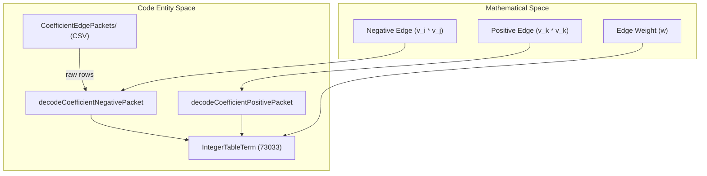
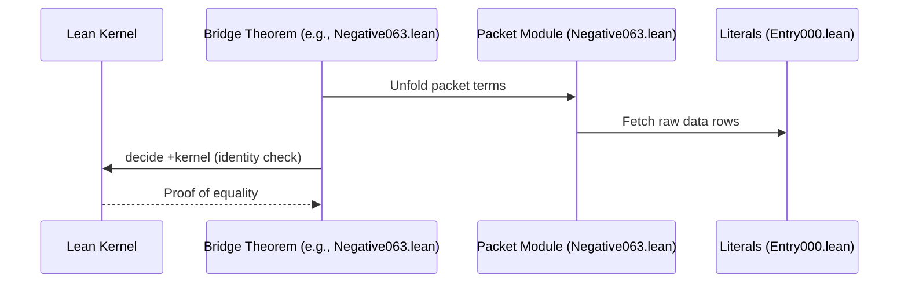

<!-- source: DeepWiki mcp.deepwiki.com · repo openai/ten-proofs · page 3.3 Edge Coefficient Packets · fetched 2026-10-26 -->

# Edge Coefficient Packets

Relevant source files

The following files were used as context for generating this wiki page:

- [ConnesRigidity/Certificates/AffineSymplectic/CoefficientEdgePackets/negative_002](ConnesRigidity/Certificates/AffineSymplectic/CoefficientEdgePackets/negative_002)
- [ConnesRigidity/Certificates/AffineSymplectic/CoefficientEdgePackets/negative_003](ConnesRigidity/Certificates/AffineSymplectic/CoefficientEdgePackets/negative_003)
- [ConnesRigidity/Certificates/AffineSymplectic/CoefficientEdgePackets/negative_004](ConnesRigidity/Certificates/AffineSymplectic/CoefficientEdgePackets/negative_004)
- [ConnesRigidity/Certificates/AffineSymplectic/CoefficientEdgePackets/negative_006](ConnesRigidity/Certificates/AffineSymplectic/CoefficientEdgePackets/negative_006)
- [ConnesRigidity/Certificates/AffineSymplectic/CoefficientEdgePackets/negative_015](ConnesRigidity/Certificates/AffineSymplectic/CoefficientEdgePackets/negative_015)
- [ConnesRigidity/Certificates/AffineSymplectic/CoefficientEdgePackets/negative_016](ConnesRigidity/Certificates/AffineSymplectic/CoefficientEdgePackets/negative_016)
- [ConnesRigidity/Certificates/AffineSymplectic/CoefficientEdgePackets/negative_017](ConnesRigidity/Certificates/AffineSymplectic/CoefficientEdgePackets/negative_017)
- [ConnesRigidity/Certificates/AffineSymplectic/CoefficientEdgePackets/negative_018](ConnesRigidity/Certificates/AffineSymplectic/CoefficientEdgePackets/negative_018)
- [ConnesRigidity/Certificates/AffineSymplectic/CoefficientEdgePackets/negative_019](ConnesRigidity/Certificates/AffineSymplectic/CoefficientEdgePackets/negative_019)
- [ConnesRigidity/Certificates/AffineSymplectic/CoefficientEdgePackets/negative_020](ConnesRigidity/Certificates/AffineSymplectic/CoefficientEdgePackets/negative_020)
- [ConnesRigidity/Certificates/AffineSymplectic/CoefficientEdgePackets/negative_021](ConnesRigidity/Certificates/AffineSymplectic/CoefficientEdgePackets/negative_021)
- [ConnesRigidity/Certificates/AffineSymplectic/CoefficientEdgePackets/negative_022](ConnesRigidity/Certificates/AffineSymplectic/CoefficientEdgePackets/negative_022)
- [ConnesRigidity/Certificates/AffineSymplectic/CoefficientEdgePackets/negative_025](ConnesRigidity/Certificates/AffineSymplectic/CoefficientEdgePackets/negative_025)
- [ConnesRigidity/Certificates/AffineSymplectic/CoefficientEdgePackets/negative_026](ConnesRigidity/Certificates/AffineSymplectic/CoefficientEdgePackets/negative_026)
- [ConnesRigidity/Certificates/AffineSymplectic/CoefficientEdgePackets/negative_027](ConnesRigidity/Certificates/AffineSymplectic/CoefficientEdgePackets/negative_027)
- [ConnesRigidity/Certificates/AffineSymplectic/CoefficientEdgePackets/negative_028](ConnesRigidity/Certificates/AffineSymplectic/CoefficientEdgePackets/negative_028)
- [ConnesRigidity/Certificates/AffineSymplectic/CoefficientEdgePackets/negative_030](ConnesRigidity/Certificates/AffineSymplectic/CoefficientEdgePackets/negative_030)
- [ConnesRigidity/Certificates/AffineSymplectic/CoefficientEdgePackets/negative_031](ConnesRigidity/Certificates/AffineSymplectic/CoefficientEdgePackets/negative_031)
- [ConnesRigidity/Certificates/AffineSymplectic/CoefficientEdgePackets/negative_032](ConnesRigidity/Certificates/AffineSymplectic/CoefficientEdgePackets/negative_032)
- [ConnesRigidity/Certificates/AffineSymplectic/CoefficientEdgePackets/negative_033](ConnesRigidity/Certificates/AffineSymplectic/CoefficientEdgePackets/negative_033)
- [ConnesRigidity/Certificates/AffineSymplectic/CoefficientEdgePackets/negative_034](ConnesRigidity/Certificates/AffineSymplectic/CoefficientEdgePackets/negative_034)
- [ConnesRigidity/Certificates/AffineSymplectic/CoefficientEdgePackets/negative_035](ConnesRigidity/Certificates/AffineSymplectic/CoefficientEdgePackets/negative_035)
- [ConnesRigidity/Certificates/AffineSymplectic/CoefficientEdgePackets/negative_036](ConnesRigidity/Certificates/AffineSymplectic/CoefficientEdgePackets/negative_036)
- [ConnesRigidity/Certificates/AffineSymplectic/CoefficientEdgePackets/negative_037](ConnesRigidity/Certificates/AffineSymplectic/CoefficientEdgePackets/negative_037)
- [ConnesRigidity/Certificates/AffineSymplectic/CoefficientEdgePackets/negative_038](ConnesRigidity/Certificates/AffineSymplectic/CoefficientEdgePackets/negative_038)
- [ConnesRigidity/Certificates/AffineSymplectic/CoefficientEdgePackets/negative_039](ConnesRigidity/Certificates/AffineSymplectic/CoefficientEdgePackets/negative_039)
- [ConnesRigidity/Certificates/AffineSymplectic/CoefficientEdgePackets/negative_040](ConnesRigidity/Certificates/AffineSymplectic/CoefficientEdgePackets/negative_040)
- [ConnesRigidity/Certificates/AffineSymplectic/CoefficientEdgePackets/negative_042](ConnesRigidity/Certificates/AffineSymplectic/CoefficientEdgePackets/negative_042)
- [ConnesRigidity/Certificates/AffineSymplectic/CoefficientEdgePackets/negative_043](ConnesRigidity/Certificates/AffineSymplectic/CoefficientEdgePackets/negative_043)
- [ConnesRigidity/Certificates/AffineSymplectic/CoefficientEdgePackets/negative_044](ConnesRigidity/Certificates/AffineSymplectic/CoefficientEdgePackets/negative_044)
- [ConnesRigidity/Certificates/AffineSymplectic/CoefficientEdgePackets/negative_045](ConnesRigidity/Certificates/AffineSymplectic/CoefficientEdgePackets/negative_045)
- [ConnesRigidity/Certificates/AffineSymplectic/CoefficientEdgePackets/negative_046](ConnesRigidity/Certificates/AffineSymplectic/CoefficientEdgePackets/negative_046)
- [ConnesRigidity/Certificates/AffineSymplectic/CoefficientEdgePackets/negative_047](ConnesRigidity/Certificates/AffineSymplectic/CoefficientEdgePackets/negative_047)
- [ConnesRigidity/Certificates/AffineSymplectic/CoefficientEdgePackets/negative_048](ConnesRigidity/Certificates/AffineSymplectic/CoefficientEdgePackets/negative_048)
- [ConnesRigidity/Certificates/AffineSymplectic/CoefficientEdgePackets/negative_049](ConnesRigidity/Certificates/AffineSymplectic/CoefficientEdgePackets/negative_049)
- [ConnesRigidity/Certificates/AffineSymplectic/CoefficientEdgePackets/negative_050](ConnesRigidity/Certificates/AffineSymplectic/CoefficientEdgePackets/negative_050)
- [ConnesRigidity/Certificates/AffineSymplectic/CoefficientEdgePackets/negative_051](ConnesRigidity/Certificates/AffineSymplectic/CoefficientEdgePackets/negative_051)
- [ConnesRigidity/Certificates/AffineSymplectic/CoefficientEdgePackets/negative_052](ConnesRigidity/Certificates/AffineSymplectic/CoefficientEdgePackets/negative_052)
- [ConnesRigidity/Certificates/AffineSymplectic/CoefficientEdgePackets/negative_053](ConnesRigidity/Certificates/AffineSymplectic/CoefficientEdgePackets/negative_053)
- [ConnesRigidity/Certificates/AffineSymplectic/CoefficientEdgePackets/negative_054](ConnesRigidity/Certificates/AffineSymplectic/CoefficientEdgePackets/negative_054)
- [ConnesRigidity/Certificates/AffineSymplectic/CoefficientEdgePackets/negative_055](ConnesRigidity/Certificates/AffineSymplectic/CoefficientEdgePackets/negative_055)
- [ConnesRigidity/Certificates/AffineSymplectic/CoefficientEdgePackets/negative_056](ConnesRigidity/Certificates/AffineSymplectic/CoefficientEdgePackets/negative_056)
- [ConnesRigidity/Certificates/AffineSymplectic/CoefficientEdgePackets/negative_057](ConnesRigidity/Certificates/AffineSymplectic/CoefficientEdgePackets/negative_057)
- [ConnesRigidity/Certificates/AffineSymplectic/CoefficientEdgePackets/negative_058](ConnesRigidity/Certificates/AffineSymplectic/CoefficientEdgePackets/negative_058)
- [ConnesRigidity/Certificates/AffineSymplectic/CoefficientEdgePackets/negative_059](ConnesRigidity/Certificates/AffineSymplectic/CoefficientEdgePackets/negative_059)
- [ConnesRigidity/Certificates/AffineSymplectic/CoefficientEdgePackets/negative_061](ConnesRigidity/Certificates/AffineSymplectic/CoefficientEdgePackets/negative_061)
- [ConnesRigidity/Certificates/AffineSymplectic/CoefficientEdgePackets/negative_062](ConnesRigidity/Certificates/AffineSymplectic/CoefficientEdgePackets/negative_062)
- [ConnesRigidity/Certificates/AffineSymplectic/CoefficientEdgePackets/negative_064](ConnesRigidity/Certificates/AffineSymplectic/CoefficientEdgePackets/negative_064)
- [ConnesRigidity/Certificates/AffineSymplectic/CoefficientEdgePackets/negative_065](ConnesRigidity/Certificates/AffineSymplectic/CoefficientEdgePackets/negative_065)
- [ConnesRigidity/Certificates/AffineSymplectic/CoefficientEdgePackets/negative_066](ConnesRigidity/Certificates/AffineSymplectic/CoefficientEdgePackets/negative_066)
- [ConnesRigidity/Certificates/AffineSymplectic/CoefficientEdgePackets/negative_067](ConnesRigidity/Certificates/AffineSymplectic/CoefficientEdgePackets/negative_067)
- [ConnesRigidity/Certificates/AffineSymplectic/CoefficientEdgePackets/negative_068](ConnesRigidity/Certificates/AffineSymplectic/CoefficientEdgePackets/negative_068)
- [ConnesRigidity/Certificates/AffineSymplectic/CoefficientEdgePackets/negative_069](ConnesRigidity/Certificates/AffineSymplectic/CoefficientEdgePackets/negative_069)
- [ConnesRigidity/Certificates/AffineSymplectic/CoefficientEdgePackets/negative_070](ConnesRigidity/Certificates/AffineSymplectic/CoefficientEdgePackets/negative_070)
- [ConnesRigidity/Certificates/AffineSymplectic/CoefficientEdgePackets/negative_071](ConnesRigidity/Certificates/AffineSymplectic/CoefficientEdgePackets/negative_071)
- [ConnesRigidity/Certificates/AffineSymplectic/CoefficientEdgePackets/negative_072](ConnesRigidity/Certificates/AffineSymplectic/CoefficientEdgePackets/negative_072)
- [ConnesRigidity/Certificates/AffineSymplectic/CoefficientEdgePackets/negative_073](ConnesRigidity/Certificates/AffineSymplectic/CoefficientEdgePackets/negative_073)
- [ConnesRigidity/Certificates/AffineSymplectic/CoefficientEdgePackets/negative_078](ConnesRigidity/Certificates/AffineSymplectic/CoefficientEdgePackets/negative_078)
- [ConnesRigidity/Certificates/AffineSymplectic/CoefficientEdgePackets/negative_079](ConnesRigidity/Certificates/AffineSymplectic/CoefficientEdgePackets/negative_079)
- [ConnesRigidity/Certificates/AffineSymplectic/CoefficientEdgePackets/negative_080](ConnesRigidity/Certificates/AffineSymplectic/CoefficientEdgePackets/negative_080)
- [ConnesRigidity/Certificates/AffineSymplectic/CoefficientEdgePackets/negative_081](ConnesRigidity/Certificates/AffineSymplectic/CoefficientEdgePackets/negative_081)
- [ConnesRigidity/Certificates/AffineSymplectic/CoefficientEdgePackets/negative_082](ConnesRigidity/Certificates/AffineSymplectic/CoefficientEdgePackets/negative_082)
- [ConnesRigidity/Certificates/AffineSymplectic/CoefficientEdgePackets/negative_083](ConnesRigidity/Certificates/AffineSymplectic/CoefficientEdgePackets/negative_083)
- [ConnesRigidity/Certificates/AffineSymplectic/CoefficientEdgePackets/negative_084](ConnesRigidity/Certificates/AffineSymplectic/CoefficientEdgePackets/negative_084)
- [ConnesRigidity/Certificates/AffineSymplectic/CoefficientEdgePackets/negative_085](ConnesRigidity/Certificates/AffineSymplectic/CoefficientEdgePackets/negative_085)
- [ConnesRigidity/Certificates/AffineSymplectic/CoefficientEdgePackets/negative_087](ConnesRigidity/Certificates/AffineSymplectic/CoefficientEdgePackets/negative_087)
- [ConnesRigidity/Certificates/AffineSymplectic/CoefficientEdgePackets/negative_088](ConnesRigidity/Certificates/AffineSymplectic/CoefficientEdgePackets/negative_088)
- [ConnesRigidity/Certificates/AffineSymplectic/CoefficientEdgePackets/negative_089](ConnesRigidity/Certificates/AffineSymplectic/CoefficientEdgePackets/negative_089)
- [ConnesRigidity/Certificates/AffineSymplectic/CoefficientEdgePackets/negative_090](ConnesRigidity/Certificates/AffineSymplectic/CoefficientEdgePackets/negative_090)
- [ConnesRigidity/Certificates/AffineSymplectic/CoefficientEdgePackets/negative_091](ConnesRigidity/Certificates/AffineSymplectic/CoefficientEdgePackets/negative_091)
- [ConnesRigidity/Certificates/AffineSymplectic/CoefficientEdgePackets/negative_092](ConnesRigidity/Certificates/AffineSymplectic/CoefficientEdgePackets/negative_092)
- [ConnesRigidity/Certificates/AffineSymplectic/CoefficientEdgePackets/negative_093](ConnesRigidity/Certificates/AffineSymplectic/CoefficientEdgePackets/negative_093)
- [ConnesRigidity/Certificates/AffineSymplectic/CoefficientEdgePackets/negative_094](ConnesRigidity/Certificates/AffineSymplectic/CoefficientEdgePackets/negative_094)
- [ConnesRigidity/Certificates/AffineSymplectic/CoefficientEdgePackets/negative_095](ConnesRigidity/Certificates/AffineSymplectic/CoefficientEdgePackets/negative_095)
- [ConnesRigidity/Certificates/AffineSymplectic/CoefficientEdgePackets/negative_096](ConnesRigidity/Certificates/AffineSymplectic/CoefficientEdgePackets/negative_096)
- [ConnesRigidity/Certificates/AffineSymplectic/CoefficientEdgePackets/negative_097](ConnesRigidity/Certificates/AffineSymplectic/CoefficientEdgePackets/negative_097)
- [ConnesRigidity/Certificates/AffineSymplectic/CoefficientEdgePackets/negative_098](ConnesRigidity/Certificates/AffineSymplectic/CoefficientEdgePackets/negative_098)
- [ConnesRigidity/Certificates/AffineSymplectic/CoefficientEdgePackets/negative_099](ConnesRigidity/Certificates/AffineSymplectic/CoefficientEdgePackets/negative_099)
- [ConnesRigidity/Certificates/AffineSymplectic/CoefficientEdgePackets/negative_100](ConnesRigidity/Certificates/AffineSymplectic/CoefficientEdgePackets/negative_100)
- [ConnesRigidity/Certificates/AffineSymplectic/CoefficientEdgePackets/negative_101](ConnesRigidity/Certificates/AffineSymplectic/CoefficientEdgePackets/negative_101)
- [ConnesRigidity/Certificates/AffineSymplectic/CoefficientEdgePackets/negative_103](ConnesRigidity/Certificates/AffineSymplectic/CoefficientEdgePackets/negative_103)
- [ConnesRigidity/Certificates/AffineSymplectic/CoefficientEdgePackets/negative_104](ConnesRigidity/Certificates/AffineSymplectic/CoefficientEdgePackets/negative_104)
- [ConnesRigidity/Certificates/AffineSymplectic/CoefficientEdgePackets/negative_106](ConnesRigidity/Certificates/AffineSymplectic/CoefficientEdgePackets/negative_106)
- [ConnesRigidity/Certificates/AffineSymplectic/CoefficientEdgePackets/negative_107](ConnesRigidity/Certificates/AffineSymplectic/CoefficientEdgePackets/negative_107)
- [ConnesRigidity/Certificates/AffineSymplectic/CoefficientEdgePackets/negative_108](ConnesRigidity/Certificates/AffineSymplectic/CoefficientEdgePackets/negative_108)
- [ConnesRigidity/Certificates/AffineSymplectic/CoefficientEdgePackets/negative_109](ConnesRigidity/Certificates/AffineSymplectic/CoefficientEdgePackets/negative_109)
- [ConnesRigidity/Certificates/AffineSymplectic/CoefficientEdgePackets/negative_112](ConnesRigidity/Certificates/AffineSymplectic/CoefficientEdgePackets/negative_112)
- [ConnesRigidity/Certificates/AffineSymplectic/CoefficientEdgePackets/negative_113](ConnesRigidity/Certificates/AffineSymplectic/CoefficientEdgePackets/negative_113)
- [ConnesRigidity/Certificates/AffineSymplectic/CoefficientEdgePackets/negative_116](ConnesRigidity/Certificates/AffineSymplectic/CoefficientEdgePackets/negative_116)
- [ConnesRigidity/Certificates/AffineSymplectic/CoefficientEdgePackets/negative_117](ConnesRigidity/Certificates/AffineSymplectic/CoefficientEdgePackets/negative_117)
- [ConnesRigidity/Certificates/AffineSymplectic/CoefficientEdgePackets/negative_118](ConnesRigidity/Certificates/AffineSymplectic/CoefficientEdgePackets/negative_118)
- [ConnesRigidity/Certificates/AffineSymplectic/CoefficientEdgePackets/negative_119](ConnesRigidity/Certificates/AffineSymplectic/CoefficientEdgePackets/negative_119)
- [ConnesRigidity/Certificates/AffineSymplectic/CoefficientEdgePackets/negative_120](ConnesRigidity/Certificates/AffineSymplectic/CoefficientEdgePackets/negative_120)
- [ConnesRigidity/Certificates/AffineSymplectic/CoefficientEdgePackets/negative_122](ConnesRigidity/Certificates/AffineSymplectic/CoefficientEdgePackets/negative_122)
- [ConnesRigidity/Certificates/AffineSymplectic/CoefficientEdgePackets/negative_124](ConnesRigidity/Certificates/AffineSymplectic/CoefficientEdgePackets/negative_124)
- [ConnesRigidity/Certificates/AffineSymplectic/CoefficientEdgePackets/negative_125](ConnesRigidity/Certificates/AffineSymplectic/CoefficientEdgePackets/negative_125)
- [ConnesRigidity/Certificates/AffineSymplectic/CoefficientEdgePackets/negative_126](ConnesRigidity/Certificates/AffineSymplectic/CoefficientEdgePackets/negative_126)
- [ConnesRigidity/Certificates/AffineSymplectic/CoefficientEdgePackets/negative_128](ConnesRigidity/Certificates/AffineSymplectic/CoefficientEdgePackets/negative_128)
- [ConnesRigidity/Certificates/AffineSymplectic/CoefficientEdgePackets/negative_129](ConnesRigidity/Certificates/AffineSymplectic/CoefficientEdgePackets/negative_129)
- [ConnesRigidity/Certificates/AffineSymplectic/CoefficientEdgePackets/negative_132](ConnesRigidity/Certificates/AffineSymplectic/CoefficientEdgePackets/negative_132)
- [ConnesRigidity/Certificates/AffineSymplectic/CoefficientEdgePackets/negative_133](ConnesRigidity/Certificates/AffineSymplectic/CoefficientEdgePackets/negative_133)
- [ConnesRigidity/Certificates/AffineSymplectic/CoefficientEdgePackets/negative_134](ConnesRigidity/Certificates/AffineSymplectic/CoefficientEdgePackets/negative_134)
- [ConnesRigidity/Certificates/AffineSymplectic/CoefficientEdgePackets/negative_135](ConnesRigidity/Certificates/AffineSymplectic/CoefficientEdgePackets/negative_135)
- [ConnesRigidity/Certificates/AffineSymplectic/CoefficientEdgePackets/negative_137](ConnesRigidity/Certificates/AffineSymplectic/CoefficientEdgePackets/negative_137)
- [ConnesRigidity/Certificates/AffineSymplectic/CoefficientEdgePackets/negative_138](ConnesRigidity/Certificates/AffineSymplectic/CoefficientEdgePackets/negative_138)
- [ConnesRigidity/Certificates/AffineSymplectic/CoefficientEdgePackets/negative_139](ConnesRigidity/Certificates/AffineSymplectic/CoefficientEdgePackets/negative_139)
- [ConnesRigidity/Certificates/AffineSymplectic/CoefficientEdgePackets/negative_140](ConnesRigidity/Certificates/AffineSymplectic/CoefficientEdgePackets/negative_140)
- [ConnesRigidity/Certificates/AffineSymplectic/CoefficientEdgePackets/negative_143](ConnesRigidity/Certificates/AffineSymplectic/CoefficientEdgePackets/negative_143)
- [ConnesRigidity/Certificates/AffineSymplectic/CoefficientEdgePackets/negative_144](ConnesRigidity/Certificates/AffineSymplectic/CoefficientEdgePackets/negative_144)
- [ConnesRigidity/Certificates/AffineSymplectic/CoefficientEdgePackets/negative_145](ConnesRigidity/Certificates/AffineSymplectic/CoefficientEdgePackets/negative_145)
- [ConnesRigidity/Certificates/AffineSymplectic/CoefficientEdgePackets/negative_148](ConnesRigidity/Certificates/AffineSymplectic/CoefficientEdgePackets/negative_148)
- [ConnesRigidity/Certificates/AffineSymplectic/CoefficientEdgePackets/negative_151](ConnesRigidity/Certificates/AffineSymplectic/CoefficientEdgePackets/negative_151)
- [ConnesRigidity/Certificates/AffineSymplectic/CoefficientEdgePackets/positive_002](ConnesRigidity/Certificates/AffineSymplectic/CoefficientEdgePackets/positive_002)
- [ConnesRigidity/Certificates/AffineSymplectic/CoefficientEdgePackets/positive_008](ConnesRigidity/Certificates/AffineSymplectic/CoefficientEdgePackets/positive_008)
- [ConnesRigidity/Certificates/AffineSymplectic/CoefficientEdgePackets/positive_010](ConnesRigidity/Certificates/AffineSymplectic/CoefficientEdgePackets/positive_010)
- [ConnesRigidity/Certificates/AffineSymplectic/CoefficientEdgePackets/positive_013](ConnesRigidity/Certificates/AffineSymplectic/CoefficientEdgePackets/positive_013)
- [ConnesRigidity/Certificates/AffineSymplectic/CoefficientEdgePackets/positive_014](ConnesRigidity/Certificates/AffineSymplectic/CoefficientEdgePackets/positive_014)
- [ConnesRigidity/Certificates/AffineSymplectic/CoefficientEdgePackets/positive_016](ConnesRigidity/Certificates/AffineSymplectic/CoefficientEdgePackets/positive_016)
- [ConnesRigidity/Certificates/AffineSymplectic/CoefficientEdgePackets/positive_020](ConnesRigidity/Certificates/AffineSymplectic/CoefficientEdgePackets/positive_020)
- [ConnesRigidity/Certificates/AffineSymplectic/CoefficientEdgePackets/positive_023](ConnesRigidity/Certificates/AffineSymplectic/CoefficientEdgePackets/positive_023)
- [ConnesRigidity/Certificates/AffineSymplectic/CoefficientEdgePackets/positive_027](ConnesRigidity/Certificates/AffineSymplectic/CoefficientEdgePackets/positive_027)
- [ConnesRigidity/Certificates/AffineSymplectic/CoefficientEdgePackets/positive_035](ConnesRigidity/Certificates/AffineSymplectic/CoefficientEdgePackets/positive_035)
- [ConnesRigidity/Certificates/AffineSymplectic/CoefficientEdgePackets/positive_037](ConnesRigidity/Certificates/AffineSymplectic/CoefficientEdgePackets/positive_037)
- [ConnesRigidity/Certificates/AffineSymplectic/CoefficientEdgePackets/positive_038](ConnesRigidity/Certificates/AffineSymplectic/CoefficientEdgePackets/positive_038)
- [ConnesRigidity/Certificates/AffineSymplectic/CoefficientEdgePackets/positive_042](ConnesRigidity/Certificates/AffineSymplectic/CoefficientEdgePackets/positive_042)
- [ConnesRigidity/Certificates/AffineSymplectic/CoefficientEdgePackets/positive_043](ConnesRigidity/Certificates/AffineSymplectic/CoefficientEdgePackets/positive_043)
- [ConnesRigidity/Certificates/AffineSymplectic/CoefficientEdgePackets/positive_044](ConnesRigidity/Certificates/AffineSymplectic/CoefficientEdgePackets/positive_044)
- [ConnesRigidity/Certificates/AffineSymplectic/CoefficientEdgePackets/positive_047](ConnesRigidity/Certificates/AffineSymplectic/CoefficientEdgePackets/positive_047)
- [ConnesRigidity/Certificates/AffineSymplectic/CoefficientEdgePackets/positive_050](ConnesRigidity/Certificates/AffineSymplectic/CoefficientEdgePackets/positive_050)
- [ConnesRigidity/Certificates/AffineSymplectic/CoefficientEdgePackets/positive_051](ConnesRigidity/Certificates/AffineSymplectic/CoefficientEdgePackets/positive_051)
- [ConnesRigidity/Certificates/AffineSymplectic/CoefficientEdgePackets/positive_052](ConnesRigidity/Certificates/AffineSymplectic/CoefficientEdgePackets/positive_052)
- [ConnesRigidity/Certificates/AffineSymplectic/CoefficientEdgePackets/positive_053](ConnesRigidity/Certificates/AffineSymplectic/CoefficientEdgePackets/positive_053)
- [ConnesRigidity/Certificates/AffineSymplectic/CoefficientEdgePackets/positive_055](ConnesRigidity/Certificates/AffineSymplectic/CoefficientEdgePackets/positive_055)
- [ConnesRigidity/Certificates/AffineSymplectic/CoefficientEdgePackets/positive_056](ConnesRigidity/Certificates/AffineSymplectic/CoefficientEdgePackets/positive_056)
- [ConnesRigidity/Certificates/AffineSymplectic/CoefficientEdgePackets/positive_061](ConnesRigidity/Certificates/AffineSymplectic/CoefficientEdgePackets/positive_061)
- [ConnesRigidity/Certificates/AffineSymplectic/CoefficientEdgePackets/positive_063](ConnesRigidity/Certificates/AffineSymplectic/CoefficientEdgePackets/positive_063)
- [ConnesRigidity/Certificates/AffineSymplectic/CoefficientEdgePackets/positive_068](ConnesRigidity/Certificates/AffineSymplectic/CoefficientEdgePackets/positive_068)
- [ConnesRigidity/Certificates/AffineSymplectic/CoefficientEdgePackets/positive_070](ConnesRigidity/Certificates/AffineSymplectic/CoefficientEdgePackets/positive_070)
- [ConnesRigidity/Certificates/AffineSymplectic/CoefficientEdgePackets/positive_071](ConnesRigidity/Certificates/AffineSymplectic/CoefficientEdgePackets/positive_071)
- [ConnesRigidity/Certificates/AffineSymplectic/CoefficientEdgePackets/positive_072](ConnesRigidity/Certificates/AffineSymplectic/CoefficientEdgePackets/positive_072)
- [ConnesRigidity/Certificates/AffineSymplectic/CoefficientEdgePackets/positive_073](ConnesRigidity/Certificates/AffineSymplectic/CoefficientEdgePackets/positive_073)
- [ConnesRigidity/Certificates/AffineSymplectic/CoefficientEdgePackets/positive_077](ConnesRigidity/Certificates/AffineSymplectic/CoefficientEdgePackets/positive_077)
- [ConnesRigidity/Certificates/AffineSymplectic/CoefficientEdgePackets/positive_080](ConnesRigidity/Certificates/AffineSymplectic/CoefficientEdgePackets/positive_080)
- [ConnesRigidity/Certificates/AffineSymplectic/CoefficientEdgePackets/positive_082](ConnesRigidity/Certificates/AffineSymplectic/CoefficientEdgePackets/positive_082)
- [ConnesRigidity/Certificates/AffineSymplectic/CoefficientEdgePackets/positive_083](ConnesRigidity/Certificates/AffineSymplectic/CoefficientEdgePackets/positive_083)
- [ConnesRigidity/Certificates/AffineSymplectic/CoefficientEdgePackets/positive_084](ConnesRigidity/Certificates/AffineSymplectic/CoefficientEdgePackets/positive_084)
- [ConnesRigidity/Certificates/AffineSymplectic/CoefficientEdgePackets/positive_085](ConnesRigidity/Certificates/AffineSymplectic/CoefficientEdgePackets/positive_085)
- [ConnesRigidity/Certificates/AffineSymplectic/CoefficientEdgePackets/positive_086](ConnesRigidity/Certificates/AffineSymplectic/CoefficientEdgePackets/positive_086)
- [ConnesRigidity/Certificates/AffineSymplectic/CoefficientEdgePackets/positive_089](ConnesRigidity/Certificates/AffineSymplectic/CoefficientEdgePackets/positive_089)
- [ConnesRigidity/Certificates/AffineSymplectic/CoefficientEdgePackets/positive_091](ConnesRigidity/Certificates/AffineSymplectic/CoefficientEdgePackets/positive_091)
- [ConnesRigidity/Certificates/AffineSymplectic/CoefficientEdgePackets/positive_093](ConnesRigidity/Certificates/AffineSymplectic/CoefficientEdgePackets/positive_093)
- [ConnesRigidity/Certificates/AffineSymplectic/CoefficientEdgePackets/positive_094](ConnesRigidity/Certificates/AffineSymplectic/CoefficientEdgePackets/positive_094)
- [ConnesRigidity/Certificates/AffineSymplectic/CoefficientEdgePackets/positive_095](ConnesRigidity/Certificates/AffineSymplectic/CoefficientEdgePackets/positive_095)
- [ConnesRigidity/Certificates/AffineSymplectic/CoefficientEdgePackets/positive_096](ConnesRigidity/Certificates/AffineSymplectic/CoefficientEdgePackets/positive_096)
- [ConnesRigidity/Certificates/AffineSymplectic/CoefficientEdgePackets/positive_099](ConnesRigidity/Certificates/AffineSymplectic/CoefficientEdgePackets/positive_099)
- [ConnesRigidity/Certificates/AffineSymplectic/CoefficientEdgePackets/positive_101](ConnesRigidity/Certificates/AffineSymplectic/CoefficientEdgePackets/positive_101)
- [ConnesRigidity/Certificates/AffineSymplectic/CoefficientEdgePackets/positive_102](ConnesRigidity/Certificates/AffineSymplectic/CoefficientEdgePackets/positive_102)
- [ConnesRigidity/Certificates/AffineSymplectic/CoefficientEdgePackets/positive_104](ConnesRigidity/Certificates/AffineSymplectic/CoefficientEdgePackets/positive_104)
- [ConnesRigidity/Certificates/AffineSymplectic/CoefficientEdgePackets/positive_105](ConnesRigidity/Certificates/AffineSymplectic/CoefficientEdgePackets/positive_105)
- [ConnesRigidity/Certificates/AffineSymplectic/CoefficientEdgePackets/positive_107](ConnesRigidity/Certificates/AffineSymplectic/CoefficientEdgePackets/positive_107)
- [ConnesRigidity/Certificates/AffineSymplectic/CoefficientEdgePackets/positive_113](ConnesRigidity/Certificates/AffineSymplectic/CoefficientEdgePackets/positive_113)
- [ConnesRigidity/Certificates/AffineSymplectic/CoefficientEdgePackets/positive_115](ConnesRigidity/Certificates/AffineSymplectic/CoefficientEdgePackets/positive_115)
- [ConnesRigidity/Certificates/AffineSymplectic/CoefficientEdgePackets/positive_119](ConnesRigidity/Certificates/AffineSymplectic/CoefficientEdgePackets/positive_119)
- [ConnesRigidity/Certificates/AffineSymplectic/CoefficientEdgePackets/positive_121](ConnesRigidity/Certificates/AffineSymplectic/CoefficientEdgePackets/positive_121)
- [ConnesRigidity/Certificates/AffineSymplectic/CoefficientEdgePackets/positive_123](ConnesRigidity/Certificates/AffineSymplectic/CoefficientEdgePackets/positive_123)
- [ConnesRigidity/Certificates/AffineSymplectic/CoefficientEdgePackets/positive_127](ConnesRigidity/Certificates/AffineSymplectic/CoefficientEdgePackets/positive_127)
- [ConnesRigidity/Certificates/AffineSymplectic/CoefficientEdgePackets/positive_129](ConnesRigidity/Certificates/AffineSymplectic/CoefficientEdgePackets/positive_129)
- [ConnesRigidity/Certificates/AffineSymplectic/CoefficientEdgePackets/positive_130](ConnesRigidity/Certificates/AffineSymplectic/CoefficientEdgePackets/positive_130)
- [ConnesRigidity/Certificates/AffineSymplectic/CoefficientEdgePackets/positive_131](ConnesRigidity/Certificates/AffineSymplectic/CoefficientEdgePackets/positive_131)
- [ConnesRigidity/Certificates/AffineSymplectic/CoefficientEdgePackets/positive_133](ConnesRigidity/Certificates/AffineSymplectic/CoefficientEdgePackets/positive_133)
- [ConnesRigidity/Certificates/AffineSymplectic/CoefficientEdgePackets/positive_134](ConnesRigidity/Certificates/AffineSymplectic/CoefficientEdgePackets/positive_134)
- [ConnesRigidity/Certificates/AffineSymplectic/CoefficientEdgePackets/positive_136](ConnesRigidity/Certificates/AffineSymplectic/CoefficientEdgePackets/positive_136)
- [ConnesRigidity/Certificates/AffineSymplectic/CoefficientEdgePackets/positive_137](ConnesRigidity/Certificates/AffineSymplectic/CoefficientEdgePackets/positive_137)
- [ConnesRigidity/Certificates/AffineSymplectic/CoefficientEdgePackets/positive_139](ConnesRigidity/Certificates/AffineSymplectic/CoefficientEdgePackets/positive_139)
- [ConnesRigidity/Certificates/AffineSymplectic/CoefficientEdgePackets/positive_141](ConnesRigidity/Certificates/AffineSymplectic/CoefficientEdgePackets/positive_141)
- [ConnesRigidity/Certificates/AffineSymplectic/CoefficientEdgePackets/positive_146](ConnesRigidity/Certificates/AffineSymplectic/CoefficientEdgePackets/positive_146)
- [ConnesRigidity/Certificates/AffineSymplectic/CoefficientEdgePackets/positive_147](ConnesRigidity/Certificates/AffineSymplectic/CoefficientEdgePackets/positive_147)
- [ConnesRigidity/Certificates/AffineSymplectic/CoefficientEdgePackets/positive_152](ConnesRigidity/Certificates/AffineSymplectic/CoefficientEdgePackets/positive_152)
- [ConnesRigidity/Certificates/AffineSymplectic/CoefficientEdgePackets/positive_155](ConnesRigidity/Certificates/AffineSymplectic/CoefficientEdgePackets/positive_155)
- [ConnesRigidity/Certificates/AffineSymplectic/CoefficientEdgePackets/positive_156](ConnesRigidity/Certificates/AffineSymplectic/CoefficientEdgePackets/positive_156)
- [ConnesRigidity/Certificates/AffineSymplectic/CoefficientEdgePackets/positive_159](ConnesRigidity/Certificates/AffineSymplectic/CoefficientEdgePackets/positive_159)
- [ConnesRigidity/Certificates/AffineSymplectic/CoefficientEdgePackets/positive_160](ConnesRigidity/Certificates/AffineSymplectic/CoefficientEdgePackets/positive_160)
- [ConnesRigidity/Certificates/AffineSymplectic/CoefficientEdgePackets/positive_163](ConnesRigidity/Certificates/AffineSymplectic/CoefficientEdgePackets/positive_163)
- [ConnesRigidity/Certificates/AffineSymplectic/CoefficientEdgePackets/positive_164](ConnesRigidity/Certificates/AffineSymplectic/CoefficientEdgePackets/positive_164)
- [ConnesRigidity/Certificates/AffineSymplectic/CoefficientEdgePackets/positive_165](ConnesRigidity/Certificates/AffineSymplectic/CoefficientEdgePackets/positive_165)
- [ConnesRigidity/Certificates/AffineSymplectic/CoefficientEdgePackets/positive_170](ConnesRigidity/Certificates/AffineSymplectic/CoefficientEdgePackets/positive_170)
- [ConnesRigidity/Certificates/AffineSymplectic/CoefficientEdgePackets/positive_172](ConnesRigidity/Certificates/AffineSymplectic/CoefficientEdgePackets/positive_172)
- [ConnesRigidity/Certificates/AffineSymplectic/CoefficientEdgePackets/positive_174](ConnesRigidity/Certificates/AffineSymplectic/CoefficientEdgePackets/positive_174)
- [ConnesRigidity/Certificates/AffineSymplectic/CoefficientEdgePackets/positive_177](ConnesRigidity/Certificates/AffineSymplectic/CoefficientEdgePackets/positive_177)
- [ConnesRigidity/Certificates/AffineSymplectic/CoefficientEdgePackets/positive_179](ConnesRigidity/Certificates/AffineSymplectic/CoefficientEdgePackets/positive_179)
- [ConnesRigidity/Certificates/AffineSymplectic/CoefficientEdgePackets/positive_181](ConnesRigidity/Certificates/AffineSymplectic/CoefficientEdgePackets/positive_181)
- [ConnesRigidity/Certificates/AffineSymplectic/CoefficientEdgePackets/positive_186](ConnesRigidity/Certificates/AffineSymplectic/CoefficientEdgePackets/positive_186)
- [ConnesRigidity/Certificates/AffineSymplectic/CoefficientEdgePackets/positive_189](ConnesRigidity/Certificates/AffineSymplectic/CoefficientEdgePackets/positive_189)
- [ConnesRigidity/Certificates/AffineSymplectic/CoefficientEdgePackets/positive_194](ConnesRigidity/Certificates/AffineSymplectic/CoefficientEdgePackets/positive_194)
- [ConnesRigidity/Certificates/AffineSymplectic/CoefficientEdgePackets/positive_195](ConnesRigidity/Certificates/AffineSymplectic/CoefficientEdgePackets/positive_195)
- [ConnesRigidity/Certificates/AffineSymplectic/CoefficientEdgePackets/positive_206](ConnesRigidity/Certificates/AffineSymplectic/CoefficientEdgePackets/positive_206)
- [ConnesRigidity/Certificates/AffineSymplectic/CoefficientEdgePackets/positive_208](ConnesRigidity/Certificates/AffineSymplectic/CoefficientEdgePackets/positive_208)
- [ConnesRigidity/Certificates/AffineSymplectic/CoefficientEdgePackets/positive_209](ConnesRigidity/Certificates/AffineSymplectic/CoefficientEdgePackets/positive_209)
- [ConnesRigidity/Certificates/AffineSymplectic/CoefficientEdgePackets/positive_210](ConnesRigidity/Certificates/AffineSymplectic/CoefficientEdgePackets/positive_210)
- [ConnesRigidity/Certificates/AffineSymplectic/CoefficientEdgePackets/positive_212](ConnesRigidity/Certificates/AffineSymplectic/CoefficientEdgePackets/positive_212)
- [ConnesRigidity/Certificates/AffineSymplectic/CoefficientEdgePackets/positive_215](ConnesRigidity/Certificates/AffineSymplectic/CoefficientEdgePackets/positive_215)
- [ConnesRigidity/Certificates/AffineSymplectic/CoefficientEdgePackets/positive_220](ConnesRigidity/Certificates/AffineSymplectic/CoefficientEdgePackets/positive_220)
- [ConnesRigidity/Certificates/AffineSymplectic/CoefficientEdgePackets/positive_221](ConnesRigidity/Certificates/AffineSymplectic/CoefficientEdgePackets/positive_221)
- [ConnesRigidity/Certificates/AffineSymplectic/CoefficientEdgePackets/positive_223](ConnesRigidity/Certificates/AffineSymplectic/CoefficientEdgePackets/positive_223)
- [ConnesRigidity/Certificates/AffineSymplectic/CoefficientEdgePackets/positive_226](ConnesRigidity/Certificates/AffineSymplectic/CoefficientEdgePackets/positive_226)
- [ConnesRigidity/Certificates/AffineSymplectic/CoefficientEdgePackets/positive_227](ConnesRigidity/Certificates/AffineSymplectic/CoefficientEdgePackets/positive_227)
- [ConnesRigidity/Certificates/AffineSymplectic/CoefficientEdgePackets/positive_229](ConnesRigidity/Certificates/AffineSymplectic/CoefficientEdgePackets/positive_229)
- [ConnesRigidity/Certificates/AffineSymplectic/CoefficientEdgePackets/positive_230](ConnesRigidity/Certificates/AffineSymplectic/CoefficientEdgePackets/positive_230)
- [ConnesRigidity/Certificates/AffineSymplectic/CoefficientEdgePackets/positive_231](ConnesRigidity/Certificates/AffineSymplectic/CoefficientEdgePackets/positive_231)
- [ConnesRigidity/Certificates/AffineSymplectic/CoefficientEdgePackets/positive_233](ConnesRigidity/Certificates/AffineSymplectic/CoefficientEdgePackets/positive_233)
- [ConnesRigidity/Certificates/AffineSymplectic/CoefficientEdgePackets/positive_234](ConnesRigidity/Certificates/AffineSymplectic/CoefficientEdgePackets/positive_234)
- [ConnesRigidity/Certificates/AffineSymplectic/CoefficientEdgePackets/positive_242](ConnesRigidity/Certificates/AffineSymplectic/CoefficientEdgePackets/positive_242)
- [ConnesRigidity/Certificates/AffineSymplectic/CoefficientEdgePackets/positive_243](ConnesRigidity/Certificates/AffineSymplectic/CoefficientEdgePackets/positive_243)
- [ConnesRigidity/Certificates/AffineSymplectic/CoefficientEdgePackets/positive_247](ConnesRigidity/Certificates/AffineSymplectic/CoefficientEdgePackets/positive_247)
- [ConnesRigidity/Certificates/AffineSymplectic/CoefficientEdgePackets/positive_258](ConnesRigidity/Certificates/AffineSymplectic/CoefficientEdgePackets/positive_258)
- [ConnesRigidity/Certificates/AffineSymplectic/CoefficientEdgePackets/positive_260](ConnesRigidity/Certificates/AffineSymplectic/CoefficientEdgePackets/positive_260)
- [ConnesRigidity/PropertyTExactCertificateCoefficientEdgePacketBridges/Negative000.lean](ConnesRigidity/PropertyTExactCertificateCoefficientEdgePacketBridges/Negative000.lean)
- [ConnesRigidity/PropertyTExactCertificateCoefficientEdgePacketBridges/Negative001.lean](ConnesRigidity/PropertyTExactCertificateCoefficientEdgePacketBridges/Negative001.lean)
- [ConnesRigidity/PropertyTExactCertificateCoefficientEdgePacketBridges/Negative002.lean](ConnesRigidity/PropertyTExactCertificateCoefficientEdgePacketBridges/Negative002.lean)
- [ConnesRigidity/PropertyTExactCertificateCoefficientEdgePacketBridges/Negative003.lean](ConnesRigidity/PropertyTExactCertificateCoefficientEdgePacketBridges/Negative003.lean)
- [ConnesRigidity/PropertyTExactCertificateCoefficientEdgePacketBridges/Negative004.lean](ConnesRigidity/PropertyTExactCertificateCoefficientEdgePacketBridges/Negative004.lean)
- [ConnesRigidity/PropertyTExactCertificateCoefficientEdgePacketBridges/Negative005.lean](ConnesRigidity/PropertyTExactCertificateCoefficientEdgePacketBridges/Negative005.lean)
- [ConnesRigidity/PropertyTExactCertificateCoefficientEdgePacketBridges/Negative006.lean](ConnesRigidity/PropertyTExactCertificateCoefficientEdgePacketBridges/Negative006.lean)
- [ConnesRigidity/PropertyTExactCertificateCoefficientEdgePacketBridges/Negative007.lean](ConnesRigidity/PropertyTExactCertificateCoefficientEdgePacketBridges/Negative007.lean)
- [ConnesRigidity/PropertyTExactCertificateCoefficientEdgePacketBridges/Negative008.lean](ConnesRigidity/PropertyTExactCertificateCoefficientEdgePacketBridges/Negative008.lean)
- [ConnesRigidity/PropertyTExactCertificateCoefficientEdgePacketBridges/Negative010.lean](ConnesRigidity/PropertyTExactCertificateCoefficientEdgePacketBridges/Negative010.lean)
- [ConnesRigidity/PropertyTExactCertificateCoefficientEdgePacketBridges/Negative011.lean](ConnesRigidity/PropertyTExactCertificateCoefficientEdgePacketBridges/Negative011.lean)
- [ConnesRigidity/PropertyTExactCertificateCoefficientEdgePacketBridges/Negative012.lean](ConnesRigidity/PropertyTExactCertificateCoefficientEdgePacketBridges/Negative012.lean)
- [ConnesRigidity/PropertyTExactCertificateCoefficientEdgePacketBridges/Negative013.lean](ConnesRigidity/PropertyTExactCertificateCoefficientEdgePacketBridges/Negative013.lean)
- [ConnesRigidity/PropertyTExactCertificateCoefficientEdgePacketBridges/Negative014.lean](ConnesRigidity/PropertyTExactCertificateCoefficientEdgePacketBridges/Negative014.lean)
- [ConnesRigidity/PropertyTExactCertificateCoefficientEdgePacketBridges/Negative015.lean](ConnesRigidity/PropertyTExactCertificateCoefficientEdgePacketBridges/Negative015.lean)
- [ConnesRigidity/PropertyTExactCertificateCoefficientEdgePacketBridges/Negative016.lean](ConnesRigidity/PropertyTExactCertificateCoefficientEdgePacketBridges/Negative016.lean)
- [ConnesRigidity/PropertyTExactCertificateCoefficientEdgePacketBridges/Negative017.lean](ConnesRigidity/PropertyTExactCertificateCoefficientEdgePacketBridges/Negative017.lean)
- [ConnesRigidity/PropertyTExactCertificateCoefficientEdgePacketBridges/Negative019.lean](ConnesRigidity/PropertyTExactCertificateCoefficientEdgePacketBridges/Negative019.lean)
- [ConnesRigidity/PropertyTExactCertificateCoefficientEdgePacketBridges/Negative020.lean](ConnesRigidity/PropertyTExactCertificateCoefficientEdgePacketBridges/Negative020.lean)
- [ConnesRigidity/PropertyTExactCertificateCoefficientEdgePacketBridges/Negative021.lean](ConnesRigidity/PropertyTExactCertificateCoefficientEdgePacketBridges/Negative021.lean)
- [ConnesRigidity/PropertyTExactCertificateCoefficientEdgePacketBridges/Negative022.lean](ConnesRigidity/PropertyTExactCertificateCoefficientEdgePacketBridges/Negative022.lean)
- [ConnesRigidity/PropertyTExactCertificateCoefficientEdgePacketBridges/Negative023.lean](ConnesRigidity/PropertyTExactCertificateCoefficientEdgePacketBridges/Negative023.lean)
- [ConnesRigidity/PropertyTExactCertificateCoefficientEdgePacketBridges/Negative024.lean](ConnesRigidity/PropertyTExactCertificateCoefficientEdgePacketBridges/Negative024.lean)
- [ConnesRigidity/PropertyTExactCertificateCoefficientEdgePacketBridges/Negative025.lean](ConnesRigidity/PropertyTExactCertificateCoefficientEdgePacketBridges/Negative025.lean)
- [ConnesRigidity/PropertyTExactCertificateCoefficientEdgePacketBridges/Negative027.lean](ConnesRigidity/PropertyTExactCertificateCoefficientEdgePacketBridges/Negative027.lean)
- [ConnesRigidity/PropertyTExactCertificateCoefficientEdgePacketBridges/Negative030.lean](ConnesRigidity/PropertyTExactCertificateCoefficientEdgePacketBridges/Negative030.lean)
- [ConnesRigidity/PropertyTExactCertificateCoefficientEdgePacketBridges/Negative034.lean](ConnesRigidity/PropertyTExactCertificateCoefficientEdgePacketBridges/Negative034.lean)
- [ConnesRigidity/PropertyTExactCertificateCoefficientEdgePacketBridges/Negative035.lean](ConnesRigidity/PropertyTExactCertificateCoefficientEdgePacketBridges/Negative035.lean)
- [ConnesRigidity/PropertyTExactCertificateCoefficientEdgePacketBridges/Negative036.lean](ConnesRigidity/PropertyTExactCertificateCoefficientEdgePacketBridges/Negative036.lean)
- [ConnesRigidity/PropertyTExactCertificateCoefficientEdgePacketBridges/Negative037.lean](ConnesRigidity/PropertyTExactCertificateCoefficientEdgePacketBridges/Negative037.lean)
- [ConnesRigidity/PropertyTExactCertificateCoefficientEdgePacketBridges/Negative038.lean](ConnesRigidity/PropertyTExactCertificateCoefficientEdgePacketBridges/Negative038.lean)
- [ConnesRigidity/PropertyTExactCertificateCoefficientEdgePacketBridges/Negative039.lean](ConnesRigidity/PropertyTExactCertificateCoefficientEdgePacketBridges/Negative039.lean)
- [ConnesRigidity/PropertyTExactCertificateCoefficientEdgePacketBridges/Negative040.lean](ConnesRigidity/PropertyTExactCertificateCoefficientEdgePacketBridges/Negative040.lean)
- [ConnesRigidity/PropertyTExactCertificateCoefficientEdgePacketBridges/Negative041.lean](ConnesRigidity/PropertyTExactCertificateCoefficientEdgePacketBridges/Negative041.lean)
- [ConnesRigidity/PropertyTExactCertificateCoefficientEdgePacketBridges/Negative042.lean](ConnesRigidity/PropertyTExactCertificateCoefficientEdgePacketBridges/Negative042.lean)
- [ConnesRigidity/PropertyTExactCertificateCoefficientEdgePacketBridges/Negative043.lean](ConnesRigidity/PropertyTExactCertificateCoefficientEdgePacketBridges/Negative043.lean)
- [ConnesRigidity/PropertyTExactCertificateCoefficientEdgePacketBridges/Negative044.lean](ConnesRigidity/PropertyTExactCertificateCoefficientEdgePacketBridges/Negative044.lean)
- [ConnesRigidity/PropertyTExactCertificateCoefficientEdgePacketBridges/Negative045.lean](ConnesRigidity/PropertyTExactCertificateCoefficientEdgePacketBridges/Negative045.lean)
- [ConnesRigidity/PropertyTExactCertificateCoefficientEdgePacketBridges/Negative046.lean](ConnesRigidity/PropertyTExactCertificateCoefficientEdgePacketBridges/Negative046.lean)
- [ConnesRigidity/PropertyTExactCertificateCoefficientEdgePacketBridges/Negative047.lean](ConnesRigidity/PropertyTExactCertificateCoefficientEdgePacketBridges/Negative047.lean)
- [ConnesRigidity/PropertyTExactCertificateCoefficientEdgePacketBridges/Negative048.lean](ConnesRigidity/PropertyTExactCertificateCoefficientEdgePacketBridges/Negative048.lean)
- [ConnesRigidity/PropertyTExactCertificateCoefficientEdgePacketBridges/Negative049.lean](ConnesRigidity/PropertyTExactCertificateCoefficientEdgePacketBridges/Negative049.lean)
- [ConnesRigidity/PropertyTExactCertificateCoefficientEdgePacketBridges/Negative050.lean](ConnesRigidity/PropertyTExactCertificateCoefficientEdgePacketBridges/Negative050.lean)
- [ConnesRigidity/PropertyTExactCertificateCoefficientEdgePacketBridges/Negative052.lean](ConnesRigidity/PropertyTExactCertificateCoefficientEdgePacketBridges/Negative052.lean)
- [ConnesRigidity/PropertyTExactCertificateCoefficientEdgePacketBridges/Negative053.lean](ConnesRigidity/PropertyTExactCertificateCoefficientEdgePacketBridges/Negative053.lean)
- [ConnesRigidity/PropertyTExactCertificateCoefficientEdgePacketBridges/Negative054.lean](ConnesRigidity/PropertyTExactCertificateCoefficientEdgePacketBridges/Negative054.lean)
- [ConnesRigidity/PropertyTExactCertificateCoefficientEdgePacketBridges/Negative055.lean](ConnesRigidity/PropertyTExactCertificateCoefficientEdgePacketBridges/Negative055.lean)
- [ConnesRigidity/PropertyTExactCertificateCoefficientEdgePacketBridges/Negative056.lean](ConnesRigidity/PropertyTExactCertificateCoefficientEdgePacketBridges/Negative056.lean)
- [ConnesRigidity/PropertyTExactCertificateCoefficientEdgePacketBridges/Negative057.lean](ConnesRigidity/PropertyTExactCertificateCoefficientEdgePacketBridges/Negative057.lean)
- [ConnesRigidity/PropertyTExactCertificateCoefficientEdgePacketBridges/Negative058.lean](ConnesRigidity/PropertyTExactCertificateCoefficientEdgePacketBridges/Negative058.lean)
- [ConnesRigidity/PropertyTExactCertificateCoefficientEdgePacketBridges/Negative059.lean](ConnesRigidity/PropertyTExactCertificateCoefficientEdgePacketBridges/Negative059.lean)
- [ConnesRigidity/PropertyTExactCertificateCoefficientEdgePacketBridges/Negative063.lean](ConnesRigidity/PropertyTExactCertificateCoefficientEdgePacketBridges/Negative063.lean)
- [ConnesRigidity/PropertyTExactCertificateCoefficientEdgePacketBridges/Negative064.lean](ConnesRigidity/PropertyTExactCertificateCoefficientEdgePacketBridges/Negative064.lean)
- [ConnesRigidity/PropertyTExactCertificateCoefficientEdgePacketBridges/Negative066.lean](ConnesRigidity/PropertyTExactCertificateCoefficientEdgePacketBridges/Negative066.lean)
- [ConnesRigidity/PropertyTExactCertificateCoefficientEdgePacketBridges/Negative067.lean](ConnesRigidity/PropertyTExactCertificateCoefficientEdgePacketBridges/Negative067.lean)
- [ConnesRigidity/PropertyTExactCertificateCoefficientEdgePacketBridges/Negative068.lean](ConnesRigidity/PropertyTExactCertificateCoefficientEdgePacketBridges/Negative068.lean)
- [ConnesRigidity/PropertyTExactCertificateCoefficientEdgePacketBridges/Negative069.lean](ConnesRigidity/PropertyTExactCertificateCoefficientEdgePacketBridges/Negative069.lean)
- [ConnesRigidity/PropertyTExactCertificateCoefficientEdgePacketBridges/Negative070.lean](ConnesRigidity/PropertyTExactCertificateCoefficientEdgePacketBridges/Negative070.lean)
- [ConnesRigidity/PropertyTExactCertificateCoefficientEdgePacketBridges/Negative074.lean](ConnesRigidity/PropertyTExactCertificateCoefficientEdgePacketBridges/Negative074.lean)
- [ConnesRigidity/PropertyTExactCertificateCoefficientEdgePacketBridges/Negative075.lean](ConnesRigidity/PropertyTExactCertificateCoefficientEdgePacketBridges/Negative075.lean)
- [ConnesRigidity/PropertyTExactCertificateCoefficientEdgePacketBridges/Negative076.lean](ConnesRigidity/PropertyTExactCertificateCoefficientEdgePacketBridges/Negative076.lean)
- [ConnesRigidity/PropertyTExactCertificateCoefficientEdgePacketBridges/Negative077.lean](ConnesRigidity/PropertyTExactCertificateCoefficientEdgePacketBridges/Negative077.lean)
- [ConnesRigidity/PropertyTExactCertificateCoefficientEdgePacketBridges/Negative078.lean](ConnesRigidity/PropertyTExactCertificateCoefficientEdgePacketBridges/Negative078.lean)
- [ConnesRigidity/PropertyTExactCertificateCoefficientEdgePacketBridges/Negative079.lean](ConnesRigidity/PropertyTExactCertificateCoefficientEdgePacketBridges/Negative079.lean)
- [ConnesRigidity/PropertyTExactCertificateCoefficientEdgePacketBridges/Negative080.lean](ConnesRigidity/PropertyTExactCertificateCoefficientEdgePacketBridges/Negative080.lean)
- [ConnesRigidity/PropertyTExactCertificateCoefficientEdgePacketBridges/Negative082.lean](ConnesRigidity/PropertyTExactCertificateCoefficientEdgePacketBridges/Negative082.lean)
- [ConnesRigidity/PropertyTExactCertificateCoefficientEdgePacketBridges/Negative083.lean](ConnesRigidity/PropertyTExactCertificateCoefficientEdgePacketBridges/Negative083.lean)
- [ConnesRigidity/PropertyTExactCertificateCoefficientEdgePacketBridges/Negative084.lean](ConnesRigidity/PropertyTExactCertificateCoefficientEdgePacketBridges/Negative084.lean)
- [ConnesRigidity/PropertyTExactCertificateCoefficientEdgePacketBridges/Negative085.lean](ConnesRigidity/PropertyTExactCertificateCoefficientEdgePacketBridges/Negative085.lean)
- [ConnesRigidity/PropertyTExactCertificateCoefficientEdgePacketBridges/Negative086.lean](ConnesRigidity/PropertyTExactCertificateCoefficientEdgePacketBridges/Negative086.lean)
- [ConnesRigidity/PropertyTExactCertificateCoefficientEdgePacketBridges/Negative088.lean](ConnesRigidity/PropertyTExactCertificateCoefficientEdgePacketBridges/Negative088.lean)
- [ConnesRigidity/PropertyTExactCertificateCoefficientEdgePacketBridges/Negative089.lean](ConnesRigidity/PropertyTExactCertificateCoefficientEdgePacketBridges/Negative089.lean)
- [ConnesRigidity/PropertyTExactCertificateCoefficientEdgePacketBridges/Negative090.lean](ConnesRigidity/PropertyTExactCertificateCoefficientEdgePacketBridges/Negative090.lean)
- [ConnesRigidity/PropertyTExactCertificateCoefficientEdgePacketBridges/Negative091.lean](ConnesRigidity/PropertyTExactCertificateCoefficientEdgePacketBridges/Negative091.lean)
- [ConnesRigidity/PropertyTExactCertificateCoefficientEdgePacketBridges/Negative092.lean](ConnesRigidity/PropertyTExactCertificateCoefficientEdgePacketBridges/Negative092.lean)
- [ConnesRigidity/PropertyTExactCertificateCoefficientEdgePacketBridges/Negative093.lean](ConnesRigidity/PropertyTExactCertificateCoefficientEdgePacketBridges/Negative093.lean)
- [ConnesRigidity/PropertyTExactCertificateCoefficientEdgePacketBridges/Negative094.lean](ConnesRigidity/PropertyTExactCertificateCoefficientEdgePacketBridges/Negative094.lean)
- [ConnesRigidity/PropertyTExactCertificateCoefficientEdgePacketBridges/Negative095.lean](ConnesRigidity/PropertyTExactCertificateCoefficientEdgePacketBridges/Negative095.lean)
- [ConnesRigidity/PropertyTExactCertificateCoefficientEdgePacketBridges/Negative096.lean](ConnesRigidity/PropertyTExactCertificateCoefficientEdgePacketBridges/Negative096.lean)
- [ConnesRigidity/PropertyTExactCertificateCoefficientEdgePacketBridges/Negative097.lean](ConnesRigidity/PropertyTExactCertificateCoefficientEdgePacketBridges/Negative097.lean)
- [ConnesRigidity/PropertyTExactCertificateCoefficientEdgePacketBridges/Negative098.lean](ConnesRigidity/PropertyTExactCertificateCoefficientEdgePacketBridges/Negative098.lean)
- [ConnesRigidity/PropertyTExactCertificateCoefficientEdgePacketBridges/Negative099.lean](ConnesRigidity/PropertyTExactCertificateCoefficientEdgePacketBridges/Negative099.lean)
- [ConnesRigidity/PropertyTExactCertificateCoefficientEdgePacketBridges/Negative101.lean](ConnesRigidity/PropertyTExactCertificateCoefficientEdgePacketBridges/Negative101.lean)
- [ConnesRigidity/PropertyTExactCertificateCoefficientEdgePacketBridges/Negative107.lean](ConnesRigidity/PropertyTExactCertificateCoefficientEdgePacketBridges/Negative107.lean)
- [ConnesRigidity/PropertyTExactCertificateCoefficientEdgePacketBridges/Negative109.lean](ConnesRigidity/PropertyTExactCertificateCoefficientEdgePacketBridges/Negative109.lean)
- [ConnesRigidity/PropertyTExactCertificateCoefficientEdgePacketBridges/Negative110.lean](ConnesRigidity/PropertyTExactCertificateCoefficientEdgePacketBridges/Negative110.lean)
- [ConnesRigidity/PropertyTExactCertificateCoefficientEdgePacketBridges/Negative111.lean](ConnesRigidity/PropertyTExactCertificateCoefficientEdgePacketBridges/Negative111.lean)
- [ConnesRigidity/PropertyTExactCertificateCoefficientEdgePacketBridges/Negative112.lean](ConnesRigidity/PropertyTExactCertificateCoefficientEdgePacketBridges/Negative112.lean)
- [ConnesRigidity/PropertyTExactCertificateCoefficientEdgePacketBridges/Negative113.lean](ConnesRigidity/PropertyTExactCertificateCoefficientEdgePacketBridges/Negative113.lean)
- [ConnesRigidity/PropertyTExactCertificateCoefficientEdgePacketBridges/Negative114.lean](ConnesRigidity/PropertyTExactCertificateCoefficientEdgePacketBridges/Negative114.lean)
- [ConnesRigidity/PropertyTExactCertificateCoefficientEdgePacketBridges/Negative116.lean](ConnesRigidity/PropertyTExactCertificateCoefficientEdgePacketBridges/Negative116.lean)
- [ConnesRigidity/PropertyTExactCertificateCoefficientEdgePacketBridges/Negative117.lean](ConnesRigidity/PropertyTExactCertificateCoefficientEdgePacketBridges/Negative117.lean)
- [ConnesRigidity/PropertyTExactCertificateCoefficientEdgePacketBridges/Negative118.lean](ConnesRigidity/PropertyTExactCertificateCoefficientEdgePacketBridges/Negative118.lean)
- [ConnesRigidity/PropertyTExactCertificateCoefficientEdgePacketBridges/Negative119.lean](ConnesRigidity/PropertyTExactCertificateCoefficientEdgePacketBridges/Negative119.lean)
- [ConnesRigidity/PropertyTExactCertificateCoefficientEdgePacketBridges/Negative122.lean](ConnesRigidity/PropertyTExactCertificateCoefficientEdgePacketBridges/Negative122.lean)
- [ConnesRigidity/PropertyTExactCertificateCoefficientEdgePacketBridges/Negative123.lean](ConnesRigidity/PropertyTExactCertificateCoefficientEdgePacketBridges/Negative123.lean)
- [ConnesRigidity/PropertyTExactCertificateCoefficientEdgePacketBridges/Negative124.lean](ConnesRigidity/PropertyTExactCertificateCoefficientEdgePacketBridges/Negative124.lean)
- [ConnesRigidity/PropertyTExactCertificateCoefficientEdgePacketBridges/Negative126.lean](ConnesRigidity/PropertyTExactCertificateCoefficientEdgePacketBridges/Negative126.lean)
- [ConnesRigidity/PropertyTExactCertificateCoefficientEdgePacketBridges/Negative127.lean](ConnesRigidity/PropertyTExactCertificateCoefficientEdgePacketBridges/Negative127.lean)
- [ConnesRigidity/PropertyTExactCertificateCoefficientEdgePacketBridges/Negative129.lean](ConnesRigidity/PropertyTExactCertificateCoefficientEdgePacketBridges/Negative129.lean)
- [ConnesRigidity/PropertyTExactCertificateCoefficientEdgePacketBridges/Negative130.lean](ConnesRigidity/PropertyTExactCertificateCoefficientEdgePacketBridges/Negative130.lean)
- [ConnesRigidity/PropertyTExactCertificateCoefficientEdgePacketBridges/Negative131.lean](ConnesRigidity/PropertyTExactCertificateCoefficientEdgePacketBridges/Negative131.lean)
- [ConnesRigidity/PropertyTExactCertificateCoefficientEdgePacketBridges/Negative132.lean](ConnesRigidity/PropertyTExactCertificateCoefficientEdgePacketBridges/Negative132.lean)
- [ConnesRigidity/PropertyTExactCertificateCoefficientEdgePacketBridges/Negative133.lean](ConnesRigidity/PropertyTExactCertificateCoefficientEdgePacketBridges/Negative133.lean)
- [ConnesRigidity/PropertyTExactCertificateCoefficientEdgePacketBridges/Negative134.lean](ConnesRigidity/PropertyTExactCertificateCoefficientEdgePacketBridges/Negative134.lean)
- [ConnesRigidity/PropertyTExactCertificateCoefficientEdgePacketBridges/Negative135.lean](ConnesRigidity/PropertyTExactCertificateCoefficientEdgePacketBridges/Negative135.lean)
- [ConnesRigidity/PropertyTExactCertificateCoefficientEdgePacketBridges/Negative136.lean](ConnesRigidity/PropertyTExactCertificateCoefficientEdgePacketBridges/Negative136.lean)
- [ConnesRigidity/PropertyTExactCertificateCoefficientEdgePacketBridges/Negative138.lean](ConnesRigidity/PropertyTExactCertificateCoefficientEdgePacketBridges/Negative138.lean)
- [ConnesRigidity/PropertyTExactCertificateCoefficientEdgePacketBridges/Negative139.lean](ConnesRigidity/PropertyTExactCertificateCoefficientEdgePacketBridges/Negative139.lean)
- [ConnesRigidity/PropertyTExactCertificateCoefficientEdgePacketBridges/Negative140.lean](ConnesRigidity/PropertyTExactCertificateCoefficientEdgePacketBridges/Negative140.lean)
- [ConnesRigidity/PropertyTExactCertificateCoefficientEdgePacketBridges/Negative144.lean](ConnesRigidity/PropertyTExactCertificateCoefficientEdgePacketBridges/Negative144.lean)
- [ConnesRigidity/PropertyTExactCertificateCoefficientEdgePacketBridges/Negative145.lean](ConnesRigidity/PropertyTExactCertificateCoefficientEdgePacketBridges/Negative145.lean)
- [ConnesRigidity/PropertyTExactCertificateCoefficientEdgePacketBridges/Negative146.lean](ConnesRigidity/PropertyTExactCertificateCoefficientEdgePacketBridges/Negative146.lean)
- [ConnesRigidity/PropertyTExactCertificateCoefficientEdgePacketBridges/Negative147.lean](ConnesRigidity/PropertyTExactCertificateCoefficientEdgePacketBridges/Negative147.lean)
- [ConnesRigidity/PropertyTExactCertificateCoefficientEdgePacketBridges/Negative148.lean](ConnesRigidity/PropertyTExactCertificateCoefficientEdgePacketBridges/Negative148.lean)
- [ConnesRigidity/PropertyTExactCertificateCoefficientEdgePacketBridges/Negative149.lean](ConnesRigidity/PropertyTExactCertificateCoefficientEdgePacketBridges/Negative149.lean)
- [ConnesRigidity/PropertyTExactCertificateCoefficientEdgePacketBridges/Negative151.lean](ConnesRigidity/PropertyTExactCertificateCoefficientEdgePacketBridges/Negative151.lean)
- [ConnesRigidity/PropertyTExactCertificateCoefficientEdgePacketBridges/Positive003.lean](ConnesRigidity/PropertyTExactCertificateCoefficientEdgePacketBridges/Positive003.lean)
- [ConnesRigidity/PropertyTExactCertificateCoefficientEdgePacketBridges/Positive005.lean](ConnesRigidity/PropertyTExactCertificateCoefficientEdgePacketBridges/Positive005.lean)
- [ConnesRigidity/PropertyTExactCertificateCoefficientEdgePacketBridges/Positive006.lean](ConnesRigidity/PropertyTExactCertificateCoefficientEdgePacketBridges/Positive006.lean)
- [ConnesRigidity/PropertyTExactCertificateCoefficientEdgePacketBridges/Positive008.lean](ConnesRigidity/PropertyTExactCertificateCoefficientEdgePacketBridges/Positive008.lean)
- [ConnesRigidity/PropertyTExactCertificateCoefficientEdgePacketBridges/Positive009.lean](ConnesRigidity/PropertyTExactCertificateCoefficientEdgePacketBridges/Positive009.lean)
- [ConnesRigidity/PropertyTExactCertificateCoefficientEdgePacketBridges/Positive011.lean](ConnesRigidity/PropertyTExactCertificateCoefficientEdgePacketBridges/Positive011.lean)
- [ConnesRigidity/PropertyTExactCertificateCoefficientEdgePacketBridges/Positive013.lean](ConnesRigidity/PropertyTExactCertificateCoefficientEdgePacketBridges/Positive013.lean)
- [ConnesRigidity/PropertyTExactCertificateCoefficientEdgePacketBridges/Positive018.lean](ConnesRigidity/PropertyTExactCertificateCoefficientEdgePacketBridges/Positive018.lean)
- [ConnesRigidity/PropertyTExactCertificateCoefficientEdgePacketBridges/Positive020.lean](ConnesRigidity/PropertyTExactCertificateCoefficientEdgePacketBridges/Positive020.lean)
- [ConnesRigidity/PropertyTExactCertificateCoefficientEdgePacketBridges/Positive021.lean](ConnesRigidity/PropertyTExactCertificateCoefficientEdgePacketBridges/Positive021.lean)
- [ConnesRigidity/PropertyTExactCertificateCoefficientEdgePacketBridges/Positive023.lean](ConnesRigidity/PropertyTExactCertificateCoefficientEdgePacketBridges/Positive023.lean)
- [ConnesRigidity/PropertyTExactCertificateCoefficientEdgePacketBridges/Positive026.lean](ConnesRigidity/PropertyTExactCertificateCoefficientEdgePacketBridges/Positive026.lean)
- [ConnesRigidity/PropertyTExactCertificateCoefficientEdgePacketBridges/Positive028.lean](ConnesRigidity/PropertyTExactCertificateCoefficientEdgePacketBridges/Positive028.lean)
- [ConnesRigidity/PropertyTExactCertificateCoefficientEdgePacketBridges/Positive031.lean](ConnesRigidity/PropertyTExactCertificateCoefficientEdgePacketBridges/Positive031.lean)
- [ConnesRigidity/PropertyTExactCertificateCoefficientEdgePacketBridges/Positive034.lean](ConnesRigidity/PropertyTExactCertificateCoefficientEdgePacketBridges/Positive034.lean)
- [ConnesRigidity/PropertyTExactCertificateCoefficientEdgePacketBridges/Positive035.lean](ConnesRigidity/PropertyTExactCertificateCoefficientEdgePacketBridges/Positive035.lean)
- [ConnesRigidity/PropertyTExactCertificateCoefficientEdgePacketBridges/Positive038.lean](ConnesRigidity/PropertyTExactCertificateCoefficientEdgePacketBridges/Positive038.lean)
- [ConnesRigidity/PropertyTExactCertificateCoefficientEdgePacketBridges/Positive040.lean](ConnesRigidity/PropertyTExactCertificateCoefficientEdgePacketBridges/Positive040.lean)
- [ConnesRigidity/PropertyTExactCertificateCoefficientEdgePacketBridges/Positive042.lean](ConnesRigidity/PropertyTExactCertificateCoefficientEdgePacketBridges/Positive042.lean)
- [ConnesRigidity/PropertyTExactCertificateCoefficientEdgePacketBridges/Positive043.lean](ConnesRigidity/PropertyTExactCertificateCoefficientEdgePacketBridges/Positive043.lean)
- [ConnesRigidity/PropertyTExactCertificateCoefficientEdgePacketBridges/Positive046.lean](ConnesRigidity/PropertyTExactCertificateCoefficientEdgePacketBridges/Positive046.lean)
- [ConnesRigidity/PropertyTExactCertificateCoefficientEdgePacketBridges/Positive047.lean](ConnesRigidity/PropertyTExactCertificateCoefficientEdgePacketBridges/Positive047.lean)
- [ConnesRigidity/PropertyTExactCertificateCoefficientEdgePacketBridges/Positive056.lean](ConnesRigidity/PropertyTExactCertificateCoefficientEdgePacketBridges/Positive056.lean)
- [ConnesRigidity/PropertyTExactCertificateCoefficientEdgePacketBridges/Positive060.lean](ConnesRigidity/PropertyTExactCertificateCoefficientEdgePacketBridges/Positive060.lean)
- [ConnesRigidity/PropertyTExactCertificateCoefficientEdgePacketBridges/Positive062.lean](ConnesRigidity/PropertyTExactCertificateCoefficientEdgePacketBridges/Positive062.lean)
- [ConnesRigidity/PropertyTExactCertificateCoefficientEdgePacketBridges/Positive063.lean](ConnesRigidity/PropertyTExactCertificateCoefficientEdgePacketBridges/Positive063.lean)
- [ConnesRigidity/PropertyTExactCertificateCoefficientEdgePacketBridges/Positive071.lean](ConnesRigidity/PropertyTExactCertificateCoefficientEdgePacketBridges/Positive071.lean)
- [ConnesRigidity/PropertyTExactCertificateCoefficientEdgePacketBridges/Positive078.lean](ConnesRigidity/PropertyTExactCertificateCoefficientEdgePacketBridges/Positive078.lean)
- [ConnesRigidity/PropertyTExactCertificateCoefficientEdgePacketBridges/Positive082.lean](ConnesRigidity/PropertyTExactCertificateCoefficientEdgePacketBridges/Positive082.lean)
- [ConnesRigidity/PropertyTExactCertificateCoefficientEdgePacketBridges/Positive095.lean](ConnesRigidity/PropertyTExactCertificateCoefficientEdgePacketBridges/Positive095.lean)
- [ConnesRigidity/PropertyTExactCertificateCoefficientEdgePacketBridges/Positive097.lean](ConnesRigidity/PropertyTExactCertificateCoefficientEdgePacketBridges/Positive097.lean)
- [ConnesRigidity/PropertyTExactCertificateCoefficientEdgePacketBridges/Positive098.lean](ConnesRigidity/PropertyTExactCertificateCoefficientEdgePacketBridges/Positive098.lean)
- [ConnesRigidity/PropertyTExactCertificateCoefficientEdgePacketBridges/Positive102.lean](ConnesRigidity/PropertyTExactCertificateCoefficientEdgePacketBridges/Positive102.lean)
- [ConnesRigidity/PropertyTExactCertificateCoefficientEdgePacketBridges/Positive104.lean](ConnesRigidity/PropertyTExactCertificateCoefficientEdgePacketBridges/Positive104.lean)
- [ConnesRigidity/PropertyTExactCertificateCoefficientEdgePacketBridges/Positive105.lean](ConnesRigidity/PropertyTExactCertificateCoefficientEdgePacketBridges/Positive105.lean)
- [ConnesRigidity/PropertyTExactCertificateCoefficientEdgePacketBridges/Positive106.lean](ConnesRigidity/PropertyTExactCertificateCoefficientEdgePacketBridges/Positive106.lean)
- [ConnesRigidity/PropertyTExactCertificateCoefficientEdgePacketBridges/Positive107.lean](ConnesRigidity/PropertyTExactCertificateCoefficientEdgePacketBridges/Positive107.lean)
- [ConnesRigidity/PropertyTExactCertificateCoefficientEdgePacketBridges/Positive109.lean](ConnesRigidity/PropertyTExactCertificateCoefficientEdgePacketBridges/Positive109.lean)
- [ConnesRigidity/PropertyTExactCertificateCoefficientEdgePacketBridges/Positive110.lean](ConnesRigidity/PropertyTExactCertificateCoefficientEdgePacketBridges/Positive110.lean)
- [ConnesRigidity/PropertyTExactCertificateCoefficientEdgePacketBridges/Positive111.lean](ConnesRigidity/PropertyTExactCertificateCoefficientEdgePacketBridges/Positive111.lean)
- [ConnesRigidity/PropertyTExactCertificateCoefficientEdgePacketBridges/Positive113.lean](ConnesRigidity/PropertyTExactCertificateCoefficientEdgePacketBridges/Positive113.lean)
- [ConnesRigidity/PropertyTExactCertificateCoefficientEdgePacketBridges/Positive114.lean](ConnesRigidity/PropertyTExactCertificateCoefficientEdgePacketBridges/Positive114.lean)
- [ConnesRigidity/PropertyTExactCertificateCoefficientEdgePacketBridges/Positive115.lean](ConnesRigidity/PropertyTExactCertificateCoefficientEdgePacketBridges/Positive115.lean)
- [ConnesRigidity/PropertyTExactCertificateCoefficientEdgePacketBridges/Positive116.lean](ConnesRigidity/PropertyTExactCertificateCoefficientEdgePacketBridges/Positive116.lean)
- [ConnesRigidity/PropertyTExactCertificateCoefficientEdgePacketBridges/Positive118.lean](ConnesRigidity/PropertyTExactCertificateCoefficientEdgePacketBridges/Positive118.lean)
- [ConnesRigidity/PropertyTExactCertificateCoefficientEdgePacketBridges/Positive123.lean](ConnesRigidity/PropertyTExactCertificateCoefficientEdgePacketBridges/Positive123.lean)
- [ConnesRigidity/PropertyTExactCertificateCoefficientEdgePacketBridges/Positive126.lean](ConnesRigidity/PropertyTExactCertificateCoefficientEdgePacketBridges/Positive126.lean)
- [ConnesRigidity/PropertyTExactCertificateCoefficientEdgePacketBridges/Positive127.lean](ConnesRigidity/PropertyTExactCertificateCoefficientEdgePacketBridges/Positive127.lean)
- [ConnesRigidity/PropertyTExactCertificateCoefficientEdgePacketBridges/Positive128.lean](ConnesRigidity/PropertyTExactCertificateCoefficientEdgePacketBridges/Positive128.lean)
- [ConnesRigidity/PropertyTExactCertificateCoefficientEdgePacketBridges/Positive129.lean](ConnesRigidity/PropertyTExactCertificateCoefficientEdgePacketBridges/Positive129.lean)
- [ConnesRigidity/PropertyTExactCertificateCoefficientEdgePacketBridges/Positive130.lean](ConnesRigidity/PropertyTExactCertificateCoefficientEdgePacketBridges/Positive130.lean)
- [ConnesRigidity/PropertyTExactCertificateCoefficientEdgePacketBridges/Positive132.lean](ConnesRigidity/PropertyTExactCertificateCoefficientEdgePacketBridges/Positive132.lean)
- [ConnesRigidity/PropertyTExactCertificateCoefficientEdgePacketBridges/Positive133.lean](ConnesRigidity/PropertyTExactCertificateCoefficientEdgePacketBridges/Positive133.lean)
- [ConnesRigidity/PropertyTExactCertificateCoefficientEdgePacketBridges/Positive134.lean](ConnesRigidity/PropertyTExactCertificateCoefficientEdgePacketBridges/Positive134.lean)
- [ConnesRigidity/PropertyTExactCertificateCoefficientEdgePacketBridges/Positive135.lean](ConnesRigidity/PropertyTExactCertificateCoefficientEdgePacketBridges/Positive135.lean)
- [ConnesRigidity/PropertyTExactCertificateCoefficientEdgePacketBridges/Positive136.lean](ConnesRigidity/PropertyTExactCertificateCoefficientEdgePacketBridges/Positive136.lean)
- [ConnesRigidity/PropertyTExactCertificateCoefficientEdgePacketBridges/Positive137.lean](ConnesRigidity/PropertyTExactCertificateCoefficientEdgePacketBridges/Positive137.lean)
- [ConnesRigidity/PropertyTExactCertificateCoefficientEdgePacketBridges/Positive139.lean](ConnesRigidity/PropertyTExactCertificateCoefficientEdgePacketBridges/Positive139.lean)
- [ConnesRigidity/PropertyTExactCertificateCoefficientEdgePacketBridges/Positive140.lean](ConnesRigidity/PropertyTExactCertificateCoefficientEdgePacketBridges/Positive140.lean)
- [ConnesRigidity/PropertyTExactCertificateCoefficientEdgePacketBridges/Positive141.lean](ConnesRigidity/PropertyTExactCertificateCoefficientEdgePacketBridges/Positive141.lean)
- [ConnesRigidity/PropertyTExactCertificateCoefficientEdgePacketBridges/Positive142.lean](ConnesRigidity/PropertyTExactCertificateCoefficientEdgePacketBridges/Positive142.lean)
- [ConnesRigidity/PropertyTExactCertificateCoefficientEdgePacketBridges/Positive147.lean](ConnesRigidity/PropertyTExactCertificateCoefficientEdgePacketBridges/Positive147.lean)
- [ConnesRigidity/PropertyTExactCertificateCoefficientEdgePacketBridges/Positive150.lean](ConnesRigidity/PropertyTExactCertificateCoefficientEdgePacketBridges/Positive150.lean)
- [ConnesRigidity/PropertyTExactCertificateCoefficientEdgePacketBridges/Positive151.lean](ConnesRigidity/PropertyTExactCertificateCoefficientEdgePacketBridges/Positive151.lean)
- [ConnesRigidity/PropertyTExactCertificateCoefficientEdgePacketBridges/Positive152.lean](ConnesRigidity/PropertyTExactCertificateCoefficientEdgePacketBridges/Positive152.lean)
- [ConnesRigidity/PropertyTExactCertificateCoefficientEdgePacketBridges/Positive153.lean](ConnesRigidity/PropertyTExactCertificateCoefficientEdgePacketBridges/Positive153.lean)
- [ConnesRigidity/PropertyTExactCertificateCoefficientEdgePacketBridges/Positive156.lean](ConnesRigidity/PropertyTExactCertificateCoefficientEdgePacketBridges/Positive156.lean)
- [ConnesRigidity/PropertyTExactCertificateCoefficientEdgePacketBridges/Positive157.lean](ConnesRigidity/PropertyTExactCertificateCoefficientEdgePacketBridges/Positive157.lean)
- [ConnesRigidity/PropertyTExactCertificateCoefficientEdgePacketBridges/Positive158.lean](ConnesRigidity/PropertyTExactCertificateCoefficientEdgePacketBridges/Positive158.lean)
- [ConnesRigidity/PropertyTExactCertificateCoefficientEdgePacketBridges/Positive159.lean](ConnesRigidity/PropertyTExactCertificateCoefficientEdgePacketBridges/Positive159.lean)
- [ConnesRigidity/PropertyTExactCertificateCoefficientEdgePacketBridges/Positive161.lean](ConnesRigidity/PropertyTExactCertificateCoefficientEdgePacketBridges/Positive161.lean)
- [ConnesRigidity/PropertyTExactCertificateCoefficientEdgePacketBridges/Positive163.lean](ConnesRigidity/PropertyTExactCertificateCoefficientEdgePacketBridges/Positive163.lean)
- [ConnesRigidity/PropertyTExactCertificateCoefficientEdgePacketBridges/Positive164.lean](ConnesRigidity/PropertyTExactCertificateCoefficientEdgePacketBridges/Positive164.lean)
- [ConnesRigidity/PropertyTExactCertificateCoefficientEdgePacketBridges/Positive166.lean](ConnesRigidity/PropertyTExactCertificateCoefficientEdgePacketBridges/Positive166.lean)
- [ConnesRigidity/PropertyTExactCertificateCoefficientEdgePacketBridges/Positive167.lean](ConnesRigidity/PropertyTExactCertificateCoefficientEdgePacketBridges/Positive167.lean)
- [ConnesRigidity/PropertyTExactCertificateCoefficientEdgePacketBridges/Positive169.lean](ConnesRigidity/PropertyTExactCertificateCoefficientEdgePacketBridges/Positive169.lean)
- [ConnesRigidity/PropertyTExactCertificateCoefficientEdgePacketBridges/Positive170.lean](ConnesRigidity/PropertyTExactCertificateCoefficientEdgePacketBridges/Positive170.lean)
- [ConnesRigidity/PropertyTExactCertificateCoefficientEdgePacketBridges/Positive171.lean](ConnesRigidity/PropertyTExactCertificateCoefficientEdgePacketBridges/Positive171.lean)
- [ConnesRigidity/PropertyTExactCertificateCoefficientEdgePacketBridges/Positive174.lean](ConnesRigidity/PropertyTExactCertificateCoefficientEdgePacketBridges/Positive174.lean)
- [ConnesRigidity/PropertyTExactCertificateCoefficientEdgePacketBridges/Positive176.lean](ConnesRigidity/PropertyTExactCertificateCoefficientEdgePacketBridges/Positive176.lean)
- [ConnesRigidity/PropertyTExactCertificateCoefficientEdgePacketBridges/Positive177.lean](ConnesRigidity/PropertyTExactCertificateCoefficientEdgePacketBridges/Positive177.lean)
- [ConnesRigidity/PropertyTExactCertificateCoefficientEdgePacketBridges/Positive178.lean](ConnesRigidity/PropertyTExactCertificateCoefficientEdgePacketBridges/Positive178.lean)
- [ConnesRigidity/PropertyTExactCertificateCoefficientEdgePacketBridges/Positive179.lean](ConnesRigidity/PropertyTExactCertificateCoefficientEdgePacketBridges/Positive179.lean)
- [ConnesRigidity/PropertyTExactCertificateCoefficientEdgePacketBridges/Positive180.lean](ConnesRigidity/PropertyTExactCertificateCoefficientEdgePacketBridges/Positive180.lean)
- [ConnesRigidity/PropertyTExactCertificateCoefficientEdgePacketBridges/Positive181.lean](ConnesRigidity/PropertyTExactCertificateCoefficientEdgePacketBridges/Positive181.lean)
- [ConnesRigidity/PropertyTExactCertificateCoefficientEdgePacketBridges/Positive184.lean](ConnesRigidity/PropertyTExactCertificateCoefficientEdgePacketBridges/Positive184.lean)
- [ConnesRigidity/PropertyTExactCertificateCoefficientEdgePacketBridges/Positive185.lean](ConnesRigidity/PropertyTExactCertificateCoefficientEdgePacketBridges/Positive185.lean)
- [ConnesRigidity/PropertyTExactCertificateCoefficientEdgePacketBridges/Positive186.lean](ConnesRigidity/PropertyTExactCertificateCoefficientEdgePacketBridges/Positive186.lean)
- [ConnesRigidity/PropertyTExactCertificateCoefficientEdgePacketBridges/Positive187.lean](ConnesRigidity/PropertyTExactCertificateCoefficientEdgePacketBridges/Positive187.lean)
- [ConnesRigidity/PropertyTExactCertificateCoefficientEdgePacketBridges/Positive188.lean](ConnesRigidity/PropertyTExactCertificateCoefficientEdgePacketBridges/Positive188.lean)
- [ConnesRigidity/PropertyTExactCertificateCoefficientEdgePacketBridges/Positive190.lean](ConnesRigidity/PropertyTExactCertificateCoefficientEdgePacketBridges/Positive190.lean)
- [ConnesRigidity/PropertyTExactCertificateCoefficientEdgePacketBridges/Positive191.lean](ConnesRigidity/PropertyTExactCertificateCoefficientEdgePacketBridges/Positive191.lean)
- [ConnesRigidity/PropertyTExactCertificateCoefficientEdgePacketBridges/Positive193.lean](ConnesRigidity/PropertyTExactCertificateCoefficientEdgePacketBridges/Positive193.lean)
- [ConnesRigidity/PropertyTExactCertificateCoefficientEdgePacketBridges/Positive194.lean](ConnesRigidity/PropertyTExactCertificateCoefficientEdgePacketBridges/Positive194.lean)
- [ConnesRigidity/PropertyTExactCertificateCoefficientEdgePacketBridges/Positive195.lean](ConnesRigidity/PropertyTExactCertificateCoefficientEdgePacketBridges/Positive195.lean)
- [ConnesRigidity/PropertyTExactCertificateCoefficientEdgePacketBridges/Positive196.lean](ConnesRigidity/PropertyTExactCertificateCoefficientEdgePacketBridges/Positive196.lean)
- [ConnesRigidity/PropertyTExactCertificateCoefficientEdgePacketBridges/Positive197.lean](ConnesRigidity/PropertyTExactCertificateCoefficientEdgePacketBridges/Positive197.lean)
- [ConnesRigidity/PropertyTExactCertificateCoefficientEdgePacketBridges/Positive198.lean](ConnesRigidity/PropertyTExactCertificateCoefficientEdgePacketBridges/Positive198.lean)
- [ConnesRigidity/PropertyTExactCertificateCoefficientEdgePacketBridges/Positive199.lean](ConnesRigidity/PropertyTExactCertificateCoefficientEdgePacketBridges/Positive199.lean)
- [ConnesRigidity/PropertyTExactCertificateCoefficientEdgePacketBridges/Positive203.lean](ConnesRigidity/PropertyTExactCertificateCoefficientEdgePacketBridges/Positive203.lean)
- [ConnesRigidity/PropertyTExactCertificateCoefficientEdgePacketBridges/Positive207.lean](ConnesRigidity/PropertyTExactCertificateCoefficientEdgePacketBridges/Positive207.lean)
- [ConnesRigidity/PropertyTExactCertificateCoefficientEdgePacketBridges/Positive209.lean](ConnesRigidity/PropertyTExactCertificateCoefficientEdgePacketBridges/Positive209.lean)
- [ConnesRigidity/PropertyTExactCertificateCoefficientEdgePacketBridges/Positive210.lean](ConnesRigidity/PropertyTExactCertificateCoefficientEdgePacketBridges/Positive210.lean)
- [ConnesRigidity/PropertyTExactCertificateCoefficientEdgePacketBridges/Positive211.lean](ConnesRigidity/PropertyTExactCertificateCoefficientEdgePacketBridges/Positive211.lean)
- [ConnesRigidity/PropertyTExactCertificateCoefficientEdgePacketBridges/Positive212.lean](ConnesRigidity/PropertyTExactCertificateCoefficientEdgePacketBridges/Positive212.lean)
- [ConnesRigidity/PropertyTExactCertificateCoefficientEdgePacketBridges/Positive213.lean](ConnesRigidity/PropertyTExactCertificateCoefficientEdgePacketBridges/Positive213.lean)
- [ConnesRigidity/PropertyTExactCertificateCoefficientEdgePacketBridges/Positive214.lean](ConnesRigidity/PropertyTExactCertificateCoefficientEdgePacketBridges/Positive214.lean)
- [ConnesRigidity/PropertyTExactCertificateCoefficientEdgePacketBridges/Positive215.lean](ConnesRigidity/PropertyTExactCertificateCoefficientEdgePacketBridges/Positive215.lean)
- [ConnesRigidity/PropertyTExactCertificateCoefficientEdgePacketBridges/Positive216.lean](ConnesRigidity/PropertyTExactCertificateCoefficientEdgePacketBridges/Positive216.lean)
- [ConnesRigidity/PropertyTExactCertificateCoefficientEdgePacketBridges/Positive222.lean](ConnesRigidity/PropertyTExactCertificateCoefficientEdgePacketBridges/Positive222.lean)
- [ConnesRigidity/PropertyTExactCertificateCoefficientEdgePacketBridges/Positive224.lean](ConnesRigidity/PropertyTExactCertificateCoefficientEdgePacketBridges/Positive224.lean)
- [ConnesRigidity/PropertyTExactCertificateCoefficientEdgePacketBridges/Positive227.lean](ConnesRigidity/PropertyTExactCertificateCoefficientEdgePacketBridges/Positive227.lean)
- [ConnesRigidity/PropertyTExactCertificateCoefficientEdgePacketBridges/Positive229.lean](ConnesRigidity/PropertyTExactCertificateCoefficientEdgePacketBridges/Positive229.lean)
- [ConnesRigidity/PropertyTExactCertificateCoefficientEdgePacketBridges/Positive231.lean](ConnesRigidity/PropertyTExactCertificateCoefficientEdgePacketBridges/Positive231.lean)
- [ConnesRigidity/PropertyTExactCertificateCoefficientEdgePacketBridges/Positive232.lean](ConnesRigidity/PropertyTExactCertificateCoefficientEdgePacketBridges/Positive232.lean)
- [ConnesRigidity/PropertyTExactCertificateCoefficientEdgePacketBridges/Positive233.lean](ConnesRigidity/PropertyTExactCertificateCoefficientEdgePacketBridges/Positive233.lean)
- [ConnesRigidity/PropertyTExactCertificateCoefficientEdgePacketBridges/Positive234.lean](ConnesRigidity/PropertyTExactCertificateCoefficientEdgePacketBridges/Positive234.lean)
- [ConnesRigidity/PropertyTExactCertificateCoefficientEdgePacketBridges/Positive238.lean](ConnesRigidity/PropertyTExactCertificateCoefficientEdgePacketBridges/Positive238.lean)
- [ConnesRigidity/PropertyTExactCertificateCoefficientEdgePacketBridges/Positive239.lean](ConnesRigidity/PropertyTExactCertificateCoefficientEdgePacketBridges/Positive239.lean)
- [ConnesRigidity/PropertyTExactCertificateCoefficientEdgePacketBridges/Positive241.lean](ConnesRigidity/PropertyTExactCertificateCoefficientEdgePacketBridges/Positive241.lean)
- [ConnesRigidity/PropertyTExactCertificateCoefficientEdgePacketBridges/Positive242.lean](ConnesRigidity/PropertyTExactCertificateCoefficientEdgePacketBridges/Positive242.lean)
- [ConnesRigidity/PropertyTExactCertificateCoefficientEdgePacketBridges/Positive245.lean](ConnesRigidity/PropertyTExactCertificateCoefficientEdgePacketBridges/Positive245.lean)
- [ConnesRigidity/PropertyTExactCertificateCoefficientEdgePacketBridges/Positive246.lean](ConnesRigidity/PropertyTExactCertificateCoefficientEdgePacketBridges/Positive246.lean)
- [ConnesRigidity/PropertyTExactCertificateCoefficientEdgePacketBridges/Positive247.lean](ConnesRigidity/PropertyTExactCertificateCoefficientEdgePacketBridges/Positive247.lean)
- [ConnesRigidity/PropertyTExactCertificateCoefficientEdgePackets/Negative000.lean](ConnesRigidity/PropertyTExactCertificateCoefficientEdgePackets/Negative000.lean)
- [ConnesRigidity/PropertyTExactCertificateCoefficientEdgePackets/Negative001.lean](ConnesRigidity/PropertyTExactCertificateCoefficientEdgePackets/Negative001.lean)
- [ConnesRigidity/PropertyTExactCertificateCoefficientEdgePackets/Negative003.lean](ConnesRigidity/PropertyTExactCertificateCoefficientEdgePackets/Negative003.lean)
- [ConnesRigidity/PropertyTExactCertificateCoefficientEdgePackets/Negative007.lean](ConnesRigidity/PropertyTExactCertificateCoefficientEdgePackets/Negative007.lean)
- [ConnesRigidity/PropertyTExactCertificateCoefficientEdgePackets/Negative009.lean](ConnesRigidity/PropertyTExactCertificateCoefficientEdgePackets/Negative009.lean)
- [ConnesRigidity/PropertyTExactCertificateCoefficientEdgePackets/Negative013.lean](ConnesRigidity/PropertyTExactCertificateCoefficientEdgePackets/Negative013.lean)
- [ConnesRigidity/PropertyTExactCertificateCoefficientEdgePackets/Negative014.lean](ConnesRigidity/PropertyTExactCertificateCoefficientEdgePackets/Negative014.lean)
- [ConnesRigidity/PropertyTExactCertificateCoefficientEdgePackets/Negative015.lean](ConnesRigidity/PropertyTExactCertificateCoefficientEdgePackets/Negative015.lean)
- [ConnesRigidity/PropertyTExactCertificateCoefficientEdgePackets/Negative016.lean](ConnesRigidity/PropertyTExactCertificateCoefficientEdgePackets/Negative016.lean)
- [ConnesRigidity/PropertyTExactCertificateCoefficientEdgePackets/Negative020.lean](ConnesRigidity/PropertyTExactCertificateCoefficientEdgePackets/Negative020.lean)
- [ConnesRigidity/PropertyTExactCertificateCoefficientEdgePackets/Negative022.lean](ConnesRigidity/PropertyTExactCertificateCoefficientEdgePackets/Negative022.lean)
- [ConnesRigidity/PropertyTExactCertificateCoefficientEdgePackets/Negative024.lean](ConnesRigidity/PropertyTExactCertificateCoefficientEdgePackets/Negative024.lean)
- [ConnesRigidity/PropertyTExactCertificateCoefficientEdgePackets/Negative026.lean](ConnesRigidity/PropertyTExactCertificateCoefficientEdgePackets/Negative026.lean)
- [ConnesRigidity/PropertyTExactCertificateCoefficientEdgePackets/Negative029.lean](ConnesRigidity/PropertyTExactCertificateCoefficientEdgePackets/Negative029.lean)
- [ConnesRigidity/PropertyTExactCertificateCoefficientEdgePackets/Negative030.lean](ConnesRigidity/PropertyTExactCertificateCoefficientEdgePackets/Negative030.lean)
- [ConnesRigidity/PropertyTExactCertificateCoefficientEdgePackets/Negative032.lean](ConnesRigidity/PropertyTExactCertificateCoefficientEdgePackets/Negative032.lean)
- [ConnesRigidity/PropertyTExactCertificateCoefficientEdgePackets/Negative033.lean](ConnesRigidity/PropertyTExactCertificateCoefficientEdgePackets/Negative033.lean)
- [ConnesRigidity/PropertyTExactCertificateCoefficientEdgePackets/Negative034.lean](ConnesRigidity/PropertyTExactCertificateCoefficientEdgePackets/Negative034.lean)
- [ConnesRigidity/PropertyTExactCertificateCoefficientEdgePackets/Negative035.lean](ConnesRigidity/PropertyTExactCertificateCoefficientEdgePackets/Negative035.lean)
- [ConnesRigidity/PropertyTExactCertificateCoefficientEdgePackets/Negative036.lean](ConnesRigidity/PropertyTExactCertificateCoefficientEdgePackets/Negative036.lean)
- [ConnesRigidity/PropertyTExactCertificateCoefficientEdgePackets/Negative037.lean](ConnesRigidity/PropertyTExactCertificateCoefficientEdgePackets/Negative037.lean)
- [ConnesRigidity/PropertyTExactCertificateCoefficientEdgePackets/Negative038.lean](ConnesRigidity/PropertyTExactCertificateCoefficientEdgePackets/Negative038.lean)
- [ConnesRigidity/PropertyTExactCertificateCoefficientEdgePackets/Negative039.lean](ConnesRigidity/PropertyTExactCertificateCoefficientEdgePackets/Negative039.lean)
- [ConnesRigidity/PropertyTExactCertificateCoefficientEdgePackets/Negative040.lean](ConnesRigidity/PropertyTExactCertificateCoefficientEdgePackets/Negative040.lean)
- [ConnesRigidity/PropertyTExactCertificateCoefficientEdgePackets/Negative041.lean](ConnesRigidity/PropertyTExactCertificateCoefficientEdgePackets/Negative041.lean)
- [ConnesRigidity/PropertyTExactCertificateCoefficientEdgePackets/Negative042.lean](ConnesRigidity/PropertyTExactCertificateCoefficientEdgePackets/Negative042.lean)
- [ConnesRigidity/PropertyTExactCertificateCoefficientEdgePackets/Negative043.lean](ConnesRigidity/PropertyTExactCertificateCoefficientEdgePackets/Negative043.lean)
- [ConnesRigidity/PropertyTExactCertificateCoefficientEdgePackets/Negative044.lean](ConnesRigidity/PropertyTExactCertificateCoefficientEdgePackets/Negative044.lean)
- [ConnesRigidity/PropertyTExactCertificateCoefficientEdgePackets/Negative045.lean](ConnesRigidity/PropertyTExactCertificateCoefficientEdgePackets/Negative045.lean)
- [ConnesRigidity/PropertyTExactCertificateCoefficientEdgePackets/Negative046.lean](ConnesRigidity/PropertyTExactCertificateCoefficientEdgePackets/Negative046.lean)
- [ConnesRigidity/PropertyTExactCertificateCoefficientEdgePackets/Negative047.lean](ConnesRigidity/PropertyTExactCertificateCoefficientEdgePackets/Negative047.lean)
- [ConnesRigidity/PropertyTExactCertificateCoefficientEdgePackets/Negative049.lean](ConnesRigidity/PropertyTExactCertificateCoefficientEdgePackets/Negative049.lean)
- [ConnesRigidity/PropertyTExactCertificateCoefficientEdgePackets/Negative050.lean](ConnesRigidity/PropertyTExactCertificateCoefficientEdgePackets/Negative050.lean)
- [ConnesRigidity/PropertyTExactCertificateCoefficientEdgePackets/Negative054.lean](ConnesRigidity/PropertyTExactCertificateCoefficientEdgePackets/Negative054.lean)
- [ConnesRigidity/PropertyTExactCertificateCoefficientEdgePackets/Negative055.lean](ConnesRigidity/PropertyTExactCertificateCoefficientEdgePackets/Negative055.lean)
- [ConnesRigidity/PropertyTExactCertificateCoefficientEdgePackets/Negative056.lean](ConnesRigidity/PropertyTExactCertificateCoefficientEdgePackets/Negative056.lean)
- [ConnesRigidity/PropertyTExactCertificateCoefficientEdgePackets/Negative058.lean](ConnesRigidity/PropertyTExactCertificateCoefficientEdgePackets/Negative058.lean)
- [ConnesRigidity/PropertyTExactCertificateCoefficientEdgePackets/Negative059.lean](ConnesRigidity/PropertyTExactCertificateCoefficientEdgePackets/Negative059.lean)
- [ConnesRigidity/PropertyTExactCertificateCoefficientEdgePackets/Negative062.lean](ConnesRigidity/PropertyTExactCertificateCoefficientEdgePackets/Negative062.lean)
- [ConnesRigidity/PropertyTExactCertificateCoefficientEdgePackets/Negative063.lean](ConnesRigidity/PropertyTExactCertificateCoefficientEdgePackets/Negative063.lean)
- [ConnesRigidity/PropertyTExactCertificateCoefficientEdgePackets/Negative064.lean](ConnesRigidity/PropertyTExactCertificateCoefficientEdgePackets/Negative064.lean)
- [ConnesRigidity/PropertyTExactCertificateCoefficientEdgePackets/Negative065.lean](ConnesRigidity/PropertyTExactCertificateCoefficientEdgePackets/Negative065.lean)
- [ConnesRigidity/PropertyTExactCertificateCoefficientEdgePackets/Negative066.lean](ConnesRigidity/PropertyTExactCertificateCoefficientEdgePackets/Negative066.lean)
- [ConnesRigidity/PropertyTExactCertificateCoefficientEdgePackets/Negative067.lean](ConnesRigidity/PropertyTExactCertificateCoefficientEdgePackets/Negative067.lean)
- [ConnesRigidity/PropertyTExactCertificateCoefficientEdgePackets/Negative068.lean](ConnesRigidity/PropertyTExactCertificateCoefficientEdgePackets/Negative068.lean)
- [ConnesRigidity/PropertyTExactCertificateCoefficientEdgePackets/Negative069.lean](ConnesRigidity/PropertyTExactCertificateCoefficientEdgePackets/Negative069.lean)
- [ConnesRigidity/PropertyTExactCertificateCoefficientEdgePackets/Negative070.lean](ConnesRigidity/PropertyTExactCertificateCoefficientEdgePackets/Negative070.lean)
- [ConnesRigidity/PropertyTExactCertificateCoefficientEdgePackets/Negative071.lean](ConnesRigidity/PropertyTExactCertificateCoefficientEdgePackets/Negative071.lean)
- [ConnesRigidity/PropertyTExactCertificateCoefficientEdgePackets/Negative072.lean](ConnesRigidity/PropertyTExactCertificateCoefficientEdgePackets/Negative072.lean)
- [ConnesRigidity/PropertyTExactCertificateCoefficientEdgePackets/Negative076.lean](ConnesRigidity/PropertyTExactCertificateCoefficientEdgePackets/Negative076.lean)
- [ConnesRigidity/PropertyTExactCertificateCoefficientEdgePackets/Negative077.lean](ConnesRigidity/PropertyTExactCertificateCoefficientEdgePackets/Negative077.lean)
- [ConnesRigidity/PropertyTExactCertificateCoefficientEdgePackets/Negative078.lean](ConnesRigidity/PropertyTExactCertificateCoefficientEdgePackets/Negative078.lean)
- [ConnesRigidity/PropertyTExactCertificateCoefficientEdgePackets/Negative080.lean](ConnesRigidity/PropertyTExactCertificateCoefficientEdgePackets/Negative080.lean)
- [ConnesRigidity/PropertyTExactCertificateCoefficientEdgePackets/Negative081.lean](ConnesRigidity/PropertyTExactCertificateCoefficientEdgePackets/Negative081.lean)
- [ConnesRigidity/PropertyTExactCertificateCoefficientEdgePackets/Negative087.lean](ConnesRigidity/PropertyTExactCertificateCoefficientEdgePackets/Negative087.lean)
- [ConnesRigidity/PropertyTExactCertificateCoefficientEdgePackets/Negative088.lean](ConnesRigidity/PropertyTExactCertificateCoefficientEdgePackets/Negative088.lean)
- [ConnesRigidity/PropertyTExactCertificateCoefficientEdgePackets/Negative090.lean](ConnesRigidity/PropertyTExactCertificateCoefficientEdgePackets/Negative090.lean)
- [ConnesRigidity/PropertyTExactCertificateCoefficientEdgePackets/Negative091.lean](ConnesRigidity/PropertyTExactCertificateCoefficientEdgePackets/Negative091.lean)
- [ConnesRigidity/PropertyTExactCertificateCoefficientEdgePackets/Negative092.lean](ConnesRigidity/PropertyTExactCertificateCoefficientEdgePackets/Negative092.lean)
- [ConnesRigidity/PropertyTExactCertificateCoefficientEdgePackets/Negative093.lean](ConnesRigidity/PropertyTExactCertificateCoefficientEdgePackets/Negative093.lean)
- [ConnesRigidity/PropertyTExactCertificateCoefficientEdgePackets/Negative094.lean](ConnesRigidity/PropertyTExactCertificateCoefficientEdgePackets/Negative094.lean)
- [ConnesRigidity/PropertyTExactCertificateCoefficientEdgePackets/Negative095.lean](ConnesRigidity/PropertyTExactCertificateCoefficientEdgePackets/Negative095.lean)
- [ConnesRigidity/PropertyTExactCertificateCoefficientEdgePackets/Negative097.lean](ConnesRigidity/PropertyTExactCertificateCoefficientEdgePackets/Negative097.lean)
- [ConnesRigidity/PropertyTExactCertificateCoefficientEdgePackets/Negative098.lean](ConnesRigidity/PropertyTExactCertificateCoefficientEdgePackets/Negative098.lean)
- [ConnesRigidity/PropertyTExactCertificateCoefficientEdgePackets/Negative099.lean](ConnesRigidity/PropertyTExactCertificateCoefficientEdgePackets/Negative099.lean)
- [ConnesRigidity/PropertyTExactCertificateCoefficientEdgePackets/Negative102.lean](ConnesRigidity/PropertyTExactCertificateCoefficientEdgePackets/Negative102.lean)
- [ConnesRigidity/PropertyTExactCertificateCoefficientEdgePackets/Negative113.lean](ConnesRigidity/PropertyTExactCertificateCoefficientEdgePackets/Negative113.lean)
- [ConnesRigidity/PropertyTExactCertificateCoefficientEdgePackets/Negative114.lean](ConnesRigidity/PropertyTExactCertificateCoefficientEdgePackets/Negative114.lean)
- [ConnesRigidity/PropertyTExactCertificateCoefficientEdgePackets/Negative115.lean](ConnesRigidity/PropertyTExactCertificateCoefficientEdgePackets/Negative115.lean)
- [ConnesRigidity/PropertyTExactCertificateCoefficientEdgePackets/Negative122.lean](ConnesRigidity/PropertyTExactCertificateCoefficientEdgePackets/Negative122.lean)
- [ConnesRigidity/PropertyTExactCertificateCoefficientEdgePackets/Negative124.lean](ConnesRigidity/PropertyTExactCertificateCoefficientEdgePackets/Negative124.lean)
- [ConnesRigidity/PropertyTExactCertificateCoefficientEdgePackets/Negative127.lean](ConnesRigidity/PropertyTExactCertificateCoefficientEdgePackets/Negative127.lean)
- [ConnesRigidity/PropertyTExactCertificateCoefficientEdgePackets/Negative130.lean](ConnesRigidity/PropertyTExactCertificateCoefficientEdgePackets/Negative130.lean)
- [ConnesRigidity/PropertyTExactCertificateCoefficientEdgePackets/Negative131.lean](ConnesRigidity/PropertyTExactCertificateCoefficientEdgePackets/Negative131.lean)
- [ConnesRigidity/PropertyTExactCertificateCoefficientEdgePackets/Negative134.lean](ConnesRigidity/PropertyTExactCertificateCoefficientEdgePackets/Negative134.lean)
- [ConnesRigidity/PropertyTExactCertificateCoefficientEdgePackets/Negative137.lean](ConnesRigidity/PropertyTExactCertificateCoefficientEdgePackets/Negative137.lean)
- [ConnesRigidity/PropertyTExactCertificateCoefficientEdgePackets/Negative138.lean](ConnesRigidity/PropertyTExactCertificateCoefficientEdgePackets/Negative138.lean)
- [ConnesRigidity/PropertyTExactCertificateCoefficientEdgePackets/Negative139.lean](ConnesRigidity/PropertyTExactCertificateCoefficientEdgePackets/Negative139.lean)
- [ConnesRigidity/PropertyTExactCertificateCoefficientEdgePackets/Negative141.lean](ConnesRigidity/PropertyTExactCertificateCoefficientEdgePackets/Negative141.lean)
- [ConnesRigidity/PropertyTExactCertificateCoefficientEdgePackets/Negative142.lean](ConnesRigidity/PropertyTExactCertificateCoefficientEdgePackets/Negative142.lean)
- [ConnesRigidity/PropertyTExactCertificateCoefficientEdgePackets/Negative144.lean](ConnesRigidity/PropertyTExactCertificateCoefficientEdgePackets/Negative144.lean)
- [ConnesRigidity/PropertyTExactCertificateCoefficientEdgePackets/Negative145.lean](ConnesRigidity/PropertyTExactCertificateCoefficientEdgePackets/Negative145.lean)
- [ConnesRigidity/PropertyTExactCertificateCoefficientEdgePackets/Negative147.lean](ConnesRigidity/PropertyTExactCertificateCoefficientEdgePackets/Negative147.lean)
- [ConnesRigidity/PropertyTExactCertificateCoefficientEdgePackets/Positive001.lean](ConnesRigidity/PropertyTExactCertificateCoefficientEdgePackets/Positive001.lean)
- [ConnesRigidity/PropertyTExactCertificateCoefficientEdgePackets/Positive002.lean](ConnesRigidity/PropertyTExactCertificateCoefficientEdgePackets/Positive002.lean)
- [ConnesRigidity/PropertyTExactCertificateCoefficientEdgePackets/Positive004.lean](ConnesRigidity/PropertyTExactCertificateCoefficientEdgePackets/Positive004.lean)
- [ConnesRigidity/PropertyTExactCertificateCoefficientEdgePackets/Positive005.lean](ConnesRigidity/PropertyTExactCertificateCoefficientEdgePackets/Positive005.lean)
- [ConnesRigidity/PropertyTExactCertificateCoefficientEdgePackets/Positive006.lean](ConnesRigidity/PropertyTExactCertificateCoefficientEdgePackets/Positive006.lean)
- [ConnesRigidity/PropertyTExactCertificateCoefficientEdgePackets/Positive008.lean](ConnesRigidity/PropertyTExactCertificateCoefficientEdgePackets/Positive008.lean)
- [ConnesRigidity/PropertyTExactCertificateCoefficientEdgePackets/Positive009.lean](ConnesRigidity/PropertyTExactCertificateCoefficientEdgePackets/Positive009.lean)
- [ConnesRigidity/PropertyTExactCertificateCoefficientEdgePackets/Positive012.lean](ConnesRigidity/PropertyTExactCertificateCoefficientEdgePackets/Positive012.lean)
- [ConnesRigidity/PropertyTExactCertificateCoefficientEdgePackets/Positive013.lean](ConnesRigidity/PropertyTExactCertificateCoefficientEdgePackets/Positive013.lean)
- [ConnesRigidity/PropertyTExactCertificateCoefficientEdgePackets/Positive018.lean](ConnesRigidity/PropertyTExactCertificateCoefficientEdgePackets/Positive018.lean)
- [ConnesRigidity/PropertyTExactCertificateCoefficientEdgePackets/Positive021.lean](ConnesRigidity/PropertyTExactCertificateCoefficientEdgePackets/Positive021.lean)
- [ConnesRigidity/PropertyTExactCertificateCoefficientEdgePackets/Positive023.lean](ConnesRigidity/PropertyTExactCertificateCoefficientEdgePackets/Positive023.lean)
- [ConnesRigidity/PropertyTExactCertificateCoefficientEdgePackets/Positive024.lean](ConnesRigidity/PropertyTExactCertificateCoefficientEdgePackets/Positive024.lean)
- [ConnesRigidity/PropertyTExactCertificateCoefficientEdgePackets/Positive026.lean](ConnesRigidity/PropertyTExactCertificateCoefficientEdgePackets/Positive026.lean)
- [ConnesRigidity/PropertyTExactCertificateCoefficientEdgePackets/Positive028.lean](ConnesRigidity/PropertyTExactCertificateCoefficientEdgePackets/Positive028.lean)
- [ConnesRigidity/PropertyTExactCertificateCoefficientEdgePackets/Positive029.lean](ConnesRigidity/PropertyTExactCertificateCoefficientEdgePackets/Positive029.lean)
- [ConnesRigidity/PropertyTExactCertificateCoefficientEdgePackets/Positive031.lean](ConnesRigidity/PropertyTExactCertificateCoefficientEdgePackets/Positive031.lean)
- [ConnesRigidity/PropertyTExactCertificateCoefficientEdgePackets/Positive034.lean](ConnesRigidity/PropertyTExactCertificateCoefficientEdgePackets/Positive034.lean)
- [ConnesRigidity/PropertyTExactCertificateCoefficientEdgePackets/Positive035.lean](ConnesRigidity/PropertyTExactCertificateCoefficientEdgePackets/Positive035.lean)
- [ConnesRigidity/PropertyTExactCertificateCoefficientEdgePackets/Positive037.lean](ConnesRigidity/PropertyTExactCertificateCoefficientEdgePackets/Positive037.lean)
- [ConnesRigidity/PropertyTExactCertificateCoefficientEdgePackets/Positive041.lean](ConnesRigidity/PropertyTExactCertificateCoefficientEdgePackets/Positive041.lean)
- [ConnesRigidity/PropertyTExactCertificateCoefficientEdgePackets/Positive042.lean](ConnesRigidity/PropertyTExactCertificateCoefficientEdgePackets/Positive042.lean)
- [ConnesRigidity/PropertyTExactCertificateCoefficientEdgePackets/Positive045.lean](ConnesRigidity/PropertyTExactCertificateCoefficientEdgePackets/Positive045.lean)
- [ConnesRigidity/PropertyTExactCertificateCoefficientEdgePackets/Positive046.lean](ConnesRigidity/PropertyTExactCertificateCoefficientEdgePackets/Positive046.lean)
- [ConnesRigidity/PropertyTExactCertificateCoefficientEdgePackets/Positive047.lean](ConnesRigidity/PropertyTExactCertificateCoefficientEdgePackets/Positive047.lean)
- [ConnesRigidity/PropertyTExactCertificateCoefficientEdgePackets/Positive050.lean](ConnesRigidity/PropertyTExactCertificateCoefficientEdgePackets/Positive050.lean)
- [ConnesRigidity/PropertyTExactCertificateCoefficientEdgePackets/Positive051.lean](ConnesRigidity/PropertyTExactCertificateCoefficientEdgePackets/Positive051.lean)
- [ConnesRigidity/PropertyTExactCertificateCoefficientEdgePackets/Positive052.lean](ConnesRigidity/PropertyTExactCertificateCoefficientEdgePackets/Positive052.lean)
- [ConnesRigidity/PropertyTExactCertificateCoefficientEdgePackets/Positive054.lean](ConnesRigidity/PropertyTExactCertificateCoefficientEdgePackets/Positive054.lean)
- [ConnesRigidity/PropertyTExactCertificateCoefficientEdgePackets/Positive055.lean](ConnesRigidity/PropertyTExactCertificateCoefficientEdgePackets/Positive055.lean)
- [ConnesRigidity/PropertyTExactCertificateCoefficientEdgePackets/Positive056.lean](ConnesRigidity/PropertyTExactCertificateCoefficientEdgePackets/Positive056.lean)
- [ConnesRigidity/PropertyTExactCertificateCoefficientEdgePackets/Positive057.lean](ConnesRigidity/PropertyTExactCertificateCoefficientEdgePackets/Positive057.lean)
- [ConnesRigidity/PropertyTExactCertificateCoefficientEdgePackets/Positive058.lean](ConnesRigidity/PropertyTExactCertificateCoefficientEdgePackets/Positive058.lean)
- [ConnesRigidity/PropertyTExactCertificateCoefficientEdgePackets/Positive060.lean](ConnesRigidity/PropertyTExactCertificateCoefficientEdgePackets/Positive060.lean)
- [ConnesRigidity/PropertyTExactCertificateCoefficientEdgePackets/Positive061.lean](ConnesRigidity/PropertyTExactCertificateCoefficientEdgePackets/Positive061.lean)
- [ConnesRigidity/PropertyTExactCertificateCoefficientEdgePackets/Positive062.lean](ConnesRigidity/PropertyTExactCertificateCoefficientEdgePackets/Positive062.lean)
- [ConnesRigidity/PropertyTExactCertificateCoefficientEdgePackets/Positive064.lean](ConnesRigidity/PropertyTExactCertificateCoefficientEdgePackets/Positive064.lean)
- [ConnesRigidity/PropertyTExactCertificateCoefficientEdgePackets/Positive065.lean](ConnesRigidity/PropertyTExactCertificateCoefficientEdgePackets/Positive065.lean)
- [ConnesRigidity/PropertyTExactCertificateCoefficientEdgePackets/Positive066.lean](ConnesRigidity/PropertyTExactCertificateCoefficientEdgePackets/Positive066.lean)
- [ConnesRigidity/PropertyTExactCertificateCoefficientEdgePackets/Positive072.lean](ConnesRigidity/PropertyTExactCertificateCoefficientEdgePackets/Positive072.lean)
- [ConnesRigidity/PropertyTExactCertificateCoefficientEdgePackets/Positive076.lean](ConnesRigidity/PropertyTExactCertificateCoefficientEdgePackets/Positive076.lean)
- [ConnesRigidity/PropertyTExactCertificateCoefficientEdgePackets/Positive077.lean](ConnesRigidity/PropertyTExactCertificateCoefficientEdgePackets/Positive077.lean)
- [ConnesRigidity/PropertyTExactCertificateCoefficientEdgePackets/Positive078.lean](ConnesRigidity/PropertyTExactCertificateCoefficientEdgePackets/Positive078.lean)
- [ConnesRigidity/PropertyTExactCertificateCoefficientEdgePackets/Positive081.lean](ConnesRigidity/PropertyTExactCertificateCoefficientEdgePackets/Positive081.lean)
- [ConnesRigidity/PropertyTExactCertificateCoefficientEdgePackets/Positive083.lean](ConnesRigidity/PropertyTExactCertificateCoefficientEdgePackets/Positive083.lean)
- [ConnesRigidity/PropertyTExactCertificateCoefficientEdgePackets/Positive084.lean](ConnesRigidity/PropertyTExactCertificateCoefficientEdgePackets/Positive084.lean)
- [ConnesRigidity/PropertyTExactCertificateCoefficientEdgePackets/Positive089.lean](ConnesRigidity/PropertyTExactCertificateCoefficientEdgePackets/Positive089.lean)
- [ConnesRigidity/PropertyTExactCertificateCoefficientEdgePackets/Positive091.lean](ConnesRigidity/PropertyTExactCertificateCoefficientEdgePackets/Positive091.lean)
- [ConnesRigidity/PropertyTExactCertificateCoefficientEdgePackets/Positive094.lean](ConnesRigidity/PropertyTExactCertificateCoefficientEdgePackets/Positive094.lean)
- [ConnesRigidity/PropertyTExactCertificateCoefficientEdgePackets/Positive096.lean](ConnesRigidity/PropertyTExactCertificateCoefficientEdgePackets/Positive096.lean)
- [ConnesRigidity/PropertyTExactCertificateCoefficientEdgePackets/Positive097.lean](ConnesRigidity/PropertyTExactCertificateCoefficientEdgePackets/Positive097.lean)
- [ConnesRigidity/PropertyTExactCertificateCoefficientEdgePackets/Positive102.lean](ConnesRigidity/PropertyTExactCertificateCoefficientEdgePackets/Positive102.lean)
- [ConnesRigidity/PropertyTExactCertificateCoefficientEdgePackets/Positive103.lean](ConnesRigidity/PropertyTExactCertificateCoefficientEdgePackets/Positive103.lean)
- [ConnesRigidity/PropertyTExactCertificateCoefficientEdgePackets/Positive105.lean](ConnesRigidity/PropertyTExactCertificateCoefficientEdgePackets/Positive105.lean)
- [ConnesRigidity/PropertyTExactCertificateCoefficientEdgePackets/Positive108.lean](ConnesRigidity/PropertyTExactCertificateCoefficientEdgePackets/Positive108.lean)
- [ConnesRigidity/PropertyTExactCertificateCoefficientEdgePackets/Positive109.lean](ConnesRigidity/PropertyTExactCertificateCoefficientEdgePackets/Positive109.lean)
- [ConnesRigidity/PropertyTExactCertificateCoefficientEdgePackets/Positive112.lean](ConnesRigidity/PropertyTExactCertificateCoefficientEdgePackets/Positive112.lean)
- [ConnesRigidity/PropertyTExactCertificateCoefficientEdgePackets/Positive113.lean](ConnesRigidity/PropertyTExactCertificateCoefficientEdgePackets/Positive113.lean)
- [ConnesRigidity/PropertyTExactCertificateCoefficientEdgePackets/Positive116.lean](ConnesRigidity/PropertyTExactCertificateCoefficientEdgePackets/Positive116.lean)
- [ConnesRigidity/PropertyTExactCertificateCoefficientEdgePackets/Positive117.lean](ConnesRigidity/PropertyTExactCertificateCoefficientEdgePackets/Positive117.lean)
- [ConnesRigidity/PropertyTExactCertificateCoefficientEdgePackets/Positive118.lean](ConnesRigidity/PropertyTExactCertificateCoefficientEdgePackets/Positive118.lean)
- [ConnesRigidity/PropertyTExactCertificateCoefficientEdgePackets/Positive120.lean](ConnesRigidity/PropertyTExactCertificateCoefficientEdgePackets/Positive120.lean)
- [ConnesRigidity/PropertyTExactCertificateCoefficientEdgePackets/Positive121.lean](ConnesRigidity/PropertyTExactCertificateCoefficientEdgePackets/Positive121.lean)
- [ConnesRigidity/PropertyTExactCertificateCoefficientEdgePackets/Positive122.lean](ConnesRigidity/PropertyTExactCertificateCoefficientEdgePackets/Positive122.lean)
- [ConnesRigidity/PropertyTExactCertificateCoefficientEdgePackets/Positive125.lean](ConnesRigidity/PropertyTExactCertificateCoefficientEdgePackets/Positive125.lean)
- [ConnesRigidity/PropertyTExactCertificateCoefficientEdgePackets/Positive129.lean](ConnesRigidity/PropertyTExactCertificateCoefficientEdgePackets/Positive129.lean)
- [ConnesRigidity/PropertyTExactCertificateCoefficientEdgePackets/Positive130.lean](ConnesRigidity/PropertyTExactCertificateCoefficientEdgePackets/Positive130.lean)
- [ConnesRigidity/PropertyTExactCertificateCoefficientEdgePackets/Positive131.lean](ConnesRigidity/PropertyTExactCertificateCoefficientEdgePackets/Positive131.lean)
- [ConnesRigidity/PropertyTExactCertificateCoefficientEdgePackets/Positive133.lean](ConnesRigidity/PropertyTExactCertificateCoefficientEdgePackets/Positive133.lean)
- [ConnesRigidity/PropertyTExactCertificateCoefficientEdgePackets/Positive135.lean](ConnesRigidity/PropertyTExactCertificateCoefficientEdgePackets/Positive135.lean)
- [ConnesRigidity/PropertyTExactCertificateCoefficientEdgePackets/Positive136.lean](ConnesRigidity/PropertyTExactCertificateCoefficientEdgePackets/Positive136.lean)
- [ConnesRigidity/PropertyTExactCertificateCoefficientEdgePackets/Positive137.lean](ConnesRigidity/PropertyTExactCertificateCoefficientEdgePackets/Positive137.lean)
- [ConnesRigidity/PropertyTExactCertificateCoefficientEdgePackets/Positive138.lean](ConnesRigidity/PropertyTExactCertificateCoefficientEdgePackets/Positive138.lean)
- [ConnesRigidity/PropertyTExactCertificateCoefficientEdgePackets/Positive141.lean](ConnesRigidity/PropertyTExactCertificateCoefficientEdgePackets/Positive141.lean)
- [ConnesRigidity/PropertyTExactCertificateCoefficientEdgePackets/Positive142.lean](ConnesRigidity/PropertyTExactCertificateCoefficientEdgePackets/Positive142.lean)
- [ConnesRigidity/PropertyTExactCertificateCoefficientEdgePackets/Positive143.lean](ConnesRigidity/PropertyTExactCertificateCoefficientEdgePackets/Positive143.lean)
- [ConnesRigidity/PropertyTExactCertificateCoefficientEdgePackets/Positive145.lean](ConnesRigidity/PropertyTExactCertificateCoefficientEdgePackets/Positive145.lean)
- [ConnesRigidity/PropertyTExactCertificateCoefficientEdgePackets/Positive146.lean](ConnesRigidity/PropertyTExactCertificateCoefficientEdgePackets/Positive146.lean)
- [ConnesRigidity/PropertyTExactCertificateCoefficientEdgePackets/Positive147.lean](ConnesRigidity/PropertyTExactCertificateCoefficientEdgePackets/Positive147.lean)
- [ConnesRigidity/PropertyTExactCertificateCoefficientEdgePackets/Positive148.lean](ConnesRigidity/PropertyTExactCertificateCoefficientEdgePackets/Positive148.lean)
- [ConnesRigidity/PropertyTExactCertificateCoefficientEdgePackets/Positive149.lean](ConnesRigidity/PropertyTExactCertificateCoefficientEdgePackets/Positive149.lean)
- [ConnesRigidity/PropertyTExactCertificateCoefficientEdgePackets/Positive151.lean](ConnesRigidity/PropertyTExactCertificateCoefficientEdgePackets/Positive151.lean)
- [ConnesRigidity/PropertyTExactCertificateCoefficientEdgePackets/Positive152.lean](ConnesRigidity/PropertyTExactCertificateCoefficientEdgePackets/Positive152.lean)
- [ConnesRigidity/PropertyTExactCertificateCoefficientEdgePackets/Positive153.lean](ConnesRigidity/PropertyTExactCertificateCoefficientEdgePackets/Positive153.lean)
- [ConnesRigidity/PropertyTExactCertificateCoefficientEdgePackets/Positive154.lean](ConnesRigidity/PropertyTExactCertificateCoefficientEdgePackets/Positive154.lean)
- [ConnesRigidity/PropertyTExactCertificateCoefficientEdgePackets/Positive155.lean](ConnesRigidity/PropertyTExactCertificateCoefficientEdgePackets/Positive155.lean)
- [ConnesRigidity/PropertyTExactCertificateCoefficientEdgePackets/Positive156.lean](ConnesRigidity/PropertyTExactCertificateCoefficientEdgePackets/Positive156.lean)
- [ConnesRigidity/PropertyTExactCertificateCoefficientEdgePackets/Positive157.lean](ConnesRigidity/PropertyTExactCertificateCoefficientEdgePackets/Positive157.lean)
- [ConnesRigidity/PropertyTExactCertificateCoefficientEdgePackets/Positive158.lean](ConnesRigidity/PropertyTExactCertificateCoefficientEdgePackets/Positive158.lean)
- [ConnesRigidity/PropertyTExactCertificateCoefficientEdgePackets/Positive159.lean](ConnesRigidity/PropertyTExactCertificateCoefficientEdgePackets/Positive159.lean)
- [ConnesRigidity/PropertyTExactCertificateCoefficientEdgePackets/Positive160.lean](ConnesRigidity/PropertyTExactCertificateCoefficientEdgePackets/Positive160.lean)
- [ConnesRigidity/PropertyTExactCertificateCoefficientEdgePackets/Positive166.lean](ConnesRigidity/PropertyTExactCertificateCoefficientEdgePackets/Positive166.lean)
- [ConnesRigidity/PropertyTExactCertificateCoefficientEdgePackets/Positive167.lean](ConnesRigidity/PropertyTExactCertificateCoefficientEdgePackets/Positive167.lean)
- [ConnesRigidity/PropertyTExactCertificateCoefficientEdgePackets/Positive168.lean](ConnesRigidity/PropertyTExactCertificateCoefficientEdgePackets/Positive168.lean)
- [ConnesRigidity/PropertyTExactCertificateCoefficientEdgePackets/Positive172.lean](ConnesRigidity/PropertyTExactCertificateCoefficientEdgePackets/Positive172.lean)
- [ConnesRigidity/PropertyTExactCertificateCoefficientEdgePackets/Positive175.lean](ConnesRigidity/PropertyTExactCertificateCoefficientEdgePackets/Positive175.lean)
- [ConnesRigidity/PropertyTExactCertificateCoefficientEdgePackets/Positive176.lean](ConnesRigidity/PropertyTExactCertificateCoefficientEdgePackets/Positive176.lean)
- [ConnesRigidity/PropertyTExactCertificateCoefficientEdgePackets/Positive177.lean](ConnesRigidity/PropertyTExactCertificateCoefficientEdgePackets/Positive177.lean)
- [ConnesRigidity/PropertyTExactCertificateCoefficientEdgePackets/Positive178.lean](ConnesRigidity/PropertyTExactCertificateCoefficientEdgePackets/Positive178.lean)
- [ConnesRigidity/PropertyTExactCertificateCoefficientEdgePackets/Positive179.lean](ConnesRigidity/PropertyTExactCertificateCoefficientEdgePackets/Positive179.lean)
- [ConnesRigidity/PropertyTExactCertificateCoefficientEdgePackets/Positive180.lean](ConnesRigidity/PropertyTExactCertificateCoefficientEdgePackets/Positive180.lean)
- [ConnesRigidity/PropertyTExactCertificateCoefficientEdgePackets/Positive181.lean](ConnesRigidity/PropertyTExactCertificateCoefficientEdgePackets/Positive181.lean)
- [ConnesRigidity/PropertyTExactCertificateCoefficientEdgePackets/Positive182.lean](ConnesRigidity/PropertyTExactCertificateCoefficientEdgePackets/Positive182.lean)
- [ConnesRigidity/PropertyTExactCertificateCoefficientEdgePackets/Positive183.lean](ConnesRigidity/PropertyTExactCertificateCoefficientEdgePackets/Positive183.lean)
- [ConnesRigidity/PropertyTExactCertificateCoefficientEdgePackets/Positive190.lean](ConnesRigidity/PropertyTExactCertificateCoefficientEdgePackets/Positive190.lean)
- [ConnesRigidity/PropertyTExactCertificateCoefficientEdgePackets/Positive194.lean](ConnesRigidity/PropertyTExactCertificateCoefficientEdgePackets/Positive194.lean)
- [ConnesRigidity/PropertyTExactCertificateCoefficientEdgePackets/Positive200.lean](ConnesRigidity/PropertyTExactCertificateCoefficientEdgePackets/Positive200.lean)
- [ConnesRigidity/PropertyTExactCertificateCoefficientEdgePackets/Positive201.lean](ConnesRigidity/PropertyTExactCertificateCoefficientEdgePackets/Positive201.lean)
- [ConnesRigidity/PropertyTExactCertificateCoefficientEdgePackets/Positive209.lean](ConnesRigidity/PropertyTExactCertificateCoefficientEdgePackets/Positive209.lean)
- [ConnesRigidity/PropertyTExactCertificateCoefficientEdgePackets/Positive211.lean](ConnesRigidity/PropertyTExactCertificateCoefficientEdgePackets/Positive211.lean)
- [ConnesRigidity/PropertyTExactCertificateCoefficientEdgePackets/Positive212.lean](ConnesRigidity/PropertyTExactCertificateCoefficientEdgePackets/Positive212.lean)
- [ConnesRigidity/PropertyTExactCertificateCoefficientEdgePackets/Positive213.lean](ConnesRigidity/PropertyTExactCertificateCoefficientEdgePackets/Positive213.lean)
- [ConnesRigidity/PropertyTExactCertificateCoefficientEdgePackets/Positive214.lean](ConnesRigidity/PropertyTExactCertificateCoefficientEdgePackets/Positive214.lean)
- [ConnesRigidity/PropertyTExactCertificateCoefficientEdgePackets/Positive217.lean](ConnesRigidity/PropertyTExactCertificateCoefficientEdgePackets/Positive217.lean)
- [ConnesRigidity/PropertyTExactCertificateCoefficientEdgePackets/Positive218.lean](ConnesRigidity/PropertyTExactCertificateCoefficientEdgePackets/Positive218.lean)
- [ConnesRigidity/PropertyTExactCertificateCoefficientEdgePackets/Positive219.lean](ConnesRigidity/PropertyTExactCertificateCoefficientEdgePackets/Positive219.lean)
- [ConnesRigidity/PropertyTExactCertificateCoefficientEdgePackets/Positive223.lean](ConnesRigidity/PropertyTExactCertificateCoefficientEdgePackets/Positive223.lean)
- [ConnesRigidity/PropertyTExactCertificateCoefficientEdgePackets/Positive224.lean](ConnesRigidity/PropertyTExactCertificateCoefficientEdgePackets/Positive224.lean)
- [ConnesRigidity/PropertyTExactCertificateCoefficientEdgePackets/Positive226.lean](ConnesRigidity/PropertyTExactCertificateCoefficientEdgePackets/Positive226.lean)
- [ConnesRigidity/PropertyTExactCertificateCoefficientEdgePackets/Positive227.lean](ConnesRigidity/PropertyTExactCertificateCoefficientEdgePackets/Positive227.lean)
- [ConnesRigidity/PropertyTExactCertificateCoefficientEdgePackets/Positive228.lean](ConnesRigidity/PropertyTExactCertificateCoefficientEdgePackets/Positive228.lean)
- [ConnesRigidity/PropertyTExactCertificateCoefficientEdgePackets/Positive229.lean](ConnesRigidity/PropertyTExactCertificateCoefficientEdgePackets/Positive229.lean)
- [ConnesRigidity/PropertyTExactCertificateCoefficientEdgePackets/Positive232.lean](ConnesRigidity/PropertyTExactCertificateCoefficientEdgePackets/Positive232.lean)
- [ConnesRigidity/PropertyTExactCertificateCoefficientEdgePackets/Positive234.lean](ConnesRigidity/PropertyTExactCertificateCoefficientEdgePackets/Positive234.lean)
- [ConnesRigidity/PropertyTExactCertificateCoefficientEdgePackets/Positive236.lean](ConnesRigidity/PropertyTExactCertificateCoefficientEdgePackets/Positive236.lean)
- [ConnesRigidity/PropertyTExactCertificateCoefficientEdgePackets/Positive237.lean](ConnesRigidity/PropertyTExactCertificateCoefficientEdgePackets/Positive237.lean)
- [ConnesRigidity/PropertyTExactCertificateCoefficientEdgePackets/Positive238.lean](ConnesRigidity/PropertyTExactCertificateCoefficientEdgePackets/Positive238.lean)
- [ConnesRigidity/PropertyTExactCertificateCoefficientEdgePackets/Positive240.lean](ConnesRigidity/PropertyTExactCertificateCoefficientEdgePackets/Positive240.lean)
- [ConnesRigidity/PropertyTExactCertificateCoefficientEdgePackets/Positive242.lean](ConnesRigidity/PropertyTExactCertificateCoefficientEdgePackets/Positive242.lean)
- [ConnesRigidity/PropertyTExactCertificateCoefficientEdgePackets/Positive243.lean](ConnesRigidity/PropertyTExactCertificateCoefficientEdgePackets/Positive243.lean)
- [ConnesRigidity/PropertyTExactCertificateCoefficientEdgePackets/Positive244.lean](ConnesRigidity/PropertyTExactCertificateCoefficientEdgePackets/Positive244.lean)
- [ConnesRigidity/PropertyTExactCertificateCoefficientEdgePackets/Positive245.lean](ConnesRigidity/PropertyTExactCertificateCoefficientEdgePackets/Positive245.lean)
- [ConnesRigidity/PropertyTExactCertificateCoefficientEdgePackets/Positive246.lean](ConnesRigidity/PropertyTExactCertificateCoefficientEdgePackets/Positive246.lean)
- [ConnesRigidity/PropertyTExactCertificateCoefficientEdgePackets/Positive247.lean](ConnesRigidity/PropertyTExactCertificateCoefficientEdgePackets/Positive247.lean)
- [ConnesRigidity/PropertyTExactCertificateCoefficientEdgePackets/Positive248.lean](ConnesRigidity/PropertyTExactCertificateCoefficientEdgePackets/Positive248.lean)
- [ConnesRigidity/PropertyTExactCertificateCoefficientEdgePackets/Positive250.lean](ConnesRigidity/PropertyTExactCertificateCoefficientEdgePackets/Positive250.lean)
- [ConnesRigidity/PropertyTExactCertificateCoefficientEdgePackets/Positive251.lean](ConnesRigidity/PropertyTExactCertificateCoefficientEdgePackets/Positive251.lean)
- [ConnesRigidity/PropertyTExactCertificateCoefficientEdgePackets/Positive256.lean](ConnesRigidity/PropertyTExactCertificateCoefficientEdgePackets/Positive256.lean)
- [ConnesRigidity/PropertyTExactCertificateCoefficientEdgePackets/Positive259.lean](ConnesRigidity/PropertyTExactCertificateCoefficientEdgePackets/Positive259.lean)
- [ConnesRigidity/PropertyTExactCertificateCoefficientEdgePackets/Positive260.lean](ConnesRigidity/PropertyTExactCertificateCoefficientEdgePackets/Positive260.lean)
- [ConnesRigidity/PropertyTExactCertificateCoefficientEdgePackets/Positive261.lean](ConnesRigidity/PropertyTExactCertificateCoefficientEdgePackets/Positive261.lean)
- [ConnesRigidity/PropertyTExactCertificateCoefficientEdgePackets/Positive264.lean](ConnesRigidity/PropertyTExactCertificateCoefficientEdgePackets/Positive264.lean)
- [ConnesRigidity/PropertyTExactCertificateCoefficientEdgePackets/Positive266.lean](ConnesRigidity/PropertyTExactCertificateCoefficientEdgePackets/Positive266.lean)

The **Edge Coefficient Packets** system manages the sparse representation of the negative and positive edge terms required for the Property T spectral gap certificate. These terms represent the off-diagonal components of the Sum-of-Squares (SOS) decomposition that ensure the group ring element $\Delta^2 - \lambda \Delta$ is positive. Due to the scale of the certificate (73,033 basis elements), these coefficients are partitioned into "packets" to facilitate parallel verification and stay within Lean 4's memory and recursion limits.

## Data Structure and Encoding

The certificate relies on two types of edge terms:
1.  **Negative Edge Terms**: Represented as a list of `IntegerTableTerm` objects.
2.  **Positive Edge Terms**: Similarly represented, used to offset specific diagonal components.

### The Edge Structure
Each edge in the raw data files is encoded as a row of integers. For example, a negative edge row contains 7 columns, while a positive edge row contains 12 columns [Certificates/AffineSymplectic/CoefficientEdgePackets/negative_058:1-10](), [Certificates/AffineSymplectic/CoefficientEdgePackets/positive_141:1-10]().

| Edge Type | Data Columns | Key Components |
| :--- | :--- | :--- |
| **Negative** | 7 | `edgeWeight`, `leftIndex`, `rightIndex`, `coefficient` |
| **Positive** | 12 | `edgeWeight`, `leftIndex`, `rightIndex`, `targetIndex`, `coefficient` |

### Natural Language to Code Entity Mapping

The following diagram illustrates how mathematical edge terms are mapped to Lean structures and data files.

**Edge Entity Mapping**

**Sources:** [ConnesRigidity/PropertyTExactCertificateCoefficientEdgePacketBridges/Negative063.lean:12-21](), [ConnesRigidity/Certificates/AffineSymplectic/CoefficientEdgePackets/negative_058:1-10]()

## Packet Architecture

To manage complexity, the edge data is sharded into hundreds of Lean modules. Each module (a "Packet") contains a fixed number of terms:
*   **Negative Packets**: 512 terms per packet [ConnesRigidity/PropertyTExactCertificateCoefficientEdgePacketBridges/Negative063.lean:14-14]().
*   **Positive Packets**: 576 terms per packet [ConnesRigidity/PropertyTExactCertificateCoefficientEdgePacketBridges/Positive115.lean:14-14]().

### Data Flow
1.  **Raw CSV**: Files like `negative_058` store raw integer rows [Certificates/AffineSymplectic/CoefficientEdgePackets/negative_058:1-128]().
2.  **Literals**: The `CertificateLiterals/` directory wraps these rows into Lean `List (List Int)` definitions, often marked as `@[irreducible]` to prevent the kernel from unfolding them prematurely [PropertyTExactCertificateCoefficientEdgePackets/Positive153.lean:9-11]().
3.  **Packet Modules**: Modules in `PropertyTExactCertificateCoefficientEdgePackets/` transform these rows into `IntegerTableTerm` lists using `coefficientNegativePacketsTerms` [PropertyTExactCertificateCoefficientEdgePackets/Negative001.lean:13-15]().
4.  **Bridge Theorems**: The `PropertyTExactCertificateCoefficientEdgePacketBridges/` files provide the formal proof that a specific packet is exactly equal to a slice of the global `negativeEdgeTerms` or `positiveEdgeTerms` [PropertyTExactCertificateCoefficientEdgePacketBridges/Negative063.lean:12-21]().

## Soundness and Verification

The soundness of the edge packets is established through a chain of theorems that connect the sharded data back to the global certificate terms defined in `PropertyTExactCertificateTerms.lean`.

### The Bridge Mechanism
Bridge theorems use `decide +kernel` to verify the identity between the local packet and the global list slice. This is a critical step in the "Proof by Reflection" strategy used in the repository.

**Sources:** [ConnesRigidity/PropertyTExactCertificateCoefficientEdgePacketBridges/Negative063.lean:12-21](), [ConnesRigidity/PropertyTExactCertificateCoefficientEdgePackets/Positive153.lean:9-15]()

### Key Functions
*   **`decodeCoefficientNegativePacket`**: Parses the 7-column integer list into a structured edge term [ConnesRigidity/PropertyTExactCertificateCoefficientEdgePacketBridges/Negative063.lean:18-18]().
*   **`decodeCoefficientPositivePacket`**: Parses the 12-column integer list for positive edges [ConnesRigidity/PropertyTExactCertificateCoefficientEdgePacketBridges/Positive115.lean:18-18]().
*   **`coefficientNegativePacketsTerms`**: Higher-level wrapper that applies decoding across a list of rows [ConnesRigidity/PropertyTExactCertificateCoefficientEdgePackets/Negative001.lean:13-15]().

## Scaling and Performance
The use of `set_option maxRecDepth 1000000` and `set_option maxHeartbeats 0` in the bridge files is necessary because the `decide` tactic must process thousands of list operations (drop/take) and decodings within the kernel [ConnesRigidity/PropertyTExactCertificateCoefficientEdgePacketBridges/Negative063.lean:9-11](). Marking definitions as `noncomputable` and `@[irreducible]` ensures that the Lean compiler does not attempt to generate bytecode for these massive static data structures, relying instead on kernel reduction during the proof phase [ConnesRigidity/PropertyTExactCertificateCoefficientEdgePackets/Positive152.lean:9-13]().

**Sources:**
*   [ConnesRigidity/PropertyTExactCertificateCoefficientEdgePacketBridges/Negative063.lean]()
*   [ConnesRigidity/PropertyTExactCertificateCoefficientEdgePacketBridges/Positive115.lean]()
*   [ConnesRigidity/PropertyTExactCertificateCoefficientEdgePackets/Positive153.lean]()
*   [ConnesRigidity/Certificates/AffineSymplectic/CoefficientEdgePackets/negative_058]()
*   [ConnesRigidity/Certificates/AffineSymplectic/CoefficientEdgePackets/negative_133]()
*   [ConnesRigidity/Certificates/AffineSymplectic/CoefficientEdgePackets/positive_141]()

---

