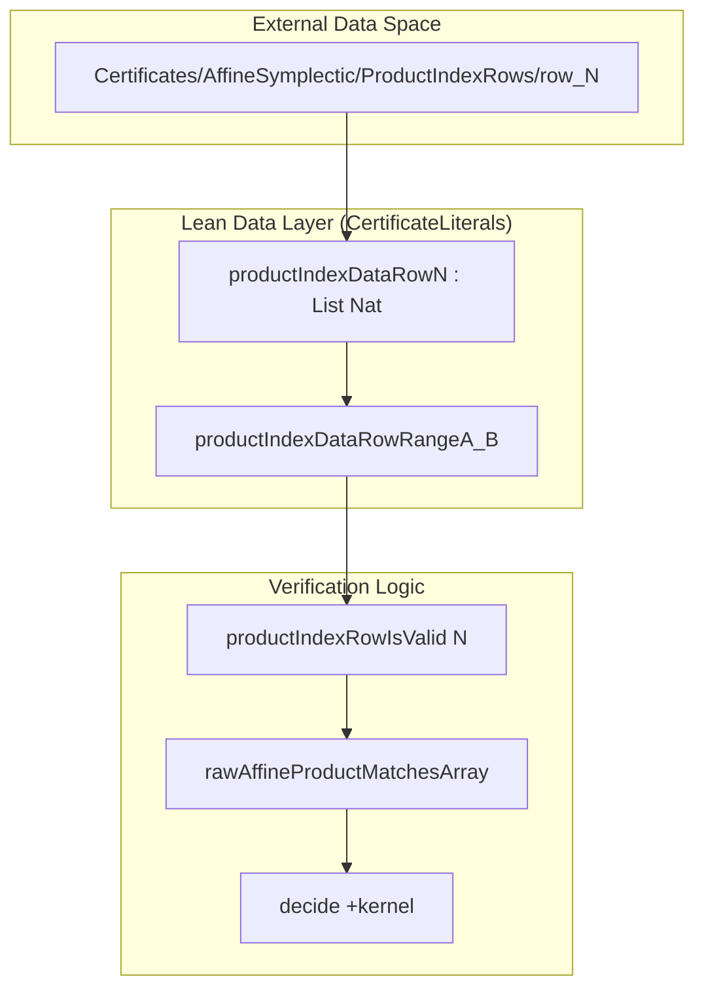
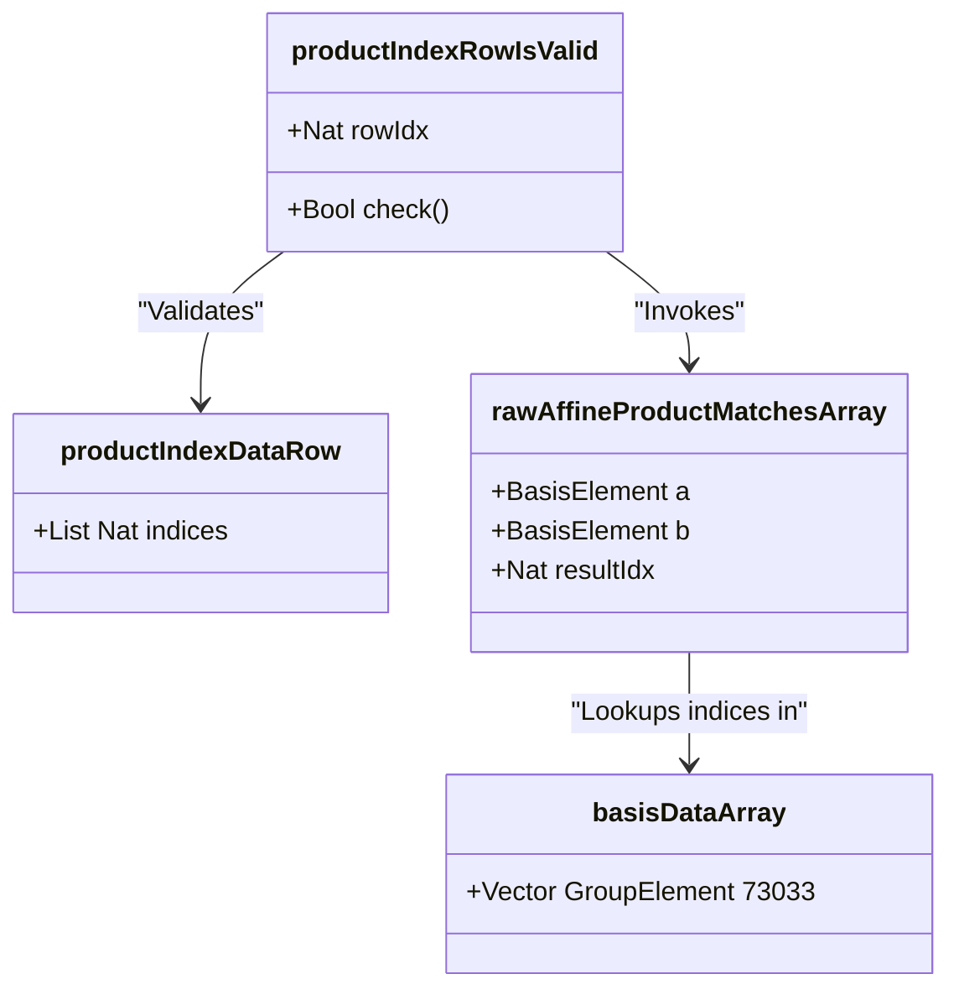

<!-- source: DeepWiki mcp.deepwiki.com · repo openai/ten-proofs · page 3.4 Product Index Table · fetched 2026-10-26 -->

# Product Index Table

Relevant source files

The following files were used as context for generating this wiki page:

- [ConnesRigidity/Certificates/AffineSymplectic/ProductIndexRows/row_011](ConnesRigidity/Certificates/AffineSymplectic/ProductIndexRows/row_011)
- [ConnesRigidity/Certificates/AffineSymplectic/ProductIndexRows/row_020](ConnesRigidity/Certificates/AffineSymplectic/ProductIndexRows/row_020)
- [ConnesRigidity/Certificates/AffineSymplectic/ProductIndexRows/row_021](ConnesRigidity/Certificates/AffineSymplectic/ProductIndexRows/row_021)
- [ConnesRigidity/Certificates/AffineSymplectic/ProductIndexRows/row_022](ConnesRigidity/Certificates/AffineSymplectic/ProductIndexRows/row_022)
- [ConnesRigidity/Certificates/AffineSymplectic/ProductIndexRows/row_023](ConnesRigidity/Certificates/AffineSymplectic/ProductIndexRows/row_023)
- [ConnesRigidity/Certificates/AffineSymplectic/ProductIndexRows/row_033](ConnesRigidity/Certificates/AffineSymplectic/ProductIndexRows/row_033)
- [ConnesRigidity/Certificates/AffineSymplectic/ProductIndexRows/row_035](ConnesRigidity/Certificates/AffineSymplectic/ProductIndexRows/row_035)
- [ConnesRigidity/Certificates/AffineSymplectic/ProductIndexRows/row_036](ConnesRigidity/Certificates/AffineSymplectic/ProductIndexRows/row_036)
- [ConnesRigidity/Certificates/AffineSymplectic/ProductIndexRows/row_039](ConnesRigidity/Certificates/AffineSymplectic/ProductIndexRows/row_039)
- [ConnesRigidity/Certificates/AffineSymplectic/ProductIndexRows/row_045](ConnesRigidity/Certificates/AffineSymplectic/ProductIndexRows/row_045)
- [ConnesRigidity/Certificates/AffineSymplectic/ProductIndexRows/row_046](ConnesRigidity/Certificates/AffineSymplectic/ProductIndexRows/row_046)
- [ConnesRigidity/Certificates/AffineSymplectic/ProductIndexRows/row_049](ConnesRigidity/Certificates/AffineSymplectic/ProductIndexRows/row_049)
- [ConnesRigidity/Certificates/AffineSymplectic/ProductIndexRows/row_051](ConnesRigidity/Certificates/AffineSymplectic/ProductIndexRows/row_051)
- [ConnesRigidity/Certificates/AffineSymplectic/ProductIndexRows/row_055](ConnesRigidity/Certificates/AffineSymplectic/ProductIndexRows/row_055)
- [ConnesRigidity/Certificates/AffineSymplectic/ProductIndexRows/row_066](ConnesRigidity/Certificates/AffineSymplectic/ProductIndexRows/row_066)
- [ConnesRigidity/Certificates/AffineSymplectic/ProductIndexRows/row_067](ConnesRigidity/Certificates/AffineSymplectic/ProductIndexRows/row_067)
- [ConnesRigidity/Certificates/AffineSymplectic/ProductIndexRows/row_076](ConnesRigidity/Certificates/AffineSymplectic/ProductIndexRows/row_076)
- [ConnesRigidity/Certificates/AffineSymplectic/ProductIndexRows/row_077](ConnesRigidity/Certificates/AffineSymplectic/ProductIndexRows/row_077)
- [ConnesRigidity/Certificates/AffineSymplectic/ProductIndexRows/row_088](ConnesRigidity/Certificates/AffineSymplectic/ProductIndexRows/row_088)
- [ConnesRigidity/Certificates/AffineSymplectic/ProductIndexRows/row_090](ConnesRigidity/Certificates/AffineSymplectic/ProductIndexRows/row_090)
- [ConnesRigidity/Certificates/AffineSymplectic/ProductIndexRows/row_093](ConnesRigidity/Certificates/AffineSymplectic/ProductIndexRows/row_093)
- [ConnesRigidity/Certificates/AffineSymplectic/ProductIndexRows/row_096](ConnesRigidity/Certificates/AffineSymplectic/ProductIndexRows/row_096)
- [ConnesRigidity/Certificates/AffineSymplectic/ProductIndexRows/row_098](ConnesRigidity/Certificates/AffineSymplectic/ProductIndexRows/row_098)
- [ConnesRigidity/Certificates/AffineSymplectic/ProductIndexRows/row_103](ConnesRigidity/Certificates/AffineSymplectic/ProductIndexRows/row_103)
- [ConnesRigidity/Certificates/AffineSymplectic/ProductIndexRows/row_107](ConnesRigidity/Certificates/AffineSymplectic/ProductIndexRows/row_107)
- [ConnesRigidity/Certificates/AffineSymplectic/ProductIndexRows/row_108](ConnesRigidity/Certificates/AffineSymplectic/ProductIndexRows/row_108)
- [ConnesRigidity/Certificates/AffineSymplectic/ProductIndexRows/row_117](ConnesRigidity/Certificates/AffineSymplectic/ProductIndexRows/row_117)
- [ConnesRigidity/Certificates/AffineSymplectic/ProductIndexRows/row_121](ConnesRigidity/Certificates/AffineSymplectic/ProductIndexRows/row_121)
- [ConnesRigidity/Certificates/AffineSymplectic/ProductIndexRows/row_132](ConnesRigidity/Certificates/AffineSymplectic/ProductIndexRows/row_132)
- [ConnesRigidity/Certificates/AffineSymplectic/ProductIndexRows/row_134](ConnesRigidity/Certificates/AffineSymplectic/ProductIndexRows/row_134)
- [ConnesRigidity/Certificates/AffineSymplectic/ProductIndexRows/row_135](ConnesRigidity/Certificates/AffineSymplectic/ProductIndexRows/row_135)
- [ConnesRigidity/Certificates/AffineSymplectic/ProductIndexRows/row_143](ConnesRigidity/Certificates/AffineSymplectic/ProductIndexRows/row_143)
- [ConnesRigidity/Certificates/AffineSymplectic/ProductIndexRows/row_144](ConnesRigidity/Certificates/AffineSymplectic/ProductIndexRows/row_144)
- [ConnesRigidity/Certificates/AffineSymplectic/ProductIndexRows/row_153](ConnesRigidity/Certificates/AffineSymplectic/ProductIndexRows/row_153)
- [ConnesRigidity/Certificates/AffineSymplectic/ProductIndexRows/row_154](ConnesRigidity/Certificates/AffineSymplectic/ProductIndexRows/row_154)
- [ConnesRigidity/Certificates/AffineSymplectic/ProductIndexRows/row_155](ConnesRigidity/Certificates/AffineSymplectic/ProductIndexRows/row_155)
- [ConnesRigidity/Certificates/AffineSymplectic/ProductIndexRows/row_163](ConnesRigidity/Certificates/AffineSymplectic/ProductIndexRows/row_163)
- [ConnesRigidity/Certificates/AffineSymplectic/ProductIndexRows/row_166](ConnesRigidity/Certificates/AffineSymplectic/ProductIndexRows/row_166)
- [ConnesRigidity/Certificates/AffineSymplectic/ProductIndexRows/row_167](ConnesRigidity/Certificates/AffineSymplectic/ProductIndexRows/row_167)
- [ConnesRigidity/Certificates/AffineSymplectic/ProductIndexRows/row_169](ConnesRigidity/Certificates/AffineSymplectic/ProductIndexRows/row_169)
- [ConnesRigidity/Certificates/AffineSymplectic/ProductIndexRows/row_170](ConnesRigidity/Certificates/AffineSymplectic/ProductIndexRows/row_170)
- [ConnesRigidity/Certificates/AffineSymplectic/ProductIndexRows/row_177](ConnesRigidity/Certificates/AffineSymplectic/ProductIndexRows/row_177)
- [ConnesRigidity/Certificates/AffineSymplectic/ProductIndexRows/row_179](ConnesRigidity/Certificates/AffineSymplectic/ProductIndexRows/row_179)
- [ConnesRigidity/Certificates/AffineSymplectic/ProductIndexRows/row_190](ConnesRigidity/Certificates/AffineSymplectic/ProductIndexRows/row_190)
- [ConnesRigidity/Certificates/AffineSymplectic/ProductIndexRows/row_191](ConnesRigidity/Certificates/AffineSymplectic/ProductIndexRows/row_191)
- [ConnesRigidity/Certificates/AffineSymplectic/ProductIndexRows/row_195](ConnesRigidity/Certificates/AffineSymplectic/ProductIndexRows/row_195)
- [ConnesRigidity/Certificates/AffineSymplectic/ProductIndexRows/row_202](ConnesRigidity/Certificates/AffineSymplectic/ProductIndexRows/row_202)
- [ConnesRigidity/Certificates/AffineSymplectic/ProductIndexRows/row_204](ConnesRigidity/Certificates/AffineSymplectic/ProductIndexRows/row_204)
- [ConnesRigidity/Certificates/AffineSymplectic/ProductIndexRows/row_206](ConnesRigidity/Certificates/AffineSymplectic/ProductIndexRows/row_206)
- [ConnesRigidity/Certificates/AffineSymplectic/ProductIndexRows/row_211](ConnesRigidity/Certificates/AffineSymplectic/ProductIndexRows/row_211)
- [ConnesRigidity/Certificates/AffineSymplectic/ProductIndexRows/row_217](ConnesRigidity/Certificates/AffineSymplectic/ProductIndexRows/row_217)
- [ConnesRigidity/Certificates/AffineSymplectic/ProductIndexRows/row_218](ConnesRigidity/Certificates/AffineSymplectic/ProductIndexRows/row_218)
- [ConnesRigidity/Certificates/AffineSymplectic/ProductIndexRows/row_225](ConnesRigidity/Certificates/AffineSymplectic/ProductIndexRows/row_225)
- [ConnesRigidity/Certificates/AffineSymplectic/ProductIndexRows/row_237](ConnesRigidity/Certificates/AffineSymplectic/ProductIndexRows/row_237)
- [ConnesRigidity/Certificates/AffineSymplectic/ProductIndexRows/row_239](ConnesRigidity/Certificates/AffineSymplectic/ProductIndexRows/row_239)
- [ConnesRigidity/Certificates/AffineSymplectic/ProductIndexRows/row_240](ConnesRigidity/Certificates/AffineSymplectic/ProductIndexRows/row_240)
- [ConnesRigidity/Certificates/AffineSymplectic/ProductIndexRows/row_244](ConnesRigidity/Certificates/AffineSymplectic/ProductIndexRows/row_244)
- [ConnesRigidity/Certificates/AffineSymplectic/ProductIndexRows/row_246](ConnesRigidity/Certificates/AffineSymplectic/ProductIndexRows/row_246)
- [ConnesRigidity/Certificates/AffineSymplectic/ProductIndexRows/row_248](ConnesRigidity/Certificates/AffineSymplectic/ProductIndexRows/row_248)
- [ConnesRigidity/Certificates/AffineSymplectic/ProductIndexRows/row_251](ConnesRigidity/Certificates/AffineSymplectic/ProductIndexRows/row_251)
- [ConnesRigidity/Certificates/AffineSymplectic/ProductIndexRows/row_257](ConnesRigidity/Certificates/AffineSymplectic/ProductIndexRows/row_257)
- [ConnesRigidity/Certificates/AffineSymplectic/ProductIndexRows/row_258](ConnesRigidity/Certificates/AffineSymplectic/ProductIndexRows/row_258)
- [ConnesRigidity/Certificates/AffineSymplectic/ProductIndexRows/row_259](ConnesRigidity/Certificates/AffineSymplectic/ProductIndexRows/row_259)
- [ConnesRigidity/Certificates/AffineSymplectic/ProductIndexRows/row_268](ConnesRigidity/Certificates/AffineSymplectic/ProductIndexRows/row_268)
- [ConnesRigidity/Certificates/AffineSymplectic/ProductIndexRows/row_270](ConnesRigidity/Certificates/AffineSymplectic/ProductIndexRows/row_270)
- [ConnesRigidity/Certificates/AffineSymplectic/ProductIndexRows/row_274](ConnesRigidity/Certificates/AffineSymplectic/ProductIndexRows/row_274)
- [ConnesRigidity/Certificates/AffineSymplectic/ProductIndexRows/row_282](ConnesRigidity/Certificates/AffineSymplectic/ProductIndexRows/row_282)
- [ConnesRigidity/Certificates/AffineSymplectic/ProductIndexRows/row_285](ConnesRigidity/Certificates/AffineSymplectic/ProductIndexRows/row_285)
- [ConnesRigidity/Certificates/AffineSymplectic/ProductIndexRows/row_286](ConnesRigidity/Certificates/AffineSymplectic/ProductIndexRows/row_286)
- [ConnesRigidity/Certificates/AffineSymplectic/ProductIndexRows/row_289](ConnesRigidity/Certificates/AffineSymplectic/ProductIndexRows/row_289)
- [ConnesRigidity/Certificates/AffineSymplectic/ProductIndexRows/row_290](ConnesRigidity/Certificates/AffineSymplectic/ProductIndexRows/row_290)
- [ConnesRigidity/Certificates/AffineSymplectic/ProductIndexRows/row_291](ConnesRigidity/Certificates/AffineSymplectic/ProductIndexRows/row_291)
- [ConnesRigidity/Certificates/AffineSymplectic/ProductIndexRows/row_299](ConnesRigidity/Certificates/AffineSymplectic/ProductIndexRows/row_299)
- [ConnesRigidity/Certificates/AffineSymplectic/ProductIndexRows/row_300](ConnesRigidity/Certificates/AffineSymplectic/ProductIndexRows/row_300)
- [ConnesRigidity/Certificates/AffineSymplectic/ProductIndexRows/row_303](ConnesRigidity/Certificates/AffineSymplectic/ProductIndexRows/row_303)
- [ConnesRigidity/Certificates/AffineSymplectic/ProductIndexRows/row_307](ConnesRigidity/Certificates/AffineSymplectic/ProductIndexRows/row_307)
- [ConnesRigidity/Certificates/AffineSymplectic/ProductIndexRows/row_309](ConnesRigidity/Certificates/AffineSymplectic/ProductIndexRows/row_309)
- [ConnesRigidity/Certificates/AffineSymplectic/ProductIndexRows/row_312](ConnesRigidity/Certificates/AffineSymplectic/ProductIndexRows/row_312)
- [ConnesRigidity/Certificates/AffineSymplectic/ProductIndexRows/row_314](ConnesRigidity/Certificates/AffineSymplectic/ProductIndexRows/row_314)
- [ConnesRigidity/Certificates/AffineSymplectic/ProductIndexRows/row_320](ConnesRigidity/Certificates/AffineSymplectic/ProductIndexRows/row_320)
- [ConnesRigidity/Certificates/AffineSymplectic/ProductIndexRows/row_321](ConnesRigidity/Certificates/AffineSymplectic/ProductIndexRows/row_321)
- [ConnesRigidity/Certificates/AffineSymplectic/ProductIndexRows/row_333](ConnesRigidity/Certificates/AffineSymplectic/ProductIndexRows/row_333)
- [ConnesRigidity/Certificates/AffineSymplectic/ProductIndexRows/row_336](ConnesRigidity/Certificates/AffineSymplectic/ProductIndexRows/row_336)
- [ConnesRigidity/Certificates/AffineSymplectic/ProductIndexRows/row_337](ConnesRigidity/Certificates/AffineSymplectic/ProductIndexRows/row_337)
- [ConnesRigidity/Certificates/AffineSymplectic/ProductIndexRows/row_341](ConnesRigidity/Certificates/AffineSymplectic/ProductIndexRows/row_341)
- [ConnesRigidity/Certificates/AffineSymplectic/ProductIndexRows/row_343](ConnesRigidity/Certificates/AffineSymplectic/ProductIndexRows/row_343)
- [ConnesRigidity/Certificates/AffineSymplectic/ProductIndexRows/row_345](ConnesRigidity/Certificates/AffineSymplectic/ProductIndexRows/row_345)
- [ConnesRigidity/Certificates/AffineSymplectic/ProductIndexRows/row_346](ConnesRigidity/Certificates/AffineSymplectic/ProductIndexRows/row_346)
- [ConnesRigidity/Certificates/AffineSymplectic/ProductIndexRows/row_353](ConnesRigidity/Certificates/AffineSymplectic/ProductIndexRows/row_353)
- [ConnesRigidity/Certificates/AffineSymplectic/ProductIndexRows/row_354](ConnesRigidity/Certificates/AffineSymplectic/ProductIndexRows/row_354)
- [ConnesRigidity/Certificates/AffineSymplectic/ProductIndexRows/row_359](ConnesRigidity/Certificates/AffineSymplectic/ProductIndexRows/row_359)
- [ConnesRigidity/Certificates/AffineSymplectic/ProductIndexRows/row_360](ConnesRigidity/Certificates/AffineSymplectic/ProductIndexRows/row_360)
- [ConnesRigidity/Certificates/AffineSymplectic/ProductIndexRows/row_361](ConnesRigidity/Certificates/AffineSymplectic/ProductIndexRows/row_361)
- [ConnesRigidity/Certificates/AffineSymplectic/ProductIndexRows/row_367](ConnesRigidity/Certificates/AffineSymplectic/ProductIndexRows/row_367)
- [ConnesRigidity/Certificates/AffineSymplectic/ProductIndexRows/row_369](ConnesRigidity/Certificates/AffineSymplectic/ProductIndexRows/row_369)
- [ConnesRigidity/Certificates/AffineSymplectic/ProductIndexRows/row_372](ConnesRigidity/Certificates/AffineSymplectic/ProductIndexRows/row_372)
- [ConnesRigidity/Certificates/AffineSymplectic/ProductIndexRows/row_375](ConnesRigidity/Certificates/AffineSymplectic/ProductIndexRows/row_375)
- [ConnesRigidity/Certificates/AffineSymplectic/ProductIndexRows/row_382](ConnesRigidity/Certificates/AffineSymplectic/ProductIndexRows/row_382)
- [ConnesRigidity/Certificates/AffineSymplectic/ProductIndexRows/row_383](ConnesRigidity/Certificates/AffineSymplectic/ProductIndexRows/row_383)
- [ConnesRigidity/Certificates/AffineSymplectic/ProductIndexRows/row_386](ConnesRigidity/Certificates/AffineSymplectic/ProductIndexRows/row_386)
- [ConnesRigidity/Certificates/AffineSymplectic/ProductIndexRows/row_393](ConnesRigidity/Certificates/AffineSymplectic/ProductIndexRows/row_393)
- [ConnesRigidity/Certificates/AffineSymplectic/ProductIndexRows/row_396](ConnesRigidity/Certificates/AffineSymplectic/ProductIndexRows/row_396)
- [ConnesRigidity/Certificates/AffineSymplectic/ProductIndexRows/row_397](ConnesRigidity/Certificates/AffineSymplectic/ProductIndexRows/row_397)
- [ConnesRigidity/Certificates/AffineSymplectic/ProductIndexRows/row_403](ConnesRigidity/Certificates/AffineSymplectic/ProductIndexRows/row_403)
- [ConnesRigidity/Certificates/AffineSymplectic/ProductIndexRows/row_407](ConnesRigidity/Certificates/AffineSymplectic/ProductIndexRows/row_407)
- [ConnesRigidity/Certificates/AffineSymplectic/ProductIndexRows/row_412](ConnesRigidity/Certificates/AffineSymplectic/ProductIndexRows/row_412)
- [ConnesRigidity/Certificates/AffineSymplectic/ProductIndexRows/row_413](ConnesRigidity/Certificates/AffineSymplectic/ProductIndexRows/row_413)
- [ConnesRigidity/Certificates/AffineSymplectic/ProductIndexRows/row_415](ConnesRigidity/Certificates/AffineSymplectic/ProductIndexRows/row_415)
- [ConnesRigidity/Certificates/AffineSymplectic/ProductIndexRows/row_418](ConnesRigidity/Certificates/AffineSymplectic/ProductIndexRows/row_418)
- [ConnesRigidity/Certificates/AffineSymplectic/ProductIndexRows/row_423](ConnesRigidity/Certificates/AffineSymplectic/ProductIndexRows/row_423)
- [ConnesRigidity/PropertyTExactCertificateProductRows/Row000.lean](ConnesRigidity/PropertyTExactCertificateProductRows/Row000.lean)
- [ConnesRigidity/PropertyTExactCertificateProductRows/Row001.lean](ConnesRigidity/PropertyTExactCertificateProductRows/Row001.lean)
- [ConnesRigidity/PropertyTExactCertificateProductRows/Row002.lean](ConnesRigidity/PropertyTExactCertificateProductRows/Row002.lean)
- [ConnesRigidity/PropertyTExactCertificateProductRows/Row003.lean](ConnesRigidity/PropertyTExactCertificateProductRows/Row003.lean)
- [ConnesRigidity/PropertyTExactCertificateProductRows/Row004.lean](ConnesRigidity/PropertyTExactCertificateProductRows/Row004.lean)
- [ConnesRigidity/PropertyTExactCertificateProductRows/Row005.lean](ConnesRigidity/PropertyTExactCertificateProductRows/Row005.lean)
- [ConnesRigidity/PropertyTExactCertificateProductRows/Row007.lean](ConnesRigidity/PropertyTExactCertificateProductRows/Row007.lean)
- [ConnesRigidity/PropertyTExactCertificateProductRows/Row009.lean](ConnesRigidity/PropertyTExactCertificateProductRows/Row009.lean)
- [ConnesRigidity/PropertyTExactCertificateProductRows/Row013.lean](ConnesRigidity/PropertyTExactCertificateProductRows/Row013.lean)
- [ConnesRigidity/PropertyTExactCertificateProductRows/Row016.lean](ConnesRigidity/PropertyTExactCertificateProductRows/Row016.lean)
- [ConnesRigidity/PropertyTExactCertificateProductRows/Row021.lean](ConnesRigidity/PropertyTExactCertificateProductRows/Row021.lean)
- [ConnesRigidity/PropertyTExactCertificateProductRows/Row023.lean](ConnesRigidity/PropertyTExactCertificateProductRows/Row023.lean)
- [ConnesRigidity/PropertyTExactCertificateProductRows/Row025.lean](ConnesRigidity/PropertyTExactCertificateProductRows/Row025.lean)
- [ConnesRigidity/PropertyTExactCertificateProductRows/Row028.lean](ConnesRigidity/PropertyTExactCertificateProductRows/Row028.lean)
- [ConnesRigidity/PropertyTExactCertificateProductRows/Row029.lean](ConnesRigidity/PropertyTExactCertificateProductRows/Row029.lean)
- [ConnesRigidity/PropertyTExactCertificateProductRows/Row031.lean](ConnesRigidity/PropertyTExactCertificateProductRows/Row031.lean)
- [ConnesRigidity/PropertyTExactCertificateProductRows/Row033.lean](ConnesRigidity/PropertyTExactCertificateProductRows/Row033.lean)
- [ConnesRigidity/PropertyTExactCertificateProductRows/Row034.lean](ConnesRigidity/PropertyTExactCertificateProductRows/Row034.lean)
- [ConnesRigidity/PropertyTExactCertificateProductRows/Row035.lean](ConnesRigidity/PropertyTExactCertificateProductRows/Row035.lean)
- [ConnesRigidity/PropertyTExactCertificateProductRows/Row036.lean](ConnesRigidity/PropertyTExactCertificateProductRows/Row036.lean)
- [ConnesRigidity/PropertyTExactCertificateProductRows/Row037.lean](ConnesRigidity/PropertyTExactCertificateProductRows/Row037.lean)
- [ConnesRigidity/PropertyTExactCertificateProductRows/Row038.lean](ConnesRigidity/PropertyTExactCertificateProductRows/Row038.lean)
- [ConnesRigidity/PropertyTExactCertificateProductRows/Row039.lean](ConnesRigidity/PropertyTExactCertificateProductRows/Row039.lean)
- [ConnesRigidity/PropertyTExactCertificateProductRows/Row040.lean](ConnesRigidity/PropertyTExactCertificateProductRows/Row040.lean)
- [ConnesRigidity/PropertyTExactCertificateProductRows/Row041.lean](ConnesRigidity/PropertyTExactCertificateProductRows/Row041.lean)
- [ConnesRigidity/PropertyTExactCertificateProductRows/Row042.lean](ConnesRigidity/PropertyTExactCertificateProductRows/Row042.lean)
- [ConnesRigidity/PropertyTExactCertificateProductRows/Row043.lean](ConnesRigidity/PropertyTExactCertificateProductRows/Row043.lean)
- [ConnesRigidity/PropertyTExactCertificateProductRows/Row044.lean](ConnesRigidity/PropertyTExactCertificateProductRows/Row044.lean)
- [ConnesRigidity/PropertyTExactCertificateProductRows/Row045.lean](ConnesRigidity/PropertyTExactCertificateProductRows/Row045.lean)
- [ConnesRigidity/PropertyTExactCertificateProductRows/Row046.lean](ConnesRigidity/PropertyTExactCertificateProductRows/Row046.lean)
- [ConnesRigidity/PropertyTExactCertificateProductRows/Row047.lean](ConnesRigidity/PropertyTExactCertificateProductRows/Row047.lean)
- [ConnesRigidity/PropertyTExactCertificateProductRows/Row048.lean](ConnesRigidity/PropertyTExactCertificateProductRows/Row048.lean)
- [ConnesRigidity/PropertyTExactCertificateProductRows/Row050.lean](ConnesRigidity/PropertyTExactCertificateProductRows/Row050.lean)
- [ConnesRigidity/PropertyTExactCertificateProductRows/Row051.lean](ConnesRigidity/PropertyTExactCertificateProductRows/Row051.lean)
- [ConnesRigidity/PropertyTExactCertificateProductRows/Row054.lean](ConnesRigidity/PropertyTExactCertificateProductRows/Row054.lean)
- [ConnesRigidity/PropertyTExactCertificateProductRows/Row057.lean](ConnesRigidity/PropertyTExactCertificateProductRows/Row057.lean)
- [ConnesRigidity/PropertyTExactCertificateProductRows/Row060.lean](ConnesRigidity/PropertyTExactCertificateProductRows/Row060.lean)
- [ConnesRigidity/PropertyTExactCertificateProductRows/Row061.lean](ConnesRigidity/PropertyTExactCertificateProductRows/Row061.lean)
- [ConnesRigidity/PropertyTExactCertificateProductRows/Row062.lean](ConnesRigidity/PropertyTExactCertificateProductRows/Row062.lean)
- [ConnesRigidity/PropertyTExactCertificateProductRows/Row070.lean](ConnesRigidity/PropertyTExactCertificateProductRows/Row070.lean)
- [ConnesRigidity/PropertyTExactCertificateProductRows/Row071.lean](ConnesRigidity/PropertyTExactCertificateProductRows/Row071.lean)
- [ConnesRigidity/PropertyTExactCertificateProductRows/Row072.lean](ConnesRigidity/PropertyTExactCertificateProductRows/Row072.lean)
- [ConnesRigidity/PropertyTExactCertificateProductRows/Row074.lean](ConnesRigidity/PropertyTExactCertificateProductRows/Row074.lean)
- [ConnesRigidity/PropertyTExactCertificateProductRows/Row075.lean](ConnesRigidity/PropertyTExactCertificateProductRows/Row075.lean)
- [ConnesRigidity/PropertyTExactCertificateProductRows/Row076.lean](ConnesRigidity/PropertyTExactCertificateProductRows/Row076.lean)
- [ConnesRigidity/PropertyTExactCertificateProductRows/Row079.lean](ConnesRigidity/PropertyTExactCertificateProductRows/Row079.lean)
- [ConnesRigidity/PropertyTExactCertificateProductRows/Row081.lean](ConnesRigidity/PropertyTExactCertificateProductRows/Row081.lean)
- [ConnesRigidity/PropertyTExactCertificateProductRows/Row082.lean](ConnesRigidity/PropertyTExactCertificateProductRows/Row082.lean)
- [ConnesRigidity/PropertyTExactCertificateProductRows/Row083.lean](ConnesRigidity/PropertyTExactCertificateProductRows/Row083.lean)
- [ConnesRigidity/PropertyTExactCertificateProductRows/Row090.lean](ConnesRigidity/PropertyTExactCertificateProductRows/Row090.lean)
- [ConnesRigidity/PropertyTExactCertificateProductRows/Row093.lean](ConnesRigidity/PropertyTExactCertificateProductRows/Row093.lean)
- [ConnesRigidity/PropertyTExactCertificateProductRows/Row102.lean](ConnesRigidity/PropertyTExactCertificateProductRows/Row102.lean)
- [ConnesRigidity/PropertyTExactCertificateProductRows/Row103.lean](ConnesRigidity/PropertyTExactCertificateProductRows/Row103.lean)
- [ConnesRigidity/PropertyTExactCertificateProductRows/Row104.lean](ConnesRigidity/PropertyTExactCertificateProductRows/Row104.lean)
- [ConnesRigidity/PropertyTExactCertificateProductRows/Row105.lean](ConnesRigidity/PropertyTExactCertificateProductRows/Row105.lean)
- [ConnesRigidity/PropertyTExactCertificateProductRows/Row106.lean](ConnesRigidity/PropertyTExactCertificateProductRows/Row106.lean)
- [ConnesRigidity/PropertyTExactCertificateProductRows/Row111.lean](ConnesRigidity/PropertyTExactCertificateProductRows/Row111.lean)
- [ConnesRigidity/PropertyTExactCertificateProductRows/Row112.lean](ConnesRigidity/PropertyTExactCertificateProductRows/Row112.lean)
- [ConnesRigidity/PropertyTExactCertificateProductRows/Row113.lean](ConnesRigidity/PropertyTExactCertificateProductRows/Row113.lean)
- [ConnesRigidity/PropertyTExactCertificateProductRows/Row114.lean](ConnesRigidity/PropertyTExactCertificateProductRows/Row114.lean)
- [ConnesRigidity/PropertyTExactCertificateProductRows/Row115.lean](ConnesRigidity/PropertyTExactCertificateProductRows/Row115.lean)
- [ConnesRigidity/PropertyTExactCertificateProductRows/Row116.lean](ConnesRigidity/PropertyTExactCertificateProductRows/Row116.lean)
- [ConnesRigidity/PropertyTExactCertificateProductRows/Row117.lean](ConnesRigidity/PropertyTExactCertificateProductRows/Row117.lean)
- [ConnesRigidity/PropertyTExactCertificateProductRows/Row118.lean](ConnesRigidity/PropertyTExactCertificateProductRows/Row118.lean)
- [ConnesRigidity/PropertyTExactCertificateProductRows/Row119.lean](ConnesRigidity/PropertyTExactCertificateProductRows/Row119.lean)
- [ConnesRigidity/PropertyTExactCertificateProductRows/Row120.lean](ConnesRigidity/PropertyTExactCertificateProductRows/Row120.lean)
- [ConnesRigidity/PropertyTExactCertificateProductRows/Row121.lean](ConnesRigidity/PropertyTExactCertificateProductRows/Row121.lean)
- [ConnesRigidity/PropertyTExactCertificateProductRows/Row125.lean](ConnesRigidity/PropertyTExactCertificateProductRows/Row125.lean)
- [ConnesRigidity/PropertyTExactCertificateProductRows/Row126.lean](ConnesRigidity/PropertyTExactCertificateProductRows/Row126.lean)
- [ConnesRigidity/PropertyTExactCertificateProductRows/Row127.lean](ConnesRigidity/PropertyTExactCertificateProductRows/Row127.lean)
- [ConnesRigidity/PropertyTExactCertificateProductRows/Row129.lean](ConnesRigidity/PropertyTExactCertificateProductRows/Row129.lean)
- [ConnesRigidity/PropertyTExactCertificateProductRows/Row130.lean](ConnesRigidity/PropertyTExactCertificateProductRows/Row130.lean)
- [ConnesRigidity/PropertyTExactCertificateProductRows/Row131.lean](ConnesRigidity/PropertyTExactCertificateProductRows/Row131.lean)
- [ConnesRigidity/PropertyTExactCertificateProductRows/Row132.lean](ConnesRigidity/PropertyTExactCertificateProductRows/Row132.lean)
- [ConnesRigidity/PropertyTExactCertificateProductRows/Row147.lean](ConnesRigidity/PropertyTExactCertificateProductRows/Row147.lean)
- [ConnesRigidity/PropertyTExactCertificateProductRows/Row148.lean](ConnesRigidity/PropertyTExactCertificateProductRows/Row148.lean)
- [ConnesRigidity/PropertyTExactCertificateProductRows/Row150.lean](ConnesRigidity/PropertyTExactCertificateProductRows/Row150.lean)
- [ConnesRigidity/PropertyTExactCertificateProductRows/Row151.lean](ConnesRigidity/PropertyTExactCertificateProductRows/Row151.lean)
- [ConnesRigidity/PropertyTExactCertificateProductRows/Row152.lean](ConnesRigidity/PropertyTExactCertificateProductRows/Row152.lean)
- [ConnesRigidity/PropertyTExactCertificateProductRows/Row153.lean](ConnesRigidity/PropertyTExactCertificateProductRows/Row153.lean)
- [ConnesRigidity/PropertyTExactCertificateProductRows/Row154.lean](ConnesRigidity/PropertyTExactCertificateProductRows/Row154.lean)
- [ConnesRigidity/PropertyTExactCertificateProductRows/Row155.lean](ConnesRigidity/PropertyTExactCertificateProductRows/Row155.lean)
- [ConnesRigidity/PropertyTExactCertificateProductRows/Row156.lean](ConnesRigidity/PropertyTExactCertificateProductRows/Row156.lean)
- [ConnesRigidity/PropertyTExactCertificateProductRows/Row157.lean](ConnesRigidity/PropertyTExactCertificateProductRows/Row157.lean)
- [ConnesRigidity/PropertyTExactCertificateProductRows/Row158.lean](ConnesRigidity/PropertyTExactCertificateProductRows/Row158.lean)
- [ConnesRigidity/PropertyTExactCertificateProductRows/Row162.lean](ConnesRigidity/PropertyTExactCertificateProductRows/Row162.lean)
- [ConnesRigidity/PropertyTExactCertificateProductRows/Row164.lean](ConnesRigidity/PropertyTExactCertificateProductRows/Row164.lean)
- [ConnesRigidity/PropertyTExactCertificateProductRows/Row167.lean](ConnesRigidity/PropertyTExactCertificateProductRows/Row167.lean)
- [ConnesRigidity/PropertyTExactCertificateProductRows/Row173.lean](ConnesRigidity/PropertyTExactCertificateProductRows/Row173.lean)
- [ConnesRigidity/PropertyTExactCertificateProductRows/Row176.lean](ConnesRigidity/PropertyTExactCertificateProductRows/Row176.lean)
- [ConnesRigidity/PropertyTExactCertificateProductRows/Row184.lean](ConnesRigidity/PropertyTExactCertificateProductRows/Row184.lean)
- [ConnesRigidity/PropertyTExactCertificateProductRows/Row185.lean](ConnesRigidity/PropertyTExactCertificateProductRows/Row185.lean)
- [ConnesRigidity/PropertyTExactCertificateProductRows/Row186.lean](ConnesRigidity/PropertyTExactCertificateProductRows/Row186.lean)
- [ConnesRigidity/PropertyTExactCertificateProductRows/Row187.lean](ConnesRigidity/PropertyTExactCertificateProductRows/Row187.lean)
- [ConnesRigidity/PropertyTExactCertificateProductRows/Row188.lean](ConnesRigidity/PropertyTExactCertificateProductRows/Row188.lean)
- [ConnesRigidity/PropertyTExactCertificateProductRows/Row191.lean](ConnesRigidity/PropertyTExactCertificateProductRows/Row191.lean)
- [ConnesRigidity/PropertyTExactCertificateProductRows/Row203.lean](ConnesRigidity/PropertyTExactCertificateProductRows/Row203.lean)
- [ConnesRigidity/PropertyTExactCertificateProductRows/Row206.lean](ConnesRigidity/PropertyTExactCertificateProductRows/Row206.lean)
- [ConnesRigidity/PropertyTExactCertificateProductRows/Row216.lean](ConnesRigidity/PropertyTExactCertificateProductRows/Row216.lean)
- [ConnesRigidity/PropertyTExactCertificateProductRows/Row217.lean](ConnesRigidity/PropertyTExactCertificateProductRows/Row217.lean)
- [ConnesRigidity/PropertyTExactCertificateProductRows/Row218.lean](ConnesRigidity/PropertyTExactCertificateProductRows/Row218.lean)
- [ConnesRigidity/PropertyTExactCertificateProductRows/Row219.lean](ConnesRigidity/PropertyTExactCertificateProductRows/Row219.lean)
- [ConnesRigidity/PropertyTExactCertificateProductRows/Row220.lean](ConnesRigidity/PropertyTExactCertificateProductRows/Row220.lean)
- [ConnesRigidity/PropertyTExactCertificateProductRows/Row221.lean](ConnesRigidity/PropertyTExactCertificateProductRows/Row221.lean)
- [ConnesRigidity/PropertyTExactCertificateProductRows/Row222.lean](ConnesRigidity/PropertyTExactCertificateProductRows/Row222.lean)
- [ConnesRigidity/PropertyTExactCertificateProductRows/Row223.lean](ConnesRigidity/PropertyTExactCertificateProductRows/Row223.lean)
- [ConnesRigidity/PropertyTExactCertificateProductRows/Row224.lean](ConnesRigidity/PropertyTExactCertificateProductRows/Row224.lean)
- [ConnesRigidity/PropertyTExactCertificateProductRows/Row227.lean](ConnesRigidity/PropertyTExactCertificateProductRows/Row227.lean)
- [ConnesRigidity/PropertyTExactCertificateProductRows/Row228.lean](ConnesRigidity/PropertyTExactCertificateProductRows/Row228.lean)
- [ConnesRigidity/PropertyTExactCertificateProductRows/Row229.lean](ConnesRigidity/PropertyTExactCertificateProductRows/Row229.lean)
- [ConnesRigidity/PropertyTExactCertificateProductRows/Row230.lean](ConnesRigidity/PropertyTExactCertificateProductRows/Row230.lean)
- [ConnesRigidity/PropertyTExactCertificateProductRows/Row231.lean](ConnesRigidity/PropertyTExactCertificateProductRows/Row231.lean)
- [ConnesRigidity/PropertyTExactCertificateProductRows/Row232.lean](ConnesRigidity/PropertyTExactCertificateProductRows/Row232.lean)
- [ConnesRigidity/PropertyTExactCertificateProductRows/Row233.lean](ConnesRigidity/PropertyTExactCertificateProductRows/Row233.lean)
- [ConnesRigidity/PropertyTExactCertificateProductRows/Row235.lean](ConnesRigidity/PropertyTExactCertificateProductRows/Row235.lean)
- [ConnesRigidity/PropertyTExactCertificateProductRows/Row237.lean](ConnesRigidity/PropertyTExactCertificateProductRows/Row237.lean)
- [ConnesRigidity/PropertyTExactCertificateProductRows/Row238.lean](ConnesRigidity/PropertyTExactCertificateProductRows/Row238.lean)
- [ConnesRigidity/PropertyTExactCertificateProductRows/Row239.lean](ConnesRigidity/PropertyTExactCertificateProductRows/Row239.lean)
- [ConnesRigidity/PropertyTExactCertificateProductRows/Row240.lean](ConnesRigidity/PropertyTExactCertificateProductRows/Row240.lean)
- [ConnesRigidity/PropertyTExactCertificateProductRows/Row243.lean](ConnesRigidity/PropertyTExactCertificateProductRows/Row243.lean)
- [ConnesRigidity/PropertyTExactCertificateProductRows/Row244.lean](ConnesRigidity/PropertyTExactCertificateProductRows/Row244.lean)
- [ConnesRigidity/PropertyTExactCertificateProductRows/Row245.lean](ConnesRigidity/PropertyTExactCertificateProductRows/Row245.lean)
- [ConnesRigidity/PropertyTExactCertificateProductRows/Row246.lean](ConnesRigidity/PropertyTExactCertificateProductRows/Row246.lean)
- [ConnesRigidity/PropertyTExactCertificateProductRows/Row247.lean](ConnesRigidity/PropertyTExactCertificateProductRows/Row247.lean)
- [ConnesRigidity/PropertyTExactCertificateProductRows/Row248.lean](ConnesRigidity/PropertyTExactCertificateProductRows/Row248.lean)
- [ConnesRigidity/PropertyTExactCertificateProductRows/Row249.lean](ConnesRigidity/PropertyTExactCertificateProductRows/Row249.lean)
- [ConnesRigidity/PropertyTExactCertificateProductRows/Row250.lean](ConnesRigidity/PropertyTExactCertificateProductRows/Row250.lean)
- [ConnesRigidity/PropertyTExactCertificateProductRows/Row252.lean](ConnesRigidity/PropertyTExactCertificateProductRows/Row252.lean)
- [ConnesRigidity/PropertyTExactCertificateProductRows/Row253.lean](ConnesRigidity/PropertyTExactCertificateProductRows/Row253.lean)
- [ConnesRigidity/PropertyTExactCertificateProductRows/Row254.lean](ConnesRigidity/PropertyTExactCertificateProductRows/Row254.lean)
- [ConnesRigidity/PropertyTExactCertificateProductRows/Row255.lean](ConnesRigidity/PropertyTExactCertificateProductRows/Row255.lean)
- [ConnesRigidity/PropertyTExactCertificateProductRows/Row256.lean](ConnesRigidity/PropertyTExactCertificateProductRows/Row256.lean)
- [ConnesRigidity/PropertyTExactCertificateProductRows/Row257.lean](ConnesRigidity/PropertyTExactCertificateProductRows/Row257.lean)
- [ConnesRigidity/PropertyTExactCertificateProductRows/Row258.lean](ConnesRigidity/PropertyTExactCertificateProductRows/Row258.lean)
- [ConnesRigidity/PropertyTExactCertificateProductRows/Row259.lean](ConnesRigidity/PropertyTExactCertificateProductRows/Row259.lean)
- [ConnesRigidity/PropertyTExactCertificateProductRows/Row261.lean](ConnesRigidity/PropertyTExactCertificateProductRows/Row261.lean)
- [ConnesRigidity/PropertyTExactCertificateProductRows/Row262.lean](ConnesRigidity/PropertyTExactCertificateProductRows/Row262.lean)
- [ConnesRigidity/PropertyTExactCertificateProductRows/Row263.lean](ConnesRigidity/PropertyTExactCertificateProductRows/Row263.lean)
- [ConnesRigidity/PropertyTExactCertificateProductRows/Row264.lean](ConnesRigidity/PropertyTExactCertificateProductRows/Row264.lean)
- [ConnesRigidity/PropertyTExactCertificateProductRows/Row265.lean](ConnesRigidity/PropertyTExactCertificateProductRows/Row265.lean)
- [ConnesRigidity/PropertyTExactCertificateProductRows/Row266.lean](ConnesRigidity/PropertyTExactCertificateProductRows/Row266.lean)
- [ConnesRigidity/PropertyTExactCertificateProductRows/Row267.lean](ConnesRigidity/PropertyTExactCertificateProductRows/Row267.lean)
- [ConnesRigidity/PropertyTExactCertificateProductRows/Row269.lean](ConnesRigidity/PropertyTExactCertificateProductRows/Row269.lean)
- [ConnesRigidity/PropertyTExactCertificateProductRows/Row270.lean](ConnesRigidity/PropertyTExactCertificateProductRows/Row270.lean)
- [ConnesRigidity/PropertyTExactCertificateProductRows/Row271.lean](ConnesRigidity/PropertyTExactCertificateProductRows/Row271.lean)
- [ConnesRigidity/PropertyTExactCertificateProductRows/Row272.lean](ConnesRigidity/PropertyTExactCertificateProductRows/Row272.lean)
- [ConnesRigidity/PropertyTExactCertificateProductRows/Row273.lean](ConnesRigidity/PropertyTExactCertificateProductRows/Row273.lean)
- [ConnesRigidity/PropertyTExactCertificateProductRows/Row274.lean](ConnesRigidity/PropertyTExactCertificateProductRows/Row274.lean)
- [ConnesRigidity/PropertyTExactCertificateProductRows/Row275.lean](ConnesRigidity/PropertyTExactCertificateProductRows/Row275.lean)
- [ConnesRigidity/PropertyTExactCertificateProductRows/Row276.lean](ConnesRigidity/PropertyTExactCertificateProductRows/Row276.lean)
- [ConnesRigidity/PropertyTExactCertificateProductRows/Row277.lean](ConnesRigidity/PropertyTExactCertificateProductRows/Row277.lean)
- [ConnesRigidity/PropertyTExactCertificateProductRows/Row278.lean](ConnesRigidity/PropertyTExactCertificateProductRows/Row278.lean)
- [ConnesRigidity/PropertyTExactCertificateProductRows/Row279.lean](ConnesRigidity/PropertyTExactCertificateProductRows/Row279.lean)
- [ConnesRigidity/PropertyTExactCertificateProductRows/Row280.lean](ConnesRigidity/PropertyTExactCertificateProductRows/Row280.lean)
- [ConnesRigidity/PropertyTExactCertificateProductRows/Row282.lean](ConnesRigidity/PropertyTExactCertificateProductRows/Row282.lean)
- [ConnesRigidity/PropertyTExactCertificateProductRows/Row285.lean](ConnesRigidity/PropertyTExactCertificateProductRows/Row285.lean)
- [ConnesRigidity/PropertyTExactCertificateProductRows/Row287.lean](ConnesRigidity/PropertyTExactCertificateProductRows/Row287.lean)
- [ConnesRigidity/PropertyTExactCertificateProductRows/Row288.lean](ConnesRigidity/PropertyTExactCertificateProductRows/Row288.lean)
- [ConnesRigidity/PropertyTExactCertificateProductRows/Row289.lean](ConnesRigidity/PropertyTExactCertificateProductRows/Row289.lean)
- [ConnesRigidity/PropertyTExactCertificateProductRows/Row290.lean](ConnesRigidity/PropertyTExactCertificateProductRows/Row290.lean)
- [ConnesRigidity/PropertyTExactCertificateProductRows/Row291.lean](ConnesRigidity/PropertyTExactCertificateProductRows/Row291.lean)
- [ConnesRigidity/PropertyTExactCertificateProductRows/Row292.lean](ConnesRigidity/PropertyTExactCertificateProductRows/Row292.lean)
- [ConnesRigidity/PropertyTExactCertificateProductRows/Row294.lean](ConnesRigidity/PropertyTExactCertificateProductRows/Row294.lean)
- [ConnesRigidity/PropertyTExactCertificateProductRows/Row296.lean](ConnesRigidity/PropertyTExactCertificateProductRows/Row296.lean)
- [ConnesRigidity/PropertyTExactCertificateProductRows/Row297.lean](ConnesRigidity/PropertyTExactCertificateProductRows/Row297.lean)
- [ConnesRigidity/PropertyTExactCertificateProductRows/Row298.lean](ConnesRigidity/PropertyTExactCertificateProductRows/Row298.lean)
- [ConnesRigidity/PropertyTExactCertificateProductRows/Row299.lean](ConnesRigidity/PropertyTExactCertificateProductRows/Row299.lean)
- [ConnesRigidity/PropertyTExactCertificateProductRows/Row300.lean](ConnesRigidity/PropertyTExactCertificateProductRows/Row300.lean)
- [ConnesRigidity/PropertyTExactCertificateProductRows/Row301.lean](ConnesRigidity/PropertyTExactCertificateProductRows/Row301.lean)
- [ConnesRigidity/PropertyTExactCertificateProductRows/Row302.lean](ConnesRigidity/PropertyTExactCertificateProductRows/Row302.lean)
- [ConnesRigidity/PropertyTExactCertificateProductRows/Row304.lean](ConnesRigidity/PropertyTExactCertificateProductRows/Row304.lean)
- [ConnesRigidity/PropertyTExactCertificateProductRows/Row306.lean](ConnesRigidity/PropertyTExactCertificateProductRows/Row306.lean)
- [ConnesRigidity/PropertyTExactCertificateProductRows/Row309.lean](ConnesRigidity/PropertyTExactCertificateProductRows/Row309.lean)
- [ConnesRigidity/PropertyTExactCertificateProductRows/Row313.lean](ConnesRigidity/PropertyTExactCertificateProductRows/Row313.lean)
- [ConnesRigidity/PropertyTExactCertificateProductRows/Row316.lean](ConnesRigidity/PropertyTExactCertificateProductRows/Row316.lean)
- [ConnesRigidity/PropertyTExactCertificateProductRows/Row317.lean](ConnesRigidity/PropertyTExactCertificateProductRows/Row317.lean)
- [ConnesRigidity/PropertyTExactCertificateProductRows/Row320.lean](ConnesRigidity/PropertyTExactCertificateProductRows/Row320.lean)
- [ConnesRigidity/PropertyTExactCertificateProductRows/Row322.lean](ConnesRigidity/PropertyTExactCertificateProductRows/Row322.lean)
- [ConnesRigidity/PropertyTExactCertificateProductRows/Row323.lean](ConnesRigidity/PropertyTExactCertificateProductRows/Row323.lean)
- [ConnesRigidity/PropertyTExactCertificateProductRows/Row324.lean](ConnesRigidity/PropertyTExactCertificateProductRows/Row324.lean)
- [ConnesRigidity/PropertyTExactCertificateProductRows/Row325.lean](ConnesRigidity/PropertyTExactCertificateProductRows/Row325.lean)
- [ConnesRigidity/PropertyTExactCertificateProductRows/Row326.lean](ConnesRigidity/PropertyTExactCertificateProductRows/Row326.lean)
- [ConnesRigidity/PropertyTExactCertificateProductRows/Row327.lean](ConnesRigidity/PropertyTExactCertificateProductRows/Row327.lean)
- [ConnesRigidity/PropertyTExactCertificateProductRows/Row328.lean](ConnesRigidity/PropertyTExactCertificateProductRows/Row328.lean)
- [ConnesRigidity/PropertyTExactCertificateProductRows/Row329.lean](ConnesRigidity/PropertyTExactCertificateProductRows/Row329.lean)
- [ConnesRigidity/PropertyTExactCertificateProductRows/Row332.lean](ConnesRigidity/PropertyTExactCertificateProductRows/Row332.lean)
- [ConnesRigidity/PropertyTExactCertificateProductRows/Row333.lean](ConnesRigidity/PropertyTExactCertificateProductRows/Row333.lean)
- [ConnesRigidity/PropertyTExactCertificateProductRows/Row334.lean](ConnesRigidity/PropertyTExactCertificateProductRows/Row334.lean)
- [ConnesRigidity/PropertyTExactCertificateProductRows/Row336.lean](ConnesRigidity/PropertyTExactCertificateProductRows/Row336.lean)
- [ConnesRigidity/PropertyTExactCertificateProductRows/Row337.lean](ConnesRigidity/PropertyTExactCertificateProductRows/Row337.lean)
- [ConnesRigidity/PropertyTExactCertificateProductRows/Row340.lean](ConnesRigidity/PropertyTExactCertificateProductRows/Row340.lean)
- [ConnesRigidity/PropertyTExactCertificateProductRows/Row343.lean](ConnesRigidity/PropertyTExactCertificateProductRows/Row343.lean)
- [ConnesRigidity/PropertyTExactCertificateProductRows/Row344.lean](ConnesRigidity/PropertyTExactCertificateProductRows/Row344.lean)
- [ConnesRigidity/PropertyTExactCertificateProductRows/Row346.lean](ConnesRigidity/PropertyTExactCertificateProductRows/Row346.lean)
- [ConnesRigidity/PropertyTExactCertificateProductRows/Row347.lean](ConnesRigidity/PropertyTExactCertificateProductRows/Row347.lean)
- [ConnesRigidity/PropertyTExactCertificateProductRows/Row348.lean](ConnesRigidity/PropertyTExactCertificateProductRows/Row348.lean)
- [ConnesRigidity/PropertyTExactCertificateProductRows/Row349.lean](ConnesRigidity/PropertyTExactCertificateProductRows/Row349.lean)
- [ConnesRigidity/PropertyTExactCertificateProductRows/Row350.lean](ConnesRigidity/PropertyTExactCertificateProductRows/Row350.lean)
- [ConnesRigidity/PropertyTExactCertificateProductRows/Row352.lean](ConnesRigidity/PropertyTExactCertificateProductRows/Row352.lean)
- [ConnesRigidity/PropertyTExactCertificateProductRows/Row353.lean](ConnesRigidity/PropertyTExactCertificateProductRows/Row353.lean)
- [ConnesRigidity/PropertyTExactCertificateProductRows/Row354.lean](ConnesRigidity/PropertyTExactCertificateProductRows/Row354.lean)
- [ConnesRigidity/PropertyTExactCertificateProductRows/Row355.lean](ConnesRigidity/PropertyTExactCertificateProductRows/Row355.lean)
- [ConnesRigidity/PropertyTExactCertificateProductRows/Row357.lean](ConnesRigidity/PropertyTExactCertificateProductRows/Row357.lean)
- [ConnesRigidity/PropertyTExactCertificateProductRows/Row358.lean](ConnesRigidity/PropertyTExactCertificateProductRows/Row358.lean)
- [ConnesRigidity/PropertyTExactCertificateProductRows/Row359.lean](ConnesRigidity/PropertyTExactCertificateProductRows/Row359.lean)
- [ConnesRigidity/PropertyTExactCertificateProductRows/Row361.lean](ConnesRigidity/PropertyTExactCertificateProductRows/Row361.lean)
- [ConnesRigidity/PropertyTExactCertificateProductRows/Row362.lean](ConnesRigidity/PropertyTExactCertificateProductRows/Row362.lean)
- [ConnesRigidity/PropertyTExactCertificateProductRows/Row363.lean](ConnesRigidity/PropertyTExactCertificateProductRows/Row363.lean)
- [ConnesRigidity/PropertyTExactCertificateProductRows/Row364.lean](ConnesRigidity/PropertyTExactCertificateProductRows/Row364.lean)
- [ConnesRigidity/PropertyTExactCertificateProductRows/Row366.lean](ConnesRigidity/PropertyTExactCertificateProductRows/Row366.lean)
- [ConnesRigidity/PropertyTExactCertificateProductRows/Row367.lean](ConnesRigidity/PropertyTExactCertificateProductRows/Row367.lean)
- [ConnesRigidity/PropertyTExactCertificateProductRows/Row368.lean](ConnesRigidity/PropertyTExactCertificateProductRows/Row368.lean)
- [ConnesRigidity/PropertyTExactCertificateProductRows/Row369.lean](ConnesRigidity/PropertyTExactCertificateProductRows/Row369.lean)
- [ConnesRigidity/PropertyTExactCertificateProductRows/Row370.lean](ConnesRigidity/PropertyTExactCertificateProductRows/Row370.lean)
- [ConnesRigidity/PropertyTExactCertificateProductRows/Row371.lean](ConnesRigidity/PropertyTExactCertificateProductRows/Row371.lean)
- [ConnesRigidity/PropertyTExactCertificateProductRows/Row373.lean](ConnesRigidity/PropertyTExactCertificateProductRows/Row373.lean)
- [ConnesRigidity/PropertyTExactCertificateProductRows/Row374.lean](ConnesRigidity/PropertyTExactCertificateProductRows/Row374.lean)
- [ConnesRigidity/PropertyTExactCertificateProductRows/Row375.lean](ConnesRigidity/PropertyTExactCertificateProductRows/Row375.lean)
- [ConnesRigidity/PropertyTExactCertificateProductRows/Row376.lean](ConnesRigidity/PropertyTExactCertificateProductRows/Row376.lean)
- [ConnesRigidity/PropertyTExactCertificateProductRows/Row377.lean](ConnesRigidity/PropertyTExactCertificateProductRows/Row377.lean)
- [ConnesRigidity/PropertyTExactCertificateProductRows/Row379.lean](ConnesRigidity/PropertyTExactCertificateProductRows/Row379.lean)
- [ConnesRigidity/PropertyTExactCertificateProductRows/Row382.lean](ConnesRigidity/PropertyTExactCertificateProductRows/Row382.lean)
- [ConnesRigidity/PropertyTExactCertificateProductRows/Row383.lean](ConnesRigidity/PropertyTExactCertificateProductRows/Row383.lean)
- [ConnesRigidity/PropertyTExactCertificateProductRows/Row384.lean](ConnesRigidity/PropertyTExactCertificateProductRows/Row384.lean)
- [ConnesRigidity/PropertyTExactCertificateProductRows/Row387.lean](ConnesRigidity/PropertyTExactCertificateProductRows/Row387.lean)
- [ConnesRigidity/PropertyTExactCertificateProductRows/Row389.lean](ConnesRigidity/PropertyTExactCertificateProductRows/Row389.lean)
- [ConnesRigidity/PropertyTExactCertificateProductRows/Row390.lean](ConnesRigidity/PropertyTExactCertificateProductRows/Row390.lean)
- [ConnesRigidity/PropertyTExactCertificateProductRows/Row391.lean](ConnesRigidity/PropertyTExactCertificateProductRows/Row391.lean)
- [ConnesRigidity/PropertyTExactCertificateProductRows/Row392.lean](ConnesRigidity/PropertyTExactCertificateProductRows/Row392.lean)
- [ConnesRigidity/PropertyTExactCertificateProductRows/Row393.lean](ConnesRigidity/PropertyTExactCertificateProductRows/Row393.lean)
- [ConnesRigidity/PropertyTExactCertificateProductRows/Row394.lean](ConnesRigidity/PropertyTExactCertificateProductRows/Row394.lean)
- [ConnesRigidity/PropertyTExactCertificateProductRows/Row395.lean](ConnesRigidity/PropertyTExactCertificateProductRows/Row395.lean)
- [ConnesRigidity/PropertyTExactCertificateProductRows/Row397.lean](ConnesRigidity/PropertyTExactCertificateProductRows/Row397.lean)
- [ConnesRigidity/PropertyTExactCertificateProductRows/Row398.lean](ConnesRigidity/PropertyTExactCertificateProductRows/Row398.lean)
- [ConnesRigidity/PropertyTExactCertificateProductRows/Row400.lean](ConnesRigidity/PropertyTExactCertificateProductRows/Row400.lean)
- [ConnesRigidity/PropertyTExactCertificateProductRows/Row403.lean](ConnesRigidity/PropertyTExactCertificateProductRows/Row403.lean)
- [ConnesRigidity/PropertyTExactCertificateProductRows/Row406.lean](ConnesRigidity/PropertyTExactCertificateProductRows/Row406.lean)
- [ConnesRigidity/PropertyTExactCertificateProductRows/Row408.lean](ConnesRigidity/PropertyTExactCertificateProductRows/Row408.lean)
- [ConnesRigidity/PropertyTExactCertificateProductRows/Row409.lean](ConnesRigidity/PropertyTExactCertificateProductRows/Row409.lean)
- [ConnesRigidity/PropertyTExactCertificateProductRows/Row410.lean](ConnesRigidity/PropertyTExactCertificateProductRows/Row410.lean)
- [ConnesRigidity/PropertyTExactCertificateProductRows/Row411.lean](ConnesRigidity/PropertyTExactCertificateProductRows/Row411.lean)
- [ConnesRigidity/PropertyTExactCertificateProductRows/Row412.lean](ConnesRigidity/PropertyTExactCertificateProductRows/Row412.lean)
- [ConnesRigidity/PropertyTExactCertificateProductRows/Row413.lean](ConnesRigidity/PropertyTExactCertificateProductRows/Row413.lean)
- [ConnesRigidity/PropertyTExactCertificateProductRows/Row414.lean](ConnesRigidity/PropertyTExactCertificateProductRows/Row414.lean)
- [ConnesRigidity/PropertyTExactCertificateProductRows/Row416.lean](ConnesRigidity/PropertyTExactCertificateProductRows/Row416.lean)
- [ConnesRigidity/PropertyTExactCertificateProductRows/Row418.lean](ConnesRigidity/PropertyTExactCertificateProductRows/Row418.lean)
- [ConnesRigidity/PropertyTExactCertificateProductRows/Row419.lean](ConnesRigidity/PropertyTExactCertificateProductRows/Row419.lean)
- [ConnesRigidity/PropertyTExactCertificateProductRows/Row420.lean](ConnesRigidity/PropertyTExactCertificateProductRows/Row420.lean)
- [ConnesRigidity/PropertyTExactCertificateProductRows/Row421.lean](ConnesRigidity/PropertyTExactCertificateProductRows/Row421.lean)
- [ConnesRigidity/PropertyTExactCertificateProductRows/Row423.lean](ConnesRigidity/PropertyTExactCertificateProductRows/Row423.lean)
- [ConnesRigidity/PropertyTExactCertificateProductRows/Row424.lean](ConnesRigidity/PropertyTExactCertificateProductRows/Row424.lean)

The **Product Index Table** is a fundamental component of the Property T certificate for the group $\Gamma_0$. It encodes the multiplication table for the 425-element basis used in the Gram matrix decomposition. Given the computational complexity of multiplying elements in the cocycle extension of $Sp(4, \mathbb{Z})$, these products are precomputed and stored as indices into a larger 73,033-element basis array.

## Overview and Data Flow

The multiplication table is stored as a series of rows, where each row $i$ contains the indices of the products $b_i \cdot b_j$ for all $j \in \{0, \dots, 424\}$. This allows the Lean kernel to verify group ring identities by looking up precomputed results rather than performing expensive symbolic group multiplications.

### Data Flow Diagram
"Data Flow: Raw CSV to Lean Kernel Validation"

Sources: [ConnesRigidity/PropertyTExactCertificateProductRows/Row383.lean:12-33](), [ConnesRigidity/Certificates/AffineSymplectic/ProductIndexRows/row_418:1-1]()

## Data Structures and Representation

The multiplication table is represented using the following key entities:

*   **`productIndexDataRow`**: A definition that maps a row index (0-424) to a list of natural numbers representing basis indices [ConnesRigidity/PropertyTExactCertificateProductRows/Row383.lean:15-15]().
*   **`basisDataArray`**: The master array containing the 73,033 group elements [ConnesRigidity/PropertyTExactCertificateProductRows/Row383.lean:29-29]().
*   **`productIndexEntryIsValid`**: A predicate checking if the $j$-th entry of row $i$ correctly identifies the product of the $i$-th and $j$-th basis elements [ConnesRigidity/PropertyTExactCertificateProductRows/Row383.lean:30-30]().

### Raw Data Format
The raw data files located in `Certificates/AffineSymplectic/ProductIndexRows/` contain comma-separated integers. For example, `row_418` starts with `237, 3322, 400, ...`, indicating that the product of basis element 418 and basis element 0 is the element at index 237 in the global `basisDataArray`.

Sources: [ConnesRigidity/Certificates/AffineSymplectic/ProductIndexRows/row_418:1-1](), [ConnesRigidity/Certificates/AffineSymplectic/ProductIndexRows/row_134:1-1]()

## Hierarchical Unfolding Strategy

Because Lean's kernel can struggle with very large definitions, the product table is accessed through a hierarchical range-based unfolding strategy. Instead of unfolding all 425 rows at once, the proof scripts unfold nested ranges (e.g., `productIndexDataRowRange212_425`) to narrow down to the specific row being validated.

### Entity Relationship Diagram
"Entity Mapping: Code Symbols to Logical Roles"

Sources: [ConnesRigidity/PropertyTExactCertificateProductRows/Row230.lean:12-33](), [ConnesRigidity/PropertyTExactCertificateProductRows/Row324.lean:12-32]()

### Example Unfolding Chain
In `Row383.lean`, the theorem `productRowCheck_383` uses the following sequence to efficiently resolve the data:
1.  `productIndexDataRowRange000_425`
2.  `productIndexDataRowRange212_425`
3.  `productIndexDataRowRange318_425`
4.  `productIndexDataRowRange371_425`
5.  ... down to `productIndexDataRow383`

Sources: [ConnesRigidity/PropertyTExactCertificateProductRows/Row383.lean:17-26]()

## Soundness Proof

The soundness of the product table is established via `decide +kernel` tactics in individual row files. Each row has a corresponding theorem (e.g., `productRowCheck_N`) that proves `productIndexRowIsValid N = true`.

### Key Functions in Soundness Chain
*   **`productIndexEntriesAreValid`**: Iterates through the list of indices in a row and checks each one [ConnesRigidity/PropertyTExactCertificateProductRows/Row383.lean:30-30]().
*   **`allElementDataRow` / `allElementDataGroups`**: Provides the mapping to the underlying group element data (translations and symplectic matrices) [ConnesRigidity/PropertyTExactCertificateProductRows/Row383.lean:32-32]().
*   **`rawAffineProductMatchesArray`**: The core computational check that performs the actual group multiplication in the kernel and compares it to the basis element at the provided index [ConnesRigidity/PropertyTExactCertificateProductRows/Row383.lean:31-31]().

### Configuration for Large Computations
Due to the depth of the basis array and the complexity of cocycle arithmetic, these proofs require elevated kernel limits:
*   `set_option maxRecDepth 1000000` [ConnesRigidity/PropertyTExactCertificateProductRows/Row383.lean:8-8]()
*   `set_option maxHeartbeats 0` [ConnesRigidity/PropertyTExactCertificateProductRows/Row383.lean:10-10]()

Sources: [ConnesRigidity/PropertyTExactCertificateProductRows/Row383.lean:8-33](), [ConnesRigidity/PropertyTExactCertificateProductRows/Row276.lean:8-33]()

---

