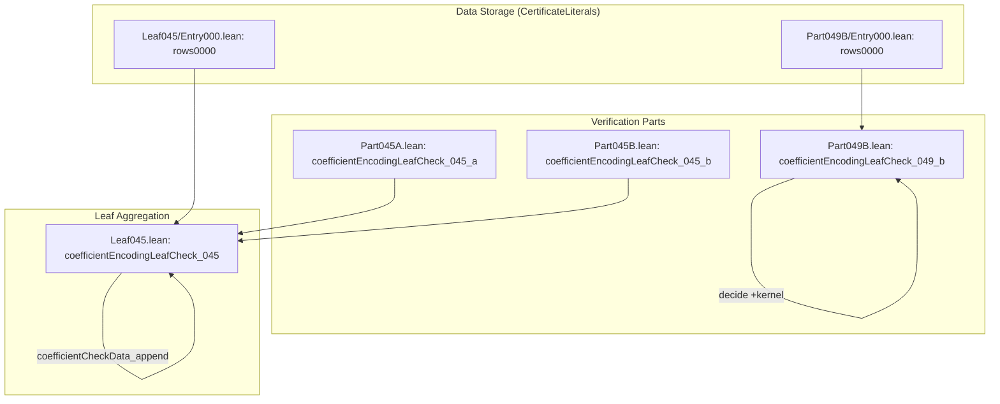
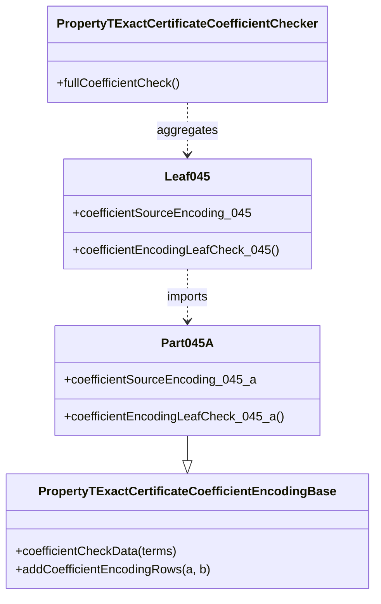

<!-- source: DeepWiki mcp.deepwiki.com · repo openai/ten-proofs · page 3.5 Coefficient Encoding and Leaves · fetched 2026-10-26 -->

# Coefficient Encoding and Leaves

<details>
<summary>Relevant source files</summary>

The following files were used as context for generating this wiki page:

- [ConnesRigidity/CertificateLiterals/PropertyTExactCertificateCoefficientEncodingLeaves/Diagonal081Part003/Entry000.lean](ConnesRigidity/CertificateLiterals/PropertyTExactCertificateCoefficientEncodingLeaves/Diagonal081Part003/Entry000.lean)
- [ConnesRigidity/CertificateLiterals/PropertyTExactCertificateCoefficientEncodingLeaves/Leaf000/Entry000.lean](ConnesRigidity/CertificateLiterals/PropertyTExactCertificateCoefficientEncodingLeaves/Leaf000/Entry000.lean)
- [ConnesRigidity/CertificateLiterals/PropertyTExactCertificateCoefficientEncodingLeaves/Leaf006/Entry000.lean](ConnesRigidity/CertificateLiterals/PropertyTExactCertificateCoefficientEncodingLeaves/Leaf006/Entry000.lean)
- [ConnesRigidity/CertificateLiterals/PropertyTExactCertificateCoefficientEncodingLeaves/Leaf008/Entry000.lean](ConnesRigidity/CertificateLiterals/PropertyTExactCertificateCoefficientEncodingLeaves/Leaf008/Entry000.lean)
- [ConnesRigidity/CertificateLiterals/PropertyTExactCertificateCoefficientEncodingLeaves/Leaf009/Entry000.lean](ConnesRigidity/CertificateLiterals/PropertyTExactCertificateCoefficientEncodingLeaves/Leaf009/Entry000.lean)
- [ConnesRigidity/CertificateLiterals/PropertyTExactCertificateCoefficientEncodingLeaves/Leaf011/Entry000.lean](ConnesRigidity/CertificateLiterals/PropertyTExactCertificateCoefficientEncodingLeaves/Leaf011/Entry000.lean)
- [ConnesRigidity/CertificateLiterals/PropertyTExactCertificateCoefficientEncodingLeaves/Leaf012/Entry000.lean](ConnesRigidity/CertificateLiterals/PropertyTExactCertificateCoefficientEncodingLeaves/Leaf012/Entry000.lean)
- [ConnesRigidity/CertificateLiterals/PropertyTExactCertificateCoefficientEncodingLeaves/Leaf016/Entry000.lean](ConnesRigidity/CertificateLiterals/PropertyTExactCertificateCoefficientEncodingLeaves/Leaf016/Entry000.lean)
- [ConnesRigidity/CertificateLiterals/PropertyTExactCertificateCoefficientEncodingLeaves/Leaf017/Entry000.lean](ConnesRigidity/CertificateLiterals/PropertyTExactCertificateCoefficientEncodingLeaves/Leaf017/Entry000.lean)
- [ConnesRigidity/CertificateLiterals/PropertyTExactCertificateCoefficientEncodingLeaves/Leaf018/Entry000.lean](ConnesRigidity/CertificateLiterals/PropertyTExactCertificateCoefficientEncodingLeaves/Leaf018/Entry000.lean)
- [ConnesRigidity/CertificateLiterals/PropertyTExactCertificateCoefficientEncodingLeaves/Leaf026/Entry000.lean](ConnesRigidity/CertificateLiterals/PropertyTExactCertificateCoefficientEncodingLeaves/Leaf026/Entry000.lean)
- [ConnesRigidity/CertificateLiterals/PropertyTExactCertificateCoefficientEncodingLeaves/Leaf031/Entry000.lean](ConnesRigidity/CertificateLiterals/PropertyTExactCertificateCoefficientEncodingLeaves/Leaf031/Entry000.lean)
- [ConnesRigidity/CertificateLiterals/PropertyTExactCertificateCoefficientEncodingLeaves/Leaf045/Entry000.lean](ConnesRigidity/CertificateLiterals/PropertyTExactCertificateCoefficientEncodingLeaves/Leaf045/Entry000.lean)
- [ConnesRigidity/CertificateLiterals/PropertyTExactCertificateCoefficientEncodingLeaves/Leaf046/Entry000.lean](ConnesRigidity/CertificateLiterals/PropertyTExactCertificateCoefficientEncodingLeaves/Leaf046/Entry000.lean)
- [ConnesRigidity/CertificateLiterals/PropertyTExactCertificateCoefficientEncodingLeaves/Leaf051/Entry000.lean](ConnesRigidity/CertificateLiterals/PropertyTExactCertificateCoefficientEncodingLeaves/Leaf051/Entry000.lean)
- [ConnesRigidity/CertificateLiterals/PropertyTExactCertificateCoefficientEncodingLeaves/Leaf055/Entry000.lean](ConnesRigidity/CertificateLiterals/PropertyTExactCertificateCoefficientEncodingLeaves/Leaf055/Entry000.lean)
- [ConnesRigidity/CertificateLiterals/PropertyTExactCertificateCoefficientEncodingLeaves/Leaf057/Entry000.lean](ConnesRigidity/CertificateLiterals/PropertyTExactCertificateCoefficientEncodingLeaves/Leaf057/Entry000.lean)
- [ConnesRigidity/CertificateLiterals/PropertyTExactCertificateCoefficientEncodingLeaves/Leaf059/Entry000.lean](ConnesRigidity/CertificateLiterals/PropertyTExactCertificateCoefficientEncodingLeaves/Leaf059/Entry000.lean)
- [ConnesRigidity/CertificateLiterals/PropertyTExactCertificateCoefficientEncodingLeaves/Leaf060/Entry000.lean](ConnesRigidity/CertificateLiterals/PropertyTExactCertificateCoefficientEncodingLeaves/Leaf060/Entry000.lean)
- [ConnesRigidity/CertificateLiterals/PropertyTExactCertificateCoefficientEncodingLeaves/Leaf062/Entry000.lean](ConnesRigidity/CertificateLiterals/PropertyTExactCertificateCoefficientEncodingLeaves/Leaf062/Entry000.lean)
- [ConnesRigidity/CertificateLiterals/PropertyTExactCertificateCoefficientEncodingLeaves/Leaf066/Entry000.lean](ConnesRigidity/CertificateLiterals/PropertyTExactCertificateCoefficientEncodingLeaves/Leaf066/Entry000.lean)
- [ConnesRigidity/CertificateLiterals/PropertyTExactCertificateCoefficientEncodingLeaves/Leaf069/Entry000.lean](ConnesRigidity/CertificateLiterals/PropertyTExactCertificateCoefficientEncodingLeaves/Leaf069/Entry000.lean)
- [ConnesRigidity/CertificateLiterals/PropertyTExactCertificateCoefficientEncodingLeaves/Leaf071/Entry000.lean](ConnesRigidity/CertificateLiterals/PropertyTExactCertificateCoefficientEncodingLeaves/Leaf071/Entry000.lean)
- [ConnesRigidity/CertificateLiterals/PropertyTExactCertificateCoefficientEncodingLeaves/Leaf072/Entry000.lean](ConnesRigidity/CertificateLiterals/PropertyTExactCertificateCoefficientEncodingLeaves/Leaf072/Entry000.lean)
- [ConnesRigidity/CertificateLiterals/PropertyTExactCertificateCoefficientEncodingLeaves/Part028B/Entry000.lean](ConnesRigidity/CertificateLiterals/PropertyTExactCertificateCoefficientEncodingLeaves/Part028B/Entry000.lean)
- [ConnesRigidity/CertificateLiterals/PropertyTExactCertificateCoefficientEncodingLeaves/Part031A/Entry000.lean](ConnesRigidity/CertificateLiterals/PropertyTExactCertificateCoefficientEncodingLeaves/Part031A/Entry000.lean)
- [ConnesRigidity/CertificateLiterals/PropertyTExactCertificateCoefficientEncodingLeaves/Part032A/Entry000.lean](ConnesRigidity/CertificateLiterals/PropertyTExactCertificateCoefficientEncodingLeaves/Part032A/Entry000.lean)
- [ConnesRigidity/CertificateLiterals/PropertyTExactCertificateCoefficientEncodingLeaves/Part036B/Entry000.lean](ConnesRigidity/CertificateLiterals/PropertyTExactCertificateCoefficientEncodingLeaves/Part036B/Entry000.lean)
- [ConnesRigidity/CertificateLiterals/PropertyTExactCertificateCoefficientEncodingLeaves/Part037B/Entry000.lean](ConnesRigidity/CertificateLiterals/PropertyTExactCertificateCoefficientEncodingLeaves/Part037B/Entry000.lean)
- [ConnesRigidity/CertificateLiterals/PropertyTExactCertificateCoefficientEncodingLeaves/Part038A/Entry000.lean](ConnesRigidity/CertificateLiterals/PropertyTExactCertificateCoefficientEncodingLeaves/Part038A/Entry000.lean)
- [ConnesRigidity/CertificateLiterals/PropertyTExactCertificateCoefficientEncodingLeaves/Part044A/Entry000.lean](ConnesRigidity/CertificateLiterals/PropertyTExactCertificateCoefficientEncodingLeaves/Part044A/Entry000.lean)
- [ConnesRigidity/CertificateLiterals/PropertyTExactCertificateCoefficientEncodingLeaves/Part044B/Entry000.lean](ConnesRigidity/CertificateLiterals/PropertyTExactCertificateCoefficientEncodingLeaves/Part044B/Entry000.lean)
- [ConnesRigidity/CertificateLiterals/PropertyTExactCertificateCoefficientEncodingLeaves/Part045A/Entry000.lean](ConnesRigidity/CertificateLiterals/PropertyTExactCertificateCoefficientEncodingLeaves/Part045A/Entry000.lean)
- [ConnesRigidity/CertificateLiterals/PropertyTExactCertificateCoefficientEncodingLeaves/Part046A/Entry000.lean](ConnesRigidity/CertificateLiterals/PropertyTExactCertificateCoefficientEncodingLeaves/Part046A/Entry000.lean)
- [ConnesRigidity/CertificateLiterals/PropertyTExactCertificateCoefficientEncodingLeaves/Part046B/Entry000.lean](ConnesRigidity/CertificateLiterals/PropertyTExactCertificateCoefficientEncodingLeaves/Part046B/Entry000.lean)
- [ConnesRigidity/CertificateLiterals/PropertyTExactCertificateCoefficientEncodingLeaves/Part047B/Entry000.lean](ConnesRigidity/CertificateLiterals/PropertyTExactCertificateCoefficientEncodingLeaves/Part047B/Entry000.lean)
- [ConnesRigidity/CertificateLiterals/PropertyTExactCertificateCoefficientEncodingLeaves/Part048A/Entry000.lean](ConnesRigidity/CertificateLiterals/PropertyTExactCertificateCoefficientEncodingLeaves/Part048A/Entry000.lean)
- [ConnesRigidity/CertificateLiterals/PropertyTExactCertificateCoefficientEncodingLeaves/Part048B/Entry000.lean](ConnesRigidity/CertificateLiterals/PropertyTExactCertificateCoefficientEncodingLeaves/Part048B/Entry000.lean)
- [ConnesRigidity/CertificateLiterals/PropertyTExactCertificateCoefficientEncodingLeaves/Part049A/Entry000.lean](ConnesRigidity/CertificateLiterals/PropertyTExactCertificateCoefficientEncodingLeaves/Part049A/Entry000.lean)
- [ConnesRigidity/CertificateLiterals/PropertyTExactCertificateCoefficientEncodingLeaves/Part049B/Entry000.lean](ConnesRigidity/CertificateLiterals/PropertyTExactCertificateCoefficientEncodingLeaves/Part049B/Entry000.lean)
- [ConnesRigidity/CertificateLiterals/PropertyTExactCertificateCoefficientEncodingLeaves/Part050B/Entry000.lean](ConnesRigidity/CertificateLiterals/PropertyTExactCertificateCoefficientEncodingLeaves/Part050B/Entry000.lean)
- [ConnesRigidity/CertificateLiterals/PropertyTExactCertificateCoefficientEncodingLeaves/Part051A/Entry000.lean](ConnesRigidity/CertificateLiterals/PropertyTExactCertificateCoefficientEncodingLeaves/Part051A/Entry000.lean)
- [ConnesRigidity/CertificateLiterals/PropertyTExactCertificateCoefficientEncodingLeaves/Part052A/Entry000.lean](ConnesRigidity/CertificateLiterals/PropertyTExactCertificateCoefficientEncodingLeaves/Part052A/Entry000.lean)
- [ConnesRigidity/CertificateLiterals/PropertyTExactCertificateCoefficientEncodingLeaves/Part052B/Entry000.lean](ConnesRigidity/CertificateLiterals/PropertyTExactCertificateCoefficientEncodingLeaves/Part052B/Entry000.lean)
- [ConnesRigidity/CertificateLiterals/PropertyTExactCertificateCoefficientEncodingLeaves/Part053A/Entry000.lean](ConnesRigidity/CertificateLiterals/PropertyTExactCertificateCoefficientEncodingLeaves/Part053A/Entry000.lean)
- [ConnesRigidity/CertificateLiterals/PropertyTExactCertificateCoefficientEncodingLeaves/Part053B/Entry000.lean](ConnesRigidity/CertificateLiterals/PropertyTExactCertificateCoefficientEncodingLeaves/Part053B/Entry000.lean)
- [ConnesRigidity/CertificateLiterals/PropertyTExactCertificateCoefficientEncodingLeaves/Part054A/Entry000.lean](ConnesRigidity/CertificateLiterals/PropertyTExactCertificateCoefficientEncodingLeaves/Part054A/Entry000.lean)
- [ConnesRigidity/CertificateLiterals/PropertyTExactCertificateCoefficientEncodingLeaves/Part054B/Entry000.lean](ConnesRigidity/CertificateLiterals/PropertyTExactCertificateCoefficientEncodingLeaves/Part054B/Entry000.lean)
- [ConnesRigidity/CertificateLiterals/PropertyTExactCertificateCoefficientEncodingLeaves/Part055A/Entry000.lean](ConnesRigidity/CertificateLiterals/PropertyTExactCertificateCoefficientEncodingLeaves/Part055A/Entry000.lean)
- [ConnesRigidity/CertificateLiterals/PropertyTExactCertificateCoefficientEncodingLeaves/Part055B/Entry000.lean](ConnesRigidity/CertificateLiterals/PropertyTExactCertificateCoefficientEncodingLeaves/Part055B/Entry000.lean)
- [ConnesRigidity/CertificateLiterals/PropertyTExactCertificateCoefficientEncodingLeaves/Part056A/Entry000.lean](ConnesRigidity/CertificateLiterals/PropertyTExactCertificateCoefficientEncodingLeaves/Part056A/Entry000.lean)
- [ConnesRigidity/CertificateLiterals/PropertyTExactCertificateCoefficientEncodingLeaves/Part056B/Entry000.lean](ConnesRigidity/CertificateLiterals/PropertyTExactCertificateCoefficientEncodingLeaves/Part056B/Entry000.lean)
- [ConnesRigidity/CertificateLiterals/PropertyTExactCertificateCoefficientEncodingLeaves/Part057A/Entry000.lean](ConnesRigidity/CertificateLiterals/PropertyTExactCertificateCoefficientEncodingLeaves/Part057A/Entry000.lean)
- [ConnesRigidity/CertificateLiterals/PropertyTExactCertificateCoefficientEncodingLeaves/Part057B/Entry000.lean](ConnesRigidity/CertificateLiterals/PropertyTExactCertificateCoefficientEncodingLeaves/Part057B/Entry000.lean)
- [ConnesRigidity/CertificateLiterals/PropertyTExactCertificateCoefficientEncodingLeaves/Part058A/Entry000.lean](ConnesRigidity/CertificateLiterals/PropertyTExactCertificateCoefficientEncodingLeaves/Part058A/Entry000.lean)
- [ConnesRigidity/CertificateLiterals/PropertyTExactCertificateCoefficientEncodingLeaves/Part058B/Entry000.lean](ConnesRigidity/CertificateLiterals/PropertyTExactCertificateCoefficientEncodingLeaves/Part058B/Entry000.lean)
- [ConnesRigidity/CertificateLiterals/PropertyTExactCertificateCoefficientEncodingLeaves/Part059B/Entry000.lean](ConnesRigidity/CertificateLiterals/PropertyTExactCertificateCoefficientEncodingLeaves/Part059B/Entry000.lean)
- [ConnesRigidity/CertificateLiterals/PropertyTExactCertificateCoefficientEncodingLeaves/Part060A/Entry000.lean](ConnesRigidity/CertificateLiterals/PropertyTExactCertificateCoefficientEncodingLeaves/Part060A/Entry000.lean)
- [ConnesRigidity/CertificateLiterals/PropertyTExactCertificateCoefficientEncodingLeaves/Part060B/Entry000.lean](ConnesRigidity/CertificateLiterals/PropertyTExactCertificateCoefficientEncodingLeaves/Part060B/Entry000.lean)
- [ConnesRigidity/CertificateLiterals/PropertyTExactCertificateCoefficientEncodingLeaves/Part061A/Entry000.lean](ConnesRigidity/CertificateLiterals/PropertyTExactCertificateCoefficientEncodingLeaves/Part061A/Entry000.lean)
- [ConnesRigidity/CertificateLiterals/PropertyTExactCertificateCoefficientEncodingLeaves/Part061B/Entry000.lean](ConnesRigidity/CertificateLiterals/PropertyTExactCertificateCoefficientEncodingLeaves/Part061B/Entry000.lean)
- [ConnesRigidity/CertificateLiterals/PropertyTExactCertificateCoefficientEncodingLeaves/Part062A/Entry000.lean](ConnesRigidity/CertificateLiterals/PropertyTExactCertificateCoefficientEncodingLeaves/Part062A/Entry000.lean)
- [ConnesRigidity/CertificateLiterals/PropertyTExactCertificateCoefficientEncodingLeaves/Part062B/Entry000.lean](ConnesRigidity/CertificateLiterals/PropertyTExactCertificateCoefficientEncodingLeaves/Part062B/Entry000.lean)
- [ConnesRigidity/CertificateLiterals/PropertyTExactCertificateCoefficientEncodingLeaves/Part070B/Entry000.lean](ConnesRigidity/CertificateLiterals/PropertyTExactCertificateCoefficientEncodingLeaves/Part070B/Entry000.lean)
- [ConnesRigidity/PropertyTExactCertificateCoefficientEncodingLeaves/Leaf000.lean](ConnesRigidity/PropertyTExactCertificateCoefficientEncodingLeaves/Leaf000.lean)
- [ConnesRigidity/PropertyTExactCertificateCoefficientEncodingLeaves/Leaf001.lean](ConnesRigidity/PropertyTExactCertificateCoefficientEncodingLeaves/Leaf001.lean)
- [ConnesRigidity/PropertyTExactCertificateCoefficientEncodingLeaves/Leaf002.lean](ConnesRigidity/PropertyTExactCertificateCoefficientEncodingLeaves/Leaf002.lean)
- [ConnesRigidity/PropertyTExactCertificateCoefficientEncodingLeaves/Leaf003.lean](ConnesRigidity/PropertyTExactCertificateCoefficientEncodingLeaves/Leaf003.lean)
- [ConnesRigidity/PropertyTExactCertificateCoefficientEncodingLeaves/Leaf004.lean](ConnesRigidity/PropertyTExactCertificateCoefficientEncodingLeaves/Leaf004.lean)
- [ConnesRigidity/PropertyTExactCertificateCoefficientEncodingLeaves/Leaf005.lean](ConnesRigidity/PropertyTExactCertificateCoefficientEncodingLeaves/Leaf005.lean)
- [ConnesRigidity/PropertyTExactCertificateCoefficientEncodingLeaves/Leaf006.lean](ConnesRigidity/PropertyTExactCertificateCoefficientEncodingLeaves/Leaf006.lean)
- [ConnesRigidity/PropertyTExactCertificateCoefficientEncodingLeaves/Leaf007.lean](ConnesRigidity/PropertyTExactCertificateCoefficientEncodingLeaves/Leaf007.lean)
- [ConnesRigidity/PropertyTExactCertificateCoefficientEncodingLeaves/Leaf008.lean](ConnesRigidity/PropertyTExactCertificateCoefficientEncodingLeaves/Leaf008.lean)
- [ConnesRigidity/PropertyTExactCertificateCoefficientEncodingLeaves/Leaf009.lean](ConnesRigidity/PropertyTExactCertificateCoefficientEncodingLeaves/Leaf009.lean)
- [ConnesRigidity/PropertyTExactCertificateCoefficientEncodingLeaves/Leaf010.lean](ConnesRigidity/PropertyTExactCertificateCoefficientEncodingLeaves/Leaf010.lean)
- [ConnesRigidity/PropertyTExactCertificateCoefficientEncodingLeaves/Leaf011.lean](ConnesRigidity/PropertyTExactCertificateCoefficientEncodingLeaves/Leaf011.lean)
- [ConnesRigidity/PropertyTExactCertificateCoefficientEncodingLeaves/Leaf012.lean](ConnesRigidity/PropertyTExactCertificateCoefficientEncodingLeaves/Leaf012.lean)
- [ConnesRigidity/PropertyTExactCertificateCoefficientEncodingLeaves/Leaf013.lean](ConnesRigidity/PropertyTExactCertificateCoefficientEncodingLeaves/Leaf013.lean)
- [ConnesRigidity/PropertyTExactCertificateCoefficientEncodingLeaves/Leaf014.lean](ConnesRigidity/PropertyTExactCertificateCoefficientEncodingLeaves/Leaf014.lean)
- [ConnesRigidity/PropertyTExactCertificateCoefficientEncodingLeaves/Leaf015.lean](ConnesRigidity/PropertyTExactCertificateCoefficientEncodingLeaves/Leaf015.lean)
- [ConnesRigidity/PropertyTExactCertificateCoefficientEncodingLeaves/Leaf016.lean](ConnesRigidity/PropertyTExactCertificateCoefficientEncodingLeaves/Leaf016.lean)
- [ConnesRigidity/PropertyTExactCertificateCoefficientEncodingLeaves/Leaf017.lean](ConnesRigidity/PropertyTExactCertificateCoefficientEncodingLeaves/Leaf017.lean)
- [ConnesRigidity/PropertyTExactCertificateCoefficientEncodingLeaves/Leaf018.lean](ConnesRigidity/PropertyTExactCertificateCoefficientEncodingLeaves/Leaf018.lean)
- [ConnesRigidity/PropertyTExactCertificateCoefficientEncodingLeaves/Leaf019.lean](ConnesRigidity/PropertyTExactCertificateCoefficientEncodingLeaves/Leaf019.lean)
- [ConnesRigidity/PropertyTExactCertificateCoefficientEncodingLeaves/Leaf020.lean](ConnesRigidity/PropertyTExactCertificateCoefficientEncodingLeaves/Leaf020.lean)
- [ConnesRigidity/PropertyTExactCertificateCoefficientEncodingLeaves/Leaf021.lean](ConnesRigidity/PropertyTExactCertificateCoefficientEncodingLeaves/Leaf021.lean)
- [ConnesRigidity/PropertyTExactCertificateCoefficientEncodingLeaves/Leaf022.lean](ConnesRigidity/PropertyTExactCertificateCoefficientEncodingLeaves/Leaf022.lean)
- [ConnesRigidity/PropertyTExactCertificateCoefficientEncodingLeaves/Leaf023.lean](ConnesRigidity/PropertyTExactCertificateCoefficientEncodingLeaves/Leaf023.lean)
- [ConnesRigidity/PropertyTExactCertificateCoefficientEncodingLeaves/Leaf024.lean](ConnesRigidity/PropertyTExactCertificateCoefficientEncodingLeaves/Leaf024.lean)
- [ConnesRigidity/PropertyTExactCertificateCoefficientEncodingLeaves/Leaf025.lean](ConnesRigidity/PropertyTExactCertificateCoefficientEncodingLeaves/Leaf025.lean)
- [ConnesRigidity/PropertyTExactCertificateCoefficientEncodingLeaves/Leaf026.lean](ConnesRigidity/PropertyTExactCertificateCoefficientEncodingLeaves/Leaf026.lean)
- [ConnesRigidity/PropertyTExactCertificateCoefficientEncodingLeaves/Leaf027.lean](ConnesRigidity/PropertyTExactCertificateCoefficientEncodingLeaves/Leaf027.lean)
- [ConnesRigidity/PropertyTExactCertificateCoefficientEncodingLeaves/Leaf028.lean](ConnesRigidity/PropertyTExactCertificateCoefficientEncodingLeaves/Leaf028.lean)
- [ConnesRigidity/PropertyTExactCertificateCoefficientEncodingLeaves/Leaf029.lean](ConnesRigidity/PropertyTExactCertificateCoefficientEncodingLeaves/Leaf029.lean)
- [ConnesRigidity/PropertyTExactCertificateCoefficientEncodingLeaves/Leaf030.lean](ConnesRigidity/PropertyTExactCertificateCoefficientEncodingLeaves/Leaf030.lean)
- [ConnesRigidity/PropertyTExactCertificateCoefficientEncodingLeaves/Leaf031.lean](ConnesRigidity/PropertyTExactCertificateCoefficientEncodingLeaves/Leaf031.lean)
- [ConnesRigidity/PropertyTExactCertificateCoefficientEncodingLeaves/Leaf032.lean](ConnesRigidity/PropertyTExactCertificateCoefficientEncodingLeaves/Leaf032.lean)
- [ConnesRigidity/PropertyTExactCertificateCoefficientEncodingLeaves/Leaf033.lean](ConnesRigidity/PropertyTExactCertificateCoefficientEncodingLeaves/Leaf033.lean)
- [ConnesRigidity/PropertyTExactCertificateCoefficientEncodingLeaves/Leaf034.lean](ConnesRigidity/PropertyTExactCertificateCoefficientEncodingLeaves/Leaf034.lean)
- [ConnesRigidity/PropertyTExactCertificateCoefficientEncodingLeaves/Leaf035.lean](ConnesRigidity/PropertyTExactCertificateCoefficientEncodingLeaves/Leaf035.lean)
- [ConnesRigidity/PropertyTExactCertificateCoefficientEncodingLeaves/Leaf036.lean](ConnesRigidity/PropertyTExactCertificateCoefficientEncodingLeaves/Leaf036.lean)
- [ConnesRigidity/PropertyTExactCertificateCoefficientEncodingLeaves/Leaf037.lean](ConnesRigidity/PropertyTExactCertificateCoefficientEncodingLeaves/Leaf037.lean)
- [ConnesRigidity/PropertyTExactCertificateCoefficientEncodingLeaves/Leaf038.lean](ConnesRigidity/PropertyTExactCertificateCoefficientEncodingLeaves/Leaf038.lean)
- [ConnesRigidity/PropertyTExactCertificateCoefficientEncodingLeaves/Leaf039.lean](ConnesRigidity/PropertyTExactCertificateCoefficientEncodingLeaves/Leaf039.lean)
- [ConnesRigidity/PropertyTExactCertificateCoefficientEncodingLeaves/Leaf040.lean](ConnesRigidity/PropertyTExactCertificateCoefficientEncodingLeaves/Leaf040.lean)
- [ConnesRigidity/PropertyTExactCertificateCoefficientEncodingLeaves/Leaf041.lean](ConnesRigidity/PropertyTExactCertificateCoefficientEncodingLeaves/Leaf041.lean)
- [ConnesRigidity/PropertyTExactCertificateCoefficientEncodingLeaves/Leaf042.lean](ConnesRigidity/PropertyTExactCertificateCoefficientEncodingLeaves/Leaf042.lean)
- [ConnesRigidity/PropertyTExactCertificateCoefficientEncodingLeaves/Leaf043.lean](ConnesRigidity/PropertyTExactCertificateCoefficientEncodingLeaves/Leaf043.lean)
- [ConnesRigidity/PropertyTExactCertificateCoefficientEncodingLeaves/Leaf044.lean](ConnesRigidity/PropertyTExactCertificateCoefficientEncodingLeaves/Leaf044.lean)
- [ConnesRigidity/PropertyTExactCertificateCoefficientEncodingLeaves/Leaf045.lean](ConnesRigidity/PropertyTExactCertificateCoefficientEncodingLeaves/Leaf045.lean)
- [ConnesRigidity/PropertyTExactCertificateCoefficientEncodingLeaves/Leaf046.lean](ConnesRigidity/PropertyTExactCertificateCoefficientEncodingLeaves/Leaf046.lean)
- [ConnesRigidity/PropertyTExactCertificateCoefficientEncodingLeaves/Leaf047.lean](ConnesRigidity/PropertyTExactCertificateCoefficientEncodingLeaves/Leaf047.lean)
- [ConnesRigidity/PropertyTExactCertificateCoefficientEncodingLeaves/Leaf048.lean](ConnesRigidity/PropertyTExactCertificateCoefficientEncodingLeaves/Leaf048.lean)
- [ConnesRigidity/PropertyTExactCertificateCoefficientEncodingLeaves/Leaf049.lean](ConnesRigidity/PropertyTExactCertificateCoefficientEncodingLeaves/Leaf049.lean)
- [ConnesRigidity/PropertyTExactCertificateCoefficientEncodingLeaves/Leaf050.lean](ConnesRigidity/PropertyTExactCertificateCoefficientEncodingLeaves/Leaf050.lean)
- [ConnesRigidity/PropertyTExactCertificateCoefficientEncodingLeaves/Leaf051.lean](ConnesRigidity/PropertyTExactCertificateCoefficientEncodingLeaves/Leaf051.lean)
- [ConnesRigidity/PropertyTExactCertificateCoefficientEncodingLeaves/Leaf052.lean](ConnesRigidity/PropertyTExactCertificateCoefficientEncodingLeaves/Leaf052.lean)
- [ConnesRigidity/PropertyTExactCertificateCoefficientEncodingLeaves/Leaf053.lean](ConnesRigidity/PropertyTExactCertificateCoefficientEncodingLeaves/Leaf053.lean)
- [ConnesRigidity/PropertyTExactCertificateCoefficientEncodingLeaves/Leaf054.lean](ConnesRigidity/PropertyTExactCertificateCoefficientEncodingLeaves/Leaf054.lean)
- [ConnesRigidity/PropertyTExactCertificateCoefficientEncodingLeaves/Leaf055.lean](ConnesRigidity/PropertyTExactCertificateCoefficientEncodingLeaves/Leaf055.lean)
- [ConnesRigidity/PropertyTExactCertificateCoefficientEncodingLeaves/Leaf056.lean](ConnesRigidity/PropertyTExactCertificateCoefficientEncodingLeaves/Leaf056.lean)
- [ConnesRigidity/PropertyTExactCertificateCoefficientEncodingLeaves/Leaf057.lean](ConnesRigidity/PropertyTExactCertificateCoefficientEncodingLeaves/Leaf057.lean)
- [ConnesRigidity/PropertyTExactCertificateCoefficientEncodingLeaves/Leaf058.lean](ConnesRigidity/PropertyTExactCertificateCoefficientEncodingLeaves/Leaf058.lean)
- [ConnesRigidity/PropertyTExactCertificateCoefficientEncodingLeaves/Leaf059.lean](ConnesRigidity/PropertyTExactCertificateCoefficientEncodingLeaves/Leaf059.lean)
- [ConnesRigidity/PropertyTExactCertificateCoefficientEncodingLeaves/Leaf060.lean](ConnesRigidity/PropertyTExactCertificateCoefficientEncodingLeaves/Leaf060.lean)
- [ConnesRigidity/PropertyTExactCertificateCoefficientEncodingLeaves/Leaf061.lean](ConnesRigidity/PropertyTExactCertificateCoefficientEncodingLeaves/Leaf061.lean)
- [ConnesRigidity/PropertyTExactCertificateCoefficientEncodingLeaves/Leaf062.lean](ConnesRigidity/PropertyTExactCertificateCoefficientEncodingLeaves/Leaf062.lean)
- [ConnesRigidity/PropertyTExactCertificateCoefficientEncodingLeaves/Leaf063.lean](ConnesRigidity/PropertyTExactCertificateCoefficientEncodingLeaves/Leaf063.lean)
- [ConnesRigidity/PropertyTExactCertificateCoefficientEncodingLeaves/Leaf064.lean](ConnesRigidity/PropertyTExactCertificateCoefficientEncodingLeaves/Leaf064.lean)
- [ConnesRigidity/PropertyTExactCertificateCoefficientEncodingLeaves/Leaf065.lean](ConnesRigidity/PropertyTExactCertificateCoefficientEncodingLeaves/Leaf065.lean)
- [ConnesRigidity/PropertyTExactCertificateCoefficientEncodingLeaves/Leaf066.lean](ConnesRigidity/PropertyTExactCertificateCoefficientEncodingLeaves/Leaf066.lean)
- [ConnesRigidity/PropertyTExactCertificateCoefficientEncodingLeaves/Leaf067.lean](ConnesRigidity/PropertyTExactCertificateCoefficientEncodingLeaves/Leaf067.lean)
- [ConnesRigidity/PropertyTExactCertificateCoefficientEncodingLeaves/Leaf068.lean](ConnesRigidity/PropertyTExactCertificateCoefficientEncodingLeaves/Leaf068.lean)
- [ConnesRigidity/PropertyTExactCertificateCoefficientEncodingLeaves/Leaf069.lean](ConnesRigidity/PropertyTExactCertificateCoefficientEncodingLeaves/Leaf069.lean)
- [ConnesRigidity/PropertyTExactCertificateCoefficientEncodingLeaves/Leaf070.lean](ConnesRigidity/PropertyTExactCertificateCoefficientEncodingLeaves/Leaf070.lean)
- [ConnesRigidity/PropertyTExactCertificateCoefficientEncodingLeaves/Leaf071.lean](ConnesRigidity/PropertyTExactCertificateCoefficientEncodingLeaves/Leaf071.lean)
- [ConnesRigidity/PropertyTExactCertificateCoefficientEncodingLeaves/Leaf072.lean](ConnesRigidity/PropertyTExactCertificateCoefficientEncodingLeaves/Leaf072.lean)
- [ConnesRigidity/PropertyTExactCertificateCoefficientEncodingLeaves/Leaf073.lean](ConnesRigidity/PropertyTExactCertificateCoefficientEncodingLeaves/Leaf073.lean)
- [ConnesRigidity/PropertyTExactCertificateCoefficientEncodingLeaves/Leaf074.lean](ConnesRigidity/PropertyTExactCertificateCoefficientEncodingLeaves/Leaf074.lean)
- [ConnesRigidity/PropertyTExactCertificateCoefficientEncodingLeaves/Leaf075.lean](ConnesRigidity/PropertyTExactCertificateCoefficientEncodingLeaves/Leaf075.lean)
- [ConnesRigidity/PropertyTExactCertificateCoefficientEncodingLeaves/Leaf076.lean](ConnesRigidity/PropertyTExactCertificateCoefficientEncodingLeaves/Leaf076.lean)
- [ConnesRigidity/PropertyTExactCertificateCoefficientEncodingLeaves/Leaf077.lean](ConnesRigidity/PropertyTExactCertificateCoefficientEncodingLeaves/Leaf077.lean)
- [ConnesRigidity/PropertyTExactCertificateCoefficientEncodingLeaves/Leaf078.lean](ConnesRigidity/PropertyTExactCertificateCoefficientEncodingLeaves/Leaf078.lean)
- [ConnesRigidity/PropertyTExactCertificateCoefficientEncodingLeaves/Leaf079.lean](ConnesRigidity/PropertyTExactCertificateCoefficientEncodingLeaves/Leaf079.lean)
- [ConnesRigidity/PropertyTExactCertificateCoefficientEncodingLeaves/Part026A.lean](ConnesRigidity/PropertyTExactCertificateCoefficientEncodingLeaves/Part026A.lean)
- [ConnesRigidity/PropertyTExactCertificateCoefficientEncodingLeaves/Part026B.lean](ConnesRigidity/PropertyTExactCertificateCoefficientEncodingLeaves/Part026B.lean)
- [ConnesRigidity/PropertyTExactCertificateCoefficientEncodingLeaves/Part027A.lean](ConnesRigidity/PropertyTExactCertificateCoefficientEncodingLeaves/Part027A.lean)
- [ConnesRigidity/PropertyTExactCertificateCoefficientEncodingLeaves/Part027B.lean](ConnesRigidity/PropertyTExactCertificateCoefficientEncodingLeaves/Part027B.lean)
- [ConnesRigidity/PropertyTExactCertificateCoefficientEncodingLeaves/Part028A.lean](ConnesRigidity/PropertyTExactCertificateCoefficientEncodingLeaves/Part028A.lean)
- [ConnesRigidity/PropertyTExactCertificateCoefficientEncodingLeaves/Part028B.lean](ConnesRigidity/PropertyTExactCertificateCoefficientEncodingLeaves/Part028B.lean)
- [ConnesRigidity/PropertyTExactCertificateCoefficientEncodingLeaves/Part029A.lean](ConnesRigidity/PropertyTExactCertificateCoefficientEncodingLeaves/Part029A.lean)
- [ConnesRigidity/PropertyTExactCertificateCoefficientEncodingLeaves/Part029B.lean](ConnesRigidity/PropertyTExactCertificateCoefficientEncodingLeaves/Part029B.lean)
- [ConnesRigidity/PropertyTExactCertificateCoefficientEncodingLeaves/Part030A.lean](ConnesRigidity/PropertyTExactCertificateCoefficientEncodingLeaves/Part030A.lean)
- [ConnesRigidity/PropertyTExactCertificateCoefficientEncodingLeaves/Part030B.lean](ConnesRigidity/PropertyTExactCertificateCoefficientEncodingLeaves/Part030B.lean)
- [ConnesRigidity/PropertyTExactCertificateCoefficientEncodingLeaves/Part031A.lean](ConnesRigidity/PropertyTExactCertificateCoefficientEncodingLeaves/Part031A.lean)
- [ConnesRigidity/PropertyTExactCertificateCoefficientEncodingLeaves/Part031B.lean](ConnesRigidity/PropertyTExactCertificateCoefficientEncodingLeaves/Part031B.lean)
- [ConnesRigidity/PropertyTExactCertificateCoefficientEncodingLeaves/Part032A.lean](ConnesRigidity/PropertyTExactCertificateCoefficientEncodingLeaves/Part032A.lean)
- [ConnesRigidity/PropertyTExactCertificateCoefficientEncodingLeaves/Part032B.lean](ConnesRigidity/PropertyTExactCertificateCoefficientEncodingLeaves/Part032B.lean)
- [ConnesRigidity/PropertyTExactCertificateCoefficientEncodingLeaves/Part033A.lean](ConnesRigidity/PropertyTExactCertificateCoefficientEncodingLeaves/Part033A.lean)
- [ConnesRigidity/PropertyTExactCertificateCoefficientEncodingLeaves/Part033B.lean](ConnesRigidity/PropertyTExactCertificateCoefficientEncodingLeaves/Part033B.lean)
- [ConnesRigidity/PropertyTExactCertificateCoefficientEncodingLeaves/Part034A.lean](ConnesRigidity/PropertyTExactCertificateCoefficientEncodingLeaves/Part034A.lean)
- [ConnesRigidity/PropertyTExactCertificateCoefficientEncodingLeaves/Part034B.lean](ConnesRigidity/PropertyTExactCertificateCoefficientEncodingLeaves/Part034B.lean)
- [ConnesRigidity/PropertyTExactCertificateCoefficientEncodingLeaves/Part035A.lean](ConnesRigidity/PropertyTExactCertificateCoefficientEncodingLeaves/Part035A.lean)
- [ConnesRigidity/PropertyTExactCertificateCoefficientEncodingLeaves/Part035B.lean](ConnesRigidity/PropertyTExactCertificateCoefficientEncodingLeaves/Part035B.lean)
- [ConnesRigidity/PropertyTExactCertificateCoefficientEncodingLeaves/Part036A.lean](ConnesRigidity/PropertyTExactCertificateCoefficientEncodingLeaves/Part036A.lean)
- [ConnesRigidity/PropertyTExactCertificateCoefficientEncodingLeaves/Part036B.lean](ConnesRigidity/PropertyTExactCertificateCoefficientEncodingLeaves/Part036B.lean)
- [ConnesRigidity/PropertyTExactCertificateCoefficientEncodingLeaves/Part037A.lean](ConnesRigidity/PropertyTExactCertificateCoefficientEncodingLeaves/Part037A.lean)
- [ConnesRigidity/PropertyTExactCertificateCoefficientEncodingLeaves/Part037B.lean](ConnesRigidity/PropertyTExactCertificateCoefficientEncodingLeaves/Part037B.lean)
- [ConnesRigidity/PropertyTExactCertificateCoefficientEncodingLeaves/Part038A.lean](ConnesRigidity/PropertyTExactCertificateCoefficientEncodingLeaves/Part038A.lean)
- [ConnesRigidity/PropertyTExactCertificateCoefficientEncodingLeaves/Part038B.lean](ConnesRigidity/PropertyTExactCertificateCoefficientEncodingLeaves/Part038B.lean)
- [ConnesRigidity/PropertyTExactCertificateCoefficientEncodingLeaves/Part039A.lean](ConnesRigidity/PropertyTExactCertificateCoefficientEncodingLeaves/Part039A.lean)
- [ConnesRigidity/PropertyTExactCertificateCoefficientEncodingLeaves/Part039B.lean](ConnesRigidity/PropertyTExactCertificateCoefficientEncodingLeaves/Part039B.lean)
- [ConnesRigidity/PropertyTExactCertificateCoefficientEncodingLeaves/Part040A.lean](ConnesRigidity/PropertyTExactCertificateCoefficientEncodingLeaves/Part040A.lean)
- [ConnesRigidity/PropertyTExactCertificateCoefficientEncodingLeaves/Part040B.lean](ConnesRigidity/PropertyTExactCertificateCoefficientEncodingLeaves/Part040B.lean)
- [ConnesRigidity/PropertyTExactCertificateCoefficientEncodingLeaves/Part041A.lean](ConnesRigidity/PropertyTExactCertificateCoefficientEncodingLeaves/Part041A.lean)
- [ConnesRigidity/PropertyTExactCertificateCoefficientEncodingLeaves/Part041B.lean](ConnesRigidity/PropertyTExactCertificateCoefficientEncodingLeaves/Part041B.lean)
- [ConnesRigidity/PropertyTExactCertificateCoefficientEncodingLeaves/Part042A.lean](ConnesRigidity/PropertyTExactCertificateCoefficientEncodingLeaves/Part042A.lean)
- [ConnesRigidity/PropertyTExactCertificateCoefficientEncodingLeaves/Part042B.lean](ConnesRigidity/PropertyTExactCertificateCoefficientEncodingLeaves/Part042B.lean)
- [ConnesRigidity/PropertyTExactCertificateCoefficientEncodingLeaves/Part043A.lean](ConnesRigidity/PropertyTExactCertificateCoefficientEncodingLeaves/Part043A.lean)
- [ConnesRigidity/PropertyTExactCertificateCoefficientEncodingLeaves/Part043B.lean](ConnesRigidity/PropertyTExactCertificateCoefficientEncodingLeaves/Part043B.lean)
- [ConnesRigidity/PropertyTExactCertificateCoefficientEncodingLeaves/Part044A.lean](ConnesRigidity/PropertyTExactCertificateCoefficientEncodingLeaves/Part044A.lean)
- [ConnesRigidity/PropertyTExactCertificateCoefficientEncodingLeaves/Part044B.lean](ConnesRigidity/PropertyTExactCertificateCoefficientEncodingLeaves/Part044B.lean)
- [ConnesRigidity/PropertyTExactCertificateCoefficientEncodingLeaves/Part045A.lean](ConnesRigidity/PropertyTExactCertificateCoefficientEncodingLeaves/Part045A.lean)
- [ConnesRigidity/PropertyTExactCertificateCoefficientEncodingLeaves/Part045B.lean](ConnesRigidity/PropertyTExactCertificateCoefficientEncodingLeaves/Part045B.lean)
- [ConnesRigidity/PropertyTExactCertificateCoefficientEncodingLeaves/Part046A.lean](ConnesRigidity/PropertyTExactCertificateCoefficientEncodingLeaves/Part046A.lean)
- [ConnesRigidity/PropertyTExactCertificateCoefficientEncodingLeaves/Part046B.lean](ConnesRigidity/PropertyTExactCertificateCoefficientEncodingLeaves/Part046B.lean)
- [ConnesRigidity/PropertyTExactCertificateCoefficientEncodingLeaves/Part047A.lean](ConnesRigidity/PropertyTExactCertificateCoefficientEncodingLeaves/Part047A.lean)
- [ConnesRigidity/PropertyTExactCertificateCoefficientEncodingLeaves/Part047B.lean](ConnesRigidity/PropertyTExactCertificateCoefficientEncodingLeaves/Part047B.lean)
- [ConnesRigidity/PropertyTExactCertificateCoefficientEncodingLeaves/Part048A.lean](ConnesRigidity/PropertyTExactCertificateCoefficientEncodingLeaves/Part048A.lean)
- [ConnesRigidity/PropertyTExactCertificateCoefficientEncodingLeaves/Part048B.lean](ConnesRigidity/PropertyTExactCertificateCoefficientEncodingLeaves/Part048B.lean)
- [ConnesRigidity/PropertyTExactCertificateCoefficientEncodingLeaves/Part049A.lean](ConnesRigidity/PropertyTExactCertificateCoefficientEncodingLeaves/Part049A.lean)
- [ConnesRigidity/PropertyTExactCertificateCoefficientEncodingLeaves/Part049B.lean](ConnesRigidity/PropertyTExactCertificateCoefficientEncodingLeaves/Part049B.lean)
- [ConnesRigidity/PropertyTExactCertificateCoefficientEncodingLeaves/Part050B.lean](ConnesRigidity/PropertyTExactCertificateCoefficientEncodingLeaves/Part050B.lean)
- [ConnesRigidity/PropertyTExactCertificateCoefficientEncodingLeaves/Part051A.lean](ConnesRigidity/PropertyTExactCertificateCoefficientEncodingLeaves/Part051A.lean)
- [ConnesRigidity/PropertyTExactCertificateCoefficientEncodingLeaves/Part051B.lean](ConnesRigidity/PropertyTExactCertificateCoefficientEncodingLeaves/Part051B.lean)
- [ConnesRigidity/PropertyTExactCertificateCoefficientEncodingLeaves/Part052A.lean](ConnesRigidity/PropertyTExactCertificateCoefficientEncodingLeaves/Part052A.lean)
- [ConnesRigidity/PropertyTExactCertificateCoefficientEncodingLeaves/Part052B.lean](ConnesRigidity/PropertyTExactCertificateCoefficientEncodingLeaves/Part052B.lean)
- [ConnesRigidity/PropertyTExactCertificateCoefficientEncodingLeaves/Part053A.lean](ConnesRigidity/PropertyTExactCertificateCoefficientEncodingLeaves/Part053A.lean)
- [ConnesRigidity/PropertyTExactCertificateCoefficientEncodingLeaves/Part053B.lean](ConnesRigidity/PropertyTExactCertificateCoefficientEncodingLeaves/Part053B.lean)
- [ConnesRigidity/PropertyTExactCertificateCoefficientEncodingLeaves/Part054A.lean](ConnesRigidity/PropertyTExactCertificateCoefficientEncodingLeaves/Part054A.lean)
- [ConnesRigidity/PropertyTExactCertificateCoefficientEncodingLeaves/Part054B.lean](ConnesRigidity/PropertyTExactCertificateCoefficientEncodingLeaves/Part054B.lean)
- [ConnesRigidity/PropertyTExactCertificateCoefficientEncodingLeaves/Part055A.lean](ConnesRigidity/PropertyTExactCertificateCoefficientEncodingLeaves/Part055A.lean)
- [ConnesRigidity/PropertyTExactCertificateCoefficientEncodingLeaves/Part055B.lean](ConnesRigidity/PropertyTExactCertificateCoefficientEncodingLeaves/Part055B.lean)
- [ConnesRigidity/PropertyTExactCertificateCoefficientEncodingLeaves/Part056A.lean](ConnesRigidity/PropertyTExactCertificateCoefficientEncodingLeaves/Part056A.lean)
- [ConnesRigidity/PropertyTExactCertificateCoefficientEncodingLeaves/Part056B.lean](ConnesRigidity/PropertyTExactCertificateCoefficientEncodingLeaves/Part056B.lean)
- [ConnesRigidity/PropertyTExactCertificateCoefficientEncodingLeaves/Part057A.lean](ConnesRigidity/PropertyTExactCertificateCoefficientEncodingLeaves/Part057A.lean)
- [ConnesRigidity/PropertyTExactCertificateCoefficientEncodingLeaves/Part057B.lean](ConnesRigidity/PropertyTExactCertificateCoefficientEncodingLeaves/Part057B.lean)
- [ConnesRigidity/PropertyTExactCertificateCoefficientEncodingLeaves/Part058A.lean](ConnesRigidity/PropertyTExactCertificateCoefficientEncodingLeaves/Part058A.lean)
- [ConnesRigidity/PropertyTExactCertificateCoefficientEncodingLeaves/Part058B.lean](ConnesRigidity/PropertyTExactCertificateCoefficientEncodingLeaves/Part058B.lean)
- [ConnesRigidity/PropertyTExactCertificateCoefficientEncodingLeaves/Part059A.lean](ConnesRigidity/PropertyTExactCertificateCoefficientEncodingLeaves/Part059A.lean)
- [ConnesRigidity/PropertyTExactCertificateCoefficientEncodingLeaves/Part059B.lean](ConnesRigidity/PropertyTExactCertificateCoefficientEncodingLeaves/Part059B.lean)
- [ConnesRigidity/PropertyTExactCertificateCoefficientEncodingLeaves/Part060A.lean](ConnesRigidity/PropertyTExactCertificateCoefficientEncodingLeaves/Part060A.lean)
- [ConnesRigidity/PropertyTExactCertificateCoefficientEncodingLeaves/Part060B.lean](ConnesRigidity/PropertyTExactCertificateCoefficientEncodingLeaves/Part060B.lean)
- [ConnesRigidity/PropertyTExactCertificateCoefficientEncodingLeaves/Part061A.lean](ConnesRigidity/PropertyTExactCertificateCoefficientEncodingLeaves/Part061A.lean)
- [ConnesRigidity/PropertyTExactCertificateCoefficientEncodingLeaves/Part061B.lean](ConnesRigidity/PropertyTExactCertificateCoefficientEncodingLeaves/Part061B.lean)
- [ConnesRigidity/PropertyTExactCertificateCoefficientEncodingLeaves/Part062A.lean](ConnesRigidity/PropertyTExactCertificateCoefficientEncodingLeaves/Part062A.lean)
- [ConnesRigidity/PropertyTExactCertificateCoefficientEncodingLeaves/Part062B.lean](ConnesRigidity/PropertyTExactCertificateCoefficientEncodingLeaves/Part062B.lean)
- [ConnesRigidity/PropertyTExactCertificateCoefficientEncodingLeaves/Part065A.lean](ConnesRigidity/PropertyTExactCertificateCoefficientEncodingLeaves/Part065A.lean)
- [ConnesRigidity/PropertyTExactCertificateCoefficientEncodingLeaves/Part066A.lean](ConnesRigidity/PropertyTExactCertificateCoefficientEncodingLeaves/Part066A.lean)
- [ConnesRigidity/PropertyTExactCertificateCoefficientEncodingLeaves/Part066B.lean](ConnesRigidity/PropertyTExactCertificateCoefficientEncodingLeaves/Part066B.lean)
- [ConnesRigidity/PropertyTExactCertificateCoefficientEncodingLeaves/Part068A.lean](ConnesRigidity/PropertyTExactCertificateCoefficientEncodingLeaves/Part068A.lean)
- [ConnesRigidity/PropertyTExactCertificateCoefficientEncodingLeaves/Part069A.lean](ConnesRigidity/PropertyTExactCertificateCoefficientEncodingLeaves/Part069A.lean)
- [ConnesRigidity/PropertyTExactCertificateCoefficientEncodingLeaves/Part074B.lean](ConnesRigidity/PropertyTExactCertificateCoefficientEncodingLeaves/Part074B.lean)
- [ConnesRigidity/PropertyTExactCertificateCoefficientEncodingLeaves/Part076A.lean](ConnesRigidity/PropertyTExactCertificateCoefficientEncodingLeaves/Part076A.lean)
- [ConnesRigidity/PropertyTExactCertificateCoefficientEncodingLeaves/Part079A.lean](ConnesRigidity/PropertyTExactCertificateCoefficientEncodingLeaves/Part079A.lean)
- [ConnesRigidity/PropertyTExactCertificateCoefficientEncodingLeaves/Part080A.lean](ConnesRigidity/PropertyTExactCertificateCoefficientEncodingLeaves/Part080A.lean)

</details>


The **Coefficient Encoding** subsystem is responsible for the final verification step of the Property T certificate. It ensures that the massive integer coefficients derived from the Gram matrix and edge terms correctly match the target values required by the spectral gap proof. Due to the scale of these coefficients, the system employs a hierarchical sharding strategy, breaking data into **Leaves** and **Parts** to remain within Lean 4 compiler limits.

## Overview and Data Flow

The encoding system validates that the sum of all certificate components (Gram matrix terms, positive/negative edge terms) equals the expected integer representation of the group ring element. This is verified using the `decide +kernel` tactic against pre-computed `coefficientSourceEncoding` arrays.

### System Hierarchy

1.  **CertificateLiterals (Raw Data):** Private `rowsXXXX` definitions containing raw `Array Int` data sharded by entry.
2.  **Part Files:** Sub-leaf modules (e.g., `Part049B.lean`) that verify a specific subset of a chunk (e.g., the first 2000 elements of a negative term chunk).
3.  **Leaf Files:** Assembly modules (e.g., `Leaf045.lean`) that combine results from multiple Part files using `coefficientCheckData_append`.
4.  **Checker/Checks:** Top-level logic that aggregates all Leaves into the final certificate soundness proof.

### Data Flow Diagram

Title: "Coefficient Verification Data Flow"

**Sources:** [ConnesRigidity/PropertyTExactCertificateCoefficientEncodingLeaves/Part049B.lean:1-32](), [ConnesRigidity/PropertyTExactCertificateCoefficientEncodingLeaves/Leaf045.lean:1-39]()

## Implementation Detail: Parts and Leaves

### Part Verification
A "Part" file typically targets a specific range of a term chunk. For example, `Part049B.lean` verifies the range starting after the first 2000 elements of `coefficientNegativeTermChunk 6` [ConnesRigidity/PropertyTExactCertificateCoefficientEncodingLeaves/Part049B.lean:18-20]().

The verification is performed by the theorem `coefficientEncodingLeafCheck_[ID]`, which uses `decide +kernel` after unfolding the entire dependency tree of group ring operations, including `productIndexDataRow`, `edgeOfData`, and `integerOuterTerms` [ConnesRigidity/PropertyTExactCertificateCoefficientEncodingLeaves/Part049B.lean:21-27]().

### Leaf Aggregation
A "Leaf" file (e.g., `Leaf045.lean`) represents a complete verification unit for a chunk. It imports its constituent Parts and uses the `coefficientCheckData_append` theorem to join the verified sub-ranges [ConnesRigidity/PropertyTExactCertificateCoefficientEncodingLeaves/Leaf045.lean:23-29]().

```lean
theorem coefficientEncodingLeafCheck_045 :
    coefficientCheckData (coefficientNegativeTermChunk 2) =
      (coefficientSourceEncoding_045, 9328672928) := by
  rw [show coefficientNegativeTermChunk 2 =
      (coefficientNegativeTermChunk 2).take 2000 ++
        (coefficientNegativeTermChunk 2).drop 2000 by
    exact (List.take_append_drop _ _).symm]
  rw [coefficientCheckData_append,
    coefficientEncodingLeafCheck_045_a,
    coefficientEncodingLeafCheck_045_b]
  ...
  decide +kernel
```
**Sources:** [ConnesRigidity/PropertyTExactCertificateCoefficientEncodingLeaves/Leaf045.lean:19-34]()

## Key Components

### Data Sharding and Irreducibility
To prevent the Lean kernel from re-elaborating massive arrays during every proof step, the data is marked `@[irreducible]` and `noncomputable`. 

| Definition | Role | File Example |
| :--- | :--- | :--- |
| `coefficientSourceEncoding_XXX` | The target `Array Int` for a leaf/part. | `Part049B.lean:11` |
| `rows0000` | The private raw literal list in `CertificateLiterals`. | `Leaf069/Entry000.lean:6` |
| `coefficientCheckData` | The function that computes the checksum/encoding of a term list. | `Part053B.lean:18` |

**Sources:** [ConnesRigidity/PropertyTExactCertificateCoefficientEncodingLeaves/Part049B.lean:11-13](), [ConnesRigidity/CertificateLiterals/PropertyTExactCertificateCoefficientEncodingLeaves/Leaf069/Entry000.lean:6]()

### Encoding Structure and Benchmarks
The encoding process relies on efficient traversal of large sparse structures. The repository contains benchmarks for different strategies:
*   **CoefficientSparseRadix:** Uses radix-based indexing for fast lookup in sparse arrays.
*   **Trie Benchmarks:** Explores prefix-tree structures for managing the 73,033-element basis.

### Soundness Chain
The soundness of the encoding is established through a chain of Lean modules:
1.  **Base (`...EncodingBase.lean`):** Defines the core encoding types and the `coefficientCheckData` function.
2.  **Leaves (`...Leaves.lean`):** Contains the actual verified data theorems (the `Part` and `Leaf` files).
3.  **Checker/Checks:** Aggregates all `coefficientEncodingLeafCheck` theorems into a global `coefficientEncodingCheck` result used by the main Property T proof.

Title: "Encoding Soundness Chain"

**Sources:** [ConnesRigidity/PropertyTExactCertificateCoefficientEncodingLeaves/Part045A.lean:2-27](), [ConnesRigidity/PropertyTExactCertificateCoefficientEncodingLeaves/Leaf045.lean:2-34]()

## Technical Constraints

### Memory and Recursion Limits
Due to the size of the integer coefficients (often exceeding hundreds of digits, e.g., in `Leaf069/Entry000.lean`), the following Lean options are strictly required in every encoding file:
*   `set_option maxRecDepth 1000000`: Allows deep unfolding of the term chunks [ConnesRigidity/PropertyTExactCertificateCoefficientEncodingLeaves/Part049B.lean:9]().
*   `set_option maxHeartbeats 0`: Disables the timeout for the `decide +kernel` tactic, as these verifications can take significant CPU time [ConnesRigidity/PropertyTExactCertificateCoefficientEncodingLeaves/Part049B.lean:15]().

**Sources:** [ConnesRigidity/PropertyTExactCertificateCoefficientEncodingLeaves/Part049B.lean:9-15](), [ConnesRigidity/CertificateLiterals/PropertyTExactCertificateCoefficientEncodingLeaves/Leaf069/Entry000.lean:7]()

---

