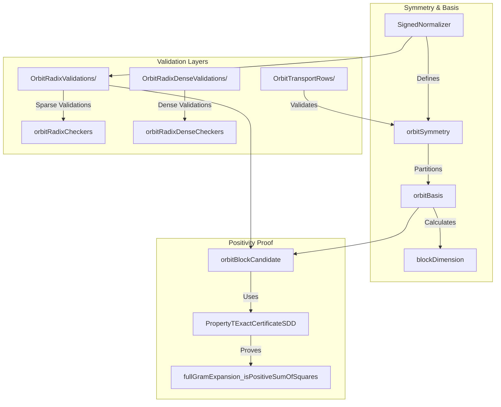
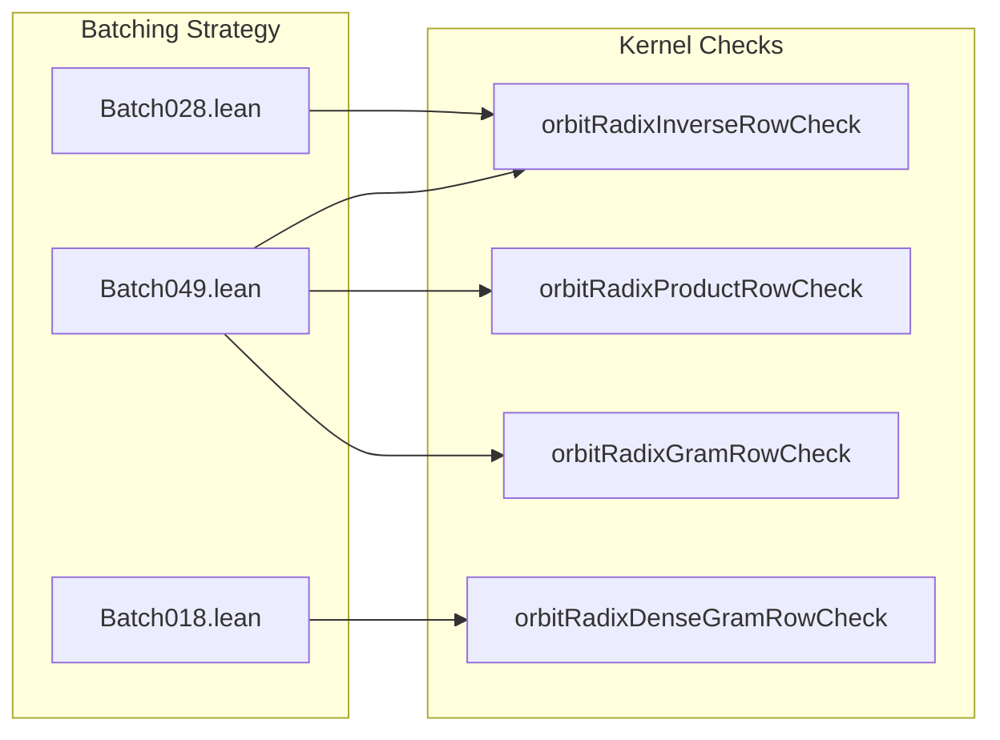

<!-- source: DeepWiki mcp.deepwiki.com · repo openai/ten-proofs · page 4 Orbit-Based Certificate Verification · fetched 2026-10-26 -->

# Orbit-Based Certificate Verification

Relevant source files

The following files were used as context for generating this wiki page:

- [ConnesRigidity/PropertyTExactCertificateOrbitRadixDenseValidations/Batch000.lean](ConnesRigidity/PropertyTExactCertificateOrbitRadixDenseValidations/Batch000.lean)
- [ConnesRigidity/PropertyTExactCertificateOrbitRadixDenseValidations/Batch001.lean](ConnesRigidity/PropertyTExactCertificateOrbitRadixDenseValidations/Batch001.lean)
- [ConnesRigidity/PropertyTExactCertificateOrbitRadixDenseValidations/Batch002.lean](ConnesRigidity/PropertyTExactCertificateOrbitRadixDenseValidations/Batch002.lean)
- [ConnesRigidity/PropertyTExactCertificateOrbitRadixDenseValidations/Batch003.lean](ConnesRigidity/PropertyTExactCertificateOrbitRadixDenseValidations/Batch003.lean)
- [ConnesRigidity/PropertyTExactCertificateOrbitRadixDenseValidations/Batch004.lean](ConnesRigidity/PropertyTExactCertificateOrbitRadixDenseValidations/Batch004.lean)
- [ConnesRigidity/PropertyTExactCertificateOrbitRadixDenseValidations/Batch005.lean](ConnesRigidity/PropertyTExactCertificateOrbitRadixDenseValidations/Batch005.lean)
- [ConnesRigidity/PropertyTExactCertificateOrbitRadixDenseValidations/Batch006.lean](ConnesRigidity/PropertyTExactCertificateOrbitRadixDenseValidations/Batch006.lean)
- [ConnesRigidity/PropertyTExactCertificateOrbitRadixDenseValidations/Batch007.lean](ConnesRigidity/PropertyTExactCertificateOrbitRadixDenseValidations/Batch007.lean)
- [ConnesRigidity/PropertyTExactCertificateOrbitRadixDenseValidations/Batch008.lean](ConnesRigidity/PropertyTExactCertificateOrbitRadixDenseValidations/Batch008.lean)
- [ConnesRigidity/PropertyTExactCertificateOrbitRadixDenseValidations/Batch009.lean](ConnesRigidity/PropertyTExactCertificateOrbitRadixDenseValidations/Batch009.lean)
- [ConnesRigidity/PropertyTExactCertificateOrbitRadixDenseValidations/Batch010.lean](ConnesRigidity/PropertyTExactCertificateOrbitRadixDenseValidations/Batch010.lean)
- [ConnesRigidity/PropertyTExactCertificateOrbitRadixDenseValidations/Batch011.lean](ConnesRigidity/PropertyTExactCertificateOrbitRadixDenseValidations/Batch011.lean)
- [ConnesRigidity/PropertyTExactCertificateOrbitRadixDenseValidations/Batch012.lean](ConnesRigidity/PropertyTExactCertificateOrbitRadixDenseValidations/Batch012.lean)
- [ConnesRigidity/PropertyTExactCertificateOrbitRadixDenseValidations/Batch013.lean](ConnesRigidity/PropertyTExactCertificateOrbitRadixDenseValidations/Batch013.lean)
- [ConnesRigidity/PropertyTExactCertificateOrbitRadixDenseValidations/Batch014.lean](ConnesRigidity/PropertyTExactCertificateOrbitRadixDenseValidations/Batch014.lean)
- [ConnesRigidity/PropertyTExactCertificateOrbitRadixDenseValidations/Batch015.lean](ConnesRigidity/PropertyTExactCertificateOrbitRadixDenseValidations/Batch015.lean)
- [ConnesRigidity/PropertyTExactCertificateOrbitRadixDenseValidations/Batch016.lean](ConnesRigidity/PropertyTExactCertificateOrbitRadixDenseValidations/Batch016.lean)
- [ConnesRigidity/PropertyTExactCertificateOrbitRadixDenseValidations/Batch017.lean](ConnesRigidity/PropertyTExactCertificateOrbitRadixDenseValidations/Batch017.lean)
- [ConnesRigidity/PropertyTExactCertificateOrbitRadixDenseValidations/Batch018.lean](ConnesRigidity/PropertyTExactCertificateOrbitRadixDenseValidations/Batch018.lean)
- [ConnesRigidity/PropertyTExactCertificateOrbitRadixDenseValidations/Batch019.lean](ConnesRigidity/PropertyTExactCertificateOrbitRadixDenseValidations/Batch019.lean)
- [ConnesRigidity/PropertyTExactCertificateOrbitRadixDenseValidations/Batch020.lean](ConnesRigidity/PropertyTExactCertificateOrbitRadixDenseValidations/Batch020.lean)
- [ConnesRigidity/PropertyTExactCertificateOrbitRadixDenseValidations/Batch021.lean](ConnesRigidity/PropertyTExactCertificateOrbitRadixDenseValidations/Batch021.lean)
- [ConnesRigidity/PropertyTExactCertificateOrbitRadixDenseValidations/Batch022.lean](ConnesRigidity/PropertyTExactCertificateOrbitRadixDenseValidations/Batch022.lean)
- [ConnesRigidity/PropertyTExactCertificateOrbitRadixDenseValidations/Batch023.lean](ConnesRigidity/PropertyTExactCertificateOrbitRadixDenseValidations/Batch023.lean)
- [ConnesRigidity/PropertyTExactCertificateOrbitRadixDenseValidations/Batch024.lean](ConnesRigidity/PropertyTExactCertificateOrbitRadixDenseValidations/Batch024.lean)
- [ConnesRigidity/PropertyTExactCertificateOrbitRadixDenseValidations/Batch025.lean](ConnesRigidity/PropertyTExactCertificateOrbitRadixDenseValidations/Batch025.lean)
- [ConnesRigidity/PropertyTExactCertificateOrbitRadixDenseValidations/Batch026.lean](ConnesRigidity/PropertyTExactCertificateOrbitRadixDenseValidations/Batch026.lean)
- [ConnesRigidity/PropertyTExactCertificateOrbitRadixDenseValidations/Batch027.lean](ConnesRigidity/PropertyTExactCertificateOrbitRadixDenseValidations/Batch027.lean)
- [ConnesRigidity/PropertyTExactCertificateOrbitRadixDenseValidations/Batch028.lean](ConnesRigidity/PropertyTExactCertificateOrbitRadixDenseValidations/Batch028.lean)
- [ConnesRigidity/PropertyTExactCertificateOrbitRadixDenseValidations/Batch029.lean](ConnesRigidity/PropertyTExactCertificateOrbitRadixDenseValidations/Batch029.lean)
- [ConnesRigidity/PropertyTExactCertificateOrbitRadixDenseValidations/Batch030.lean](ConnesRigidity/PropertyTExactCertificateOrbitRadixDenseValidations/Batch030.lean)
- [ConnesRigidity/PropertyTExactCertificateOrbitRadixDenseValidations/Batch031.lean](ConnesRigidity/PropertyTExactCertificateOrbitRadixDenseValidations/Batch031.lean)
- [ConnesRigidity/PropertyTExactCertificateOrbitRadixDenseValidations/Batch032.lean](ConnesRigidity/PropertyTExactCertificateOrbitRadixDenseValidations/Batch032.lean)
- [ConnesRigidity/PropertyTExactCertificateOrbitRadixDenseValidations/Batch033.lean](ConnesRigidity/PropertyTExactCertificateOrbitRadixDenseValidations/Batch033.lean)
- [ConnesRigidity/PropertyTExactCertificateOrbitRadixDenseValidations/Batch034.lean](ConnesRigidity/PropertyTExactCertificateOrbitRadixDenseValidations/Batch034.lean)
- [ConnesRigidity/PropertyTExactCertificateOrbitRadixDenseValidations/Batch035.lean](ConnesRigidity/PropertyTExactCertificateOrbitRadixDenseValidations/Batch035.lean)
- [ConnesRigidity/PropertyTExactCertificateOrbitRadixDenseValidations/Batch036.lean](ConnesRigidity/PropertyTExactCertificateOrbitRadixDenseValidations/Batch036.lean)
- [ConnesRigidity/PropertyTExactCertificateOrbitRadixDenseValidations/Batch037.lean](ConnesRigidity/PropertyTExactCertificateOrbitRadixDenseValidations/Batch037.lean)
- [ConnesRigidity/PropertyTExactCertificateOrbitRadixDenseValidations/Batch038.lean](ConnesRigidity/PropertyTExactCertificateOrbitRadixDenseValidations/Batch038.lean)
- [ConnesRigidity/PropertyTExactCertificateOrbitRadixDenseValidations/Batch039.lean](ConnesRigidity/PropertyTExactCertificateOrbitRadixDenseValidations/Batch039.lean)
- [ConnesRigidity/PropertyTExactCertificateOrbitRadixDenseValidations/Batch040.lean](ConnesRigidity/PropertyTExactCertificateOrbitRadixDenseValidations/Batch040.lean)
- [ConnesRigidity/PropertyTExactCertificateOrbitRadixDenseValidations/Batch041.lean](ConnesRigidity/PropertyTExactCertificateOrbitRadixDenseValidations/Batch041.lean)
- [ConnesRigidity/PropertyTExactCertificateOrbitRadixDenseValidations/Batch042.lean](ConnesRigidity/PropertyTExactCertificateOrbitRadixDenseValidations/Batch042.lean)
- [ConnesRigidity/PropertyTExactCertificateOrbitRadixDenseValidations/Batch043.lean](ConnesRigidity/PropertyTExactCertificateOrbitRadixDenseValidations/Batch043.lean)
- [ConnesRigidity/PropertyTExactCertificateOrbitRadixDenseValidations/Batch044.lean](ConnesRigidity/PropertyTExactCertificateOrbitRadixDenseValidations/Batch044.lean)
- [ConnesRigidity/PropertyTExactCertificateOrbitRadixDenseValidations/Batch045.lean](ConnesRigidity/PropertyTExactCertificateOrbitRadixDenseValidations/Batch045.lean)
- [ConnesRigidity/PropertyTExactCertificateOrbitRadixDenseValidations/Batch046.lean](ConnesRigidity/PropertyTExactCertificateOrbitRadixDenseValidations/Batch046.lean)
- [ConnesRigidity/PropertyTExactCertificateOrbitRadixDenseValidations/Batch047.lean](ConnesRigidity/PropertyTExactCertificateOrbitRadixDenseValidations/Batch047.lean)
- [ConnesRigidity/PropertyTExactCertificateOrbitRadixDenseValidations/Batch048.lean](ConnesRigidity/PropertyTExactCertificateOrbitRadixDenseValidations/Batch048.lean)
- [ConnesRigidity/PropertyTExactCertificateOrbitRadixDenseValidations/Batch049.lean](ConnesRigidity/PropertyTExactCertificateOrbitRadixDenseValidations/Batch049.lean)
- [ConnesRigidity/PropertyTExactCertificateOrbitRadixDenseValidations/Batch050.lean](ConnesRigidity/PropertyTExactCertificateOrbitRadixDenseValidations/Batch050.lean)
- [ConnesRigidity/PropertyTExactCertificateOrbitRadixDenseValidations/Batch051.lean](ConnesRigidity/PropertyTExactCertificateOrbitRadixDenseValidations/Batch051.lean)
- [ConnesRigidity/PropertyTExactCertificateOrbitRadixDenseValidations/Batch052.lean](ConnesRigidity/PropertyTExactCertificateOrbitRadixDenseValidations/Batch052.lean)
- [ConnesRigidity/PropertyTExactCertificateOrbitRadixValidations/Batch000.lean](ConnesRigidity/PropertyTExactCertificateOrbitRadixValidations/Batch000.lean)
- [ConnesRigidity/PropertyTExactCertificateOrbitRadixValidations/Batch001.lean](ConnesRigidity/PropertyTExactCertificateOrbitRadixValidations/Batch001.lean)
- [ConnesRigidity/PropertyTExactCertificateOrbitRadixValidations/Batch002.lean](ConnesRigidity/PropertyTExactCertificateOrbitRadixValidations/Batch002.lean)
- [ConnesRigidity/PropertyTExactCertificateOrbitRadixValidations/Batch003.lean](ConnesRigidity/PropertyTExactCertificateOrbitRadixValidations/Batch003.lean)
- [ConnesRigidity/PropertyTExactCertificateOrbitRadixValidations/Batch004.lean](ConnesRigidity/PropertyTExactCertificateOrbitRadixValidations/Batch004.lean)
- [ConnesRigidity/PropertyTExactCertificateOrbitRadixValidations/Batch005.lean](ConnesRigidity/PropertyTExactCertificateOrbitRadixValidations/Batch005.lean)
- [ConnesRigidity/PropertyTExactCertificateOrbitRadixValidations/Batch006.lean](ConnesRigidity/PropertyTExactCertificateOrbitRadixValidations/Batch006.lean)
- [ConnesRigidity/PropertyTExactCertificateOrbitRadixValidations/Batch007.lean](ConnesRigidity/PropertyTExactCertificateOrbitRadixValidations/Batch007.lean)
- [ConnesRigidity/PropertyTExactCertificateOrbitRadixValidations/Batch008.lean](ConnesRigidity/PropertyTExactCertificateOrbitRadixValidations/Batch008.lean)
- [ConnesRigidity/PropertyTExactCertificateOrbitRadixValidations/Batch009.lean](ConnesRigidity/PropertyTExactCertificateOrbitRadixValidations/Batch009.lean)
- [ConnesRigidity/PropertyTExactCertificateOrbitRadixValidations/Batch010.lean](ConnesRigidity/PropertyTExactCertificateOrbitRadixValidations/Batch010.lean)
- [ConnesRigidity/PropertyTExactCertificateOrbitRadixValidations/Batch011.lean](ConnesRigidity/PropertyTExactCertificateOrbitRadixValidations/Batch011.lean)
- [ConnesRigidity/PropertyTExactCertificateOrbitRadixValidations/Batch012.lean](ConnesRigidity/PropertyTExactCertificateOrbitRadixValidations/Batch012.lean)
- [ConnesRigidity/PropertyTExactCertificateOrbitRadixValidations/Batch013.lean](ConnesRigidity/PropertyTExactCertificateOrbitRadixValidations/Batch013.lean)
- [ConnesRigidity/PropertyTExactCertificateOrbitRadixValidations/Batch014.lean](ConnesRigidity/PropertyTExactCertificateOrbitRadixValidations/Batch014.lean)
- [ConnesRigidity/PropertyTExactCertificateOrbitRadixValidations/Batch015.lean](ConnesRigidity/PropertyTExactCertificateOrbitRadixValidations/Batch015.lean)
- [ConnesRigidity/PropertyTExactCertificateOrbitRadixValidations/Batch016.lean](ConnesRigidity/PropertyTExactCertificateOrbitRadixValidations/Batch016.lean)
- [ConnesRigidity/PropertyTExactCertificateOrbitRadixValidations/Batch017.lean](ConnesRigidity/PropertyTExactCertificateOrbitRadixValidations/Batch017.lean)
- [ConnesRigidity/PropertyTExactCertificateOrbitRadixValidations/Batch018.lean](ConnesRigidity/PropertyTExactCertificateOrbitRadixValidations/Batch018.lean)
- [ConnesRigidity/PropertyTExactCertificateOrbitRadixValidations/Batch019.lean](ConnesRigidity/PropertyTExactCertificateOrbitRadixValidations/Batch019.lean)
- [ConnesRigidity/PropertyTExactCertificateOrbitRadixValidations/Batch020.lean](ConnesRigidity/PropertyTExactCertificateOrbitRadixValidations/Batch020.lean)
- [ConnesRigidity/PropertyTExactCertificateOrbitRadixValidations/Batch021.lean](ConnesRigidity/PropertyTExactCertificateOrbitRadixValidations/Batch021.lean)
- [ConnesRigidity/PropertyTExactCertificateOrbitRadixValidations/Batch022.lean](ConnesRigidity/PropertyTExactCertificateOrbitRadixValidations/Batch022.lean)
- [ConnesRigidity/PropertyTExactCertificateOrbitRadixValidations/Batch023.lean](ConnesRigidity/PropertyTExactCertificateOrbitRadixValidations/Batch023.lean)
- [ConnesRigidity/PropertyTExactCertificateOrbitRadixValidations/Batch024.lean](ConnesRigidity/PropertyTExactCertificateOrbitRadixValidations/Batch024.lean)
- [ConnesRigidity/PropertyTExactCertificateOrbitRadixValidations/Batch025.lean](ConnesRigidity/PropertyTExactCertificateOrbitRadixValidations/Batch025.lean)
- [ConnesRigidity/PropertyTExactCertificateOrbitRadixValidations/Batch026.lean](ConnesRigidity/PropertyTExactCertificateOrbitRadixValidations/Batch026.lean)
- [ConnesRigidity/PropertyTExactCertificateOrbitRadixValidations/Batch027.lean](ConnesRigidity/PropertyTExactCertificateOrbitRadixValidations/Batch027.lean)
- [ConnesRigidity/PropertyTExactCertificateOrbitRadixValidations/Batch028.lean](ConnesRigidity/PropertyTExactCertificateOrbitRadixValidations/Batch028.lean)
- [ConnesRigidity/PropertyTExactCertificateOrbitRadixValidations/Batch029.lean](ConnesRigidity/PropertyTExactCertificateOrbitRadixValidations/Batch029.lean)
- [ConnesRigidity/PropertyTExactCertificateOrbitRadixValidations/Batch030.lean](ConnesRigidity/PropertyTExactCertificateOrbitRadixValidations/Batch030.lean)
- [ConnesRigidity/PropertyTExactCertificateOrbitRadixValidations/Batch031.lean](ConnesRigidity/PropertyTExactCertificateOrbitRadixValidations/Batch031.lean)
- [ConnesRigidity/PropertyTExactCertificateOrbitRadixValidations/Batch032.lean](ConnesRigidity/PropertyTExactCertificateOrbitRadixValidations/Batch032.lean)
- [ConnesRigidity/PropertyTExactCertificateOrbitRadixValidations/Batch033.lean](ConnesRigidity/PropertyTExactCertificateOrbitRadixValidations/Batch033.lean)
- [ConnesRigidity/PropertyTExactCertificateOrbitRadixValidations/Batch034.lean](ConnesRigidity/PropertyTExactCertificateOrbitRadixValidations/Batch034.lean)
- [ConnesRigidity/PropertyTExactCertificateOrbitRadixValidations/Batch035.lean](ConnesRigidity/PropertyTExactCertificateOrbitRadixValidations/Batch035.lean)
- [ConnesRigidity/PropertyTExactCertificateOrbitRadixValidations/Batch036.lean](ConnesRigidity/PropertyTExactCertificateOrbitRadixValidations/Batch036.lean)
- [ConnesRigidity/PropertyTExactCertificateOrbitRadixValidations/Batch037.lean](ConnesRigidity/PropertyTExactCertificateOrbitRadixValidations/Batch037.lean)
- [ConnesRigidity/PropertyTExactCertificateOrbitRadixValidations/Batch038.lean](ConnesRigidity/PropertyTExactCertificateOrbitRadixValidations/Batch038.lean)
- [ConnesRigidity/PropertyTExactCertificateOrbitRadixValidations/Batch039.lean](ConnesRigidity/PropertyTExactCertificateOrbitRadixValidations/Batch039.lean)
- [ConnesRigidity/PropertyTExactCertificateOrbitRadixValidations/Batch040.lean](ConnesRigidity/PropertyTExactCertificateOrbitRadixValidations/Batch040.lean)
- [ConnesRigidity/PropertyTExactCertificateOrbitRadixValidations/Batch041.lean](ConnesRigidity/PropertyTExactCertificateOrbitRadixValidations/Batch041.lean)
- [ConnesRigidity/PropertyTExactCertificateOrbitRadixValidations/Batch042.lean](ConnesRigidity/PropertyTExactCertificateOrbitRadixValidations/Batch042.lean)
- [ConnesRigidity/PropertyTExactCertificateOrbitRadixValidations/Batch043.lean](ConnesRigidity/PropertyTExactCertificateOrbitRadixValidations/Batch043.lean)
- [ConnesRigidity/PropertyTExactCertificateOrbitRadixValidations/Batch044.lean](ConnesRigidity/PropertyTExactCertificateOrbitRadixValidations/Batch044.lean)
- [ConnesRigidity/PropertyTExactCertificateOrbitRadixValidations/Batch045.lean](ConnesRigidity/PropertyTExactCertificateOrbitRadixValidations/Batch045.lean)
- [ConnesRigidity/PropertyTExactCertificateOrbitRadixValidations/Batch046.lean](ConnesRigidity/PropertyTExactCertificateOrbitRadixValidations/Batch046.lean)
- [ConnesRigidity/PropertyTExactCertificateOrbitRadixValidations/Batch047.lean](ConnesRigidity/PropertyTExactCertificateOrbitRadixValidations/Batch047.lean)
- [ConnesRigidity/PropertyTExactCertificateOrbitRadixValidations/Batch048.lean](ConnesRigidity/PropertyTExactCertificateOrbitRadixValidations/Batch048.lean)
- [ConnesRigidity/PropertyTExactCertificateOrbitRadixValidations/Batch049.lean](ConnesRigidity/PropertyTExactCertificateOrbitRadixValidations/Batch049.lean)
- [ConnesRigidity/PropertyTExactCertificateOrbitRadixValidations/Batch050.lean](ConnesRigidity/PropertyTExactCertificateOrbitRadixValidations/Batch050.lean)
- [ConnesRigidity/PropertyTExactCertificateOrbitRadixValidations/Batch051.lean](ConnesRigidity/PropertyTExactCertificateOrbitRadixValidations/Batch051.lean)
- [ConnesRigidity/PropertyTExactCertificateOrbitRadixValidations/Batch052.lean](ConnesRigidity/PropertyTExactCertificateOrbitRadixValidations/Batch052.lean)
- [ConnesRigidity/PropertyTExactCertificateOrbitTransportRows/Row000.lean](ConnesRigidity/PropertyTExactCertificateOrbitTransportRows/Row000.lean)
- [ConnesRigidity/PropertyTExactCertificateOrbitTransportRows/Row001.lean](ConnesRigidity/PropertyTExactCertificateOrbitTransportRows/Row001.lean)
- [ConnesRigidity/PropertyTExactCertificateOrbitTransportRows/Row002.lean](ConnesRigidity/PropertyTExactCertificateOrbitTransportRows/Row002.lean)
- [ConnesRigidity/PropertyTExactCertificateOrbitTransportRows/Row003.lean](ConnesRigidity/PropertyTExactCertificateOrbitTransportRows/Row003.lean)
- [ConnesRigidity/PropertyTExactCertificateOrbitTransportRows/Row004.lean](ConnesRigidity/PropertyTExactCertificateOrbitTransportRows/Row004.lean)
- [ConnesRigidity/PropertyTExactCertificateOrbitTransportRows/Row005.lean](ConnesRigidity/PropertyTExactCertificateOrbitTransportRows/Row005.lean)
- [ConnesRigidity/PropertyTExactCertificateOrbitTransportRows/Row006.lean](ConnesRigidity/PropertyTExactCertificateOrbitTransportRows/Row006.lean)
- [ConnesRigidity/PropertyTExactCertificateOrbitTransportRows/Row008.lean](ConnesRigidity/PropertyTExactCertificateOrbitTransportRows/Row008.lean)
- [ConnesRigidity/PropertyTExactCertificateOrbitTransportRows/Row010.lean](ConnesRigidity/PropertyTExactCertificateOrbitTransportRows/Row010.lean)
- [ConnesRigidity/PropertyTExactCertificateOrbitTransportRows/Row011.lean](ConnesRigidity/PropertyTExactCertificateOrbitTransportRows/Row011.lean)
- [ConnesRigidity/PropertyTExactCertificateOrbitTransportRows/Row012.lean](ConnesRigidity/PropertyTExactCertificateOrbitTransportRows/Row012.lean)
- [ConnesRigidity/PropertyTExactCertificateOrbitTransportRows/Row013.lean](ConnesRigidity/PropertyTExactCertificateOrbitTransportRows/Row013.lean)
- [ConnesRigidity/PropertyTExactCertificateOrbitTransportRows/Row014.lean](ConnesRigidity/PropertyTExactCertificateOrbitTransportRows/Row014.lean)
- [ConnesRigidity/PropertyTExactCertificateOrbitTransportRows/Row018.lean](ConnesRigidity/PropertyTExactCertificateOrbitTransportRows/Row018.lean)
- [ConnesRigidity/PropertyTExactCertificateOrbitTransportRows/Row019.lean](ConnesRigidity/PropertyTExactCertificateOrbitTransportRows/Row019.lean)
- [ConnesRigidity/PropertyTExactCertificateOrbitTransportRows/Row020.lean](ConnesRigidity/PropertyTExactCertificateOrbitTransportRows/Row020.lean)
- [ConnesRigidity/PropertyTExactCertificateOrbitTransportRows/Row021.lean](ConnesRigidity/PropertyTExactCertificateOrbitTransportRows/Row021.lean)
- [ConnesRigidity/PropertyTExactCertificateOrbitTransportRows/Row023.lean](ConnesRigidity/PropertyTExactCertificateOrbitTransportRows/Row023.lean)
- [ConnesRigidity/PropertyTExactCertificateOrbitTransportRows/Row024.lean](ConnesRigidity/PropertyTExactCertificateOrbitTransportRows/Row024.lean)
- [ConnesRigidity/PropertyTExactCertificateOrbitTransportRows/Row026.lean](ConnesRigidity/PropertyTExactCertificateOrbitTransportRows/Row026.lean)
- [ConnesRigidity/PropertyTExactCertificateOrbitTransportRows/Row027.lean](ConnesRigidity/PropertyTExactCertificateOrbitTransportRows/Row027.lean)
- [ConnesRigidity/PropertyTExactCertificateOrbitTransportRows/Row028.lean](ConnesRigidity/PropertyTExactCertificateOrbitTransportRows/Row028.lean)
- [ConnesRigidity/PropertyTExactCertificateOrbitTransportRows/Row029.lean](ConnesRigidity/PropertyTExactCertificateOrbitTransportRows/Row029.lean)
- [ConnesRigidity/PropertyTExactCertificateOrbitTransportRows/Row030.lean](ConnesRigidity/PropertyTExactCertificateOrbitTransportRows/Row030.lean)
- [ConnesRigidity/PropertyTExactCertificateOrbitTransportRows/Row032.lean](ConnesRigidity/PropertyTExactCertificateOrbitTransportRows/Row032.lean)
- [ConnesRigidity/PropertyTExactCertificateOrbitTransportRows/Row033.lean](ConnesRigidity/PropertyTExactCertificateOrbitTransportRows/Row033.lean)
- [ConnesRigidity/PropertyTExactCertificateOrbitTransportRows/Row034.lean](ConnesRigidity/PropertyTExactCertificateOrbitTransportRows/Row034.lean)
- [ConnesRigidity/PropertyTExactCertificateOrbitTransportRows/Row035.lean](ConnesRigidity/PropertyTExactCertificateOrbitTransportRows/Row035.lean)
- [ConnesRigidity/PropertyTExactCertificateOrbitTransportRows/Row036.lean](ConnesRigidity/PropertyTExactCertificateOrbitTransportRows/Row036.lean)
- [ConnesRigidity/PropertyTExactCertificateOrbitTransportRows/Row037.lean](ConnesRigidity/PropertyTExactCertificateOrbitTransportRows/Row037.lean)
- [ConnesRigidity/PropertyTExactCertificateOrbitTransportRows/Row038.lean](ConnesRigidity/PropertyTExactCertificateOrbitTransportRows/Row038.lean)
- [ConnesRigidity/PropertyTExactCertificateOrbitTransportRows/Row039.lean](ConnesRigidity/PropertyTExactCertificateOrbitTransportRows/Row039.lean)
- [ConnesRigidity/PropertyTExactCertificateOrbitTransportRows/Row041.lean](ConnesRigidity/PropertyTExactCertificateOrbitTransportRows/Row041.lean)
- [ConnesRigidity/PropertyTExactCertificateOrbitTransportRows/Row042.lean](ConnesRigidity/PropertyTExactCertificateOrbitTransportRows/Row042.lean)
- [ConnesRigidity/PropertyTExactCertificateOrbitTransportRows/Row043.lean](ConnesRigidity/PropertyTExactCertificateOrbitTransportRows/Row043.lean)
- [ConnesRigidity/PropertyTExactCertificateOrbitTransportRows/Row044.lean](ConnesRigidity/PropertyTExactCertificateOrbitTransportRows/Row044.lean)
- [ConnesRigidity/PropertyTExactCertificateOrbitTransportRows/Row045.lean](ConnesRigidity/PropertyTExactCertificateOrbitTransportRows/Row045.lean)
- [ConnesRigidity/PropertyTExactCertificateOrbitTransportRows/Row046.lean](ConnesRigidity/PropertyTExactCertificateOrbitTransportRows/Row046.lean)
- [ConnesRigidity/PropertyTExactCertificateOrbitTransportRows/Row047.lean](ConnesRigidity/PropertyTExactCertificateOrbitTransportRows/Row047.lean)
- [ConnesRigidity/PropertyTExactCertificateOrbitTransportRows/Row048.lean](ConnesRigidity/PropertyTExactCertificateOrbitTransportRows/Row048.lean)
- [ConnesRigidity/PropertyTExactCertificateOrbitTransportRows/Row049.lean](ConnesRigidity/PropertyTExactCertificateOrbitTransportRows/Row049.lean)
- [ConnesRigidity/PropertyTExactCertificateOrbitTransportRows/Row050.lean](ConnesRigidity/PropertyTExactCertificateOrbitTransportRows/Row050.lean)
- [ConnesRigidity/PropertyTExactCertificateOrbitTransportRows/Row051.lean](ConnesRigidity/PropertyTExactCertificateOrbitTransportRows/Row051.lean)
- [ConnesRigidity/PropertyTExactCertificateOrbitTransportRows/Row052.lean](ConnesRigidity/PropertyTExactCertificateOrbitTransportRows/Row052.lean)
- [ConnesRigidity/PropertyTExactCertificateOrbitTransportRows/Row053.lean](ConnesRigidity/PropertyTExactCertificateOrbitTransportRows/Row053.lean)
- [ConnesRigidity/PropertyTExactCertificateOrbitTransportRows/Row054.lean](ConnesRigidity/PropertyTExactCertificateOrbitTransportRows/Row054.lean)
- [ConnesRigidity/PropertyTExactCertificateOrbitTransportRows/Row055.lean](ConnesRigidity/PropertyTExactCertificateOrbitTransportRows/Row055.lean)
- [ConnesRigidity/PropertyTExactCertificateOrbitTransportRows/Row056.lean](ConnesRigidity/PropertyTExactCertificateOrbitTransportRows/Row056.lean)
- [ConnesRigidity/PropertyTExactCertificateOrbitTransportRows/Row057.lean](ConnesRigidity/PropertyTExactCertificateOrbitTransportRows/Row057.lean)
- [ConnesRigidity/PropertyTExactCertificateOrbitTransportRows/Row063.lean](ConnesRigidity/PropertyTExactCertificateOrbitTransportRows/Row063.lean)

This page provides an overview of the orbit decomposition approach used to verify the Property T certificate for the group $\Gamma_0$. The core challenge in verifying the spectral gap for $\Gamma_0$ is the size of the Gram matrix: a direct $425 \times 425$ matrix verification is computationally expensive and difficult to represent in a purely symbolic exact certificate. By exploiting the 64-element symmetry group of $\Gamma_0$, the problem is reduced to verifying 28 smaller blocks, significantly lowering the computational burden on the Lean kernel.

### Symmetry-Aware Verification Architecture

The orbit verification system maps the 425-element basis of the group ring into orbits under the action of a symmetry group. This transformation allows the full Gram matrix to be represented as a block-diagonal matrix in the orbit basis.

#### System Component Mapping
The following diagram bridges the mathematical concept of orbit decomposition to the specific Lean entities and validation batches.

**Orbit System Architecture**

Sources: [ConnesRigidity/PropertyTExactCertificateOrbitTransportRows/Row053.lean:9-11](), [ConnesRigidity/PropertyTExactCertificateOrbitRadixValidations/Batch049.lean:10-43]()

---

### Orbit Structure and Symmetry
The 425 elements are partitioned into orbits under a 64-element symmetry group. This group is derived from the `SignedNormalizer` of the group generators. The verification process involves checking that the symmetry action is correctly applied across all basis elements, ensuring the averaging argument (group ring symmetry average) is sound.

For details on the group action, block dimensions, and the elementary generators of $\Gamma_0$, see **[Orbit Structure and Symmetry](#4.1)**.

### Orbit Block Certificate and Positivity
The certificate is constructed by defining an `orbitBlockCandidate` for each of the 28 blocks. Instead of a single massive PSD check, the system uses a Strictly Diagonally Dominant (SDD) argument to prove positivity. This ensures that the `orbitAveragedCertificate` represents a valid sum of squares in the group ring.

For details on the block-diagonal construction and the SDD positivity theorems, see **[Orbit Block Certificate and Positivity](#4.2)**.

### Orbit Coefficient and Transport Validation
Validation is performed in batches using a radix-based trie system to handle sparse coefficient data efficiently. The `OrbitTransportRows` validate the mapping of group elements under the symmetry action, while `OrbitRadixValidations` verify the incidence of coefficients within the orbit blocks.

**Batch Validation Logic**

Sources: [ConnesRigidity/PropertyTExactCertificateOrbitRadixValidations/Batch049.lean:10-43](), [ConnesRigidity/PropertyTExactCertificateOrbitRadixDenseValidations/Batch018.lean:10-48]()

For details on the transport rows and the radix-based validation of coefficients, see **[Orbit Coefficient and Transport Validation](#4.3)**.

### Orbit Canonical Form and Validations
To maintain a consistent representation, every element in an orbit is mapped to a "canonical form" using a lexicographical ordering. The system validates these mappings through `OrbitCanonicalPackedValidations` and `OrbitCanonicalLexValidations`, ensuring that the orbit representatives are unique and correctly calculated.

For details on the lex-order canonical form and packed action validations, see **[Orbit Canonical Form and Canonical Validations](#4.4)**.

---
### Technical Implementation Notes
*   **Kernel Efficiency**: The use of `decide +kernel` is central to this module. Large theorems are broken into batches (e.g., `Batch049.lean`, `Batch018.lean`) to prevent kernel timeouts.
*   **Memory Management**: Options like `set_option maxHeartbeats 64000000` and `set_option maxRecDepth 1000000` are frequently employed in the validation files to accommodate the depth of the radix trie lookups.

Sources: [ConnesRigidity/PropertyTExactCertificateOrbitRadixValidations/Batch049.lean:6-9](), [ConnesRigidity/PropertyTExactCertificateOrbitTransportRows/Row053.lean:6-7]()

---

