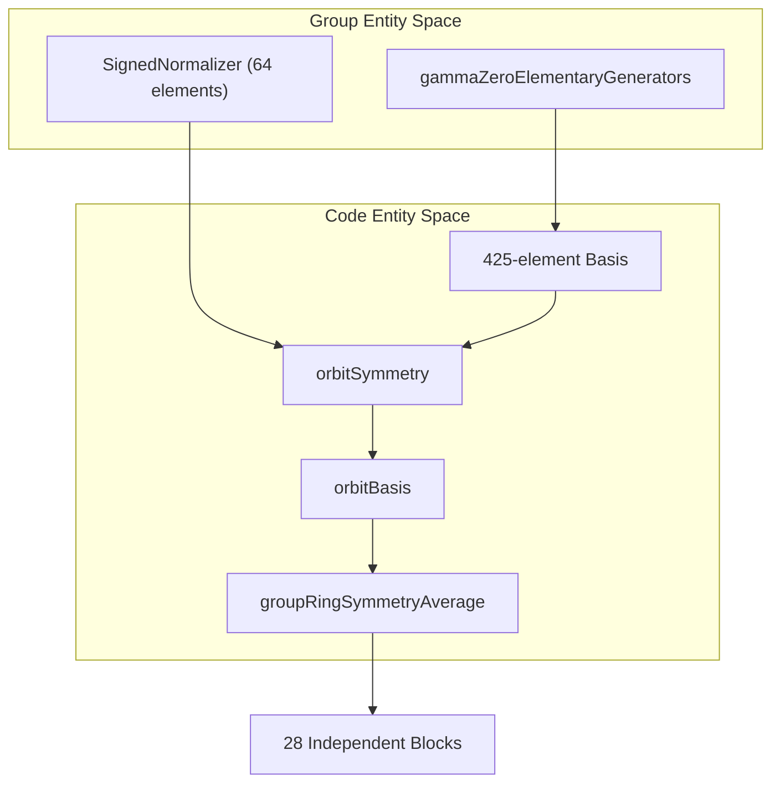
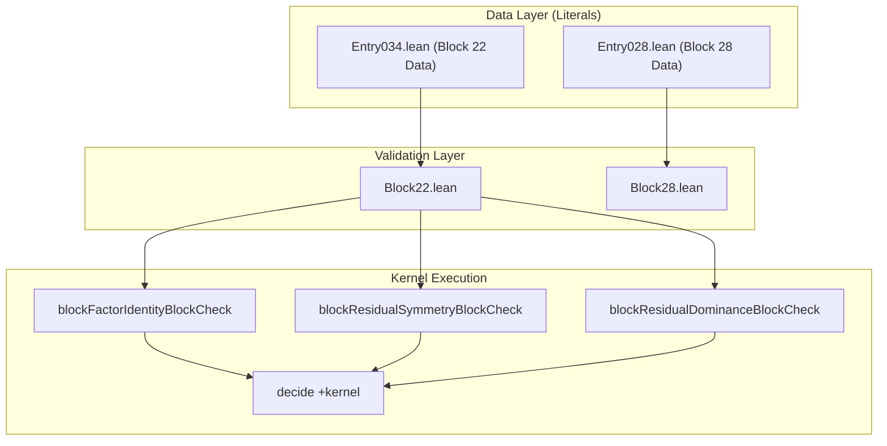

<!-- source: DeepWiki mcp.deepwiki.com · repo openai/ten-proofs · page 4.1 Orbit Structure and Symmetry · fetched 2026-10-26 -->

# Orbit Structure and Symmetry

Relevant source files

The following files were used as context for generating this wiki page:

- [ConnesRigidity/CertificateLiterals/PropertyTExactCertificateCoefficientEdgePackets/Positive266/Entry000.lean](ConnesRigidity/CertificateLiterals/PropertyTExactCertificateCoefficientEdgePackets/Positive266/Entry000.lean)
- [ConnesRigidity/CertificateLiterals/PropertyTExactCertificateOrbitBlockLocalData/Entry003.lean](ConnesRigidity/CertificateLiterals/PropertyTExactCertificateOrbitBlockLocalData/Entry003.lean)
- [ConnesRigidity/CertificateLiterals/PropertyTExactCertificateOrbitBlockLocalData/Entry004.lean](ConnesRigidity/CertificateLiterals/PropertyTExactCertificateOrbitBlockLocalData/Entry004.lean)
- [ConnesRigidity/CertificateLiterals/PropertyTExactCertificateOrbitBlockLocalData/Entry005.lean](ConnesRigidity/CertificateLiterals/PropertyTExactCertificateOrbitBlockLocalData/Entry005.lean)
- [ConnesRigidity/CertificateLiterals/PropertyTExactCertificateOrbitBlockLocalData/Entry011.lean](ConnesRigidity/CertificateLiterals/PropertyTExactCertificateOrbitBlockLocalData/Entry011.lean)
- [ConnesRigidity/CertificateLiterals/PropertyTExactCertificateOrbitBlockLocalData/Entry012.lean](ConnesRigidity/CertificateLiterals/PropertyTExactCertificateOrbitBlockLocalData/Entry012.lean)
- [ConnesRigidity/CertificateLiterals/PropertyTExactCertificateOrbitBlockLocalData/Entry013.lean](ConnesRigidity/CertificateLiterals/PropertyTExactCertificateOrbitBlockLocalData/Entry013.lean)
- [ConnesRigidity/CertificateLiterals/PropertyTExactCertificateOrbitBlockLocalData/Entry014.lean](ConnesRigidity/CertificateLiterals/PropertyTExactCertificateOrbitBlockLocalData/Entry014.lean)
- [ConnesRigidity/CertificateLiterals/PropertyTExactCertificateOrbitBlockLocalData/Entry015.lean](ConnesRigidity/CertificateLiterals/PropertyTExactCertificateOrbitBlockLocalData/Entry015.lean)
- [ConnesRigidity/CertificateLiterals/PropertyTExactCertificateOrbitBlockLocalData/Entry016.lean](ConnesRigidity/CertificateLiterals/PropertyTExactCertificateOrbitBlockLocalData/Entry016.lean)
- [ConnesRigidity/CertificateLiterals/PropertyTExactCertificateOrbitBlockLocalData/Entry017.lean](ConnesRigidity/CertificateLiterals/PropertyTExactCertificateOrbitBlockLocalData/Entry017.lean)
- [ConnesRigidity/CertificateLiterals/PropertyTExactCertificateOrbitBlockLocalData/Entry018.lean](ConnesRigidity/CertificateLiterals/PropertyTExactCertificateOrbitBlockLocalData/Entry018.lean)
- [ConnesRigidity/CertificateLiterals/PropertyTExactCertificateOrbitBlockLocalData/Entry019.lean](ConnesRigidity/CertificateLiterals/PropertyTExactCertificateOrbitBlockLocalData/Entry019.lean)
- [ConnesRigidity/CertificateLiterals/PropertyTExactCertificateOrbitBlockLocalData/Entry020.lean](ConnesRigidity/CertificateLiterals/PropertyTExactCertificateOrbitBlockLocalData/Entry020.lean)
- [ConnesRigidity/CertificateLiterals/PropertyTExactCertificateOrbitBlockLocalData/Entry021.lean](ConnesRigidity/CertificateLiterals/PropertyTExactCertificateOrbitBlockLocalData/Entry021.lean)
- [ConnesRigidity/CertificateLiterals/PropertyTExactCertificateOrbitBlockLocalData/Entry022.lean](ConnesRigidity/CertificateLiterals/PropertyTExactCertificateOrbitBlockLocalData/Entry022.lean)
- [ConnesRigidity/CertificateLiterals/PropertyTExactCertificateOrbitBlockLocalData/Entry023.lean](ConnesRigidity/CertificateLiterals/PropertyTExactCertificateOrbitBlockLocalData/Entry023.lean)
- [ConnesRigidity/CertificateLiterals/PropertyTExactCertificateOrbitBlockLocalData/Entry026.lean](ConnesRigidity/CertificateLiterals/PropertyTExactCertificateOrbitBlockLocalData/Entry026.lean)
- [ConnesRigidity/CertificateLiterals/PropertyTExactCertificateOrbitBlockLocalData/Entry027.lean](ConnesRigidity/CertificateLiterals/PropertyTExactCertificateOrbitBlockLocalData/Entry027.lean)
- [ConnesRigidity/CertificateLiterals/PropertyTExactCertificateOrbitBlockLocalData/Entry028.lean](ConnesRigidity/CertificateLiterals/PropertyTExactCertificateOrbitBlockLocalData/Entry028.lean)
- [ConnesRigidity/CertificateLiterals/PropertyTExactCertificateOrbitBlockLocalData/Entry029.lean](ConnesRigidity/CertificateLiterals/PropertyTExactCertificateOrbitBlockLocalData/Entry029.lean)
- [ConnesRigidity/CertificateLiterals/PropertyTExactCertificateOrbitBlockLocalData/Entry030.lean](ConnesRigidity/CertificateLiterals/PropertyTExactCertificateOrbitBlockLocalData/Entry030.lean)
- [ConnesRigidity/CertificateLiterals/PropertyTExactCertificateOrbitBlockLocalData/Entry031.lean](ConnesRigidity/CertificateLiterals/PropertyTExactCertificateOrbitBlockLocalData/Entry031.lean)
- [ConnesRigidity/CertificateLiterals/PropertyTExactCertificateOrbitBlockLocalData/Entry032.lean](ConnesRigidity/CertificateLiterals/PropertyTExactCertificateOrbitBlockLocalData/Entry032.lean)
- [ConnesRigidity/CertificateLiterals/PropertyTExactCertificateOrbitBlockLocalData/Entry033.lean](ConnesRigidity/CertificateLiterals/PropertyTExactCertificateOrbitBlockLocalData/Entry033.lean)
- [ConnesRigidity/CertificateLiterals/PropertyTExactCertificateOrbitBlockLocalData/Entry034.lean](ConnesRigidity/CertificateLiterals/PropertyTExactCertificateOrbitBlockLocalData/Entry034.lean)
- [ConnesRigidity/CertificateLiterals/PropertyTExactCertificateOrbitBlockLocalData/Entry035.lean](ConnesRigidity/CertificateLiterals/PropertyTExactCertificateOrbitBlockLocalData/Entry035.lean)
- [ConnesRigidity/CertificateLiterals/PropertyTExactCertificateOrbitBlockLocalData/Entry036.lean](ConnesRigidity/CertificateLiterals/PropertyTExactCertificateOrbitBlockLocalData/Entry036.lean)
- [ConnesRigidity/CertificateLiterals/PropertyTExactCertificateOrbitBlockLocalData/Entry037.lean](ConnesRigidity/CertificateLiterals/PropertyTExactCertificateOrbitBlockLocalData/Entry037.lean)
- [ConnesRigidity/CertificateLiterals/PropertyTExactCertificateOrbitBlockLocalData/Entry038.lean](ConnesRigidity/CertificateLiterals/PropertyTExactCertificateOrbitBlockLocalData/Entry038.lean)
- [ConnesRigidity/CertificateLiterals/PropertyTExactCertificateOrbitBlockLocalData/Entry039.lean](ConnesRigidity/CertificateLiterals/PropertyTExactCertificateOrbitBlockLocalData/Entry039.lean)
- [ConnesRigidity/CertificateLiterals/PropertyTExactCertificateOrbitBlockLocalData/Entry040.lean](ConnesRigidity/CertificateLiterals/PropertyTExactCertificateOrbitBlockLocalData/Entry040.lean)
- [ConnesRigidity/CertificateLiterals/PropertyTExactCertificateOrbitBlockLocalData/Entry041.lean](ConnesRigidity/CertificateLiterals/PropertyTExactCertificateOrbitBlockLocalData/Entry041.lean)
- [ConnesRigidity/CertificateLiterals/PropertyTExactCertificateOrbitBlockLocalData/Entry054.lean](ConnesRigidity/CertificateLiterals/PropertyTExactCertificateOrbitBlockLocalData/Entry054.lean)
- [ConnesRigidity/CertificateLiterals/PropertyTExactCertificateOrbitBlockLocalData/Entry055.lean](ConnesRigidity/CertificateLiterals/PropertyTExactCertificateOrbitBlockLocalData/Entry055.lean)
- [ConnesRigidity/CertificateLiterals/PropertyTExactCertificateOrbitBlockLocalData/Entry056.lean](ConnesRigidity/CertificateLiterals/PropertyTExactCertificateOrbitBlockLocalData/Entry056.lean)
- [ConnesRigidity/CertificateLiterals/PropertyTExactCertificateOrbitBlockLocalData/Entry057.lean](ConnesRigidity/CertificateLiterals/PropertyTExactCertificateOrbitBlockLocalData/Entry057.lean)
- [ConnesRigidity/CertificateLiterals/PropertyTExactCertificateOrbitBlockLocalData/Entry058.lean](ConnesRigidity/CertificateLiterals/PropertyTExactCertificateOrbitBlockLocalData/Entry058.lean)
- [ConnesRigidity/CertificateLiterals/PropertyTExactCertificateOrbitBlockLocalData/Entry059.lean](ConnesRigidity/CertificateLiterals/PropertyTExactCertificateOrbitBlockLocalData/Entry059.lean)
- [ConnesRigidity/CertificateLiterals/PropertyTExactCertificateOrbitBlockLocalData/Entry060.lean](ConnesRigidity/CertificateLiterals/PropertyTExactCertificateOrbitBlockLocalData/Entry060.lean)
- [ConnesRigidity/CertificateLiterals/PropertyTExactCertificateOrbitBlockLocalData/Entry061.lean](ConnesRigidity/CertificateLiterals/PropertyTExactCertificateOrbitBlockLocalData/Entry061.lean)
- [ConnesRigidity/CertificateLiterals/PropertyTExactCertificateOrbitBlockLocalData/Entry062.lean](ConnesRigidity/CertificateLiterals/PropertyTExactCertificateOrbitBlockLocalData/Entry062.lean)
- [ConnesRigidity/CertificateLiterals/PropertyTExactCertificateOrbitBlockLocalData/Entry063.lean](ConnesRigidity/CertificateLiterals/PropertyTExactCertificateOrbitBlockLocalData/Entry063.lean)
- [ConnesRigidity/CertificateLiterals/PropertyTExactCertificateOrbitBlockLocalData/Entry064.lean](ConnesRigidity/CertificateLiterals/PropertyTExactCertificateOrbitBlockLocalData/Entry064.lean)
- [ConnesRigidity/CertificateLiterals/PropertyTExactCertificateOrbitBlockLocalData/Entry065.lean](ConnesRigidity/CertificateLiterals/PropertyTExactCertificateOrbitBlockLocalData/Entry065.lean)
- [ConnesRigidity/CertificateLiterals/PropertyTExactCertificateOrbitBlockLocalData/Entry067.lean](ConnesRigidity/CertificateLiterals/PropertyTExactCertificateOrbitBlockLocalData/Entry067.lean)
- [ConnesRigidity/CertificateLiterals/PropertyTExactCertificateOrbitBlockLocalData/Entry068.lean](ConnesRigidity/CertificateLiterals/PropertyTExactCertificateOrbitBlockLocalData/Entry068.lean)
- [ConnesRigidity/CertificateLiterals/PropertyTExactCertificateOrbitBlockLocalData/Entry070.lean](ConnesRigidity/CertificateLiterals/PropertyTExactCertificateOrbitBlockLocalData/Entry070.lean)
- [ConnesRigidity/CertificateLiterals/PropertyTExactCertificateOrbitBlockLocalData/Entry074.lean](ConnesRigidity/CertificateLiterals/PropertyTExactCertificateOrbitBlockLocalData/Entry074.lean)
- [ConnesRigidity/CertificateLiterals/PropertyTExactCertificateOrbitBlockLocalData/Entry076.lean](ConnesRigidity/CertificateLiterals/PropertyTExactCertificateOrbitBlockLocalData/Entry076.lean)
- [ConnesRigidity/CertificateLiterals/PropertyTExactCertificateOrbitBlockLocalData/Entry078.lean](ConnesRigidity/CertificateLiterals/PropertyTExactCertificateOrbitBlockLocalData/Entry078.lean)
- [ConnesRigidity/CertificateLiterals/PropertyTExactCertificateOrbitBlockLocalData/Entry079.lean](ConnesRigidity/CertificateLiterals/PropertyTExactCertificateOrbitBlockLocalData/Entry079.lean)
- [ConnesRigidity/CertificateLiterals/PropertyTExactCertificateOrbitBlockLocalData/Entry080.lean](ConnesRigidity/CertificateLiterals/PropertyTExactCertificateOrbitBlockLocalData/Entry080.lean)
- [ConnesRigidity/CertificateLiterals/PropertyTExactCertificateOrbitBlockLocalData/Entry081.lean](ConnesRigidity/CertificateLiterals/PropertyTExactCertificateOrbitBlockLocalData/Entry081.lean)
- [ConnesRigidity/CertificateLiterals/PropertyTExactCertificateOrbitBlockLocalData/Entry082.lean](ConnesRigidity/CertificateLiterals/PropertyTExactCertificateOrbitBlockLocalData/Entry082.lean)
- [ConnesRigidity/CertificateLiterals/PropertyTExactCertificateOrbitBlockLocalData/Entry083.lean](ConnesRigidity/CertificateLiterals/PropertyTExactCertificateOrbitBlockLocalData/Entry083.lean)
- [ConnesRigidity/CertificateLiterals/PropertyTExactCertificateOrbitRadixData/Entry003.lean](ConnesRigidity/CertificateLiterals/PropertyTExactCertificateOrbitRadixData/Entry003.lean)
- [ConnesRigidity/CertificateLiterals/PropertyTExactCertificateOrbitRadixData/Entry006.lean](ConnesRigidity/CertificateLiterals/PropertyTExactCertificateOrbitRadixData/Entry006.lean)
- [ConnesRigidity/CertificateLiterals/PropertyTExactCertificateOrbitSymmetryWordData/Entry002.lean](ConnesRigidity/CertificateLiterals/PropertyTExactCertificateOrbitSymmetryWordData/Entry002.lean)
- [ConnesRigidity/PropertyTExactCertificateOrbitBlockValidations/Block00.lean](ConnesRigidity/PropertyTExactCertificateOrbitBlockValidations/Block00.lean)
- [ConnesRigidity/PropertyTExactCertificateOrbitBlockValidations/Block01.lean](ConnesRigidity/PropertyTExactCertificateOrbitBlockValidations/Block01.lean)
- [ConnesRigidity/PropertyTExactCertificateOrbitBlockValidations/Block02.lean](ConnesRigidity/PropertyTExactCertificateOrbitBlockValidations/Block02.lean)
- [ConnesRigidity/PropertyTExactCertificateOrbitBlockValidations/Block03.lean](ConnesRigidity/PropertyTExactCertificateOrbitBlockValidations/Block03.lean)
- [ConnesRigidity/PropertyTExactCertificateOrbitBlockValidations/Block04.lean](ConnesRigidity/PropertyTExactCertificateOrbitBlockValidations/Block04.lean)
- [ConnesRigidity/PropertyTExactCertificateOrbitBlockValidations/Block05.lean](ConnesRigidity/PropertyTExactCertificateOrbitBlockValidations/Block05.lean)
- [ConnesRigidity/PropertyTExactCertificateOrbitBlockValidations/Block06.lean](ConnesRigidity/PropertyTExactCertificateOrbitBlockValidations/Block06.lean)
- [ConnesRigidity/PropertyTExactCertificateOrbitBlockValidations/Block07.lean](ConnesRigidity/PropertyTExactCertificateOrbitBlockValidations/Block07.lean)
- [ConnesRigidity/PropertyTExactCertificateOrbitBlockValidations/Block08.lean](ConnesRigidity/PropertyTExactCertificateOrbitBlockValidations/Block08.lean)
- [ConnesRigidity/PropertyTExactCertificateOrbitBlockValidations/Block09.lean](ConnesRigidity/PropertyTExactCertificateOrbitBlockValidations/Block09.lean)
- [ConnesRigidity/PropertyTExactCertificateOrbitBlockValidations/Block10.lean](ConnesRigidity/PropertyTExactCertificateOrbitBlockValidations/Block10.lean)
- [ConnesRigidity/PropertyTExactCertificateOrbitBlockValidations/Block11.lean](ConnesRigidity/PropertyTExactCertificateOrbitBlockValidations/Block11.lean)
- [ConnesRigidity/PropertyTExactCertificateOrbitBlockValidations/Block12.lean](ConnesRigidity/PropertyTExactCertificateOrbitBlockValidations/Block12.lean)
- [ConnesRigidity/PropertyTExactCertificateOrbitBlockValidations/Block13.lean](ConnesRigidity/PropertyTExactCertificateOrbitBlockValidations/Block13.lean)
- [ConnesRigidity/PropertyTExactCertificateOrbitBlockValidations/Block14.lean](ConnesRigidity/PropertyTExactCertificateOrbitBlockValidations/Block14.lean)
- [ConnesRigidity/PropertyTExactCertificateOrbitBlockValidations/Block15.lean](ConnesRigidity/PropertyTExactCertificateOrbitBlockValidations/Block15.lean)
- [ConnesRigidity/PropertyTExactCertificateOrbitBlockValidations/Block16.lean](ConnesRigidity/PropertyTExactCertificateOrbitBlockValidations/Block16.lean)
- [ConnesRigidity/PropertyTExactCertificateOrbitBlockValidations/Block17.lean](ConnesRigidity/PropertyTExactCertificateOrbitBlockValidations/Block17.lean)
- [ConnesRigidity/PropertyTExactCertificateOrbitBlockValidations/Block18.lean](ConnesRigidity/PropertyTExactCertificateOrbitBlockValidations/Block18.lean)
- [ConnesRigidity/PropertyTExactCertificateOrbitBlockValidations/Block19.lean](ConnesRigidity/PropertyTExactCertificateOrbitBlockValidations/Block19.lean)
- [ConnesRigidity/PropertyTExactCertificateOrbitBlockValidations/Block20.lean](ConnesRigidity/PropertyTExactCertificateOrbitBlockValidations/Block20.lean)
- [ConnesRigidity/PropertyTExactCertificateOrbitBlockValidations/Block21.lean](ConnesRigidity/PropertyTExactCertificateOrbitBlockValidations/Block21.lean)
- [ConnesRigidity/PropertyTExactCertificateOrbitBlockValidations/Block22.lean](ConnesRigidity/PropertyTExactCertificateOrbitBlockValidations/Block22.lean)
- [ConnesRigidity/PropertyTExactCertificateOrbitBlockValidations/Block23.lean](ConnesRigidity/PropertyTExactCertificateOrbitBlockValidations/Block23.lean)
- [ConnesRigidity/PropertyTExactCertificateOrbitBlockValidations/Block24.lean](ConnesRigidity/PropertyTExactCertificateOrbitBlockValidations/Block24.lean)
- [ConnesRigidity/PropertyTExactCertificateOrbitBlockValidations/Block25.lean](ConnesRigidity/PropertyTExactCertificateOrbitBlockValidations/Block25.lean)
- [ConnesRigidity/PropertyTExactCertificateOrbitBlockValidations/Block26.lean](ConnesRigidity/PropertyTExactCertificateOrbitBlockValidations/Block26.lean)
- [ConnesRigidity/PropertyTExactCertificateOrbitBlockValidations/Block27.lean](ConnesRigidity/PropertyTExactCertificateOrbitBlockValidations/Block27.lean)

The verification of Property T for $\Gamma_0$ involves a group ring element $S$ that must be shown to be a sum of squares. Given the 425-element basis used for the Gram matrix, a direct verification of the $425 \times 425$ matrix is computationally intensive. The codebase utilizes the symmetry group of $\Gamma_0$ to decompose this large matrix into a block-diagonal form consisting of 28 smaller blocks. This section details the orbit decomposition, the symmetry group action, and the resulting block structure.

## Symmetry Group and Orbit Decomposition

The symmetry group, referred to as the `SignedNormalizer`, consists of 64 elements that act on the group $\Gamma_0$. This group is used to partition the 425 basis elements into orbits. By applying an averaging argument (`groupRingSymmetryAverage`), the problem of finding a positive semidefinite (PSD) Gram matrix is reduced to finding PSD matrices for each invariant subspace.

### Key Components

*   **`SignedNormalizer`**: The 64-element group acting on the basis.
*   **`orbitSymmetry`**: Defines the action of the symmetry group on the indices of the group ring basis.
*   **`orbitBasis`**: The decomposed basis where elements are grouped by their orbit under the symmetry action.
*   **`gammaZeroElementaryGenerators`**: The specific generators of $\Gamma_0$ used to construct the basis and verify the spectral gap.

### Data Flow: Basis to Orbits

**Sources:**
*   `PropertyTExactCertificateOrbitSymmetry.lean`
*   `PropertyTExactCertificateOrbitBasis.lean`
*   `GammaZeroGenerators.lean`

## Block Structure and Dimensions

The orbit decomposition results in 28 distinct blocks. The certificate for each block is stored in sharded Lean files under the `PropertyTExactCertificateOrbitBlockLocalData` namespace. Each block has a specific dimension (`blockDimension`) and a starting offset within the global orbit-organized basis (`blockRowStart`).

### Block Specifications

The blocks vary significantly in size, reflecting the dimensions of the invariant subspaces of the group ring under the symmetry action.

| Block ID | Dimension | Data Entry (Example) | Validation File |
| :--- | :--- | :--- | :--- |
| 12 | 32 | `Entry012.lean` | `Block12.lean` |
| 20 | 20 | `Entry020.lean` | `Block20.lean` |
| 22 | 18 | `Entry034.lean` | `Block22.lean` |
| 28 | 15 | `Entry028.lean` | `Block28.lean` |
| 29 | 15 | `Entry029.lean` | `Block29.lean` |
| 40 | 18 | `Entry040.lean` | `Block40.lean` |
| 62 | 12 | `Entry062.lean` | `Block62.lean` |
| 68 | 16 | `Entry068.lean` | `Block68.lean` |

**Sources:**
*   `ConnesRigidity/CertificateLiterals/PropertyTExactCertificateOrbitBlockLocalData/Entry012.lean:6-7`()
*   `ConnesRigidity/CertificateLiterals/PropertyTExactCertificateOrbitBlockLocalData/Entry020.lean:16-17`()
*   `ConnesRigidity/CertificateLiterals/PropertyTExactCertificateOrbitBlockLocalData/Entry034.lean:12-13`()
*   `ConnesRigidity/PropertyTExactCertificateOrbitBlockValidations/Block22.lean:9-11`()

## Implementation of Block Validations

The validity of the orbit decomposition and the positivity of the resulting blocks are checked using Lean's `decide +kernel` tactic. This performs high-performance reflection-based verification of the matrix properties.

### Validation Functions
*   **`blockFactorIdentityBlockCheck`**: Verifies that the block corresponds correctly to the factored form of the Gram matrix [ConnesRigidity/PropertyTExactCertificateOrbitBlockValidations/Block22.lean:9-11]().
*   **`blockResidualSymmetryBlockCheck`**: Ensures the residual terms maintain the required symmetry properties [ConnesRigidity/PropertyTExactCertificateOrbitBlockValidations/Block22.lean:14-16]().
*   **`blockResidualDominanceBlockCheck`**: Checks for diagonal dominance or other positivity indicators within the block [ConnesRigidity/PropertyTExactCertificateOrbitBlockValidations/Block22.lean:19-21]().

### Kernel Verification Workflow

**Sources:**
*   `ConnesRigidity/PropertyTExactCertificateOrbitBlockValidations/Block22.lean:1-24`()
*   `ConnesRigidity/PropertyTExactCertificateOrbitBlockValidations/Block23.lean:1-24`()
*   `ConnesRigidity/PropertyTExactCertificateOrbitBlockValidations/Block24.lean:1-24`()

## Data Representation

The matrix data for each block is stored as a `List (List Int)`. For larger blocks, the data is partitioned into sub-definitions (e.g., `rows0000`, `rows0001`) to prevent Lean compiler overflows during the ingestion of large literals.

For instance, Block 12 (dimension 32) is represented by multiple row segments [ConnesRigidity/CertificateLiterals/PropertyTExactCertificateOrbitBlockLocalData/Entry012.lean:6-16](), while smaller blocks like Block 62 (dimension 12) are more compact [ConnesRigidity/CertificateLiterals/PropertyTExactCertificateOrbitBlockLocalData/Entry062.lean:6-10]().

**Sources:**
*   `ConnesRigidity/CertificateLiterals/PropertyTExactCertificateOrbitBlockLocalData/Entry012.lean:6-16`()
*   `ConnesRigidity/CertificateLiterals/PropertyTExactCertificateOrbitBlockLocalData/Entry062.lean:6-10`()
*   `PropertyTExactCertificateOrbitAlgebra.lean`

---

