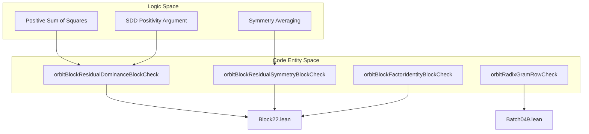
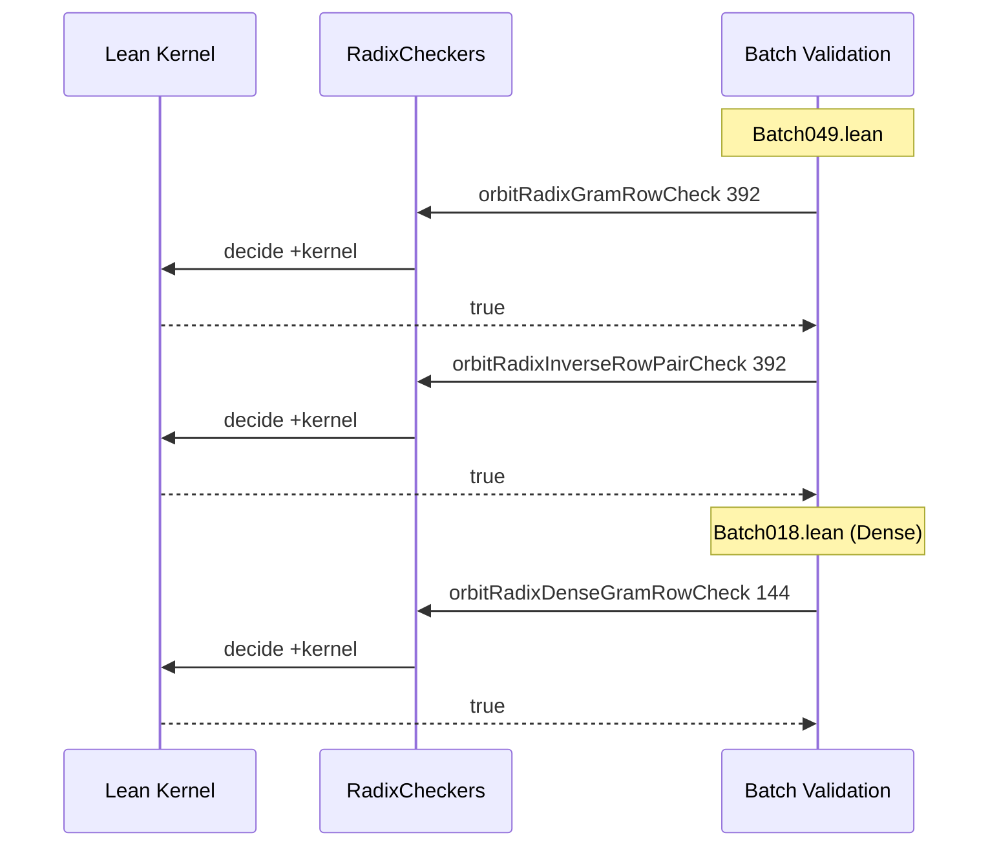

<!-- source: DeepWiki mcp.deepwiki.com · repo openai/ten-proofs · page 4.2 Orbit Block Certificate and Positivity · fetched 2026-10-26 -->

# Orbit Block Certificate and Positivity

Relevant source files

The following files were used as context for generating this wiki page:

- [ConnesRigidity/PropertyTExactCertificateOrbitBlockValidations/Block00.lean](ConnesRigidity/PropertyTExactCertificateOrbitBlockValidations/Block00.lean)
- [ConnesRigidity/PropertyTExactCertificateOrbitBlockValidations/Block01.lean](ConnesRigidity/PropertyTExactCertificateOrbitBlockValidations/Block01.lean)
- [ConnesRigidity/PropertyTExactCertificateOrbitBlockValidations/Block02.lean](ConnesRigidity/PropertyTExactCertificateOrbitBlockValidations/Block02.lean)
- [ConnesRigidity/PropertyTExactCertificateOrbitBlockValidations/Block03.lean](ConnesRigidity/PropertyTExactCertificateOrbitBlockValidations/Block03.lean)
- [ConnesRigidity/PropertyTExactCertificateOrbitBlockValidations/Block04.lean](ConnesRigidity/PropertyTExactCertificateOrbitBlockValidations/Block04.lean)
- [ConnesRigidity/PropertyTExactCertificateOrbitBlockValidations/Block05.lean](ConnesRigidity/PropertyTExactCertificateOrbitBlockValidations/Block05.lean)
- [ConnesRigidity/PropertyTExactCertificateOrbitBlockValidations/Block06.lean](ConnesRigidity/PropertyTExactCertificateOrbitBlockValidations/Block06.lean)
- [ConnesRigidity/PropertyTExactCertificateOrbitBlockValidations/Block07.lean](ConnesRigidity/PropertyTExactCertificateOrbitBlockValidations/Block07.lean)
- [ConnesRigidity/PropertyTExactCertificateOrbitBlockValidations/Block08.lean](ConnesRigidity/PropertyTExactCertificateOrbitBlockValidations/Block08.lean)
- [ConnesRigidity/PropertyTExactCertificateOrbitBlockValidations/Block09.lean](ConnesRigidity/PropertyTExactCertificateOrbitBlockValidations/Block09.lean)
- [ConnesRigidity/PropertyTExactCertificateOrbitBlockValidations/Block10.lean](ConnesRigidity/PropertyTExactCertificateOrbitBlockValidations/Block10.lean)
- [ConnesRigidity/PropertyTExactCertificateOrbitBlockValidations/Block11.lean](ConnesRigidity/PropertyTExactCertificateOrbitBlockValidations/Block11.lean)
- [ConnesRigidity/PropertyTExactCertificateOrbitBlockValidations/Block12.lean](ConnesRigidity/PropertyTExactCertificateOrbitBlockValidations/Block12.lean)
- [ConnesRigidity/PropertyTExactCertificateOrbitBlockValidations/Block13.lean](ConnesRigidity/PropertyTExactCertificateOrbitBlockValidations/Block13.lean)
- [ConnesRigidity/PropertyTExactCertificateOrbitBlockValidations/Block14.lean](ConnesRigidity/PropertyTExactCertificateOrbitBlockValidations/Block14.lean)
- [ConnesRigidity/PropertyTExactCertificateOrbitBlockValidations/Block15.lean](ConnesRigidity/PropertyTExactCertificateOrbitBlockValidations/Block15.lean)
- [ConnesRigidity/PropertyTExactCertificateOrbitBlockValidations/Block16.lean](ConnesRigidity/PropertyTExactCertificateOrbitBlockValidations/Block16.lean)
- [ConnesRigidity/PropertyTExactCertificateOrbitBlockValidations/Block17.lean](ConnesRigidity/PropertyTExactCertificateOrbitBlockValidations/Block17.lean)
- [ConnesRigidity/PropertyTExactCertificateOrbitBlockValidations/Block18.lean](ConnesRigidity/PropertyTExactCertificateOrbitBlockValidations/Block18.lean)
- [ConnesRigidity/PropertyTExactCertificateOrbitBlockValidations/Block19.lean](ConnesRigidity/PropertyTExactCertificateOrbitBlockValidations/Block19.lean)
- [ConnesRigidity/PropertyTExactCertificateOrbitBlockValidations/Block20.lean](ConnesRigidity/PropertyTExactCertificateOrbitBlockValidations/Block20.lean)
- [ConnesRigidity/PropertyTExactCertificateOrbitBlockValidations/Block21.lean](ConnesRigidity/PropertyTExactCertificateOrbitBlockValidations/Block21.lean)
- [ConnesRigidity/PropertyTExactCertificateOrbitBlockValidations/Block22.lean](ConnesRigidity/PropertyTExactCertificateOrbitBlockValidations/Block22.lean)
- [ConnesRigidity/PropertyTExactCertificateOrbitBlockValidations/Block23.lean](ConnesRigidity/PropertyTExactCertificateOrbitBlockValidations/Block23.lean)
- [ConnesRigidity/PropertyTExactCertificateOrbitBlockValidations/Block24.lean](ConnesRigidity/PropertyTExactCertificateOrbitBlockValidations/Block24.lean)
- [ConnesRigidity/PropertyTExactCertificateOrbitBlockValidations/Block25.lean](ConnesRigidity/PropertyTExactCertificateOrbitBlockValidations/Block25.lean)
- [ConnesRigidity/PropertyTExactCertificateOrbitBlockValidations/Block26.lean](ConnesRigidity/PropertyTExactCertificateOrbitBlockValidations/Block26.lean)
- [ConnesRigidity/PropertyTExactCertificateOrbitBlockValidations/Block27.lean](ConnesRigidity/PropertyTExactCertificateOrbitBlockValidations/Block27.lean)
- [ConnesRigidity/PropertyTExactCertificateOrbitRadixDenseValidations/Batch000.lean](ConnesRigidity/PropertyTExactCertificateOrbitRadixDenseValidations/Batch000.lean)
- [ConnesRigidity/PropertyTExactCertificateOrbitRadixDenseValidations/Batch001.lean](ConnesRigidity/PropertyTExactCertificateOrbitRadixDenseValidations/Batch001.lean)
- [ConnesRigidity/PropertyTExactCertificateOrbitRadixDenseValidations/Batch002.lean](ConnesRigidity/PropertyTExactCertificateOrbitRadixDenseValidations/Batch002.lean)
- [ConnesRigidity/PropertyTExactCertificateOrbitRadixDenseValidations/Batch003.lean](ConnesRigidity/PropertyTExactCertificateOrbitRadixDenseValidations/Batch003.lean)
- [ConnesRigidity/PropertyTExactCertificateOrbitRadixDenseValidations/Batch004.lean](ConnesRigidity/PropertyTExactCertificateOrbitRadixDenseValidations/Batch004.lean)
- [ConnesRigidity/PropertyTExactCertificateOrbitRadixDenseValidations/Batch005.lean](ConnesRigidity/PropertyTExactCertificateOrbitRadixDenseValidations/Batch005.lean)
- [ConnesRigidity/PropertyTExactCertificateOrbitRadixDenseValidations/Batch006.lean](ConnesRigidity/PropertyTExactCertificateOrbitRadixDenseValidations/Batch006.lean)
- [ConnesRigidity/PropertyTExactCertificateOrbitRadixDenseValidations/Batch007.lean](ConnesRigidity/PropertyTExactCertificateOrbitRadixDenseValidations/Batch007.lean)
- [ConnesRigidity/PropertyTExactCertificateOrbitRadixDenseValidations/Batch008.lean](ConnesRigidity/PropertyTExactCertificateOrbitRadixDenseValidations/Batch008.lean)
- [ConnesRigidity/PropertyTExactCertificateOrbitRadixDenseValidations/Batch009.lean](ConnesRigidity/PropertyTExactCertificateOrbitRadixDenseValidations/Batch009.lean)
- [ConnesRigidity/PropertyTExactCertificateOrbitRadixDenseValidations/Batch010.lean](ConnesRigidity/PropertyTExactCertificateOrbitRadixDenseValidations/Batch010.lean)
- [ConnesRigidity/PropertyTExactCertificateOrbitRadixDenseValidations/Batch011.lean](ConnesRigidity/PropertyTExactCertificateOrbitRadixDenseValidations/Batch011.lean)
- [ConnesRigidity/PropertyTExactCertificateOrbitRadixDenseValidations/Batch012.lean](ConnesRigidity/PropertyTExactCertificateOrbitRadixDenseValidations/Batch012.lean)
- [ConnesRigidity/PropertyTExactCertificateOrbitRadixDenseValidations/Batch013.lean](ConnesRigidity/PropertyTExactCertificateOrbitRadixDenseValidations/Batch013.lean)
- [ConnesRigidity/PropertyTExactCertificateOrbitRadixDenseValidations/Batch014.lean](ConnesRigidity/PropertyTExactCertificateOrbitRadixDenseValidations/Batch014.lean)
- [ConnesRigidity/PropertyTExactCertificateOrbitRadixDenseValidations/Batch015.lean](ConnesRigidity/PropertyTExactCertificateOrbitRadixDenseValidations/Batch015.lean)
- [ConnesRigidity/PropertyTExactCertificateOrbitRadixDenseValidations/Batch016.lean](ConnesRigidity/PropertyTExactCertificateOrbitRadixDenseValidations/Batch016.lean)
- [ConnesRigidity/PropertyTExactCertificateOrbitRadixDenseValidations/Batch017.lean](ConnesRigidity/PropertyTExactCertificateOrbitRadixDenseValidations/Batch017.lean)
- [ConnesRigidity/PropertyTExactCertificateOrbitRadixDenseValidations/Batch018.lean](ConnesRigidity/PropertyTExactCertificateOrbitRadixDenseValidations/Batch018.lean)
- [ConnesRigidity/PropertyTExactCertificateOrbitRadixDenseValidations/Batch019.lean](ConnesRigidity/PropertyTExactCertificateOrbitRadixDenseValidations/Batch019.lean)
- [ConnesRigidity/PropertyTExactCertificateOrbitRadixDenseValidations/Batch020.lean](ConnesRigidity/PropertyTExactCertificateOrbitRadixDenseValidations/Batch020.lean)
- [ConnesRigidity/PropertyTExactCertificateOrbitRadixDenseValidations/Batch021.lean](ConnesRigidity/PropertyTExactCertificateOrbitRadixDenseValidations/Batch021.lean)
- [ConnesRigidity/PropertyTExactCertificateOrbitRadixDenseValidations/Batch022.lean](ConnesRigidity/PropertyTExactCertificateOrbitRadixDenseValidations/Batch022.lean)
- [ConnesRigidity/PropertyTExactCertificateOrbitRadixDenseValidations/Batch023.lean](ConnesRigidity/PropertyTExactCertificateOrbitRadixDenseValidations/Batch023.lean)
- [ConnesRigidity/PropertyTExactCertificateOrbitRadixDenseValidations/Batch024.lean](ConnesRigidity/PropertyTExactCertificateOrbitRadixDenseValidations/Batch024.lean)
- [ConnesRigidity/PropertyTExactCertificateOrbitRadixDenseValidations/Batch025.lean](ConnesRigidity/PropertyTExactCertificateOrbitRadixDenseValidations/Batch025.lean)
- [ConnesRigidity/PropertyTExactCertificateOrbitRadixDenseValidations/Batch026.lean](ConnesRigidity/PropertyTExactCertificateOrbitRadixDenseValidations/Batch026.lean)
- [ConnesRigidity/PropertyTExactCertificateOrbitRadixDenseValidations/Batch027.lean](ConnesRigidity/PropertyTExactCertificateOrbitRadixDenseValidations/Batch027.lean)
- [ConnesRigidity/PropertyTExactCertificateOrbitRadixDenseValidations/Batch028.lean](ConnesRigidity/PropertyTExactCertificateOrbitRadixDenseValidations/Batch028.lean)
- [ConnesRigidity/PropertyTExactCertificateOrbitRadixDenseValidations/Batch029.lean](ConnesRigidity/PropertyTExactCertificateOrbitRadixDenseValidations/Batch029.lean)
- [ConnesRigidity/PropertyTExactCertificateOrbitRadixDenseValidations/Batch030.lean](ConnesRigidity/PropertyTExactCertificateOrbitRadixDenseValidations/Batch030.lean)
- [ConnesRigidity/PropertyTExactCertificateOrbitRadixDenseValidations/Batch031.lean](ConnesRigidity/PropertyTExactCertificateOrbitRadixDenseValidations/Batch031.lean)
- [ConnesRigidity/PropertyTExactCertificateOrbitRadixDenseValidations/Batch032.lean](ConnesRigidity/PropertyTExactCertificateOrbitRadixDenseValidations/Batch032.lean)
- [ConnesRigidity/PropertyTExactCertificateOrbitRadixDenseValidations/Batch033.lean](ConnesRigidity/PropertyTExactCertificateOrbitRadixDenseValidations/Batch033.lean)
- [ConnesRigidity/PropertyTExactCertificateOrbitRadixDenseValidations/Batch034.lean](ConnesRigidity/PropertyTExactCertificateOrbitRadixDenseValidations/Batch034.lean)
- [ConnesRigidity/PropertyTExactCertificateOrbitRadixDenseValidations/Batch035.lean](ConnesRigidity/PropertyTExactCertificateOrbitRadixDenseValidations/Batch035.lean)
- [ConnesRigidity/PropertyTExactCertificateOrbitRadixDenseValidations/Batch036.lean](ConnesRigidity/PropertyTExactCertificateOrbitRadixDenseValidations/Batch036.lean)
- [ConnesRigidity/PropertyTExactCertificateOrbitRadixDenseValidations/Batch037.lean](ConnesRigidity/PropertyTExactCertificateOrbitRadixDenseValidations/Batch037.lean)
- [ConnesRigidity/PropertyTExactCertificateOrbitRadixDenseValidations/Batch038.lean](ConnesRigidity/PropertyTExactCertificateOrbitRadixDenseValidations/Batch038.lean)
- [ConnesRigidity/PropertyTExactCertificateOrbitRadixDenseValidations/Batch039.lean](ConnesRigidity/PropertyTExactCertificateOrbitRadixDenseValidations/Batch039.lean)
- [ConnesRigidity/PropertyTExactCertificateOrbitRadixDenseValidations/Batch040.lean](ConnesRigidity/PropertyTExactCertificateOrbitRadixDenseValidations/Batch040.lean)
- [ConnesRigidity/PropertyTExactCertificateOrbitRadixDenseValidations/Batch041.lean](ConnesRigidity/PropertyTExactCertificateOrbitRadixDenseValidations/Batch041.lean)
- [ConnesRigidity/PropertyTExactCertificateOrbitRadixDenseValidations/Batch042.lean](ConnesRigidity/PropertyTExactCertificateOrbitRadixDenseValidations/Batch042.lean)
- [ConnesRigidity/PropertyTExactCertificateOrbitRadixDenseValidations/Batch043.lean](ConnesRigidity/PropertyTExactCertificateOrbitRadixDenseValidations/Batch043.lean)
- [ConnesRigidity/PropertyTExactCertificateOrbitRadixDenseValidations/Batch044.lean](ConnesRigidity/PropertyTExactCertificateOrbitRadixDenseValidations/Batch044.lean)
- [ConnesRigidity/PropertyTExactCertificateOrbitRadixDenseValidations/Batch045.lean](ConnesRigidity/PropertyTExactCertificateOrbitRadixDenseValidations/Batch045.lean)
- [ConnesRigidity/PropertyTExactCertificateOrbitRadixDenseValidations/Batch046.lean](ConnesRigidity/PropertyTExactCertificateOrbitRadixDenseValidations/Batch046.lean)
- [ConnesRigidity/PropertyTExactCertificateOrbitRadixDenseValidations/Batch047.lean](ConnesRigidity/PropertyTExactCertificateOrbitRadixDenseValidations/Batch047.lean)
- [ConnesRigidity/PropertyTExactCertificateOrbitRadixDenseValidations/Batch048.lean](ConnesRigidity/PropertyTExactCertificateOrbitRadixDenseValidations/Batch048.lean)
- [ConnesRigidity/PropertyTExactCertificateOrbitRadixDenseValidations/Batch049.lean](ConnesRigidity/PropertyTExactCertificateOrbitRadixDenseValidations/Batch049.lean)
- [ConnesRigidity/PropertyTExactCertificateOrbitRadixDenseValidations/Batch050.lean](ConnesRigidity/PropertyTExactCertificateOrbitRadixDenseValidations/Batch050.lean)
- [ConnesRigidity/PropertyTExactCertificateOrbitRadixDenseValidations/Batch051.lean](ConnesRigidity/PropertyTExactCertificateOrbitRadixDenseValidations/Batch051.lean)
- [ConnesRigidity/PropertyTExactCertificateOrbitRadixDenseValidations/Batch052.lean](ConnesRigidity/PropertyTExactCertificateOrbitRadixDenseValidations/Batch052.lean)
- [ConnesRigidity/PropertyTExactCertificateOrbitRadixValidations/Batch000.lean](ConnesRigidity/PropertyTExactCertificateOrbitRadixValidations/Batch000.lean)
- [ConnesRigidity/PropertyTExactCertificateOrbitRadixValidations/Batch001.lean](ConnesRigidity/PropertyTExactCertificateOrbitRadixValidations/Batch001.lean)
- [ConnesRigidity/PropertyTExactCertificateOrbitRadixValidations/Batch002.lean](ConnesRigidity/PropertyTExactCertificateOrbitRadixValidations/Batch002.lean)
- [ConnesRigidity/PropertyTExactCertificateOrbitRadixValidations/Batch003.lean](ConnesRigidity/PropertyTExactCertificateOrbitRadixValidations/Batch003.lean)
- [ConnesRigidity/PropertyTExactCertificateOrbitRadixValidations/Batch004.lean](ConnesRigidity/PropertyTExactCertificateOrbitRadixValidations/Batch004.lean)
- [ConnesRigidity/PropertyTExactCertificateOrbitRadixValidations/Batch005.lean](ConnesRigidity/PropertyTExactCertificateOrbitRadixValidations/Batch005.lean)
- [ConnesRigidity/PropertyTExactCertificateOrbitRadixValidations/Batch006.lean](ConnesRigidity/PropertyTExactCertificateOrbitRadixValidations/Batch006.lean)
- [ConnesRigidity/PropertyTExactCertificateOrbitRadixValidations/Batch007.lean](ConnesRigidity/PropertyTExactCertificateOrbitRadixValidations/Batch007.lean)
- [ConnesRigidity/PropertyTExactCertificateOrbitRadixValidations/Batch008.lean](ConnesRigidity/PropertyTExactCertificateOrbitRadixValidations/Batch008.lean)
- [ConnesRigidity/PropertyTExactCertificateOrbitRadixValidations/Batch009.lean](ConnesRigidity/PropertyTExactCertificateOrbitRadixValidations/Batch009.lean)
- [ConnesRigidity/PropertyTExactCertificateOrbitRadixValidations/Batch010.lean](ConnesRigidity/PropertyTExactCertificateOrbitRadixValidations/Batch010.lean)
- [ConnesRigidity/PropertyTExactCertificateOrbitRadixValidations/Batch011.lean](ConnesRigidity/PropertyTExactCertificateOrbitRadixValidations/Batch011.lean)
- [ConnesRigidity/PropertyTExactCertificateOrbitRadixValidations/Batch012.lean](ConnesRigidity/PropertyTExactCertificateOrbitRadixValidations/Batch012.lean)
- [ConnesRigidity/PropertyTExactCertificateOrbitRadixValidations/Batch013.lean](ConnesRigidity/PropertyTExactCertificateOrbitRadixValidations/Batch013.lean)
- [ConnesRigidity/PropertyTExactCertificateOrbitRadixValidations/Batch014.lean](ConnesRigidity/PropertyTExactCertificateOrbitRadixValidations/Batch014.lean)
- [ConnesRigidity/PropertyTExactCertificateOrbitRadixValidations/Batch015.lean](ConnesRigidity/PropertyTExactCertificateOrbitRadixValidations/Batch015.lean)
- [ConnesRigidity/PropertyTExactCertificateOrbitRadixValidations/Batch016.lean](ConnesRigidity/PropertyTExactCertificateOrbitRadixValidations/Batch016.lean)
- [ConnesRigidity/PropertyTExactCertificateOrbitRadixValidations/Batch017.lean](ConnesRigidity/PropertyTExactCertificateOrbitRadixValidations/Batch017.lean)
- [ConnesRigidity/PropertyTExactCertificateOrbitRadixValidations/Batch018.lean](ConnesRigidity/PropertyTExactCertificateOrbitRadixValidations/Batch018.lean)
- [ConnesRigidity/PropertyTExactCertificateOrbitRadixValidations/Batch019.lean](ConnesRigidity/PropertyTExactCertificateOrbitRadixValidations/Batch019.lean)
- [ConnesRigidity/PropertyTExactCertificateOrbitRadixValidations/Batch020.lean](ConnesRigidity/PropertyTExactCertificateOrbitRadixValidations/Batch020.lean)
- [ConnesRigidity/PropertyTExactCertificateOrbitRadixValidations/Batch021.lean](ConnesRigidity/PropertyTExactCertificateOrbitRadixValidations/Batch021.lean)
- [ConnesRigidity/PropertyTExactCertificateOrbitRadixValidations/Batch022.lean](ConnesRigidity/PropertyTExactCertificateOrbitRadixValidations/Batch022.lean)
- [ConnesRigidity/PropertyTExactCertificateOrbitRadixValidations/Batch023.lean](ConnesRigidity/PropertyTExactCertificateOrbitRadixValidations/Batch023.lean)
- [ConnesRigidity/PropertyTExactCertificateOrbitRadixValidations/Batch024.lean](ConnesRigidity/PropertyTExactCertificateOrbitRadixValidations/Batch024.lean)
- [ConnesRigidity/PropertyTExactCertificateOrbitRadixValidations/Batch025.lean](ConnesRigidity/PropertyTExactCertificateOrbitRadixValidations/Batch025.lean)
- [ConnesRigidity/PropertyTExactCertificateOrbitRadixValidations/Batch026.lean](ConnesRigidity/PropertyTExactCertificateOrbitRadixValidations/Batch026.lean)
- [ConnesRigidity/PropertyTExactCertificateOrbitRadixValidations/Batch027.lean](ConnesRigidity/PropertyTExactCertificateOrbitRadixValidations/Batch027.lean)
- [ConnesRigidity/PropertyTExactCertificateOrbitRadixValidations/Batch028.lean](ConnesRigidity/PropertyTExactCertificateOrbitRadixValidations/Batch028.lean)
- [ConnesRigidity/PropertyTExactCertificateOrbitRadixValidations/Batch029.lean](ConnesRigidity/PropertyTExactCertificateOrbitRadixValidations/Batch029.lean)
- [ConnesRigidity/PropertyTExactCertificateOrbitRadixValidations/Batch030.lean](ConnesRigidity/PropertyTExactCertificateOrbitRadixValidations/Batch030.lean)
- [ConnesRigidity/PropertyTExactCertificateOrbitRadixValidations/Batch031.lean](ConnesRigidity/PropertyTExactCertificateOrbitRadixValidations/Batch031.lean)
- [ConnesRigidity/PropertyTExactCertificateOrbitRadixValidations/Batch032.lean](ConnesRigidity/PropertyTExactCertificateOrbitRadixValidations/Batch032.lean)
- [ConnesRigidity/PropertyTExactCertificateOrbitRadixValidations/Batch033.lean](ConnesRigidity/PropertyTExactCertificateOrbitRadixValidations/Batch033.lean)
- [ConnesRigidity/PropertyTExactCertificateOrbitRadixValidations/Batch034.lean](ConnesRigidity/PropertyTExactCertificateOrbitRadixValidations/Batch034.lean)
- [ConnesRigidity/PropertyTExactCertificateOrbitRadixValidations/Batch035.lean](ConnesRigidity/PropertyTExactCertificateOrbitRadixValidations/Batch035.lean)
- [ConnesRigidity/PropertyTExactCertificateOrbitRadixValidations/Batch036.lean](ConnesRigidity/PropertyTExactCertificateOrbitRadixValidations/Batch036.lean)
- [ConnesRigidity/PropertyTExactCertificateOrbitRadixValidations/Batch037.lean](ConnesRigidity/PropertyTExactCertificateOrbitRadixValidations/Batch037.lean)
- [ConnesRigidity/PropertyTExactCertificateOrbitRadixValidations/Batch038.lean](ConnesRigidity/PropertyTExactCertificateOrbitRadixValidations/Batch038.lean)
- [ConnesRigidity/PropertyTExactCertificateOrbitRadixValidations/Batch039.lean](ConnesRigidity/PropertyTExactCertificateOrbitRadixValidations/Batch039.lean)
- [ConnesRigidity/PropertyTExactCertificateOrbitRadixValidations/Batch040.lean](ConnesRigidity/PropertyTExactCertificateOrbitRadixValidations/Batch040.lean)
- [ConnesRigidity/PropertyTExactCertificateOrbitRadixValidations/Batch041.lean](ConnesRigidity/PropertyTExactCertificateOrbitRadixValidations/Batch041.lean)
- [ConnesRigidity/PropertyTExactCertificateOrbitRadixValidations/Batch042.lean](ConnesRigidity/PropertyTExactCertificateOrbitRadixValidations/Batch042.lean)
- [ConnesRigidity/PropertyTExactCertificateOrbitRadixValidations/Batch043.lean](ConnesRigidity/PropertyTExactCertificateOrbitRadixValidations/Batch043.lean)
- [ConnesRigidity/PropertyTExactCertificateOrbitRadixValidations/Batch044.lean](ConnesRigidity/PropertyTExactCertificateOrbitRadixValidations/Batch044.lean)
- [ConnesRigidity/PropertyTExactCertificateOrbitRadixValidations/Batch045.lean](ConnesRigidity/PropertyTExactCertificateOrbitRadixValidations/Batch045.lean)
- [ConnesRigidity/PropertyTExactCertificateOrbitRadixValidations/Batch046.lean](ConnesRigidity/PropertyTExactCertificateOrbitRadixValidations/Batch046.lean)
- [ConnesRigidity/PropertyTExactCertificateOrbitRadixValidations/Batch047.lean](ConnesRigidity/PropertyTExactCertificateOrbitRadixValidations/Batch047.lean)
- [ConnesRigidity/PropertyTExactCertificateOrbitRadixValidations/Batch048.lean](ConnesRigidity/PropertyTExactCertificateOrbitRadixValidations/Batch048.lean)
- [ConnesRigidity/PropertyTExactCertificateOrbitRadixValidations/Batch049.lean](ConnesRigidity/PropertyTExactCertificateOrbitRadixValidations/Batch049.lean)
- [ConnesRigidity/PropertyTExactCertificateOrbitRadixValidations/Batch050.lean](ConnesRigidity/PropertyTExactCertificateOrbitRadixValidations/Batch050.lean)
- [ConnesRigidity/PropertyTExactCertificateOrbitRadixValidations/Batch051.lean](ConnesRigidity/PropertyTExactCertificateOrbitRadixValidations/Batch051.lean)
- [ConnesRigidity/PropertyTExactCertificateOrbitRadixValidations/Batch052.lean](ConnesRigidity/PropertyTExactCertificateOrbitRadixValidations/Batch052.lean)

This page describes the block-diagonal decomposition and positivity verification of the Property T certificate. By exploiting the 64-element symmetry group of $\Gamma_0$, the massive $425 \times 425$ Gram matrix is reduced to 28 smaller blocks. The verification process confirms that the orbit-averaged certificate is a Positive Sum of Squares (PSS) by proving each block is Strictly Diagonally Dominant (SDD).

## Block Certificate Architecture

The orbit-based certificate utilizes an averaging argument to simplify the verification of the spectral gap. Instead of verifying a single large matrix, the system constructs `orbitBlockAtom` and `orbitBlockCandidate` objects for each of the 28 orbits.

### Data Flow and Verification Logic

The verification is partitioned into specific checks for each block, ensuring that the certificate accurately represents the group ring element while maintaining positivity.

### Entity Mapping: Orbit Verification

**Sources:** [ConnesRigidity/PropertyTExactCertificateOrbitBlockValidations/Block22.lean:9-21](), [ConnesRigidity/PropertyTExactCertificateOrbitRadixValidations/Batch049.lean:25-27]()

## Strictly Diagonally Dominant (SDD) Positivity

A key component of the Property T proof is showing that the Gram matrix $Q$ is positive semi-definite. The codebase achieves this by demonstrating that the blocks are Strictly Diagonally Dominant. 

The verification is split into three primary theorems per block:
1.  **Factor Identity:** `orbitBlockFactorIdentityBlockCheck` ensures the block matches the intended group ring coefficients.
2.  **Residual Symmetry:** `orbitBlockResidualSymmetryBlockCheck` verifies the symmetry of the error/residual terms.
3.  **Residual Dominance:** `orbitBlockResidualDominanceBlockCheck` proves the diagonal terms dominate the off-diagonal terms, providing the positivity certificate.

### Block Validation Suite
Each block (0 through 27) undergoes a standard set of kernel-verified checks. For example, in Block 22:

| Theorem Name | Purpose | Method |
| :--- | :--- | :--- |
| `orbitBlockFactorIdentityBlockCheck_22` | Validates factor identity | `decide +kernel` |
| `orbitBlockResidualSymmetryBlockCheck_22` | Validates symmetry | `decide +kernel` |
| `orbitBlockResidualDominanceBlockCheck_22` | Validates SDD property | `decide +kernel` |

**Sources:** [ConnesRigidity/PropertyTExactCertificateOrbitBlockValidations/Block22.lean:9-21]()

## Radix-Based Row Validations

To handle the scale of the orbit data, the codebase employs a "Radix" validation system. This system checks rows of the certificate in batches to ensure consistency across the orbit decomposition.

### Radix Check Types
The `orbitRadix` suite performs several granular checks on each row index:
*   **Inverse Row Check:** `orbitRadixInverseRowCheck` [ConnesRigidity/PropertyTExactCertificateOrbitRadixValidations/Batch049.lean:10-12]().
*   **Product Row Check:** `orbitRadixProductRowCheck` [ConnesRigidity/PropertyTExactCertificateOrbitRadixValidations/Batch049.lean:15-17]().
*   **Gram Row Check:** `orbitRadixGramRowCheck` [ConnesRigidity/PropertyTExactCertificateOrbitRadixValidations/Batch049.lean:25-27]().
*   **Dense Gram Check:** For specific dense regions, `orbitRadixDenseGramRowCheck` is used to verify matrix entries [ConnesRigidity/PropertyTExactCertificateOrbitRadixDenseValidations/Batch018.lean:10-12]().

### Batch Processing Diagram

**Sources:** [ConnesRigidity/PropertyTExactCertificateOrbitRadixValidations/Batch049.lean:1-40](), [ConnesRigidity/PropertyTExactCertificateOrbitRadixDenseValidations/Batch018.lean:1-12]()

## Implementation Details

The verification relies heavily on Lean 4's `decide +kernel` tactic, which performs proof by reflection. Because these computations involve large integers and matrix operations, the `maxHeartbeats` and `maxRecDepth` options are significantly increased.

*   **Heartbeat Limits:** Most orbit theorems are allocated `64,000,000` heartbeats to ensure completion in the kernel [ConnesRigidity/PropertyTExactCertificateOrbitRadixValidations/Batch049.lean:9]().
*   **Recursion Depth:** The recursion depth is set to `1,000,000` to accommodate deep expression trees during the SDD dominance checks [ConnesRigidity/PropertyTExactCertificateOrbitBlockValidations/Block22.lean:6]().

### Summary of Validated Batches
The validation is distributed across numerous files to maintain manageable compilation units:
*   **Block Validations:** `Block05.lean` through `Block27.lean`.
*   **Radix Batches:** `Batch001.lean` through `Batch052.lean` (covering indices like 392-398) [ConnesRigidity/PropertyTExactCertificateOrbitRadixValidations/Batch049.lean:10-240]().
*   **Dense Batches:** `Batch006.lean` through `Batch052.lean` for dense Gram sub-matrices [ConnesRigidity/PropertyTExactCertificateOrbitRadixDenseValidations/Batch018.lean:10-48]().

**Sources:** [ConnesRigidity/PropertyTExactCertificateOrbitBlockValidations/Block22.lean:1-24](), [ConnesRigidity/PropertyTExactCertificateOrbitRadixValidations/Batch049.lean:1-240](), [ConnesRigidity/PropertyTExactCertificateOrbitRadixDenseValidations/Batch018.lean:1-50]()

---

