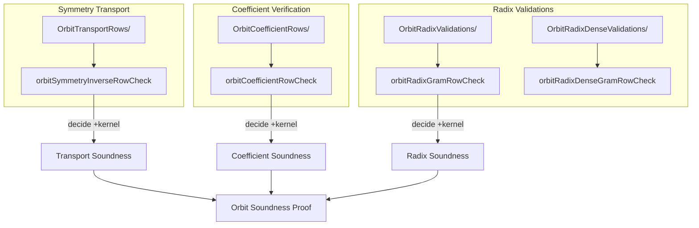
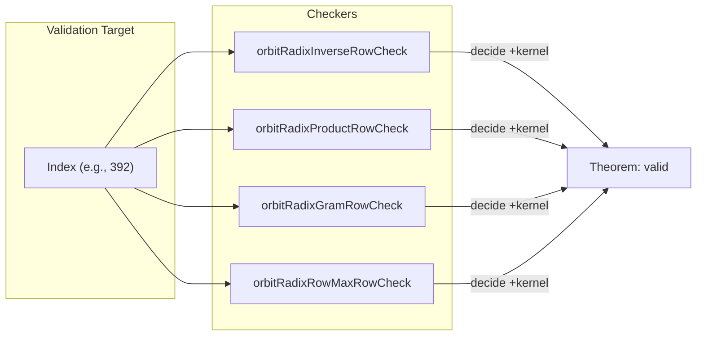

<!-- source: DeepWiki mcp.deepwiki.com · repo openai/ten-proofs · page 4.3 Orbit Coefficient and Transport Validation · fetched 2026-10-26 -->

# Orbit Coefficient and Transport Validation

Relevant source files

The following files were used as context for generating this wiki page:

- [ConnesRigidity/PropertyTExactCertificateOrbitCoefficientRows/Batch000.lean](ConnesRigidity/PropertyTExactCertificateOrbitCoefficientRows/Batch000.lean)
- [ConnesRigidity/PropertyTExactCertificateOrbitCoefficientRows/Batch001.lean](ConnesRigidity/PropertyTExactCertificateOrbitCoefficientRows/Batch001.lean)
- [ConnesRigidity/PropertyTExactCertificateOrbitCoefficientRows/Batch002.lean](ConnesRigidity/PropertyTExactCertificateOrbitCoefficientRows/Batch002.lean)
- [ConnesRigidity/PropertyTExactCertificateOrbitCoefficientRows/Batch003.lean](ConnesRigidity/PropertyTExactCertificateOrbitCoefficientRows/Batch003.lean)
- [ConnesRigidity/PropertyTExactCertificateOrbitCoefficientRows/Batch004.lean](ConnesRigidity/PropertyTExactCertificateOrbitCoefficientRows/Batch004.lean)
- [ConnesRigidity/PropertyTExactCertificateOrbitCoefficientRows/Batch005.lean](ConnesRigidity/PropertyTExactCertificateOrbitCoefficientRows/Batch005.lean)
- [ConnesRigidity/PropertyTExactCertificateOrbitCoefficientRows/Batch006.lean](ConnesRigidity/PropertyTExactCertificateOrbitCoefficientRows/Batch006.lean)
- [ConnesRigidity/PropertyTExactCertificateOrbitCoefficientRows/Batch007.lean](ConnesRigidity/PropertyTExactCertificateOrbitCoefficientRows/Batch007.lean)
- [ConnesRigidity/PropertyTExactCertificateOrbitCoefficientRows/Batch008.lean](ConnesRigidity/PropertyTExactCertificateOrbitCoefficientRows/Batch008.lean)
- [ConnesRigidity/PropertyTExactCertificateOrbitCoefficientRows/Batch009.lean](ConnesRigidity/PropertyTExactCertificateOrbitCoefficientRows/Batch009.lean)
- [ConnesRigidity/PropertyTExactCertificateOrbitCoefficientRows/Batch010.lean](ConnesRigidity/PropertyTExactCertificateOrbitCoefficientRows/Batch010.lean)
- [ConnesRigidity/PropertyTExactCertificateOrbitCoefficientRows/Batch011.lean](ConnesRigidity/PropertyTExactCertificateOrbitCoefficientRows/Batch011.lean)
- [ConnesRigidity/PropertyTExactCertificateOrbitCoefficientRows/Batch012.lean](ConnesRigidity/PropertyTExactCertificateOrbitCoefficientRows/Batch012.lean)
- [ConnesRigidity/PropertyTExactCertificateOrbitCoefficientRows/Batch013.lean](ConnesRigidity/PropertyTExactCertificateOrbitCoefficientRows/Batch013.lean)
- [ConnesRigidity/PropertyTExactCertificateOrbitCoefficientRows/Batch014.lean](ConnesRigidity/PropertyTExactCertificateOrbitCoefficientRows/Batch014.lean)
- [ConnesRigidity/PropertyTExactCertificateOrbitCoefficientRows/Batch015.lean](ConnesRigidity/PropertyTExactCertificateOrbitCoefficientRows/Batch015.lean)
- [ConnesRigidity/PropertyTExactCertificateOrbitCoefficientRows/Batch016.lean](ConnesRigidity/PropertyTExactCertificateOrbitCoefficientRows/Batch016.lean)
- [ConnesRigidity/PropertyTExactCertificateOrbitCoefficientRows/Batch017.lean](ConnesRigidity/PropertyTExactCertificateOrbitCoefficientRows/Batch017.lean)
- [ConnesRigidity/PropertyTExactCertificateOrbitCoefficientRows/Batch018.lean](ConnesRigidity/PropertyTExactCertificateOrbitCoefficientRows/Batch018.lean)
- [ConnesRigidity/PropertyTExactCertificateOrbitCoefficientRows/Batch019.lean](ConnesRigidity/PropertyTExactCertificateOrbitCoefficientRows/Batch019.lean)
- [ConnesRigidity/PropertyTExactCertificateOrbitCoefficientRows/Batch020.lean](ConnesRigidity/PropertyTExactCertificateOrbitCoefficientRows/Batch020.lean)
- [ConnesRigidity/PropertyTExactCertificateOrbitCoefficientRows/Batch021.lean](ConnesRigidity/PropertyTExactCertificateOrbitCoefficientRows/Batch021.lean)
- [ConnesRigidity/PropertyTExactCertificateOrbitCoefficientRows/Batch022.lean](ConnesRigidity/PropertyTExactCertificateOrbitCoefficientRows/Batch022.lean)
- [ConnesRigidity/PropertyTExactCertificateOrbitCoefficientRows/Batch023.lean](ConnesRigidity/PropertyTExactCertificateOrbitCoefficientRows/Batch023.lean)
- [ConnesRigidity/PropertyTExactCertificateOrbitCoefficientRows/Batch024.lean](ConnesRigidity/PropertyTExactCertificateOrbitCoefficientRows/Batch024.lean)
- [ConnesRigidity/PropertyTExactCertificateOrbitCoefficientRows/Batch026.lean](ConnesRigidity/PropertyTExactCertificateOrbitCoefficientRows/Batch026.lean)
- [ConnesRigidity/PropertyTExactCertificateOrbitRadixDenseValidations/Batch000.lean](ConnesRigidity/PropertyTExactCertificateOrbitRadixDenseValidations/Batch000.lean)
- [ConnesRigidity/PropertyTExactCertificateOrbitRadixDenseValidations/Batch001.lean](ConnesRigidity/PropertyTExactCertificateOrbitRadixDenseValidations/Batch001.lean)
- [ConnesRigidity/PropertyTExactCertificateOrbitRadixDenseValidations/Batch002.lean](ConnesRigidity/PropertyTExactCertificateOrbitRadixDenseValidations/Batch002.lean)
- [ConnesRigidity/PropertyTExactCertificateOrbitRadixDenseValidations/Batch003.lean](ConnesRigidity/PropertyTExactCertificateOrbitRadixDenseValidations/Batch003.lean)
- [ConnesRigidity/PropertyTExactCertificateOrbitRadixDenseValidations/Batch004.lean](ConnesRigidity/PropertyTExactCertificateOrbitRadixDenseValidations/Batch004.lean)
- [ConnesRigidity/PropertyTExactCertificateOrbitRadixDenseValidations/Batch005.lean](ConnesRigidity/PropertyTExactCertificateOrbitRadixDenseValidations/Batch005.lean)
- [ConnesRigidity/PropertyTExactCertificateOrbitRadixDenseValidations/Batch006.lean](ConnesRigidity/PropertyTExactCertificateOrbitRadixDenseValidations/Batch006.lean)
- [ConnesRigidity/PropertyTExactCertificateOrbitRadixDenseValidations/Batch007.lean](ConnesRigidity/PropertyTExactCertificateOrbitRadixDenseValidations/Batch007.lean)
- [ConnesRigidity/PropertyTExactCertificateOrbitRadixDenseValidations/Batch008.lean](ConnesRigidity/PropertyTExactCertificateOrbitRadixDenseValidations/Batch008.lean)
- [ConnesRigidity/PropertyTExactCertificateOrbitRadixDenseValidations/Batch009.lean](ConnesRigidity/PropertyTExactCertificateOrbitRadixDenseValidations/Batch009.lean)
- [ConnesRigidity/PropertyTExactCertificateOrbitRadixDenseValidations/Batch010.lean](ConnesRigidity/PropertyTExactCertificateOrbitRadixDenseValidations/Batch010.lean)
- [ConnesRigidity/PropertyTExactCertificateOrbitRadixDenseValidations/Batch011.lean](ConnesRigidity/PropertyTExactCertificateOrbitRadixDenseValidations/Batch011.lean)
- [ConnesRigidity/PropertyTExactCertificateOrbitRadixDenseValidations/Batch012.lean](ConnesRigidity/PropertyTExactCertificateOrbitRadixDenseValidations/Batch012.lean)
- [ConnesRigidity/PropertyTExactCertificateOrbitRadixDenseValidations/Batch013.lean](ConnesRigidity/PropertyTExactCertificateOrbitRadixDenseValidations/Batch013.lean)
- [ConnesRigidity/PropertyTExactCertificateOrbitRadixDenseValidations/Batch014.lean](ConnesRigidity/PropertyTExactCertificateOrbitRadixDenseValidations/Batch014.lean)
- [ConnesRigidity/PropertyTExactCertificateOrbitRadixDenseValidations/Batch015.lean](ConnesRigidity/PropertyTExactCertificateOrbitRadixDenseValidations/Batch015.lean)
- [ConnesRigidity/PropertyTExactCertificateOrbitRadixDenseValidations/Batch016.lean](ConnesRigidity/PropertyTExactCertificateOrbitRadixDenseValidations/Batch016.lean)
- [ConnesRigidity/PropertyTExactCertificateOrbitRadixDenseValidations/Batch017.lean](ConnesRigidity/PropertyTExactCertificateOrbitRadixDenseValidations/Batch017.lean)
- [ConnesRigidity/PropertyTExactCertificateOrbitRadixDenseValidations/Batch018.lean](ConnesRigidity/PropertyTExactCertificateOrbitRadixDenseValidations/Batch018.lean)
- [ConnesRigidity/PropertyTExactCertificateOrbitRadixDenseValidations/Batch019.lean](ConnesRigidity/PropertyTExactCertificateOrbitRadixDenseValidations/Batch019.lean)
- [ConnesRigidity/PropertyTExactCertificateOrbitRadixDenseValidations/Batch020.lean](ConnesRigidity/PropertyTExactCertificateOrbitRadixDenseValidations/Batch020.lean)
- [ConnesRigidity/PropertyTExactCertificateOrbitRadixDenseValidations/Batch021.lean](ConnesRigidity/PropertyTExactCertificateOrbitRadixDenseValidations/Batch021.lean)
- [ConnesRigidity/PropertyTExactCertificateOrbitRadixDenseValidations/Batch022.lean](ConnesRigidity/PropertyTExactCertificateOrbitRadixDenseValidations/Batch022.lean)
- [ConnesRigidity/PropertyTExactCertificateOrbitRadixDenseValidations/Batch023.lean](ConnesRigidity/PropertyTExactCertificateOrbitRadixDenseValidations/Batch023.lean)
- [ConnesRigidity/PropertyTExactCertificateOrbitRadixDenseValidations/Batch024.lean](ConnesRigidity/PropertyTExactCertificateOrbitRadixDenseValidations/Batch024.lean)
- [ConnesRigidity/PropertyTExactCertificateOrbitRadixDenseValidations/Batch025.lean](ConnesRigidity/PropertyTExactCertificateOrbitRadixDenseValidations/Batch025.lean)
- [ConnesRigidity/PropertyTExactCertificateOrbitRadixDenseValidations/Batch026.lean](ConnesRigidity/PropertyTExactCertificateOrbitRadixDenseValidations/Batch026.lean)
- [ConnesRigidity/PropertyTExactCertificateOrbitRadixDenseValidations/Batch027.lean](ConnesRigidity/PropertyTExactCertificateOrbitRadixDenseValidations/Batch027.lean)
- [ConnesRigidity/PropertyTExactCertificateOrbitRadixDenseValidations/Batch028.lean](ConnesRigidity/PropertyTExactCertificateOrbitRadixDenseValidations/Batch028.lean)
- [ConnesRigidity/PropertyTExactCertificateOrbitRadixDenseValidations/Batch029.lean](ConnesRigidity/PropertyTExactCertificateOrbitRadixDenseValidations/Batch029.lean)
- [ConnesRigidity/PropertyTExactCertificateOrbitRadixDenseValidations/Batch030.lean](ConnesRigidity/PropertyTExactCertificateOrbitRadixDenseValidations/Batch030.lean)
- [ConnesRigidity/PropertyTExactCertificateOrbitRadixDenseValidations/Batch031.lean](ConnesRigidity/PropertyTExactCertificateOrbitRadixDenseValidations/Batch031.lean)
- [ConnesRigidity/PropertyTExactCertificateOrbitRadixDenseValidations/Batch032.lean](ConnesRigidity/PropertyTExactCertificateOrbitRadixDenseValidations/Batch032.lean)
- [ConnesRigidity/PropertyTExactCertificateOrbitRadixDenseValidations/Batch033.lean](ConnesRigidity/PropertyTExactCertificateOrbitRadixDenseValidations/Batch033.lean)
- [ConnesRigidity/PropertyTExactCertificateOrbitRadixDenseValidations/Batch034.lean](ConnesRigidity/PropertyTExactCertificateOrbitRadixDenseValidations/Batch034.lean)
- [ConnesRigidity/PropertyTExactCertificateOrbitRadixDenseValidations/Batch035.lean](ConnesRigidity/PropertyTExactCertificateOrbitRadixDenseValidations/Batch035.lean)
- [ConnesRigidity/PropertyTExactCertificateOrbitRadixDenseValidations/Batch036.lean](ConnesRigidity/PropertyTExactCertificateOrbitRadixDenseValidations/Batch036.lean)
- [ConnesRigidity/PropertyTExactCertificateOrbitRadixDenseValidations/Batch037.lean](ConnesRigidity/PropertyTExactCertificateOrbitRadixDenseValidations/Batch037.lean)
- [ConnesRigidity/PropertyTExactCertificateOrbitRadixDenseValidations/Batch038.lean](ConnesRigidity/PropertyTExactCertificateOrbitRadixDenseValidations/Batch038.lean)
- [ConnesRigidity/PropertyTExactCertificateOrbitRadixDenseValidations/Batch039.lean](ConnesRigidity/PropertyTExactCertificateOrbitRadixDenseValidations/Batch039.lean)
- [ConnesRigidity/PropertyTExactCertificateOrbitRadixDenseValidations/Batch040.lean](ConnesRigidity/PropertyTExactCertificateOrbitRadixDenseValidations/Batch040.lean)
- [ConnesRigidity/PropertyTExactCertificateOrbitRadixDenseValidations/Batch041.lean](ConnesRigidity/PropertyTExactCertificateOrbitRadixDenseValidations/Batch041.lean)
- [ConnesRigidity/PropertyTExactCertificateOrbitRadixDenseValidations/Batch042.lean](ConnesRigidity/PropertyTExactCertificateOrbitRadixDenseValidations/Batch042.lean)
- [ConnesRigidity/PropertyTExactCertificateOrbitRadixDenseValidations/Batch043.lean](ConnesRigidity/PropertyTExactCertificateOrbitRadixDenseValidations/Batch043.lean)
- [ConnesRigidity/PropertyTExactCertificateOrbitRadixDenseValidations/Batch044.lean](ConnesRigidity/PropertyTExactCertificateOrbitRadixDenseValidations/Batch044.lean)
- [ConnesRigidity/PropertyTExactCertificateOrbitRadixDenseValidations/Batch045.lean](ConnesRigidity/PropertyTExactCertificateOrbitRadixDenseValidations/Batch045.lean)
- [ConnesRigidity/PropertyTExactCertificateOrbitRadixDenseValidations/Batch046.lean](ConnesRigidity/PropertyTExactCertificateOrbitRadixDenseValidations/Batch046.lean)
- [ConnesRigidity/PropertyTExactCertificateOrbitRadixDenseValidations/Batch047.lean](ConnesRigidity/PropertyTExactCertificateOrbitRadixDenseValidations/Batch047.lean)
- [ConnesRigidity/PropertyTExactCertificateOrbitRadixDenseValidations/Batch048.lean](ConnesRigidity/PropertyTExactCertificateOrbitRadixDenseValidations/Batch048.lean)
- [ConnesRigidity/PropertyTExactCertificateOrbitRadixDenseValidations/Batch049.lean](ConnesRigidity/PropertyTExactCertificateOrbitRadixDenseValidations/Batch049.lean)
- [ConnesRigidity/PropertyTExactCertificateOrbitRadixDenseValidations/Batch050.lean](ConnesRigidity/PropertyTExactCertificateOrbitRadixDenseValidations/Batch050.lean)
- [ConnesRigidity/PropertyTExactCertificateOrbitRadixDenseValidations/Batch051.lean](ConnesRigidity/PropertyTExactCertificateOrbitRadixDenseValidations/Batch051.lean)
- [ConnesRigidity/PropertyTExactCertificateOrbitRadixDenseValidations/Batch052.lean](ConnesRigidity/PropertyTExactCertificateOrbitRadixDenseValidations/Batch052.lean)
- [ConnesRigidity/PropertyTExactCertificateOrbitRadixValidations/Batch000.lean](ConnesRigidity/PropertyTExactCertificateOrbitRadixValidations/Batch000.lean)
- [ConnesRigidity/PropertyTExactCertificateOrbitRadixValidations/Batch001.lean](ConnesRigidity/PropertyTExactCertificateOrbitRadixValidations/Batch001.lean)
- [ConnesRigidity/PropertyTExactCertificateOrbitRadixValidations/Batch002.lean](ConnesRigidity/PropertyTExactCertificateOrbitRadixValidations/Batch002.lean)
- [ConnesRigidity/PropertyTExactCertificateOrbitRadixValidations/Batch003.lean](ConnesRigidity/PropertyTExactCertificateOrbitRadixValidations/Batch003.lean)
- [ConnesRigidity/PropertyTExactCertificateOrbitRadixValidations/Batch004.lean](ConnesRigidity/PropertyTExactCertificateOrbitRadixValidations/Batch004.lean)
- [ConnesRigidity/PropertyTExactCertificateOrbitRadixValidations/Batch005.lean](ConnesRigidity/PropertyTExactCertificateOrbitRadixValidations/Batch005.lean)
- [ConnesRigidity/PropertyTExactCertificateOrbitRadixValidations/Batch006.lean](ConnesRigidity/PropertyTExactCertificateOrbitRadixValidations/Batch006.lean)
- [ConnesRigidity/PropertyTExactCertificateOrbitRadixValidations/Batch007.lean](ConnesRigidity/PropertyTExactCertificateOrbitRadixValidations/Batch007.lean)
- [ConnesRigidity/PropertyTExactCertificateOrbitRadixValidations/Batch008.lean](ConnesRigidity/PropertyTExactCertificateOrbitRadixValidations/Batch008.lean)
- [ConnesRigidity/PropertyTExactCertificateOrbitRadixValidations/Batch009.lean](ConnesRigidity/PropertyTExactCertificateOrbitRadixValidations/Batch009.lean)
- [ConnesRigidity/PropertyTExactCertificateOrbitRadixValidations/Batch010.lean](ConnesRigidity/PropertyTExactCertificateOrbitRadixValidations/Batch010.lean)
- [ConnesRigidity/PropertyTExactCertificateOrbitRadixValidations/Batch011.lean](ConnesRigidity/PropertyTExactCertificateOrbitRadixValidations/Batch011.lean)
- [ConnesRigidity/PropertyTExactCertificateOrbitRadixValidations/Batch012.lean](ConnesRigidity/PropertyTExactCertificateOrbitRadixValidations/Batch012.lean)
- [ConnesRigidity/PropertyTExactCertificateOrbitRadixValidations/Batch013.lean](ConnesRigidity/PropertyTExactCertificateOrbitRadixValidations/Batch013.lean)
- [ConnesRigidity/PropertyTExactCertificateOrbitRadixValidations/Batch014.lean](ConnesRigidity/PropertyTExactCertificateOrbitRadixValidations/Batch014.lean)
- [ConnesRigidity/PropertyTExactCertificateOrbitRadixValidations/Batch015.lean](ConnesRigidity/PropertyTExactCertificateOrbitRadixValidations/Batch015.lean)
- [ConnesRigidity/PropertyTExactCertificateOrbitRadixValidations/Batch016.lean](ConnesRigidity/PropertyTExactCertificateOrbitRadixValidations/Batch016.lean)
- [ConnesRigidity/PropertyTExactCertificateOrbitRadixValidations/Batch017.lean](ConnesRigidity/PropertyTExactCertificateOrbitRadixValidations/Batch017.lean)
- [ConnesRigidity/PropertyTExactCertificateOrbitRadixValidations/Batch018.lean](ConnesRigidity/PropertyTExactCertificateOrbitRadixValidations/Batch018.lean)
- [ConnesRigidity/PropertyTExactCertificateOrbitRadixValidations/Batch019.lean](ConnesRigidity/PropertyTExactCertificateOrbitRadixValidations/Batch019.lean)
- [ConnesRigidity/PropertyTExactCertificateOrbitRadixValidations/Batch020.lean](ConnesRigidity/PropertyTExactCertificateOrbitRadixValidations/Batch020.lean)
- [ConnesRigidity/PropertyTExactCertificateOrbitRadixValidations/Batch021.lean](ConnesRigidity/PropertyTExactCertificateOrbitRadixValidations/Batch021.lean)
- [ConnesRigidity/PropertyTExactCertificateOrbitRadixValidations/Batch022.lean](ConnesRigidity/PropertyTExactCertificateOrbitRadixValidations/Batch022.lean)
- [ConnesRigidity/PropertyTExactCertificateOrbitRadixValidations/Batch023.lean](ConnesRigidity/PropertyTExactCertificateOrbitRadixValidations/Batch023.lean)
- [ConnesRigidity/PropertyTExactCertificateOrbitRadixValidations/Batch024.lean](ConnesRigidity/PropertyTExactCertificateOrbitRadixValidations/Batch024.lean)
- [ConnesRigidity/PropertyTExactCertificateOrbitRadixValidations/Batch025.lean](ConnesRigidity/PropertyTExactCertificateOrbitRadixValidations/Batch025.lean)
- [ConnesRigidity/PropertyTExactCertificateOrbitRadixValidations/Batch026.lean](ConnesRigidity/PropertyTExactCertificateOrbitRadixValidations/Batch026.lean)
- [ConnesRigidity/PropertyTExactCertificateOrbitRadixValidations/Batch027.lean](ConnesRigidity/PropertyTExactCertificateOrbitRadixValidations/Batch027.lean)
- [ConnesRigidity/PropertyTExactCertificateOrbitRadixValidations/Batch028.lean](ConnesRigidity/PropertyTExactCertificateOrbitRadixValidations/Batch028.lean)
- [ConnesRigidity/PropertyTExactCertificateOrbitRadixValidations/Batch029.lean](ConnesRigidity/PropertyTExactCertificateOrbitRadixValidations/Batch029.lean)
- [ConnesRigidity/PropertyTExactCertificateOrbitRadixValidations/Batch030.lean](ConnesRigidity/PropertyTExactCertificateOrbitRadixValidations/Batch030.lean)
- [ConnesRigidity/PropertyTExactCertificateOrbitRadixValidations/Batch031.lean](ConnesRigidity/PropertyTExactCertificateOrbitRadixValidations/Batch031.lean)
- [ConnesRigidity/PropertyTExactCertificateOrbitRadixValidations/Batch032.lean](ConnesRigidity/PropertyTExactCertificateOrbitRadixValidations/Batch032.lean)
- [ConnesRigidity/PropertyTExactCertificateOrbitRadixValidations/Batch033.lean](ConnesRigidity/PropertyTExactCertificateOrbitRadixValidations/Batch033.lean)
- [ConnesRigidity/PropertyTExactCertificateOrbitRadixValidations/Batch034.lean](ConnesRigidity/PropertyTExactCertificateOrbitRadixValidations/Batch034.lean)
- [ConnesRigidity/PropertyTExactCertificateOrbitRadixValidations/Batch035.lean](ConnesRigidity/PropertyTExactCertificateOrbitRadixValidations/Batch035.lean)
- [ConnesRigidity/PropertyTExactCertificateOrbitRadixValidations/Batch036.lean](ConnesRigidity/PropertyTExactCertificateOrbitRadixValidations/Batch036.lean)
- [ConnesRigidity/PropertyTExactCertificateOrbitRadixValidations/Batch037.lean](ConnesRigidity/PropertyTExactCertificateOrbitRadixValidations/Batch037.lean)
- [ConnesRigidity/PropertyTExactCertificateOrbitRadixValidations/Batch038.lean](ConnesRigidity/PropertyTExactCertificateOrbitRadixValidations/Batch038.lean)
- [ConnesRigidity/PropertyTExactCertificateOrbitRadixValidations/Batch039.lean](ConnesRigidity/PropertyTExactCertificateOrbitRadixValidations/Batch039.lean)
- [ConnesRigidity/PropertyTExactCertificateOrbitRadixValidations/Batch040.lean](ConnesRigidity/PropertyTExactCertificateOrbitRadixValidations/Batch040.lean)
- [ConnesRigidity/PropertyTExactCertificateOrbitRadixValidations/Batch041.lean](ConnesRigidity/PropertyTExactCertificateOrbitRadixValidations/Batch041.lean)
- [ConnesRigidity/PropertyTExactCertificateOrbitRadixValidations/Batch042.lean](ConnesRigidity/PropertyTExactCertificateOrbitRadixValidations/Batch042.lean)
- [ConnesRigidity/PropertyTExactCertificateOrbitRadixValidations/Batch043.lean](ConnesRigidity/PropertyTExactCertificateOrbitRadixValidations/Batch043.lean)
- [ConnesRigidity/PropertyTExactCertificateOrbitRadixValidations/Batch044.lean](ConnesRigidity/PropertyTExactCertificateOrbitRadixValidations/Batch044.lean)
- [ConnesRigidity/PropertyTExactCertificateOrbitRadixValidations/Batch045.lean](ConnesRigidity/PropertyTExactCertificateOrbitRadixValidations/Batch045.lean)
- [ConnesRigidity/PropertyTExactCertificateOrbitRadixValidations/Batch046.lean](ConnesRigidity/PropertyTExactCertificateOrbitRadixValidations/Batch046.lean)
- [ConnesRigidity/PropertyTExactCertificateOrbitRadixValidations/Batch047.lean](ConnesRigidity/PropertyTExactCertificateOrbitRadixValidations/Batch047.lean)
- [ConnesRigidity/PropertyTExactCertificateOrbitRadixValidations/Batch048.lean](ConnesRigidity/PropertyTExactCertificateOrbitRadixValidations/Batch048.lean)
- [ConnesRigidity/PropertyTExactCertificateOrbitRadixValidations/Batch049.lean](ConnesRigidity/PropertyTExactCertificateOrbitRadixValidations/Batch049.lean)
- [ConnesRigidity/PropertyTExactCertificateOrbitRadixValidations/Batch050.lean](ConnesRigidity/PropertyTExactCertificateOrbitRadixValidations/Batch050.lean)
- [ConnesRigidity/PropertyTExactCertificateOrbitRadixValidations/Batch051.lean](ConnesRigidity/PropertyTExactCertificateOrbitRadixValidations/Batch051.lean)
- [ConnesRigidity/PropertyTExactCertificateOrbitRadixValidations/Batch052.lean](ConnesRigidity/PropertyTExactCertificateOrbitRadixValidations/Batch052.lean)
- [ConnesRigidity/PropertyTExactCertificateOrbitTransportRows/Row000.lean](ConnesRigidity/PropertyTExactCertificateOrbitTransportRows/Row000.lean)
- [ConnesRigidity/PropertyTExactCertificateOrbitTransportRows/Row001.lean](ConnesRigidity/PropertyTExactCertificateOrbitTransportRows/Row001.lean)
- [ConnesRigidity/PropertyTExactCertificateOrbitTransportRows/Row002.lean](ConnesRigidity/PropertyTExactCertificateOrbitTransportRows/Row002.lean)
- [ConnesRigidity/PropertyTExactCertificateOrbitTransportRows/Row003.lean](ConnesRigidity/PropertyTExactCertificateOrbitTransportRows/Row003.lean)
- [ConnesRigidity/PropertyTExactCertificateOrbitTransportRows/Row004.lean](ConnesRigidity/PropertyTExactCertificateOrbitTransportRows/Row004.lean)
- [ConnesRigidity/PropertyTExactCertificateOrbitTransportRows/Row005.lean](ConnesRigidity/PropertyTExactCertificateOrbitTransportRows/Row005.lean)
- [ConnesRigidity/PropertyTExactCertificateOrbitTransportRows/Row006.lean](ConnesRigidity/PropertyTExactCertificateOrbitTransportRows/Row006.lean)
- [ConnesRigidity/PropertyTExactCertificateOrbitTransportRows/Row008.lean](ConnesRigidity/PropertyTExactCertificateOrbitTransportRows/Row008.lean)
- [ConnesRigidity/PropertyTExactCertificateOrbitTransportRows/Row010.lean](ConnesRigidity/PropertyTExactCertificateOrbitTransportRows/Row010.lean)
- [ConnesRigidity/PropertyTExactCertificateOrbitTransportRows/Row011.lean](ConnesRigidity/PropertyTExactCertificateOrbitTransportRows/Row011.lean)
- [ConnesRigidity/PropertyTExactCertificateOrbitTransportRows/Row012.lean](ConnesRigidity/PropertyTExactCertificateOrbitTransportRows/Row012.lean)
- [ConnesRigidity/PropertyTExactCertificateOrbitTransportRows/Row013.lean](ConnesRigidity/PropertyTExactCertificateOrbitTransportRows/Row013.lean)
- [ConnesRigidity/PropertyTExactCertificateOrbitTransportRows/Row014.lean](ConnesRigidity/PropertyTExactCertificateOrbitTransportRows/Row014.lean)
- [ConnesRigidity/PropertyTExactCertificateOrbitTransportRows/Row018.lean](ConnesRigidity/PropertyTExactCertificateOrbitTransportRows/Row018.lean)
- [ConnesRigidity/PropertyTExactCertificateOrbitTransportRows/Row019.lean](ConnesRigidity/PropertyTExactCertificateOrbitTransportRows/Row019.lean)
- [ConnesRigidity/PropertyTExactCertificateOrbitTransportRows/Row020.lean](ConnesRigidity/PropertyTExactCertificateOrbitTransportRows/Row020.lean)
- [ConnesRigidity/PropertyTExactCertificateOrbitTransportRows/Row021.lean](ConnesRigidity/PropertyTExactCertificateOrbitTransportRows/Row021.lean)
- [ConnesRigidity/PropertyTExactCertificateOrbitTransportRows/Row023.lean](ConnesRigidity/PropertyTExactCertificateOrbitTransportRows/Row023.lean)
- [ConnesRigidity/PropertyTExactCertificateOrbitTransportRows/Row024.lean](ConnesRigidity/PropertyTExactCertificateOrbitTransportRows/Row024.lean)
- [ConnesRigidity/PropertyTExactCertificateOrbitTransportRows/Row026.lean](ConnesRigidity/PropertyTExactCertificateOrbitTransportRows/Row026.lean)
- [ConnesRigidity/PropertyTExactCertificateOrbitTransportRows/Row027.lean](ConnesRigidity/PropertyTExactCertificateOrbitTransportRows/Row027.lean)
- [ConnesRigidity/PropertyTExactCertificateOrbitTransportRows/Row028.lean](ConnesRigidity/PropertyTExactCertificateOrbitTransportRows/Row028.lean)
- [ConnesRigidity/PropertyTExactCertificateOrbitTransportRows/Row029.lean](ConnesRigidity/PropertyTExactCertificateOrbitTransportRows/Row029.lean)
- [ConnesRigidity/PropertyTExactCertificateOrbitTransportRows/Row030.lean](ConnesRigidity/PropertyTExactCertificateOrbitTransportRows/Row030.lean)
- [ConnesRigidity/PropertyTExactCertificateOrbitTransportRows/Row032.lean](ConnesRigidity/PropertyTExactCertificateOrbitTransportRows/Row032.lean)
- [ConnesRigidity/PropertyTExactCertificateOrbitTransportRows/Row033.lean](ConnesRigidity/PropertyTExactCertificateOrbitTransportRows/Row033.lean)
- [ConnesRigidity/PropertyTExactCertificateOrbitTransportRows/Row034.lean](ConnesRigidity/PropertyTExactCertificateOrbitTransportRows/Row034.lean)
- [ConnesRigidity/PropertyTExactCertificateOrbitTransportRows/Row035.lean](ConnesRigidity/PropertyTExactCertificateOrbitTransportRows/Row035.lean)
- [ConnesRigidity/PropertyTExactCertificateOrbitTransportRows/Row036.lean](ConnesRigidity/PropertyTExactCertificateOrbitTransportRows/Row036.lean)
- [ConnesRigidity/PropertyTExactCertificateOrbitTransportRows/Row037.lean](ConnesRigidity/PropertyTExactCertificateOrbitTransportRows/Row037.lean)
- [ConnesRigidity/PropertyTExactCertificateOrbitTransportRows/Row038.lean](ConnesRigidity/PropertyTExactCertificateOrbitTransportRows/Row038.lean)
- [ConnesRigidity/PropertyTExactCertificateOrbitTransportRows/Row039.lean](ConnesRigidity/PropertyTExactCertificateOrbitTransportRows/Row039.lean)
- [ConnesRigidity/PropertyTExactCertificateOrbitTransportRows/Row041.lean](ConnesRigidity/PropertyTExactCertificateOrbitTransportRows/Row041.lean)
- [ConnesRigidity/PropertyTExactCertificateOrbitTransportRows/Row042.lean](ConnesRigidity/PropertyTExactCertificateOrbitTransportRows/Row042.lean)
- [ConnesRigidity/PropertyTExactCertificateOrbitTransportRows/Row043.lean](ConnesRigidity/PropertyTExactCertificateOrbitTransportRows/Row043.lean)
- [ConnesRigidity/PropertyTExactCertificateOrbitTransportRows/Row044.lean](ConnesRigidity/PropertyTExactCertificateOrbitTransportRows/Row044.lean)
- [ConnesRigidity/PropertyTExactCertificateOrbitTransportRows/Row045.lean](ConnesRigidity/PropertyTExactCertificateOrbitTransportRows/Row045.lean)
- [ConnesRigidity/PropertyTExactCertificateOrbitTransportRows/Row046.lean](ConnesRigidity/PropertyTExactCertificateOrbitTransportRows/Row046.lean)
- [ConnesRigidity/PropertyTExactCertificateOrbitTransportRows/Row047.lean](ConnesRigidity/PropertyTExactCertificateOrbitTransportRows/Row047.lean)
- [ConnesRigidity/PropertyTExactCertificateOrbitTransportRows/Row048.lean](ConnesRigidity/PropertyTExactCertificateOrbitTransportRows/Row048.lean)
- [ConnesRigidity/PropertyTExactCertificateOrbitTransportRows/Row049.lean](ConnesRigidity/PropertyTExactCertificateOrbitTransportRows/Row049.lean)
- [ConnesRigidity/PropertyTExactCertificateOrbitTransportRows/Row050.lean](ConnesRigidity/PropertyTExactCertificateOrbitTransportRows/Row050.lean)
- [ConnesRigidity/PropertyTExactCertificateOrbitTransportRows/Row051.lean](ConnesRigidity/PropertyTExactCertificateOrbitTransportRows/Row051.lean)
- [ConnesRigidity/PropertyTExactCertificateOrbitTransportRows/Row052.lean](ConnesRigidity/PropertyTExactCertificateOrbitTransportRows/Row052.lean)
- [ConnesRigidity/PropertyTExactCertificateOrbitTransportRows/Row053.lean](ConnesRigidity/PropertyTExactCertificateOrbitTransportRows/Row053.lean)
- [ConnesRigidity/PropertyTExactCertificateOrbitTransportRows/Row054.lean](ConnesRigidity/PropertyTExactCertificateOrbitTransportRows/Row054.lean)
- [ConnesRigidity/PropertyTExactCertificateOrbitTransportRows/Row055.lean](ConnesRigidity/PropertyTExactCertificateOrbitTransportRows/Row055.lean)
- [ConnesRigidity/PropertyTExactCertificateOrbitTransportRows/Row056.lean](ConnesRigidity/PropertyTExactCertificateOrbitTransportRows/Row056.lean)
- [ConnesRigidity/PropertyTExactCertificateOrbitTransportRows/Row057.lean](ConnesRigidity/PropertyTExactCertificateOrbitTransportRows/Row057.lean)
- [ConnesRigidity/PropertyTExactCertificateOrbitTransportRows/Row063.lean](ConnesRigidity/PropertyTExactCertificateOrbitTransportRows/Row063.lean)

This page details the verification of the orbit-based incidence system, which ensures that the symmetry-reduced Gram matrix blocks correctly represent the full group ring element. This process involves validating the transport of group elements under the 64-element symmetry group, the radix-based coefficient verification, and the row-sum validations that link coefficients to the final Property T certificate.

## Overview of Orbit Validation Flow

The orbit validation subsystem bridges the gap between the 425-element orbit basis and the full 73,033-element basis. It ensures that every coefficient in the averaged certificate is correctly accounted for across the symmetry group.

### Data Flow Diagram

The following diagram illustrates how raw orbit data is transformed into validated Lean theorems using specialized checkers.

Title: Orbit Validation Data Flow

Sources: [ConnesRigidity/PropertyTExactCertificateOrbitTransportRows/Row053.lean:9-11](), [ConnesRigidity/PropertyTExactCertificateOrbitRadixValidations/Batch049.lean:25-27](), [ConnesRigidity/PropertyTExactCertificateOrbitCoefficientRows/Batch013.lean:9-11]()

## Symmetry Transport Validation

The `OrbitTransportRows/` directory contains theorems that verify the action of the symmetry group on the basis. Specifically, it validates the inverse row checks to ensure that group elements are correctly mapped back to their orbit representatives.

### Key Components
- **Function**: `orbitSymmetryInverseRowCheck` [ConnesRigidity/PropertyTExactCertificateOrbitTransportRows/Row053.lean:9]()
- **Implementation**: These files use `decide +kernel` to verify that the precomputed symmetry actions stored in the certificate literals match the mathematical definition of the group action.
- **Organization**: Each row of the symmetry group (or basis subset) is typically handled in an individual file, such as `Row053.lean` or `Row046.lean`.

Sources: [ConnesRigidity/PropertyTExactCertificateOrbitTransportRows/Row053.lean:1-14](), [ConnesRigidity/PropertyTExactCertificateOrbitTransportRows/Row046.lean:1-14]()

## Radix-Based Coefficient Validation

To handle the high-dimensional coefficient data efficiently within the Lean kernel, the system employs a radix-based validation strategy. This is split into "Sparse" and "Dense" validations.

### Radix Validation Batches (`OrbitRadixValidations/`)
These files verify multiple properties of the orbit coefficients in batches. For every index (e.g., 392), several checks are performed:
- `orbitRadixInverseRowCheck`: Validates the inverse mapping in the radix tree.
- `orbitRadixProductRowCheck`: Validates coefficients resulting from group multiplications.
- `orbitRadixGramRowCheck`: Validates the entries of the Gram matrix blocks.
- `orbitRadixRowMaxRowCheck`: Validates the maximum coefficient values for SDD (Strictly Diagonally Dominant) checks.

### Dense Radix Validations (`OrbitRadixDenseValidations/`)
For parts of the Gram matrix where the coefficient density is higher, the `OrbitRadixDenseValidations/` modules are used. These focus primarily on `orbitRadixDenseGramRowCheck`.

Title: Radix Validation Logic

Sources: [ConnesRigidity/PropertyTExactCertificateOrbitRadixValidations/Batch049.lean:10-43](), [ConnesRigidity/PropertyTExactCertificateOrbitRadixDenseValidations/Batch018.lean:10-48]()

## Orbit Coefficient Row Checks

The `OrbitCoefficientRows/` directory contains the final layer of coefficient verification. These theorems link the individual orbit calculations to the row-sum requirements of the full certificate.

### Implementation Details
- **Function**: `orbitCoefficientRowCheck` [ConnesRigidity/PropertyTExactCertificateOrbitCoefficientRows/Batch013.lean:9]()
- **Batching**: Theorems are grouped into batches (e.g., `Batch013.lean` handles indices 260-279).
- **Resource Management**: These files use `set_option maxHeartbeats 0` to allow the kernel sufficient time to process the large integer sums required for coefficient validation.

Sources: [ConnesRigidity/PropertyTExactCertificateOrbitCoefficientRows/Batch013.lean:1-90](), [ConnesRigidity/PropertyTExactCertificateOrbitCoefficientRows/Batch017.lean:1-90]()

## Assembly into Full Orbit Soundness

The validations described above are aggregated to prove the soundness of the orbit decomposition. By verifying every transport row, every radix entry, and every coefficient sum, the system establishes that the sum of the 28 block-diagonal matrices (after symmetry averaging) is identical to the certificate's Gram matrix.

| Validation Type | File Pattern | Key Function |
| :--- | :--- | :--- |
| Transport | `OrbitTransportRows/Row*.lean` | `orbitSymmetryInverseRowCheck` |
| Sparse Radix | `OrbitRadixValidations/Batch*.lean` | `orbitRadixGramRowCheck` |
| Dense Radix | `OrbitRadixDenseValidations/Batch*.lean` | `orbitRadixDenseGramRowCheck` |
| Coefficient | `OrbitCoefficientRows/Batch*.lean` | `orbitCoefficientRowCheck` |

Sources: [ConnesRigidity/PropertyTExactCertificateOrbitTransportRows/Row053.lean:9-11](), [ConnesRigidity/PropertyTExactCertificateOrbitRadixValidations/Batch049.lean:25-27](), [ConnesRigidity/PropertyTExactCertificateOrbitRadixDenseValidations/Batch018.lean:10-12](), [ConnesRigidity/PropertyTExactCertificateOrbitCoefficientRows/Batch013.lean:9-11]()

---

