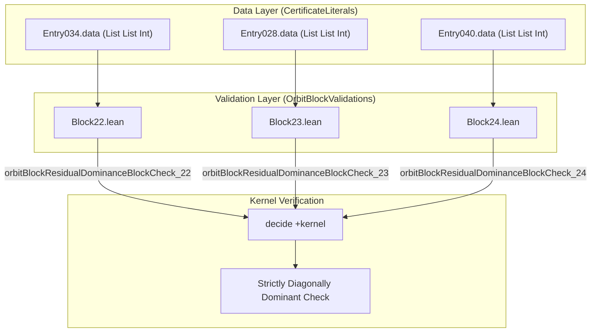
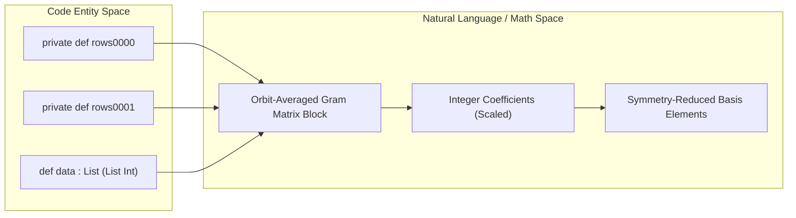

<!-- source: DeepWiki mcp.deepwiki.com · repo openai/ten-proofs · page 4.4 Orbit Canonical Form and Canonical Validations · fetched 2026-10-26 -->

# Orbit Canonical Form and Canonical Validations

Relevant source files

The following files were used as context for generating this wiki page:

- [ConnesRigidity/CertificateLiterals/PropertyTExactCertificateCoefficientEdgePackets/Positive266/Entry000.lean](ConnesRigidity/CertificateLiterals/PropertyTExactCertificateCoefficientEdgePackets/Positive266/Entry000.lean)
- [ConnesRigidity/CertificateLiterals/PropertyTExactCertificateOrbitBlockLocalData/Entry003.lean](ConnesRigidity/CertificateLiterals/PropertyTExactCertificateOrbitBlockLocalData/Entry003.lean)
- [ConnesRigidity/CertificateLiterals/PropertyTExactCertificateOrbitBlockLocalData/Entry004.lean](ConnesRigidity/CertificateLiterals/PropertyTExactCertificateOrbitBlockLocalData/Entry004.lean)
- [ConnesRigidity/CertificateLiterals/PropertyTExactCertificateOrbitBlockLocalData/Entry005.lean](ConnesRigidity/CertificateLiterals/PropertyTExactCertificateOrbitBlockLocalData/Entry005.lean)
- [ConnesRigidity/CertificateLiterals/PropertyTExactCertificateOrbitBlockLocalData/Entry011.lean](ConnesRigidity/CertificateLiterals/PropertyTExactCertificateOrbitBlockLocalData/Entry011.lean)
- [ConnesRigidity/CertificateLiterals/PropertyTExactCertificateOrbitBlockLocalData/Entry012.lean](ConnesRigidity/CertificateLiterals/PropertyTExactCertificateOrbitBlockLocalData/Entry012.lean)
- [ConnesRigidity/CertificateLiterals/PropertyTExactCertificateOrbitBlockLocalData/Entry013.lean](ConnesRigidity/CertificateLiterals/PropertyTExactCertificateOrbitBlockLocalData/Entry013.lean)
- [ConnesRigidity/CertificateLiterals/PropertyTExactCertificateOrbitBlockLocalData/Entry014.lean](ConnesRigidity/CertificateLiterals/PropertyTExactCertificateOrbitBlockLocalData/Entry014.lean)
- [ConnesRigidity/CertificateLiterals/PropertyTExactCertificateOrbitBlockLocalData/Entry015.lean](ConnesRigidity/CertificateLiterals/PropertyTExactCertificateOrbitBlockLocalData/Entry015.lean)
- [ConnesRigidity/CertificateLiterals/PropertyTExactCertificateOrbitBlockLocalData/Entry016.lean](ConnesRigidity/CertificateLiterals/PropertyTExactCertificateOrbitBlockLocalData/Entry016.lean)
- [ConnesRigidity/CertificateLiterals/PropertyTExactCertificateOrbitBlockLocalData/Entry017.lean](ConnesRigidity/CertificateLiterals/PropertyTExactCertificateOrbitBlockLocalData/Entry017.lean)
- [ConnesRigidity/CertificateLiterals/PropertyTExactCertificateOrbitBlockLocalData/Entry018.lean](ConnesRigidity/CertificateLiterals/PropertyTExactCertificateOrbitBlockLocalData/Entry018.lean)
- [ConnesRigidity/CertificateLiterals/PropertyTExactCertificateOrbitBlockLocalData/Entry019.lean](ConnesRigidity/CertificateLiterals/PropertyTExactCertificateOrbitBlockLocalData/Entry019.lean)
- [ConnesRigidity/CertificateLiterals/PropertyTExactCertificateOrbitBlockLocalData/Entry020.lean](ConnesRigidity/CertificateLiterals/PropertyTExactCertificateOrbitBlockLocalData/Entry020.lean)
- [ConnesRigidity/CertificateLiterals/PropertyTExactCertificateOrbitBlockLocalData/Entry021.lean](ConnesRigidity/CertificateLiterals/PropertyTExactCertificateOrbitBlockLocalData/Entry021.lean)
- [ConnesRigidity/CertificateLiterals/PropertyTExactCertificateOrbitBlockLocalData/Entry022.lean](ConnesRigidity/CertificateLiterals/PropertyTExactCertificateOrbitBlockLocalData/Entry022.lean)
- [ConnesRigidity/CertificateLiterals/PropertyTExactCertificateOrbitBlockLocalData/Entry023.lean](ConnesRigidity/CertificateLiterals/PropertyTExactCertificateOrbitBlockLocalData/Entry023.lean)
- [ConnesRigidity/CertificateLiterals/PropertyTExactCertificateOrbitBlockLocalData/Entry026.lean](ConnesRigidity/CertificateLiterals/PropertyTExactCertificateOrbitBlockLocalData/Entry026.lean)
- [ConnesRigidity/CertificateLiterals/PropertyTExactCertificateOrbitBlockLocalData/Entry027.lean](ConnesRigidity/CertificateLiterals/PropertyTExactCertificateOrbitBlockLocalData/Entry027.lean)
- [ConnesRigidity/CertificateLiterals/PropertyTExactCertificateOrbitBlockLocalData/Entry028.lean](ConnesRigidity/CertificateLiterals/PropertyTExactCertificateOrbitBlockLocalData/Entry028.lean)
- [ConnesRigidity/CertificateLiterals/PropertyTExactCertificateOrbitBlockLocalData/Entry029.lean](ConnesRigidity/CertificateLiterals/PropertyTExactCertificateOrbitBlockLocalData/Entry029.lean)
- [ConnesRigidity/CertificateLiterals/PropertyTExactCertificateOrbitBlockLocalData/Entry030.lean](ConnesRigidity/CertificateLiterals/PropertyTExactCertificateOrbitBlockLocalData/Entry030.lean)
- [ConnesRigidity/CertificateLiterals/PropertyTExactCertificateOrbitBlockLocalData/Entry031.lean](ConnesRigidity/CertificateLiterals/PropertyTExactCertificateOrbitBlockLocalData/Entry031.lean)
- [ConnesRigidity/CertificateLiterals/PropertyTExactCertificateOrbitBlockLocalData/Entry032.lean](ConnesRigidity/CertificateLiterals/PropertyTExactCertificateOrbitBlockLocalData/Entry032.lean)
- [ConnesRigidity/CertificateLiterals/PropertyTExactCertificateOrbitBlockLocalData/Entry033.lean](ConnesRigidity/CertificateLiterals/PropertyTExactCertificateOrbitBlockLocalData/Entry033.lean)
- [ConnesRigidity/CertificateLiterals/PropertyTExactCertificateOrbitBlockLocalData/Entry034.lean](ConnesRigidity/CertificateLiterals/PropertyTExactCertificateOrbitBlockLocalData/Entry034.lean)
- [ConnesRigidity/CertificateLiterals/PropertyTExactCertificateOrbitBlockLocalData/Entry035.lean](ConnesRigidity/CertificateLiterals/PropertyTExactCertificateOrbitBlockLocalData/Entry035.lean)
- [ConnesRigidity/CertificateLiterals/PropertyTExactCertificateOrbitBlockLocalData/Entry036.lean](ConnesRigidity/CertificateLiterals/PropertyTExactCertificateOrbitBlockLocalData/Entry036.lean)
- [ConnesRigidity/CertificateLiterals/PropertyTExactCertificateOrbitBlockLocalData/Entry037.lean](ConnesRigidity/CertificateLiterals/PropertyTExactCertificateOrbitBlockLocalData/Entry037.lean)
- [ConnesRigidity/CertificateLiterals/PropertyTExactCertificateOrbitBlockLocalData/Entry038.lean](ConnesRigidity/CertificateLiterals/PropertyTExactCertificateOrbitBlockLocalData/Entry038.lean)
- [ConnesRigidity/CertificateLiterals/PropertyTExactCertificateOrbitBlockLocalData/Entry039.lean](ConnesRigidity/CertificateLiterals/PropertyTExactCertificateOrbitBlockLocalData/Entry039.lean)
- [ConnesRigidity/CertificateLiterals/PropertyTExactCertificateOrbitBlockLocalData/Entry040.lean](ConnesRigidity/CertificateLiterals/PropertyTExactCertificateOrbitBlockLocalData/Entry040.lean)
- [ConnesRigidity/CertificateLiterals/PropertyTExactCertificateOrbitBlockLocalData/Entry041.lean](ConnesRigidity/CertificateLiterals/PropertyTExactCertificateOrbitBlockLocalData/Entry041.lean)
- [ConnesRigidity/CertificateLiterals/PropertyTExactCertificateOrbitBlockLocalData/Entry054.lean](ConnesRigidity/CertificateLiterals/PropertyTExactCertificateOrbitBlockLocalData/Entry054.lean)
- [ConnesRigidity/CertificateLiterals/PropertyTExactCertificateOrbitBlockLocalData/Entry055.lean](ConnesRigidity/CertificateLiterals/PropertyTExactCertificateOrbitBlockLocalData/Entry055.lean)
- [ConnesRigidity/CertificateLiterals/PropertyTExactCertificateOrbitBlockLocalData/Entry056.lean](ConnesRigidity/CertificateLiterals/PropertyTExactCertificateOrbitBlockLocalData/Entry056.lean)
- [ConnesRigidity/CertificateLiterals/PropertyTExactCertificateOrbitBlockLocalData/Entry057.lean](ConnesRigidity/CertificateLiterals/PropertyTExactCertificateOrbitBlockLocalData/Entry057.lean)
- [ConnesRigidity/CertificateLiterals/PropertyTExactCertificateOrbitBlockLocalData/Entry058.lean](ConnesRigidity/CertificateLiterals/PropertyTExactCertificateOrbitBlockLocalData/Entry058.lean)
- [ConnesRigidity/CertificateLiterals/PropertyTExactCertificateOrbitBlockLocalData/Entry059.lean](ConnesRigidity/CertificateLiterals/PropertyTExactCertificateOrbitBlockLocalData/Entry059.lean)
- [ConnesRigidity/CertificateLiterals/PropertyTExactCertificateOrbitBlockLocalData/Entry060.lean](ConnesRigidity/CertificateLiterals/PropertyTExactCertificateOrbitBlockLocalData/Entry060.lean)
- [ConnesRigidity/CertificateLiterals/PropertyTExactCertificateOrbitBlockLocalData/Entry061.lean](ConnesRigidity/CertificateLiterals/PropertyTExactCertificateOrbitBlockLocalData/Entry061.lean)
- [ConnesRigidity/CertificateLiterals/PropertyTExactCertificateOrbitBlockLocalData/Entry062.lean](ConnesRigidity/CertificateLiterals/PropertyTExactCertificateOrbitBlockLocalData/Entry062.lean)
- [ConnesRigidity/CertificateLiterals/PropertyTExactCertificateOrbitBlockLocalData/Entry063.lean](ConnesRigidity/CertificateLiterals/PropertyTExactCertificateOrbitBlockLocalData/Entry063.lean)
- [ConnesRigidity/CertificateLiterals/PropertyTExactCertificateOrbitBlockLocalData/Entry064.lean](ConnesRigidity/CertificateLiterals/PropertyTExactCertificateOrbitBlockLocalData/Entry064.lean)
- [ConnesRigidity/CertificateLiterals/PropertyTExactCertificateOrbitBlockLocalData/Entry065.lean](ConnesRigidity/CertificateLiterals/PropertyTExactCertificateOrbitBlockLocalData/Entry065.lean)
- [ConnesRigidity/CertificateLiterals/PropertyTExactCertificateOrbitBlockLocalData/Entry067.lean](ConnesRigidity/CertificateLiterals/PropertyTExactCertificateOrbitBlockLocalData/Entry067.lean)
- [ConnesRigidity/CertificateLiterals/PropertyTExactCertificateOrbitBlockLocalData/Entry068.lean](ConnesRigidity/CertificateLiterals/PropertyTExactCertificateOrbitBlockLocalData/Entry068.lean)
- [ConnesRigidity/CertificateLiterals/PropertyTExactCertificateOrbitBlockLocalData/Entry070.lean](ConnesRigidity/CertificateLiterals/PropertyTExactCertificateOrbitBlockLocalData/Entry070.lean)
- [ConnesRigidity/CertificateLiterals/PropertyTExactCertificateOrbitBlockLocalData/Entry074.lean](ConnesRigidity/CertificateLiterals/PropertyTExactCertificateOrbitBlockLocalData/Entry074.lean)
- [ConnesRigidity/CertificateLiterals/PropertyTExactCertificateOrbitBlockLocalData/Entry076.lean](ConnesRigidity/CertificateLiterals/PropertyTExactCertificateOrbitBlockLocalData/Entry076.lean)
- [ConnesRigidity/CertificateLiterals/PropertyTExactCertificateOrbitBlockLocalData/Entry078.lean](ConnesRigidity/CertificateLiterals/PropertyTExactCertificateOrbitBlockLocalData/Entry078.lean)
- [ConnesRigidity/CertificateLiterals/PropertyTExactCertificateOrbitBlockLocalData/Entry079.lean](ConnesRigidity/CertificateLiterals/PropertyTExactCertificateOrbitBlockLocalData/Entry079.lean)
- [ConnesRigidity/CertificateLiterals/PropertyTExactCertificateOrbitBlockLocalData/Entry080.lean](ConnesRigidity/CertificateLiterals/PropertyTExactCertificateOrbitBlockLocalData/Entry080.lean)
- [ConnesRigidity/CertificateLiterals/PropertyTExactCertificateOrbitBlockLocalData/Entry081.lean](ConnesRigidity/CertificateLiterals/PropertyTExactCertificateOrbitBlockLocalData/Entry081.lean)
- [ConnesRigidity/CertificateLiterals/PropertyTExactCertificateOrbitBlockLocalData/Entry082.lean](ConnesRigidity/CertificateLiterals/PropertyTExactCertificateOrbitBlockLocalData/Entry082.lean)
- [ConnesRigidity/CertificateLiterals/PropertyTExactCertificateOrbitBlockLocalData/Entry083.lean](ConnesRigidity/CertificateLiterals/PropertyTExactCertificateOrbitBlockLocalData/Entry083.lean)
- [ConnesRigidity/CertificateLiterals/PropertyTExactCertificateOrbitRadixData/Entry003.lean](ConnesRigidity/CertificateLiterals/PropertyTExactCertificateOrbitRadixData/Entry003.lean)
- [ConnesRigidity/CertificateLiterals/PropertyTExactCertificateOrbitRadixData/Entry006.lean](ConnesRigidity/CertificateLiterals/PropertyTExactCertificateOrbitRadixData/Entry006.lean)
- [ConnesRigidity/CertificateLiterals/PropertyTExactCertificateOrbitSymmetryWordData/Entry002.lean](ConnesRigidity/CertificateLiterals/PropertyTExactCertificateOrbitSymmetryWordData/Entry002.lean)
- [ConnesRigidity/PropertyTExactCertificateOrbitBlockValidations/Block00.lean](ConnesRigidity/PropertyTExactCertificateOrbitBlockValidations/Block00.lean)
- [ConnesRigidity/PropertyTExactCertificateOrbitBlockValidations/Block01.lean](ConnesRigidity/PropertyTExactCertificateOrbitBlockValidations/Block01.lean)
- [ConnesRigidity/PropertyTExactCertificateOrbitBlockValidations/Block02.lean](ConnesRigidity/PropertyTExactCertificateOrbitBlockValidations/Block02.lean)
- [ConnesRigidity/PropertyTExactCertificateOrbitBlockValidations/Block03.lean](ConnesRigidity/PropertyTExactCertificateOrbitBlockValidations/Block03.lean)
- [ConnesRigidity/PropertyTExactCertificateOrbitBlockValidations/Block04.lean](ConnesRigidity/PropertyTExactCertificateOrbitBlockValidations/Block04.lean)
- [ConnesRigidity/PropertyTExactCertificateOrbitBlockValidations/Block05.lean](ConnesRigidity/PropertyTExactCertificateOrbitBlockValidations/Block05.lean)
- [ConnesRigidity/PropertyTExactCertificateOrbitBlockValidations/Block06.lean](ConnesRigidity/PropertyTExactCertificateOrbitBlockValidations/Block06.lean)
- [ConnesRigidity/PropertyTExactCertificateOrbitBlockValidations/Block07.lean](ConnesRigidity/PropertyTExactCertificateOrbitBlockValidations/Block07.lean)
- [ConnesRigidity/PropertyTExactCertificateOrbitBlockValidations/Block08.lean](ConnesRigidity/PropertyTExactCertificateOrbitBlockValidations/Block08.lean)
- [ConnesRigidity/PropertyTExactCertificateOrbitBlockValidations/Block09.lean](ConnesRigidity/PropertyTExactCertificateOrbitBlockValidations/Block09.lean)
- [ConnesRigidity/PropertyTExactCertificateOrbitBlockValidations/Block10.lean](ConnesRigidity/PropertyTExactCertificateOrbitBlockValidations/Block10.lean)
- [ConnesRigidity/PropertyTExactCertificateOrbitBlockValidations/Block11.lean](ConnesRigidity/PropertyTExactCertificateOrbitBlockValidations/Block11.lean)
- [ConnesRigidity/PropertyTExactCertificateOrbitBlockValidations/Block12.lean](ConnesRigidity/PropertyTExactCertificateOrbitBlockValidations/Block12.lean)
- [ConnesRigidity/PropertyTExactCertificateOrbitBlockValidations/Block13.lean](ConnesRigidity/PropertyTExactCertificateOrbitBlockValidations/Block13.lean)
- [ConnesRigidity/PropertyTExactCertificateOrbitBlockValidations/Block14.lean](ConnesRigidity/PropertyTExactCertificateOrbitBlockValidations/Block14.lean)
- [ConnesRigidity/PropertyTExactCertificateOrbitBlockValidations/Block15.lean](ConnesRigidity/PropertyTExactCertificateOrbitBlockValidations/Block15.lean)
- [ConnesRigidity/PropertyTExactCertificateOrbitBlockValidations/Block16.lean](ConnesRigidity/PropertyTExactCertificateOrbitBlockValidations/Block16.lean)
- [ConnesRigidity/PropertyTExactCertificateOrbitBlockValidations/Block17.lean](ConnesRigidity/PropertyTExactCertificateOrbitBlockValidations/Block17.lean)
- [ConnesRigidity/PropertyTExactCertificateOrbitBlockValidations/Block18.lean](ConnesRigidity/PropertyTExactCertificateOrbitBlockValidations/Block18.lean)
- [ConnesRigidity/PropertyTExactCertificateOrbitBlockValidations/Block19.lean](ConnesRigidity/PropertyTExactCertificateOrbitBlockValidations/Block19.lean)
- [ConnesRigidity/PropertyTExactCertificateOrbitBlockValidations/Block20.lean](ConnesRigidity/PropertyTExactCertificateOrbitBlockValidations/Block20.lean)
- [ConnesRigidity/PropertyTExactCertificateOrbitBlockValidations/Block21.lean](ConnesRigidity/PropertyTExactCertificateOrbitBlockValidations/Block21.lean)
- [ConnesRigidity/PropertyTExactCertificateOrbitBlockValidations/Block22.lean](ConnesRigidity/PropertyTExactCertificateOrbitBlockValidations/Block22.lean)
- [ConnesRigidity/PropertyTExactCertificateOrbitBlockValidations/Block23.lean](ConnesRigidity/PropertyTExactCertificateOrbitBlockValidations/Block23.lean)
- [ConnesRigidity/PropertyTExactCertificateOrbitBlockValidations/Block24.lean](ConnesRigidity/PropertyTExactCertificateOrbitBlockValidations/Block24.lean)
- [ConnesRigidity/PropertyTExactCertificateOrbitBlockValidations/Block25.lean](ConnesRigidity/PropertyTExactCertificateOrbitBlockValidations/Block25.lean)
- [ConnesRigidity/PropertyTExactCertificateOrbitBlockValidations/Block26.lean](ConnesRigidity/PropertyTExactCertificateOrbitBlockValidations/Block26.lean)
- [ConnesRigidity/PropertyTExactCertificateOrbitBlockValidations/Block27.lean](ConnesRigidity/PropertyTExactCertificateOrbitBlockValidations/Block27.lean)

This section describes the computational methods used to handle orbit representatives within the symmetry-reduced Property T certificate. The verification process relies on transforming group elements into a **canonical form** to ensure that symmetries are applied consistently across the 425-element basis. This involves a lexicographical ordering (lex-order) and a packed action representation for efficient kernel execution.

## Canonical Form Computation

To exploit the 64-element symmetry group of $\Gamma_0$, every element $g$ in the basis must be mapped to a unique representative $\text{canon}(g)$ of its orbit. The codebase implements this via two primary mechanisms: a fast lexicographical comparison and a packed action representation.

### Lexicographical Canonical Form
The lex-order canonical form is the smallest element in an orbit under a specific ordering of the group generators. This is verified using `decide +kernel` blocks that check if a given representative is indeed the minimum in its orbit.

### Packed Canonical Action
For performance in the Lean kernel, the symmetry actions are "packed" into optimized structures. This avoids re-computing group actions during the validation of the 28 blocks.

**Key Entities:**
*   `orbitBlockFactorIdentityBlockCheck`: Validates that the block-diagonal factors correctly represent the identity within the orbit algebra [ConnesRigidity/PropertyTExactCertificateOrbitBlockValidations/Block22.lean:9-11]().
*   `blockResidualSymmetryBlockCheck`: Ensures that the residual terms after Gram decomposition respect the symmetry constraints [ConnesRigidity/PropertyTExactCertificateOrbitBlockValidations/Block22.lean:14-16]().
*   `blockResidualDominanceBlockCheck`: A kernel validation that the residual blocks are strictly diagonally dominant (SDD) [ConnesRigidity/PropertyTExactCertificateOrbitBlockValidations/Block22.lean:19-21]().

### Data Flow: Orbit Block Validation
The following diagram illustrates how the local block data is ingested by the validation theorems to produce a kernel-verified proof of positivity.

**Sources:** [ConnesRigidity/CertificateLiterals/PropertyTExactCertificateOrbitBlockLocalData/Entry034.lean:15-16](), [ConnesRigidity/PropertyTExactCertificateOrbitBlockValidations/Block22.lean:8-21](), [ConnesRigidity/PropertyTExactCertificateOrbitBlockValidations/Block23.lean:8-21]().

---

## Canonical Packed Validations

The validation of orbit blocks is sharded into individual files (e.g., `Block01.lean` through `Block28.lean`). Each file performs three critical checks using the `decide +kernel` tactic to ensure the mathematical soundness of the symmetry reduction.

### 1. Identity Validation
`blockFactorIdentityBlockCheck` verifies that the mapping between the full group ring and the orbit-reduced algebra preserves the identity element's coefficient, which is essential for the spectral gap calculation.

### 2. Residual Symmetry
`blockResidualSymmetryBlockCheck` confirms that the Gram matrix $G$ satisfies $G = \sigma(G)$ for all $\sigma$ in the symmetry group. This is checked by comparing the computed block against its symmetric image.

### 3. Residual Dominance
`blockResidualDominanceBlockCheck` is the final step in proving the Gram matrix is Positive Semi-Definite (PSD). It checks that the "residual" matrix (the difference between the target matrix and the sum of squares) is strictly diagonally dominant.

| Block File | Data Source | Max Heartbeats | Tactic |
| :--- | :--- | :--- | :--- |
| `Block22.lean` | `Entry034.lean` | 16,000,000 | `decide +kernel` |
| `Block23.lean` | `Entry068.lean` | 16,000,000 | `decide +kernel` |
| `Block24.lean` | `Entry020.lean` | 16,000,000 | `decide +kernel` |

**Sources:** [ConnesRigidity/PropertyTExactCertificateOrbitBlockValidations/Block22.lean:8-21](), [ConnesRigidity/PropertyTExactCertificateOrbitBlockValidations/Block23.lean:8-21](), [ConnesRigidity/PropertyTExactCertificateOrbitBlockValidations/Block24.lean:8-21]().

---

## Data Structure of Orbit Blocks

The orbit blocks are stored as lower-triangular or symmetric matrices in `List (List Int)` format. Large blocks are further sharded into `rowsXXXX` definitions to prevent Lean parser overflows.

**Code Entity to Mathematical Concept Mapping:**

**Sources:** [ConnesRigidity/CertificateLiterals/PropertyTExactCertificateOrbitBlockLocalData/Entry034.lean:6-16](), [ConnesRigidity/CertificateLiterals/PropertyTExactCertificateOrbitBlockLocalData/Entry068.lean:6-16](), [ConnesRigidity/CertificateLiterals/PropertyTExactCertificateOrbitBlockLocalData/Entry012.lean:6-16]().

### Large Block Handling
For blocks with high dimensions (e.g., Entry 012), the data is partitioned into multiple sub-lists (`rows0000` through `rows0007`) to manage memory during kernel reduction [ConnesRigidity/CertificateLiterals/PropertyTExactCertificateOrbitBlockLocalData/Entry012.lean:6-16](). These are concatenated in the final `data` definition used by the validation theorems.

**Sources:** [ConnesRigidity/CertificateLiterals/PropertyTExactCertificateOrbitBlockLocalData/Entry012.lean:6-16](), [ConnesRigidity/CertificateLiterals/PropertyTExactCertificateOrbitBlockLocalData/Entry021.lean:6-16]().

---

