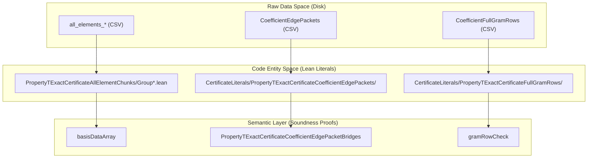
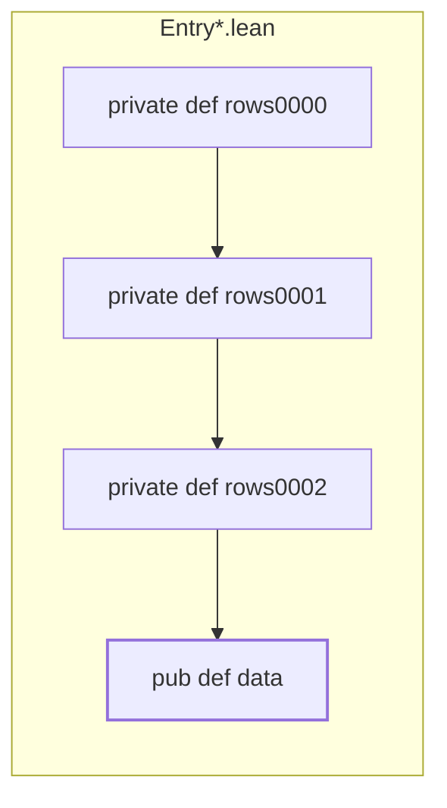

<!-- source: DeepWiki mcp.deepwiki.com · repo openai/ten-proofs · page 5 Certificate Data Layer · fetched 2026-10-26 -->

# Certificate Data Layer

Relevant source files

The following files were used as context for generating this wiki page:

- [ConnesRigidity/CertificateLiterals/PropertyTExactCertificateCoefficientEdgePackets/Positive024/Entry000.lean](ConnesRigidity/CertificateLiterals/PropertyTExactCertificateCoefficientEdgePackets/Positive024/Entry000.lean)
- [ConnesRigidity/CertificateLiterals/PropertyTExactCertificateCoefficientEdgePackets/Positive033/Entry000.lean](ConnesRigidity/CertificateLiterals/PropertyTExactCertificateCoefficientEdgePackets/Positive033/Entry000.lean)
- [ConnesRigidity/CertificateLiterals/PropertyTExactCertificateCoefficientEdgePackets/Positive052/Entry000.lean](ConnesRigidity/CertificateLiterals/PropertyTExactCertificateCoefficientEdgePackets/Positive052/Entry000.lean)
- [ConnesRigidity/CertificateLiterals/PropertyTExactCertificateCoefficientEdgePackets/Positive053/Entry000.lean](ConnesRigidity/CertificateLiterals/PropertyTExactCertificateCoefficientEdgePackets/Positive053/Entry000.lean)
- [ConnesRigidity/CertificateLiterals/PropertyTExactCertificateCoefficientEdgePackets/Positive057/Entry000.lean](ConnesRigidity/CertificateLiterals/PropertyTExactCertificateCoefficientEdgePackets/Positive057/Entry000.lean)
- [ConnesRigidity/CertificateLiterals/PropertyTExactCertificateCoefficientEdgePackets/Positive086/Entry000.lean](ConnesRigidity/CertificateLiterals/PropertyTExactCertificateCoefficientEdgePackets/Positive086/Entry000.lean)
- [ConnesRigidity/CertificateLiterals/PropertyTExactCertificateCoefficientEdgePackets/Positive113/Entry000.lean](ConnesRigidity/CertificateLiterals/PropertyTExactCertificateCoefficientEdgePackets/Positive113/Entry000.lean)
- [ConnesRigidity/CertificateLiterals/PropertyTExactCertificateCoefficientEdgePackets/Positive119/Entry000.lean](ConnesRigidity/CertificateLiterals/PropertyTExactCertificateCoefficientEdgePackets/Positive119/Entry000.lean)
- [ConnesRigidity/CertificateLiterals/PropertyTExactCertificateCoefficientEdgePackets/Positive122/Entry000.lean](ConnesRigidity/CertificateLiterals/PropertyTExactCertificateCoefficientEdgePackets/Positive122/Entry000.lean)
- [ConnesRigidity/CertificateLiterals/PropertyTExactCertificateCoefficientEdgePackets/Positive134/Entry000.lean](ConnesRigidity/CertificateLiterals/PropertyTExactCertificateCoefficientEdgePackets/Positive134/Entry000.lean)
- [ConnesRigidity/CertificateLiterals/PropertyTExactCertificateCoefficientEdgePackets/Positive140/Entry000.lean](ConnesRigidity/CertificateLiterals/PropertyTExactCertificateCoefficientEdgePackets/Positive140/Entry000.lean)
- [ConnesRigidity/CertificateLiterals/PropertyTExactCertificateCoefficientEdgePackets/Positive154/Entry000.lean](ConnesRigidity/CertificateLiterals/PropertyTExactCertificateCoefficientEdgePackets/Positive154/Entry000.lean)
- [ConnesRigidity/CertificateLiterals/PropertyTExactCertificateCoefficientEdgePackets/Positive162/Entry000.lean](ConnesRigidity/CertificateLiterals/PropertyTExactCertificateCoefficientEdgePackets/Positive162/Entry000.lean)
- [ConnesRigidity/CertificateLiterals/PropertyTExactCertificateCoefficientEdgePackets/Positive224/Entry000.lean](ConnesRigidity/CertificateLiterals/PropertyTExactCertificateCoefficientEdgePackets/Positive224/Entry000.lean)
- [ConnesRigidity/CertificateLiterals/PropertyTExactCertificateCoefficientEdgePackets/Positive227/Entry000.lean](ConnesRigidity/CertificateLiterals/PropertyTExactCertificateCoefficientEdgePackets/Positive227/Entry000.lean)
- [ConnesRigidity/CertificateLiterals/PropertyTExactCertificateCoefficientEdgePackets/Positive233/Entry000.lean](ConnesRigidity/CertificateLiterals/PropertyTExactCertificateCoefficientEdgePackets/Positive233/Entry000.lean)
- [ConnesRigidity/CertificateLiterals/PropertyTExactCertificateCoefficientEdgePackets/Positive236/Entry000.lean](ConnesRigidity/CertificateLiterals/PropertyTExactCertificateCoefficientEdgePackets/Positive236/Entry000.lean)
- [ConnesRigidity/CertificateLiterals/PropertyTExactCertificateCoefficientEdgePackets/Positive248/Entry000.lean](ConnesRigidity/CertificateLiterals/PropertyTExactCertificateCoefficientEdgePackets/Positive248/Entry000.lean)
- [ConnesRigidity/CertificateLiterals/PropertyTExactCertificateCoefficientEdgePackets/Positive258/Entry000.lean](ConnesRigidity/CertificateLiterals/PropertyTExactCertificateCoefficientEdgePackets/Positive258/Entry000.lean)
- [ConnesRigidity/CertificateLiterals/PropertyTExactCertificateCoefficientEdgePackets/Positive261/Entry000.lean](ConnesRigidity/CertificateLiterals/PropertyTExactCertificateCoefficientEdgePackets/Positive261/Entry000.lean)
- [ConnesRigidity/CertificateLiterals/PropertyTExactCertificateCoefficientEdgePackets/Positive265/Entry000.lean](ConnesRigidity/CertificateLiterals/PropertyTExactCertificateCoefficientEdgePackets/Positive265/Entry000.lean)
- [ConnesRigidity/CertificateLiterals/PropertyTExactCertificateFullGramRows/Entry048.lean](ConnesRigidity/CertificateLiterals/PropertyTExactCertificateFullGramRows/Entry048.lean)
- [ConnesRigidity/CertificateLiterals/PropertyTExactCertificateFullGramRows/Entry115.lean](ConnesRigidity/CertificateLiterals/PropertyTExactCertificateFullGramRows/Entry115.lean)
- [ConnesRigidity/CertificateLiterals/PropertyTExactCertificateFullGramRows/Entry120.lean](ConnesRigidity/CertificateLiterals/PropertyTExactCertificateFullGramRows/Entry120.lean)
- [ConnesRigidity/CertificateLiterals/PropertyTExactCertificateFullGramRows/Entry132.lean](ConnesRigidity/CertificateLiterals/PropertyTExactCertificateFullGramRows/Entry132.lean)
- [ConnesRigidity/CertificateLiterals/PropertyTExactCertificateFullGramRows/Entry149.lean](ConnesRigidity/CertificateLiterals/PropertyTExactCertificateFullGramRows/Entry149.lean)
- [ConnesRigidity/CertificateLiterals/PropertyTExactCertificateFullGramRows/Entry153.lean](ConnesRigidity/CertificateLiterals/PropertyTExactCertificateFullGramRows/Entry153.lean)
- [ConnesRigidity/CertificateLiterals/PropertyTExactCertificateFullGramRows/Entry159.lean](ConnesRigidity/CertificateLiterals/PropertyTExactCertificateFullGramRows/Entry159.lean)
- [ConnesRigidity/CertificateLiterals/PropertyTExactCertificateFullGramRows/Entry167.lean](ConnesRigidity/CertificateLiterals/PropertyTExactCertificateFullGramRows/Entry167.lean)
- [ConnesRigidity/CertificateLiterals/PropertyTExactCertificateFullGramRows/Entry174.lean](ConnesRigidity/CertificateLiterals/PropertyTExactCertificateFullGramRows/Entry174.lean)
- [ConnesRigidity/CertificateLiterals/PropertyTExactCertificateFullGramRows/Entry183.lean](ConnesRigidity/CertificateLiterals/PropertyTExactCertificateFullGramRows/Entry183.lean)
- [ConnesRigidity/CertificateLiterals/PropertyTExactCertificateFullGramRows/Entry188.lean](ConnesRigidity/CertificateLiterals/PropertyTExactCertificateFullGramRows/Entry188.lean)
- [ConnesRigidity/CertificateLiterals/PropertyTExactCertificateFullGramRows/Entry234.lean](ConnesRigidity/CertificateLiterals/PropertyTExactCertificateFullGramRows/Entry234.lean)
- [ConnesRigidity/CertificateLiterals/PropertyTExactCertificateFullGramRows/Entry256.lean](ConnesRigidity/CertificateLiterals/PropertyTExactCertificateFullGramRows/Entry256.lean)
- [ConnesRigidity/CertificateLiterals/PropertyTExactCertificateFullGramRows/Entry284.lean](ConnesRigidity/CertificateLiterals/PropertyTExactCertificateFullGramRows/Entry284.lean)
- [ConnesRigidity/CertificateLiterals/PropertyTExactCertificateFullGramRows/Entry288.lean](ConnesRigidity/CertificateLiterals/PropertyTExactCertificateFullGramRows/Entry288.lean)
- [ConnesRigidity/CertificateLiterals/PropertyTExactCertificateFullGramRows/Entry290.lean](ConnesRigidity/CertificateLiterals/PropertyTExactCertificateFullGramRows/Entry290.lean)
- [ConnesRigidity/CertificateLiterals/PropertyTExactCertificateFullGramRows/Entry292.lean](ConnesRigidity/CertificateLiterals/PropertyTExactCertificateFullGramRows/Entry292.lean)
- [ConnesRigidity/CertificateLiterals/PropertyTExactCertificateFullGramRows/Entry293.lean](ConnesRigidity/CertificateLiterals/PropertyTExactCertificateFullGramRows/Entry293.lean)
- [ConnesRigidity/CertificateLiterals/PropertyTExactCertificateFullGramRows/Entry296.lean](ConnesRigidity/CertificateLiterals/PropertyTExactCertificateFullGramRows/Entry296.lean)
- [ConnesRigidity/CertificateLiterals/PropertyTExactCertificateFullGramRows/Entry302.lean](ConnesRigidity/CertificateLiterals/PropertyTExactCertificateFullGramRows/Entry302.lean)
- [ConnesRigidity/CertificateLiterals/PropertyTExactCertificateFullGramRows/Entry303.lean](ConnesRigidity/CertificateLiterals/PropertyTExactCertificateFullGramRows/Entry303.lean)
- [ConnesRigidity/CertificateLiterals/PropertyTExactCertificateFullGramRows/Entry304.lean](ConnesRigidity/CertificateLiterals/PropertyTExactCertificateFullGramRows/Entry304.lean)
- [ConnesRigidity/CertificateLiterals/PropertyTExactCertificateFullGramRows/Entry305.lean](ConnesRigidity/CertificateLiterals/PropertyTExactCertificateFullGramRows/Entry305.lean)
- [ConnesRigidity/CertificateLiterals/PropertyTExactCertificateFullGramRows/Entry319.lean](ConnesRigidity/CertificateLiterals/PropertyTExactCertificateFullGramRows/Entry319.lean)
- [ConnesRigidity/CertificateLiterals/PropertyTExactCertificateFullGramRows/Entry321.lean](ConnesRigidity/CertificateLiterals/PropertyTExactCertificateFullGramRows/Entry321.lean)
- [ConnesRigidity/CertificateLiterals/PropertyTExactCertificateFullGramRows/Entry327.lean](ConnesRigidity/CertificateLiterals/PropertyTExactCertificateFullGramRows/Entry327.lean)
- [ConnesRigidity/CertificateLiterals/PropertyTExactCertificateFullGramRows/Entry340.lean](ConnesRigidity/CertificateLiterals/PropertyTExactCertificateFullGramRows/Entry340.lean)
- [ConnesRigidity/CertificateLiterals/PropertyTExactCertificateFullGramRows/Entry359.lean](ConnesRigidity/CertificateLiterals/PropertyTExactCertificateFullGramRows/Entry359.lean)
- [ConnesRigidity/CertificateLiterals/PropertyTExactCertificateFullGramRows/Entry362.lean](ConnesRigidity/CertificateLiterals/PropertyTExactCertificateFullGramRows/Entry362.lean)
- [ConnesRigidity/CertificateLiterals/PropertyTExactCertificateFullGramRows/Entry372.lean](ConnesRigidity/CertificateLiterals/PropertyTExactCertificateFullGramRows/Entry372.lean)
- [ConnesRigidity/CertificateLiterals/PropertyTExactCertificateFullGramRows/Entry386.lean](ConnesRigidity/CertificateLiterals/PropertyTExactCertificateFullGramRows/Entry386.lean)
- [ConnesRigidity/CertificateLiterals/PropertyTExactCertificateFullGramRows/Entry387.lean](ConnesRigidity/CertificateLiterals/PropertyTExactCertificateFullGramRows/Entry387.lean)
- [ConnesRigidity/CertificateLiterals/PropertyTExactCertificateFullGramRows/Entry393.lean](ConnesRigidity/CertificateLiterals/PropertyTExactCertificateFullGramRows/Entry393.lean)
- [ConnesRigidity/CertificateLiterals/PropertyTExactCertificateFullGramRows/Entry394.lean](ConnesRigidity/CertificateLiterals/PropertyTExactCertificateFullGramRows/Entry394.lean)
- [ConnesRigidity/CertificateLiterals/PropertyTExactCertificateFullGramRows/Entry408.lean](ConnesRigidity/CertificateLiterals/PropertyTExactCertificateFullGramRows/Entry408.lean)
- [ConnesRigidity/Certificates/AffineSymplectic/Chunks/all_elements_000](ConnesRigidity/Certificates/AffineSymplectic/Chunks/all_elements_000)
- [ConnesRigidity/Certificates/AffineSymplectic/Chunks/all_elements_003](ConnesRigidity/Certificates/AffineSymplectic/Chunks/all_elements_003)
- [ConnesRigidity/Certificates/AffineSymplectic/Chunks/all_elements_005](ConnesRigidity/Certificates/AffineSymplectic/Chunks/all_elements_005)
- [ConnesRigidity/Certificates/AffineSymplectic/Chunks/all_elements_006](ConnesRigidity/Certificates/AffineSymplectic/Chunks/all_elements_006)
- [ConnesRigidity/Certificates/AffineSymplectic/Chunks/all_elements_010](ConnesRigidity/Certificates/AffineSymplectic/Chunks/all_elements_010)
- [ConnesRigidity/Certificates/AffineSymplectic/Chunks/all_elements_011](ConnesRigidity/Certificates/AffineSymplectic/Chunks/all_elements_011)
- [ConnesRigidity/Certificates/AffineSymplectic/Chunks/all_elements_012](ConnesRigidity/Certificates/AffineSymplectic/Chunks/all_elements_012)
- [ConnesRigidity/Certificates/AffineSymplectic/Chunks/all_elements_013](ConnesRigidity/Certificates/AffineSymplectic/Chunks/all_elements_013)
- [ConnesRigidity/Certificates/AffineSymplectic/Chunks/all_elements_015](ConnesRigidity/Certificates/AffineSymplectic/Chunks/all_elements_015)
- [ConnesRigidity/Certificates/AffineSymplectic/Chunks/all_elements_016](ConnesRigidity/Certificates/AffineSymplectic/Chunks/all_elements_016)
- [ConnesRigidity/Certificates/AffineSymplectic/Chunks/all_elements_017](ConnesRigidity/Certificates/AffineSymplectic/Chunks/all_elements_017)
- [ConnesRigidity/Certificates/AffineSymplectic/Chunks/all_elements_018](ConnesRigidity/Certificates/AffineSymplectic/Chunks/all_elements_018)
- [ConnesRigidity/Certificates/AffineSymplectic/Chunks/all_elements_019](ConnesRigidity/Certificates/AffineSymplectic/Chunks/all_elements_019)
- [ConnesRigidity/Certificates/AffineSymplectic/Chunks/all_elements_020](ConnesRigidity/Certificates/AffineSymplectic/Chunks/all_elements_020)
- [ConnesRigidity/Certificates/AffineSymplectic/Chunks/all_elements_023](ConnesRigidity/Certificates/AffineSymplectic/Chunks/all_elements_023)
- [ConnesRigidity/Certificates/AffineSymplectic/Chunks/all_elements_025](ConnesRigidity/Certificates/AffineSymplectic/Chunks/all_elements_025)
- [ConnesRigidity/Certificates/AffineSymplectic/Chunks/all_elements_026](ConnesRigidity/Certificates/AffineSymplectic/Chunks/all_elements_026)
- [ConnesRigidity/Certificates/AffineSymplectic/Chunks/all_elements_027](ConnesRigidity/Certificates/AffineSymplectic/Chunks/all_elements_027)
- [ConnesRigidity/Certificates/AffineSymplectic/Chunks/all_elements_028](ConnesRigidity/Certificates/AffineSymplectic/Chunks/all_elements_028)
- [ConnesRigidity/Certificates/AffineSymplectic/Chunks/all_elements_030](ConnesRigidity/Certificates/AffineSymplectic/Chunks/all_elements_030)
- [ConnesRigidity/Certificates/AffineSymplectic/Chunks/all_elements_031](ConnesRigidity/Certificates/AffineSymplectic/Chunks/all_elements_031)
- [ConnesRigidity/Certificates/AffineSymplectic/Chunks/all_elements_032](ConnesRigidity/Certificates/AffineSymplectic/Chunks/all_elements_032)
- [ConnesRigidity/Certificates/AffineSymplectic/Chunks/all_elements_035](ConnesRigidity/Certificates/AffineSymplectic/Chunks/all_elements_035)
- [ConnesRigidity/Certificates/AffineSymplectic/Chunks/all_elements_038](ConnesRigidity/Certificates/AffineSymplectic/Chunks/all_elements_038)
- [ConnesRigidity/Certificates/AffineSymplectic/Chunks/all_elements_039](ConnesRigidity/Certificates/AffineSymplectic/Chunks/all_elements_039)
- [ConnesRigidity/Certificates/AffineSymplectic/Chunks/all_elements_040](ConnesRigidity/Certificates/AffineSymplectic/Chunks/all_elements_040)
- [ConnesRigidity/Certificates/AffineSymplectic/Chunks/all_elements_041](ConnesRigidity/Certificates/AffineSymplectic/Chunks/all_elements_041)
- [ConnesRigidity/Certificates/AffineSymplectic/Chunks/all_elements_042](ConnesRigidity/Certificates/AffineSymplectic/Chunks/all_elements_042)
- [ConnesRigidity/Certificates/AffineSymplectic/Chunks/all_elements_043](ConnesRigidity/Certificates/AffineSymplectic/Chunks/all_elements_043)
- [ConnesRigidity/Certificates/AffineSymplectic/Chunks/all_elements_044](ConnesRigidity/Certificates/AffineSymplectic/Chunks/all_elements_044)
- [ConnesRigidity/Certificates/AffineSymplectic/Chunks/all_elements_046](ConnesRigidity/Certificates/AffineSymplectic/Chunks/all_elements_046)
- [ConnesRigidity/Certificates/AffineSymplectic/Chunks/all_elements_049](ConnesRigidity/Certificates/AffineSymplectic/Chunks/all_elements_049)
- [ConnesRigidity/Certificates/AffineSymplectic/Chunks/all_elements_050](ConnesRigidity/Certificates/AffineSymplectic/Chunks/all_elements_050)
- [ConnesRigidity/Certificates/AffineSymplectic/Chunks/all_elements_051](ConnesRigidity/Certificates/AffineSymplectic/Chunks/all_elements_051)
- [ConnesRigidity/Certificates/AffineSymplectic/Chunks/all_elements_055](ConnesRigidity/Certificates/AffineSymplectic/Chunks/all_elements_055)
- [ConnesRigidity/Certificates/AffineSymplectic/Chunks/all_elements_057](ConnesRigidity/Certificates/AffineSymplectic/Chunks/all_elements_057)
- [ConnesRigidity/Certificates/AffineSymplectic/Chunks/all_elements_058](ConnesRigidity/Certificates/AffineSymplectic/Chunks/all_elements_058)
- [ConnesRigidity/Certificates/AffineSymplectic/Chunks/all_elements_059](ConnesRigidity/Certificates/AffineSymplectic/Chunks/all_elements_059)
- [ConnesRigidity/Certificates/AffineSymplectic/Chunks/all_elements_060](ConnesRigidity/Certificates/AffineSymplectic/Chunks/all_elements_060)
- [ConnesRigidity/Certificates/AffineSymplectic/Chunks/all_elements_063](ConnesRigidity/Certificates/AffineSymplectic/Chunks/all_elements_063)
- [ConnesRigidity/Certificates/AffineSymplectic/Chunks/all_elements_066](ConnesRigidity/Certificates/AffineSymplectic/Chunks/all_elements_066)
- [ConnesRigidity/Certificates/AffineSymplectic/Chunks/all_elements_068](ConnesRigidity/Certificates/AffineSymplectic/Chunks/all_elements_068)
- [ConnesRigidity/Certificates/AffineSymplectic/Chunks/all_elements_069](ConnesRigidity/Certificates/AffineSymplectic/Chunks/all_elements_069)
- [ConnesRigidity/Certificates/AffineSymplectic/Chunks/all_elements_070](ConnesRigidity/Certificates/AffineSymplectic/Chunks/all_elements_070)
- [ConnesRigidity/Certificates/AffineSymplectic/Chunks/all_elements_071](ConnesRigidity/Certificates/AffineSymplectic/Chunks/all_elements_071)
- [ConnesRigidity/Certificates/AffineSymplectic/Chunks/all_elements_072](ConnesRigidity/Certificates/AffineSymplectic/Chunks/all_elements_072)

The **Certificate Data Layer** manages the massive static datasets required to verify that the group $\Gamma_0$ possesses Kazhdan's Property (T). Given the scale of the certificate (involving a 73,033-element basis and a 425x425 Gram matrix of large integers), the repository employs a structured, three-tier architecture to bridge raw computational output with Lean 4's formal environment.

## Data Architecture Overview

The system transitions data from raw CSV formats into highly optimized Lean modules. This pipeline is designed to bypass Lean compiler memory limits and recursion depth constraints by using a "sharding" strategy.

### Three-Tier Pipeline

1.  **Raw Data Tier**: Large CSV/text files generated by external solvers. These are located in `Certificates/AffineSymplectic/`.
2.  **Literal Tier**: Lean 4 source files that wrap raw integers into `List` or `Array` structures using a hierarchical `private def` pattern to facilitate fast elaboration. These reside in `CertificateLiterals/`.
3.  **Logical Tier**: Lean modules that provide the semantic interpretation of the data (e.g., mapping an integer to a group ring element). These are prefixed with `PropertyTExactCertificate*`.

### Data Flow Diagram

Title: Certificate Data Transformation Flow

**Sources:** [ConnesRigidity/CertificateLiterals/PropertyTExactCertificateFullGramRows/Entry372.lean:1-13](), [ConnesRigidity/CertificateLiterals/PropertyTExactCertificateCoefficientEdgePackets/Positive122/Entry000.lean:1-31]()

---

## Data Categories

The certificate data is partitioned into three primary functional categories, each handled by specific child pages.

### 1. AffineSymplectic Raw Files
The raw data consists of integer vectors representing group elements and coefficients for the spectral gap proof.
*   **Group Elements**: Stored as 20-column integer vectors.
*   **Edge Packets**: 7-column records representing the weights of edges in the Laplacian decomposition.
*   **Gram Rows**: High-precision integer rows of the Gram matrix $Q$.

For details on formats and partitioning, see [AffineSymplectic Raw Certificate Files](#5.1).

**Sources:** [ConnesRigidity/Certificates/AffineSymplectic/Chunks/all_elements_015:1-167](), [ConnesRigidity/Certificates/AffineSymplectic/Chunks/all_elements_010:1-160]()

### 2. Lean Data Modules (CertificateLiterals)
To make these files processable by Lean, data is sharded into hundreds of small files. A common pattern is the use of `private def rowsXXXX` which are then concatenated into a public `data` definition. This prevents the Lean elaborator from attempting to process the entire list in a single pass.

*   **Optimization**: Definitions are often marked `@[irreducible]` or `noncomputable` to prevent the kernel from unfolding them prematurely during general proof steps.
*   **Structure**: Each packet (e.g., `Positive122`) contains an `Entry000.lean` that exports the sharded integers.

For details on the sharding lifecycle, see [CertificateLiterals: Lean Data Modules](#5.2).

**Sources:** [ConnesRigidity/CertificateLiterals/PropertyTExactCertificateCoefficientEdgePackets/Positive261/Entry000.lean:24-30](), [ConnesRigidity/CertificateLiterals/PropertyTExactCertificateFullGramRows/Entry362.lean:4-12]()

### 3. AllElement Chunks and Basis Data
The group ring basis $\mathcal{B}$ contains 73,033 elements. These are partitioned into "Chunks" to allow for parallel verification and to stay within Lean's `maxHeartbeats` limits.
*   **Mapping**: The `gammaZeroOfData` function converts these raw chunks into formal `GammaZero` group elements.
*   **Indexing**: The `basisDataArray` serves as the global lookup table for the entire proof.

For details on basis construction, see [AllElement Chunks and Basis Data](#5.3).

**Sources:** [ConnesRigidity/Certificates/AffineSymplectic/Chunks/all_elements_013:1-168](), [ConnesRigidity/Certificates/AffineSymplectic/Chunks/all_elements_032:1-164]()

---

## Sharding Strategy and Limits

The codebase uses a hierarchical unfolding strategy to manage the large `List` and `Array` literals. 

Title: Hierarchical Unfolding Pattern

By nesting definitions (e.g., `rows0000` calling `rows0001`), the proof engineering avoids hitting the default recursion depth of the Lean compiler. This is critical for the `decide +kernel` tactic used in the final verification.

**Sources:** [ConnesRigidity/CertificateLiterals/PropertyTExactCertificateCoefficientEdgePackets/Positive122/Entry000.lean:6-28](), [ConnesRigidity/CertificateLiterals/PropertyTExactCertificateFullGramRows/Entry149.lean:6-12]()

---

