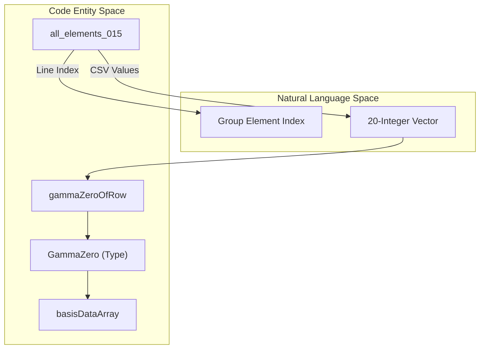
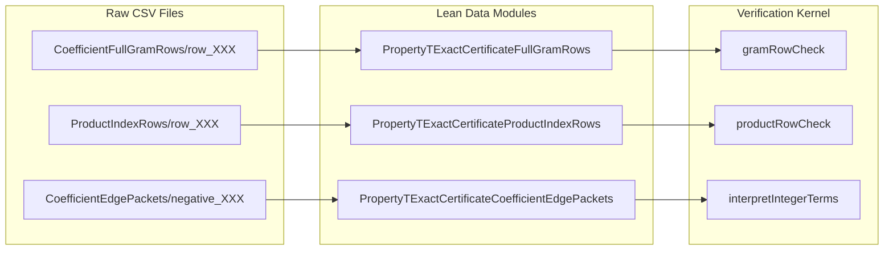

<!-- source: DeepWiki mcp.deepwiki.com · repo openai/ten-proofs · page 5.1 AffineSymplectic Raw Certificate Files · fetched 2026-10-26 -->

# AffineSymplectic Raw Certificate Files

Relevant source files

The following files were used as context for generating this wiki page:

- [ConnesRigidity/Certificates/AffineSymplectic/Chunks/all_elements_000](ConnesRigidity/Certificates/AffineSymplectic/Chunks/all_elements_000)
- [ConnesRigidity/Certificates/AffineSymplectic/Chunks/all_elements_003](ConnesRigidity/Certificates/AffineSymplectic/Chunks/all_elements_003)
- [ConnesRigidity/Certificates/AffineSymplectic/Chunks/all_elements_005](ConnesRigidity/Certificates/AffineSymplectic/Chunks/all_elements_005)
- [ConnesRigidity/Certificates/AffineSymplectic/Chunks/all_elements_006](ConnesRigidity/Certificates/AffineSymplectic/Chunks/all_elements_006)
- [ConnesRigidity/Certificates/AffineSymplectic/Chunks/all_elements_010](ConnesRigidity/Certificates/AffineSymplectic/Chunks/all_elements_010)
- [ConnesRigidity/Certificates/AffineSymplectic/Chunks/all_elements_011](ConnesRigidity/Certificates/AffineSymplectic/Chunks/all_elements_011)
- [ConnesRigidity/Certificates/AffineSymplectic/Chunks/all_elements_012](ConnesRigidity/Certificates/AffineSymplectic/Chunks/all_elements_012)
- [ConnesRigidity/Certificates/AffineSymplectic/Chunks/all_elements_013](ConnesRigidity/Certificates/AffineSymplectic/Chunks/all_elements_013)
- [ConnesRigidity/Certificates/AffineSymplectic/Chunks/all_elements_015](ConnesRigidity/Certificates/AffineSymplectic/Chunks/all_elements_015)
- [ConnesRigidity/Certificates/AffineSymplectic/Chunks/all_elements_016](ConnesRigidity/Certificates/AffineSymplectic/Chunks/all_elements_016)
- [ConnesRigidity/Certificates/AffineSymplectic/Chunks/all_elements_017](ConnesRigidity/Certificates/AffineSymplectic/Chunks/all_elements_017)
- [ConnesRigidity/Certificates/AffineSymplectic/Chunks/all_elements_018](ConnesRigidity/Certificates/AffineSymplectic/Chunks/all_elements_018)
- [ConnesRigidity/Certificates/AffineSymplectic/Chunks/all_elements_019](ConnesRigidity/Certificates/AffineSymplectic/Chunks/all_elements_019)
- [ConnesRigidity/Certificates/AffineSymplectic/Chunks/all_elements_020](ConnesRigidity/Certificates/AffineSymplectic/Chunks/all_elements_020)
- [ConnesRigidity/Certificates/AffineSymplectic/Chunks/all_elements_023](ConnesRigidity/Certificates/AffineSymplectic/Chunks/all_elements_023)
- [ConnesRigidity/Certificates/AffineSymplectic/Chunks/all_elements_025](ConnesRigidity/Certificates/AffineSymplectic/Chunks/all_elements_025)
- [ConnesRigidity/Certificates/AffineSymplectic/Chunks/all_elements_026](ConnesRigidity/Certificates/AffineSymplectic/Chunks/all_elements_026)
- [ConnesRigidity/Certificates/AffineSymplectic/Chunks/all_elements_027](ConnesRigidity/Certificates/AffineSymplectic/Chunks/all_elements_027)
- [ConnesRigidity/Certificates/AffineSymplectic/Chunks/all_elements_028](ConnesRigidity/Certificates/AffineSymplectic/Chunks/all_elements_028)
- [ConnesRigidity/Certificates/AffineSymplectic/Chunks/all_elements_030](ConnesRigidity/Certificates/AffineSymplectic/Chunks/all_elements_030)
- [ConnesRigidity/Certificates/AffineSymplectic/Chunks/all_elements_031](ConnesRigidity/Certificates/AffineSymplectic/Chunks/all_elements_031)
- [ConnesRigidity/Certificates/AffineSymplectic/Chunks/all_elements_032](ConnesRigidity/Certificates/AffineSymplectic/Chunks/all_elements_032)
- [ConnesRigidity/Certificates/AffineSymplectic/Chunks/all_elements_035](ConnesRigidity/Certificates/AffineSymplectic/Chunks/all_elements_035)
- [ConnesRigidity/Certificates/AffineSymplectic/Chunks/all_elements_038](ConnesRigidity/Certificates/AffineSymplectic/Chunks/all_elements_038)
- [ConnesRigidity/Certificates/AffineSymplectic/Chunks/all_elements_039](ConnesRigidity/Certificates/AffineSymplectic/Chunks/all_elements_039)
- [ConnesRigidity/Certificates/AffineSymplectic/Chunks/all_elements_040](ConnesRigidity/Certificates/AffineSymplectic/Chunks/all_elements_040)
- [ConnesRigidity/Certificates/AffineSymplectic/Chunks/all_elements_041](ConnesRigidity/Certificates/AffineSymplectic/Chunks/all_elements_041)
- [ConnesRigidity/Certificates/AffineSymplectic/Chunks/all_elements_042](ConnesRigidity/Certificates/AffineSymplectic/Chunks/all_elements_042)
- [ConnesRigidity/Certificates/AffineSymplectic/Chunks/all_elements_043](ConnesRigidity/Certificates/AffineSymplectic/Chunks/all_elements_043)
- [ConnesRigidity/Certificates/AffineSymplectic/Chunks/all_elements_044](ConnesRigidity/Certificates/AffineSymplectic/Chunks/all_elements_044)
- [ConnesRigidity/Certificates/AffineSymplectic/Chunks/all_elements_046](ConnesRigidity/Certificates/AffineSymplectic/Chunks/all_elements_046)
- [ConnesRigidity/Certificates/AffineSymplectic/Chunks/all_elements_049](ConnesRigidity/Certificates/AffineSymplectic/Chunks/all_elements_049)
- [ConnesRigidity/Certificates/AffineSymplectic/Chunks/all_elements_050](ConnesRigidity/Certificates/AffineSymplectic/Chunks/all_elements_050)
- [ConnesRigidity/Certificates/AffineSymplectic/Chunks/all_elements_051](ConnesRigidity/Certificates/AffineSymplectic/Chunks/all_elements_051)
- [ConnesRigidity/Certificates/AffineSymplectic/Chunks/all_elements_055](ConnesRigidity/Certificates/AffineSymplectic/Chunks/all_elements_055)
- [ConnesRigidity/Certificates/AffineSymplectic/Chunks/all_elements_057](ConnesRigidity/Certificates/AffineSymplectic/Chunks/all_elements_057)
- [ConnesRigidity/Certificates/AffineSymplectic/Chunks/all_elements_058](ConnesRigidity/Certificates/AffineSymplectic/Chunks/all_elements_058)
- [ConnesRigidity/Certificates/AffineSymplectic/Chunks/all_elements_059](ConnesRigidity/Certificates/AffineSymplectic/Chunks/all_elements_059)
- [ConnesRigidity/Certificates/AffineSymplectic/Chunks/all_elements_060](ConnesRigidity/Certificates/AffineSymplectic/Chunks/all_elements_060)
- [ConnesRigidity/Certificates/AffineSymplectic/Chunks/all_elements_063](ConnesRigidity/Certificates/AffineSymplectic/Chunks/all_elements_063)
- [ConnesRigidity/Certificates/AffineSymplectic/Chunks/all_elements_066](ConnesRigidity/Certificates/AffineSymplectic/Chunks/all_elements_066)
- [ConnesRigidity/Certificates/AffineSymplectic/Chunks/all_elements_068](ConnesRigidity/Certificates/AffineSymplectic/Chunks/all_elements_068)
- [ConnesRigidity/Certificates/AffineSymplectic/Chunks/all_elements_069](ConnesRigidity/Certificates/AffineSymplectic/Chunks/all_elements_069)
- [ConnesRigidity/Certificates/AffineSymplectic/Chunks/all_elements_070](ConnesRigidity/Certificates/AffineSymplectic/Chunks/all_elements_070)
- [ConnesRigidity/Certificates/AffineSymplectic/Chunks/all_elements_071](ConnesRigidity/Certificates/AffineSymplectic/Chunks/all_elements_071)
- [ConnesRigidity/Certificates/AffineSymplectic/Chunks/all_elements_072](ConnesRigidity/Certificates/AffineSymplectic/Chunks/all_elements_072)
- [ConnesRigidity/Certificates/AffineSymplectic/CoefficientEdgePackets/negative_002](ConnesRigidity/Certificates/AffineSymplectic/CoefficientEdgePackets/negative_002)
- [ConnesRigidity/Certificates/AffineSymplectic/CoefficientEdgePackets/negative_003](ConnesRigidity/Certificates/AffineSymplectic/CoefficientEdgePackets/negative_003)
- [ConnesRigidity/Certificates/AffineSymplectic/CoefficientEdgePackets/negative_004](ConnesRigidity/Certificates/AffineSymplectic/CoefficientEdgePackets/negative_004)
- [ConnesRigidity/Certificates/AffineSymplectic/CoefficientEdgePackets/negative_006](ConnesRigidity/Certificates/AffineSymplectic/CoefficientEdgePackets/negative_006)
- [ConnesRigidity/Certificates/AffineSymplectic/CoefficientEdgePackets/negative_015](ConnesRigidity/Certificates/AffineSymplectic/CoefficientEdgePackets/negative_015)
- [ConnesRigidity/Certificates/AffineSymplectic/CoefficientEdgePackets/negative_016](ConnesRigidity/Certificates/AffineSymplectic/CoefficientEdgePackets/negative_016)
- [ConnesRigidity/Certificates/AffineSymplectic/CoefficientEdgePackets/negative_017](ConnesRigidity/Certificates/AffineSymplectic/CoefficientEdgePackets/negative_017)
- [ConnesRigidity/Certificates/AffineSymplectic/CoefficientEdgePackets/negative_018](ConnesRigidity/Certificates/AffineSymplectic/CoefficientEdgePackets/negative_018)
- [ConnesRigidity/Certificates/AffineSymplectic/CoefficientEdgePackets/negative_019](ConnesRigidity/Certificates/AffineSymplectic/CoefficientEdgePackets/negative_019)
- [ConnesRigidity/Certificates/AffineSymplectic/CoefficientEdgePackets/negative_020](ConnesRigidity/Certificates/AffineSymplectic/CoefficientEdgePackets/negative_020)
- [ConnesRigidity/Certificates/AffineSymplectic/CoefficientEdgePackets/negative_021](ConnesRigidity/Certificates/AffineSymplectic/CoefficientEdgePackets/negative_021)
- [ConnesRigidity/Certificates/AffineSymplectic/CoefficientEdgePackets/negative_022](ConnesRigidity/Certificates/AffineSymplectic/CoefficientEdgePackets/negative_022)
- [ConnesRigidity/Certificates/AffineSymplectic/CoefficientEdgePackets/negative_025](ConnesRigidity/Certificates/AffineSymplectic/CoefficientEdgePackets/negative_025)
- [ConnesRigidity/Certificates/AffineSymplectic/CoefficientEdgePackets/negative_026](ConnesRigidity/Certificates/AffineSymplectic/CoefficientEdgePackets/negative_026)
- [ConnesRigidity/Certificates/AffineSymplectic/CoefficientEdgePackets/negative_027](ConnesRigidity/Certificates/AffineSymplectic/CoefficientEdgePackets/negative_027)
- [ConnesRigidity/Certificates/AffineSymplectic/CoefficientEdgePackets/negative_028](ConnesRigidity/Certificates/AffineSymplectic/CoefficientEdgePackets/negative_028)
- [ConnesRigidity/Certificates/AffineSymplectic/CoefficientEdgePackets/negative_030](ConnesRigidity/Certificates/AffineSymplectic/CoefficientEdgePackets/negative_030)
- [ConnesRigidity/Certificates/AffineSymplectic/CoefficientEdgePackets/negative_031](ConnesRigidity/Certificates/AffineSymplectic/CoefficientEdgePackets/negative_031)
- [ConnesRigidity/Certificates/AffineSymplectic/CoefficientEdgePackets/negative_032](ConnesRigidity/Certificates/AffineSymplectic/CoefficientEdgePackets/negative_032)
- [ConnesRigidity/Certificates/AffineSymplectic/CoefficientEdgePackets/negative_033](ConnesRigidity/Certificates/AffineSymplectic/CoefficientEdgePackets/negative_033)
- [ConnesRigidity/Certificates/AffineSymplectic/CoefficientEdgePackets/negative_034](ConnesRigidity/Certificates/AffineSymplectic/CoefficientEdgePackets/negative_034)
- [ConnesRigidity/Certificates/AffineSymplectic/CoefficientEdgePackets/negative_035](ConnesRigidity/Certificates/AffineSymplectic/CoefficientEdgePackets/negative_035)
- [ConnesRigidity/Certificates/AffineSymplectic/CoefficientEdgePackets/negative_036](ConnesRigidity/Certificates/AffineSymplectic/CoefficientEdgePackets/negative_036)
- [ConnesRigidity/Certificates/AffineSymplectic/CoefficientEdgePackets/negative_037](ConnesRigidity/Certificates/AffineSymplectic/CoefficientEdgePackets/negative_037)
- [ConnesRigidity/Certificates/AffineSymplectic/CoefficientEdgePackets/negative_038](ConnesRigidity/Certificates/AffineSymplectic/CoefficientEdgePackets/negative_038)
- [ConnesRigidity/Certificates/AffineSymplectic/CoefficientEdgePackets/negative_039](ConnesRigidity/Certificates/AffineSymplectic/CoefficientEdgePackets/negative_039)
- [ConnesRigidity/Certificates/AffineSymplectic/CoefficientEdgePackets/negative_040](ConnesRigidity/Certificates/AffineSymplectic/CoefficientEdgePackets/negative_040)
- [ConnesRigidity/Certificates/AffineSymplectic/CoefficientEdgePackets/negative_042](ConnesRigidity/Certificates/AffineSymplectic/CoefficientEdgePackets/negative_042)
- [ConnesRigidity/Certificates/AffineSymplectic/CoefficientEdgePackets/negative_043](ConnesRigidity/Certificates/AffineSymplectic/CoefficientEdgePackets/negative_043)
- [ConnesRigidity/Certificates/AffineSymplectic/CoefficientEdgePackets/negative_044](ConnesRigidity/Certificates/AffineSymplectic/CoefficientEdgePackets/negative_044)
- [ConnesRigidity/Certificates/AffineSymplectic/CoefficientEdgePackets/negative_045](ConnesRigidity/Certificates/AffineSymplectic/CoefficientEdgePackets/negative_045)
- [ConnesRigidity/Certificates/AffineSymplectic/CoefficientEdgePackets/negative_046](ConnesRigidity/Certificates/AffineSymplectic/CoefficientEdgePackets/negative_046)
- [ConnesRigidity/Certificates/AffineSymplectic/CoefficientEdgePackets/negative_047](ConnesRigidity/Certificates/AffineSymplectic/CoefficientEdgePackets/negative_047)
- [ConnesRigidity/Certificates/AffineSymplectic/CoefficientEdgePackets/negative_048](ConnesRigidity/Certificates/AffineSymplectic/CoefficientEdgePackets/negative_048)
- [ConnesRigidity/Certificates/AffineSymplectic/CoefficientEdgePackets/negative_049](ConnesRigidity/Certificates/AffineSymplectic/CoefficientEdgePackets/negative_049)
- [ConnesRigidity/Certificates/AffineSymplectic/CoefficientEdgePackets/negative_050](ConnesRigidity/Certificates/AffineSymplectic/CoefficientEdgePackets/negative_050)
- [ConnesRigidity/Certificates/AffineSymplectic/CoefficientEdgePackets/negative_051](ConnesRigidity/Certificates/AffineSymplectic/CoefficientEdgePackets/negative_051)
- [ConnesRigidity/Certificates/AffineSymplectic/CoefficientEdgePackets/negative_052](ConnesRigidity/Certificates/AffineSymplectic/CoefficientEdgePackets/negative_052)
- [ConnesRigidity/Certificates/AffineSymplectic/CoefficientEdgePackets/negative_053](ConnesRigidity/Certificates/AffineSymplectic/CoefficientEdgePackets/negative_053)
- [ConnesRigidity/Certificates/AffineSymplectic/CoefficientEdgePackets/negative_054](ConnesRigidity/Certificates/AffineSymplectic/CoefficientEdgePackets/negative_054)
- [ConnesRigidity/Certificates/AffineSymplectic/CoefficientEdgePackets/negative_055](ConnesRigidity/Certificates/AffineSymplectic/CoefficientEdgePackets/negative_055)
- [ConnesRigidity/Certificates/AffineSymplectic/CoefficientEdgePackets/negative_056](ConnesRigidity/Certificates/AffineSymplectic/CoefficientEdgePackets/negative_056)
- [ConnesRigidity/Certificates/AffineSymplectic/CoefficientEdgePackets/negative_057](ConnesRigidity/Certificates/AffineSymplectic/CoefficientEdgePackets/negative_057)
- [ConnesRigidity/Certificates/AffineSymplectic/CoefficientEdgePackets/negative_058](ConnesRigidity/Certificates/AffineSymplectic/CoefficientEdgePackets/negative_058)
- [ConnesRigidity/Certificates/AffineSymplectic/CoefficientEdgePackets/negative_059](ConnesRigidity/Certificates/AffineSymplectic/CoefficientEdgePackets/negative_059)
- [ConnesRigidity/Certificates/AffineSymplectic/CoefficientEdgePackets/negative_061](ConnesRigidity/Certificates/AffineSymplectic/CoefficientEdgePackets/negative_061)
- [ConnesRigidity/Certificates/AffineSymplectic/CoefficientEdgePackets/negative_062](ConnesRigidity/Certificates/AffineSymplectic/CoefficientEdgePackets/negative_062)
- [ConnesRigidity/Certificates/AffineSymplectic/CoefficientEdgePackets/negative_064](ConnesRigidity/Certificates/AffineSymplectic/CoefficientEdgePackets/negative_064)
- [ConnesRigidity/Certificates/AffineSymplectic/CoefficientEdgePackets/negative_065](ConnesRigidity/Certificates/AffineSymplectic/CoefficientEdgePackets/negative_065)
- [ConnesRigidity/Certificates/AffineSymplectic/CoefficientEdgePackets/negative_066](ConnesRigidity/Certificates/AffineSymplectic/CoefficientEdgePackets/negative_066)
- [ConnesRigidity/Certificates/AffineSymplectic/CoefficientEdgePackets/negative_067](ConnesRigidity/Certificates/AffineSymplectic/CoefficientEdgePackets/negative_067)
- [ConnesRigidity/Certificates/AffineSymplectic/CoefficientEdgePackets/negative_068](ConnesRigidity/Certificates/AffineSymplectic/CoefficientEdgePackets/negative_068)
- [ConnesRigidity/Certificates/AffineSymplectic/CoefficientEdgePackets/negative_069](ConnesRigidity/Certificates/AffineSymplectic/CoefficientEdgePackets/negative_069)
- [ConnesRigidity/Certificates/AffineSymplectic/CoefficientEdgePackets/negative_070](ConnesRigidity/Certificates/AffineSymplectic/CoefficientEdgePackets/negative_070)
- [ConnesRigidity/Certificates/AffineSymplectic/CoefficientEdgePackets/negative_071](ConnesRigidity/Certificates/AffineSymplectic/CoefficientEdgePackets/negative_071)
- [ConnesRigidity/Certificates/AffineSymplectic/CoefficientEdgePackets/negative_072](ConnesRigidity/Certificates/AffineSymplectic/CoefficientEdgePackets/negative_072)
- [ConnesRigidity/Certificates/AffineSymplectic/CoefficientEdgePackets/negative_073](ConnesRigidity/Certificates/AffineSymplectic/CoefficientEdgePackets/negative_073)
- [ConnesRigidity/Certificates/AffineSymplectic/CoefficientEdgePackets/negative_078](ConnesRigidity/Certificates/AffineSymplectic/CoefficientEdgePackets/negative_078)
- [ConnesRigidity/Certificates/AffineSymplectic/CoefficientEdgePackets/negative_079](ConnesRigidity/Certificates/AffineSymplectic/CoefficientEdgePackets/negative_079)
- [ConnesRigidity/Certificates/AffineSymplectic/CoefficientEdgePackets/negative_080](ConnesRigidity/Certificates/AffineSymplectic/CoefficientEdgePackets/negative_080)
- [ConnesRigidity/Certificates/AffineSymplectic/CoefficientEdgePackets/negative_081](ConnesRigidity/Certificates/AffineSymplectic/CoefficientEdgePackets/negative_081)
- [ConnesRigidity/Certificates/AffineSymplectic/CoefficientEdgePackets/negative_082](ConnesRigidity/Certificates/AffineSymplectic/CoefficientEdgePackets/negative_082)
- [ConnesRigidity/Certificates/AffineSymplectic/CoefficientEdgePackets/negative_083](ConnesRigidity/Certificates/AffineSymplectic/CoefficientEdgePackets/negative_083)
- [ConnesRigidity/Certificates/AffineSymplectic/CoefficientEdgePackets/negative_084](ConnesRigidity/Certificates/AffineSymplectic/CoefficientEdgePackets/negative_084)
- [ConnesRigidity/Certificates/AffineSymplectic/CoefficientEdgePackets/negative_085](ConnesRigidity/Certificates/AffineSymplectic/CoefficientEdgePackets/negative_085)
- [ConnesRigidity/Certificates/AffineSymplectic/CoefficientEdgePackets/negative_087](ConnesRigidity/Certificates/AffineSymplectic/CoefficientEdgePackets/negative_087)
- [ConnesRigidity/Certificates/AffineSymplectic/CoefficientEdgePackets/negative_088](ConnesRigidity/Certificates/AffineSymplectic/CoefficientEdgePackets/negative_088)
- [ConnesRigidity/Certificates/AffineSymplectic/CoefficientEdgePackets/negative_089](ConnesRigidity/Certificates/AffineSymplectic/CoefficientEdgePackets/negative_089)
- [ConnesRigidity/Certificates/AffineSymplectic/CoefficientEdgePackets/negative_090](ConnesRigidity/Certificates/AffineSymplectic/CoefficientEdgePackets/negative_090)
- [ConnesRigidity/Certificates/AffineSymplectic/CoefficientEdgePackets/negative_091](ConnesRigidity/Certificates/AffineSymplectic/CoefficientEdgePackets/negative_091)
- [ConnesRigidity/Certificates/AffineSymplectic/CoefficientEdgePackets/negative_092](ConnesRigidity/Certificates/AffineSymplectic/CoefficientEdgePackets/negative_092)
- [ConnesRigidity/Certificates/AffineSymplectic/CoefficientEdgePackets/negative_093](ConnesRigidity/Certificates/AffineSymplectic/CoefficientEdgePackets/negative_093)
- [ConnesRigidity/Certificates/AffineSymplectic/CoefficientEdgePackets/negative_094](ConnesRigidity/Certificates/AffineSymplectic/CoefficientEdgePackets/negative_094)
- [ConnesRigidity/Certificates/AffineSymplectic/CoefficientEdgePackets/negative_095](ConnesRigidity/Certificates/AffineSymplectic/CoefficientEdgePackets/negative_095)
- [ConnesRigidity/Certificates/AffineSymplectic/CoefficientEdgePackets/negative_096](ConnesRigidity/Certificates/AffineSymplectic/CoefficientEdgePackets/negative_096)
- [ConnesRigidity/Certificates/AffineSymplectic/CoefficientEdgePackets/negative_097](ConnesRigidity/Certificates/AffineSymplectic/CoefficientEdgePackets/negative_097)
- [ConnesRigidity/Certificates/AffineSymplectic/CoefficientEdgePackets/negative_098](ConnesRigidity/Certificates/AffineSymplectic/CoefficientEdgePackets/negative_098)
- [ConnesRigidity/Certificates/AffineSymplectic/CoefficientEdgePackets/negative_099](ConnesRigidity/Certificates/AffineSymplectic/CoefficientEdgePackets/negative_099)
- [ConnesRigidity/Certificates/AffineSymplectic/CoefficientEdgePackets/negative_100](ConnesRigidity/Certificates/AffineSymplectic/CoefficientEdgePackets/negative_100)
- [ConnesRigidity/Certificates/AffineSymplectic/CoefficientEdgePackets/negative_101](ConnesRigidity/Certificates/AffineSymplectic/CoefficientEdgePackets/negative_101)
- [ConnesRigidity/Certificates/AffineSymplectic/CoefficientEdgePackets/negative_103](ConnesRigidity/Certificates/AffineSymplectic/CoefficientEdgePackets/negative_103)
- [ConnesRigidity/Certificates/AffineSymplectic/CoefficientEdgePackets/negative_104](ConnesRigidity/Certificates/AffineSymplectic/CoefficientEdgePackets/negative_104)
- [ConnesRigidity/Certificates/AffineSymplectic/CoefficientEdgePackets/negative_106](ConnesRigidity/Certificates/AffineSymplectic/CoefficientEdgePackets/negative_106)
- [ConnesRigidity/Certificates/AffineSymplectic/CoefficientEdgePackets/negative_107](ConnesRigidity/Certificates/AffineSymplectic/CoefficientEdgePackets/negative_107)
- [ConnesRigidity/Certificates/AffineSymplectic/CoefficientEdgePackets/negative_108](ConnesRigidity/Certificates/AffineSymplectic/CoefficientEdgePackets/negative_108)
- [ConnesRigidity/Certificates/AffineSymplectic/CoefficientEdgePackets/negative_109](ConnesRigidity/Certificates/AffineSymplectic/CoefficientEdgePackets/negative_109)
- [ConnesRigidity/Certificates/AffineSymplectic/CoefficientEdgePackets/negative_112](ConnesRigidity/Certificates/AffineSymplectic/CoefficientEdgePackets/negative_112)
- [ConnesRigidity/Certificates/AffineSymplectic/CoefficientEdgePackets/negative_113](ConnesRigidity/Certificates/AffineSymplectic/CoefficientEdgePackets/negative_113)
- [ConnesRigidity/Certificates/AffineSymplectic/CoefficientEdgePackets/negative_116](ConnesRigidity/Certificates/AffineSymplectic/CoefficientEdgePackets/negative_116)
- [ConnesRigidity/Certificates/AffineSymplectic/CoefficientEdgePackets/negative_117](ConnesRigidity/Certificates/AffineSymplectic/CoefficientEdgePackets/negative_117)
- [ConnesRigidity/Certificates/AffineSymplectic/CoefficientEdgePackets/negative_118](ConnesRigidity/Certificates/AffineSymplectic/CoefficientEdgePackets/negative_118)
- [ConnesRigidity/Certificates/AffineSymplectic/CoefficientEdgePackets/negative_119](ConnesRigidity/Certificates/AffineSymplectic/CoefficientEdgePackets/negative_119)
- [ConnesRigidity/Certificates/AffineSymplectic/CoefficientEdgePackets/negative_120](ConnesRigidity/Certificates/AffineSymplectic/CoefficientEdgePackets/negative_120)
- [ConnesRigidity/Certificates/AffineSymplectic/CoefficientEdgePackets/negative_122](ConnesRigidity/Certificates/AffineSymplectic/CoefficientEdgePackets/negative_122)
- [ConnesRigidity/Certificates/AffineSymplectic/CoefficientEdgePackets/negative_124](ConnesRigidity/Certificates/AffineSymplectic/CoefficientEdgePackets/negative_124)
- [ConnesRigidity/Certificates/AffineSymplectic/CoefficientEdgePackets/negative_125](ConnesRigidity/Certificates/AffineSymplectic/CoefficientEdgePackets/negative_125)
- [ConnesRigidity/Certificates/AffineSymplectic/CoefficientEdgePackets/negative_126](ConnesRigidity/Certificates/AffineSymplectic/CoefficientEdgePackets/negative_126)
- [ConnesRigidity/Certificates/AffineSymplectic/CoefficientEdgePackets/negative_128](ConnesRigidity/Certificates/AffineSymplectic/CoefficientEdgePackets/negative_128)
- [ConnesRigidity/Certificates/AffineSymplectic/CoefficientEdgePackets/negative_129](ConnesRigidity/Certificates/AffineSymplectic/CoefficientEdgePackets/negative_129)
- [ConnesRigidity/Certificates/AffineSymplectic/CoefficientEdgePackets/negative_132](ConnesRigidity/Certificates/AffineSymplectic/CoefficientEdgePackets/negative_132)
- [ConnesRigidity/Certificates/AffineSymplectic/CoefficientEdgePackets/negative_133](ConnesRigidity/Certificates/AffineSymplectic/CoefficientEdgePackets/negative_133)
- [ConnesRigidity/Certificates/AffineSymplectic/CoefficientEdgePackets/negative_134](ConnesRigidity/Certificates/AffineSymplectic/CoefficientEdgePackets/negative_134)
- [ConnesRigidity/Certificates/AffineSymplectic/CoefficientEdgePackets/negative_135](ConnesRigidity/Certificates/AffineSymplectic/CoefficientEdgePackets/negative_135)
- [ConnesRigidity/Certificates/AffineSymplectic/CoefficientEdgePackets/negative_137](ConnesRigidity/Certificates/AffineSymplectic/CoefficientEdgePackets/negative_137)
- [ConnesRigidity/Certificates/AffineSymplectic/CoefficientEdgePackets/negative_138](ConnesRigidity/Certificates/AffineSymplectic/CoefficientEdgePackets/negative_138)
- [ConnesRigidity/Certificates/AffineSymplectic/CoefficientEdgePackets/negative_139](ConnesRigidity/Certificates/AffineSymplectic/CoefficientEdgePackets/negative_139)
- [ConnesRigidity/Certificates/AffineSymplectic/CoefficientEdgePackets/negative_140](ConnesRigidity/Certificates/AffineSymplectic/CoefficientEdgePackets/negative_140)
- [ConnesRigidity/Certificates/AffineSymplectic/CoefficientEdgePackets/negative_143](ConnesRigidity/Certificates/AffineSymplectic/CoefficientEdgePackets/negative_143)
- [ConnesRigidity/Certificates/AffineSymplectic/CoefficientEdgePackets/negative_144](ConnesRigidity/Certificates/AffineSymplectic/CoefficientEdgePackets/negative_144)
- [ConnesRigidity/Certificates/AffineSymplectic/CoefficientEdgePackets/negative_145](ConnesRigidity/Certificates/AffineSymplectic/CoefficientEdgePackets/negative_145)
- [ConnesRigidity/Certificates/AffineSymplectic/CoefficientEdgePackets/negative_148](ConnesRigidity/Certificates/AffineSymplectic/CoefficientEdgePackets/negative_148)
- [ConnesRigidity/Certificates/AffineSymplectic/CoefficientEdgePackets/negative_151](ConnesRigidity/Certificates/AffineSymplectic/CoefficientEdgePackets/negative_151)
- [ConnesRigidity/Certificates/AffineSymplectic/CoefficientEdgePackets/positive_002](ConnesRigidity/Certificates/AffineSymplectic/CoefficientEdgePackets/positive_002)
- [ConnesRigidity/Certificates/AffineSymplectic/CoefficientEdgePackets/positive_008](ConnesRigidity/Certificates/AffineSymplectic/CoefficientEdgePackets/positive_008)
- [ConnesRigidity/Certificates/AffineSymplectic/CoefficientEdgePackets/positive_010](ConnesRigidity/Certificates/AffineSymplectic/CoefficientEdgePackets/positive_010)
- [ConnesRigidity/Certificates/AffineSymplectic/CoefficientEdgePackets/positive_013](ConnesRigidity/Certificates/AffineSymplectic/CoefficientEdgePackets/positive_013)
- [ConnesRigidity/Certificates/AffineSymplectic/CoefficientEdgePackets/positive_014](ConnesRigidity/Certificates/AffineSymplectic/CoefficientEdgePackets/positive_014)
- [ConnesRigidity/Certificates/AffineSymplectic/CoefficientEdgePackets/positive_016](ConnesRigidity/Certificates/AffineSymplectic/CoefficientEdgePackets/positive_016)
- [ConnesRigidity/Certificates/AffineSymplectic/CoefficientEdgePackets/positive_020](ConnesRigidity/Certificates/AffineSymplectic/CoefficientEdgePackets/positive_020)
- [ConnesRigidity/Certificates/AffineSymplectic/CoefficientEdgePackets/positive_023](ConnesRigidity/Certificates/AffineSymplectic/CoefficientEdgePackets/positive_023)
- [ConnesRigidity/Certificates/AffineSymplectic/CoefficientEdgePackets/positive_027](ConnesRigidity/Certificates/AffineSymplectic/CoefficientEdgePackets/positive_027)
- [ConnesRigidity/Certificates/AffineSymplectic/CoefficientEdgePackets/positive_035](ConnesRigidity/Certificates/AffineSymplectic/CoefficientEdgePackets/positive_035)
- [ConnesRigidity/Certificates/AffineSymplectic/CoefficientEdgePackets/positive_037](ConnesRigidity/Certificates/AffineSymplectic/CoefficientEdgePackets/positive_037)
- [ConnesRigidity/Certificates/AffineSymplectic/CoefficientEdgePackets/positive_038](ConnesRigidity/Certificates/AffineSymplectic/CoefficientEdgePackets/positive_038)
- [ConnesRigidity/Certificates/AffineSymplectic/CoefficientEdgePackets/positive_042](ConnesRigidity/Certificates/AffineSymplectic/CoefficientEdgePackets/positive_042)
- [ConnesRigidity/Certificates/AffineSymplectic/CoefficientEdgePackets/positive_043](ConnesRigidity/Certificates/AffineSymplectic/CoefficientEdgePackets/positive_043)
- [ConnesRigidity/Certificates/AffineSymplectic/CoefficientEdgePackets/positive_044](ConnesRigidity/Certificates/AffineSymplectic/CoefficientEdgePackets/positive_044)
- [ConnesRigidity/Certificates/AffineSymplectic/CoefficientEdgePackets/positive_047](ConnesRigidity/Certificates/AffineSymplectic/CoefficientEdgePackets/positive_047)
- [ConnesRigidity/Certificates/AffineSymplectic/CoefficientEdgePackets/positive_050](ConnesRigidity/Certificates/AffineSymplectic/CoefficientEdgePackets/positive_050)
- [ConnesRigidity/Certificates/AffineSymplectic/CoefficientEdgePackets/positive_051](ConnesRigidity/Certificates/AffineSymplectic/CoefficientEdgePackets/positive_051)
- [ConnesRigidity/Certificates/AffineSymplectic/CoefficientEdgePackets/positive_052](ConnesRigidity/Certificates/AffineSymplectic/CoefficientEdgePackets/positive_052)
- [ConnesRigidity/Certificates/AffineSymplectic/CoefficientEdgePackets/positive_053](ConnesRigidity/Certificates/AffineSymplectic/CoefficientEdgePackets/positive_053)
- [ConnesRigidity/Certificates/AffineSymplectic/CoefficientEdgePackets/positive_055](ConnesRigidity/Certificates/AffineSymplectic/CoefficientEdgePackets/positive_055)
- [ConnesRigidity/Certificates/AffineSymplectic/CoefficientEdgePackets/positive_056](ConnesRigidity/Certificates/AffineSymplectic/CoefficientEdgePackets/positive_056)
- [ConnesRigidity/Certificates/AffineSymplectic/CoefficientEdgePackets/positive_061](ConnesRigidity/Certificates/AffineSymplectic/CoefficientEdgePackets/positive_061)
- [ConnesRigidity/Certificates/AffineSymplectic/CoefficientEdgePackets/positive_063](ConnesRigidity/Certificates/AffineSymplectic/CoefficientEdgePackets/positive_063)
- [ConnesRigidity/Certificates/AffineSymplectic/CoefficientEdgePackets/positive_068](ConnesRigidity/Certificates/AffineSymplectic/CoefficientEdgePackets/positive_068)
- [ConnesRigidity/Certificates/AffineSymplectic/CoefficientEdgePackets/positive_070](ConnesRigidity/Certificates/AffineSymplectic/CoefficientEdgePackets/positive_070)
- [ConnesRigidity/Certificates/AffineSymplectic/CoefficientEdgePackets/positive_071](ConnesRigidity/Certificates/AffineSymplectic/CoefficientEdgePackets/positive_071)
- [ConnesRigidity/Certificates/AffineSymplectic/CoefficientEdgePackets/positive_072](ConnesRigidity/Certificates/AffineSymplectic/CoefficientEdgePackets/positive_072)
- [ConnesRigidity/Certificates/AffineSymplectic/CoefficientEdgePackets/positive_073](ConnesRigidity/Certificates/AffineSymplectic/CoefficientEdgePackets/positive_073)
- [ConnesRigidity/Certificates/AffineSymplectic/CoefficientEdgePackets/positive_077](ConnesRigidity/Certificates/AffineSymplectic/CoefficientEdgePackets/positive_077)
- [ConnesRigidity/Certificates/AffineSymplectic/CoefficientEdgePackets/positive_080](ConnesRigidity/Certificates/AffineSymplectic/CoefficientEdgePackets/positive_080)
- [ConnesRigidity/Certificates/AffineSymplectic/CoefficientEdgePackets/positive_082](ConnesRigidity/Certificates/AffineSymplectic/CoefficientEdgePackets/positive_082)
- [ConnesRigidity/Certificates/AffineSymplectic/CoefficientEdgePackets/positive_083](ConnesRigidity/Certificates/AffineSymplectic/CoefficientEdgePackets/positive_083)
- [ConnesRigidity/Certificates/AffineSymplectic/CoefficientEdgePackets/positive_084](ConnesRigidity/Certificates/AffineSymplectic/CoefficientEdgePackets/positive_084)
- [ConnesRigidity/Certificates/AffineSymplectic/CoefficientEdgePackets/positive_085](ConnesRigidity/Certificates/AffineSymplectic/CoefficientEdgePackets/positive_085)
- [ConnesRigidity/Certificates/AffineSymplectic/CoefficientEdgePackets/positive_086](ConnesRigidity/Certificates/AffineSymplectic/CoefficientEdgePackets/positive_086)
- [ConnesRigidity/Certificates/AffineSymplectic/CoefficientEdgePackets/positive_089](ConnesRigidity/Certificates/AffineSymplectic/CoefficientEdgePackets/positive_089)
- [ConnesRigidity/Certificates/AffineSymplectic/CoefficientEdgePackets/positive_091](ConnesRigidity/Certificates/AffineSymplectic/CoefficientEdgePackets/positive_091)
- [ConnesRigidity/Certificates/AffineSymplectic/CoefficientEdgePackets/positive_093](ConnesRigidity/Certificates/AffineSymplectic/CoefficientEdgePackets/positive_093)
- [ConnesRigidity/Certificates/AffineSymplectic/CoefficientEdgePackets/positive_094](ConnesRigidity/Certificates/AffineSymplectic/CoefficientEdgePackets/positive_094)
- [ConnesRigidity/Certificates/AffineSymplectic/CoefficientEdgePackets/positive_095](ConnesRigidity/Certificates/AffineSymplectic/CoefficientEdgePackets/positive_095)
- [ConnesRigidity/Certificates/AffineSymplectic/CoefficientEdgePackets/positive_096](ConnesRigidity/Certificates/AffineSymplectic/CoefficientEdgePackets/positive_096)
- [ConnesRigidity/Certificates/AffineSymplectic/CoefficientEdgePackets/positive_099](ConnesRigidity/Certificates/AffineSymplectic/CoefficientEdgePackets/positive_099)
- [ConnesRigidity/Certificates/AffineSymplectic/CoefficientEdgePackets/positive_101](ConnesRigidity/Certificates/AffineSymplectic/CoefficientEdgePackets/positive_101)
- [ConnesRigidity/Certificates/AffineSymplectic/CoefficientEdgePackets/positive_102](ConnesRigidity/Certificates/AffineSymplectic/CoefficientEdgePackets/positive_102)
- [ConnesRigidity/Certificates/AffineSymplectic/CoefficientEdgePackets/positive_104](ConnesRigidity/Certificates/AffineSymplectic/CoefficientEdgePackets/positive_104)
- [ConnesRigidity/Certificates/AffineSymplectic/CoefficientEdgePackets/positive_105](ConnesRigidity/Certificates/AffineSymplectic/CoefficientEdgePackets/positive_105)
- [ConnesRigidity/Certificates/AffineSymplectic/CoefficientEdgePackets/positive_107](ConnesRigidity/Certificates/AffineSymplectic/CoefficientEdgePackets/positive_107)
- [ConnesRigidity/Certificates/AffineSymplectic/CoefficientEdgePackets/positive_113](ConnesRigidity/Certificates/AffineSymplectic/CoefficientEdgePackets/positive_113)
- [ConnesRigidity/Certificates/AffineSymplectic/CoefficientEdgePackets/positive_115](ConnesRigidity/Certificates/AffineSymplectic/CoefficientEdgePackets/positive_115)
- [ConnesRigidity/Certificates/AffineSymplectic/CoefficientEdgePackets/positive_119](ConnesRigidity/Certificates/AffineSymplectic/CoefficientEdgePackets/positive_119)
- [ConnesRigidity/Certificates/AffineSymplectic/CoefficientEdgePackets/positive_121](ConnesRigidity/Certificates/AffineSymplectic/CoefficientEdgePackets/positive_121)
- [ConnesRigidity/Certificates/AffineSymplectic/CoefficientEdgePackets/positive_123](ConnesRigidity/Certificates/AffineSymplectic/CoefficientEdgePackets/positive_123)
- [ConnesRigidity/Certificates/AffineSymplectic/CoefficientEdgePackets/positive_127](ConnesRigidity/Certificates/AffineSymplectic/CoefficientEdgePackets/positive_127)
- [ConnesRigidity/Certificates/AffineSymplectic/CoefficientEdgePackets/positive_129](ConnesRigidity/Certificates/AffineSymplectic/CoefficientEdgePackets/positive_129)
- [ConnesRigidity/Certificates/AffineSymplectic/CoefficientEdgePackets/positive_130](ConnesRigidity/Certificates/AffineSymplectic/CoefficientEdgePackets/positive_130)
- [ConnesRigidity/Certificates/AffineSymplectic/CoefficientEdgePackets/positive_131](ConnesRigidity/Certificates/AffineSymplectic/CoefficientEdgePackets/positive_131)
- [ConnesRigidity/Certificates/AffineSymplectic/CoefficientEdgePackets/positive_133](ConnesRigidity/Certificates/AffineSymplectic/CoefficientEdgePackets/positive_133)
- [ConnesRigidity/Certificates/AffineSymplectic/CoefficientEdgePackets/positive_134](ConnesRigidity/Certificates/AffineSymplectic/CoefficientEdgePackets/positive_134)
- [ConnesRigidity/Certificates/AffineSymplectic/CoefficientEdgePackets/positive_136](ConnesRigidity/Certificates/AffineSymplectic/CoefficientEdgePackets/positive_136)
- [ConnesRigidity/Certificates/AffineSymplectic/CoefficientEdgePackets/positive_137](ConnesRigidity/Certificates/AffineSymplectic/CoefficientEdgePackets/positive_137)
- [ConnesRigidity/Certificates/AffineSymplectic/CoefficientEdgePackets/positive_139](ConnesRigidity/Certificates/AffineSymplectic/CoefficientEdgePackets/positive_139)
- [ConnesRigidity/Certificates/AffineSymplectic/CoefficientEdgePackets/positive_141](ConnesRigidity/Certificates/AffineSymplectic/CoefficientEdgePackets/positive_141)
- [ConnesRigidity/Certificates/AffineSymplectic/CoefficientEdgePackets/positive_146](ConnesRigidity/Certificates/AffineSymplectic/CoefficientEdgePackets/positive_146)
- [ConnesRigidity/Certificates/AffineSymplectic/CoefficientEdgePackets/positive_147](ConnesRigidity/Certificates/AffineSymplectic/CoefficientEdgePackets/positive_147)
- [ConnesRigidity/Certificates/AffineSymplectic/CoefficientEdgePackets/positive_152](ConnesRigidity/Certificates/AffineSymplectic/CoefficientEdgePackets/positive_152)
- [ConnesRigidity/Certificates/AffineSymplectic/CoefficientEdgePackets/positive_155](ConnesRigidity/Certificates/AffineSymplectic/CoefficientEdgePackets/positive_155)
- [ConnesRigidity/Certificates/AffineSymplectic/CoefficientEdgePackets/positive_156](ConnesRigidity/Certificates/AffineSymplectic/CoefficientEdgePackets/positive_156)
- [ConnesRigidity/Certificates/AffineSymplectic/CoefficientEdgePackets/positive_159](ConnesRigidity/Certificates/AffineSymplectic/CoefficientEdgePackets/positive_159)
- [ConnesRigidity/Certificates/AffineSymplectic/CoefficientEdgePackets/positive_160](ConnesRigidity/Certificates/AffineSymplectic/CoefficientEdgePackets/positive_160)
- [ConnesRigidity/Certificates/AffineSymplectic/CoefficientEdgePackets/positive_163](ConnesRigidity/Certificates/AffineSymplectic/CoefficientEdgePackets/positive_163)
- [ConnesRigidity/Certificates/AffineSymplectic/CoefficientEdgePackets/positive_164](ConnesRigidity/Certificates/AffineSymplectic/CoefficientEdgePackets/positive_164)
- [ConnesRigidity/Certificates/AffineSymplectic/CoefficientEdgePackets/positive_165](ConnesRigidity/Certificates/AffineSymplectic/CoefficientEdgePackets/positive_165)
- [ConnesRigidity/Certificates/AffineSymplectic/CoefficientEdgePackets/positive_170](ConnesRigidity/Certificates/AffineSymplectic/CoefficientEdgePackets/positive_170)
- [ConnesRigidity/Certificates/AffineSymplectic/CoefficientEdgePackets/positive_172](ConnesRigidity/Certificates/AffineSymplectic/CoefficientEdgePackets/positive_172)
- [ConnesRigidity/Certificates/AffineSymplectic/CoefficientEdgePackets/positive_174](ConnesRigidity/Certificates/AffineSymplectic/CoefficientEdgePackets/positive_174)
- [ConnesRigidity/Certificates/AffineSymplectic/CoefficientEdgePackets/positive_177](ConnesRigidity/Certificates/AffineSymplectic/CoefficientEdgePackets/positive_177)
- [ConnesRigidity/Certificates/AffineSymplectic/CoefficientEdgePackets/positive_179](ConnesRigidity/Certificates/AffineSymplectic/CoefficientEdgePackets/positive_179)
- [ConnesRigidity/Certificates/AffineSymplectic/CoefficientEdgePackets/positive_181](ConnesRigidity/Certificates/AffineSymplectic/CoefficientEdgePackets/positive_181)
- [ConnesRigidity/Certificates/AffineSymplectic/CoefficientEdgePackets/positive_186](ConnesRigidity/Certificates/AffineSymplectic/CoefficientEdgePackets/positive_186)
- [ConnesRigidity/Certificates/AffineSymplectic/CoefficientEdgePackets/positive_189](ConnesRigidity/Certificates/AffineSymplectic/CoefficientEdgePackets/positive_189)
- [ConnesRigidity/Certificates/AffineSymplectic/CoefficientEdgePackets/positive_194](ConnesRigidity/Certificates/AffineSymplectic/CoefficientEdgePackets/positive_194)
- [ConnesRigidity/Certificates/AffineSymplectic/CoefficientEdgePackets/positive_195](ConnesRigidity/Certificates/AffineSymplectic/CoefficientEdgePackets/positive_195)
- [ConnesRigidity/Certificates/AffineSymplectic/CoefficientEdgePackets/positive_206](ConnesRigidity/Certificates/AffineSymplectic/CoefficientEdgePackets/positive_206)
- [ConnesRigidity/Certificates/AffineSymplectic/CoefficientEdgePackets/positive_208](ConnesRigidity/Certificates/AffineSymplectic/CoefficientEdgePackets/positive_208)
- [ConnesRigidity/Certificates/AffineSymplectic/CoefficientEdgePackets/positive_209](ConnesRigidity/Certificates/AffineSymplectic/CoefficientEdgePackets/positive_209)
- [ConnesRigidity/Certificates/AffineSymplectic/CoefficientEdgePackets/positive_210](ConnesRigidity/Certificates/AffineSymplectic/CoefficientEdgePackets/positive_210)
- [ConnesRigidity/Certificates/AffineSymplectic/CoefficientEdgePackets/positive_212](ConnesRigidity/Certificates/AffineSymplectic/CoefficientEdgePackets/positive_212)
- [ConnesRigidity/Certificates/AffineSymplectic/CoefficientEdgePackets/positive_215](ConnesRigidity/Certificates/AffineSymplectic/CoefficientEdgePackets/positive_215)
- [ConnesRigidity/Certificates/AffineSymplectic/CoefficientEdgePackets/positive_220](ConnesRigidity/Certificates/AffineSymplectic/CoefficientEdgePackets/positive_220)
- [ConnesRigidity/Certificates/AffineSymplectic/CoefficientEdgePackets/positive_221](ConnesRigidity/Certificates/AffineSymplectic/CoefficientEdgePackets/positive_221)
- [ConnesRigidity/Certificates/AffineSymplectic/CoefficientEdgePackets/positive_223](ConnesRigidity/Certificates/AffineSymplectic/CoefficientEdgePackets/positive_223)
- [ConnesRigidity/Certificates/AffineSymplectic/CoefficientEdgePackets/positive_226](ConnesRigidity/Certificates/AffineSymplectic/CoefficientEdgePackets/positive_226)
- [ConnesRigidity/Certificates/AffineSymplectic/CoefficientEdgePackets/positive_227](ConnesRigidity/Certificates/AffineSymplectic/CoefficientEdgePackets/positive_227)
- [ConnesRigidity/Certificates/AffineSymplectic/CoefficientEdgePackets/positive_229](ConnesRigidity/Certificates/AffineSymplectic/CoefficientEdgePackets/positive_229)
- [ConnesRigidity/Certificates/AffineSymplectic/CoefficientEdgePackets/positive_230](ConnesRigidity/Certificates/AffineSymplectic/CoefficientEdgePackets/positive_230)
- [ConnesRigidity/Certificates/AffineSymplectic/CoefficientEdgePackets/positive_231](ConnesRigidity/Certificates/AffineSymplectic/CoefficientEdgePackets/positive_231)
- [ConnesRigidity/Certificates/AffineSymplectic/CoefficientEdgePackets/positive_233](ConnesRigidity/Certificates/AffineSymplectic/CoefficientEdgePackets/positive_233)
- [ConnesRigidity/Certificates/AffineSymplectic/CoefficientEdgePackets/positive_234](ConnesRigidity/Certificates/AffineSymplectic/CoefficientEdgePackets/positive_234)
- [ConnesRigidity/Certificates/AffineSymplectic/CoefficientEdgePackets/positive_242](ConnesRigidity/Certificates/AffineSymplectic/CoefficientEdgePackets/positive_242)
- [ConnesRigidity/Certificates/AffineSymplectic/CoefficientEdgePackets/positive_243](ConnesRigidity/Certificates/AffineSymplectic/CoefficientEdgePackets/positive_243)
- [ConnesRigidity/Certificates/AffineSymplectic/CoefficientEdgePackets/positive_247](ConnesRigidity/Certificates/AffineSymplectic/CoefficientEdgePackets/positive_247)
- [ConnesRigidity/Certificates/AffineSymplectic/CoefficientEdgePackets/positive_258](ConnesRigidity/Certificates/AffineSymplectic/CoefficientEdgePackets/positive_258)
- [ConnesRigidity/Certificates/AffineSymplectic/CoefficientEdgePackets/positive_260](ConnesRigidity/Certificates/AffineSymplectic/CoefficientEdgePackets/positive_260)
- [ConnesRigidity/Certificates/AffineSymplectic/CoefficientEncodingRows/row_000](ConnesRigidity/Certificates/AffineSymplectic/CoefficientEncodingRows/row_000)
- [ConnesRigidity/Certificates/AffineSymplectic/CoefficientEncodingRows/row_002](ConnesRigidity/Certificates/AffineSymplectic/CoefficientEncodingRows/row_002)
- [ConnesRigidity/Certificates/AffineSymplectic/CoefficientEncodingRows/row_004](ConnesRigidity/Certificates/AffineSymplectic/CoefficientEncodingRows/row_004)
- [ConnesRigidity/Certificates/AffineSymplectic/CoefficientEncodingRows/row_010](ConnesRigidity/Certificates/AffineSymplectic/CoefficientEncodingRows/row_010)
- [ConnesRigidity/Certificates/AffineSymplectic/CoefficientEncodingRows/row_012](ConnesRigidity/Certificates/AffineSymplectic/CoefficientEncodingRows/row_012)
- [ConnesRigidity/Certificates/AffineSymplectic/CoefficientEncodingRows/row_026](ConnesRigidity/Certificates/AffineSymplectic/CoefficientEncodingRows/row_026)
- [ConnesRigidity/Certificates/AffineSymplectic/CoefficientEncodingRows/row_026_a](ConnesRigidity/Certificates/AffineSymplectic/CoefficientEncodingRows/row_026_a)
- [ConnesRigidity/Certificates/AffineSymplectic/CoefficientEncodingRows/row_030](ConnesRigidity/Certificates/AffineSymplectic/CoefficientEncodingRows/row_030)
- [ConnesRigidity/Certificates/AffineSymplectic/CoefficientEncodingRows/row_030_a](ConnesRigidity/Certificates/AffineSymplectic/CoefficientEncodingRows/row_030_a)
- [ConnesRigidity/Certificates/AffineSymplectic/CoefficientEncodingRows/row_031](ConnesRigidity/Certificates/AffineSymplectic/CoefficientEncodingRows/row_031)
- [ConnesRigidity/Certificates/AffineSymplectic/CoefficientEncodingRows/row_031_b](ConnesRigidity/Certificates/AffineSymplectic/CoefficientEncodingRows/row_031_b)
- [ConnesRigidity/Certificates/AffineSymplectic/CoefficientEncodingRows/row_032_b](ConnesRigidity/Certificates/AffineSymplectic/CoefficientEncodingRows/row_032_b)
- [ConnesRigidity/Certificates/AffineSymplectic/CoefficientEncodingRows/row_033_a](ConnesRigidity/Certificates/AffineSymplectic/CoefficientEncodingRows/row_033_a)
- [ConnesRigidity/Certificates/AffineSymplectic/CoefficientEncodingRows/row_033_b](ConnesRigidity/Certificates/AffineSymplectic/CoefficientEncodingRows/row_033_b)
- [ConnesRigidity/Certificates/AffineSymplectic/CoefficientEncodingRows/row_036_a](ConnesRigidity/Certificates/AffineSymplectic/CoefficientEncodingRows/row_036_a)
- [ConnesRigidity/Certificates/AffineSymplectic/CoefficientEncodingRows/row_037](ConnesRigidity/Certificates/AffineSymplectic/CoefficientEncodingRows/row_037)
- [ConnesRigidity/Certificates/AffineSymplectic/CoefficientEncodingRows/row_037_b](ConnesRigidity/Certificates/AffineSymplectic/CoefficientEncodingRows/row_037_b)
- [ConnesRigidity/Certificates/AffineSymplectic/CoefficientEncodingRows/row_038](ConnesRigidity/Certificates/AffineSymplectic/CoefficientEncodingRows/row_038)
- [ConnesRigidity/Certificates/AffineSymplectic/CoefficientEncodingRows/row_038_b](ConnesRigidity/Certificates/AffineSymplectic/CoefficientEncodingRows/row_038_b)
- [ConnesRigidity/Certificates/AffineSymplectic/CoefficientEncodingRows/row_039](ConnesRigidity/Certificates/AffineSymplectic/CoefficientEncodingRows/row_039)
- [ConnesRigidity/Certificates/AffineSymplectic/CoefficientEncodingRows/row_039_a](ConnesRigidity/Certificates/AffineSymplectic/CoefficientEncodingRows/row_039_a)
- [ConnesRigidity/Certificates/AffineSymplectic/CoefficientEncodingRows/row_040](ConnesRigidity/Certificates/AffineSymplectic/CoefficientEncodingRows/row_040)
- [ConnesRigidity/Certificates/AffineSymplectic/CoefficientEncodingRows/row_040_a](ConnesRigidity/Certificates/AffineSymplectic/CoefficientEncodingRows/row_040_a)
- [ConnesRigidity/Certificates/AffineSymplectic/CoefficientEncodingRows/row_040_b](ConnesRigidity/Certificates/AffineSymplectic/CoefficientEncodingRows/row_040_b)
- [ConnesRigidity/Certificates/AffineSymplectic/CoefficientEncodingRows/row_041](ConnesRigidity/Certificates/AffineSymplectic/CoefficientEncodingRows/row_041)
- [ConnesRigidity/Certificates/AffineSymplectic/CoefficientEncodingRows/row_041_a](ConnesRigidity/Certificates/AffineSymplectic/CoefficientEncodingRows/row_041_a)
- [ConnesRigidity/Certificates/AffineSymplectic/CoefficientEncodingRows/row_043](ConnesRigidity/Certificates/AffineSymplectic/CoefficientEncodingRows/row_043)
- [ConnesRigidity/Certificates/AffineSymplectic/CoefficientEncodingRows/row_046](ConnesRigidity/Certificates/AffineSymplectic/CoefficientEncodingRows/row_046)
- [ConnesRigidity/Certificates/AffineSymplectic/CoefficientEncodingRows/row_046_a](ConnesRigidity/Certificates/AffineSymplectic/CoefficientEncodingRows/row_046_a)
- [ConnesRigidity/Certificates/AffineSymplectic/CoefficientEncodingRows/row_047](ConnesRigidity/Certificates/AffineSymplectic/CoefficientEncodingRows/row_047)
- [ConnesRigidity/Certificates/AffineSymplectic/CoefficientEncodingRows/row_047_a](ConnesRigidity/Certificates/AffineSymplectic/CoefficientEncodingRows/row_047_a)
- [ConnesRigidity/Certificates/AffineSymplectic/CoefficientEncodingRows/row_047_b](ConnesRigidity/Certificates/AffineSymplectic/CoefficientEncodingRows/row_047_b)
- [ConnesRigidity/Certificates/AffineSymplectic/CoefficientEncodingRows/row_048](ConnesRigidity/Certificates/AffineSymplectic/CoefficientEncodingRows/row_048)
- [ConnesRigidity/Certificates/AffineSymplectic/CoefficientEncodingRows/row_048_a](ConnesRigidity/Certificates/AffineSymplectic/CoefficientEncodingRows/row_048_a)
- [ConnesRigidity/Certificates/AffineSymplectic/CoefficientEncodingRows/row_049](ConnesRigidity/Certificates/AffineSymplectic/CoefficientEncodingRows/row_049)
- [ConnesRigidity/Certificates/AffineSymplectic/CoefficientEncodingRows/row_049_a](ConnesRigidity/Certificates/AffineSymplectic/CoefficientEncodingRows/row_049_a)
- [ConnesRigidity/Certificates/AffineSymplectic/CoefficientEncodingRows/row_049_b](ConnesRigidity/Certificates/AffineSymplectic/CoefficientEncodingRows/row_049_b)
- [ConnesRigidity/Certificates/AffineSymplectic/CoefficientEncodingRows/row_050](ConnesRigidity/Certificates/AffineSymplectic/CoefficientEncodingRows/row_050)
- [ConnesRigidity/Certificates/AffineSymplectic/CoefficientEncodingRows/row_050_a](ConnesRigidity/Certificates/AffineSymplectic/CoefficientEncodingRows/row_050_a)
- [ConnesRigidity/Certificates/AffineSymplectic/CoefficientEncodingRows/row_050_b](ConnesRigidity/Certificates/AffineSymplectic/CoefficientEncodingRows/row_050_b)
- [ConnesRigidity/Certificates/AffineSymplectic/CoefficientEncodingRows/row_051](ConnesRigidity/Certificates/AffineSymplectic/CoefficientEncodingRows/row_051)
- [ConnesRigidity/Certificates/AffineSymplectic/CoefficientEncodingRows/row_051_a](ConnesRigidity/Certificates/AffineSymplectic/CoefficientEncodingRows/row_051_a)
- [ConnesRigidity/Certificates/AffineSymplectic/CoefficientEncodingRows/row_051_b](ConnesRigidity/Certificates/AffineSymplectic/CoefficientEncodingRows/row_051_b)
- [ConnesRigidity/Certificates/AffineSymplectic/CoefficientEncodingRows/row_052](ConnesRigidity/Certificates/AffineSymplectic/CoefficientEncodingRows/row_052)
- [ConnesRigidity/Certificates/AffineSymplectic/CoefficientEncodingRows/row_052_a](ConnesRigidity/Certificates/AffineSymplectic/CoefficientEncodingRows/row_052_a)
- [ConnesRigidity/Certificates/AffineSymplectic/CoefficientEncodingRows/row_052_b](ConnesRigidity/Certificates/AffineSymplectic/CoefficientEncodingRows/row_052_b)
- [ConnesRigidity/Certificates/AffineSymplectic/CoefficientEncodingRows/row_053](ConnesRigidity/Certificates/AffineSymplectic/CoefficientEncodingRows/row_053)
- [ConnesRigidity/Certificates/AffineSymplectic/CoefficientEncodingRows/row_053_a](ConnesRigidity/Certificates/AffineSymplectic/CoefficientEncodingRows/row_053_a)
- [ConnesRigidity/Certificates/AffineSymplectic/CoefficientEncodingRows/row_053_b](ConnesRigidity/Certificates/AffineSymplectic/CoefficientEncodingRows/row_053_b)
- [ConnesRigidity/Certificates/AffineSymplectic/CoefficientEncodingRows/row_054](ConnesRigidity/Certificates/AffineSymplectic/CoefficientEncodingRows/row_054)
- [ConnesRigidity/Certificates/AffineSymplectic/CoefficientEncodingRows/row_054_a](ConnesRigidity/Certificates/AffineSymplectic/CoefficientEncodingRows/row_054_a)
- [ConnesRigidity/Certificates/AffineSymplectic/CoefficientEncodingRows/row_054_b](ConnesRigidity/Certificates/AffineSymplectic/CoefficientEncodingRows/row_054_b)
- [ConnesRigidity/Certificates/AffineSymplectic/CoefficientEncodingRows/row_055](ConnesRigidity/Certificates/AffineSymplectic/CoefficientEncodingRows/row_055)
- [ConnesRigidity/Certificates/AffineSymplectic/CoefficientEncodingRows/row_055_a](ConnesRigidity/Certificates/AffineSymplectic/CoefficientEncodingRows/row_055_a)
- [ConnesRigidity/Certificates/AffineSymplectic/CoefficientEncodingRows/row_055_b](ConnesRigidity/Certificates/AffineSymplectic/CoefficientEncodingRows/row_055_b)
- [ConnesRigidity/Certificates/AffineSymplectic/CoefficientEncodingRows/row_056](ConnesRigidity/Certificates/AffineSymplectic/CoefficientEncodingRows/row_056)
- [ConnesRigidity/Certificates/AffineSymplectic/CoefficientEncodingRows/row_056_a](ConnesRigidity/Certificates/AffineSymplectic/CoefficientEncodingRows/row_056_a)
- [ConnesRigidity/Certificates/AffineSymplectic/CoefficientEncodingRows/row_056_b](ConnesRigidity/Certificates/AffineSymplectic/CoefficientEncodingRows/row_056_b)
- [ConnesRigidity/Certificates/AffineSymplectic/CoefficientEncodingRows/row_057](ConnesRigidity/Certificates/AffineSymplectic/CoefficientEncodingRows/row_057)
- [ConnesRigidity/Certificates/AffineSymplectic/CoefficientEncodingRows/row_057_a](ConnesRigidity/Certificates/AffineSymplectic/CoefficientEncodingRows/row_057_a)
- [ConnesRigidity/Certificates/AffineSymplectic/CoefficientEncodingRows/row_057_b](ConnesRigidity/Certificates/AffineSymplectic/CoefficientEncodingRows/row_057_b)
- [ConnesRigidity/Certificates/AffineSymplectic/CoefficientEncodingRows/row_058](ConnesRigidity/Certificates/AffineSymplectic/CoefficientEncodingRows/row_058)
- [ConnesRigidity/Certificates/AffineSymplectic/CoefficientEncodingRows/row_058_a](ConnesRigidity/Certificates/AffineSymplectic/CoefficientEncodingRows/row_058_a)
- [ConnesRigidity/Certificates/AffineSymplectic/CoefficientEncodingRows/row_058_b](ConnesRigidity/Certificates/AffineSymplectic/CoefficientEncodingRows/row_058_b)
- [ConnesRigidity/Certificates/AffineSymplectic/CoefficientEncodingRows/row_059](ConnesRigidity/Certificates/AffineSymplectic/CoefficientEncodingRows/row_059)
- [ConnesRigidity/Certificates/AffineSymplectic/CoefficientEncodingRows/row_059_a](ConnesRigidity/Certificates/AffineSymplectic/CoefficientEncodingRows/row_059_a)
- [ConnesRigidity/Certificates/AffineSymplectic/CoefficientEncodingRows/row_059_b](ConnesRigidity/Certificates/AffineSymplectic/CoefficientEncodingRows/row_059_b)
- [ConnesRigidity/Certificates/AffineSymplectic/CoefficientEncodingRows/row_060](ConnesRigidity/Certificates/AffineSymplectic/CoefficientEncodingRows/row_060)
- [ConnesRigidity/Certificates/AffineSymplectic/CoefficientEncodingRows/row_060_a](ConnesRigidity/Certificates/AffineSymplectic/CoefficientEncodingRows/row_060_a)
- [ConnesRigidity/Certificates/AffineSymplectic/CoefficientEncodingRows/row_060_b](ConnesRigidity/Certificates/AffineSymplectic/CoefficientEncodingRows/row_060_b)
- [ConnesRigidity/Certificates/AffineSymplectic/CoefficientEncodingRows/row_061](ConnesRigidity/Certificates/AffineSymplectic/CoefficientEncodingRows/row_061)
- [ConnesRigidity/Certificates/AffineSymplectic/CoefficientEncodingRows/row_061_a](ConnesRigidity/Certificates/AffineSymplectic/CoefficientEncodingRows/row_061_a)
- [ConnesRigidity/Certificates/AffineSymplectic/CoefficientEncodingRows/row_061_b](ConnesRigidity/Certificates/AffineSymplectic/CoefficientEncodingRows/row_061_b)
- [ConnesRigidity/Certificates/AffineSymplectic/CoefficientEncodingRows/row_062](ConnesRigidity/Certificates/AffineSymplectic/CoefficientEncodingRows/row_062)
- [ConnesRigidity/Certificates/AffineSymplectic/CoefficientEncodingRows/row_062_a](ConnesRigidity/Certificates/AffineSymplectic/CoefficientEncodingRows/row_062_a)
- [ConnesRigidity/Certificates/AffineSymplectic/CoefficientEncodingRows/row_062_b](ConnesRigidity/Certificates/AffineSymplectic/CoefficientEncodingRows/row_062_b)
- [ConnesRigidity/Certificates/AffineSymplectic/CoefficientEncodingRows/row_063_b](ConnesRigidity/Certificates/AffineSymplectic/CoefficientEncodingRows/row_063_b)
- [ConnesRigidity/Certificates/AffineSymplectic/CoefficientEncodingRows/row_064_a](ConnesRigidity/Certificates/AffineSymplectic/CoefficientEncodingRows/row_064_a)
- [ConnesRigidity/Certificates/AffineSymplectic/CoefficientEncodingRows/row_065](ConnesRigidity/Certificates/AffineSymplectic/CoefficientEncodingRows/row_065)
- [ConnesRigidity/Certificates/AffineSymplectic/CoefficientEncodingRows/row_066](ConnesRigidity/Certificates/AffineSymplectic/CoefficientEncodingRows/row_066)
- [ConnesRigidity/Certificates/AffineSymplectic/CoefficientEncodingRows/row_066_b](ConnesRigidity/Certificates/AffineSymplectic/CoefficientEncodingRows/row_066_b)
- [ConnesRigidity/Certificates/AffineSymplectic/CoefficientEncodingRows/row_067](ConnesRigidity/Certificates/AffineSymplectic/CoefficientEncodingRows/row_067)
- [ConnesRigidity/Certificates/AffineSymplectic/CoefficientEncodingRows/row_068](ConnesRigidity/Certificates/AffineSymplectic/CoefficientEncodingRows/row_068)
- [ConnesRigidity/Certificates/AffineSymplectic/CoefficientEncodingRows/row_068_a](ConnesRigidity/Certificates/AffineSymplectic/CoefficientEncodingRows/row_068_a)
- [ConnesRigidity/Certificates/AffineSymplectic/CoefficientEncodingRows/row_068_b](ConnesRigidity/Certificates/AffineSymplectic/CoefficientEncodingRows/row_068_b)
- [ConnesRigidity/Certificates/AffineSymplectic/CoefficientEncodingRows/row_069_a](ConnesRigidity/Certificates/AffineSymplectic/CoefficientEncodingRows/row_069_a)
- [ConnesRigidity/Certificates/AffineSymplectic/CoefficientEncodingRows/row_070](ConnesRigidity/Certificates/AffineSymplectic/CoefficientEncodingRows/row_070)
- [ConnesRigidity/Certificates/AffineSymplectic/CoefficientEncodingRows/row_070_a](ConnesRigidity/Certificates/AffineSymplectic/CoefficientEncodingRows/row_070_a)
- [ConnesRigidity/Certificates/AffineSymplectic/CoefficientEncodingRows/row_071](ConnesRigidity/Certificates/AffineSymplectic/CoefficientEncodingRows/row_071)
- [ConnesRigidity/Certificates/AffineSymplectic/CoefficientEncodingRows/row_071_a](ConnesRigidity/Certificates/AffineSymplectic/CoefficientEncodingRows/row_071_a)
- [ConnesRigidity/Certificates/AffineSymplectic/CoefficientEncodingRows/row_071_b](ConnesRigidity/Certificates/AffineSymplectic/CoefficientEncodingRows/row_071_b)
- [ConnesRigidity/Certificates/AffineSymplectic/CoefficientEncodingRows/row_072_a](ConnesRigidity/Certificates/AffineSymplectic/CoefficientEncodingRows/row_072_a)
- [ConnesRigidity/Certificates/AffineSymplectic/CoefficientEncodingRows/row_072_b](ConnesRigidity/Certificates/AffineSymplectic/CoefficientEncodingRows/row_072_b)
- [ConnesRigidity/Certificates/AffineSymplectic/CoefficientEncodingRows/row_073_a](ConnesRigidity/Certificates/AffineSymplectic/CoefficientEncodingRows/row_073_a)
- [ConnesRigidity/Certificates/AffineSymplectic/CoefficientEncodingRows/row_073_b](ConnesRigidity/Certificates/AffineSymplectic/CoefficientEncodingRows/row_073_b)
- [ConnesRigidity/Certificates/AffineSymplectic/CoefficientEncodingRows/row_074](ConnesRigidity/Certificates/AffineSymplectic/CoefficientEncodingRows/row_074)
- [ConnesRigidity/Certificates/AffineSymplectic/CoefficientEncodingRows/row_075_a](ConnesRigidity/Certificates/AffineSymplectic/CoefficientEncodingRows/row_075_a)
- [ConnesRigidity/Certificates/AffineSymplectic/CoefficientEncodingRows/row_076](ConnesRigidity/Certificates/AffineSymplectic/CoefficientEncodingRows/row_076)
- [ConnesRigidity/Certificates/AffineSymplectic/CoefficientEncodingRows/row_077](ConnesRigidity/Certificates/AffineSymplectic/CoefficientEncodingRows/row_077)
- [ConnesRigidity/Certificates/AffineSymplectic/CoefficientEncodingRows/row_077_a](ConnesRigidity/Certificates/AffineSymplectic/CoefficientEncodingRows/row_077_a)
- [ConnesRigidity/Certificates/AffineSymplectic/CoefficientEncodingRows/row_078](ConnesRigidity/Certificates/AffineSymplectic/CoefficientEncodingRows/row_078)
- [ConnesRigidity/Certificates/AffineSymplectic/CoefficientEncodingRows/row_078_a](ConnesRigidity/Certificates/AffineSymplectic/CoefficientEncodingRows/row_078_a)
- [ConnesRigidity/Certificates/AffineSymplectic/CoefficientEncodingRows/row_078_b](ConnesRigidity/Certificates/AffineSymplectic/CoefficientEncodingRows/row_078_b)
- [ConnesRigidity/Certificates/AffineSymplectic/CoefficientEncodingRows/row_079](ConnesRigidity/Certificates/AffineSymplectic/CoefficientEncodingRows/row_079)
- [ConnesRigidity/Certificates/AffineSymplectic/CoefficientEncodingRows/row_079_a](ConnesRigidity/Certificates/AffineSymplectic/CoefficientEncodingRows/row_079_a)
- [ConnesRigidity/Certificates/AffineSymplectic/CoefficientEncodingRows/row_080_b](ConnesRigidity/Certificates/AffineSymplectic/CoefficientEncodingRows/row_080_b)
- [ConnesRigidity/Certificates/AffineSymplectic/CoefficientEncodingRows/row_081](ConnesRigidity/Certificates/AffineSymplectic/CoefficientEncodingRows/row_081)
- [ConnesRigidity/Certificates/AffineSymplectic/CoefficientEncodingRows/row_081_001](ConnesRigidity/Certificates/AffineSymplectic/CoefficientEncodingRows/row_081_001)
- [ConnesRigidity/Certificates/AffineSymplectic/CoefficientEncodingRows/row_081_002](ConnesRigidity/Certificates/AffineSymplectic/CoefficientEncodingRows/row_081_002)
- [ConnesRigidity/Certificates/AffineSymplectic/CoefficientFullGramRows/row_000](ConnesRigidity/Certificates/AffineSymplectic/CoefficientFullGramRows/row_000)
- [ConnesRigidity/Certificates/AffineSymplectic/CoefficientFullGramRows/row_001](ConnesRigidity/Certificates/AffineSymplectic/CoefficientFullGramRows/row_001)
- [ConnesRigidity/Certificates/AffineSymplectic/CoefficientFullGramRows/row_002](ConnesRigidity/Certificates/AffineSymplectic/CoefficientFullGramRows/row_002)
- [ConnesRigidity/Certificates/AffineSymplectic/CoefficientFullGramRows/row_003](ConnesRigidity/Certificates/AffineSymplectic/CoefficientFullGramRows/row_003)
- [ConnesRigidity/Certificates/AffineSymplectic/CoefficientFullGramRows/row_008](ConnesRigidity/Certificates/AffineSymplectic/CoefficientFullGramRows/row_008)
- [ConnesRigidity/Certificates/AffineSymplectic/CoefficientFullGramRows/row_009](ConnesRigidity/Certificates/AffineSymplectic/CoefficientFullGramRows/row_009)
- [ConnesRigidity/Certificates/AffineSymplectic/CoefficientFullGramRows/row_012](ConnesRigidity/Certificates/AffineSymplectic/CoefficientFullGramRows/row_012)
- [ConnesRigidity/Certificates/AffineSymplectic/CoefficientFullGramRows/row_013](ConnesRigidity/Certificates/AffineSymplectic/CoefficientFullGramRows/row_013)
- [ConnesRigidity/Certificates/AffineSymplectic/CoefficientFullGramRows/row_014](ConnesRigidity/Certificates/AffineSymplectic/CoefficientFullGramRows/row_014)
- [ConnesRigidity/Certificates/AffineSymplectic/CoefficientFullGramRows/row_015](ConnesRigidity/Certificates/AffineSymplectic/CoefficientFullGramRows/row_015)
- [ConnesRigidity/Certificates/AffineSymplectic/CoefficientFullGramRows/row_017](ConnesRigidity/Certificates/AffineSymplectic/CoefficientFullGramRows/row_017)
- [ConnesRigidity/Certificates/AffineSymplectic/CoefficientFullGramRows/row_018](ConnesRigidity/Certificates/AffineSymplectic/CoefficientFullGramRows/row_018)
- [ConnesRigidity/Certificates/AffineSymplectic/CoefficientFullGramRows/row_019](ConnesRigidity/Certificates/AffineSymplectic/CoefficientFullGramRows/row_019)
- [ConnesRigidity/Certificates/AffineSymplectic/CoefficientFullGramRows/row_020](ConnesRigidity/Certificates/AffineSymplectic/CoefficientFullGramRows/row_020)
- [ConnesRigidity/Certificates/AffineSymplectic/CoefficientFullGramRows/row_021](ConnesRigidity/Certificates/AffineSymplectic/CoefficientFullGramRows/row_021)
- [ConnesRigidity/Certificates/AffineSymplectic/CoefficientFullGramRows/row_023](ConnesRigidity/Certificates/AffineSymplectic/CoefficientFullGramRows/row_023)
- [ConnesRigidity/Certificates/AffineSymplectic/CoefficientFullGramRows/row_025](ConnesRigidity/Certificates/AffineSymplectic/CoefficientFullGramRows/row_025)
- [ConnesRigidity/Certificates/AffineSymplectic/CoefficientFullGramRows/row_026](ConnesRigidity/Certificates/AffineSymplectic/CoefficientFullGramRows/row_026)
- [ConnesRigidity/Certificates/AffineSymplectic/CoefficientFullGramRows/row_028](ConnesRigidity/Certificates/AffineSymplectic/CoefficientFullGramRows/row_028)
- [ConnesRigidity/Certificates/AffineSymplectic/CoefficientFullGramRows/row_029](ConnesRigidity/Certificates/AffineSymplectic/CoefficientFullGramRows/row_029)
- [ConnesRigidity/Certificates/AffineSymplectic/CoefficientFullGramRows/row_030](ConnesRigidity/Certificates/AffineSymplectic/CoefficientFullGramRows/row_030)
- [ConnesRigidity/Certificates/AffineSymplectic/CoefficientFullGramRows/row_036](ConnesRigidity/Certificates/AffineSymplectic/CoefficientFullGramRows/row_036)
- [ConnesRigidity/Certificates/AffineSymplectic/CoefficientFullGramRows/row_040](ConnesRigidity/Certificates/AffineSymplectic/CoefficientFullGramRows/row_040)
- [ConnesRigidity/Certificates/AffineSymplectic/CoefficientFullGramRows/row_041](ConnesRigidity/Certificates/AffineSymplectic/CoefficientFullGramRows/row_041)
- [ConnesRigidity/Certificates/AffineSymplectic/CoefficientFullGramRows/row_042](ConnesRigidity/Certificates/AffineSymplectic/CoefficientFullGramRows/row_042)
- [ConnesRigidity/Certificates/AffineSymplectic/CoefficientFullGramRows/row_044](ConnesRigidity/Certificates/AffineSymplectic/CoefficientFullGramRows/row_044)
- [ConnesRigidity/Certificates/AffineSymplectic/CoefficientFullGramRows/row_046](ConnesRigidity/Certificates/AffineSymplectic/CoefficientFullGramRows/row_046)
- [ConnesRigidity/Certificates/AffineSymplectic/CoefficientFullGramRows/row_047](ConnesRigidity/Certificates/AffineSymplectic/CoefficientFullGramRows/row_047)
- [ConnesRigidity/Certificates/AffineSymplectic/CoefficientFullGramRows/row_048](ConnesRigidity/Certificates/AffineSymplectic/CoefficientFullGramRows/row_048)
- [ConnesRigidity/Certificates/AffineSymplectic/CoefficientFullGramRows/row_049](ConnesRigidity/Certificates/AffineSymplectic/CoefficientFullGramRows/row_049)
- [ConnesRigidity/Certificates/AffineSymplectic/CoefficientFullGramRows/row_052](ConnesRigidity/Certificates/AffineSymplectic/CoefficientFullGramRows/row_052)
- [ConnesRigidity/Certificates/AffineSymplectic/CoefficientFullGramRows/row_054](ConnesRigidity/Certificates/AffineSymplectic/CoefficientFullGramRows/row_054)
- [ConnesRigidity/Certificates/AffineSymplectic/CoefficientFullGramRows/row_055](ConnesRigidity/Certificates/AffineSymplectic/CoefficientFullGramRows/row_055)
- [ConnesRigidity/Certificates/AffineSymplectic/CoefficientFullGramRows/row_056](ConnesRigidity/Certificates/AffineSymplectic/CoefficientFullGramRows/row_056)
- [ConnesRigidity/Certificates/AffineSymplectic/CoefficientFullGramRows/row_057](ConnesRigidity/Certificates/AffineSymplectic/CoefficientFullGramRows/row_057)
- [ConnesRigidity/Certificates/AffineSymplectic/CoefficientFullGramRows/row_059](ConnesRigidity/Certificates/AffineSymplectic/CoefficientFullGramRows/row_059)
- [ConnesRigidity/Certificates/AffineSymplectic/CoefficientFullGramRows/row_062](ConnesRigidity/Certificates/AffineSymplectic/CoefficientFullGramRows/row_062)
- [ConnesRigidity/Certificates/AffineSymplectic/CoefficientFullGramRows/row_063](ConnesRigidity/Certificates/AffineSymplectic/CoefficientFullGramRows/row_063)
- [ConnesRigidity/Certificates/AffineSymplectic/CoefficientFullGramRows/row_064](ConnesRigidity/Certificates/AffineSymplectic/CoefficientFullGramRows/row_064)
- [ConnesRigidity/Certificates/AffineSymplectic/CoefficientFullGramRows/row_072](ConnesRigidity/Certificates/AffineSymplectic/CoefficientFullGramRows/row_072)
- [ConnesRigidity/Certificates/AffineSymplectic/CoefficientFullGramRows/row_074](ConnesRigidity/Certificates/AffineSymplectic/CoefficientFullGramRows/row_074)
- [ConnesRigidity/Certificates/AffineSymplectic/CoefficientFullGramRows/row_076](ConnesRigidity/Certificates/AffineSymplectic/CoefficientFullGramRows/row_076)
- [ConnesRigidity/Certificates/AffineSymplectic/CoefficientFullGramRows/row_077](ConnesRigidity/Certificates/AffineSymplectic/CoefficientFullGramRows/row_077)
- [ConnesRigidity/Certificates/AffineSymplectic/CoefficientFullGramRows/row_081](ConnesRigidity/Certificates/AffineSymplectic/CoefficientFullGramRows/row_081)
- [ConnesRigidity/Certificates/AffineSymplectic/CoefficientFullGramRows/row_082](ConnesRigidity/Certificates/AffineSymplectic/CoefficientFullGramRows/row_082)
- [ConnesRigidity/Certificates/AffineSymplectic/CoefficientFullGramRows/row_083](ConnesRigidity/Certificates/AffineSymplectic/CoefficientFullGramRows/row_083)
- [ConnesRigidity/Certificates/AffineSymplectic/CoefficientFullGramRows/row_084](ConnesRigidity/Certificates/AffineSymplectic/CoefficientFullGramRows/row_084)
- [ConnesRigidity/Certificates/AffineSymplectic/CoefficientFullGramRows/row_085](ConnesRigidity/Certificates/AffineSymplectic/CoefficientFullGramRows/row_085)
- [ConnesRigidity/Certificates/AffineSymplectic/CoefficientFullGramRows/row_086](ConnesRigidity/Certificates/AffineSymplectic/CoefficientFullGramRows/row_086)
- [ConnesRigidity/Certificates/AffineSymplectic/CoefficientFullGramRows/row_089](ConnesRigidity/Certificates/AffineSymplectic/CoefficientFullGramRows/row_089)
- [ConnesRigidity/Certificates/AffineSymplectic/CoefficientFullGramRows/row_092](ConnesRigidity/Certificates/AffineSymplectic/CoefficientFullGramRows/row_092)
- [ConnesRigidity/Certificates/AffineSymplectic/CoefficientFullGramRows/row_094](ConnesRigidity/Certificates/AffineSymplectic/CoefficientFullGramRows/row_094)
- [ConnesRigidity/Certificates/AffineSymplectic/CoefficientFullGramRows/row_095](ConnesRigidity/Certificates/AffineSymplectic/CoefficientFullGramRows/row_095)
- [ConnesRigidity/Certificates/AffineSymplectic/CoefficientFullGramRows/row_100](ConnesRigidity/Certificates/AffineSymplectic/CoefficientFullGramRows/row_100)
- [ConnesRigidity/Certificates/AffineSymplectic/CoefficientFullGramRows/row_104](ConnesRigidity/Certificates/AffineSymplectic/CoefficientFullGramRows/row_104)
- [ConnesRigidity/Certificates/AffineSymplectic/CoefficientFullGramRows/row_105](ConnesRigidity/Certificates/AffineSymplectic/CoefficientFullGramRows/row_105)
- [ConnesRigidity/Certificates/AffineSymplectic/CoefficientFullGramRows/row_106](ConnesRigidity/Certificates/AffineSymplectic/CoefficientFullGramRows/row_106)
- [ConnesRigidity/Certificates/AffineSymplectic/CoefficientFullGramRows/row_107](ConnesRigidity/Certificates/AffineSymplectic/CoefficientFullGramRows/row_107)
- [ConnesRigidity/Certificates/AffineSymplectic/CoefficientFullGramRows/row_111](ConnesRigidity/Certificates/AffineSymplectic/CoefficientFullGramRows/row_111)
- [ConnesRigidity/Certificates/AffineSymplectic/CoefficientFullGramRows/row_113](ConnesRigidity/Certificates/AffineSymplectic/CoefficientFullGramRows/row_113)
- [ConnesRigidity/Certificates/AffineSymplectic/CoefficientFullGramRows/row_118](ConnesRigidity/Certificates/AffineSymplectic/CoefficientFullGramRows/row_118)
- [ConnesRigidity/Certificates/AffineSymplectic/CoefficientFullGramRows/row_122](ConnesRigidity/Certificates/AffineSymplectic/CoefficientFullGramRows/row_122)
- [ConnesRigidity/Certificates/AffineSymplectic/CoefficientFullGramRows/row_124](ConnesRigidity/Certificates/AffineSymplectic/CoefficientFullGramRows/row_124)
- [ConnesRigidity/Certificates/AffineSymplectic/CoefficientFullGramRows/row_125](ConnesRigidity/Certificates/AffineSymplectic/CoefficientFullGramRows/row_125)
- [ConnesRigidity/Certificates/AffineSymplectic/CoefficientFullGramRows/row_129](ConnesRigidity/Certificates/AffineSymplectic/CoefficientFullGramRows/row_129)
- [ConnesRigidity/Certificates/AffineSymplectic/CoefficientFullGramRows/row_130](ConnesRigidity/Certificates/AffineSymplectic/CoefficientFullGramRows/row_130)
- [ConnesRigidity/Certificates/AffineSymplectic/CoefficientFullGramRows/row_132](ConnesRigidity/Certificates/AffineSymplectic/CoefficientFullGramRows/row_132)
- [ConnesRigidity/Certificates/AffineSymplectic/CoefficientFullGramRows/row_134](ConnesRigidity/Certificates/AffineSymplectic/CoefficientFullGramRows/row_134)
- [ConnesRigidity/Certificates/AffineSymplectic/CoefficientFullGramRows/row_135](ConnesRigidity/Certificates/AffineSymplectic/CoefficientFullGramRows/row_135)
- [ConnesRigidity/Certificates/AffineSymplectic/CoefficientFullGramRows/row_136](ConnesRigidity/Certificates/AffineSymplectic/CoefficientFullGramRows/row_136)
- [ConnesRigidity/Certificates/AffineSymplectic/CoefficientFullGramRows/row_137](ConnesRigidity/Certificates/AffineSymplectic/CoefficientFullGramRows/row_137)
- [ConnesRigidity/Certificates/AffineSymplectic/CoefficientFullGramRows/row_138](ConnesRigidity/Certificates/AffineSymplectic/CoefficientFullGramRows/row_138)
- [ConnesRigidity/Certificates/AffineSymplectic/CoefficientFullGramRows/row_140](ConnesRigidity/Certificates/AffineSymplectic/CoefficientFullGramRows/row_140)
- [ConnesRigidity/Certificates/AffineSymplectic/CoefficientFullGramRows/row_142](ConnesRigidity/Certificates/AffineSymplectic/CoefficientFullGramRows/row_142)
- [ConnesRigidity/Certificates/AffineSymplectic/CoefficientFullGramRows/row_145](ConnesRigidity/Certificates/AffineSymplectic/CoefficientFullGramRows/row_145)
- [ConnesRigidity/Certificates/AffineSymplectic/CoefficientFullGramRows/row_146](ConnesRigidity/Certificates/AffineSymplectic/CoefficientFullGramRows/row_146)
- [ConnesRigidity/Certificates/AffineSymplectic/CoefficientFullGramRows/row_148](ConnesRigidity/Certificates/AffineSymplectic/CoefficientFullGramRows/row_148)
- [ConnesRigidity/Certificates/AffineSymplectic/CoefficientFullGramRows/row_152](ConnesRigidity/Certificates/AffineSymplectic/CoefficientFullGramRows/row_152)
- [ConnesRigidity/Certificates/AffineSymplectic/CoefficientFullGramRows/row_155](ConnesRigidity/Certificates/AffineSymplectic/CoefficientFullGramRows/row_155)
- [ConnesRigidity/Certificates/AffineSymplectic/CoefficientFullGramRows/row_158](ConnesRigidity/Certificates/AffineSymplectic/CoefficientFullGramRows/row_158)
- [ConnesRigidity/Certificates/AffineSymplectic/CoefficientFullGramRows/row_163](ConnesRigidity/Certificates/AffineSymplectic/CoefficientFullGramRows/row_163)
- [ConnesRigidity/Certificates/AffineSymplectic/CoefficientFullGramRows/row_167](ConnesRigidity/Certificates/AffineSymplectic/CoefficientFullGramRows/row_167)
- [ConnesRigidity/Certificates/AffineSymplectic/CoefficientFullGramRows/row_168](ConnesRigidity/Certificates/AffineSymplectic/CoefficientFullGramRows/row_168)
- [ConnesRigidity/Certificates/AffineSymplectic/CoefficientFullGramRows/row_170](ConnesRigidity/Certificates/AffineSymplectic/CoefficientFullGramRows/row_170)
- [ConnesRigidity/Certificates/AffineSymplectic/CoefficientFullGramRows/row_172](ConnesRigidity/Certificates/AffineSymplectic/CoefficientFullGramRows/row_172)
- [ConnesRigidity/Certificates/AffineSymplectic/CoefficientFullGramRows/row_173](ConnesRigidity/Certificates/AffineSymplectic/CoefficientFullGramRows/row_173)
- [ConnesRigidity/Certificates/AffineSymplectic/CoefficientFullGramRows/row_175](ConnesRigidity/Certificates/AffineSymplectic/CoefficientFullGramRows/row_175)
- [ConnesRigidity/Certificates/AffineSymplectic/CoefficientFullGramRows/row_176](ConnesRigidity/Certificates/AffineSymplectic/CoefficientFullGramRows/row_176)
- [ConnesRigidity/Certificates/AffineSymplectic/CoefficientFullGramRows/row_179](ConnesRigidity/Certificates/AffineSymplectic/CoefficientFullGramRows/row_179)
- [ConnesRigidity/Certificates/AffineSymplectic/CoefficientFullGramRows/row_182](ConnesRigidity/Certificates/AffineSymplectic/CoefficientFullGramRows/row_182)
- [ConnesRigidity/Certificates/AffineSymplectic/CoefficientFullGramRows/row_183](ConnesRigidity/Certificates/AffineSymplectic/CoefficientFullGramRows/row_183)
- [ConnesRigidity/Certificates/AffineSymplectic/CoefficientFullGramRows/row_184](ConnesRigidity/Certificates/AffineSymplectic/CoefficientFullGramRows/row_184)
- [ConnesRigidity/Certificates/AffineSymplectic/CoefficientFullGramRows/row_185](ConnesRigidity/Certificates/AffineSymplectic/CoefficientFullGramRows/row_185)
- [ConnesRigidity/Certificates/AffineSymplectic/CoefficientFullGramRows/row_187](ConnesRigidity/Certificates/AffineSymplectic/CoefficientFullGramRows/row_187)
- [ConnesRigidity/Certificates/AffineSymplectic/CoefficientFullGramRows/row_192](ConnesRigidity/Certificates/AffineSymplectic/CoefficientFullGramRows/row_192)
- [ConnesRigidity/Certificates/AffineSymplectic/CoefficientFullGramRows/row_193](ConnesRigidity/Certificates/AffineSymplectic/CoefficientFullGramRows/row_193)
- [ConnesRigidity/Certificates/AffineSymplectic/CoefficientFullGramRows/row_196](ConnesRigidity/Certificates/AffineSymplectic/CoefficientFullGramRows/row_196)
- [ConnesRigidity/Certificates/AffineSymplectic/CoefficientFullGramRows/row_197](ConnesRigidity/Certificates/AffineSymplectic/CoefficientFullGramRows/row_197)
- [ConnesRigidity/Certificates/AffineSymplectic/CoefficientFullGramRows/row_198](ConnesRigidity/Certificates/AffineSymplectic/CoefficientFullGramRows/row_198)
- [ConnesRigidity/Certificates/AffineSymplectic/CoefficientFullGramRows/row_201](ConnesRigidity/Certificates/AffineSymplectic/CoefficientFullGramRows/row_201)
- [ConnesRigidity/Certificates/AffineSymplectic/CoefficientFullGramRows/row_202](ConnesRigidity/Certificates/AffineSymplectic/CoefficientFullGramRows/row_202)
- [ConnesRigidity/Certificates/AffineSymplectic/CoefficientFullGramRows/row_203](ConnesRigidity/Certificates/AffineSymplectic/CoefficientFullGramRows/row_203)
- [ConnesRigidity/Certificates/AffineSymplectic/CoefficientFullGramRows/row_205](ConnesRigidity/Certificates/AffineSymplectic/CoefficientFullGramRows/row_205)
- [ConnesRigidity/Certificates/AffineSymplectic/CoefficientFullGramRows/row_206](ConnesRigidity/Certificates/AffineSymplectic/CoefficientFullGramRows/row_206)
- [ConnesRigidity/Certificates/AffineSymplectic/CoefficientFullGramRows/row_209](ConnesRigidity/Certificates/AffineSymplectic/CoefficientFullGramRows/row_209)
- [ConnesRigidity/Certificates/AffineSymplectic/CoefficientFullGramRows/row_211](ConnesRigidity/Certificates/AffineSymplectic/CoefficientFullGramRows/row_211)
- [ConnesRigidity/Certificates/AffineSymplectic/CoefficientFullGramRows/row_212](ConnesRigidity/Certificates/AffineSymplectic/CoefficientFullGramRows/row_212)
- [ConnesRigidity/Certificates/AffineSymplectic/CoefficientFullGramRows/row_213](ConnesRigidity/Certificates/AffineSymplectic/CoefficientFullGramRows/row_213)
- [ConnesRigidity/Certificates/AffineSymplectic/CoefficientFullGramRows/row_214](ConnesRigidity/Certificates/AffineSymplectic/CoefficientFullGramRows/row_214)
- [ConnesRigidity/Certificates/AffineSymplectic/CoefficientFullGramRows/row_217](ConnesRigidity/Certificates/AffineSymplectic/CoefficientFullGramRows/row_217)
- [ConnesRigidity/Certificates/AffineSymplectic/CoefficientFullGramRows/row_220](ConnesRigidity/Certificates/AffineSymplectic/CoefficientFullGramRows/row_220)
- [ConnesRigidity/Certificates/AffineSymplectic/CoefficientFullGramRows/row_223](ConnesRigidity/Certificates/AffineSymplectic/CoefficientFullGramRows/row_223)
- [ConnesRigidity/Certificates/AffineSymplectic/CoefficientFullGramRows/row_229](ConnesRigidity/Certificates/AffineSymplectic/CoefficientFullGramRows/row_229)
- [ConnesRigidity/Certificates/AffineSymplectic/CoefficientFullGramRows/row_231](ConnesRigidity/Certificates/AffineSymplectic/CoefficientFullGramRows/row_231)
- [ConnesRigidity/Certificates/AffineSymplectic/CoefficientFullGramRows/row_232](ConnesRigidity/Certificates/AffineSymplectic/CoefficientFullGramRows/row_232)
- [ConnesRigidity/Certificates/AffineSymplectic/CoefficientFullGramRows/row_233](ConnesRigidity/Certificates/AffineSymplectic/CoefficientFullGramRows/row_233)
- [ConnesRigidity/Certificates/AffineSymplectic/CoefficientFullGramRows/row_237](ConnesRigidity/Certificates/AffineSymplectic/CoefficientFullGramRows/row_237)
- [ConnesRigidity/Certificates/AffineSymplectic/CoefficientFullGramRows/row_238](ConnesRigidity/Certificates/AffineSymplectic/CoefficientFullGramRows/row_238)
- [ConnesRigidity/Certificates/AffineSymplectic/CoefficientFullGramRows/row_239](ConnesRigidity/Certificates/AffineSymplectic/CoefficientFullGramRows/row_239)
- [ConnesRigidity/Certificates/AffineSymplectic/CoefficientFullGramRows/row_241](ConnesRigidity/Certificates/AffineSymplectic/CoefficientFullGramRows/row_241)
- [ConnesRigidity/Certificates/AffineSymplectic/CoefficientFullGramRows/row_242](ConnesRigidity/Certificates/AffineSymplectic/CoefficientFullGramRows/row_242)
- [ConnesRigidity/Certificates/AffineSymplectic/CoefficientFullGramRows/row_244](ConnesRigidity/Certificates/AffineSymplectic/CoefficientFullGramRows/row_244)
- [ConnesRigidity/Certificates/AffineSymplectic/CoefficientFullGramRows/row_245](ConnesRigidity/Certificates/AffineSymplectic/CoefficientFullGramRows/row_245)
- [ConnesRigidity/Certificates/AffineSymplectic/CoefficientFullGramRows/row_246](ConnesRigidity/Certificates/AffineSymplectic/CoefficientFullGramRows/row_246)
- [ConnesRigidity/Certificates/AffineSymplectic/CoefficientFullGramRows/row_248](ConnesRigidity/Certificates/AffineSymplectic/CoefficientFullGramRows/row_248)
- [ConnesRigidity/Certificates/AffineSymplectic/CoefficientFullGramRows/row_250](ConnesRigidity/Certificates/AffineSymplectic/CoefficientFullGramRows/row_250)
- [ConnesRigidity/Certificates/AffineSymplectic/CoefficientFullGramRows/row_255](ConnesRigidity/Certificates/AffineSymplectic/CoefficientFullGramRows/row_255)
- [ConnesRigidity/Certificates/AffineSymplectic/CoefficientFullGramRows/row_258](ConnesRigidity/Certificates/AffineSymplectic/CoefficientFullGramRows/row_258)
- [ConnesRigidity/Certificates/AffineSymplectic/CoefficientFullGramRows/row_259](ConnesRigidity/Certificates/AffineSymplectic/CoefficientFullGramRows/row_259)
- [ConnesRigidity/Certificates/AffineSymplectic/CoefficientFullGramRows/row_262](ConnesRigidity/Certificates/AffineSymplectic/CoefficientFullGramRows/row_262)
- [ConnesRigidity/Certificates/AffineSymplectic/CoefficientFullGramRows/row_264](ConnesRigidity/Certificates/AffineSymplectic/CoefficientFullGramRows/row_264)
- [ConnesRigidity/Certificates/AffineSymplectic/CoefficientFullGramRows/row_271](ConnesRigidity/Certificates/AffineSymplectic/CoefficientFullGramRows/row_271)
- [ConnesRigidity/Certificates/AffineSymplectic/CoefficientFullGramRows/row_272](ConnesRigidity/Certificates/AffineSymplectic/CoefficientFullGramRows/row_272)
- [ConnesRigidity/Certificates/AffineSymplectic/CoefficientFullGramRows/row_273](ConnesRigidity/Certificates/AffineSymplectic/CoefficientFullGramRows/row_273)
- [ConnesRigidity/Certificates/AffineSymplectic/CoefficientFullGramRows/row_274](ConnesRigidity/Certificates/AffineSymplectic/CoefficientFullGramRows/row_274)
- [ConnesRigidity/Certificates/AffineSymplectic/CoefficientFullGramRows/row_279](ConnesRigidity/Certificates/AffineSymplectic/CoefficientFullGramRows/row_279)
- [ConnesRigidity/Certificates/AffineSymplectic/CoefficientFullGramRows/row_281](ConnesRigidity/Certificates/AffineSymplectic/CoefficientFullGramRows/row_281)
- [ConnesRigidity/Certificates/AffineSymplectic/CoefficientFullGramRows/row_283](ConnesRigidity/Certificates/AffineSymplectic/CoefficientFullGramRows/row_283)
- [ConnesRigidity/Certificates/AffineSymplectic/CoefficientFullGramRows/row_284](ConnesRigidity/Certificates/AffineSymplectic/CoefficientFullGramRows/row_284)
- [ConnesRigidity/Certificates/AffineSymplectic/CoefficientFullGramRows/row_285](ConnesRigidity/Certificates/AffineSymplectic/CoefficientFullGramRows/row_285)
- [ConnesRigidity/Certificates/AffineSymplectic/CoefficientFullGramRows/row_288](ConnesRigidity/Certificates/AffineSymplectic/CoefficientFullGramRows/row_288)
- [ConnesRigidity/Certificates/AffineSymplectic/CoefficientFullGramRows/row_289](ConnesRigidity/Certificates/AffineSymplectic/CoefficientFullGramRows/row_289)
- [ConnesRigidity/Certificates/AffineSymplectic/CoefficientFullGramRows/row_290](ConnesRigidity/Certificates/AffineSymplectic/CoefficientFullGramRows/row_290)
- [ConnesRigidity/Certificates/AffineSymplectic/CoefficientFullGramRows/row_292](ConnesRigidity/Certificates/AffineSymplectic/CoefficientFullGramRows/row_292)
- [ConnesRigidity/Certificates/AffineSymplectic/CoefficientFullGramRows/row_293](ConnesRigidity/Certificates/AffineSymplectic/CoefficientFullGramRows/row_293)
- [ConnesRigidity/Certificates/AffineSymplectic/CoefficientFullGramRows/row_295](ConnesRigidity/Certificates/AffineSymplectic/CoefficientFullGramRows/row_295)
- [ConnesRigidity/Certificates/AffineSymplectic/CoefficientFullGramRows/row_296](ConnesRigidity/Certificates/AffineSymplectic/CoefficientFullGramRows/row_296)
- [ConnesRigidity/Certificates/AffineSymplectic/CoefficientFullGramRows/row_298](ConnesRigidity/Certificates/AffineSymplectic/CoefficientFullGramRows/row_298)
- [ConnesRigidity/Certificates/AffineSymplectic/CoefficientFullGramRows/row_299](ConnesRigidity/Certificates/AffineSymplectic/CoefficientFullGramRows/row_299)
- [ConnesRigidity/Certificates/AffineSymplectic/CoefficientFullGramRows/row_301](ConnesRigidity/Certificates/AffineSymplectic/CoefficientFullGramRows/row_301)
- [ConnesRigidity/Certificates/AffineSymplectic/CoefficientFullGramRows/row_306](ConnesRigidity/Certificates/AffineSymplectic/CoefficientFullGramRows/row_306)
- [ConnesRigidity/Certificates/AffineSymplectic/CoefficientFullGramRows/row_310](ConnesRigidity/Certificates/AffineSymplectic/CoefficientFullGramRows/row_310)
- [ConnesRigidity/Certificates/AffineSymplectic/CoefficientFullGramRows/row_312](ConnesRigidity/Certificates/AffineSymplectic/CoefficientFullGramRows/row_312)
- [ConnesRigidity/Certificates/AffineSymplectic/CoefficientFullGramRows/row_314](ConnesRigidity/Certificates/AffineSymplectic/CoefficientFullGramRows/row_314)
- [ConnesRigidity/Certificates/AffineSymplectic/CoefficientFullGramRows/row_316](ConnesRigidity/Certificates/AffineSymplectic/CoefficientFullGramRows/row_316)
- [ConnesRigidity/Certificates/AffineSymplectic/CoefficientFullGramRows/row_317](ConnesRigidity/Certificates/AffineSymplectic/CoefficientFullGramRows/row_317)
- [ConnesRigidity/Certificates/AffineSymplectic/CoefficientFullGramRows/row_320](ConnesRigidity/Certificates/AffineSymplectic/CoefficientFullGramRows/row_320)
- [ConnesRigidity/Certificates/AffineSymplectic/CoefficientFullGramRows/row_321](ConnesRigidity/Certificates/AffineSymplectic/CoefficientFullGramRows/row_321)
- [ConnesRigidity/Certificates/AffineSymplectic/CoefficientFullGramRows/row_325](ConnesRigidity/Certificates/AffineSymplectic/CoefficientFullGramRows/row_325)
- [ConnesRigidity/Certificates/AffineSymplectic/CoefficientFullGramRows/row_327](ConnesRigidity/Certificates/AffineSymplectic/CoefficientFullGramRows/row_327)
- [ConnesRigidity/Certificates/AffineSymplectic/CoefficientFullGramRows/row_328](ConnesRigidity/Certificates/AffineSymplectic/CoefficientFullGramRows/row_328)
- [ConnesRigidity/Certificates/AffineSymplectic/CoefficientFullGramRows/row_329](ConnesRigidity/Certificates/AffineSymplectic/CoefficientFullGramRows/row_329)
- [ConnesRigidity/Certificates/AffineSymplectic/CoefficientFullGramRows/row_330](ConnesRigidity/Certificates/AffineSymplectic/CoefficientFullGramRows/row_330)
- [ConnesRigidity/Certificates/AffineSymplectic/CoefficientFullGramRows/row_331](ConnesRigidity/Certificates/AffineSymplectic/CoefficientFullGramRows/row_331)
- [ConnesRigidity/Certificates/AffineSymplectic/CoefficientFullGramRows/row_332](ConnesRigidity/Certificates/AffineSymplectic/CoefficientFullGramRows/row_332)
- [ConnesRigidity/Certificates/AffineSymplectic/CoefficientFullGramRows/row_333](ConnesRigidity/Certificates/AffineSymplectic/CoefficientFullGramRows/row_333)
- [ConnesRigidity/Certificates/AffineSymplectic/CoefficientFullGramRows/row_334](ConnesRigidity/Certificates/AffineSymplectic/CoefficientFullGramRows/row_334)
- [ConnesRigidity/Certificates/AffineSymplectic/CoefficientFullGramRows/row_335](ConnesRigidity/Certificates/AffineSymplectic/CoefficientFullGramRows/row_335)
- [ConnesRigidity/Certificates/AffineSymplectic/CoefficientFullGramRows/row_345](ConnesRigidity/Certificates/AffineSymplectic/CoefficientFullGramRows/row_345)
- [ConnesRigidity/Certificates/AffineSymplectic/CoefficientFullGramRows/row_346](ConnesRigidity/Certificates/AffineSymplectic/CoefficientFullGramRows/row_346)
- [ConnesRigidity/Certificates/AffineSymplectic/CoefficientFullGramRows/row_349](ConnesRigidity/Certificates/AffineSymplectic/CoefficientFullGramRows/row_349)
- [ConnesRigidity/Certificates/AffineSymplectic/CoefficientFullGramRows/row_351](ConnesRigidity/Certificates/AffineSymplectic/CoefficientFullGramRows/row_351)
- [ConnesRigidity/Certificates/AffineSymplectic/CoefficientFullGramRows/row_352](ConnesRigidity/Certificates/AffineSymplectic/CoefficientFullGramRows/row_352)
- [ConnesRigidity/Certificates/AffineSymplectic/CoefficientFullGramRows/row_357](ConnesRigidity/Certificates/AffineSymplectic/CoefficientFullGramRows/row_357)
- [ConnesRigidity/Certificates/AffineSymplectic/CoefficientFullGramRows/row_358](ConnesRigidity/Certificates/AffineSymplectic/CoefficientFullGramRows/row_358)
- [ConnesRigidity/Certificates/AffineSymplectic/CoefficientFullGramRows/row_363](ConnesRigidity/Certificates/AffineSymplectic/CoefficientFullGramRows/row_363)
- [ConnesRigidity/Certificates/AffineSymplectic/CoefficientFullGramRows/row_367](ConnesRigidity/Certificates/AffineSymplectic/CoefficientFullGramRows/row_367)
- [ConnesRigidity/Certificates/AffineSymplectic/CoefficientFullGramRows/row_369](ConnesRigidity/Certificates/AffineSymplectic/CoefficientFullGramRows/row_369)
- [ConnesRigidity/Certificates/AffineSymplectic/CoefficientFullGramRows/row_370](ConnesRigidity/Certificates/AffineSymplectic/CoefficientFullGramRows/row_370)
- [ConnesRigidity/Certificates/AffineSymplectic/CoefficientFullGramRows/row_373](ConnesRigidity/Certificates/AffineSymplectic/CoefficientFullGramRows/row_373)
- [ConnesRigidity/Certificates/AffineSymplectic/CoefficientFullGramRows/row_374](ConnesRigidity/Certificates/AffineSymplectic/CoefficientFullGramRows/row_374)
- [ConnesRigidity/Certificates/AffineSymplectic/CoefficientFullGramRows/row_375](ConnesRigidity/Certificates/AffineSymplectic/CoefficientFullGramRows/row_375)
- [ConnesRigidity/Certificates/AffineSymplectic/CoefficientFullGramRows/row_376](ConnesRigidity/Certificates/AffineSymplectic/CoefficientFullGramRows/row_376)
- [ConnesRigidity/Certificates/AffineSymplectic/CoefficientFullGramRows/row_377](ConnesRigidity/Certificates/AffineSymplectic/CoefficientFullGramRows/row_377)
- [ConnesRigidity/Certificates/AffineSymplectic/CoefficientFullGramRows/row_378](ConnesRigidity/Certificates/AffineSymplectic/CoefficientFullGramRows/row_378)
- [ConnesRigidity/Certificates/AffineSymplectic/CoefficientFullGramRows/row_379](ConnesRigidity/Certificates/AffineSymplectic/CoefficientFullGramRows/row_379)
- [ConnesRigidity/Certificates/AffineSymplectic/CoefficientFullGramRows/row_382](ConnesRigidity/Certificates/AffineSymplectic/CoefficientFullGramRows/row_382)
- [ConnesRigidity/Certificates/AffineSymplectic/CoefficientFullGramRows/row_383](ConnesRigidity/Certificates/AffineSymplectic/CoefficientFullGramRows/row_383)
- [ConnesRigidity/Certificates/AffineSymplectic/CoefficientFullGramRows/row_384](ConnesRigidity/Certificates/AffineSymplectic/CoefficientFullGramRows/row_384)
- [ConnesRigidity/Certificates/AffineSymplectic/CoefficientFullGramRows/row_389](ConnesRigidity/Certificates/AffineSymplectic/CoefficientFullGramRows/row_389)
- [ConnesRigidity/Certificates/AffineSymplectic/CoefficientFullGramRows/row_391](ConnesRigidity/Certificates/AffineSymplectic/CoefficientFullGramRows/row_391)
- [ConnesRigidity/Certificates/AffineSymplectic/CoefficientFullGramRows/row_394](ConnesRigidity/Certificates/AffineSymplectic/CoefficientFullGramRows/row_394)
- [ConnesRigidity/Certificates/AffineSymplectic/CoefficientFullGramRows/row_396](ConnesRigidity/Certificates/AffineSymplectic/CoefficientFullGramRows/row_396)
- [ConnesRigidity/Certificates/AffineSymplectic/CoefficientFullGramRows/row_397](ConnesRigidity/Certificates/AffineSymplectic/CoefficientFullGramRows/row_397)
- [ConnesRigidity/Certificates/AffineSymplectic/CoefficientFullGramRows/row_399](ConnesRigidity/Certificates/AffineSymplectic/CoefficientFullGramRows/row_399)
- [ConnesRigidity/Certificates/AffineSymplectic/CoefficientFullGramRows/row_402](ConnesRigidity/Certificates/AffineSymplectic/CoefficientFullGramRows/row_402)
- [ConnesRigidity/Certificates/AffineSymplectic/CoefficientFullGramRows/row_405](ConnesRigidity/Certificates/AffineSymplectic/CoefficientFullGramRows/row_405)
- [ConnesRigidity/Certificates/AffineSymplectic/CoefficientFullGramRows/row_410](ConnesRigidity/Certificates/AffineSymplectic/CoefficientFullGramRows/row_410)
- [ConnesRigidity/Certificates/AffineSymplectic/CoefficientFullGramRows/row_411](ConnesRigidity/Certificates/AffineSymplectic/CoefficientFullGramRows/row_411)
- [ConnesRigidity/Certificates/AffineSymplectic/CoefficientFullGramRows/row_419](ConnesRigidity/Certificates/AffineSymplectic/CoefficientFullGramRows/row_419)
- [ConnesRigidity/Certificates/AffineSymplectic/CoefficientFullGramRows/row_421](ConnesRigidity/Certificates/AffineSymplectic/CoefficientFullGramRows/row_421)
- [ConnesRigidity/Certificates/AffineSymplectic/CoefficientFullGramRows/row_422](ConnesRigidity/Certificates/AffineSymplectic/CoefficientFullGramRows/row_422)
- [ConnesRigidity/Certificates/AffineSymplectic/CoefficientFullGramRows/row_424](ConnesRigidity/Certificates/AffineSymplectic/CoefficientFullGramRows/row_424)
- [ConnesRigidity/Certificates/AffineSymplectic/ProductIndexRows/row_011](ConnesRigidity/Certificates/AffineSymplectic/ProductIndexRows/row_011)
- [ConnesRigidity/Certificates/AffineSymplectic/ProductIndexRows/row_020](ConnesRigidity/Certificates/AffineSymplectic/ProductIndexRows/row_020)
- [ConnesRigidity/Certificates/AffineSymplectic/ProductIndexRows/row_021](ConnesRigidity/Certificates/AffineSymplectic/ProductIndexRows/row_021)
- [ConnesRigidity/Certificates/AffineSymplectic/ProductIndexRows/row_022](ConnesRigidity/Certificates/AffineSymplectic/ProductIndexRows/row_022)
- [ConnesRigidity/Certificates/AffineSymplectic/ProductIndexRows/row_023](ConnesRigidity/Certificates/AffineSymplectic/ProductIndexRows/row_023)
- [ConnesRigidity/Certificates/AffineSymplectic/ProductIndexRows/row_033](ConnesRigidity/Certificates/AffineSymplectic/ProductIndexRows/row_033)
- [ConnesRigidity/Certificates/AffineSymplectic/ProductIndexRows/row_035](ConnesRigidity/Certificates/AffineSymplectic/ProductIndexRows/row_035)
- [ConnesRigidity/Certificates/AffineSymplectic/ProductIndexRows/row_036](ConnesRigidity/Certificates/AffineSymplectic/ProductIndexRows/row_036)
- [ConnesRigidity/Certificates/AffineSymplectic/ProductIndexRows/row_039](ConnesRigidity/Certificates/AffineSymplectic/ProductIndexRows/row_039)
- [ConnesRigidity/Certificates/AffineSymplectic/ProductIndexRows/row_045](ConnesRigidity/Certificates/AffineSymplectic/ProductIndexRows/row_045)
- [ConnesRigidity/Certificates/AffineSymplectic/ProductIndexRows/row_046](ConnesRigidity/Certificates/AffineSymplectic/ProductIndexRows/row_046)
- [ConnesRigidity/Certificates/AffineSymplectic/ProductIndexRows/row_049](ConnesRigidity/Certificates/AffineSymplectic/ProductIndexRows/row_049)
- [ConnesRigidity/Certificates/AffineSymplectic/ProductIndexRows/row_051](ConnesRigidity/Certificates/AffineSymplectic/ProductIndexRows/row_051)
- [ConnesRigidity/Certificates/AffineSymplectic/ProductIndexRows/row_055](ConnesRigidity/Certificates/AffineSymplectic/ProductIndexRows/row_055)
- [ConnesRigidity/Certificates/AffineSymplectic/ProductIndexRows/row_066](ConnesRigidity/Certificates/AffineSymplectic/ProductIndexRows/row_066)
- [ConnesRigidity/Certificates/AffineSymplectic/ProductIndexRows/row_067](ConnesRigidity/Certificates/AffineSymplectic/ProductIndexRows/row_067)
- [ConnesRigidity/Certificates/AffineSymplectic/ProductIndexRows/row_076](ConnesRigidity/Certificates/AffineSymplectic/ProductIndexRows/row_076)
- [ConnesRigidity/Certificates/AffineSymplectic/ProductIndexRows/row_077](ConnesRigidity/Certificates/AffineSymplectic/ProductIndexRows/row_077)
- [ConnesRigidity/Certificates/AffineSymplectic/ProductIndexRows/row_088](ConnesRigidity/Certificates/AffineSymplectic/ProductIndexRows/row_088)
- [ConnesRigidity/Certificates/AffineSymplectic/ProductIndexRows/row_090](ConnesRigidity/Certificates/AffineSymplectic/ProductIndexRows/row_090)
- [ConnesRigidity/Certificates/AffineSymplectic/ProductIndexRows/row_093](ConnesRigidity/Certificates/AffineSymplectic/ProductIndexRows/row_093)
- [ConnesRigidity/Certificates/AffineSymplectic/ProductIndexRows/row_096](ConnesRigidity/Certificates/AffineSymplectic/ProductIndexRows/row_096)
- [ConnesRigidity/Certificates/AffineSymplectic/ProductIndexRows/row_098](ConnesRigidity/Certificates/AffineSymplectic/ProductIndexRows/row_098)
- [ConnesRigidity/Certificates/AffineSymplectic/ProductIndexRows/row_103](ConnesRigidity/Certificates/AffineSymplectic/ProductIndexRows/row_103)
- [ConnesRigidity/Certificates/AffineSymplectic/ProductIndexRows/row_107](ConnesRigidity/Certificates/AffineSymplectic/ProductIndexRows/row_107)
- [ConnesRigidity/Certificates/AffineSymplectic/ProductIndexRows/row_108](ConnesRigidity/Certificates/AffineSymplectic/ProductIndexRows/row_108)
- [ConnesRigidity/Certificates/AffineSymplectic/ProductIndexRows/row_117](ConnesRigidity/Certificates/AffineSymplectic/ProductIndexRows/row_117)
- [ConnesRigidity/Certificates/AffineSymplectic/ProductIndexRows/row_121](ConnesRigidity/Certificates/AffineSymplectic/ProductIndexRows/row_121)
- [ConnesRigidity/Certificates/AffineSymplectic/ProductIndexRows/row_132](ConnesRigidity/Certificates/AffineSymplectic/ProductIndexRows/row_132)
- [ConnesRigidity/Certificates/AffineSymplectic/ProductIndexRows/row_134](ConnesRigidity/Certificates/AffineSymplectic/ProductIndexRows/row_134)
- [ConnesRigidity/Certificates/AffineSymplectic/ProductIndexRows/row_135](ConnesRigidity/Certificates/AffineSymplectic/ProductIndexRows/row_135)
- [ConnesRigidity/Certificates/AffineSymplectic/ProductIndexRows/row_143](ConnesRigidity/Certificates/AffineSymplectic/ProductIndexRows/row_143)
- [ConnesRigidity/Certificates/AffineSymplectic/ProductIndexRows/row_144](ConnesRigidity/Certificates/AffineSymplectic/ProductIndexRows/row_144)
- [ConnesRigidity/Certificates/AffineSymplectic/ProductIndexRows/row_153](ConnesRigidity/Certificates/AffineSymplectic/ProductIndexRows/row_153)
- [ConnesRigidity/Certificates/AffineSymplectic/ProductIndexRows/row_154](ConnesRigidity/Certificates/AffineSymplectic/ProductIndexRows/row_154)
- [ConnesRigidity/Certificates/AffineSymplectic/ProductIndexRows/row_155](ConnesRigidity/Certificates/AffineSymplectic/ProductIndexRows/row_155)
- [ConnesRigidity/Certificates/AffineSymplectic/ProductIndexRows/row_163](ConnesRigidity/Certificates/AffineSymplectic/ProductIndexRows/row_163)
- [ConnesRigidity/Certificates/AffineSymplectic/ProductIndexRows/row_166](ConnesRigidity/Certificates/AffineSymplectic/ProductIndexRows/row_166)
- [ConnesRigidity/Certificates/AffineSymplectic/ProductIndexRows/row_167](ConnesRigidity/Certificates/AffineSymplectic/ProductIndexRows/row_167)
- [ConnesRigidity/Certificates/AffineSymplectic/ProductIndexRows/row_169](ConnesRigidity/Certificates/AffineSymplectic/ProductIndexRows/row_169)
- [ConnesRigidity/Certificates/AffineSymplectic/ProductIndexRows/row_170](ConnesRigidity/Certificates/AffineSymplectic/ProductIndexRows/row_170)
- [ConnesRigidity/Certificates/AffineSymplectic/ProductIndexRows/row_177](ConnesRigidity/Certificates/AffineSymplectic/ProductIndexRows/row_177)
- [ConnesRigidity/Certificates/AffineSymplectic/ProductIndexRows/row_179](ConnesRigidity/Certificates/AffineSymplectic/ProductIndexRows/row_179)
- [ConnesRigidity/Certificates/AffineSymplectic/ProductIndexRows/row_190](ConnesRigidity/Certificates/AffineSymplectic/ProductIndexRows/row_190)
- [ConnesRigidity/Certificates/AffineSymplectic/ProductIndexRows/row_191](ConnesRigidity/Certificates/AffineSymplectic/ProductIndexRows/row_191)
- [ConnesRigidity/Certificates/AffineSymplectic/ProductIndexRows/row_195](ConnesRigidity/Certificates/AffineSymplectic/ProductIndexRows/row_195)
- [ConnesRigidity/Certificates/AffineSymplectic/ProductIndexRows/row_202](ConnesRigidity/Certificates/AffineSymplectic/ProductIndexRows/row_202)
- [ConnesRigidity/Certificates/AffineSymplectic/ProductIndexRows/row_204](ConnesRigidity/Certificates/AffineSymplectic/ProductIndexRows/row_204)
- [ConnesRigidity/Certificates/AffineSymplectic/ProductIndexRows/row_206](ConnesRigidity/Certificates/AffineSymplectic/ProductIndexRows/row_206)
- [ConnesRigidity/Certificates/AffineSymplectic/ProductIndexRows/row_211](ConnesRigidity/Certificates/AffineSymplectic/ProductIndexRows/row_211)
- [ConnesRigidity/Certificates/AffineSymplectic/ProductIndexRows/row_217](ConnesRigidity/Certificates/AffineSymplectic/ProductIndexRows/row_217)
- [ConnesRigidity/Certificates/AffineSymplectic/ProductIndexRows/row_218](ConnesRigidity/Certificates/AffineSymplectic/ProductIndexRows/row_218)
- [ConnesRigidity/Certificates/AffineSymplectic/ProductIndexRows/row_225](ConnesRigidity/Certificates/AffineSymplectic/ProductIndexRows/row_225)
- [ConnesRigidity/Certificates/AffineSymplectic/ProductIndexRows/row_237](ConnesRigidity/Certificates/AffineSymplectic/ProductIndexRows/row_237)
- [ConnesRigidity/Certificates/AffineSymplectic/ProductIndexRows/row_239](ConnesRigidity/Certificates/AffineSymplectic/ProductIndexRows/row_239)
- [ConnesRigidity/Certificates/AffineSymplectic/ProductIndexRows/row_240](ConnesRigidity/Certificates/AffineSymplectic/ProductIndexRows/row_240)
- [ConnesRigidity/Certificates/AffineSymplectic/ProductIndexRows/row_244](ConnesRigidity/Certificates/AffineSymplectic/ProductIndexRows/row_244)
- [ConnesRigidity/Certificates/AffineSymplectic/ProductIndexRows/row_246](ConnesRigidity/Certificates/AffineSymplectic/ProductIndexRows/row_246)
- [ConnesRigidity/Certificates/AffineSymplectic/ProductIndexRows/row_248](ConnesRigidity/Certificates/AffineSymplectic/ProductIndexRows/row_248)
- [ConnesRigidity/Certificates/AffineSymplectic/ProductIndexRows/row_251](ConnesRigidity/Certificates/AffineSymplectic/ProductIndexRows/row_251)
- [ConnesRigidity/Certificates/AffineSymplectic/ProductIndexRows/row_257](ConnesRigidity/Certificates/AffineSymplectic/ProductIndexRows/row_257)
- [ConnesRigidity/Certificates/AffineSymplectic/ProductIndexRows/row_258](ConnesRigidity/Certificates/AffineSymplectic/ProductIndexRows/row_258)
- [ConnesRigidity/Certificates/AffineSymplectic/ProductIndexRows/row_259](ConnesRigidity/Certificates/AffineSymplectic/ProductIndexRows/row_259)
- [ConnesRigidity/Certificates/AffineSymplectic/ProductIndexRows/row_268](ConnesRigidity/Certificates/AffineSymplectic/ProductIndexRows/row_268)
- [ConnesRigidity/Certificates/AffineSymplectic/ProductIndexRows/row_270](ConnesRigidity/Certificates/AffineSymplectic/ProductIndexRows/row_270)
- [ConnesRigidity/Certificates/AffineSymplectic/ProductIndexRows/row_274](ConnesRigidity/Certificates/AffineSymplectic/ProductIndexRows/row_274)
- [ConnesRigidity/Certificates/AffineSymplectic/ProductIndexRows/row_282](ConnesRigidity/Certificates/AffineSymplectic/ProductIndexRows/row_282)
- [ConnesRigidity/Certificates/AffineSymplectic/ProductIndexRows/row_285](ConnesRigidity/Certificates/AffineSymplectic/ProductIndexRows/row_285)
- [ConnesRigidity/Certificates/AffineSymplectic/ProductIndexRows/row_286](ConnesRigidity/Certificates/AffineSymplectic/ProductIndexRows/row_286)
- [ConnesRigidity/Certificates/AffineSymplectic/ProductIndexRows/row_289](ConnesRigidity/Certificates/AffineSymplectic/ProductIndexRows/row_289)
- [ConnesRigidity/Certificates/AffineSymplectic/ProductIndexRows/row_290](ConnesRigidity/Certificates/AffineSymplectic/ProductIndexRows/row_290)
- [ConnesRigidity/Certificates/AffineSymplectic/ProductIndexRows/row_291](ConnesRigidity/Certificates/AffineSymplectic/ProductIndexRows/row_291)
- [ConnesRigidity/Certificates/AffineSymplectic/ProductIndexRows/row_299](ConnesRigidity/Certificates/AffineSymplectic/ProductIndexRows/row_299)
- [ConnesRigidity/Certificates/AffineSymplectic/ProductIndexRows/row_300](ConnesRigidity/Certificates/AffineSymplectic/ProductIndexRows/row_300)
- [ConnesRigidity/Certificates/AffineSymplectic/ProductIndexRows/row_303](ConnesRigidity/Certificates/AffineSymplectic/ProductIndexRows/row_303)
- [ConnesRigidity/Certificates/AffineSymplectic/ProductIndexRows/row_307](ConnesRigidity/Certificates/AffineSymplectic/ProductIndexRows/row_307)
- [ConnesRigidity/Certificates/AffineSymplectic/ProductIndexRows/row_309](ConnesRigidity/Certificates/AffineSymplectic/ProductIndexRows/row_309)
- [ConnesRigidity/Certificates/AffineSymplectic/ProductIndexRows/row_312](ConnesRigidity/Certificates/AffineSymplectic/ProductIndexRows/row_312)
- [ConnesRigidity/Certificates/AffineSymplectic/ProductIndexRows/row_314](ConnesRigidity/Certificates/AffineSymplectic/ProductIndexRows/row_314)
- [ConnesRigidity/Certificates/AffineSymplectic/ProductIndexRows/row_320](ConnesRigidity/Certificates/AffineSymplectic/ProductIndexRows/row_320)
- [ConnesRigidity/Certificates/AffineSymplectic/ProductIndexRows/row_321](ConnesRigidity/Certificates/AffineSymplectic/ProductIndexRows/row_321)
- [ConnesRigidity/Certificates/AffineSymplectic/ProductIndexRows/row_333](ConnesRigidity/Certificates/AffineSymplectic/ProductIndexRows/row_333)
- [ConnesRigidity/Certificates/AffineSymplectic/ProductIndexRows/row_336](ConnesRigidity/Certificates/AffineSymplectic/ProductIndexRows/row_336)
- [ConnesRigidity/Certificates/AffineSymplectic/ProductIndexRows/row_337](ConnesRigidity/Certificates/AffineSymplectic/ProductIndexRows/row_337)
- [ConnesRigidity/Certificates/AffineSymplectic/ProductIndexRows/row_341](ConnesRigidity/Certificates/AffineSymplectic/ProductIndexRows/row_341)
- [ConnesRigidity/Certificates/AffineSymplectic/ProductIndexRows/row_343](ConnesRigidity/Certificates/AffineSymplectic/ProductIndexRows/row_343)
- [ConnesRigidity/Certificates/AffineSymplectic/ProductIndexRows/row_345](ConnesRigidity/Certificates/AffineSymplectic/ProductIndexRows/row_345)
- [ConnesRigidity/Certificates/AffineSymplectic/ProductIndexRows/row_346](ConnesRigidity/Certificates/AffineSymplectic/ProductIndexRows/row_346)
- [ConnesRigidity/Certificates/AffineSymplectic/ProductIndexRows/row_353](ConnesRigidity/Certificates/AffineSymplectic/ProductIndexRows/row_353)
- [ConnesRigidity/Certificates/AffineSymplectic/ProductIndexRows/row_354](ConnesRigidity/Certificates/AffineSymplectic/ProductIndexRows/row_354)
- [ConnesRigidity/Certificates/AffineSymplectic/ProductIndexRows/row_359](ConnesRigidity/Certificates/AffineSymplectic/ProductIndexRows/row_359)
- [ConnesRigidity/Certificates/AffineSymplectic/ProductIndexRows/row_360](ConnesRigidity/Certificates/AffineSymplectic/ProductIndexRows/row_360)
- [ConnesRigidity/Certificates/AffineSymplectic/ProductIndexRows/row_361](ConnesRigidity/Certificates/AffineSymplectic/ProductIndexRows/row_361)
- [ConnesRigidity/Certificates/AffineSymplectic/ProductIndexRows/row_367](ConnesRigidity/Certificates/AffineSymplectic/ProductIndexRows/row_367)
- [ConnesRigidity/Certificates/AffineSymplectic/ProductIndexRows/row_369](ConnesRigidity/Certificates/AffineSymplectic/ProductIndexRows/row_369)
- [ConnesRigidity/Certificates/AffineSymplectic/ProductIndexRows/row_372](ConnesRigidity/Certificates/AffineSymplectic/ProductIndexRows/row_372)
- [ConnesRigidity/Certificates/AffineSymplectic/ProductIndexRows/row_375](ConnesRigidity/Certificates/AffineSymplectic/ProductIndexRows/row_375)
- [ConnesRigidity/Certificates/AffineSymplectic/ProductIndexRows/row_382](ConnesRigidity/Certificates/AffineSymplectic/ProductIndexRows/row_382)
- [ConnesRigidity/Certificates/AffineSymplectic/ProductIndexRows/row_383](ConnesRigidity/Certificates/AffineSymplectic/ProductIndexRows/row_383)
- [ConnesRigidity/Certificates/AffineSymplectic/ProductIndexRows/row_386](ConnesRigidity/Certificates/AffineSymplectic/ProductIndexRows/row_386)
- [ConnesRigidity/Certificates/AffineSymplectic/ProductIndexRows/row_393](ConnesRigidity/Certificates/AffineSymplectic/ProductIndexRows/row_393)
- [ConnesRigidity/Certificates/AffineSymplectic/ProductIndexRows/row_396](ConnesRigidity/Certificates/AffineSymplectic/ProductIndexRows/row_396)
- [ConnesRigidity/Certificates/AffineSymplectic/ProductIndexRows/row_397](ConnesRigidity/Certificates/AffineSymplectic/ProductIndexRows/row_397)
- [ConnesRigidity/Certificates/AffineSymplectic/ProductIndexRows/row_403](ConnesRigidity/Certificates/AffineSymplectic/ProductIndexRows/row_403)
- [ConnesRigidity/Certificates/AffineSymplectic/ProductIndexRows/row_407](ConnesRigidity/Certificates/AffineSymplectic/ProductIndexRows/row_407)
- [ConnesRigidity/Certificates/AffineSymplectic/ProductIndexRows/row_412](ConnesRigidity/Certificates/AffineSymplectic/ProductIndexRows/row_412)
- [ConnesRigidity/Certificates/AffineSymplectic/ProductIndexRows/row_413](ConnesRigidity/Certificates/AffineSymplectic/ProductIndexRows/row_413)
- [ConnesRigidity/Certificates/AffineSymplectic/ProductIndexRows/row_415](ConnesRigidity/Certificates/AffineSymplectic/ProductIndexRows/row_415)
- [ConnesRigidity/Certificates/AffineSymplectic/ProductIndexRows/row_418](ConnesRigidity/Certificates/AffineSymplectic/ProductIndexRows/row_418)
- [ConnesRigidity/Certificates/AffineSymplectic/ProductIndexRows/row_423](ConnesRigidity/Certificates/AffineSymplectic/ProductIndexRows/row_423)

The Property T exact certificate for the group $\Gamma_0$ relies on a massive collection of static data files stored in `Certificates/AffineSymplectic/`. These files represent the raw, un-sharded data generated by external solvers, which are subsequently processed into Lean-compatible modules. This page details the format, partitioning strategy, and structural role of these raw CSV files.

## 1. Data Partitioning and Storage Strategy

Because the certificate involves a basis of 73,033 group elements and a 425x425 Gram matrix, the data exceeds the capacity of single Lean source files. The repository uses a sharding strategy where raw data is split into manageable "chunks" or "packets."

| Data Category | Directory | Format | Purpose |
| :--- | :--- | :--- | :--- |
| **Group Elements** | `Chunks/` | 20-column CSV | Defines the 73,033 elements of $\Gamma_0$ as integer vectors. |
| **Edge Packets** | `CoefficientEdgePackets/` | 7-column CSV | Stores coefficients for positive and negative edge terms in the sum-of-squares. |
| **Gram Rows** | `CoefficientFullGramRows/` | Variable CSV | Stores the rows of the $425 \times 425$ Gram matrix. |
| **Product Table** | `ProductIndexRows/` | Variable CSV | Defines the multiplication table for the 425-element basis. |
| **Encoding Rows** | `CoefficientEncodingRows/` | Hierarchical CSV | Defines the sparse radix tree for coefficient lookup. |

**Sources:** `Certificates/AffineSymplectic/` [all files]()

---

## 2. Group Element Chunks (`all_elements_*`)

The group $\Gamma_0$ is represented as a cocycle extension of $Sp(4, \mathbb{Z})$. Each element is uniquely identified by a 20-integer vector. These are stored in files like `all_elements_015`.

### Data Format
Each line contains 20 integers representing the components of a group element:
`1,0,0,0,1,1,0,0,0,0,1,-1,0,0,0,1,-1,-3,0,0`

These files are used to populate the `basisDataArray`, which maps an index (0 to 73,032) to a `GammaZero` element.

### Code Entity Mapping: Group Elements

**Sources:** `ConnesRigidity/Certificates/AffineSymplectic/Chunks/all_elements_015:1-100`(), `ConnesRigidity/Certificates/AffineSymplectic/Chunks/all_elements_010:1-100`()

---

## 3. Coefficient Edge Packets

Edge packets contain the coefficients for the sum-of-squares decomposition of the Laplacian. They are split into `positive_XXX` and `negative_XXX` files.

### Negative Edge Packets
Stored in files like `negative_058`. Each row consists of 7 integers. These are interpreted as `CoefficientEdgePacket` records.
* **Format:** `EdgeIdx, TermIdx, Coeff1, Coeff2, Coeff3, Coeff4, Coeff5`
* **Example:** `333,134,277944,0,17492,55395,0` [ConnesRigidity/Certificates/AffineSymplectic/CoefficientEdgePackets/negative_058:1-1]()

### Positive Edge Packets
Stored in files like `positive_141`. These records bridge the edge weights to the final certificate.
* **Example:** `315,189,144808,0,315,189,118,0,25307,338,59495,0` [ConnesRigidity/Certificates/AffineSymplectic/CoefficientEdgePackets/positive_141:1-1]()

**Sources:** `ConnesRigidity/Certificates/AffineSymplectic/CoefficientEdgePackets/negative_058:1-100`(), `ConnesRigidity/Certificates/AffineSymplectic/CoefficientEdgePackets/positive_141:1-50`()

---

## 4. Product Index Rows

The `ProductIndexRows` directory contains the multiplication table for the 425-element basis. Each file (e.g., `row_418`) describes the products of a specific basis element with all others.

### Format
The first number is the row index, followed by a list of indices into the 73,033-element `basisDataArray`.
* **Example (Row 418):** `237,3322,400,1336,3339,3356,...` [ConnesRigidity/Certificates/AffineSymplectic/ProductIndexRows/row_418:1-1]()

This data is crucial for the `ProductRowCheck` theorems, ensuring that $b_i \cdot b_j = b_k$ in the group ring.

**Sources:** `ConnesRigidity/Certificates/AffineSymplectic/ProductIndexRows/row_418:1-1`(), `ConnesRigidity/Certificates/AffineSymplectic/ProductIndexRows/row_134:1-1`()

---

## 5. Gram Matrix and Encoding Rows

### Coefficient Full Gram Rows
These files (e.g., `row_245`) store the entries of the $425 \times 425$ Gram matrix. Each row is a sequence of large integers representing the exact coefficients needed for the PSD (Positive Semi-Definite) verification.
* **Example:** `670689250101,53513115048,134430269702,...` [ConnesRigidity/Certificates/AffineSymplectic/CoefficientFullGramRows/row_245:1-1]()

### Coefficient Encoding Rows
These files define the structure of the sparse radix tree used to efficiently look up coefficients during kernel verification. They are typically split into parts (e.g., `row_063_b`).

### Code Entity Mapping: Data Flow

**Sources:** `ConnesRigidity/Certificates/AffineSymplectic/CoefficientFullGramRows/row_245:1-1`(), `ConnesRigidity/Certificates/AffineSymplectic/ProductIndexRows/row_321:1-1`()

---

