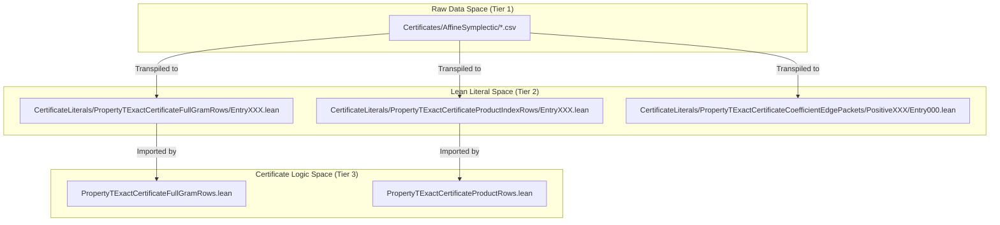
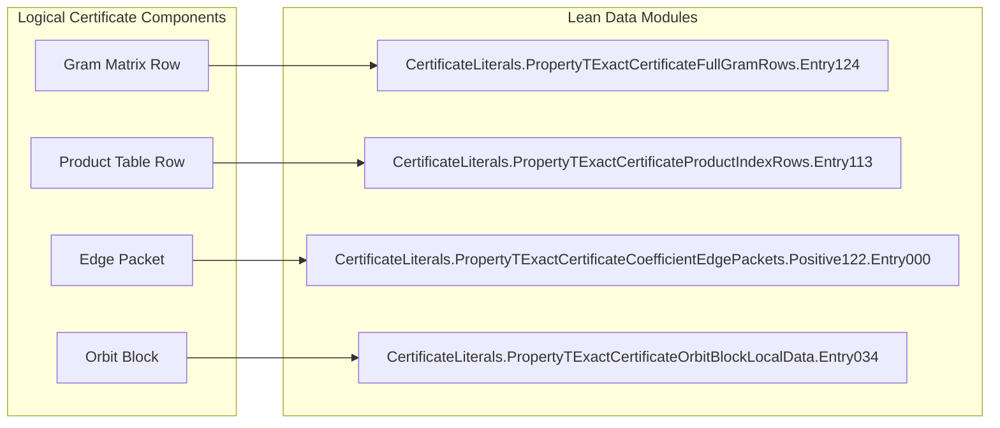

<!-- source: DeepWiki mcp.deepwiki.com · repo openai/ten-proofs · page 5.2 CertificateLiterals: Lean Data Modules · fetched 2026-10-26 -->

# CertificateLiterals: Lean Data Modules

<details>
<summary>Relevant source files</summary>

The following files were used as context for generating this wiki page:

- [ConnesRigidity/CertificateLiterals/PropertyTExactCertificateCoefficientEdgePackets/Positive007/Entry000.lean](ConnesRigidity/CertificateLiterals/PropertyTExactCertificateCoefficientEdgePackets/Positive007/Entry000.lean)
- [ConnesRigidity/CertificateLiterals/PropertyTExactCertificateCoefficientEdgePackets/Positive008/Entry000.lean](ConnesRigidity/CertificateLiterals/PropertyTExactCertificateCoefficientEdgePackets/Positive008/Entry000.lean)
- [ConnesRigidity/CertificateLiterals/PropertyTExactCertificateCoefficientEdgePackets/Positive014/Entry000.lean](ConnesRigidity/CertificateLiterals/PropertyTExactCertificateCoefficientEdgePackets/Positive014/Entry000.lean)
- [ConnesRigidity/CertificateLiterals/PropertyTExactCertificateCoefficientEdgePackets/Positive015/Entry000.lean](ConnesRigidity/CertificateLiterals/PropertyTExactCertificateCoefficientEdgePackets/Positive015/Entry000.lean)
- [ConnesRigidity/CertificateLiterals/PropertyTExactCertificateCoefficientEdgePackets/Positive021/Entry000.lean](ConnesRigidity/CertificateLiterals/PropertyTExactCertificateCoefficientEdgePackets/Positive021/Entry000.lean)
- [ConnesRigidity/CertificateLiterals/PropertyTExactCertificateCoefficientEdgePackets/Positive022/Entry000.lean](ConnesRigidity/CertificateLiterals/PropertyTExactCertificateCoefficientEdgePackets/Positive022/Entry000.lean)
- [ConnesRigidity/CertificateLiterals/PropertyTExactCertificateCoefficientEdgePackets/Positive024/Entry000.lean](ConnesRigidity/CertificateLiterals/PropertyTExactCertificateCoefficientEdgePackets/Positive024/Entry000.lean)
- [ConnesRigidity/CertificateLiterals/PropertyTExactCertificateCoefficientEdgePackets/Positive026/Entry000.lean](ConnesRigidity/CertificateLiterals/PropertyTExactCertificateCoefficientEdgePackets/Positive026/Entry000.lean)
- [ConnesRigidity/CertificateLiterals/PropertyTExactCertificateCoefficientEdgePackets/Positive028/Entry000.lean](ConnesRigidity/CertificateLiterals/PropertyTExactCertificateCoefficientEdgePackets/Positive028/Entry000.lean)
- [ConnesRigidity/CertificateLiterals/PropertyTExactCertificateCoefficientEdgePackets/Positive032/Entry000.lean](ConnesRigidity/CertificateLiterals/PropertyTExactCertificateCoefficientEdgePackets/Positive032/Entry000.lean)
- [ConnesRigidity/CertificateLiterals/PropertyTExactCertificateCoefficientEdgePackets/Positive033/Entry000.lean](ConnesRigidity/CertificateLiterals/PropertyTExactCertificateCoefficientEdgePackets/Positive033/Entry000.lean)
- [ConnesRigidity/CertificateLiterals/PropertyTExactCertificateCoefficientEdgePackets/Positive034/Entry000.lean](ConnesRigidity/CertificateLiterals/PropertyTExactCertificateCoefficientEdgePackets/Positive034/Entry000.lean)
- [ConnesRigidity/CertificateLiterals/PropertyTExactCertificateCoefficientEdgePackets/Positive035/Entry000.lean](ConnesRigidity/CertificateLiterals/PropertyTExactCertificateCoefficientEdgePackets/Positive035/Entry000.lean)
- [ConnesRigidity/CertificateLiterals/PropertyTExactCertificateCoefficientEdgePackets/Positive036/Entry000.lean](ConnesRigidity/CertificateLiterals/PropertyTExactCertificateCoefficientEdgePackets/Positive036/Entry000.lean)
- [ConnesRigidity/CertificateLiterals/PropertyTExactCertificateCoefficientEdgePackets/Positive037/Entry000.lean](ConnesRigidity/CertificateLiterals/PropertyTExactCertificateCoefficientEdgePackets/Positive037/Entry000.lean)
- [ConnesRigidity/CertificateLiterals/PropertyTExactCertificateCoefficientEdgePackets/Positive038/Entry000.lean](ConnesRigidity/CertificateLiterals/PropertyTExactCertificateCoefficientEdgePackets/Positive038/Entry000.lean)
- [ConnesRigidity/CertificateLiterals/PropertyTExactCertificateCoefficientEdgePackets/Positive040/Entry000.lean](ConnesRigidity/CertificateLiterals/PropertyTExactCertificateCoefficientEdgePackets/Positive040/Entry000.lean)
- [ConnesRigidity/CertificateLiterals/PropertyTExactCertificateCoefficientEdgePackets/Positive043/Entry000.lean](ConnesRigidity/CertificateLiterals/PropertyTExactCertificateCoefficientEdgePackets/Positive043/Entry000.lean)
- [ConnesRigidity/CertificateLiterals/PropertyTExactCertificateCoefficientEdgePackets/Positive045/Entry000.lean](ConnesRigidity/CertificateLiterals/PropertyTExactCertificateCoefficientEdgePackets/Positive045/Entry000.lean)
- [ConnesRigidity/CertificateLiterals/PropertyTExactCertificateCoefficientEdgePackets/Positive046/Entry000.lean](ConnesRigidity/CertificateLiterals/PropertyTExactCertificateCoefficientEdgePackets/Positive046/Entry000.lean)
- [ConnesRigidity/CertificateLiterals/PropertyTExactCertificateCoefficientEdgePackets/Positive047/Entry000.lean](ConnesRigidity/CertificateLiterals/PropertyTExactCertificateCoefficientEdgePackets/Positive047/Entry000.lean)
- [ConnesRigidity/CertificateLiterals/PropertyTExactCertificateCoefficientEdgePackets/Positive048/Entry000.lean](ConnesRigidity/CertificateLiterals/PropertyTExactCertificateCoefficientEdgePackets/Positive048/Entry000.lean)
- [ConnesRigidity/CertificateLiterals/PropertyTExactCertificateCoefficientEdgePackets/Positive051/Entry000.lean](ConnesRigidity/CertificateLiterals/PropertyTExactCertificateCoefficientEdgePackets/Positive051/Entry000.lean)
- [ConnesRigidity/CertificateLiterals/PropertyTExactCertificateCoefficientEdgePackets/Positive052/Entry000.lean](ConnesRigidity/CertificateLiterals/PropertyTExactCertificateCoefficientEdgePackets/Positive052/Entry000.lean)
- [ConnesRigidity/CertificateLiterals/PropertyTExactCertificateCoefficientEdgePackets/Positive053/Entry000.lean](ConnesRigidity/CertificateLiterals/PropertyTExactCertificateCoefficientEdgePackets/Positive053/Entry000.lean)
- [ConnesRigidity/CertificateLiterals/PropertyTExactCertificateCoefficientEdgePackets/Positive055/Entry000.lean](ConnesRigidity/CertificateLiterals/PropertyTExactCertificateCoefficientEdgePackets/Positive055/Entry000.lean)
- [ConnesRigidity/CertificateLiterals/PropertyTExactCertificateCoefficientEdgePackets/Positive057/Entry000.lean](ConnesRigidity/CertificateLiterals/PropertyTExactCertificateCoefficientEdgePackets/Positive057/Entry000.lean)
- [ConnesRigidity/CertificateLiterals/PropertyTExactCertificateCoefficientEdgePackets/Positive058/Entry000.lean](ConnesRigidity/CertificateLiterals/PropertyTExactCertificateCoefficientEdgePackets/Positive058/Entry000.lean)
- [ConnesRigidity/CertificateLiterals/PropertyTExactCertificateCoefficientEdgePackets/Positive059/Entry000.lean](ConnesRigidity/CertificateLiterals/PropertyTExactCertificateCoefficientEdgePackets/Positive059/Entry000.lean)
- [ConnesRigidity/CertificateLiterals/PropertyTExactCertificateCoefficientEdgePackets/Positive061/Entry000.lean](ConnesRigidity/CertificateLiterals/PropertyTExactCertificateCoefficientEdgePackets/Positive061/Entry000.lean)
- [ConnesRigidity/CertificateLiterals/PropertyTExactCertificateCoefficientEdgePackets/Positive062/Entry000.lean](ConnesRigidity/CertificateLiterals/PropertyTExactCertificateCoefficientEdgePackets/Positive062/Entry000.lean)
- [ConnesRigidity/CertificateLiterals/PropertyTExactCertificateCoefficientEdgePackets/Positive063/Entry000.lean](ConnesRigidity/CertificateLiterals/PropertyTExactCertificateCoefficientEdgePackets/Positive063/Entry000.lean)
- [ConnesRigidity/CertificateLiterals/PropertyTExactCertificateCoefficientEdgePackets/Positive065/Entry000.lean](ConnesRigidity/CertificateLiterals/PropertyTExactCertificateCoefficientEdgePackets/Positive065/Entry000.lean)
- [ConnesRigidity/CertificateLiterals/PropertyTExactCertificateCoefficientEdgePackets/Positive069/Entry000.lean](ConnesRigidity/CertificateLiterals/PropertyTExactCertificateCoefficientEdgePackets/Positive069/Entry000.lean)
- [ConnesRigidity/CertificateLiterals/PropertyTExactCertificateCoefficientEdgePackets/Positive070/Entry000.lean](ConnesRigidity/CertificateLiterals/PropertyTExactCertificateCoefficientEdgePackets/Positive070/Entry000.lean)
- [ConnesRigidity/CertificateLiterals/PropertyTExactCertificateCoefficientEdgePackets/Positive071/Entry000.lean](ConnesRigidity/CertificateLiterals/PropertyTExactCertificateCoefficientEdgePackets/Positive071/Entry000.lean)
- [ConnesRigidity/CertificateLiterals/PropertyTExactCertificateCoefficientEdgePackets/Positive073/Entry000.lean](ConnesRigidity/CertificateLiterals/PropertyTExactCertificateCoefficientEdgePackets/Positive073/Entry000.lean)
- [ConnesRigidity/CertificateLiterals/PropertyTExactCertificateCoefficientEdgePackets/Positive074/Entry000.lean](ConnesRigidity/CertificateLiterals/PropertyTExactCertificateCoefficientEdgePackets/Positive074/Entry000.lean)
- [ConnesRigidity/CertificateLiterals/PropertyTExactCertificateCoefficientEdgePackets/Positive076/Entry000.lean](ConnesRigidity/CertificateLiterals/PropertyTExactCertificateCoefficientEdgePackets/Positive076/Entry000.lean)
- [ConnesRigidity/CertificateLiterals/PropertyTExactCertificateCoefficientEdgePackets/Positive077/Entry000.lean](ConnesRigidity/CertificateLiterals/PropertyTExactCertificateCoefficientEdgePackets/Positive077/Entry000.lean)
- [ConnesRigidity/CertificateLiterals/PropertyTExactCertificateCoefficientEdgePackets/Positive085/Entry000.lean](ConnesRigidity/CertificateLiterals/PropertyTExactCertificateCoefficientEdgePackets/Positive085/Entry000.lean)
- [ConnesRigidity/CertificateLiterals/PropertyTExactCertificateCoefficientEdgePackets/Positive086/Entry000.lean](ConnesRigidity/CertificateLiterals/PropertyTExactCertificateCoefficientEdgePackets/Positive086/Entry000.lean)
- [ConnesRigidity/CertificateLiterals/PropertyTExactCertificateCoefficientEdgePackets/Positive095/Entry000.lean](ConnesRigidity/CertificateLiterals/PropertyTExactCertificateCoefficientEdgePackets/Positive095/Entry000.lean)
- [ConnesRigidity/CertificateLiterals/PropertyTExactCertificateCoefficientEdgePackets/Positive097/Entry000.lean](ConnesRigidity/CertificateLiterals/PropertyTExactCertificateCoefficientEdgePackets/Positive097/Entry000.lean)
- [ConnesRigidity/CertificateLiterals/PropertyTExactCertificateCoefficientEdgePackets/Positive102/Entry000.lean](ConnesRigidity/CertificateLiterals/PropertyTExactCertificateCoefficientEdgePackets/Positive102/Entry000.lean)
- [ConnesRigidity/CertificateLiterals/PropertyTExactCertificateCoefficientEdgePackets/Positive103/Entry000.lean](ConnesRigidity/CertificateLiterals/PropertyTExactCertificateCoefficientEdgePackets/Positive103/Entry000.lean)
- [ConnesRigidity/CertificateLiterals/PropertyTExactCertificateCoefficientEdgePackets/Positive104/Entry000.lean](ConnesRigidity/CertificateLiterals/PropertyTExactCertificateCoefficientEdgePackets/Positive104/Entry000.lean)
- [ConnesRigidity/CertificateLiterals/PropertyTExactCertificateCoefficientEdgePackets/Positive105/Entry000.lean](ConnesRigidity/CertificateLiterals/PropertyTExactCertificateCoefficientEdgePackets/Positive105/Entry000.lean)
- [ConnesRigidity/CertificateLiterals/PropertyTExactCertificateCoefficientEdgePackets/Positive110/Entry000.lean](ConnesRigidity/CertificateLiterals/PropertyTExactCertificateCoefficientEdgePackets/Positive110/Entry000.lean)
- [ConnesRigidity/CertificateLiterals/PropertyTExactCertificateCoefficientEdgePackets/Positive112/Entry000.lean](ConnesRigidity/CertificateLiterals/PropertyTExactCertificateCoefficientEdgePackets/Positive112/Entry000.lean)
- [ConnesRigidity/CertificateLiterals/PropertyTExactCertificateCoefficientEdgePackets/Positive113/Entry000.lean](ConnesRigidity/CertificateLiterals/PropertyTExactCertificateCoefficientEdgePackets/Positive113/Entry000.lean)
- [ConnesRigidity/CertificateLiterals/PropertyTExactCertificateCoefficientEdgePackets/Positive116/Entry000.lean](ConnesRigidity/CertificateLiterals/PropertyTExactCertificateCoefficientEdgePackets/Positive116/Entry000.lean)
- [ConnesRigidity/CertificateLiterals/PropertyTExactCertificateCoefficientEdgePackets/Positive117/Entry000.lean](ConnesRigidity/CertificateLiterals/PropertyTExactCertificateCoefficientEdgePackets/Positive117/Entry000.lean)
- [ConnesRigidity/CertificateLiterals/PropertyTExactCertificateCoefficientEdgePackets/Positive119/Entry000.lean](ConnesRigidity/CertificateLiterals/PropertyTExactCertificateCoefficientEdgePackets/Positive119/Entry000.lean)
- [ConnesRigidity/CertificateLiterals/PropertyTExactCertificateCoefficientEdgePackets/Positive122/Entry000.lean](ConnesRigidity/CertificateLiterals/PropertyTExactCertificateCoefficientEdgePackets/Positive122/Entry000.lean)
- [ConnesRigidity/CertificateLiterals/PropertyTExactCertificateCoefficientEdgePackets/Positive123/Entry000.lean](ConnesRigidity/CertificateLiterals/PropertyTExactCertificateCoefficientEdgePackets/Positive123/Entry000.lean)
- [ConnesRigidity/CertificateLiterals/PropertyTExactCertificateCoefficientEdgePackets/Positive132/Entry000.lean](ConnesRigidity/CertificateLiterals/PropertyTExactCertificateCoefficientEdgePackets/Positive132/Entry000.lean)
- [ConnesRigidity/CertificateLiterals/PropertyTExactCertificateCoefficientEdgePackets/Positive134/Entry000.lean](ConnesRigidity/CertificateLiterals/PropertyTExactCertificateCoefficientEdgePackets/Positive134/Entry000.lean)
- [ConnesRigidity/CertificateLiterals/PropertyTExactCertificateCoefficientEdgePackets/Positive135/Entry000.lean](ConnesRigidity/CertificateLiterals/PropertyTExactCertificateCoefficientEdgePackets/Positive135/Entry000.lean)
- [ConnesRigidity/CertificateLiterals/PropertyTExactCertificateCoefficientEdgePackets/Positive136/Entry000.lean](ConnesRigidity/CertificateLiterals/PropertyTExactCertificateCoefficientEdgePackets/Positive136/Entry000.lean)
- [ConnesRigidity/CertificateLiterals/PropertyTExactCertificateCoefficientEdgePackets/Positive140/Entry000.lean](ConnesRigidity/CertificateLiterals/PropertyTExactCertificateCoefficientEdgePackets/Positive140/Entry000.lean)
- [ConnesRigidity/CertificateLiterals/PropertyTExactCertificateCoefficientEdgePackets/Positive141/Entry000.lean](ConnesRigidity/CertificateLiterals/PropertyTExactCertificateCoefficientEdgePackets/Positive141/Entry000.lean)
- [ConnesRigidity/CertificateLiterals/PropertyTExactCertificateCoefficientEdgePackets/Positive145/Entry000.lean](ConnesRigidity/CertificateLiterals/PropertyTExactCertificateCoefficientEdgePackets/Positive145/Entry000.lean)
- [ConnesRigidity/CertificateLiterals/PropertyTExactCertificateCoefficientEdgePackets/Positive146/Entry000.lean](ConnesRigidity/CertificateLiterals/PropertyTExactCertificateCoefficientEdgePackets/Positive146/Entry000.lean)
- [ConnesRigidity/CertificateLiterals/PropertyTExactCertificateCoefficientEdgePackets/Positive148/Entry000.lean](ConnesRigidity/CertificateLiterals/PropertyTExactCertificateCoefficientEdgePackets/Positive148/Entry000.lean)
- [ConnesRigidity/CertificateLiterals/PropertyTExactCertificateCoefficientEdgePackets/Positive149/Entry000.lean](ConnesRigidity/CertificateLiterals/PropertyTExactCertificateCoefficientEdgePackets/Positive149/Entry000.lean)
- [ConnesRigidity/CertificateLiterals/PropertyTExactCertificateCoefficientEdgePackets/Positive151/Entry000.lean](ConnesRigidity/CertificateLiterals/PropertyTExactCertificateCoefficientEdgePackets/Positive151/Entry000.lean)
- [ConnesRigidity/CertificateLiterals/PropertyTExactCertificateCoefficientEdgePackets/Positive153/Entry000.lean](ConnesRigidity/CertificateLiterals/PropertyTExactCertificateCoefficientEdgePackets/Positive153/Entry000.lean)
- [ConnesRigidity/CertificateLiterals/PropertyTExactCertificateCoefficientEdgePackets/Positive154/Entry000.lean](ConnesRigidity/CertificateLiterals/PropertyTExactCertificateCoefficientEdgePackets/Positive154/Entry000.lean)
- [ConnesRigidity/CertificateLiterals/PropertyTExactCertificateCoefficientEdgePackets/Positive156/Entry000.lean](ConnesRigidity/CertificateLiterals/PropertyTExactCertificateCoefficientEdgePackets/Positive156/Entry000.lean)
- [ConnesRigidity/CertificateLiterals/PropertyTExactCertificateCoefficientEdgePackets/Positive158/Entry000.lean](ConnesRigidity/CertificateLiterals/PropertyTExactCertificateCoefficientEdgePackets/Positive158/Entry000.lean)
- [ConnesRigidity/CertificateLiterals/PropertyTExactCertificateCoefficientEdgePackets/Positive162/Entry000.lean](ConnesRigidity/CertificateLiterals/PropertyTExactCertificateCoefficientEdgePackets/Positive162/Entry000.lean)
- [ConnesRigidity/CertificateLiterals/PropertyTExactCertificateCoefficientEdgePackets/Positive163/Entry000.lean](ConnesRigidity/CertificateLiterals/PropertyTExactCertificateCoefficientEdgePackets/Positive163/Entry000.lean)
- [ConnesRigidity/CertificateLiterals/PropertyTExactCertificateCoefficientEdgePackets/Positive164/Entry000.lean](ConnesRigidity/CertificateLiterals/PropertyTExactCertificateCoefficientEdgePackets/Positive164/Entry000.lean)
- [ConnesRigidity/CertificateLiterals/PropertyTExactCertificateCoefficientEdgePackets/Positive167/Entry000.lean](ConnesRigidity/CertificateLiterals/PropertyTExactCertificateCoefficientEdgePackets/Positive167/Entry000.lean)
- [ConnesRigidity/CertificateLiterals/PropertyTExactCertificateCoefficientEdgePackets/Positive169/Entry000.lean](ConnesRigidity/CertificateLiterals/PropertyTExactCertificateCoefficientEdgePackets/Positive169/Entry000.lean)
- [ConnesRigidity/CertificateLiterals/PropertyTExactCertificateCoefficientEdgePackets/Positive170/Entry000.lean](ConnesRigidity/CertificateLiterals/PropertyTExactCertificateCoefficientEdgePackets/Positive170/Entry000.lean)
- [ConnesRigidity/CertificateLiterals/PropertyTExactCertificateCoefficientEdgePackets/Positive171/Entry000.lean](ConnesRigidity/CertificateLiterals/PropertyTExactCertificateCoefficientEdgePackets/Positive171/Entry000.lean)
- [ConnesRigidity/CertificateLiterals/PropertyTExactCertificateCoefficientEdgePackets/Positive172/Entry000.lean](ConnesRigidity/CertificateLiterals/PropertyTExactCertificateCoefficientEdgePackets/Positive172/Entry000.lean)
- [ConnesRigidity/CertificateLiterals/PropertyTExactCertificateCoefficientEdgePackets/Positive173/Entry000.lean](ConnesRigidity/CertificateLiterals/PropertyTExactCertificateCoefficientEdgePackets/Positive173/Entry000.lean)
- [ConnesRigidity/CertificateLiterals/PropertyTExactCertificateCoefficientEdgePackets/Positive174/Entry000.lean](ConnesRigidity/CertificateLiterals/PropertyTExactCertificateCoefficientEdgePackets/Positive174/Entry000.lean)
- [ConnesRigidity/CertificateLiterals/PropertyTExactCertificateCoefficientEdgePackets/Positive177/Entry000.lean](ConnesRigidity/CertificateLiterals/PropertyTExactCertificateCoefficientEdgePackets/Positive177/Entry000.lean)
- [ConnesRigidity/CertificateLiterals/PropertyTExactCertificateCoefficientEdgePackets/Positive178/Entry000.lean](ConnesRigidity/CertificateLiterals/PropertyTExactCertificateCoefficientEdgePackets/Positive178/Entry000.lean)
- [ConnesRigidity/CertificateLiterals/PropertyTExactCertificateCoefficientEdgePackets/Positive181/Entry000.lean](ConnesRigidity/CertificateLiterals/PropertyTExactCertificateCoefficientEdgePackets/Positive181/Entry000.lean)
- [ConnesRigidity/CertificateLiterals/PropertyTExactCertificateCoefficientEdgePackets/Positive186/Entry000.lean](ConnesRigidity/CertificateLiterals/PropertyTExactCertificateCoefficientEdgePackets/Positive186/Entry000.lean)
- [ConnesRigidity/CertificateLiterals/PropertyTExactCertificateCoefficientEdgePackets/Positive188/Entry000.lean](ConnesRigidity/CertificateLiterals/PropertyTExactCertificateCoefficientEdgePackets/Positive188/Entry000.lean)
- [ConnesRigidity/CertificateLiterals/PropertyTExactCertificateCoefficientEdgePackets/Positive189/Entry000.lean](ConnesRigidity/CertificateLiterals/PropertyTExactCertificateCoefficientEdgePackets/Positive189/Entry000.lean)
- [ConnesRigidity/CertificateLiterals/PropertyTExactCertificateCoefficientEdgePackets/Positive191/Entry000.lean](ConnesRigidity/CertificateLiterals/PropertyTExactCertificateCoefficientEdgePackets/Positive191/Entry000.lean)
- [ConnesRigidity/CertificateLiterals/PropertyTExactCertificateCoefficientEdgePackets/Positive194/Entry000.lean](ConnesRigidity/CertificateLiterals/PropertyTExactCertificateCoefficientEdgePackets/Positive194/Entry000.lean)
- [ConnesRigidity/CertificateLiterals/PropertyTExactCertificateCoefficientEdgePackets/Positive195/Entry000.lean](ConnesRigidity/CertificateLiterals/PropertyTExactCertificateCoefficientEdgePackets/Positive195/Entry000.lean)
- [ConnesRigidity/CertificateLiterals/PropertyTExactCertificateCoefficientEdgePackets/Positive196/Entry000.lean](ConnesRigidity/CertificateLiterals/PropertyTExactCertificateCoefficientEdgePackets/Positive196/Entry000.lean)
- [ConnesRigidity/CertificateLiterals/PropertyTExactCertificateCoefficientEdgePackets/Positive197/Entry000.lean](ConnesRigidity/CertificateLiterals/PropertyTExactCertificateCoefficientEdgePackets/Positive197/Entry000.lean)
- [ConnesRigidity/CertificateLiterals/PropertyTExactCertificateCoefficientEdgePackets/Positive198/Entry000.lean](ConnesRigidity/CertificateLiterals/PropertyTExactCertificateCoefficientEdgePackets/Positive198/Entry000.lean)
- [ConnesRigidity/CertificateLiterals/PropertyTExactCertificateCoefficientEdgePackets/Positive204/Entry000.lean](ConnesRigidity/CertificateLiterals/PropertyTExactCertificateCoefficientEdgePackets/Positive204/Entry000.lean)
- [ConnesRigidity/CertificateLiterals/PropertyTExactCertificateCoefficientEdgePackets/Positive205/Entry000.lean](ConnesRigidity/CertificateLiterals/PropertyTExactCertificateCoefficientEdgePackets/Positive205/Entry000.lean)
- [ConnesRigidity/CertificateLiterals/PropertyTExactCertificateCoefficientEdgePackets/Positive207/Entry000.lean](ConnesRigidity/CertificateLiterals/PropertyTExactCertificateCoefficientEdgePackets/Positive207/Entry000.lean)
- [ConnesRigidity/CertificateLiterals/PropertyTExactCertificateCoefficientEdgePackets/Positive216/Entry000.lean](ConnesRigidity/CertificateLiterals/PropertyTExactCertificateCoefficientEdgePackets/Positive216/Entry000.lean)
- [ConnesRigidity/CertificateLiterals/PropertyTExactCertificateCoefficientEdgePackets/Positive224/Entry000.lean](ConnesRigidity/CertificateLiterals/PropertyTExactCertificateCoefficientEdgePackets/Positive224/Entry000.lean)
- [ConnesRigidity/CertificateLiterals/PropertyTExactCertificateCoefficientEdgePackets/Positive225/Entry000.lean](ConnesRigidity/CertificateLiterals/PropertyTExactCertificateCoefficientEdgePackets/Positive225/Entry000.lean)
- [ConnesRigidity/CertificateLiterals/PropertyTExactCertificateCoefficientEdgePackets/Positive227/Entry000.lean](ConnesRigidity/CertificateLiterals/PropertyTExactCertificateCoefficientEdgePackets/Positive227/Entry000.lean)
- [ConnesRigidity/CertificateLiterals/PropertyTExactCertificateCoefficientEdgePackets/Positive229/Entry000.lean](ConnesRigidity/CertificateLiterals/PropertyTExactCertificateCoefficientEdgePackets/Positive229/Entry000.lean)
- [ConnesRigidity/CertificateLiterals/PropertyTExactCertificateCoefficientEdgePackets/Positive233/Entry000.lean](ConnesRigidity/CertificateLiterals/PropertyTExactCertificateCoefficientEdgePackets/Positive233/Entry000.lean)
- [ConnesRigidity/CertificateLiterals/PropertyTExactCertificateCoefficientEdgePackets/Positive236/Entry000.lean](ConnesRigidity/CertificateLiterals/PropertyTExactCertificateCoefficientEdgePackets/Positive236/Entry000.lean)
- [ConnesRigidity/CertificateLiterals/PropertyTExactCertificateCoefficientEdgePackets/Positive238/Entry000.lean](ConnesRigidity/CertificateLiterals/PropertyTExactCertificateCoefficientEdgePackets/Positive238/Entry000.lean)
- [ConnesRigidity/CertificateLiterals/PropertyTExactCertificateCoefficientEdgePackets/Positive240/Entry000.lean](ConnesRigidity/CertificateLiterals/PropertyTExactCertificateCoefficientEdgePackets/Positive240/Entry000.lean)
- [ConnesRigidity/CertificateLiterals/PropertyTExactCertificateCoefficientEdgePackets/Positive245/Entry000.lean](ConnesRigidity/CertificateLiterals/PropertyTExactCertificateCoefficientEdgePackets/Positive245/Entry000.lean)
- [ConnesRigidity/CertificateLiterals/PropertyTExactCertificateCoefficientEdgePackets/Positive248/Entry000.lean](ConnesRigidity/CertificateLiterals/PropertyTExactCertificateCoefficientEdgePackets/Positive248/Entry000.lean)
- [ConnesRigidity/CertificateLiterals/PropertyTExactCertificateCoefficientEdgePackets/Positive250/Entry000.lean](ConnesRigidity/CertificateLiterals/PropertyTExactCertificateCoefficientEdgePackets/Positive250/Entry000.lean)
- [ConnesRigidity/CertificateLiterals/PropertyTExactCertificateCoefficientEdgePackets/Positive252/Entry000.lean](ConnesRigidity/CertificateLiterals/PropertyTExactCertificateCoefficientEdgePackets/Positive252/Entry000.lean)
- [ConnesRigidity/CertificateLiterals/PropertyTExactCertificateCoefficientEdgePackets/Positive256/Entry000.lean](ConnesRigidity/CertificateLiterals/PropertyTExactCertificateCoefficientEdgePackets/Positive256/Entry000.lean)
- [ConnesRigidity/CertificateLiterals/PropertyTExactCertificateCoefficientEdgePackets/Positive258/Entry000.lean](ConnesRigidity/CertificateLiterals/PropertyTExactCertificateCoefficientEdgePackets/Positive258/Entry000.lean)
- [ConnesRigidity/CertificateLiterals/PropertyTExactCertificateCoefficientEdgePackets/Positive259/Entry000.lean](ConnesRigidity/CertificateLiterals/PropertyTExactCertificateCoefficientEdgePackets/Positive259/Entry000.lean)
- [ConnesRigidity/CertificateLiterals/PropertyTExactCertificateCoefficientEdgePackets/Positive260/Entry000.lean](ConnesRigidity/CertificateLiterals/PropertyTExactCertificateCoefficientEdgePackets/Positive260/Entry000.lean)
- [ConnesRigidity/CertificateLiterals/PropertyTExactCertificateCoefficientEdgePackets/Positive261/Entry000.lean](ConnesRigidity/CertificateLiterals/PropertyTExactCertificateCoefficientEdgePackets/Positive261/Entry000.lean)
- [ConnesRigidity/CertificateLiterals/PropertyTExactCertificateCoefficientEdgePackets/Positive265/Entry000.lean](ConnesRigidity/CertificateLiterals/PropertyTExactCertificateCoefficientEdgePackets/Positive265/Entry000.lean)
- [ConnesRigidity/CertificateLiterals/PropertyTExactCertificateCoefficientEdgePackets/Positive266/Entry000.lean](ConnesRigidity/CertificateLiterals/PropertyTExactCertificateCoefficientEdgePackets/Positive266/Entry000.lean)
- [ConnesRigidity/CertificateLiterals/PropertyTExactCertificateCoefficientEncodingLeaves/Diagonal081Part003/Entry000.lean](ConnesRigidity/CertificateLiterals/PropertyTExactCertificateCoefficientEncodingLeaves/Diagonal081Part003/Entry000.lean)
- [ConnesRigidity/CertificateLiterals/PropertyTExactCertificateCoefficientEncodingLeaves/Leaf000/Entry000.lean](ConnesRigidity/CertificateLiterals/PropertyTExactCertificateCoefficientEncodingLeaves/Leaf000/Entry000.lean)
- [ConnesRigidity/CertificateLiterals/PropertyTExactCertificateCoefficientEncodingLeaves/Leaf006/Entry000.lean](ConnesRigidity/CertificateLiterals/PropertyTExactCertificateCoefficientEncodingLeaves/Leaf006/Entry000.lean)
- [ConnesRigidity/CertificateLiterals/PropertyTExactCertificateCoefficientEncodingLeaves/Leaf008/Entry000.lean](ConnesRigidity/CertificateLiterals/PropertyTExactCertificateCoefficientEncodingLeaves/Leaf008/Entry000.lean)
- [ConnesRigidity/CertificateLiterals/PropertyTExactCertificateCoefficientEncodingLeaves/Leaf009/Entry000.lean](ConnesRigidity/CertificateLiterals/PropertyTExactCertificateCoefficientEncodingLeaves/Leaf009/Entry000.lean)
- [ConnesRigidity/CertificateLiterals/PropertyTExactCertificateCoefficientEncodingLeaves/Leaf011/Entry000.lean](ConnesRigidity/CertificateLiterals/PropertyTExactCertificateCoefficientEncodingLeaves/Leaf011/Entry000.lean)
- [ConnesRigidity/CertificateLiterals/PropertyTExactCertificateCoefficientEncodingLeaves/Leaf012/Entry000.lean](ConnesRigidity/CertificateLiterals/PropertyTExactCertificateCoefficientEncodingLeaves/Leaf012/Entry000.lean)
- [ConnesRigidity/CertificateLiterals/PropertyTExactCertificateCoefficientEncodingLeaves/Leaf016/Entry000.lean](ConnesRigidity/CertificateLiterals/PropertyTExactCertificateCoefficientEncodingLeaves/Leaf016/Entry000.lean)
- [ConnesRigidity/CertificateLiterals/PropertyTExactCertificateCoefficientEncodingLeaves/Leaf017/Entry000.lean](ConnesRigidity/CertificateLiterals/PropertyTExactCertificateCoefficientEncodingLeaves/Leaf017/Entry000.lean)
- [ConnesRigidity/CertificateLiterals/PropertyTExactCertificateCoefficientEncodingLeaves/Leaf018/Entry000.lean](ConnesRigidity/CertificateLiterals/PropertyTExactCertificateCoefficientEncodingLeaves/Leaf018/Entry000.lean)
- [ConnesRigidity/CertificateLiterals/PropertyTExactCertificateCoefficientEncodingLeaves/Leaf026/Entry000.lean](ConnesRigidity/CertificateLiterals/PropertyTExactCertificateCoefficientEncodingLeaves/Leaf026/Entry000.lean)
- [ConnesRigidity/CertificateLiterals/PropertyTExactCertificateCoefficientEncodingLeaves/Leaf031/Entry000.lean](ConnesRigidity/CertificateLiterals/PropertyTExactCertificateCoefficientEncodingLeaves/Leaf031/Entry000.lean)
- [ConnesRigidity/CertificateLiterals/PropertyTExactCertificateCoefficientEncodingLeaves/Leaf045/Entry000.lean](ConnesRigidity/CertificateLiterals/PropertyTExactCertificateCoefficientEncodingLeaves/Leaf045/Entry000.lean)
- [ConnesRigidity/CertificateLiterals/PropertyTExactCertificateCoefficientEncodingLeaves/Leaf046/Entry000.lean](ConnesRigidity/CertificateLiterals/PropertyTExactCertificateCoefficientEncodingLeaves/Leaf046/Entry000.lean)
- [ConnesRigidity/CertificateLiterals/PropertyTExactCertificateCoefficientEncodingLeaves/Leaf051/Entry000.lean](ConnesRigidity/CertificateLiterals/PropertyTExactCertificateCoefficientEncodingLeaves/Leaf051/Entry000.lean)
- [ConnesRigidity/CertificateLiterals/PropertyTExactCertificateCoefficientEncodingLeaves/Leaf055/Entry000.lean](ConnesRigidity/CertificateLiterals/PropertyTExactCertificateCoefficientEncodingLeaves/Leaf055/Entry000.lean)
- [ConnesRigidity/CertificateLiterals/PropertyTExactCertificateCoefficientEncodingLeaves/Leaf057/Entry000.lean](ConnesRigidity/CertificateLiterals/PropertyTExactCertificateCoefficientEncodingLeaves/Leaf057/Entry000.lean)
- [ConnesRigidity/CertificateLiterals/PropertyTExactCertificateCoefficientEncodingLeaves/Leaf059/Entry000.lean](ConnesRigidity/CertificateLiterals/PropertyTExactCertificateCoefficientEncodingLeaves/Leaf059/Entry000.lean)
- [ConnesRigidity/CertificateLiterals/PropertyTExactCertificateCoefficientEncodingLeaves/Leaf060/Entry000.lean](ConnesRigidity/CertificateLiterals/PropertyTExactCertificateCoefficientEncodingLeaves/Leaf060/Entry000.lean)
- [ConnesRigidity/CertificateLiterals/PropertyTExactCertificateCoefficientEncodingLeaves/Leaf062/Entry000.lean](ConnesRigidity/CertificateLiterals/PropertyTExactCertificateCoefficientEncodingLeaves/Leaf062/Entry000.lean)
- [ConnesRigidity/CertificateLiterals/PropertyTExactCertificateCoefficientEncodingLeaves/Leaf066/Entry000.lean](ConnesRigidity/CertificateLiterals/PropertyTExactCertificateCoefficientEncodingLeaves/Leaf066/Entry000.lean)
- [ConnesRigidity/CertificateLiterals/PropertyTExactCertificateCoefficientEncodingLeaves/Leaf069/Entry000.lean](ConnesRigidity/CertificateLiterals/PropertyTExactCertificateCoefficientEncodingLeaves/Leaf069/Entry000.lean)
- [ConnesRigidity/CertificateLiterals/PropertyTExactCertificateCoefficientEncodingLeaves/Leaf071/Entry000.lean](ConnesRigidity/CertificateLiterals/PropertyTExactCertificateCoefficientEncodingLeaves/Leaf071/Entry000.lean)
- [ConnesRigidity/CertificateLiterals/PropertyTExactCertificateCoefficientEncodingLeaves/Leaf072/Entry000.lean](ConnesRigidity/CertificateLiterals/PropertyTExactCertificateCoefficientEncodingLeaves/Leaf072/Entry000.lean)
- [ConnesRigidity/CertificateLiterals/PropertyTExactCertificateCoefficientEncodingLeaves/Part028B/Entry000.lean](ConnesRigidity/CertificateLiterals/PropertyTExactCertificateCoefficientEncodingLeaves/Part028B/Entry000.lean)
- [ConnesRigidity/CertificateLiterals/PropertyTExactCertificateCoefficientEncodingLeaves/Part031A/Entry000.lean](ConnesRigidity/CertificateLiterals/PropertyTExactCertificateCoefficientEncodingLeaves/Part031A/Entry000.lean)
- [ConnesRigidity/CertificateLiterals/PropertyTExactCertificateCoefficientEncodingLeaves/Part032A/Entry000.lean](ConnesRigidity/CertificateLiterals/PropertyTExactCertificateCoefficientEncodingLeaves/Part032A/Entry000.lean)
- [ConnesRigidity/CertificateLiterals/PropertyTExactCertificateCoefficientEncodingLeaves/Part036B/Entry000.lean](ConnesRigidity/CertificateLiterals/PropertyTExactCertificateCoefficientEncodingLeaves/Part036B/Entry000.lean)
- [ConnesRigidity/CertificateLiterals/PropertyTExactCertificateCoefficientEncodingLeaves/Part037B/Entry000.lean](ConnesRigidity/CertificateLiterals/PropertyTExactCertificateCoefficientEncodingLeaves/Part037B/Entry000.lean)
- [ConnesRigidity/CertificateLiterals/PropertyTExactCertificateCoefficientEncodingLeaves/Part038A/Entry000.lean](ConnesRigidity/CertificateLiterals/PropertyTExactCertificateCoefficientEncodingLeaves/Part038A/Entry000.lean)
- [ConnesRigidity/CertificateLiterals/PropertyTExactCertificateCoefficientEncodingLeaves/Part044A/Entry000.lean](ConnesRigidity/CertificateLiterals/PropertyTExactCertificateCoefficientEncodingLeaves/Part044A/Entry000.lean)
- [ConnesRigidity/CertificateLiterals/PropertyTExactCertificateCoefficientEncodingLeaves/Part044B/Entry000.lean](ConnesRigidity/CertificateLiterals/PropertyTExactCertificateCoefficientEncodingLeaves/Part044B/Entry000.lean)
- [ConnesRigidity/CertificateLiterals/PropertyTExactCertificateCoefficientEncodingLeaves/Part045A/Entry000.lean](ConnesRigidity/CertificateLiterals/PropertyTExactCertificateCoefficientEncodingLeaves/Part045A/Entry000.lean)
- [ConnesRigidity/CertificateLiterals/PropertyTExactCertificateCoefficientEncodingLeaves/Part046A/Entry000.lean](ConnesRigidity/CertificateLiterals/PropertyTExactCertificateCoefficientEncodingLeaves/Part046A/Entry000.lean)
- [ConnesRigidity/CertificateLiterals/PropertyTExactCertificateCoefficientEncodingLeaves/Part046B/Entry000.lean](ConnesRigidity/CertificateLiterals/PropertyTExactCertificateCoefficientEncodingLeaves/Part046B/Entry000.lean)
- [ConnesRigidity/CertificateLiterals/PropertyTExactCertificateCoefficientEncodingLeaves/Part047B/Entry000.lean](ConnesRigidity/CertificateLiterals/PropertyTExactCertificateCoefficientEncodingLeaves/Part047B/Entry000.lean)
- [ConnesRigidity/CertificateLiterals/PropertyTExactCertificateCoefficientEncodingLeaves/Part048A/Entry000.lean](ConnesRigidity/CertificateLiterals/PropertyTExactCertificateCoefficientEncodingLeaves/Part048A/Entry000.lean)
- [ConnesRigidity/CertificateLiterals/PropertyTExactCertificateCoefficientEncodingLeaves/Part048B/Entry000.lean](ConnesRigidity/CertificateLiterals/PropertyTExactCertificateCoefficientEncodingLeaves/Part048B/Entry000.lean)
- [ConnesRigidity/CertificateLiterals/PropertyTExactCertificateCoefficientEncodingLeaves/Part049A/Entry000.lean](ConnesRigidity/CertificateLiterals/PropertyTExactCertificateCoefficientEncodingLeaves/Part049A/Entry000.lean)
- [ConnesRigidity/CertificateLiterals/PropertyTExactCertificateCoefficientEncodingLeaves/Part049B/Entry000.lean](ConnesRigidity/CertificateLiterals/PropertyTExactCertificateCoefficientEncodingLeaves/Part049B/Entry000.lean)
- [ConnesRigidity/CertificateLiterals/PropertyTExactCertificateCoefficientEncodingLeaves/Part050B/Entry000.lean](ConnesRigidity/CertificateLiterals/PropertyTExactCertificateCoefficientEncodingLeaves/Part050B/Entry000.lean)
- [ConnesRigidity/CertificateLiterals/PropertyTExactCertificateCoefficientEncodingLeaves/Part051A/Entry000.lean](ConnesRigidity/CertificateLiterals/PropertyTExactCertificateCoefficientEncodingLeaves/Part051A/Entry000.lean)
- [ConnesRigidity/CertificateLiterals/PropertyTExactCertificateCoefficientEncodingLeaves/Part052A/Entry000.lean](ConnesRigidity/CertificateLiterals/PropertyTExactCertificateCoefficientEncodingLeaves/Part052A/Entry000.lean)
- [ConnesRigidity/CertificateLiterals/PropertyTExactCertificateCoefficientEncodingLeaves/Part052B/Entry000.lean](ConnesRigidity/CertificateLiterals/PropertyTExactCertificateCoefficientEncodingLeaves/Part052B/Entry000.lean)
- [ConnesRigidity/CertificateLiterals/PropertyTExactCertificateCoefficientEncodingLeaves/Part053A/Entry000.lean](ConnesRigidity/CertificateLiterals/PropertyTExactCertificateCoefficientEncodingLeaves/Part053A/Entry000.lean)
- [ConnesRigidity/CertificateLiterals/PropertyTExactCertificateCoefficientEncodingLeaves/Part053B/Entry000.lean](ConnesRigidity/CertificateLiterals/PropertyTExactCertificateCoefficientEncodingLeaves/Part053B/Entry000.lean)
- [ConnesRigidity/CertificateLiterals/PropertyTExactCertificateCoefficientEncodingLeaves/Part054A/Entry000.lean](ConnesRigidity/CertificateLiterals/PropertyTExactCertificateCoefficientEncodingLeaves/Part054A/Entry000.lean)
- [ConnesRigidity/CertificateLiterals/PropertyTExactCertificateCoefficientEncodingLeaves/Part054B/Entry000.lean](ConnesRigidity/CertificateLiterals/PropertyTExactCertificateCoefficientEncodingLeaves/Part054B/Entry000.lean)
- [ConnesRigidity/CertificateLiterals/PropertyTExactCertificateCoefficientEncodingLeaves/Part055A/Entry000.lean](ConnesRigidity/CertificateLiterals/PropertyTExactCertificateCoefficientEncodingLeaves/Part055A/Entry000.lean)
- [ConnesRigidity/CertificateLiterals/PropertyTExactCertificateCoefficientEncodingLeaves/Part055B/Entry000.lean](ConnesRigidity/CertificateLiterals/PropertyTExactCertificateCoefficientEncodingLeaves/Part055B/Entry000.lean)
- [ConnesRigidity/CertificateLiterals/PropertyTExactCertificateCoefficientEncodingLeaves/Part056A/Entry000.lean](ConnesRigidity/CertificateLiterals/PropertyTExactCertificateCoefficientEncodingLeaves/Part056A/Entry000.lean)
- [ConnesRigidity/CertificateLiterals/PropertyTExactCertificateCoefficientEncodingLeaves/Part056B/Entry000.lean](ConnesRigidity/CertificateLiterals/PropertyTExactCertificateCoefficientEncodingLeaves/Part056B/Entry000.lean)
- [ConnesRigidity/CertificateLiterals/PropertyTExactCertificateCoefficientEncodingLeaves/Part057A/Entry000.lean](ConnesRigidity/CertificateLiterals/PropertyTExactCertificateCoefficientEncodingLeaves/Part057A/Entry000.lean)
- [ConnesRigidity/CertificateLiterals/PropertyTExactCertificateCoefficientEncodingLeaves/Part057B/Entry000.lean](ConnesRigidity/CertificateLiterals/PropertyTExactCertificateCoefficientEncodingLeaves/Part057B/Entry000.lean)
- [ConnesRigidity/CertificateLiterals/PropertyTExactCertificateCoefficientEncodingLeaves/Part058A/Entry000.lean](ConnesRigidity/CertificateLiterals/PropertyTExactCertificateCoefficientEncodingLeaves/Part058A/Entry000.lean)
- [ConnesRigidity/CertificateLiterals/PropertyTExactCertificateCoefficientEncodingLeaves/Part058B/Entry000.lean](ConnesRigidity/CertificateLiterals/PropertyTExactCertificateCoefficientEncodingLeaves/Part058B/Entry000.lean)
- [ConnesRigidity/CertificateLiterals/PropertyTExactCertificateCoefficientEncodingLeaves/Part059B/Entry000.lean](ConnesRigidity/CertificateLiterals/PropertyTExactCertificateCoefficientEncodingLeaves/Part059B/Entry000.lean)
- [ConnesRigidity/CertificateLiterals/PropertyTExactCertificateCoefficientEncodingLeaves/Part060A/Entry000.lean](ConnesRigidity/CertificateLiterals/PropertyTExactCertificateCoefficientEncodingLeaves/Part060A/Entry000.lean)
- [ConnesRigidity/CertificateLiterals/PropertyTExactCertificateCoefficientEncodingLeaves/Part060B/Entry000.lean](ConnesRigidity/CertificateLiterals/PropertyTExactCertificateCoefficientEncodingLeaves/Part060B/Entry000.lean)
- [ConnesRigidity/CertificateLiterals/PropertyTExactCertificateCoefficientEncodingLeaves/Part061A/Entry000.lean](ConnesRigidity/CertificateLiterals/PropertyTExactCertificateCoefficientEncodingLeaves/Part061A/Entry000.lean)
- [ConnesRigidity/CertificateLiterals/PropertyTExactCertificateCoefficientEncodingLeaves/Part061B/Entry000.lean](ConnesRigidity/CertificateLiterals/PropertyTExactCertificateCoefficientEncodingLeaves/Part061B/Entry000.lean)
- [ConnesRigidity/CertificateLiterals/PropertyTExactCertificateCoefficientEncodingLeaves/Part062A/Entry000.lean](ConnesRigidity/CertificateLiterals/PropertyTExactCertificateCoefficientEncodingLeaves/Part062A/Entry000.lean)
- [ConnesRigidity/CertificateLiterals/PropertyTExactCertificateCoefficientEncodingLeaves/Part062B/Entry000.lean](ConnesRigidity/CertificateLiterals/PropertyTExactCertificateCoefficientEncodingLeaves/Part062B/Entry000.lean)
- [ConnesRigidity/CertificateLiterals/PropertyTExactCertificateCoefficientEncodingLeaves/Part070B/Entry000.lean](ConnesRigidity/CertificateLiterals/PropertyTExactCertificateCoefficientEncodingLeaves/Part070B/Entry000.lean)
- [ConnesRigidity/CertificateLiterals/PropertyTExactCertificateData/Entry026.lean](ConnesRigidity/CertificateLiterals/PropertyTExactCertificateData/Entry026.lean)
- [ConnesRigidity/CertificateLiterals/PropertyTExactCertificateData/Entry027.lean](ConnesRigidity/CertificateLiterals/PropertyTExactCertificateData/Entry027.lean)
- [ConnesRigidity/CertificateLiterals/PropertyTExactCertificateData/Entry028.lean](ConnesRigidity/CertificateLiterals/PropertyTExactCertificateData/Entry028.lean)
- [ConnesRigidity/CertificateLiterals/PropertyTExactCertificateData/Entry029.lean](ConnesRigidity/CertificateLiterals/PropertyTExactCertificateData/Entry029.lean)
- [ConnesRigidity/CertificateLiterals/PropertyTExactCertificateData/Entry030.lean](ConnesRigidity/CertificateLiterals/PropertyTExactCertificateData/Entry030.lean)
- [ConnesRigidity/CertificateLiterals/PropertyTExactCertificateData/Entry031.lean](ConnesRigidity/CertificateLiterals/PropertyTExactCertificateData/Entry031.lean)
- [ConnesRigidity/CertificateLiterals/PropertyTExactCertificateData/Entry032.lean](ConnesRigidity/CertificateLiterals/PropertyTExactCertificateData/Entry032.lean)
- [ConnesRigidity/CertificateLiterals/PropertyTExactCertificateData/Entry033.lean](ConnesRigidity/CertificateLiterals/PropertyTExactCertificateData/Entry033.lean)
- [ConnesRigidity/CertificateLiterals/PropertyTExactCertificateData/Entry034.lean](ConnesRigidity/CertificateLiterals/PropertyTExactCertificateData/Entry034.lean)
- [ConnesRigidity/CertificateLiterals/PropertyTExactCertificateData/Entry035.lean](ConnesRigidity/CertificateLiterals/PropertyTExactCertificateData/Entry035.lean)
- [ConnesRigidity/CertificateLiterals/PropertyTExactCertificateData/Entry036.lean](ConnesRigidity/CertificateLiterals/PropertyTExactCertificateData/Entry036.lean)
- [ConnesRigidity/CertificateLiterals/PropertyTExactCertificateData/Entry037.lean](ConnesRigidity/CertificateLiterals/PropertyTExactCertificateData/Entry037.lean)
- [ConnesRigidity/CertificateLiterals/PropertyTExactCertificateData/Entry039.lean](ConnesRigidity/CertificateLiterals/PropertyTExactCertificateData/Entry039.lean)
- [ConnesRigidity/CertificateLiterals/PropertyTExactCertificateData/Entry040.lean](ConnesRigidity/CertificateLiterals/PropertyTExactCertificateData/Entry040.lean)
- [ConnesRigidity/CertificateLiterals/PropertyTExactCertificateData/Entry041.lean](ConnesRigidity/CertificateLiterals/PropertyTExactCertificateData/Entry041.lean)
- [ConnesRigidity/CertificateLiterals/PropertyTExactCertificateData/Entry042.lean](ConnesRigidity/CertificateLiterals/PropertyTExactCertificateData/Entry042.lean)
- [ConnesRigidity/CertificateLiterals/PropertyTExactCertificateFullGramRows/Entry007.lean](ConnesRigidity/CertificateLiterals/PropertyTExactCertificateFullGramRows/Entry007.lean)
- [ConnesRigidity/CertificateLiterals/PropertyTExactCertificateFullGramRows/Entry008.lean](ConnesRigidity/CertificateLiterals/PropertyTExactCertificateFullGramRows/Entry008.lean)
- [ConnesRigidity/CertificateLiterals/PropertyTExactCertificateFullGramRows/Entry011.lean](ConnesRigidity/CertificateLiterals/PropertyTExactCertificateFullGramRows/Entry011.lean)
- [ConnesRigidity/CertificateLiterals/PropertyTExactCertificateFullGramRows/Entry013.lean](ConnesRigidity/CertificateLiterals/PropertyTExactCertificateFullGramRows/Entry013.lean)
- [ConnesRigidity/CertificateLiterals/PropertyTExactCertificateFullGramRows/Entry016.lean](ConnesRigidity/CertificateLiterals/PropertyTExactCertificateFullGramRows/Entry016.lean)
- [ConnesRigidity/CertificateLiterals/PropertyTExactCertificateFullGramRows/Entry018.lean](ConnesRigidity/CertificateLiterals/PropertyTExactCertificateFullGramRows/Entry018.lean)
- [ConnesRigidity/CertificateLiterals/PropertyTExactCertificateFullGramRows/Entry019.lean](ConnesRigidity/CertificateLiterals/PropertyTExactCertificateFullGramRows/Entry019.lean)
- [ConnesRigidity/CertificateLiterals/PropertyTExactCertificateFullGramRows/Entry021.lean](ConnesRigidity/CertificateLiterals/PropertyTExactCertificateFullGramRows/Entry021.lean)
- [ConnesRigidity/CertificateLiterals/PropertyTExactCertificateFullGramRows/Entry024.lean](ConnesRigidity/CertificateLiterals/PropertyTExactCertificateFullGramRows/Entry024.lean)
- [ConnesRigidity/CertificateLiterals/PropertyTExactCertificateFullGramRows/Entry026.lean](ConnesRigidity/CertificateLiterals/PropertyTExactCertificateFullGramRows/Entry026.lean)
- [ConnesRigidity/CertificateLiterals/PropertyTExactCertificateFullGramRows/Entry027.lean](ConnesRigidity/CertificateLiterals/PropertyTExactCertificateFullGramRows/Entry027.lean)
- [ConnesRigidity/CertificateLiterals/PropertyTExactCertificateFullGramRows/Entry032.lean](ConnesRigidity/CertificateLiterals/PropertyTExactCertificateFullGramRows/Entry032.lean)
- [ConnesRigidity/CertificateLiterals/PropertyTExactCertificateFullGramRows/Entry033.lean](ConnesRigidity/CertificateLiterals/PropertyTExactCertificateFullGramRows/Entry033.lean)
- [ConnesRigidity/CertificateLiterals/PropertyTExactCertificateFullGramRows/Entry039.lean](ConnesRigidity/CertificateLiterals/PropertyTExactCertificateFullGramRows/Entry039.lean)
- [ConnesRigidity/CertificateLiterals/PropertyTExactCertificateFullGramRows/Entry040.lean](ConnesRigidity/CertificateLiterals/PropertyTExactCertificateFullGramRows/Entry040.lean)
- [ConnesRigidity/CertificateLiterals/PropertyTExactCertificateFullGramRows/Entry041.lean](ConnesRigidity/CertificateLiterals/PropertyTExactCertificateFullGramRows/Entry041.lean)
- [ConnesRigidity/CertificateLiterals/PropertyTExactCertificateFullGramRows/Entry045.lean](ConnesRigidity/CertificateLiterals/PropertyTExactCertificateFullGramRows/Entry045.lean)
- [ConnesRigidity/CertificateLiterals/PropertyTExactCertificateFullGramRows/Entry046.lean](ConnesRigidity/CertificateLiterals/PropertyTExactCertificateFullGramRows/Entry046.lean)
- [ConnesRigidity/CertificateLiterals/PropertyTExactCertificateFullGramRows/Entry048.lean](ConnesRigidity/CertificateLiterals/PropertyTExactCertificateFullGramRows/Entry048.lean)
- [ConnesRigidity/CertificateLiterals/PropertyTExactCertificateFullGramRows/Entry049.lean](ConnesRigidity/CertificateLiterals/PropertyTExactCertificateFullGramRows/Entry049.lean)
- [ConnesRigidity/CertificateLiterals/PropertyTExactCertificateFullGramRows/Entry051.lean](ConnesRigidity/CertificateLiterals/PropertyTExactCertificateFullGramRows/Entry051.lean)
- [ConnesRigidity/CertificateLiterals/PropertyTExactCertificateFullGramRows/Entry052.lean](ConnesRigidity/CertificateLiterals/PropertyTExactCertificateFullGramRows/Entry052.lean)
- [ConnesRigidity/CertificateLiterals/PropertyTExactCertificateFullGramRows/Entry055.lean](ConnesRigidity/CertificateLiterals/PropertyTExactCertificateFullGramRows/Entry055.lean)
- [ConnesRigidity/CertificateLiterals/PropertyTExactCertificateFullGramRows/Entry061.lean](ConnesRigidity/CertificateLiterals/PropertyTExactCertificateFullGramRows/Entry061.lean)
- [ConnesRigidity/CertificateLiterals/PropertyTExactCertificateFullGramRows/Entry063.lean](ConnesRigidity/CertificateLiterals/PropertyTExactCertificateFullGramRows/Entry063.lean)
- [ConnesRigidity/CertificateLiterals/PropertyTExactCertificateFullGramRows/Entry064.lean](ConnesRigidity/CertificateLiterals/PropertyTExactCertificateFullGramRows/Entry064.lean)
- [ConnesRigidity/CertificateLiterals/PropertyTExactCertificateFullGramRows/Entry065.lean](ConnesRigidity/CertificateLiterals/PropertyTExactCertificateFullGramRows/Entry065.lean)
- [ConnesRigidity/CertificateLiterals/PropertyTExactCertificateFullGramRows/Entry066.lean](ConnesRigidity/CertificateLiterals/PropertyTExactCertificateFullGramRows/Entry066.lean)
- [ConnesRigidity/CertificateLiterals/PropertyTExactCertificateFullGramRows/Entry067.lean](ConnesRigidity/CertificateLiterals/PropertyTExactCertificateFullGramRows/Entry067.lean)
- [ConnesRigidity/CertificateLiterals/PropertyTExactCertificateFullGramRows/Entry068.lean](ConnesRigidity/CertificateLiterals/PropertyTExactCertificateFullGramRows/Entry068.lean)
- [ConnesRigidity/CertificateLiterals/PropertyTExactCertificateFullGramRows/Entry069.lean](ConnesRigidity/CertificateLiterals/PropertyTExactCertificateFullGramRows/Entry069.lean)
- [ConnesRigidity/CertificateLiterals/PropertyTExactCertificateFullGramRows/Entry070.lean](ConnesRigidity/CertificateLiterals/PropertyTExactCertificateFullGramRows/Entry070.lean)
- [ConnesRigidity/CertificateLiterals/PropertyTExactCertificateFullGramRows/Entry071.lean](ConnesRigidity/CertificateLiterals/PropertyTExactCertificateFullGramRows/Entry071.lean)
- [ConnesRigidity/CertificateLiterals/PropertyTExactCertificateFullGramRows/Entry072.lean](ConnesRigidity/CertificateLiterals/PropertyTExactCertificateFullGramRows/Entry072.lean)
- [ConnesRigidity/CertificateLiterals/PropertyTExactCertificateFullGramRows/Entry073.lean](ConnesRigidity/CertificateLiterals/PropertyTExactCertificateFullGramRows/Entry073.lean)
- [ConnesRigidity/CertificateLiterals/PropertyTExactCertificateFullGramRows/Entry074.lean](ConnesRigidity/CertificateLiterals/PropertyTExactCertificateFullGramRows/Entry074.lean)
- [ConnesRigidity/CertificateLiterals/PropertyTExactCertificateFullGramRows/Entry075.lean](ConnesRigidity/CertificateLiterals/PropertyTExactCertificateFullGramRows/Entry075.lean)
- [ConnesRigidity/CertificateLiterals/PropertyTExactCertificateFullGramRows/Entry076.lean](ConnesRigidity/CertificateLiterals/PropertyTExactCertificateFullGramRows/Entry076.lean)
- [ConnesRigidity/CertificateLiterals/PropertyTExactCertificateFullGramRows/Entry078.lean](ConnesRigidity/CertificateLiterals/PropertyTExactCertificateFullGramRows/Entry078.lean)
- [ConnesRigidity/CertificateLiterals/PropertyTExactCertificateFullGramRows/Entry085.lean](ConnesRigidity/CertificateLiterals/PropertyTExactCertificateFullGramRows/Entry085.lean)
- [ConnesRigidity/CertificateLiterals/PropertyTExactCertificateFullGramRows/Entry086.lean](ConnesRigidity/CertificateLiterals/PropertyTExactCertificateFullGramRows/Entry086.lean)
- [ConnesRigidity/CertificateLiterals/PropertyTExactCertificateFullGramRows/Entry088.lean](ConnesRigidity/CertificateLiterals/PropertyTExactCertificateFullGramRows/Entry088.lean)
- [ConnesRigidity/CertificateLiterals/PropertyTExactCertificateFullGramRows/Entry089.lean](ConnesRigidity/CertificateLiterals/PropertyTExactCertificateFullGramRows/Entry089.lean)
- [ConnesRigidity/CertificateLiterals/PropertyTExactCertificateFullGramRows/Entry090.lean](ConnesRigidity/CertificateLiterals/PropertyTExactCertificateFullGramRows/Entry090.lean)
- [ConnesRigidity/CertificateLiterals/PropertyTExactCertificateFullGramRows/Entry091.lean](ConnesRigidity/CertificateLiterals/PropertyTExactCertificateFullGramRows/Entry091.lean)
- [ConnesRigidity/CertificateLiterals/PropertyTExactCertificateFullGramRows/Entry095.lean](ConnesRigidity/CertificateLiterals/PropertyTExactCertificateFullGramRows/Entry095.lean)
- [ConnesRigidity/CertificateLiterals/PropertyTExactCertificateFullGramRows/Entry096.lean](ConnesRigidity/CertificateLiterals/PropertyTExactCertificateFullGramRows/Entry096.lean)
- [ConnesRigidity/CertificateLiterals/PropertyTExactCertificateFullGramRows/Entry097.lean](ConnesRigidity/CertificateLiterals/PropertyTExactCertificateFullGramRows/Entry097.lean)
- [ConnesRigidity/CertificateLiterals/PropertyTExactCertificateFullGramRows/Entry098.lean](ConnesRigidity/CertificateLiterals/PropertyTExactCertificateFullGramRows/Entry098.lean)
- [ConnesRigidity/CertificateLiterals/PropertyTExactCertificateFullGramRows/Entry099.lean](ConnesRigidity/CertificateLiterals/PropertyTExactCertificateFullGramRows/Entry099.lean)
- [ConnesRigidity/CertificateLiterals/PropertyTExactCertificateFullGramRows/Entry100.lean](ConnesRigidity/CertificateLiterals/PropertyTExactCertificateFullGramRows/Entry100.lean)
- [ConnesRigidity/CertificateLiterals/PropertyTExactCertificateFullGramRows/Entry102.lean](ConnesRigidity/CertificateLiterals/PropertyTExactCertificateFullGramRows/Entry102.lean)
- [ConnesRigidity/CertificateLiterals/PropertyTExactCertificateFullGramRows/Entry104.lean](ConnesRigidity/CertificateLiterals/PropertyTExactCertificateFullGramRows/Entry104.lean)
- [ConnesRigidity/CertificateLiterals/PropertyTExactCertificateFullGramRows/Entry106.lean](ConnesRigidity/CertificateLiterals/PropertyTExactCertificateFullGramRows/Entry106.lean)
- [ConnesRigidity/CertificateLiterals/PropertyTExactCertificateFullGramRows/Entry108.lean](ConnesRigidity/CertificateLiterals/PropertyTExactCertificateFullGramRows/Entry108.lean)
- [ConnesRigidity/CertificateLiterals/PropertyTExactCertificateFullGramRows/Entry110.lean](ConnesRigidity/CertificateLiterals/PropertyTExactCertificateFullGramRows/Entry110.lean)
- [ConnesRigidity/CertificateLiterals/PropertyTExactCertificateFullGramRows/Entry112.lean](ConnesRigidity/CertificateLiterals/PropertyTExactCertificateFullGramRows/Entry112.lean)
- [ConnesRigidity/CertificateLiterals/PropertyTExactCertificateFullGramRows/Entry113.lean](ConnesRigidity/CertificateLiterals/PropertyTExactCertificateFullGramRows/Entry113.lean)
- [ConnesRigidity/CertificateLiterals/PropertyTExactCertificateFullGramRows/Entry114.lean](ConnesRigidity/CertificateLiterals/PropertyTExactCertificateFullGramRows/Entry114.lean)
- [ConnesRigidity/CertificateLiterals/PropertyTExactCertificateFullGramRows/Entry115.lean](ConnesRigidity/CertificateLiterals/PropertyTExactCertificateFullGramRows/Entry115.lean)
- [ConnesRigidity/CertificateLiterals/PropertyTExactCertificateFullGramRows/Entry116.lean](ConnesRigidity/CertificateLiterals/PropertyTExactCertificateFullGramRows/Entry116.lean)
- [ConnesRigidity/CertificateLiterals/PropertyTExactCertificateFullGramRows/Entry117.lean](ConnesRigidity/CertificateLiterals/PropertyTExactCertificateFullGramRows/Entry117.lean)
- [ConnesRigidity/CertificateLiterals/PropertyTExactCertificateFullGramRows/Entry118.lean](ConnesRigidity/CertificateLiterals/PropertyTExactCertificateFullGramRows/Entry118.lean)
- [ConnesRigidity/CertificateLiterals/PropertyTExactCertificateFullGramRows/Entry120.lean](ConnesRigidity/CertificateLiterals/PropertyTExactCertificateFullGramRows/Entry120.lean)
- [ConnesRigidity/CertificateLiterals/PropertyTExactCertificateFullGramRows/Entry121.lean](ConnesRigidity/CertificateLiterals/PropertyTExactCertificateFullGramRows/Entry121.lean)
- [ConnesRigidity/CertificateLiterals/PropertyTExactCertificateFullGramRows/Entry124.lean](ConnesRigidity/CertificateLiterals/PropertyTExactCertificateFullGramRows/Entry124.lean)
- [ConnesRigidity/CertificateLiterals/PropertyTExactCertificateFullGramRows/Entry128.lean](ConnesRigidity/CertificateLiterals/PropertyTExactCertificateFullGramRows/Entry128.lean)
- [ConnesRigidity/CertificateLiterals/PropertyTExactCertificateFullGramRows/Entry129.lean](ConnesRigidity/CertificateLiterals/PropertyTExactCertificateFullGramRows/Entry129.lean)
- [ConnesRigidity/CertificateLiterals/PropertyTExactCertificateFullGramRows/Entry130.lean](ConnesRigidity/CertificateLiterals/PropertyTExactCertificateFullGramRows/Entry130.lean)
- [ConnesRigidity/CertificateLiterals/PropertyTExactCertificateFullGramRows/Entry131.lean](ConnesRigidity/CertificateLiterals/PropertyTExactCertificateFullGramRows/Entry131.lean)
- [ConnesRigidity/CertificateLiterals/PropertyTExactCertificateFullGramRows/Entry132.lean](ConnesRigidity/CertificateLiterals/PropertyTExactCertificateFullGramRows/Entry132.lean)
- [ConnesRigidity/CertificateLiterals/PropertyTExactCertificateFullGramRows/Entry133.lean](ConnesRigidity/CertificateLiterals/PropertyTExactCertificateFullGramRows/Entry133.lean)
- [ConnesRigidity/CertificateLiterals/PropertyTExactCertificateFullGramRows/Entry134.lean](ConnesRigidity/CertificateLiterals/PropertyTExactCertificateFullGramRows/Entry134.lean)
- [ConnesRigidity/CertificateLiterals/PropertyTExactCertificateFullGramRows/Entry136.lean](ConnesRigidity/CertificateLiterals/PropertyTExactCertificateFullGramRows/Entry136.lean)
- [ConnesRigidity/CertificateLiterals/PropertyTExactCertificateFullGramRows/Entry137.lean](ConnesRigidity/CertificateLiterals/PropertyTExactCertificateFullGramRows/Entry137.lean)
- [ConnesRigidity/CertificateLiterals/PropertyTExactCertificateFullGramRows/Entry143.lean](ConnesRigidity/CertificateLiterals/PropertyTExactCertificateFullGramRows/Entry143.lean)
- [ConnesRigidity/CertificateLiterals/PropertyTExactCertificateFullGramRows/Entry146.lean](ConnesRigidity/CertificateLiterals/PropertyTExactCertificateFullGramRows/Entry146.lean)
- [ConnesRigidity/CertificateLiterals/PropertyTExactCertificateFullGramRows/Entry148.lean](ConnesRigidity/CertificateLiterals/PropertyTExactCertificateFullGramRows/Entry148.lean)
- [ConnesRigidity/CertificateLiterals/PropertyTExactCertificateFullGramRows/Entry149.lean](ConnesRigidity/CertificateLiterals/PropertyTExactCertificateFullGramRows/Entry149.lean)
- [ConnesRigidity/CertificateLiterals/PropertyTExactCertificateFullGramRows/Entry150.lean](ConnesRigidity/CertificateLiterals/PropertyTExactCertificateFullGramRows/Entry150.lean)
- [ConnesRigidity/CertificateLiterals/PropertyTExactCertificateFullGramRows/Entry151.lean](ConnesRigidity/CertificateLiterals/PropertyTExactCertificateFullGramRows/Entry151.lean)
- [ConnesRigidity/CertificateLiterals/PropertyTExactCertificateFullGramRows/Entry152.lean](ConnesRigidity/CertificateLiterals/PropertyTExactCertificateFullGramRows/Entry152.lean)
- [ConnesRigidity/CertificateLiterals/PropertyTExactCertificateFullGramRows/Entry153.lean](ConnesRigidity/CertificateLiterals/PropertyTExactCertificateFullGramRows/Entry153.lean)
- [ConnesRigidity/CertificateLiterals/PropertyTExactCertificateFullGramRows/Entry154.lean](ConnesRigidity/CertificateLiterals/PropertyTExactCertificateFullGramRows/Entry154.lean)
- [ConnesRigidity/CertificateLiterals/PropertyTExactCertificateFullGramRows/Entry157.lean](ConnesRigidity/CertificateLiterals/PropertyTExactCertificateFullGramRows/Entry157.lean)
- [ConnesRigidity/CertificateLiterals/PropertyTExactCertificateFullGramRows/Entry158.lean](ConnesRigidity/CertificateLiterals/PropertyTExactCertificateFullGramRows/Entry158.lean)
- [ConnesRigidity/CertificateLiterals/PropertyTExactCertificateFullGramRows/Entry159.lean](ConnesRigidity/CertificateLiterals/PropertyTExactCertificateFullGramRows/Entry159.lean)
- [ConnesRigidity/CertificateLiterals/PropertyTExactCertificateFullGramRows/Entry164.lean](ConnesRigidity/CertificateLiterals/PropertyTExactCertificateFullGramRows/Entry164.lean)
- [ConnesRigidity/CertificateLiterals/PropertyTExactCertificateFullGramRows/Entry166.lean](ConnesRigidity/CertificateLiterals/PropertyTExactCertificateFullGramRows/Entry166.lean)
- [ConnesRigidity/CertificateLiterals/PropertyTExactCertificateFullGramRows/Entry167.lean](ConnesRigidity/CertificateLiterals/PropertyTExactCertificateFullGramRows/Entry167.lean)
- [ConnesRigidity/CertificateLiterals/PropertyTExactCertificateFullGramRows/Entry168.lean](ConnesRigidity/CertificateLiterals/PropertyTExactCertificateFullGramRows/Entry168.lean)
- [ConnesRigidity/CertificateLiterals/PropertyTExactCertificateFullGramRows/Entry170.lean](ConnesRigidity/CertificateLiterals/PropertyTExactCertificateFullGramRows/Entry170.lean)
- [ConnesRigidity/CertificateLiterals/PropertyTExactCertificateFullGramRows/Entry171.lean](ConnesRigidity/CertificateLiterals/PropertyTExactCertificateFullGramRows/Entry171.lean)
- [ConnesRigidity/CertificateLiterals/PropertyTExactCertificateFullGramRows/Entry172.lean](ConnesRigidity/CertificateLiterals/PropertyTExactCertificateFullGramRows/Entry172.lean)
- [ConnesRigidity/CertificateLiterals/PropertyTExactCertificateFullGramRows/Entry173.lean](ConnesRigidity/CertificateLiterals/PropertyTExactCertificateFullGramRows/Entry173.lean)
- [ConnesRigidity/CertificateLiterals/PropertyTExactCertificateFullGramRows/Entry174.lean](ConnesRigidity/CertificateLiterals/PropertyTExactCertificateFullGramRows/Entry174.lean)
- [ConnesRigidity/CertificateLiterals/PropertyTExactCertificateFullGramRows/Entry175.lean](ConnesRigidity/CertificateLiterals/PropertyTExactCertificateFullGramRows/Entry175.lean)
- [ConnesRigidity/CertificateLiterals/PropertyTExactCertificateFullGramRows/Entry176.lean](ConnesRigidity/CertificateLiterals/PropertyTExactCertificateFullGramRows/Entry176.lean)
- [ConnesRigidity/CertificateLiterals/PropertyTExactCertificateFullGramRows/Entry179.lean](ConnesRigidity/CertificateLiterals/PropertyTExactCertificateFullGramRows/Entry179.lean)
- [ConnesRigidity/CertificateLiterals/PropertyTExactCertificateFullGramRows/Entry180.lean](ConnesRigidity/CertificateLiterals/PropertyTExactCertificateFullGramRows/Entry180.lean)
- [ConnesRigidity/CertificateLiterals/PropertyTExactCertificateFullGramRows/Entry181.lean](ConnesRigidity/CertificateLiterals/PropertyTExactCertificateFullGramRows/Entry181.lean)
- [ConnesRigidity/CertificateLiterals/PropertyTExactCertificateFullGramRows/Entry183.lean](ConnesRigidity/CertificateLiterals/PropertyTExactCertificateFullGramRows/Entry183.lean)
- [ConnesRigidity/CertificateLiterals/PropertyTExactCertificateFullGramRows/Entry184.lean](ConnesRigidity/CertificateLiterals/PropertyTExactCertificateFullGramRows/Entry184.lean)
- [ConnesRigidity/CertificateLiterals/PropertyTExactCertificateFullGramRows/Entry185.lean](ConnesRigidity/CertificateLiterals/PropertyTExactCertificateFullGramRows/Entry185.lean)
- [ConnesRigidity/CertificateLiterals/PropertyTExactCertificateFullGramRows/Entry187.lean](ConnesRigidity/CertificateLiterals/PropertyTExactCertificateFullGramRows/Entry187.lean)
- [ConnesRigidity/CertificateLiterals/PropertyTExactCertificateFullGramRows/Entry188.lean](ConnesRigidity/CertificateLiterals/PropertyTExactCertificateFullGramRows/Entry188.lean)
- [ConnesRigidity/CertificateLiterals/PropertyTExactCertificateFullGramRows/Entry190.lean](ConnesRigidity/CertificateLiterals/PropertyTExactCertificateFullGramRows/Entry190.lean)
- [ConnesRigidity/CertificateLiterals/PropertyTExactCertificateFullGramRows/Entry191.lean](ConnesRigidity/CertificateLiterals/PropertyTExactCertificateFullGramRows/Entry191.lean)
- [ConnesRigidity/CertificateLiterals/PropertyTExactCertificateFullGramRows/Entry194.lean](ConnesRigidity/CertificateLiterals/PropertyTExactCertificateFullGramRows/Entry194.lean)
- [ConnesRigidity/CertificateLiterals/PropertyTExactCertificateFullGramRows/Entry196.lean](ConnesRigidity/CertificateLiterals/PropertyTExactCertificateFullGramRows/Entry196.lean)
- [ConnesRigidity/CertificateLiterals/PropertyTExactCertificateFullGramRows/Entry197.lean](ConnesRigidity/CertificateLiterals/PropertyTExactCertificateFullGramRows/Entry197.lean)
- [ConnesRigidity/CertificateLiterals/PropertyTExactCertificateFullGramRows/Entry200.lean](ConnesRigidity/CertificateLiterals/PropertyTExactCertificateFullGramRows/Entry200.lean)
- [ConnesRigidity/CertificateLiterals/PropertyTExactCertificateFullGramRows/Entry202.lean](ConnesRigidity/CertificateLiterals/PropertyTExactCertificateFullGramRows/Entry202.lean)
- [ConnesRigidity/CertificateLiterals/PropertyTExactCertificateFullGramRows/Entry206.lean](ConnesRigidity/CertificateLiterals/PropertyTExactCertificateFullGramRows/Entry206.lean)
- [ConnesRigidity/CertificateLiterals/PropertyTExactCertificateFullGramRows/Entry209.lean](ConnesRigidity/CertificateLiterals/PropertyTExactCertificateFullGramRows/Entry209.lean)
- [ConnesRigidity/CertificateLiterals/PropertyTExactCertificateFullGramRows/Entry210.lean](ConnesRigidity/CertificateLiterals/PropertyTExactCertificateFullGramRows/Entry210.lean)
- [ConnesRigidity/CertificateLiterals/PropertyTExactCertificateFullGramRows/Entry212.lean](ConnesRigidity/CertificateLiterals/PropertyTExactCertificateFullGramRows/Entry212.lean)
- [ConnesRigidity/CertificateLiterals/PropertyTExactCertificateFullGramRows/Entry214.lean](ConnesRigidity/CertificateLiterals/PropertyTExactCertificateFullGramRows/Entry214.lean)
- [ConnesRigidity/CertificateLiterals/PropertyTExactCertificateFullGramRows/Entry215.lean](ConnesRigidity/CertificateLiterals/PropertyTExactCertificateFullGramRows/Entry215.lean)
- [ConnesRigidity/CertificateLiterals/PropertyTExactCertificateFullGramRows/Entry221.lean](ConnesRigidity/CertificateLiterals/PropertyTExactCertificateFullGramRows/Entry221.lean)
- [ConnesRigidity/CertificateLiterals/PropertyTExactCertificateFullGramRows/Entry222.lean](ConnesRigidity/CertificateLiterals/PropertyTExactCertificateFullGramRows/Entry222.lean)
- [ConnesRigidity/CertificateLiterals/PropertyTExactCertificateFullGramRows/Entry225.lean](ConnesRigidity/CertificateLiterals/PropertyTExactCertificateFullGramRows/Entry225.lean)
- [ConnesRigidity/CertificateLiterals/PropertyTExactCertificateFullGramRows/Entry230.lean](ConnesRigidity/CertificateLiterals/PropertyTExactCertificateFullGramRows/Entry230.lean)
- [ConnesRigidity/CertificateLiterals/PropertyTExactCertificateFullGramRows/Entry234.lean](ConnesRigidity/CertificateLiterals/PropertyTExactCertificateFullGramRows/Entry234.lean)
- [ConnesRigidity/CertificateLiterals/PropertyTExactCertificateFullGramRows/Entry236.lean](ConnesRigidity/CertificateLiterals/PropertyTExactCertificateFullGramRows/Entry236.lean)
- [ConnesRigidity/CertificateLiterals/PropertyTExactCertificateFullGramRows/Entry237.lean](ConnesRigidity/CertificateLiterals/PropertyTExactCertificateFullGramRows/Entry237.lean)
- [ConnesRigidity/CertificateLiterals/PropertyTExactCertificateFullGramRows/Entry239.lean](ConnesRigidity/CertificateLiterals/PropertyTExactCertificateFullGramRows/Entry239.lean)
- [ConnesRigidity/CertificateLiterals/PropertyTExactCertificateFullGramRows/Entry240.lean](ConnesRigidity/CertificateLiterals/PropertyTExactCertificateFullGramRows/Entry240.lean)
- [ConnesRigidity/CertificateLiterals/PropertyTExactCertificateFullGramRows/Entry241.lean](ConnesRigidity/CertificateLiterals/PropertyTExactCertificateFullGramRows/Entry241.lean)
- [ConnesRigidity/CertificateLiterals/PropertyTExactCertificateFullGramRows/Entry245.lean](ConnesRigidity/CertificateLiterals/PropertyTExactCertificateFullGramRows/Entry245.lean)
- [ConnesRigidity/CertificateLiterals/PropertyTExactCertificateFullGramRows/Entry246.lean](ConnesRigidity/CertificateLiterals/PropertyTExactCertificateFullGramRows/Entry246.lean)
- [ConnesRigidity/CertificateLiterals/PropertyTExactCertificateFullGramRows/Entry248.lean](ConnesRigidity/CertificateLiterals/PropertyTExactCertificateFullGramRows/Entry248.lean)
- [ConnesRigidity/CertificateLiterals/PropertyTExactCertificateFullGramRows/Entry249.lean](ConnesRigidity/CertificateLiterals/PropertyTExactCertificateFullGramRows/Entry249.lean)
- [ConnesRigidity/CertificateLiterals/PropertyTExactCertificateFullGramRows/Entry250.lean](ConnesRigidity/CertificateLiterals/PropertyTExactCertificateFullGramRows/Entry250.lean)
- [ConnesRigidity/CertificateLiterals/PropertyTExactCertificateFullGramRows/Entry254.lean](ConnesRigidity/CertificateLiterals/PropertyTExactCertificateFullGramRows/Entry254.lean)
- [ConnesRigidity/CertificateLiterals/PropertyTExactCertificateFullGramRows/Entry256.lean](ConnesRigidity/CertificateLiterals/PropertyTExactCertificateFullGramRows/Entry256.lean)
- [ConnesRigidity/CertificateLiterals/PropertyTExactCertificateFullGramRows/Entry258.lean](ConnesRigidity/CertificateLiterals/PropertyTExactCertificateFullGramRows/Entry258.lean)
- [ConnesRigidity/CertificateLiterals/PropertyTExactCertificateFullGramRows/Entry259.lean](ConnesRigidity/CertificateLiterals/PropertyTExactCertificateFullGramRows/Entry259.lean)
- [ConnesRigidity/CertificateLiterals/PropertyTExactCertificateFullGramRows/Entry260.lean](ConnesRigidity/CertificateLiterals/PropertyTExactCertificateFullGramRows/Entry260.lean)
- [ConnesRigidity/CertificateLiterals/PropertyTExactCertificateFullGramRows/Entry261.lean](ConnesRigidity/CertificateLiterals/PropertyTExactCertificateFullGramRows/Entry261.lean)
- [ConnesRigidity/CertificateLiterals/PropertyTExactCertificateFullGramRows/Entry263.lean](ConnesRigidity/CertificateLiterals/PropertyTExactCertificateFullGramRows/Entry263.lean)
- [ConnesRigidity/CertificateLiterals/PropertyTExactCertificateFullGramRows/Entry266.lean](ConnesRigidity/CertificateLiterals/PropertyTExactCertificateFullGramRows/Entry266.lean)
- [ConnesRigidity/CertificateLiterals/PropertyTExactCertificateFullGramRows/Entry267.lean](ConnesRigidity/CertificateLiterals/PropertyTExactCertificateFullGramRows/Entry267.lean)
- [ConnesRigidity/CertificateLiterals/PropertyTExactCertificateFullGramRows/Entry268.lean](ConnesRigidity/CertificateLiterals/PropertyTExactCertificateFullGramRows/Entry268.lean)
- [ConnesRigidity/CertificateLiterals/PropertyTExactCertificateFullGramRows/Entry269.lean](ConnesRigidity/CertificateLiterals/PropertyTExactCertificateFullGramRows/Entry269.lean)
- [ConnesRigidity/CertificateLiterals/PropertyTExactCertificateFullGramRows/Entry270.lean](ConnesRigidity/CertificateLiterals/PropertyTExactCertificateFullGramRows/Entry270.lean)
- [ConnesRigidity/CertificateLiterals/PropertyTExactCertificateFullGramRows/Entry271.lean](ConnesRigidity/CertificateLiterals/PropertyTExactCertificateFullGramRows/Entry271.lean)
- [ConnesRigidity/CertificateLiterals/PropertyTExactCertificateFullGramRows/Entry272.lean](ConnesRigidity/CertificateLiterals/PropertyTExactCertificateFullGramRows/Entry272.lean)
- [ConnesRigidity/CertificateLiterals/PropertyTExactCertificateFullGramRows/Entry273.lean](ConnesRigidity/CertificateLiterals/PropertyTExactCertificateFullGramRows/Entry273.lean)
- [ConnesRigidity/CertificateLiterals/PropertyTExactCertificateFullGramRows/Entry274.lean](ConnesRigidity/CertificateLiterals/PropertyTExactCertificateFullGramRows/Entry274.lean)
- [ConnesRigidity/CertificateLiterals/PropertyTExactCertificateFullGramRows/Entry275.lean](ConnesRigidity/CertificateLiterals/PropertyTExactCertificateFullGramRows/Entry275.lean)
- [ConnesRigidity/CertificateLiterals/PropertyTExactCertificateFullGramRows/Entry276.lean](ConnesRigidity/CertificateLiterals/PropertyTExactCertificateFullGramRows/Entry276.lean)
- [ConnesRigidity/CertificateLiterals/PropertyTExactCertificateFullGramRows/Entry278.lean](ConnesRigidity/CertificateLiterals/PropertyTExactCertificateFullGramRows/Entry278.lean)
- [ConnesRigidity/CertificateLiterals/PropertyTExactCertificateFullGramRows/Entry282.lean](ConnesRigidity/CertificateLiterals/PropertyTExactCertificateFullGramRows/Entry282.lean)
- [ConnesRigidity/CertificateLiterals/PropertyTExactCertificateFullGramRows/Entry283.lean](ConnesRigidity/CertificateLiterals/PropertyTExactCertificateFullGramRows/Entry283.lean)
- [ConnesRigidity/CertificateLiterals/PropertyTExactCertificateFullGramRows/Entry284.lean](ConnesRigidity/CertificateLiterals/PropertyTExactCertificateFullGramRows/Entry284.lean)
- [ConnesRigidity/CertificateLiterals/PropertyTExactCertificateFullGramRows/Entry287.lean](ConnesRigidity/CertificateLiterals/PropertyTExactCertificateFullGramRows/Entry287.lean)
- [ConnesRigidity/CertificateLiterals/PropertyTExactCertificateFullGramRows/Entry288.lean](ConnesRigidity/CertificateLiterals/PropertyTExactCertificateFullGramRows/Entry288.lean)
- [ConnesRigidity/CertificateLiterals/PropertyTExactCertificateFullGramRows/Entry290.lean](ConnesRigidity/CertificateLiterals/PropertyTExactCertificateFullGramRows/Entry290.lean)
- [ConnesRigidity/CertificateLiterals/PropertyTExactCertificateFullGramRows/Entry292.lean](ConnesRigidity/CertificateLiterals/PropertyTExactCertificateFullGramRows/Entry292.lean)
- [ConnesRigidity/CertificateLiterals/PropertyTExactCertificateFullGramRows/Entry293.lean](ConnesRigidity/CertificateLiterals/PropertyTExactCertificateFullGramRows/Entry293.lean)
- [ConnesRigidity/CertificateLiterals/PropertyTExactCertificateFullGramRows/Entry294.lean](ConnesRigidity/CertificateLiterals/PropertyTExactCertificateFullGramRows/Entry294.lean)
- [ConnesRigidity/CertificateLiterals/PropertyTExactCertificateFullGramRows/Entry295.lean](ConnesRigidity/CertificateLiterals/PropertyTExactCertificateFullGramRows/Entry295.lean)
- [ConnesRigidity/CertificateLiterals/PropertyTExactCertificateFullGramRows/Entry296.lean](ConnesRigidity/CertificateLiterals/PropertyTExactCertificateFullGramRows/Entry296.lean)
- [ConnesRigidity/CertificateLiterals/PropertyTExactCertificateFullGramRows/Entry297.lean](ConnesRigidity/CertificateLiterals/PropertyTExactCertificateFullGramRows/Entry297.lean)
- [ConnesRigidity/CertificateLiterals/PropertyTExactCertificateFullGramRows/Entry300.lean](ConnesRigidity/CertificateLiterals/PropertyTExactCertificateFullGramRows/Entry300.lean)
- [ConnesRigidity/CertificateLiterals/PropertyTExactCertificateFullGramRows/Entry302.lean](ConnesRigidity/CertificateLiterals/PropertyTExactCertificateFullGramRows/Entry302.lean)
- [ConnesRigidity/CertificateLiterals/PropertyTExactCertificateFullGramRows/Entry303.lean](ConnesRigidity/CertificateLiterals/PropertyTExactCertificateFullGramRows/Entry303.lean)
- [ConnesRigidity/CertificateLiterals/PropertyTExactCertificateFullGramRows/Entry304.lean](ConnesRigidity/CertificateLiterals/PropertyTExactCertificateFullGramRows/Entry304.lean)
- [ConnesRigidity/CertificateLiterals/PropertyTExactCertificateFullGramRows/Entry305.lean](ConnesRigidity/CertificateLiterals/PropertyTExactCertificateFullGramRows/Entry305.lean)
- [ConnesRigidity/CertificateLiterals/PropertyTExactCertificateFullGramRows/Entry306.lean](ConnesRigidity/CertificateLiterals/PropertyTExactCertificateFullGramRows/Entry306.lean)
- [ConnesRigidity/CertificateLiterals/PropertyTExactCertificateFullGramRows/Entry307.lean](ConnesRigidity/CertificateLiterals/PropertyTExactCertificateFullGramRows/Entry307.lean)
- [ConnesRigidity/CertificateLiterals/PropertyTExactCertificateFullGramRows/Entry308.lean](ConnesRigidity/CertificateLiterals/PropertyTExactCertificateFullGramRows/Entry308.lean)
- [ConnesRigidity/CertificateLiterals/PropertyTExactCertificateFullGramRows/Entry309.lean](ConnesRigidity/CertificateLiterals/PropertyTExactCertificateFullGramRows/Entry309.lean)
- [ConnesRigidity/CertificateLiterals/PropertyTExactCertificateFullGramRows/Entry310.lean](ConnesRigidity/CertificateLiterals/PropertyTExactCertificateFullGramRows/Entry310.lean)
- [ConnesRigidity/CertificateLiterals/PropertyTExactCertificateFullGramRows/Entry316.lean](ConnesRigidity/CertificateLiterals/PropertyTExactCertificateFullGramRows/Entry316.lean)
- [ConnesRigidity/CertificateLiterals/PropertyTExactCertificateFullGramRows/Entry319.lean](ConnesRigidity/CertificateLiterals/PropertyTExactCertificateFullGramRows/Entry319.lean)
- [ConnesRigidity/CertificateLiterals/PropertyTExactCertificateFullGramRows/Entry320.lean](ConnesRigidity/CertificateLiterals/PropertyTExactCertificateFullGramRows/Entry320.lean)
- [ConnesRigidity/CertificateLiterals/PropertyTExactCertificateFullGramRows/Entry321.lean](ConnesRigidity/CertificateLiterals/PropertyTExactCertificateFullGramRows/Entry321.lean)
- [ConnesRigidity/CertificateLiterals/PropertyTExactCertificateFullGramRows/Entry322.lean](ConnesRigidity/CertificateLiterals/PropertyTExactCertificateFullGramRows/Entry322.lean)
- [ConnesRigidity/CertificateLiterals/PropertyTExactCertificateFullGramRows/Entry324.lean](ConnesRigidity/CertificateLiterals/PropertyTExactCertificateFullGramRows/Entry324.lean)
- [ConnesRigidity/CertificateLiterals/PropertyTExactCertificateFullGramRows/Entry325.lean](ConnesRigidity/CertificateLiterals/PropertyTExactCertificateFullGramRows/Entry325.lean)
- [ConnesRigidity/CertificateLiterals/PropertyTExactCertificateFullGramRows/Entry326.lean](ConnesRigidity/CertificateLiterals/PropertyTExactCertificateFullGramRows/Entry326.lean)
- [ConnesRigidity/CertificateLiterals/PropertyTExactCertificateFullGramRows/Entry327.lean](ConnesRigidity/CertificateLiterals/PropertyTExactCertificateFullGramRows/Entry327.lean)
- [ConnesRigidity/CertificateLiterals/PropertyTExactCertificateFullGramRows/Entry335.lean](ConnesRigidity/CertificateLiterals/PropertyTExactCertificateFullGramRows/Entry335.lean)
- [ConnesRigidity/CertificateLiterals/PropertyTExactCertificateFullGramRows/Entry340.lean](ConnesRigidity/CertificateLiterals/PropertyTExactCertificateFullGramRows/Entry340.lean)
- [ConnesRigidity/CertificateLiterals/PropertyTExactCertificateFullGramRows/Entry341.lean](ConnesRigidity/CertificateLiterals/PropertyTExactCertificateFullGramRows/Entry341.lean)
- [ConnesRigidity/CertificateLiterals/PropertyTExactCertificateFullGramRows/Entry342.lean](ConnesRigidity/CertificateLiterals/PropertyTExactCertificateFullGramRows/Entry342.lean)
- [ConnesRigidity/CertificateLiterals/PropertyTExactCertificateFullGramRows/Entry343.lean](ConnesRigidity/CertificateLiterals/PropertyTExactCertificateFullGramRows/Entry343.lean)
- [ConnesRigidity/CertificateLiterals/PropertyTExactCertificateFullGramRows/Entry344.lean](ConnesRigidity/CertificateLiterals/PropertyTExactCertificateFullGramRows/Entry344.lean)
- [ConnesRigidity/CertificateLiterals/PropertyTExactCertificateFullGramRows/Entry346.lean](ConnesRigidity/CertificateLiterals/PropertyTExactCertificateFullGramRows/Entry346.lean)
- [ConnesRigidity/CertificateLiterals/PropertyTExactCertificateFullGramRows/Entry350.lean](ConnesRigidity/CertificateLiterals/PropertyTExactCertificateFullGramRows/Entry350.lean)
- [ConnesRigidity/CertificateLiterals/PropertyTExactCertificateFullGramRows/Entry351.lean](ConnesRigidity/CertificateLiterals/PropertyTExactCertificateFullGramRows/Entry351.lean)
- [ConnesRigidity/CertificateLiterals/PropertyTExactCertificateFullGramRows/Entry352.lean](ConnesRigidity/CertificateLiterals/PropertyTExactCertificateFullGramRows/Entry352.lean)
- [ConnesRigidity/CertificateLiterals/PropertyTExactCertificateFullGramRows/Entry353.lean](ConnesRigidity/CertificateLiterals/PropertyTExactCertificateFullGramRows/Entry353.lean)
- [ConnesRigidity/CertificateLiterals/PropertyTExactCertificateFullGramRows/Entry354.lean](ConnesRigidity/CertificateLiterals/PropertyTExactCertificateFullGramRows/Entry354.lean)
- [ConnesRigidity/CertificateLiterals/PropertyTExactCertificateFullGramRows/Entry355.lean](ConnesRigidity/CertificateLiterals/PropertyTExactCertificateFullGramRows/Entry355.lean)
- [ConnesRigidity/CertificateLiterals/PropertyTExactCertificateFullGramRows/Entry356.lean](ConnesRigidity/CertificateLiterals/PropertyTExactCertificateFullGramRows/Entry356.lean)
- [ConnesRigidity/CertificateLiterals/PropertyTExactCertificateFullGramRows/Entry357.lean](ConnesRigidity/CertificateLiterals/PropertyTExactCertificateFullGramRows/Entry357.lean)
- [ConnesRigidity/CertificateLiterals/PropertyTExactCertificateFullGramRows/Entry359.lean](ConnesRigidity/CertificateLiterals/PropertyTExactCertificateFullGramRows/Entry359.lean)
- [ConnesRigidity/CertificateLiterals/PropertyTExactCertificateFullGramRows/Entry362.lean](ConnesRigidity/CertificateLiterals/PropertyTExactCertificateFullGramRows/Entry362.lean)
- [ConnesRigidity/CertificateLiterals/PropertyTExactCertificateFullGramRows/Entry365.lean](ConnesRigidity/CertificateLiterals/PropertyTExactCertificateFullGramRows/Entry365.lean)
- [ConnesRigidity/CertificateLiterals/PropertyTExactCertificateFullGramRows/Entry366.lean](ConnesRigidity/CertificateLiterals/PropertyTExactCertificateFullGramRows/Entry366.lean)
- [ConnesRigidity/CertificateLiterals/PropertyTExactCertificateFullGramRows/Entry367.lean](ConnesRigidity/CertificateLiterals/PropertyTExactCertificateFullGramRows/Entry367.lean)
- [ConnesRigidity/CertificateLiterals/PropertyTExactCertificateFullGramRows/Entry369.lean](ConnesRigidity/CertificateLiterals/PropertyTExactCertificateFullGramRows/Entry369.lean)
- [ConnesRigidity/CertificateLiterals/PropertyTExactCertificateFullGramRows/Entry371.lean](ConnesRigidity/CertificateLiterals/PropertyTExactCertificateFullGramRows/Entry371.lean)
- [ConnesRigidity/CertificateLiterals/PropertyTExactCertificateFullGramRows/Entry372.lean](ConnesRigidity/CertificateLiterals/PropertyTExactCertificateFullGramRows/Entry372.lean)
- [ConnesRigidity/CertificateLiterals/PropertyTExactCertificateFullGramRows/Entry376.lean](ConnesRigidity/CertificateLiterals/PropertyTExactCertificateFullGramRows/Entry376.lean)
- [ConnesRigidity/CertificateLiterals/PropertyTExactCertificateFullGramRows/Entry377.lean](ConnesRigidity/CertificateLiterals/PropertyTExactCertificateFullGramRows/Entry377.lean)
- [ConnesRigidity/CertificateLiterals/PropertyTExactCertificateFullGramRows/Entry379.lean](ConnesRigidity/CertificateLiterals/PropertyTExactCertificateFullGramRows/Entry379.lean)
- [ConnesRigidity/CertificateLiterals/PropertyTExactCertificateFullGramRows/Entry380.lean](ConnesRigidity/CertificateLiterals/PropertyTExactCertificateFullGramRows/Entry380.lean)
- [ConnesRigidity/CertificateLiterals/PropertyTExactCertificateFullGramRows/Entry381.lean](ConnesRigidity/CertificateLiterals/PropertyTExactCertificateFullGramRows/Entry381.lean)
- [ConnesRigidity/CertificateLiterals/PropertyTExactCertificateFullGramRows/Entry383.lean](ConnesRigidity/CertificateLiterals/PropertyTExactCertificateFullGramRows/Entry383.lean)
- [ConnesRigidity/CertificateLiterals/PropertyTExactCertificateFullGramRows/Entry384.lean](ConnesRigidity/CertificateLiterals/PropertyTExactCertificateFullGramRows/Entry384.lean)
- [ConnesRigidity/CertificateLiterals/PropertyTExactCertificateFullGramRows/Entry386.lean](ConnesRigidity/CertificateLiterals/PropertyTExactCertificateFullGramRows/Entry386.lean)
- [ConnesRigidity/CertificateLiterals/PropertyTExactCertificateFullGramRows/Entry387.lean](ConnesRigidity/CertificateLiterals/PropertyTExactCertificateFullGramRows/Entry387.lean)
- [ConnesRigidity/CertificateLiterals/PropertyTExactCertificateFullGramRows/Entry389.lean](ConnesRigidity/CertificateLiterals/PropertyTExactCertificateFullGramRows/Entry389.lean)
- [ConnesRigidity/CertificateLiterals/PropertyTExactCertificateFullGramRows/Entry390.lean](ConnesRigidity/CertificateLiterals/PropertyTExactCertificateFullGramRows/Entry390.lean)
- [ConnesRigidity/CertificateLiterals/PropertyTExactCertificateFullGramRows/Entry392.lean](ConnesRigidity/CertificateLiterals/PropertyTExactCertificateFullGramRows/Entry392.lean)
- [ConnesRigidity/CertificateLiterals/PropertyTExactCertificateFullGramRows/Entry393.lean](ConnesRigidity/CertificateLiterals/PropertyTExactCertificateFullGramRows/Entry393.lean)
- [ConnesRigidity/CertificateLiterals/PropertyTExactCertificateFullGramRows/Entry394.lean](ConnesRigidity/CertificateLiterals/PropertyTExactCertificateFullGramRows/Entry394.lean)
- [ConnesRigidity/CertificateLiterals/PropertyTExactCertificateFullGramRows/Entry396.lean](ConnesRigidity/CertificateLiterals/PropertyTExactCertificateFullGramRows/Entry396.lean)
- [ConnesRigidity/CertificateLiterals/PropertyTExactCertificateFullGramRows/Entry399.lean](ConnesRigidity/CertificateLiterals/PropertyTExactCertificateFullGramRows/Entry399.lean)
- [ConnesRigidity/CertificateLiterals/PropertyTExactCertificateFullGramRows/Entry400.lean](ConnesRigidity/CertificateLiterals/PropertyTExactCertificateFullGramRows/Entry400.lean)
- [ConnesRigidity/CertificateLiterals/PropertyTExactCertificateFullGramRows/Entry401.lean](ConnesRigidity/CertificateLiterals/PropertyTExactCertificateFullGramRows/Entry401.lean)
- [ConnesRigidity/CertificateLiterals/PropertyTExactCertificateFullGramRows/Entry402.lean](ConnesRigidity/CertificateLiterals/PropertyTExactCertificateFullGramRows/Entry402.lean)
- [ConnesRigidity/CertificateLiterals/PropertyTExactCertificateFullGramRows/Entry408.lean](ConnesRigidity/CertificateLiterals/PropertyTExactCertificateFullGramRows/Entry408.lean)
- [ConnesRigidity/CertificateLiterals/PropertyTExactCertificateFullGramRows/Entry410.lean](ConnesRigidity/CertificateLiterals/PropertyTExactCertificateFullGramRows/Entry410.lean)
- [ConnesRigidity/CertificateLiterals/PropertyTExactCertificateFullGramRows/Entry412.lean](ConnesRigidity/CertificateLiterals/PropertyTExactCertificateFullGramRows/Entry412.lean)
- [ConnesRigidity/CertificateLiterals/PropertyTExactCertificateFullGramRows/Entry413.lean](ConnesRigidity/CertificateLiterals/PropertyTExactCertificateFullGramRows/Entry413.lean)
- [ConnesRigidity/CertificateLiterals/PropertyTExactCertificateFullGramRows/Entry414.lean](ConnesRigidity/CertificateLiterals/PropertyTExactCertificateFullGramRows/Entry414.lean)
- [ConnesRigidity/CertificateLiterals/PropertyTExactCertificateFullGramRows/Entry421.lean](ConnesRigidity/CertificateLiterals/PropertyTExactCertificateFullGramRows/Entry421.lean)
- [ConnesRigidity/CertificateLiterals/PropertyTExactCertificateGramData/Entry018.lean](ConnesRigidity/CertificateLiterals/PropertyTExactCertificateGramData/Entry018.lean)
- [ConnesRigidity/CertificateLiterals/PropertyTExactCertificateGramData/Entry019.lean](ConnesRigidity/CertificateLiterals/PropertyTExactCertificateGramData/Entry019.lean)
- [ConnesRigidity/CertificateLiterals/PropertyTExactCertificateGramData/Entry020.lean](ConnesRigidity/CertificateLiterals/PropertyTExactCertificateGramData/Entry020.lean)
- [ConnesRigidity/CertificateLiterals/PropertyTExactCertificateGramData/Entry021.lean](ConnesRigidity/CertificateLiterals/PropertyTExactCertificateGramData/Entry021.lean)
- [ConnesRigidity/CertificateLiterals/PropertyTExactCertificateGramData/Entry022.lean](ConnesRigidity/CertificateLiterals/PropertyTExactCertificateGramData/Entry022.lean)
- [ConnesRigidity/CertificateLiterals/PropertyTExactCertificateGramData/Entry023.lean](ConnesRigidity/CertificateLiterals/PropertyTExactCertificateGramData/Entry023.lean)
- [ConnesRigidity/CertificateLiterals/PropertyTExactCertificateGramData/Entry024.lean](ConnesRigidity/CertificateLiterals/PropertyTExactCertificateGramData/Entry024.lean)
- [ConnesRigidity/CertificateLiterals/PropertyTExactCertificateGramData/Entry026.lean](ConnesRigidity/CertificateLiterals/PropertyTExactCertificateGramData/Entry026.lean)
- [ConnesRigidity/CertificateLiterals/PropertyTExactCertificateGramData/Entry027.lean](ConnesRigidity/CertificateLiterals/PropertyTExactCertificateGramData/Entry027.lean)
- [ConnesRigidity/CertificateLiterals/PropertyTExactCertificateGramData/Entry028.lean](ConnesRigidity/CertificateLiterals/PropertyTExactCertificateGramData/Entry028.lean)
- [ConnesRigidity/CertificateLiterals/PropertyTExactCertificateGramData/Entry029.lean](ConnesRigidity/CertificateLiterals/PropertyTExactCertificateGramData/Entry029.lean)
- [ConnesRigidity/CertificateLiterals/PropertyTExactCertificateGramData/Entry030.lean](ConnesRigidity/CertificateLiterals/PropertyTExactCertificateGramData/Entry030.lean)
- [ConnesRigidity/CertificateLiterals/PropertyTExactCertificateGramData/Entry031.lean](ConnesRigidity/CertificateLiterals/PropertyTExactCertificateGramData/Entry031.lean)
- [ConnesRigidity/CertificateLiterals/PropertyTExactCertificateGramData/Entry032.lean](ConnesRigidity/CertificateLiterals/PropertyTExactCertificateGramData/Entry032.lean)
- [ConnesRigidity/CertificateLiterals/PropertyTExactCertificateGramData/Entry033.lean](ConnesRigidity/CertificateLiterals/PropertyTExactCertificateGramData/Entry033.lean)
- [ConnesRigidity/CertificateLiterals/PropertyTExactCertificateOrbitBlockLocalData/Entry003.lean](ConnesRigidity/CertificateLiterals/PropertyTExactCertificateOrbitBlockLocalData/Entry003.lean)
- [ConnesRigidity/CertificateLiterals/PropertyTExactCertificateOrbitBlockLocalData/Entry004.lean](ConnesRigidity/CertificateLiterals/PropertyTExactCertificateOrbitBlockLocalData/Entry004.lean)
- [ConnesRigidity/CertificateLiterals/PropertyTExactCertificateOrbitBlockLocalData/Entry005.lean](ConnesRigidity/CertificateLiterals/PropertyTExactCertificateOrbitBlockLocalData/Entry005.lean)
- [ConnesRigidity/CertificateLiterals/PropertyTExactCertificateOrbitBlockLocalData/Entry011.lean](ConnesRigidity/CertificateLiterals/PropertyTExactCertificateOrbitBlockLocalData/Entry011.lean)
- [ConnesRigidity/CertificateLiterals/PropertyTExactCertificateOrbitBlockLocalData/Entry012.lean](ConnesRigidity/CertificateLiterals/PropertyTExactCertificateOrbitBlockLocalData/Entry012.lean)
- [ConnesRigidity/CertificateLiterals/PropertyTExactCertificateOrbitBlockLocalData/Entry013.lean](ConnesRigidity/CertificateLiterals/PropertyTExactCertificateOrbitBlockLocalData/Entry013.lean)
- [ConnesRigidity/CertificateLiterals/PropertyTExactCertificateOrbitBlockLocalData/Entry014.lean](ConnesRigidity/CertificateLiterals/PropertyTExactCertificateOrbitBlockLocalData/Entry014.lean)
- [ConnesRigidity/CertificateLiterals/PropertyTExactCertificateOrbitBlockLocalData/Entry015.lean](ConnesRigidity/CertificateLiterals/PropertyTExactCertificateOrbitBlockLocalData/Entry015.lean)
- [ConnesRigidity/CertificateLiterals/PropertyTExactCertificateOrbitBlockLocalData/Entry016.lean](ConnesRigidity/CertificateLiterals/PropertyTExactCertificateOrbitBlockLocalData/Entry016.lean)
- [ConnesRigidity/CertificateLiterals/PropertyTExactCertificateOrbitBlockLocalData/Entry017.lean](ConnesRigidity/CertificateLiterals/PropertyTExactCertificateOrbitBlockLocalData/Entry017.lean)
- [ConnesRigidity/CertificateLiterals/PropertyTExactCertificateOrbitBlockLocalData/Entry018.lean](ConnesRigidity/CertificateLiterals/PropertyTExactCertificateOrbitBlockLocalData/Entry018.lean)
- [ConnesRigidity/CertificateLiterals/PropertyTExactCertificateOrbitBlockLocalData/Entry019.lean](ConnesRigidity/CertificateLiterals/PropertyTExactCertificateOrbitBlockLocalData/Entry019.lean)
- [ConnesRigidity/CertificateLiterals/PropertyTExactCertificateOrbitBlockLocalData/Entry020.lean](ConnesRigidity/CertificateLiterals/PropertyTExactCertificateOrbitBlockLocalData/Entry020.lean)
- [ConnesRigidity/CertificateLiterals/PropertyTExactCertificateOrbitBlockLocalData/Entry021.lean](ConnesRigidity/CertificateLiterals/PropertyTExactCertificateOrbitBlockLocalData/Entry021.lean)
- [ConnesRigidity/CertificateLiterals/PropertyTExactCertificateOrbitBlockLocalData/Entry022.lean](ConnesRigidity/CertificateLiterals/PropertyTExactCertificateOrbitBlockLocalData/Entry022.lean)
- [ConnesRigidity/CertificateLiterals/PropertyTExactCertificateOrbitBlockLocalData/Entry023.lean](ConnesRigidity/CertificateLiterals/PropertyTExactCertificateOrbitBlockLocalData/Entry023.lean)
- [ConnesRigidity/CertificateLiterals/PropertyTExactCertificateOrbitBlockLocalData/Entry026.lean](ConnesRigidity/CertificateLiterals/PropertyTExactCertificateOrbitBlockLocalData/Entry026.lean)
- [ConnesRigidity/CertificateLiterals/PropertyTExactCertificateOrbitBlockLocalData/Entry027.lean](ConnesRigidity/CertificateLiterals/PropertyTExactCertificateOrbitBlockLocalData/Entry027.lean)
- [ConnesRigidity/CertificateLiterals/PropertyTExactCertificateOrbitBlockLocalData/Entry028.lean](ConnesRigidity/CertificateLiterals/PropertyTExactCertificateOrbitBlockLocalData/Entry028.lean)
- [ConnesRigidity/CertificateLiterals/PropertyTExactCertificateOrbitBlockLocalData/Entry029.lean](ConnesRigidity/CertificateLiterals/PropertyTExactCertificateOrbitBlockLocalData/Entry029.lean)
- [ConnesRigidity/CertificateLiterals/PropertyTExactCertificateOrbitBlockLocalData/Entry030.lean](ConnesRigidity/CertificateLiterals/PropertyTExactCertificateOrbitBlockLocalData/Entry030.lean)
- [ConnesRigidity/CertificateLiterals/PropertyTExactCertificateOrbitBlockLocalData/Entry031.lean](ConnesRigidity/CertificateLiterals/PropertyTExactCertificateOrbitBlockLocalData/Entry031.lean)
- [ConnesRigidity/CertificateLiterals/PropertyTExactCertificateOrbitBlockLocalData/Entry032.lean](ConnesRigidity/CertificateLiterals/PropertyTExactCertificateOrbitBlockLocalData/Entry032.lean)
- [ConnesRigidity/CertificateLiterals/PropertyTExactCertificateOrbitBlockLocalData/Entry033.lean](ConnesRigidity/CertificateLiterals/PropertyTExactCertificateOrbitBlockLocalData/Entry033.lean)
- [ConnesRigidity/CertificateLiterals/PropertyTExactCertificateOrbitBlockLocalData/Entry034.lean](ConnesRigidity/CertificateLiterals/PropertyTExactCertificateOrbitBlockLocalData/Entry034.lean)
- [ConnesRigidity/CertificateLiterals/PropertyTExactCertificateOrbitBlockLocalData/Entry035.lean](ConnesRigidity/CertificateLiterals/PropertyTExactCertificateOrbitBlockLocalData/Entry035.lean)
- [ConnesRigidity/CertificateLiterals/PropertyTExactCertificateOrbitBlockLocalData/Entry036.lean](ConnesRigidity/CertificateLiterals/PropertyTExactCertificateOrbitBlockLocalData/Entry036.lean)
- [ConnesRigidity/CertificateLiterals/PropertyTExactCertificateOrbitBlockLocalData/Entry037.lean](ConnesRigidity/CertificateLiterals/PropertyTExactCertificateOrbitBlockLocalData/Entry037.lean)
- [ConnesRigidity/CertificateLiterals/PropertyTExactCertificateOrbitBlockLocalData/Entry038.lean](ConnesRigidity/CertificateLiterals/PropertyTExactCertificateOrbitBlockLocalData/Entry038.lean)
- [ConnesRigidity/CertificateLiterals/PropertyTExactCertificateOrbitBlockLocalData/Entry039.lean](ConnesRigidity/CertificateLiterals/PropertyTExactCertificateOrbitBlockLocalData/Entry039.lean)
- [ConnesRigidity/CertificateLiterals/PropertyTExactCertificateOrbitBlockLocalData/Entry040.lean](ConnesRigidity/CertificateLiterals/PropertyTExactCertificateOrbitBlockLocalData/Entry040.lean)
- [ConnesRigidity/CertificateLiterals/PropertyTExactCertificateOrbitBlockLocalData/Entry041.lean](ConnesRigidity/CertificateLiterals/PropertyTExactCertificateOrbitBlockLocalData/Entry041.lean)
- [ConnesRigidity/CertificateLiterals/PropertyTExactCertificateOrbitBlockLocalData/Entry054.lean](ConnesRigidity/CertificateLiterals/PropertyTExactCertificateOrbitBlockLocalData/Entry054.lean)
- [ConnesRigidity/CertificateLiterals/PropertyTExactCertificateOrbitBlockLocalData/Entry055.lean](ConnesRigidity/CertificateLiterals/PropertyTExactCertificateOrbitBlockLocalData/Entry055.lean)
- [ConnesRigidity/CertificateLiterals/PropertyTExactCertificateOrbitBlockLocalData/Entry056.lean](ConnesRigidity/CertificateLiterals/PropertyTExactCertificateOrbitBlockLocalData/Entry056.lean)
- [ConnesRigidity/CertificateLiterals/PropertyTExactCertificateOrbitBlockLocalData/Entry057.lean](ConnesRigidity/CertificateLiterals/PropertyTExactCertificateOrbitBlockLocalData/Entry057.lean)
- [ConnesRigidity/CertificateLiterals/PropertyTExactCertificateOrbitBlockLocalData/Entry058.lean](ConnesRigidity/CertificateLiterals/PropertyTExactCertificateOrbitBlockLocalData/Entry058.lean)
- [ConnesRigidity/CertificateLiterals/PropertyTExactCertificateOrbitBlockLocalData/Entry059.lean](ConnesRigidity/CertificateLiterals/PropertyTExactCertificateOrbitBlockLocalData/Entry059.lean)
- [ConnesRigidity/CertificateLiterals/PropertyTExactCertificateOrbitBlockLocalData/Entry060.lean](ConnesRigidity/CertificateLiterals/PropertyTExactCertificateOrbitBlockLocalData/Entry060.lean)
- [ConnesRigidity/CertificateLiterals/PropertyTExactCertificateOrbitBlockLocalData/Entry061.lean](ConnesRigidity/CertificateLiterals/PropertyTExactCertificateOrbitBlockLocalData/Entry061.lean)
- [ConnesRigidity/CertificateLiterals/PropertyTExactCertificateOrbitBlockLocalData/Entry062.lean](ConnesRigidity/CertificateLiterals/PropertyTExactCertificateOrbitBlockLocalData/Entry062.lean)
- [ConnesRigidity/CertificateLiterals/PropertyTExactCertificateOrbitBlockLocalData/Entry063.lean](ConnesRigidity/CertificateLiterals/PropertyTExactCertificateOrbitBlockLocalData/Entry063.lean)
- [ConnesRigidity/CertificateLiterals/PropertyTExactCertificateOrbitBlockLocalData/Entry064.lean](ConnesRigidity/CertificateLiterals/PropertyTExactCertificateOrbitBlockLocalData/Entry064.lean)
- [ConnesRigidity/CertificateLiterals/PropertyTExactCertificateOrbitBlockLocalData/Entry065.lean](ConnesRigidity/CertificateLiterals/PropertyTExactCertificateOrbitBlockLocalData/Entry065.lean)
- [ConnesRigidity/CertificateLiterals/PropertyTExactCertificateOrbitBlockLocalData/Entry067.lean](ConnesRigidity/CertificateLiterals/PropertyTExactCertificateOrbitBlockLocalData/Entry067.lean)
- [ConnesRigidity/CertificateLiterals/PropertyTExactCertificateOrbitBlockLocalData/Entry068.lean](ConnesRigidity/CertificateLiterals/PropertyTExactCertificateOrbitBlockLocalData/Entry068.lean)
- [ConnesRigidity/CertificateLiterals/PropertyTExactCertificateOrbitBlockLocalData/Entry070.lean](ConnesRigidity/CertificateLiterals/PropertyTExactCertificateOrbitBlockLocalData/Entry070.lean)
- [ConnesRigidity/CertificateLiterals/PropertyTExactCertificateOrbitBlockLocalData/Entry074.lean](ConnesRigidity/CertificateLiterals/PropertyTExactCertificateOrbitBlockLocalData/Entry074.lean)
- [ConnesRigidity/CertificateLiterals/PropertyTExactCertificateOrbitBlockLocalData/Entry076.lean](ConnesRigidity/CertificateLiterals/PropertyTExactCertificateOrbitBlockLocalData/Entry076.lean)
- [ConnesRigidity/CertificateLiterals/PropertyTExactCertificateOrbitBlockLocalData/Entry078.lean](ConnesRigidity/CertificateLiterals/PropertyTExactCertificateOrbitBlockLocalData/Entry078.lean)
- [ConnesRigidity/CertificateLiterals/PropertyTExactCertificateOrbitBlockLocalData/Entry079.lean](ConnesRigidity/CertificateLiterals/PropertyTExactCertificateOrbitBlockLocalData/Entry079.lean)
- [ConnesRigidity/CertificateLiterals/PropertyTExactCertificateOrbitBlockLocalData/Entry080.lean](ConnesRigidity/CertificateLiterals/PropertyTExactCertificateOrbitBlockLocalData/Entry080.lean)
- [ConnesRigidity/CertificateLiterals/PropertyTExactCertificateOrbitBlockLocalData/Entry081.lean](ConnesRigidity/CertificateLiterals/PropertyTExactCertificateOrbitBlockLocalData/Entry081.lean)
- [ConnesRigidity/CertificateLiterals/PropertyTExactCertificateOrbitBlockLocalData/Entry082.lean](ConnesRigidity/CertificateLiterals/PropertyTExactCertificateOrbitBlockLocalData/Entry082.lean)
- [ConnesRigidity/CertificateLiterals/PropertyTExactCertificateOrbitBlockLocalData/Entry083.lean](ConnesRigidity/CertificateLiterals/PropertyTExactCertificateOrbitBlockLocalData/Entry083.lean)
- [ConnesRigidity/CertificateLiterals/PropertyTExactCertificateOrbitRadixData/Entry003.lean](ConnesRigidity/CertificateLiterals/PropertyTExactCertificateOrbitRadixData/Entry003.lean)
- [ConnesRigidity/CertificateLiterals/PropertyTExactCertificateOrbitRadixData/Entry006.lean](ConnesRigidity/CertificateLiterals/PropertyTExactCertificateOrbitRadixData/Entry006.lean)
- [ConnesRigidity/CertificateLiterals/PropertyTExactCertificateOrbitRadixData/Entry011.lean](ConnesRigidity/CertificateLiterals/PropertyTExactCertificateOrbitRadixData/Entry011.lean)
- [ConnesRigidity/CertificateLiterals/PropertyTExactCertificateOrbitSymmetryWordData/Entry002.lean](ConnesRigidity/CertificateLiterals/PropertyTExactCertificateOrbitSymmetryWordData/Entry002.lean)
- [ConnesRigidity/CertificateLiterals/PropertyTExactCertificateProductIndexRows/Entry003.lean](ConnesRigidity/CertificateLiterals/PropertyTExactCertificateProductIndexRows/Entry003.lean)
- [ConnesRigidity/CertificateLiterals/PropertyTExactCertificateProductIndexRows/Entry018.lean](ConnesRigidity/CertificateLiterals/PropertyTExactCertificateProductIndexRows/Entry018.lean)
- [ConnesRigidity/CertificateLiterals/PropertyTExactCertificateProductIndexRows/Entry021.lean](ConnesRigidity/CertificateLiterals/PropertyTExactCertificateProductIndexRows/Entry021.lean)
- [ConnesRigidity/CertificateLiterals/PropertyTExactCertificateProductIndexRows/Entry022.lean](ConnesRigidity/CertificateLiterals/PropertyTExactCertificateProductIndexRows/Entry022.lean)
- [ConnesRigidity/CertificateLiterals/PropertyTExactCertificateProductIndexRows/Entry023.lean](ConnesRigidity/CertificateLiterals/PropertyTExactCertificateProductIndexRows/Entry023.lean)
- [ConnesRigidity/CertificateLiterals/PropertyTExactCertificateProductIndexRows/Entry037.lean](ConnesRigidity/CertificateLiterals/PropertyTExactCertificateProductIndexRows/Entry037.lean)
- [ConnesRigidity/CertificateLiterals/PropertyTExactCertificateProductIndexRows/Entry051.lean](ConnesRigidity/CertificateLiterals/PropertyTExactCertificateProductIndexRows/Entry051.lean)
- [ConnesRigidity/CertificateLiterals/PropertyTExactCertificateProductIndexRows/Entry055.lean](ConnesRigidity/CertificateLiterals/PropertyTExactCertificateProductIndexRows/Entry055.lean)
- [ConnesRigidity/CertificateLiterals/PropertyTExactCertificateProductIndexRows/Entry060.lean](ConnesRigidity/CertificateLiterals/PropertyTExactCertificateProductIndexRows/Entry060.lean)
- [ConnesRigidity/CertificateLiterals/PropertyTExactCertificateProductIndexRows/Entry069.lean](ConnesRigidity/CertificateLiterals/PropertyTExactCertificateProductIndexRows/Entry069.lean)
- [ConnesRigidity/CertificateLiterals/PropertyTExactCertificateProductIndexRows/Entry070.lean](ConnesRigidity/CertificateLiterals/PropertyTExactCertificateProductIndexRows/Entry070.lean)
- [ConnesRigidity/CertificateLiterals/PropertyTExactCertificateProductIndexRows/Entry075.lean](ConnesRigidity/CertificateLiterals/PropertyTExactCertificateProductIndexRows/Entry075.lean)
- [ConnesRigidity/CertificateLiterals/PropertyTExactCertificateProductIndexRows/Entry079.lean](ConnesRigidity/CertificateLiterals/PropertyTExactCertificateProductIndexRows/Entry079.lean)
- [ConnesRigidity/CertificateLiterals/PropertyTExactCertificateProductIndexRows/Entry080.lean](ConnesRigidity/CertificateLiterals/PropertyTExactCertificateProductIndexRows/Entry080.lean)
- [ConnesRigidity/CertificateLiterals/PropertyTExactCertificateProductIndexRows/Entry084.lean](ConnesRigidity/CertificateLiterals/PropertyTExactCertificateProductIndexRows/Entry084.lean)
- [ConnesRigidity/CertificateLiterals/PropertyTExactCertificateProductIndexRows/Entry086.lean](ConnesRigidity/CertificateLiterals/PropertyTExactCertificateProductIndexRows/Entry086.lean)
- [ConnesRigidity/CertificateLiterals/PropertyTExactCertificateProductIndexRows/Entry088.lean](ConnesRigidity/CertificateLiterals/PropertyTExactCertificateProductIndexRows/Entry088.lean)
- [ConnesRigidity/CertificateLiterals/PropertyTExactCertificateProductIndexRows/Entry089.lean](ConnesRigidity/CertificateLiterals/PropertyTExactCertificateProductIndexRows/Entry089.lean)
- [ConnesRigidity/CertificateLiterals/PropertyTExactCertificateProductIndexRows/Entry090.lean](ConnesRigidity/CertificateLiterals/PropertyTExactCertificateProductIndexRows/Entry090.lean)
- [ConnesRigidity/CertificateLiterals/PropertyTExactCertificateProductIndexRows/Entry092.lean](ConnesRigidity/CertificateLiterals/PropertyTExactCertificateProductIndexRows/Entry092.lean)
- [ConnesRigidity/CertificateLiterals/PropertyTExactCertificateProductIndexRows/Entry094.lean](ConnesRigidity/CertificateLiterals/PropertyTExactCertificateProductIndexRows/Entry094.lean)
- [ConnesRigidity/CertificateLiterals/PropertyTExactCertificateProductIndexRows/Entry096.lean](ConnesRigidity/CertificateLiterals/PropertyTExactCertificateProductIndexRows/Entry096.lean)
- [ConnesRigidity/CertificateLiterals/PropertyTExactCertificateProductIndexRows/Entry102.lean](ConnesRigidity/CertificateLiterals/PropertyTExactCertificateProductIndexRows/Entry102.lean)
- [ConnesRigidity/CertificateLiterals/PropertyTExactCertificateProductIndexRows/Entry103.lean](ConnesRigidity/CertificateLiterals/PropertyTExactCertificateProductIndexRows/Entry103.lean)
- [ConnesRigidity/CertificateLiterals/PropertyTExactCertificateProductIndexRows/Entry107.lean](ConnesRigidity/CertificateLiterals/PropertyTExactCertificateProductIndexRows/Entry107.lean)
- [ConnesRigidity/CertificateLiterals/PropertyTExactCertificateProductIndexRows/Entry108.lean](ConnesRigidity/CertificateLiterals/PropertyTExactCertificateProductIndexRows/Entry108.lean)
- [ConnesRigidity/CertificateLiterals/PropertyTExactCertificateProductIndexRows/Entry112.lean](ConnesRigidity/CertificateLiterals/PropertyTExactCertificateProductIndexRows/Entry112.lean)
- [ConnesRigidity/CertificateLiterals/PropertyTExactCertificateProductIndexRows/Entry113.lean](ConnesRigidity/CertificateLiterals/PropertyTExactCertificateProductIndexRows/Entry113.lean)
- [ConnesRigidity/CertificateLiterals/PropertyTExactCertificateProductIndexRows/Entry114.lean](ConnesRigidity/CertificateLiterals/PropertyTExactCertificateProductIndexRows/Entry114.lean)
- [ConnesRigidity/CertificateLiterals/PropertyTExactCertificateProductIndexRows/Entry115.lean](ConnesRigidity/CertificateLiterals/PropertyTExactCertificateProductIndexRows/Entry115.lean)
- [ConnesRigidity/CertificateLiterals/PropertyTExactCertificateProductIndexRows/Entry116.lean](ConnesRigidity/CertificateLiterals/PropertyTExactCertificateProductIndexRows/Entry116.lean)
- [ConnesRigidity/CertificateLiterals/PropertyTExactCertificateProductIndexRows/Entry117.lean](ConnesRigidity/CertificateLiterals/PropertyTExactCertificateProductIndexRows/Entry117.lean)
- [ConnesRigidity/CertificateLiterals/PropertyTExactCertificateProductIndexRows/Entry121.lean](ConnesRigidity/CertificateLiterals/PropertyTExactCertificateProductIndexRows/Entry121.lean)
- [ConnesRigidity/CertificateLiterals/PropertyTExactCertificateProductIndexRows/Entry125.lean](ConnesRigidity/CertificateLiterals/PropertyTExactCertificateProductIndexRows/Entry125.lean)
- [ConnesRigidity/CertificateLiterals/PropertyTExactCertificateProductIndexRows/Entry129.lean](ConnesRigidity/CertificateLiterals/PropertyTExactCertificateProductIndexRows/Entry129.lean)
- [ConnesRigidity/CertificateLiterals/PropertyTExactCertificateProductIndexRows/Entry130.lean](ConnesRigidity/CertificateLiterals/PropertyTExactCertificateProductIndexRows/Entry130.lean)
- [ConnesRigidity/CertificateLiterals/PropertyTExactCertificateProductIndexRows/Entry131.lean](ConnesRigidity/CertificateLiterals/PropertyTExactCertificateProductIndexRows/Entry131.lean)
- [ConnesRigidity/CertificateLiterals/PropertyTExactCertificateProductIndexRows/Entry133.lean](ConnesRigidity/CertificateLiterals/PropertyTExactCertificateProductIndexRows/Entry133.lean)
- [ConnesRigidity/CertificateLiterals/PropertyTExactCertificateProductIndexRows/Entry135.lean](ConnesRigidity/CertificateLiterals/PropertyTExactCertificateProductIndexRows/Entry135.lean)
- [ConnesRigidity/CertificateLiterals/PropertyTExactCertificateProductIndexRows/Entry136.lean](ConnesRigidity/CertificateLiterals/PropertyTExactCertificateProductIndexRows/Entry136.lean)
- [ConnesRigidity/CertificateLiterals/PropertyTExactCertificateProductIndexRows/Entry139.lean](ConnesRigidity/CertificateLiterals/PropertyTExactCertificateProductIndexRows/Entry139.lean)
- [ConnesRigidity/CertificateLiterals/PropertyTExactCertificateProductIndexRows/Entry140.lean](ConnesRigidity/CertificateLiterals/PropertyTExactCertificateProductIndexRows/Entry140.lean)
- [ConnesRigidity/CertificateLiterals/PropertyTExactCertificateProductIndexRows/Entry141.lean](ConnesRigidity/CertificateLiterals/PropertyTExactCertificateProductIndexRows/Entry141.lean)
- [ConnesRigidity/CertificateLiterals/PropertyTExactCertificateProductIndexRows/Entry142.lean](ConnesRigidity/CertificateLiterals/PropertyTExactCertificateProductIndexRows/Entry142.lean)
- [ConnesRigidity/CertificateLiterals/PropertyTExactCertificateProductIndexRows/Entry143.lean](ConnesRigidity/CertificateLiterals/PropertyTExactCertificateProductIndexRows/Entry143.lean)
- [ConnesRigidity/CertificateLiterals/PropertyTExactCertificateProductIndexRows/Entry147.lean](ConnesRigidity/CertificateLiterals/PropertyTExactCertificateProductIndexRows/Entry147.lean)
- [ConnesRigidity/CertificateLiterals/PropertyTExactCertificateProductIndexRows/Entry149.lean](ConnesRigidity/CertificateLiterals/PropertyTExactCertificateProductIndexRows/Entry149.lean)
- [ConnesRigidity/CertificateLiterals/PropertyTExactCertificateProductIndexRows/Entry151.lean](ConnesRigidity/CertificateLiterals/PropertyTExactCertificateProductIndexRows/Entry151.lean)
- [ConnesRigidity/CertificateLiterals/PropertyTExactCertificateProductIndexRows/Entry156.lean](ConnesRigidity/CertificateLiterals/PropertyTExactCertificateProductIndexRows/Entry156.lean)
- [ConnesRigidity/CertificateLiterals/PropertyTExactCertificateProductIndexRows/Entry157.lean](ConnesRigidity/CertificateLiterals/PropertyTExactCertificateProductIndexRows/Entry157.lean)
- [ConnesRigidity/CertificateLiterals/PropertyTExactCertificateProductIndexRows/Entry159.lean](ConnesRigidity/CertificateLiterals/PropertyTExactCertificateProductIndexRows/Entry159.lean)
- [ConnesRigidity/CertificateLiterals/PropertyTExactCertificateProductIndexRows/Entry162.lean](ConnesRigidity/CertificateLiterals/PropertyTExactCertificateProductIndexRows/Entry162.lean)
- [ConnesRigidity/CertificateLiterals/PropertyTExactCertificateProductIndexRows/Entry164.lean](ConnesRigidity/CertificateLiterals/PropertyTExactCertificateProductIndexRows/Entry164.lean)
- [ConnesRigidity/CertificateLiterals/PropertyTExactCertificateProductIndexRows/Entry170.lean](ConnesRigidity/CertificateLiterals/PropertyTExactCertificateProductIndexRows/Entry170.lean)
- [ConnesRigidity/CertificateLiterals/PropertyTExactCertificateProductIndexRows/Entry171.lean](ConnesRigidity/CertificateLiterals/PropertyTExactCertificateProductIndexRows/Entry171.lean)
- [ConnesRigidity/CertificateLiterals/PropertyTExactCertificateProductIndexRows/Entry174.lean](ConnesRigidity/CertificateLiterals/PropertyTExactCertificateProductIndexRows/Entry174.lean)
- [ConnesRigidity/CertificateLiterals/PropertyTExactCertificateProductIndexRows/Entry175.lean](ConnesRigidity/CertificateLiterals/PropertyTExactCertificateProductIndexRows/Entry175.lean)
- [ConnesRigidity/CertificateLiterals/PropertyTExactCertificateProductIndexRows/Entry176.lean](ConnesRigidity/CertificateLiterals/PropertyTExactCertificateProductIndexRows/Entry176.lean)
- [ConnesRigidity/CertificateLiterals/PropertyTExactCertificateProductIndexRows/Entry177.lean](ConnesRigidity/CertificateLiterals/PropertyTExactCertificateProductIndexRows/Entry177.lean)
- [ConnesRigidity/CertificateLiterals/PropertyTExactCertificateProductIndexRows/Entry179.lean](ConnesRigidity/CertificateLiterals/PropertyTExactCertificateProductIndexRows/Entry179.lean)
- [ConnesRigidity/CertificateLiterals/PropertyTExactCertificateProductIndexRows/Entry180.lean](ConnesRigidity/CertificateLiterals/PropertyTExactCertificateProductIndexRows/Entry180.lean)
- [ConnesRigidity/CertificateLiterals/PropertyTExactCertificateProductIndexRows/Entry181.lean](ConnesRigidity/CertificateLiterals/PropertyTExactCertificateProductIndexRows/Entry181.lean)
- [ConnesRigidity/CertificateLiterals/PropertyTExactCertificateProductIndexRows/Entry182.lean](ConnesRigidity/CertificateLiterals/PropertyTExactCertificateProductIndexRows/Entry182.lean)
- [ConnesRigidity/CertificateLiterals/PropertyTExactCertificateProductIndexRows/Entry188.lean](ConnesRigidity/CertificateLiterals/PropertyTExactCertificateProductIndexRows/Entry188.lean)
- [ConnesRigidity/CertificateLiterals/PropertyTExactCertificateProductIndexRows/Entry191.lean](ConnesRigidity/CertificateLiterals/PropertyTExactCertificateProductIndexRows/Entry191.lean)
- [ConnesRigidity/CertificateLiterals/PropertyTExactCertificateProductIndexRows/Entry195.lean](ConnesRigidity/CertificateLiterals/PropertyTExactCertificateProductIndexRows/Entry195.lean)
- [ConnesRigidity/CertificateLiterals/PropertyTExactCertificateProductIndexRows/Entry206.lean](ConnesRigidity/CertificateLiterals/PropertyTExactCertificateProductIndexRows/Entry206.lean)
- [ConnesRigidity/CertificateLiterals/PropertyTExactCertificateProductIndexRows/Entry207.lean](ConnesRigidity/CertificateLiterals/PropertyTExactCertificateProductIndexRows/Entry207.lean)
- [ConnesRigidity/CertificateLiterals/PropertyTExactCertificateProductIndexRows/Entry208.lean](ConnesRigidity/CertificateLiterals/PropertyTExactCertificateProductIndexRows/Entry208.lean)
- [ConnesRigidity/CertificateLiterals/PropertyTExactCertificateProductIndexRows/Entry211.lean](ConnesRigidity/CertificateLiterals/PropertyTExactCertificateProductIndexRows/Entry211.lean)
- [ConnesRigidity/CertificateLiterals/PropertyTExactCertificateProductIndexRows/Entry215.lean](ConnesRigidity/CertificateLiterals/PropertyTExactCertificateProductIndexRows/Entry215.lean)
- [ConnesRigidity/CertificateLiterals/PropertyTExactCertificateProductIndexRows/Entry217.lean](ConnesRigidity/CertificateLiterals/PropertyTExactCertificateProductIndexRows/Entry217.lean)
- [ConnesRigidity/CertificateLiterals/PropertyTExactCertificateProductIndexRows/Entry219.lean](ConnesRigidity/CertificateLiterals/PropertyTExactCertificateProductIndexRows/Entry219.lean)
- [ConnesRigidity/CertificateLiterals/PropertyTExactCertificateProductIndexRows/Entry222.lean](ConnesRigidity/CertificateLiterals/PropertyTExactCertificateProductIndexRows/Entry222.lean)
- [ConnesRigidity/CertificateLiterals/PropertyTExactCertificateProductIndexRows/Entry231.lean](ConnesRigidity/CertificateLiterals/PropertyTExactCertificateProductIndexRows/Entry231.lean)
- [ConnesRigidity/CertificateLiterals/PropertyTExactCertificateProductIndexRows/Entry235.lean](ConnesRigidity/CertificateLiterals/PropertyTExactCertificateProductIndexRows/Entry235.lean)
- [ConnesRigidity/CertificateLiterals/PropertyTExactCertificateProductIndexRows/Entry237.lean](ConnesRigidity/CertificateLiterals/PropertyTExactCertificateProductIndexRows/Entry237.lean)
- [ConnesRigidity/CertificateLiterals/PropertyTExactCertificateProductIndexRows/Entry239.lean](ConnesRigidity/CertificateLiterals/PropertyTExactCertificateProductIndexRows/Entry239.lean)
- [ConnesRigidity/CertificateLiterals/PropertyTExactCertificateProductIndexRows/Entry240.lean](ConnesRigidity/CertificateLiterals/PropertyTExactCertificateProductIndexRows/Entry240.lean)
- [ConnesRigidity/CertificateLiterals/PropertyTExactCertificateProductIndexRows/Entry241.lean](ConnesRigidity/CertificateLiterals/PropertyTExactCertificateProductIndexRows/Entry241.lean)
- [ConnesRigidity/CertificateLiterals/PropertyTExactCertificateProductIndexRows/Entry242.lean](ConnesRigidity/CertificateLiterals/PropertyTExactCertificateProductIndexRows/Entry242.lean)
- [ConnesRigidity/CertificateLiterals/PropertyTExactCertificateProductIndexRows/Entry245.lean](ConnesRigidity/CertificateLiterals/PropertyTExactCertificateProductIndexRows/Entry245.lean)
- [ConnesRigidity/CertificateLiterals/PropertyTExactCertificateProductIndexRows/Entry247.lean](ConnesRigidity/CertificateLiterals/PropertyTExactCertificateProductIndexRows/Entry247.lean)
- [ConnesRigidity/CertificateLiterals/PropertyTExactCertificateProductIndexRows/Entry250.lean](ConnesRigidity/CertificateLiterals/PropertyTExactCertificateProductIndexRows/Entry250.lean)
- [ConnesRigidity/CertificateLiterals/PropertyTExactCertificateProductIndexRows/Entry251.lean](ConnesRigidity/CertificateLiterals/PropertyTExactCertificateProductIndexRows/Entry251.lean)
- [ConnesRigidity/CertificateLiterals/PropertyTExactCertificateProductIndexRows/Entry252.lean](ConnesRigidity/CertificateLiterals/PropertyTExactCertificateProductIndexRows/Entry252.lean)
- [ConnesRigidity/CertificateLiterals/PropertyTExactCertificateProductIndexRows/Entry254.lean](ConnesRigidity/CertificateLiterals/PropertyTExactCertificateProductIndexRows/Entry254.lean)
- [ConnesRigidity/CertificateLiterals/PropertyTExactCertificateProductIndexRows/Entry255.lean](ConnesRigidity/CertificateLiterals/PropertyTExactCertificateProductIndexRows/Entry255.lean)
- [ConnesRigidity/CertificateLiterals/PropertyTExactCertificateProductIndexRows/Entry257.lean](ConnesRigidity/CertificateLiterals/PropertyTExactCertificateProductIndexRows/Entry257.lean)
- [ConnesRigidity/CertificateLiterals/PropertyTExactCertificateProductIndexRows/Entry264.lean](ConnesRigidity/CertificateLiterals/PropertyTExactCertificateProductIndexRows/Entry264.lean)
- [ConnesRigidity/CertificateLiterals/PropertyTExactCertificateProductIndexRows/Entry268.lean](ConnesRigidity/CertificateLiterals/PropertyTExactCertificateProductIndexRows/Entry268.lean)
- [ConnesRigidity/CertificateLiterals/PropertyTExactCertificateProductIndexRows/Entry269.lean](ConnesRigidity/CertificateLiterals/PropertyTExactCertificateProductIndexRows/Entry269.lean)
- [ConnesRigidity/CertificateLiterals/PropertyTExactCertificateProductIndexRows/Entry270.lean](ConnesRigidity/CertificateLiterals/PropertyTExactCertificateProductIndexRows/Entry270.lean)
- [ConnesRigidity/CertificateLiterals/PropertyTExactCertificateProductIndexRows/Entry271.lean](ConnesRigidity/CertificateLiterals/PropertyTExactCertificateProductIndexRows/Entry271.lean)
- [ConnesRigidity/CertificateLiterals/PropertyTExactCertificateProductIndexRows/Entry272.lean](ConnesRigidity/CertificateLiterals/PropertyTExactCertificateProductIndexRows/Entry272.lean)
- [ConnesRigidity/CertificateLiterals/PropertyTExactCertificateProductIndexRows/Entry274.lean](ConnesRigidity/CertificateLiterals/PropertyTExactCertificateProductIndexRows/Entry274.lean)
- [ConnesRigidity/CertificateLiterals/PropertyTExactCertificateProductIndexRows/Entry275.lean](ConnesRigidity/CertificateLiterals/PropertyTExactCertificateProductIndexRows/Entry275.lean)
- [ConnesRigidity/CertificateLiterals/PropertyTExactCertificateProductIndexRows/Entry279.lean](ConnesRigidity/CertificateLiterals/PropertyTExactCertificateProductIndexRows/Entry279.lean)
- [ConnesRigidity/CertificateLiterals/PropertyTExactCertificateProductIndexRows/Entry281.lean](ConnesRigidity/CertificateLiterals/PropertyTExactCertificateProductIndexRows/Entry281.lean)
- [ConnesRigidity/CertificateLiterals/PropertyTExactCertificateProductIndexRows/Entry285.lean](ConnesRigidity/CertificateLiterals/PropertyTExactCertificateProductIndexRows/Entry285.lean)
- [ConnesRigidity/CertificateLiterals/PropertyTExactCertificateProductIndexRows/Entry289.lean](ConnesRigidity/CertificateLiterals/PropertyTExactCertificateProductIndexRows/Entry289.lean)
- [ConnesRigidity/CertificateLiterals/PropertyTExactCertificateProductIndexRows/Entry293.lean](ConnesRigidity/CertificateLiterals/PropertyTExactCertificateProductIndexRows/Entry293.lean)
- [ConnesRigidity/CertificateLiterals/PropertyTExactCertificateProductIndexRows/Entry294.lean](ConnesRigidity/CertificateLiterals/PropertyTExactCertificateProductIndexRows/Entry294.lean)
- [ConnesRigidity/CertificateLiterals/PropertyTExactCertificateProductIndexRows/Entry296.lean](ConnesRigidity/CertificateLiterals/PropertyTExactCertificateProductIndexRows/Entry296.lean)
- [ConnesRigidity/CertificateLiterals/PropertyTExactCertificateProductIndexRows/Entry300.lean](ConnesRigidity/CertificateLiterals/PropertyTExactCertificateProductIndexRows/Entry300.lean)
- [ConnesRigidity/CertificateLiterals/PropertyTExactCertificateProductIndexRows/Entry302.lean](ConnesRigidity/CertificateLiterals/PropertyTExactCertificateProductIndexRows/Entry302.lean)
- [ConnesRigidity/CertificateLiterals/PropertyTExactCertificateProductIndexRows/Entry305.lean](ConnesRigidity/CertificateLiterals/PropertyTExactCertificateProductIndexRows/Entry305.lean)
- [ConnesRigidity/CertificateLiterals/PropertyTExactCertificateProductIndexRows/Entry307.lean](ConnesRigidity/CertificateLiterals/PropertyTExactCertificateProductIndexRows/Entry307.lean)
- [ConnesRigidity/CertificateLiterals/PropertyTExactCertificateProductIndexRows/Entry308.lean](ConnesRigidity/CertificateLiterals/PropertyTExactCertificateProductIndexRows/Entry308.lean)
- [ConnesRigidity/CertificateLiterals/PropertyTExactCertificateProductIndexRows/Entry309.lean](ConnesRigidity/CertificateLiterals/PropertyTExactCertificateProductIndexRows/Entry309.lean)
- [ConnesRigidity/CertificateLiterals/PropertyTExactCertificateProductIndexRows/Entry310.lean](ConnesRigidity/CertificateLiterals/PropertyTExactCertificateProductIndexRows/Entry310.lean)
- [ConnesRigidity/CertificateLiterals/PropertyTExactCertificateProductIndexRows/Entry313.lean](ConnesRigidity/CertificateLiterals/PropertyTExactCertificateProductIndexRows/Entry313.lean)
- [ConnesRigidity/CertificateLiterals/PropertyTExactCertificateProductIndexRows/Entry316.lean](ConnesRigidity/CertificateLiterals/PropertyTExactCertificateProductIndexRows/Entry316.lean)
- [ConnesRigidity/CertificateLiterals/PropertyTExactCertificateProductIndexRows/Entry317.lean](ConnesRigidity/CertificateLiterals/PropertyTExactCertificateProductIndexRows/Entry317.lean)
- [ConnesRigidity/CertificateLiterals/PropertyTExactCertificateProductIndexRows/Entry322.lean](ConnesRigidity/CertificateLiterals/PropertyTExactCertificateProductIndexRows/Entry322.lean)
- [ConnesRigidity/CertificateLiterals/PropertyTExactCertificateProductIndexRows/Entry323.lean](ConnesRigidity/CertificateLiterals/PropertyTExactCertificateProductIndexRows/Entry323.lean)
- [ConnesRigidity/CertificateLiterals/PropertyTExactCertificateProductIndexRows/Entry324.lean](ConnesRigidity/CertificateLiterals/PropertyTExactCertificateProductIndexRows/Entry324.lean)
- [ConnesRigidity/CertificateLiterals/PropertyTExactCertificateProductIndexRows/Entry325.lean](ConnesRigidity/CertificateLiterals/PropertyTExactCertificateProductIndexRows/Entry325.lean)
- [ConnesRigidity/CertificateLiterals/PropertyTExactCertificateProductIndexRows/Entry337.lean](ConnesRigidity/CertificateLiterals/PropertyTExactCertificateProductIndexRows/Entry337.lean)
- [ConnesRigidity/CertificateLiterals/PropertyTExactCertificateProductIndexRows/Entry339.lean](ConnesRigidity/CertificateLiterals/PropertyTExactCertificateProductIndexRows/Entry339.lean)
- [ConnesRigidity/CertificateLiterals/PropertyTExactCertificateProductIndexRows/Entry345.lean](ConnesRigidity/CertificateLiterals/PropertyTExactCertificateProductIndexRows/Entry345.lean)
- [ConnesRigidity/CertificateLiterals/PropertyTExactCertificateProductIndexRows/Entry347.lean](ConnesRigidity/CertificateLiterals/PropertyTExactCertificateProductIndexRows/Entry347.lean)
- [ConnesRigidity/CertificateLiterals/PropertyTExactCertificateProductIndexRows/Entry349.lean](ConnesRigidity/CertificateLiterals/PropertyTExactCertificateProductIndexRows/Entry349.lean)
- [ConnesRigidity/CertificateLiterals/PropertyTExactCertificateProductIndexRows/Entry350.lean](ConnesRigidity/CertificateLiterals/PropertyTExactCertificateProductIndexRows/Entry350.lean)
- [ConnesRigidity/CertificateLiterals/PropertyTExactCertificateProductIndexRows/Entry351.lean](ConnesRigidity/CertificateLiterals/PropertyTExactCertificateProductIndexRows/Entry351.lean)
- [ConnesRigidity/CertificateLiterals/PropertyTExactCertificateProductIndexRows/Entry353.lean](ConnesRigidity/CertificateLiterals/PropertyTExactCertificateProductIndexRows/Entry353.lean)
- [ConnesRigidity/CertificateLiterals/PropertyTExactCertificateProductIndexRows/Entry355.lean](ConnesRigidity/CertificateLiterals/PropertyTExactCertificateProductIndexRows/Entry355.lean)
- [ConnesRigidity/CertificateLiterals/PropertyTExactCertificateProductIndexRows/Entry358.lean](ConnesRigidity/CertificateLiterals/PropertyTExactCertificateProductIndexRows/Entry358.lean)
- [ConnesRigidity/CertificateLiterals/PropertyTExactCertificateProductIndexRows/Entry363.lean](ConnesRigidity/CertificateLiterals/PropertyTExactCertificateProductIndexRows/Entry363.lean)
- [ConnesRigidity/CertificateLiterals/PropertyTExactCertificateProductIndexRows/Entry366.lean](ConnesRigidity/CertificateLiterals/PropertyTExactCertificateProductIndexRows/Entry366.lean)
- [ConnesRigidity/CertificateLiterals/PropertyTExactCertificateProductIndexRows/Entry367.lean](ConnesRigidity/CertificateLiterals/PropertyTExactCertificateProductIndexRows/Entry367.lean)
- [ConnesRigidity/CertificateLiterals/PropertyTExactCertificateProductIndexRows/Entry371.lean](ConnesRigidity/CertificateLiterals/PropertyTExactCertificateProductIndexRows/Entry371.lean)
- [ConnesRigidity/CertificateLiterals/PropertyTExactCertificateProductIndexRows/Entry374.lean](ConnesRigidity/CertificateLiterals/PropertyTExactCertificateProductIndexRows/Entry374.lean)
- [ConnesRigidity/CertificateLiterals/PropertyTExactCertificateProductIndexRows/Entry375.lean](ConnesRigidity/CertificateLiterals/PropertyTExactCertificateProductIndexRows/Entry375.lean)
- [ConnesRigidity/CertificateLiterals/PropertyTExactCertificateProductIndexRows/Entry376.lean](ConnesRigidity/CertificateLiterals/PropertyTExactCertificateProductIndexRows/Entry376.lean)
- [ConnesRigidity/CertificateLiterals/PropertyTExactCertificateProductIndexRows/Entry377.lean](ConnesRigidity/CertificateLiterals/PropertyTExactCertificateProductIndexRows/Entry377.lean)
- [ConnesRigidity/CertificateLiterals/PropertyTExactCertificateProductIndexRows/Entry381.lean](ConnesRigidity/CertificateLiterals/PropertyTExactCertificateProductIndexRows/Entry381.lean)
- [ConnesRigidity/CertificateLiterals/PropertyTExactCertificateProductIndexRows/Entry383.lean](ConnesRigidity/CertificateLiterals/PropertyTExactCertificateProductIndexRows/Entry383.lean)
- [ConnesRigidity/CertificateLiterals/PropertyTExactCertificateProductIndexRows/Entry386.lean](ConnesRigidity/CertificateLiterals/PropertyTExactCertificateProductIndexRows/Entry386.lean)
- [ConnesRigidity/CertificateLiterals/PropertyTExactCertificateProductIndexRows/Entry390.lean](ConnesRigidity/CertificateLiterals/PropertyTExactCertificateProductIndexRows/Entry390.lean)
- [ConnesRigidity/CertificateLiterals/PropertyTExactCertificateProductIndexRows/Entry391.lean](ConnesRigidity/CertificateLiterals/PropertyTExactCertificateProductIndexRows/Entry391.lean)
- [ConnesRigidity/CertificateLiterals/PropertyTExactCertificateProductIndexRows/Entry393.lean](ConnesRigidity/CertificateLiterals/PropertyTExactCertificateProductIndexRows/Entry393.lean)
- [ConnesRigidity/CertificateLiterals/PropertyTExactCertificateProductIndexRows/Entry394.lean](ConnesRigidity/CertificateLiterals/PropertyTExactCertificateProductIndexRows/Entry394.lean)
- [ConnesRigidity/CertificateLiterals/PropertyTExactCertificateProductIndexRows/Entry398.lean](ConnesRigidity/CertificateLiterals/PropertyTExactCertificateProductIndexRows/Entry398.lean)
- [ConnesRigidity/CertificateLiterals/PropertyTExactCertificateProductIndexRows/Entry400.lean](ConnesRigidity/CertificateLiterals/PropertyTExactCertificateProductIndexRows/Entry400.lean)
- [ConnesRigidity/CertificateLiterals/PropertyTExactCertificateProductIndexRows/Entry407.lean](ConnesRigidity/CertificateLiterals/PropertyTExactCertificateProductIndexRows/Entry407.lean)
- [ConnesRigidity/CertificateLiterals/PropertyTExactCertificateProductIndexRows/Entry408.lean](ConnesRigidity/CertificateLiterals/PropertyTExactCertificateProductIndexRows/Entry408.lean)
- [ConnesRigidity/CertificateLiterals/PropertyTExactCertificateProductIndexRows/Entry410.lean](ConnesRigidity/CertificateLiterals/PropertyTExactCertificateProductIndexRows/Entry410.lean)
- [ConnesRigidity/CertificateLiterals/PropertyTExactCertificateProductIndexRows/Entry412.lean](ConnesRigidity/CertificateLiterals/PropertyTExactCertificateProductIndexRows/Entry412.lean)
- [ConnesRigidity/CertificateLiterals/PropertyTExactCertificateProductIndexRows/Entry416.lean](ConnesRigidity/CertificateLiterals/PropertyTExactCertificateProductIndexRows/Entry416.lean)
- [ConnesRigidity/CertificateLiterals/PropertyTExactCertificateProductIndexRows/Entry418.lean](ConnesRigidity/CertificateLiterals/PropertyTExactCertificateProductIndexRows/Entry418.lean)
- [ConnesRigidity/CertificateLiterals/PropertyTExactCertificateProductIndexRows/Entry419.lean](ConnesRigidity/CertificateLiterals/PropertyTExactCertificateProductIndexRows/Entry419.lean)
- [ConnesRigidity/CertificateLiterals/PropertyTExactCertificateProductIndexRows/Entry420.lean](ConnesRigidity/CertificateLiterals/PropertyTExactCertificateProductIndexRows/Entry420.lean)
- [ConnesRigidity/CertificateLiterals/PropertyTExactCertificateProductIndexRows/Entry424.lean](ConnesRigidity/CertificateLiterals/PropertyTExactCertificateProductIndexRows/Entry424.lean)

</details>


The `CertificateLiterals/` directory serves as the middle tier of the three-tier data architecture in the `ten-proofs` repository. It contains Lean 4 source files that wrap raw certificate data (from CSV or binary formats) into strongly typed Lean constants. This approach is designed to circumvent Lean compiler limits regarding large literal terms by using private definitions and the `@[irreducible]` attribute to prevent the kernel from attempting to reduce massive data structures during non-relevant proof steps.

## Data Wrapping Strategy

Each file within `CertificateLiterals/` follows a standardized pattern to manage memory and compilation time:
1.  **Private Sharding**: Large lists or arrays are broken into smaller `private def rowsXXXX` blocks to keep individual term sizes manageable for the Lean parser [CertificateLiterals/PropertyTExactCertificateCoefficientEdgePackets/Positive122/Entry000.lean:6-25]().
2.  **Public Interface**: A public `def data` (or similar name) concatenates these private shards into a single exported structure [CertificateLiterals/PropertyTExactCertificateProductIndexRows/Entry113.lean:9-10]().
3.  **Namespace Isolation**: Data is strictly namespaced by its entry index or packet type to avoid symbol collisions [CertificateLiterals/PropertyTExactCertificateFullGramRows/Entry124.lean:4]().

### Data Flow: Raw to Lean

The following diagram illustrates how raw data is transformed into Lean modules:

**Data Ingestion Pipeline**

Sources: [CertificateLiterals/PropertyTExactCertificateFullGramRows/Entry124.lean:6-12](), [CertificateLiterals/PropertyTExactCertificateProductIndexRows/Entry113.lean:6-10](), [CertificateLiterals/PropertyTExactCertificateCoefficientEdgePackets/Positive122/Entry000.lean:6-28]()

---

## Core Data Subdirectories

### 1. Full Gram Rows
The `PropertyTExactCertificateFullGramRows/` directory contains the rows of the 425x425 Gram matrix. Each file (e.g., `Entry124.lean`) represents a single row of the matrix, stored as an `Array Int` [CertificateLiterals/PropertyTExactCertificateFullGramRows/Entry124.lean:7](). These rows are used in the sum-of-squares verification to prove the spectral gap.

*   **Key Files**: `Entry124.lean`, `Entry372.lean`, `Entry362.lean`, `Entry380.lean`.
*   **Format**: `private def rows0000 : List (Array Int)` containing large integer coefficients [CertificateLiterals/PropertyTExactCertificateFullGramRows/Entry372.lean:6-7]().

### 2. Product Index Rows
The `PropertyTExactCertificateProductIndexRows/` directory stores the multiplication table for the basis elements of the group ring. These indices map pairs of basis elements to their resulting product index in the 73,033-element basis.

*   **Key Files**: `Entry113.lean`, `Entry270.lean`.
*   **Format**: `Array (Array Int)` where each inner array represents the product results for a specific basis element [CertificateLiterals/PropertyTExactCertificateProductIndexRows/Entry113.lean:7-10]().

### 3. Edge Coefficient Packets
The `PropertyTExactCertificateCoefficientEdgePackets/` directory contains the coefficients for the "edge" terms in the Property T certificate. These are categorized into `Positive` and `Negative` packets.

*   **Packet Structure**: Data is organized into subdirectories like `Positive122/` or `Positive261/`, each containing an `Entry000.lean` [CertificateLiterals/PropertyTExactCertificateCoefficientEdgePackets/Positive122/Entry000.lean:4]().
*   **Data Layout**: Each entry is a `List (List Int)` representing structured edge data (typically 7-column or 12-column records) [CertificateLiterals/PropertyTExactCertificateCoefficientEdgePackets/Positive261/Entry000.lean:7-25]().

### 4. Orbit Block Data
The `PropertyTExactCertificateOrbitBlockLocalData/` directory contains the results of the orbit decomposition. This data represents the 28 smaller blocks derived from the 425x425 Gram matrix using symmetry averaging.

*   **Format**: `private def rowsXXXX : List (List Int)` [CertificateLiterals/PropertyTExactCertificateOrbitBlockLocalData/Entry034.lean:6-13]().

---

## Implementation Details

### Sharding and Concatenation
To prevent the Lean parser from overflowing the stack, large data blocks are defined as a sequence of private lists (`rows0000`, `rows0001`, etc.) which are then prepended.

```lean
-- Example from Positive122/Entry000.lean
private def rows0001 : List (List Int) :=
  [...] :: rows0002

private def rows0000 : List (List Int) :=
  [...] :: rows0001

def data : List (List Int) :=
  rows0000
```
Sources: [CertificateLiterals/PropertyTExactCertificateCoefficientEdgePackets/Positive122/Entry000.lean:21-28]()

### System Entity Mapping

The following diagram maps the logical certificate components to their specific `CertificateLiterals` implementation files.

**Component to File Mapping**

Sources: [CertificateLiterals/PropertyTExactCertificateFullGramRows/Entry124.lean:4](), [CertificateLiterals/PropertyTExactCertificateProductIndexRows/Entry113.lean:4](), [CertificateLiterals/PropertyTExactCertificateCoefficientEdgePackets/Positive122/Entry000.lean:4](), [CertificateLiterals/PropertyTExactCertificateOrbitBlockLocalData/Entry034.lean:4]()

### Irreducible Usage
While the `@[irreducible]` attribute is often applied at the Tier 3 level (e.g., in `PropertyTExactCertificateFullGramRows.lean`), the Tier 2 modules in `CertificateLiterals/` provide the raw `data` constants that these attributes protect. By making the final assembled `data` irreducible, the developer ensures that `simp` or `rw` tactics do not attempt to expand the millions of integers contained within these files, which would otherwise crash the Lean server.

Sources: [CertificateLiterals/PropertyTExactCertificateFullGramRows/Entry124.lean:9-10](), [CertificateLiterals/PropertyTExactCertificateProductIndexRows/Entry113.lean:9-10]()

---

