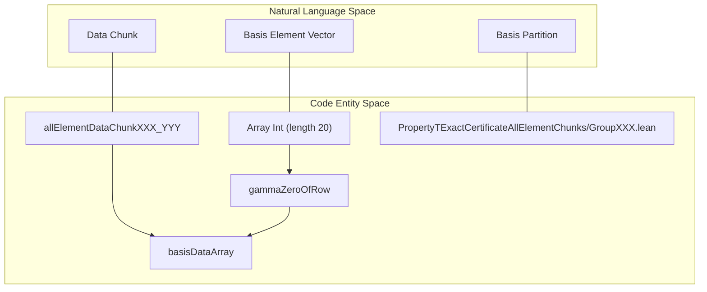
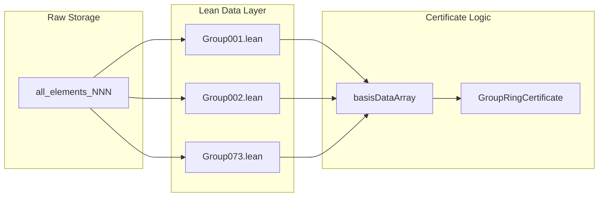

<!-- source: DeepWiki mcp.deepwiki.com · repo openai/ten-proofs · page 5.3 AllElement Chunks and Basis Data · fetched 2026-10-26 -->

# AllElement Chunks and Basis Data

Relevant source files

The following files were used as context for generating this wiki page:

- [ConnesRigidity/Certificates/AffineSymplectic/Chunks/all_elements_000](ConnesRigidity/Certificates/AffineSymplectic/Chunks/all_elements_000)
- [ConnesRigidity/Certificates/AffineSymplectic/Chunks/all_elements_003](ConnesRigidity/Certificates/AffineSymplectic/Chunks/all_elements_003)
- [ConnesRigidity/Certificates/AffineSymplectic/Chunks/all_elements_005](ConnesRigidity/Certificates/AffineSymplectic/Chunks/all_elements_005)
- [ConnesRigidity/Certificates/AffineSymplectic/Chunks/all_elements_006](ConnesRigidity/Certificates/AffineSymplectic/Chunks/all_elements_006)
- [ConnesRigidity/Certificates/AffineSymplectic/Chunks/all_elements_010](ConnesRigidity/Certificates/AffineSymplectic/Chunks/all_elements_010)
- [ConnesRigidity/Certificates/AffineSymplectic/Chunks/all_elements_011](ConnesRigidity/Certificates/AffineSymplectic/Chunks/all_elements_011)
- [ConnesRigidity/Certificates/AffineSymplectic/Chunks/all_elements_012](ConnesRigidity/Certificates/AffineSymplectic/Chunks/all_elements_012)
- [ConnesRigidity/Certificates/AffineSymplectic/Chunks/all_elements_013](ConnesRigidity/Certificates/AffineSymplectic/Chunks/all_elements_013)
- [ConnesRigidity/Certificates/AffineSymplectic/Chunks/all_elements_015](ConnesRigidity/Certificates/AffineSymplectic/Chunks/all_elements_015)
- [ConnesRigidity/Certificates/AffineSymplectic/Chunks/all_elements_016](ConnesRigidity/Certificates/AffineSymplectic/Chunks/all_elements_016)
- [ConnesRigidity/Certificates/AffineSymplectic/Chunks/all_elements_017](ConnesRigidity/Certificates/AffineSymplectic/Chunks/all_elements_017)
- [ConnesRigidity/Certificates/AffineSymplectic/Chunks/all_elements_018](ConnesRigidity/Certificates/AffineSymplectic/Chunks/all_elements_018)
- [ConnesRigidity/Certificates/AffineSymplectic/Chunks/all_elements_019](ConnesRigidity/Certificates/AffineSymplectic/Chunks/all_elements_019)
- [ConnesRigidity/Certificates/AffineSymplectic/Chunks/all_elements_020](ConnesRigidity/Certificates/AffineSymplectic/Chunks/all_elements_020)
- [ConnesRigidity/Certificates/AffineSymplectic/Chunks/all_elements_023](ConnesRigidity/Certificates/AffineSymplectic/Chunks/all_elements_023)
- [ConnesRigidity/Certificates/AffineSymplectic/Chunks/all_elements_025](ConnesRigidity/Certificates/AffineSymplectic/Chunks/all_elements_025)
- [ConnesRigidity/Certificates/AffineSymplectic/Chunks/all_elements_026](ConnesRigidity/Certificates/AffineSymplectic/Chunks/all_elements_026)
- [ConnesRigidity/Certificates/AffineSymplectic/Chunks/all_elements_027](ConnesRigidity/Certificates/AffineSymplectic/Chunks/all_elements_027)
- [ConnesRigidity/Certificates/AffineSymplectic/Chunks/all_elements_028](ConnesRigidity/Certificates/AffineSymplectic/Chunks/all_elements_028)
- [ConnesRigidity/Certificates/AffineSymplectic/Chunks/all_elements_030](ConnesRigidity/Certificates/AffineSymplectic/Chunks/all_elements_030)
- [ConnesRigidity/Certificates/AffineSymplectic/Chunks/all_elements_031](ConnesRigidity/Certificates/AffineSymplectic/Chunks/all_elements_031)
- [ConnesRigidity/Certificates/AffineSymplectic/Chunks/all_elements_032](ConnesRigidity/Certificates/AffineSymplectic/Chunks/all_elements_032)
- [ConnesRigidity/Certificates/AffineSymplectic/Chunks/all_elements_035](ConnesRigidity/Certificates/AffineSymplectic/Chunks/all_elements_035)
- [ConnesRigidity/Certificates/AffineSymplectic/Chunks/all_elements_038](ConnesRigidity/Certificates/AffineSymplectic/Chunks/all_elements_038)
- [ConnesRigidity/Certificates/AffineSymplectic/Chunks/all_elements_039](ConnesRigidity/Certificates/AffineSymplectic/Chunks/all_elements_039)
- [ConnesRigidity/Certificates/AffineSymplectic/Chunks/all_elements_040](ConnesRigidity/Certificates/AffineSymplectic/Chunks/all_elements_040)
- [ConnesRigidity/Certificates/AffineSymplectic/Chunks/all_elements_041](ConnesRigidity/Certificates/AffineSymplectic/Chunks/all_elements_041)
- [ConnesRigidity/Certificates/AffineSymplectic/Chunks/all_elements_042](ConnesRigidity/Certificates/AffineSymplectic/Chunks/all_elements_042)
- [ConnesRigidity/Certificates/AffineSymplectic/Chunks/all_elements_043](ConnesRigidity/Certificates/AffineSymplectic/Chunks/all_elements_043)
- [ConnesRigidity/Certificates/AffineSymplectic/Chunks/all_elements_044](ConnesRigidity/Certificates/AffineSymplectic/Chunks/all_elements_044)
- [ConnesRigidity/Certificates/AffineSymplectic/Chunks/all_elements_046](ConnesRigidity/Certificates/AffineSymplectic/Chunks/all_elements_046)
- [ConnesRigidity/Certificates/AffineSymplectic/Chunks/all_elements_049](ConnesRigidity/Certificates/AffineSymplectic/Chunks/all_elements_049)
- [ConnesRigidity/Certificates/AffineSymplectic/Chunks/all_elements_050](ConnesRigidity/Certificates/AffineSymplectic/Chunks/all_elements_050)
- [ConnesRigidity/Certificates/AffineSymplectic/Chunks/all_elements_051](ConnesRigidity/Certificates/AffineSymplectic/Chunks/all_elements_051)
- [ConnesRigidity/Certificates/AffineSymplectic/Chunks/all_elements_055](ConnesRigidity/Certificates/AffineSymplectic/Chunks/all_elements_055)
- [ConnesRigidity/Certificates/AffineSymplectic/Chunks/all_elements_057](ConnesRigidity/Certificates/AffineSymplectic/Chunks/all_elements_057)
- [ConnesRigidity/Certificates/AffineSymplectic/Chunks/all_elements_058](ConnesRigidity/Certificates/AffineSymplectic/Chunks/all_elements_058)
- [ConnesRigidity/Certificates/AffineSymplectic/Chunks/all_elements_059](ConnesRigidity/Certificates/AffineSymplectic/Chunks/all_elements_059)
- [ConnesRigidity/Certificates/AffineSymplectic/Chunks/all_elements_060](ConnesRigidity/Certificates/AffineSymplectic/Chunks/all_elements_060)
- [ConnesRigidity/Certificates/AffineSymplectic/Chunks/all_elements_063](ConnesRigidity/Certificates/AffineSymplectic/Chunks/all_elements_063)
- [ConnesRigidity/Certificates/AffineSymplectic/Chunks/all_elements_066](ConnesRigidity/Certificates/AffineSymplectic/Chunks/all_elements_066)
- [ConnesRigidity/Certificates/AffineSymplectic/Chunks/all_elements_068](ConnesRigidity/Certificates/AffineSymplectic/Chunks/all_elements_068)
- [ConnesRigidity/Certificates/AffineSymplectic/Chunks/all_elements_069](ConnesRigidity/Certificates/AffineSymplectic/Chunks/all_elements_069)
- [ConnesRigidity/Certificates/AffineSymplectic/Chunks/all_elements_070](ConnesRigidity/Certificates/AffineSymplectic/Chunks/all_elements_070)
- [ConnesRigidity/Certificates/AffineSymplectic/Chunks/all_elements_071](ConnesRigidity/Certificates/AffineSymplectic/Chunks/all_elements_071)
- [ConnesRigidity/Certificates/AffineSymplectic/Chunks/all_elements_072](ConnesRigidity/Certificates/AffineSymplectic/Chunks/all_elements_072)
- [ConnesRigidity/PropertyTExactCertificateAllElementChunks/Group000.lean](ConnesRigidity/PropertyTExactCertificateAllElementChunks/Group000.lean)
- [ConnesRigidity/PropertyTExactCertificateAllElementChunks/Group001.lean](ConnesRigidity/PropertyTExactCertificateAllElementChunks/Group001.lean)
- [ConnesRigidity/PropertyTExactCertificateAllElementChunks/Group002.lean](ConnesRigidity/PropertyTExactCertificateAllElementChunks/Group002.lean)
- [ConnesRigidity/PropertyTExactCertificateAllElementChunks/Group003.lean](ConnesRigidity/PropertyTExactCertificateAllElementChunks/Group003.lean)
- [ConnesRigidity/PropertyTExactCertificateAllElementChunks/Group004.lean](ConnesRigidity/PropertyTExactCertificateAllElementChunks/Group004.lean)
- [ConnesRigidity/PropertyTExactCertificateAllElementChunks/Group005.lean](ConnesRigidity/PropertyTExactCertificateAllElementChunks/Group005.lean)
- [ConnesRigidity/PropertyTExactCertificateAllElementChunks/Group007.lean](ConnesRigidity/PropertyTExactCertificateAllElementChunks/Group007.lean)
- [ConnesRigidity/PropertyTExactCertificateAllElementChunks/Group008.lean](ConnesRigidity/PropertyTExactCertificateAllElementChunks/Group008.lean)
- [ConnesRigidity/PropertyTExactCertificateAllElementChunks/Group009.lean](ConnesRigidity/PropertyTExactCertificateAllElementChunks/Group009.lean)
- [ConnesRigidity/PropertyTExactCertificateAllElementChunks/Group010.lean](ConnesRigidity/PropertyTExactCertificateAllElementChunks/Group010.lean)
- [ConnesRigidity/PropertyTExactCertificateAllElementChunks/Group011.lean](ConnesRigidity/PropertyTExactCertificateAllElementChunks/Group011.lean)
- [ConnesRigidity/PropertyTExactCertificateAllElementChunks/Group012.lean](ConnesRigidity/PropertyTExactCertificateAllElementChunks/Group012.lean)
- [ConnesRigidity/PropertyTExactCertificateAllElementChunks/Group013.lean](ConnesRigidity/PropertyTExactCertificateAllElementChunks/Group013.lean)
- [ConnesRigidity/PropertyTExactCertificateAllElementChunks/Group014.lean](ConnesRigidity/PropertyTExactCertificateAllElementChunks/Group014.lean)
- [ConnesRigidity/PropertyTExactCertificateAllElementChunks/Group015.lean](ConnesRigidity/PropertyTExactCertificateAllElementChunks/Group015.lean)
- [ConnesRigidity/PropertyTExactCertificateAllElementChunks/Group016.lean](ConnesRigidity/PropertyTExactCertificateAllElementChunks/Group016.lean)
- [ConnesRigidity/PropertyTExactCertificateAllElementChunks/Group017.lean](ConnesRigidity/PropertyTExactCertificateAllElementChunks/Group017.lean)
- [ConnesRigidity/PropertyTExactCertificateAllElementChunks/Group018.lean](ConnesRigidity/PropertyTExactCertificateAllElementChunks/Group018.lean)
- [ConnesRigidity/PropertyTExactCertificateAllElementChunks/Group019.lean](ConnesRigidity/PropertyTExactCertificateAllElementChunks/Group019.lean)
- [ConnesRigidity/PropertyTExactCertificateAllElementChunks/Group020.lean](ConnesRigidity/PropertyTExactCertificateAllElementChunks/Group020.lean)
- [ConnesRigidity/PropertyTExactCertificateAllElementChunks/Group021.lean](ConnesRigidity/PropertyTExactCertificateAllElementChunks/Group021.lean)
- [ConnesRigidity/PropertyTExactCertificateAllElementChunks/Group022.lean](ConnesRigidity/PropertyTExactCertificateAllElementChunks/Group022.lean)
- [ConnesRigidity/PropertyTExactCertificateAllElementChunks/Group023.lean](ConnesRigidity/PropertyTExactCertificateAllElementChunks/Group023.lean)
- [ConnesRigidity/PropertyTExactCertificateAllElementChunks/Group024.lean](ConnesRigidity/PropertyTExactCertificateAllElementChunks/Group024.lean)
- [ConnesRigidity/PropertyTExactCertificateAllElementChunks/Group025.lean](ConnesRigidity/PropertyTExactCertificateAllElementChunks/Group025.lean)
- [ConnesRigidity/PropertyTExactCertificateAllElementChunks/Group026.lean](ConnesRigidity/PropertyTExactCertificateAllElementChunks/Group026.lean)
- [ConnesRigidity/PropertyTExactCertificateAllElementChunks/Group027.lean](ConnesRigidity/PropertyTExactCertificateAllElementChunks/Group027.lean)
- [ConnesRigidity/PropertyTExactCertificateAllElementChunks/Group028.lean](ConnesRigidity/PropertyTExactCertificateAllElementChunks/Group028.lean)
- [ConnesRigidity/PropertyTExactCertificateAllElementChunks/Group029.lean](ConnesRigidity/PropertyTExactCertificateAllElementChunks/Group029.lean)
- [ConnesRigidity/PropertyTExactCertificateAllElementChunks/Group030.lean](ConnesRigidity/PropertyTExactCertificateAllElementChunks/Group030.lean)
- [ConnesRigidity/PropertyTExactCertificateAllElementChunks/Group031.lean](ConnesRigidity/PropertyTExactCertificateAllElementChunks/Group031.lean)
- [ConnesRigidity/PropertyTExactCertificateAllElementChunks/Group032.lean](ConnesRigidity/PropertyTExactCertificateAllElementChunks/Group032.lean)
- [ConnesRigidity/PropertyTExactCertificateAllElementChunks/Group033.lean](ConnesRigidity/PropertyTExactCertificateAllElementChunks/Group033.lean)
- [ConnesRigidity/PropertyTExactCertificateAllElementChunks/Group034.lean](ConnesRigidity/PropertyTExactCertificateAllElementChunks/Group034.lean)
- [ConnesRigidity/PropertyTExactCertificateAllElementChunks/Group035.lean](ConnesRigidity/PropertyTExactCertificateAllElementChunks/Group035.lean)
- [ConnesRigidity/PropertyTExactCertificateAllElementChunks/Group036.lean](ConnesRigidity/PropertyTExactCertificateAllElementChunks/Group036.lean)
- [ConnesRigidity/PropertyTExactCertificateAllElementChunks/Group037.lean](ConnesRigidity/PropertyTExactCertificateAllElementChunks/Group037.lean)
- [ConnesRigidity/PropertyTExactCertificateAllElementChunks/Group038.lean](ConnesRigidity/PropertyTExactCertificateAllElementChunks/Group038.lean)
- [ConnesRigidity/PropertyTExactCertificateAllElementChunks/Group039.lean](ConnesRigidity/PropertyTExactCertificateAllElementChunks/Group039.lean)
- [ConnesRigidity/PropertyTExactCertificateAllElementChunks/Group040.lean](ConnesRigidity/PropertyTExactCertificateAllElementChunks/Group040.lean)
- [ConnesRigidity/PropertyTExactCertificateAllElementChunks/Group041.lean](ConnesRigidity/PropertyTExactCertificateAllElementChunks/Group041.lean)
- [ConnesRigidity/PropertyTExactCertificateAllElementChunks/Group042.lean](ConnesRigidity/PropertyTExactCertificateAllElementChunks/Group042.lean)
- [ConnesRigidity/PropertyTExactCertificateAllElementChunks/Group043.lean](ConnesRigidity/PropertyTExactCertificateAllElementChunks/Group043.lean)
- [ConnesRigidity/PropertyTExactCertificateAllElementChunks/Group044.lean](ConnesRigidity/PropertyTExactCertificateAllElementChunks/Group044.lean)
- [ConnesRigidity/PropertyTExactCertificateAllElementChunks/Group045.lean](ConnesRigidity/PropertyTExactCertificateAllElementChunks/Group045.lean)
- [ConnesRigidity/PropertyTExactCertificateAllElementChunks/Group046.lean](ConnesRigidity/PropertyTExactCertificateAllElementChunks/Group046.lean)
- [ConnesRigidity/PropertyTExactCertificateAllElementChunks/Group047.lean](ConnesRigidity/PropertyTExactCertificateAllElementChunks/Group047.lean)
- [ConnesRigidity/PropertyTExactCertificateAllElementChunks/Group048.lean](ConnesRigidity/PropertyTExactCertificateAllElementChunks/Group048.lean)
- [ConnesRigidity/PropertyTExactCertificateAllElementChunks/Group049.lean](ConnesRigidity/PropertyTExactCertificateAllElementChunks/Group049.lean)
- [ConnesRigidity/PropertyTExactCertificateAllElementChunks/Group050.lean](ConnesRigidity/PropertyTExactCertificateAllElementChunks/Group050.lean)
- [ConnesRigidity/PropertyTExactCertificateAllElementChunks/Group051.lean](ConnesRigidity/PropertyTExactCertificateAllElementChunks/Group051.lean)
- [ConnesRigidity/PropertyTExactCertificateAllElementChunks/Group052.lean](ConnesRigidity/PropertyTExactCertificateAllElementChunks/Group052.lean)
- [ConnesRigidity/PropertyTExactCertificateAllElementChunks/Group053.lean](ConnesRigidity/PropertyTExactCertificateAllElementChunks/Group053.lean)
- [ConnesRigidity/PropertyTExactCertificateAllElementChunks/Group054.lean](ConnesRigidity/PropertyTExactCertificateAllElementChunks/Group054.lean)
- [ConnesRigidity/PropertyTExactCertificateAllElementChunks/Group055.lean](ConnesRigidity/PropertyTExactCertificateAllElementChunks/Group055.lean)
- [ConnesRigidity/PropertyTExactCertificateAllElementChunks/Group056.lean](ConnesRigidity/PropertyTExactCertificateAllElementChunks/Group056.lean)
- [ConnesRigidity/PropertyTExactCertificateAllElementChunks/Group057.lean](ConnesRigidity/PropertyTExactCertificateAllElementChunks/Group057.lean)
- [ConnesRigidity/PropertyTExactCertificateAllElementChunks/Group058.lean](ConnesRigidity/PropertyTExactCertificateAllElementChunks/Group058.lean)
- [ConnesRigidity/PropertyTExactCertificateAllElementChunks/Group059.lean](ConnesRigidity/PropertyTExactCertificateAllElementChunks/Group059.lean)
- [ConnesRigidity/PropertyTExactCertificateAllElementChunks/Group060.lean](ConnesRigidity/PropertyTExactCertificateAllElementChunks/Group060.lean)
- [ConnesRigidity/PropertyTExactCertificateAllElementChunks/Group061.lean](ConnesRigidity/PropertyTExactCertificateAllElementChunks/Group061.lean)
- [ConnesRigidity/PropertyTExactCertificateAllElementChunks/Group062.lean](ConnesRigidity/PropertyTExactCertificateAllElementChunks/Group062.lean)
- [ConnesRigidity/PropertyTExactCertificateAllElementChunks/Group063.lean](ConnesRigidity/PropertyTExactCertificateAllElementChunks/Group063.lean)
- [ConnesRigidity/PropertyTExactCertificateAllElementChunks/Group064.lean](ConnesRigidity/PropertyTExactCertificateAllElementChunks/Group064.lean)
- [ConnesRigidity/PropertyTExactCertificateAllElementChunks/Group065.lean](ConnesRigidity/PropertyTExactCertificateAllElementChunks/Group065.lean)
- [ConnesRigidity/PropertyTExactCertificateAllElementChunks/Group066.lean](ConnesRigidity/PropertyTExactCertificateAllElementChunks/Group066.lean)
- [ConnesRigidity/PropertyTExactCertificateAllElementChunks/Group067.lean](ConnesRigidity/PropertyTExactCertificateAllElementChunks/Group067.lean)
- [ConnesRigidity/PropertyTExactCertificateAllElementChunks/Group068.lean](ConnesRigidity/PropertyTExactCertificateAllElementChunks/Group068.lean)
- [ConnesRigidity/PropertyTExactCertificateAllElementChunks/Group069.lean](ConnesRigidity/PropertyTExactCertificateAllElementChunks/Group069.lean)
- [ConnesRigidity/PropertyTExactCertificateAllElementChunks/Group072.lean](ConnesRigidity/PropertyTExactCertificateAllElementChunks/Group072.lean)

This section details the storage and processing of the 73,033 group elements that constitute the basis for the group ring $\mathbb{Z}[\Gamma_0]$. Given the scale of the data, the basis is partitioned into chunks to facilitate parallel processing and bypass Lean 4 compiler limits on large literals.

## Data Partitioning and Raw Storage

The basis elements are represented as 20-column integer vectors. These vectors correspond to the parameters required to reconstruct elements of the group $\Gamma_0$, a cocycle extension of $Sp(4, \mathbb{Z})$. The raw data is stored in the `Certificates/AffineSymplectic/Chunks/` directory.

### Raw Data Format
Each file (e.g., `all_elements_015`) contains rows of 20 comma-separated integers [Certificates/AffineSymplectic/Chunks/all_elements_015:1-167](). These integers represent:
1.  The symplectic matrix components (derived from the 10 generators).
2.  The translation components in the integral lattice.
3.  The cocycle values associated with the extension.

### Sharding Strategy
The data is sharded across 74 files in `PropertyTExactCertificateAllElementChunks/`, named `Group000.lean` through `Group073.lean`. Each file contains multiple `Array (Array Int)` definitions, typically partitioned into sub-chunks of 5 elements each to maintain high compilation performance [PropertyTExactCertificateAllElementChunks/Group045.lean:6-148]().

| Component | Description |
| :--- | :--- |
| **Raw Chunks** | CSV-like files in `Certificates/AffineSymplectic/Chunks/` containing raw integer vectors. |
| **Lean Chunks** | Modules in `PropertyTExactCertificateAllElementChunks/` wrapping raw data in `@[irreducible] noncomputable def` blocks. |
| **Basis Array** | The aggregate `basisDataArray` which concatenates these chunks for use in the certificate. |

**Sources:**
- [Certificates/AffineSymplectic/Chunks/all_elements_015:1-167]()
- [PropertyTExactCertificateAllElementChunks/Group045.lean:6-148]()
- [PropertyTExactCertificateAllElementChunks/Group011.lean:6-151]()

## Data Flow: From Integers to Group Elements

The transformation of raw integer arrays into formal group elements involves a two-step process: parsing the 20-column rows and lifting them into the `GammaZero` type.

### Mapping Diagram: Data to Code Entities
The following diagram illustrates how the static data chunks are associated with the functional components of the group ring.

"Data to Code Mapping"

### Construction Functions
*   **`gammaZeroOfData`**: The primary entry point for converting a raw integer array into a `GammaZero` element.
*   **`gammaZeroOfRow`**: A helper that maps the specific indices of the 20-column vector to the internal fields of the `GammaZero` structure (e.g., matrix entries, lattice coordinates).
*   **`basisDataArray`**: The top-level array that indexes all 73,033 elements, providing the mapping from `TableIndex` to `GammaZero`.

**Sources:**
- [PropertyTExactCertificateAllElementChunks/Group045.lean:2-5]()
- [PropertyTExactCertificateAllElementChunks/Group011.lean:2-5]()

## Parallel Processing and Compilation

The division into 74 `Group*.lean` files allows the Lean 4 compiler to process basis data in parallel. Each file uses the `@[irreducible]` attribute to prevent the kernel from attempting to unfold the large arrays during routine tactic application, which would otherwise lead to memory exhaustion.

### Data Flow Architecture

"Chunked Data Flow"

**Sources:**
- [PropertyTExactCertificateAllElementChunks/Group045.lean:6-10]()
- [PropertyTExactCertificateAllElementChunks/Group011.lean:6-10]()

Would you like a summary of the next segment, which covers **Section 6.1: Data Sharding and Modular Compilation**?

---

