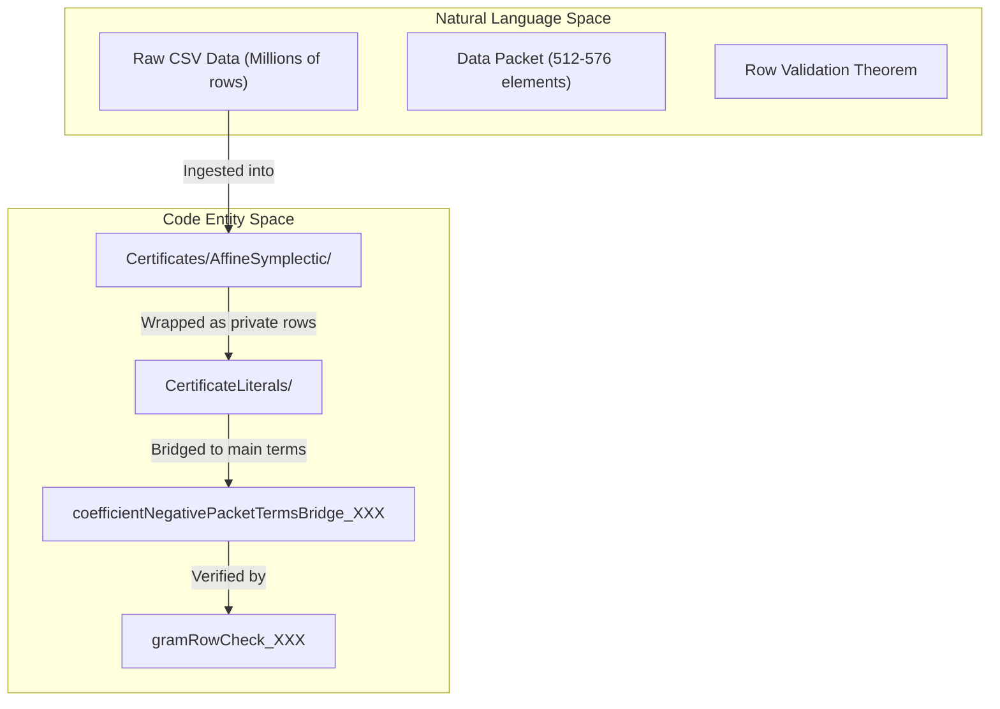
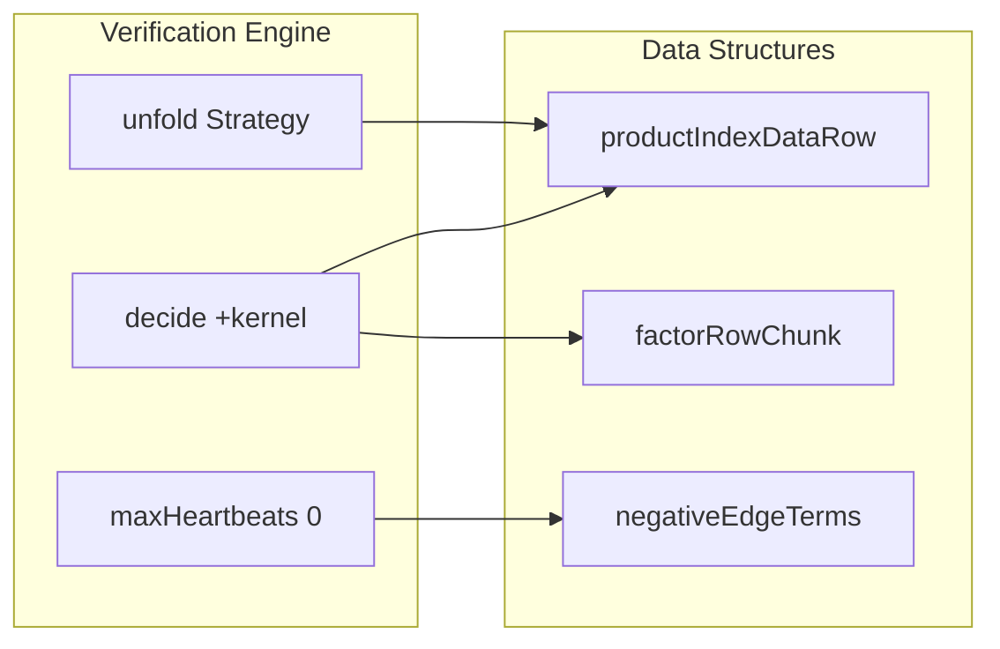

<!-- source: DeepWiki mcp.deepwiki.com · repo openai/ten-proofs · page 6 Lean 4 Proof Engineering Techniques · fetched 2026-10-26 -->

# Lean 4 Proof Engineering Techniques

Relevant source files

The following files were used as context for generating this wiki page:

- [ConnesRigidity/PropertyTExactCertificateCoefficientEdgePacketBridges/Negative000.lean](ConnesRigidity/PropertyTExactCertificateCoefficientEdgePacketBridges/Negative000.lean)
- [ConnesRigidity/PropertyTExactCertificateCoefficientEdgePacketBridges/Negative001.lean](ConnesRigidity/PropertyTExactCertificateCoefficientEdgePacketBridges/Negative001.lean)
- [ConnesRigidity/PropertyTExactCertificateCoefficientEdgePacketBridges/Negative010.lean](ConnesRigidity/PropertyTExactCertificateCoefficientEdgePacketBridges/Negative010.lean)
- [ConnesRigidity/PropertyTExactCertificateCoefficientEdgePacketBridges/Negative011.lean](ConnesRigidity/PropertyTExactCertificateCoefficientEdgePacketBridges/Negative011.lean)
- [ConnesRigidity/PropertyTExactCertificateCoefficientEdgePacketBridges/Negative013.lean](ConnesRigidity/PropertyTExactCertificateCoefficientEdgePacketBridges/Negative013.lean)
- [ConnesRigidity/PropertyTExactCertificateCoefficientEdgePacketBridges/Negative014.lean](ConnesRigidity/PropertyTExactCertificateCoefficientEdgePacketBridges/Negative014.lean)
- [ConnesRigidity/PropertyTExactCertificateCoefficientEdgePacketBridges/Negative016.lean](ConnesRigidity/PropertyTExactCertificateCoefficientEdgePacketBridges/Negative016.lean)
- [ConnesRigidity/PropertyTExactCertificateCoefficientEdgePacketBridges/Negative017.lean](ConnesRigidity/PropertyTExactCertificateCoefficientEdgePacketBridges/Negative017.lean)
- [ConnesRigidity/PropertyTExactCertificateCoefficientEdgePacketBridges/Negative019.lean](ConnesRigidity/PropertyTExactCertificateCoefficientEdgePacketBridges/Negative019.lean)
- [ConnesRigidity/PropertyTExactCertificateCoefficientEdgePacketBridges/Negative020.lean](ConnesRigidity/PropertyTExactCertificateCoefficientEdgePacketBridges/Negative020.lean)
- [ConnesRigidity/PropertyTExactCertificateCoefficientEdgePacketBridges/Negative021.lean](ConnesRigidity/PropertyTExactCertificateCoefficientEdgePacketBridges/Negative021.lean)
- [ConnesRigidity/PropertyTExactCertificateCoefficientEdgePacketBridges/Negative022.lean](ConnesRigidity/PropertyTExactCertificateCoefficientEdgePacketBridges/Negative022.lean)
- [ConnesRigidity/PropertyTExactCertificateCoefficientEdgePacketBridges/Negative023.lean](ConnesRigidity/PropertyTExactCertificateCoefficientEdgePacketBridges/Negative023.lean)
- [ConnesRigidity/PropertyTExactCertificateCoefficientEdgePacketBridges/Negative024.lean](ConnesRigidity/PropertyTExactCertificateCoefficientEdgePacketBridges/Negative024.lean)
- [ConnesRigidity/PropertyTExactCertificateCoefficientEdgePacketBridges/Negative027.lean](ConnesRigidity/PropertyTExactCertificateCoefficientEdgePacketBridges/Negative027.lean)
- [ConnesRigidity/PropertyTExactCertificateCoefficientEdgePacketBridges/Negative034.lean](ConnesRigidity/PropertyTExactCertificateCoefficientEdgePacketBridges/Negative034.lean)
- [ConnesRigidity/PropertyTExactCertificateCoefficientEdgePacketBridges/Negative035.lean](ConnesRigidity/PropertyTExactCertificateCoefficientEdgePacketBridges/Negative035.lean)
- [ConnesRigidity/PropertyTExactCertificateCoefficientEdgePacketBridges/Negative036.lean](ConnesRigidity/PropertyTExactCertificateCoefficientEdgePacketBridges/Negative036.lean)
- [ConnesRigidity/PropertyTExactCertificateCoefficientEdgePacketBridges/Negative038.lean](ConnesRigidity/PropertyTExactCertificateCoefficientEdgePacketBridges/Negative038.lean)
- [ConnesRigidity/PropertyTExactCertificateCoefficientEdgePacketBridges/Negative039.lean](ConnesRigidity/PropertyTExactCertificateCoefficientEdgePacketBridges/Negative039.lean)
- [ConnesRigidity/PropertyTExactCertificateCoefficientEdgePacketBridges/Negative044.lean](ConnesRigidity/PropertyTExactCertificateCoefficientEdgePacketBridges/Negative044.lean)
- [ConnesRigidity/PropertyTExactCertificateCoefficientEdgePacketBridges/Negative048.lean](ConnesRigidity/PropertyTExactCertificateCoefficientEdgePacketBridges/Negative048.lean)
- [ConnesRigidity/PropertyTExactCertificateCoefficientEdgePacketBridges/Negative049.lean](ConnesRigidity/PropertyTExactCertificateCoefficientEdgePacketBridges/Negative049.lean)
- [ConnesRigidity/PropertyTExactCertificateCoefficientEdgePacketBridges/Negative052.lean](ConnesRigidity/PropertyTExactCertificateCoefficientEdgePacketBridges/Negative052.lean)
- [ConnesRigidity/PropertyTExactCertificateCoefficientEdgePacketBridges/Negative053.lean](ConnesRigidity/PropertyTExactCertificateCoefficientEdgePacketBridges/Negative053.lean)
- [ConnesRigidity/PropertyTExactCertificateCoefficientEdgePacketBridges/Negative055.lean](ConnesRigidity/PropertyTExactCertificateCoefficientEdgePacketBridges/Negative055.lean)
- [ConnesRigidity/PropertyTExactCertificateCoefficientEdgePacketBridges/Negative056.lean](ConnesRigidity/PropertyTExactCertificateCoefficientEdgePacketBridges/Negative056.lean)
- [ConnesRigidity/PropertyTExactCertificateCoefficientEdgePacketBridges/Negative057.lean](ConnesRigidity/PropertyTExactCertificateCoefficientEdgePacketBridges/Negative057.lean)
- [ConnesRigidity/PropertyTExactCertificateCoefficientEdgePacketBridges/Negative058.lean](ConnesRigidity/PropertyTExactCertificateCoefficientEdgePacketBridges/Negative058.lean)
- [ConnesRigidity/PropertyTExactCertificateCoefficientEdgePacketBridges/Negative063.lean](ConnesRigidity/PropertyTExactCertificateCoefficientEdgePacketBridges/Negative063.lean)
- [ConnesRigidity/PropertyTExactCertificateCoefficientEdgePacketBridges/Negative066.lean](ConnesRigidity/PropertyTExactCertificateCoefficientEdgePacketBridges/Negative066.lean)
- [ConnesRigidity/PropertyTExactCertificateCoefficientEdgePacketBridges/Negative076.lean](ConnesRigidity/PropertyTExactCertificateCoefficientEdgePacketBridges/Negative076.lean)
- [ConnesRigidity/PropertyTExactCertificateCoefficientEdgePacketBridges/Negative077.lean](ConnesRigidity/PropertyTExactCertificateCoefficientEdgePacketBridges/Negative077.lean)
- [ConnesRigidity/PropertyTExactCertificateCoefficientEdgePacketBridges/Negative078.lean](ConnesRigidity/PropertyTExactCertificateCoefficientEdgePacketBridges/Negative078.lean)
- [ConnesRigidity/PropertyTExactCertificateCoefficientEdgePacketBridges/Negative079.lean](ConnesRigidity/PropertyTExactCertificateCoefficientEdgePacketBridges/Negative079.lean)
- [ConnesRigidity/PropertyTExactCertificateCoefficientEdgePacketBridges/Negative082.lean](ConnesRigidity/PropertyTExactCertificateCoefficientEdgePacketBridges/Negative082.lean)
- [ConnesRigidity/PropertyTExactCertificateCoefficientEdgePacketBridges/Negative083.lean](ConnesRigidity/PropertyTExactCertificateCoefficientEdgePacketBridges/Negative083.lean)
- [ConnesRigidity/PropertyTExactCertificateCoefficientEdgePacketBridges/Negative090.lean](ConnesRigidity/PropertyTExactCertificateCoefficientEdgePacketBridges/Negative090.lean)
- [ConnesRigidity/PropertyTExactCertificateCoefficientEdgePacketBridges/Negative091.lean](ConnesRigidity/PropertyTExactCertificateCoefficientEdgePacketBridges/Negative091.lean)
- [ConnesRigidity/PropertyTExactCertificateCoefficientEdgePacketBridges/Negative092.lean](ConnesRigidity/PropertyTExactCertificateCoefficientEdgePacketBridges/Negative092.lean)
- [ConnesRigidity/PropertyTExactCertificateCoefficientEdgePacketBridges/Negative093.lean](ConnesRigidity/PropertyTExactCertificateCoefficientEdgePacketBridges/Negative093.lean)
- [ConnesRigidity/PropertyTExactCertificateCoefficientEdgePacketBridges/Negative094.lean](ConnesRigidity/PropertyTExactCertificateCoefficientEdgePacketBridges/Negative094.lean)
- [ConnesRigidity/PropertyTExactCertificateCoefficientEdgePacketBridges/Negative095.lean](ConnesRigidity/PropertyTExactCertificateCoefficientEdgePacketBridges/Negative095.lean)
- [ConnesRigidity/PropertyTExactCertificateCoefficientEdgePacketBridges/Negative096.lean](ConnesRigidity/PropertyTExactCertificateCoefficientEdgePacketBridges/Negative096.lean)
- [ConnesRigidity/PropertyTExactCertificateCoefficientEdgePacketBridges/Negative097.lean](ConnesRigidity/PropertyTExactCertificateCoefficientEdgePacketBridges/Negative097.lean)
- [ConnesRigidity/PropertyTExactCertificateCoefficientEdgePacketBridges/Negative098.lean](ConnesRigidity/PropertyTExactCertificateCoefficientEdgePacketBridges/Negative098.lean)
- [ConnesRigidity/PropertyTExactCertificateCoefficientEdgePacketBridges/Negative099.lean](ConnesRigidity/PropertyTExactCertificateCoefficientEdgePacketBridges/Negative099.lean)
- [ConnesRigidity/PropertyTExactCertificateCoefficientEdgePacketBridges/Negative116.lean](ConnesRigidity/PropertyTExactCertificateCoefficientEdgePacketBridges/Negative116.lean)
- [ConnesRigidity/PropertyTExactCertificateCoefficientEdgePacketBridges/Negative123.lean](ConnesRigidity/PropertyTExactCertificateCoefficientEdgePacketBridges/Negative123.lean)
- [ConnesRigidity/PropertyTExactCertificateCoefficientEdgePacketBridges/Negative131.lean](ConnesRigidity/PropertyTExactCertificateCoefficientEdgePacketBridges/Negative131.lean)
- [ConnesRigidity/PropertyTExactCertificateCoefficientEdgePacketBridges/Negative135.lean](ConnesRigidity/PropertyTExactCertificateCoefficientEdgePacketBridges/Negative135.lean)
- [ConnesRigidity/PropertyTExactCertificateCoefficientEdgePacketBridges/Negative140.lean](ConnesRigidity/PropertyTExactCertificateCoefficientEdgePacketBridges/Negative140.lean)
- [ConnesRigidity/PropertyTExactCertificateCoefficientEdgePacketBridges/Negative145.lean](ConnesRigidity/PropertyTExactCertificateCoefficientEdgePacketBridges/Negative145.lean)
- [ConnesRigidity/PropertyTExactCertificateCoefficientEdgePacketBridges/Negative151.lean](ConnesRigidity/PropertyTExactCertificateCoefficientEdgePacketBridges/Negative151.lean)
- [ConnesRigidity/PropertyTExactCertificateGramRows/Row019.lean](ConnesRigidity/PropertyTExactCertificateGramRows/Row019.lean)
- [ConnesRigidity/PropertyTExactCertificateGramRows/Row020.lean](ConnesRigidity/PropertyTExactCertificateGramRows/Row020.lean)
- [ConnesRigidity/PropertyTExactCertificateGramRows/Row021.lean](ConnesRigidity/PropertyTExactCertificateGramRows/Row021.lean)
- [ConnesRigidity/PropertyTExactCertificateGramRows/Row024.lean](ConnesRigidity/PropertyTExactCertificateGramRows/Row024.lean)
- [ConnesRigidity/PropertyTExactCertificateGramRows/Row031.lean](ConnesRigidity/PropertyTExactCertificateGramRows/Row031.lean)
- [ConnesRigidity/PropertyTExactCertificateGramRows/Row037.lean](ConnesRigidity/PropertyTExactCertificateGramRows/Row037.lean)
- [ConnesRigidity/PropertyTExactCertificateGramRows/Row039.lean](ConnesRigidity/PropertyTExactCertificateGramRows/Row039.lean)
- [ConnesRigidity/PropertyTExactCertificateGramRows/Row085.lean](ConnesRigidity/PropertyTExactCertificateGramRows/Row085.lean)
- [ConnesRigidity/PropertyTExactCertificateGramRows/Row126.lean](ConnesRigidity/PropertyTExactCertificateGramRows/Row126.lean)
- [ConnesRigidity/PropertyTExactCertificateGramRows/Row212.lean](ConnesRigidity/PropertyTExactCertificateGramRows/Row212.lean)
- [ConnesRigidity/PropertyTExactCertificateGramRows/Row213.lean](ConnesRigidity/PropertyTExactCertificateGramRows/Row213.lean)
- [ConnesRigidity/PropertyTExactCertificateGramRows/Row225.lean](ConnesRigidity/PropertyTExactCertificateGramRows/Row225.lean)
- [ConnesRigidity/PropertyTExactCertificateGramRows/Row270.lean](ConnesRigidity/PropertyTExactCertificateGramRows/Row270.lean)
- [ConnesRigidity/PropertyTExactCertificateGramRows/Row285.lean](ConnesRigidity/PropertyTExactCertificateGramRows/Row285.lean)
- [ConnesRigidity/PropertyTExactCertificateGramRows/Row295.lean](ConnesRigidity/PropertyTExactCertificateGramRows/Row295.lean)
- [ConnesRigidity/PropertyTExactCertificateGramRows/Row296.lean](ConnesRigidity/PropertyTExactCertificateGramRows/Row296.lean)
- [ConnesRigidity/PropertyTExactCertificateGramRows/Row298.lean](ConnesRigidity/PropertyTExactCertificateGramRows/Row298.lean)
- [ConnesRigidity/PropertyTExactCertificateGramRows/Row316.lean](ConnesRigidity/PropertyTExactCertificateGramRows/Row316.lean)
- [ConnesRigidity/PropertyTExactCertificateGramRows/Row328.lean](ConnesRigidity/PropertyTExactCertificateGramRows/Row328.lean)
- [ConnesRigidity/PropertyTExactCertificateGramRows/Row373.lean](ConnesRigidity/PropertyTExactCertificateGramRows/Row373.lean)
- [ConnesRigidity/PropertyTExactCertificateGramRows/Row383.lean](ConnesRigidity/PropertyTExactCertificateGramRows/Row383.lean)
- [ConnesRigidity/PropertyTExactCertificateGramRows/Row393.lean](ConnesRigidity/PropertyTExactCertificateGramRows/Row393.lean)
- [ConnesRigidity/PropertyTExactCertificateGramRows/Row408.lean](ConnesRigidity/PropertyTExactCertificateGramRows/Row408.lean)
- [ConnesRigidity/PropertyTExactCertificateProductRows/Row148.lean](ConnesRigidity/PropertyTExactCertificateProductRows/Row148.lean)
- [ConnesRigidity/PropertyTExactCertificateProductRows/Row219.lean](ConnesRigidity/PropertyTExactCertificateProductRows/Row219.lean)
- [ConnesRigidity/PropertyTExactCertificateProductRows/Row273.lean](ConnesRigidity/PropertyTExactCertificateProductRows/Row273.lean)
- [ConnesRigidity/PropertyTExactCertificateProductRows/Row282.lean](ConnesRigidity/PropertyTExactCertificateProductRows/Row282.lean)
- [ConnesRigidity/PropertyTExactCertificateProductRows/Row306.lean](ConnesRigidity/PropertyTExactCertificateProductRows/Row306.lean)
- [ConnesRigidity/PropertyTExactCertificateProductRows/Row309.lean](ConnesRigidity/PropertyTExactCertificateProductRows/Row309.lean)
- [ConnesRigidity/PropertyTExactCertificateProductRows/Row349.lean](ConnesRigidity/PropertyTExactCertificateProductRows/Row349.lean)
- [ConnesRigidity/PropertyTExactCertificateProductRows/Row355.lean](ConnesRigidity/PropertyTExactCertificateProductRows/Row355.lean)
- [ConnesRigidity/PropertyTExactCertificateProductRows/Row358.lean](ConnesRigidity/PropertyTExactCertificateProductRows/Row358.lean)
- [ConnesRigidity/PropertyTExactCertificateProductRows/Row359.lean](ConnesRigidity/PropertyTExactCertificateProductRows/Row359.lean)
- [ConnesRigidity/PropertyTExactCertificateProductRows/Row368.lean](ConnesRigidity/PropertyTExactCertificateProductRows/Row368.lean)
- [ConnesRigidity/PropertyTExactCertificateProductRows/Row376.lean](ConnesRigidity/PropertyTExactCertificateProductRows/Row376.lean)
- [ConnesRigidity/PropertyTExactCertificateProductRows/Row383.lean](ConnesRigidity/PropertyTExactCertificateProductRows/Row383.lean)
- [ConnesRigidity/PropertyTExactCertificateProductRows/Row406.lean](ConnesRigidity/PropertyTExactCertificateProductRows/Row406.lean)
- [ConnesRigidity/PropertyTExactCertificateProductRows/Row419.lean](ConnesRigidity/PropertyTExactCertificateProductRows/Row419.lean)
- [ConnesRigidity/PropertyTExactCertificateProductRows/Row420.lean](ConnesRigidity/PropertyTExactCertificateProductRows/Row420.lean)
- [ConnesRigidity/PropertyTExactCertificateProductRows/Row421.lean](ConnesRigidity/PropertyTExactCertificateProductRows/Row421.lean)
- [ConnesRigidity/PropertyTExactCertificateProductRows/Row424.lean](ConnesRigidity/PropertyTExactCertificateProductRows/Row424.lean)

The `ten-proofs` repository represents a large-scale formal verification effort that pushes the boundaries of the Lean 4 kernel and compiler. Verifying the disproof of the Connes Rigidity Conjecture requires processing millions of integer coefficients and performing complex algebraic checks on a 425-dimensional basis. This page provides a high-level overview of the engineering strategies employed to manage this scale.

## Data Sharding and Modular Compilation

To prevent the Lean compiler from exhausting memory or timing out during the processing of large static data, the repository utilizes a three-tier sharding architecture. Raw data is ingested into `CertificateLiterals` and then bridged into `PropertyTExact*` modules.

Key techniques include:
*   **Packetization**: Large lists are broken into fixed-size packets (e.g., 512 for negative edge terms) to facilitate parallel checking [ConnesRigidity/PropertyTExactCertificateCoefficientEdgePacketBridges/Negative063.lean:12-14]().
*   **Incremental Compilation**: The use of the `Entry000` pattern and `private` definitions ensures that individual data rows can be compiled and cached independently.
*   **Optimization Attributes**: Heavy use of `@[irreducible]` and `noncomputable` prevents the elaborator from attempting to unfold massive data structures prematurely.

For details, see [Data Sharding and Modular Compilation](#6.1).

### Data Flow from Raw Storage to Kernel

Data Source to Code Entity Mapping:

Sources: [ConnesRigidity/PropertyTExactCertificateCoefficientEdgePacketBridges/Negative063.lean:12-21](), [ConnesRigidity/PropertyTExactCertificateGramRows/Row295.lean:14-25]()

## Kernel Computation and the `decide +kernel` Tactic

The core of the verification relies on **Proof by Reflection**. Instead of building a massive proof term for every arithmetic operation, the system defines boolean decision procedures that the Lean kernel executes directly.

Important configurations for large-scale reflection:
*   **Recursion Depth**: `set_option maxRecDepth 1000000` is frequently required to handle the deep expression trees of the certificate [ConnesRigidity/PropertyTExactCertificateGramRows/Row295.lean:10-10]().
*   **Heartbeat Management**: `set_option maxHeartbeats 0` disables the safety timeout for the kernel, allowing it to complete multi-minute computations [ConnesRigidity/PropertyTExactCertificateProductRows/Row383.lean:10-12]().
*   **Hierarchical Unfolding**: Tactics use a specific `unfold` sequence (e.g., `productIndexDataRowRangeXXX`) to guide the kernel's reduction path efficiently [ConnesRigidity/PropertyTExactCertificateProductRows/Row282.lean:17-26]().

For details, see [Kernel Computation and the decide +kernel Tactic](#6.2).

## Benchmarks and Independent Verification

To ensure the certificate approach was viable, the repository includes extensive benchmarking of different data structures (Tries, Radix trees, and Sparse arrays) to determine which performed best in the Lean 4 kernel.

The engineering pipeline also supports:
*   **TotalGramPrototype**: Alternative verification strategies using "micro-rows" and residuals.
*   **ComparatorChallenges**: A framework for exporting Lean proofs to external checkers like `nanoda_bin` to ensure kernel soundness.

For details, see [Benchmarks and the TotalGramPrototype](#6.3).

### Verification Architecture

System Name to Code Entity Mapping:

| System Component | Code Entity / File Path | Role |
| :--- | :--- | :--- |
| **Gram Row Validator** | `gramRowCheck_XXX` | Validates Gram matrix rows via reflection [ConnesRigidity/PropertyTExactCertificateGramRows/Row295.lean:14-16]() |
| **Product Table Validator** | `productRowCheck_XXX` | Validates basis multiplication [ConnesRigidity/PropertyTExactCertificateProductRows/Row383.lean:12-13]() |
| **Packet Bridge** | `coefficientNegativePacketTermsBridge_XXX` | Connects sharded data to global terms [ConnesRigidity/PropertyTExactCertificateCoefficientEdgePacketBridges/Negative013.lean:12-14]() |
| **Basis Data** | `basisDataArray` | The central lookup for group ring elements [ConnesRigidity/PropertyTExactCertificateProductRows/Row383.lean:29-29]() |

Sources: [ConnesRigidity/PropertyTExactCertificateProductRows/Row383.lean:10-33](), [ConnesRigidity/PropertyTExactCertificateGramRows/Row212.lean:10-25](), [ConnesRigidity/PropertyTExactCertificateCoefficientEdgePacketBridges/Negative098.lean:9-21]()

---

