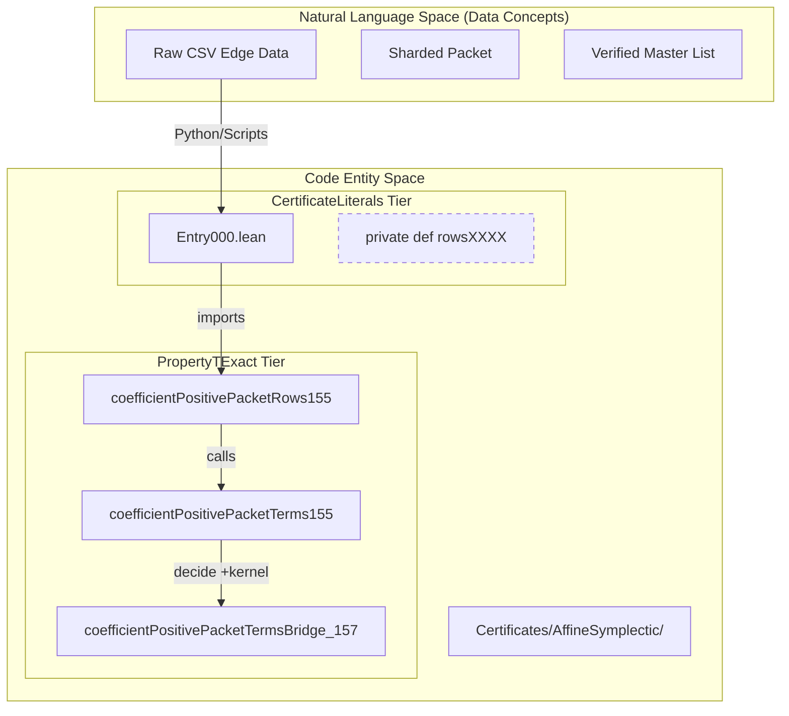
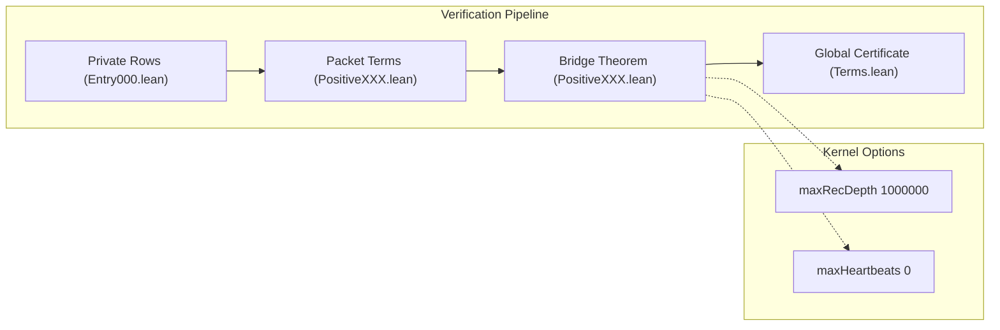

<!-- source: DeepWiki mcp.deepwiki.com · repo openai/ten-proofs · page 6.1 Data Sharding and Modular Compilation · fetched 2026-10-26 -->

# Data Sharding and Modular Compilation

Relevant source files

The following files were used as context for generating this wiki page:

- [ConnesRigidity/CertificateLiterals/PropertyTExactCertificateCoefficientEdgePackets/Positive024/Entry000.lean](ConnesRigidity/CertificateLiterals/PropertyTExactCertificateCoefficientEdgePackets/Positive024/Entry000.lean)
- [ConnesRigidity/CertificateLiterals/PropertyTExactCertificateCoefficientEdgePackets/Positive033/Entry000.lean](ConnesRigidity/CertificateLiterals/PropertyTExactCertificateCoefficientEdgePackets/Positive033/Entry000.lean)
- [ConnesRigidity/CertificateLiterals/PropertyTExactCertificateCoefficientEdgePackets/Positive052/Entry000.lean](ConnesRigidity/CertificateLiterals/PropertyTExactCertificateCoefficientEdgePackets/Positive052/Entry000.lean)
- [ConnesRigidity/CertificateLiterals/PropertyTExactCertificateCoefficientEdgePackets/Positive053/Entry000.lean](ConnesRigidity/CertificateLiterals/PropertyTExactCertificateCoefficientEdgePackets/Positive053/Entry000.lean)
- [ConnesRigidity/CertificateLiterals/PropertyTExactCertificateCoefficientEdgePackets/Positive057/Entry000.lean](ConnesRigidity/CertificateLiterals/PropertyTExactCertificateCoefficientEdgePackets/Positive057/Entry000.lean)
- [ConnesRigidity/CertificateLiterals/PropertyTExactCertificateCoefficientEdgePackets/Positive086/Entry000.lean](ConnesRigidity/CertificateLiterals/PropertyTExactCertificateCoefficientEdgePackets/Positive086/Entry000.lean)
- [ConnesRigidity/CertificateLiterals/PropertyTExactCertificateCoefficientEdgePackets/Positive113/Entry000.lean](ConnesRigidity/CertificateLiterals/PropertyTExactCertificateCoefficientEdgePackets/Positive113/Entry000.lean)
- [ConnesRigidity/CertificateLiterals/PropertyTExactCertificateCoefficientEdgePackets/Positive119/Entry000.lean](ConnesRigidity/CertificateLiterals/PropertyTExactCertificateCoefficientEdgePackets/Positive119/Entry000.lean)
- [ConnesRigidity/CertificateLiterals/PropertyTExactCertificateCoefficientEdgePackets/Positive122/Entry000.lean](ConnesRigidity/CertificateLiterals/PropertyTExactCertificateCoefficientEdgePackets/Positive122/Entry000.lean)
- [ConnesRigidity/CertificateLiterals/PropertyTExactCertificateCoefficientEdgePackets/Positive134/Entry000.lean](ConnesRigidity/CertificateLiterals/PropertyTExactCertificateCoefficientEdgePackets/Positive134/Entry000.lean)
- [ConnesRigidity/CertificateLiterals/PropertyTExactCertificateCoefficientEdgePackets/Positive140/Entry000.lean](ConnesRigidity/CertificateLiterals/PropertyTExactCertificateCoefficientEdgePackets/Positive140/Entry000.lean)
- [ConnesRigidity/CertificateLiterals/PropertyTExactCertificateCoefficientEdgePackets/Positive154/Entry000.lean](ConnesRigidity/CertificateLiterals/PropertyTExactCertificateCoefficientEdgePackets/Positive154/Entry000.lean)
- [ConnesRigidity/CertificateLiterals/PropertyTExactCertificateCoefficientEdgePackets/Positive162/Entry000.lean](ConnesRigidity/CertificateLiterals/PropertyTExactCertificateCoefficientEdgePackets/Positive162/Entry000.lean)
- [ConnesRigidity/CertificateLiterals/PropertyTExactCertificateCoefficientEdgePackets/Positive224/Entry000.lean](ConnesRigidity/CertificateLiterals/PropertyTExactCertificateCoefficientEdgePackets/Positive224/Entry000.lean)
- [ConnesRigidity/CertificateLiterals/PropertyTExactCertificateCoefficientEdgePackets/Positive227/Entry000.lean](ConnesRigidity/CertificateLiterals/PropertyTExactCertificateCoefficientEdgePackets/Positive227/Entry000.lean)
- [ConnesRigidity/CertificateLiterals/PropertyTExactCertificateCoefficientEdgePackets/Positive233/Entry000.lean](ConnesRigidity/CertificateLiterals/PropertyTExactCertificateCoefficientEdgePackets/Positive233/Entry000.lean)
- [ConnesRigidity/CertificateLiterals/PropertyTExactCertificateCoefficientEdgePackets/Positive236/Entry000.lean](ConnesRigidity/CertificateLiterals/PropertyTExactCertificateCoefficientEdgePackets/Positive236/Entry000.lean)
- [ConnesRigidity/CertificateLiterals/PropertyTExactCertificateCoefficientEdgePackets/Positive248/Entry000.lean](ConnesRigidity/CertificateLiterals/PropertyTExactCertificateCoefficientEdgePackets/Positive248/Entry000.lean)
- [ConnesRigidity/CertificateLiterals/PropertyTExactCertificateCoefficientEdgePackets/Positive258/Entry000.lean](ConnesRigidity/CertificateLiterals/PropertyTExactCertificateCoefficientEdgePackets/Positive258/Entry000.lean)
- [ConnesRigidity/CertificateLiterals/PropertyTExactCertificateCoefficientEdgePackets/Positive261/Entry000.lean](ConnesRigidity/CertificateLiterals/PropertyTExactCertificateCoefficientEdgePackets/Positive261/Entry000.lean)
- [ConnesRigidity/CertificateLiterals/PropertyTExactCertificateCoefficientEdgePackets/Positive265/Entry000.lean](ConnesRigidity/CertificateLiterals/PropertyTExactCertificateCoefficientEdgePackets/Positive265/Entry000.lean)
- [ConnesRigidity/PropertyTExactCertificateCoefficientEdgePacketBridges/Negative000.lean](ConnesRigidity/PropertyTExactCertificateCoefficientEdgePacketBridges/Negative000.lean)
- [ConnesRigidity/PropertyTExactCertificateCoefficientEdgePacketBridges/Negative001.lean](ConnesRigidity/PropertyTExactCertificateCoefficientEdgePacketBridges/Negative001.lean)
- [ConnesRigidity/PropertyTExactCertificateCoefficientEdgePacketBridges/Negative010.lean](ConnesRigidity/PropertyTExactCertificateCoefficientEdgePacketBridges/Negative010.lean)
- [ConnesRigidity/PropertyTExactCertificateCoefficientEdgePacketBridges/Negative011.lean](ConnesRigidity/PropertyTExactCertificateCoefficientEdgePacketBridges/Negative011.lean)
- [ConnesRigidity/PropertyTExactCertificateCoefficientEdgePacketBridges/Negative013.lean](ConnesRigidity/PropertyTExactCertificateCoefficientEdgePacketBridges/Negative013.lean)
- [ConnesRigidity/PropertyTExactCertificateCoefficientEdgePacketBridges/Negative014.lean](ConnesRigidity/PropertyTExactCertificateCoefficientEdgePacketBridges/Negative014.lean)
- [ConnesRigidity/PropertyTExactCertificateCoefficientEdgePacketBridges/Negative016.lean](ConnesRigidity/PropertyTExactCertificateCoefficientEdgePacketBridges/Negative016.lean)
- [ConnesRigidity/PropertyTExactCertificateCoefficientEdgePacketBridges/Negative017.lean](ConnesRigidity/PropertyTExactCertificateCoefficientEdgePacketBridges/Negative017.lean)
- [ConnesRigidity/PropertyTExactCertificateCoefficientEdgePacketBridges/Negative019.lean](ConnesRigidity/PropertyTExactCertificateCoefficientEdgePacketBridges/Negative019.lean)
- [ConnesRigidity/PropertyTExactCertificateCoefficientEdgePacketBridges/Negative020.lean](ConnesRigidity/PropertyTExactCertificateCoefficientEdgePacketBridges/Negative020.lean)
- [ConnesRigidity/PropertyTExactCertificateCoefficientEdgePacketBridges/Negative021.lean](ConnesRigidity/PropertyTExactCertificateCoefficientEdgePacketBridges/Negative021.lean)
- [ConnesRigidity/PropertyTExactCertificateCoefficientEdgePacketBridges/Negative022.lean](ConnesRigidity/PropertyTExactCertificateCoefficientEdgePacketBridges/Negative022.lean)
- [ConnesRigidity/PropertyTExactCertificateCoefficientEdgePacketBridges/Negative023.lean](ConnesRigidity/PropertyTExactCertificateCoefficientEdgePacketBridges/Negative023.lean)
- [ConnesRigidity/PropertyTExactCertificateCoefficientEdgePacketBridges/Negative024.lean](ConnesRigidity/PropertyTExactCertificateCoefficientEdgePacketBridges/Negative024.lean)
- [ConnesRigidity/PropertyTExactCertificateCoefficientEdgePacketBridges/Negative027.lean](ConnesRigidity/PropertyTExactCertificateCoefficientEdgePacketBridges/Negative027.lean)
- [ConnesRigidity/PropertyTExactCertificateCoefficientEdgePacketBridges/Negative034.lean](ConnesRigidity/PropertyTExactCertificateCoefficientEdgePacketBridges/Negative034.lean)
- [ConnesRigidity/PropertyTExactCertificateCoefficientEdgePacketBridges/Negative035.lean](ConnesRigidity/PropertyTExactCertificateCoefficientEdgePacketBridges/Negative035.lean)
- [ConnesRigidity/PropertyTExactCertificateCoefficientEdgePacketBridges/Negative036.lean](ConnesRigidity/PropertyTExactCertificateCoefficientEdgePacketBridges/Negative036.lean)
- [ConnesRigidity/PropertyTExactCertificateCoefficientEdgePacketBridges/Negative038.lean](ConnesRigidity/PropertyTExactCertificateCoefficientEdgePacketBridges/Negative038.lean)
- [ConnesRigidity/PropertyTExactCertificateCoefficientEdgePacketBridges/Negative039.lean](ConnesRigidity/PropertyTExactCertificateCoefficientEdgePacketBridges/Negative039.lean)
- [ConnesRigidity/PropertyTExactCertificateCoefficientEdgePacketBridges/Negative044.lean](ConnesRigidity/PropertyTExactCertificateCoefficientEdgePacketBridges/Negative044.lean)
- [ConnesRigidity/PropertyTExactCertificateCoefficientEdgePacketBridges/Negative048.lean](ConnesRigidity/PropertyTExactCertificateCoefficientEdgePacketBridges/Negative048.lean)
- [ConnesRigidity/PropertyTExactCertificateCoefficientEdgePacketBridges/Negative049.lean](ConnesRigidity/PropertyTExactCertificateCoefficientEdgePacketBridges/Negative049.lean)
- [ConnesRigidity/PropertyTExactCertificateCoefficientEdgePacketBridges/Negative052.lean](ConnesRigidity/PropertyTExactCertificateCoefficientEdgePacketBridges/Negative052.lean)
- [ConnesRigidity/PropertyTExactCertificateCoefficientEdgePacketBridges/Negative053.lean](ConnesRigidity/PropertyTExactCertificateCoefficientEdgePacketBridges/Negative053.lean)
- [ConnesRigidity/PropertyTExactCertificateCoefficientEdgePacketBridges/Negative055.lean](ConnesRigidity/PropertyTExactCertificateCoefficientEdgePacketBridges/Negative055.lean)
- [ConnesRigidity/PropertyTExactCertificateCoefficientEdgePacketBridges/Negative056.lean](ConnesRigidity/PropertyTExactCertificateCoefficientEdgePacketBridges/Negative056.lean)
- [ConnesRigidity/PropertyTExactCertificateCoefficientEdgePacketBridges/Negative057.lean](ConnesRigidity/PropertyTExactCertificateCoefficientEdgePacketBridges/Negative057.lean)
- [ConnesRigidity/PropertyTExactCertificateCoefficientEdgePacketBridges/Negative058.lean](ConnesRigidity/PropertyTExactCertificateCoefficientEdgePacketBridges/Negative058.lean)
- [ConnesRigidity/PropertyTExactCertificateCoefficientEdgePacketBridges/Negative063.lean](ConnesRigidity/PropertyTExactCertificateCoefficientEdgePacketBridges/Negative063.lean)
- [ConnesRigidity/PropertyTExactCertificateCoefficientEdgePacketBridges/Negative066.lean](ConnesRigidity/PropertyTExactCertificateCoefficientEdgePacketBridges/Negative066.lean)
- [ConnesRigidity/PropertyTExactCertificateCoefficientEdgePacketBridges/Negative076.lean](ConnesRigidity/PropertyTExactCertificateCoefficientEdgePacketBridges/Negative076.lean)
- [ConnesRigidity/PropertyTExactCertificateCoefficientEdgePacketBridges/Negative077.lean](ConnesRigidity/PropertyTExactCertificateCoefficientEdgePacketBridges/Negative077.lean)
- [ConnesRigidity/PropertyTExactCertificateCoefficientEdgePacketBridges/Negative078.lean](ConnesRigidity/PropertyTExactCertificateCoefficientEdgePacketBridges/Negative078.lean)
- [ConnesRigidity/PropertyTExactCertificateCoefficientEdgePacketBridges/Negative079.lean](ConnesRigidity/PropertyTExactCertificateCoefficientEdgePacketBridges/Negative079.lean)
- [ConnesRigidity/PropertyTExactCertificateCoefficientEdgePacketBridges/Negative082.lean](ConnesRigidity/PropertyTExactCertificateCoefficientEdgePacketBridges/Negative082.lean)
- [ConnesRigidity/PropertyTExactCertificateCoefficientEdgePacketBridges/Negative083.lean](ConnesRigidity/PropertyTExactCertificateCoefficientEdgePacketBridges/Negative083.lean)
- [ConnesRigidity/PropertyTExactCertificateCoefficientEdgePacketBridges/Negative090.lean](ConnesRigidity/PropertyTExactCertificateCoefficientEdgePacketBridges/Negative090.lean)
- [ConnesRigidity/PropertyTExactCertificateCoefficientEdgePacketBridges/Negative091.lean](ConnesRigidity/PropertyTExactCertificateCoefficientEdgePacketBridges/Negative091.lean)
- [ConnesRigidity/PropertyTExactCertificateCoefficientEdgePacketBridges/Negative092.lean](ConnesRigidity/PropertyTExactCertificateCoefficientEdgePacketBridges/Negative092.lean)
- [ConnesRigidity/PropertyTExactCertificateCoefficientEdgePacketBridges/Negative093.lean](ConnesRigidity/PropertyTExactCertificateCoefficientEdgePacketBridges/Negative093.lean)
- [ConnesRigidity/PropertyTExactCertificateCoefficientEdgePacketBridges/Negative094.lean](ConnesRigidity/PropertyTExactCertificateCoefficientEdgePacketBridges/Negative094.lean)
- [ConnesRigidity/PropertyTExactCertificateCoefficientEdgePacketBridges/Negative095.lean](ConnesRigidity/PropertyTExactCertificateCoefficientEdgePacketBridges/Negative095.lean)
- [ConnesRigidity/PropertyTExactCertificateCoefficientEdgePacketBridges/Negative096.lean](ConnesRigidity/PropertyTExactCertificateCoefficientEdgePacketBridges/Negative096.lean)
- [ConnesRigidity/PropertyTExactCertificateCoefficientEdgePacketBridges/Negative097.lean](ConnesRigidity/PropertyTExactCertificateCoefficientEdgePacketBridges/Negative097.lean)
- [ConnesRigidity/PropertyTExactCertificateCoefficientEdgePacketBridges/Negative098.lean](ConnesRigidity/PropertyTExactCertificateCoefficientEdgePacketBridges/Negative098.lean)
- [ConnesRigidity/PropertyTExactCertificateCoefficientEdgePacketBridges/Negative099.lean](ConnesRigidity/PropertyTExactCertificateCoefficientEdgePacketBridges/Negative099.lean)
- [ConnesRigidity/PropertyTExactCertificateCoefficientEdgePacketBridges/Negative116.lean](ConnesRigidity/PropertyTExactCertificateCoefficientEdgePacketBridges/Negative116.lean)
- [ConnesRigidity/PropertyTExactCertificateCoefficientEdgePacketBridges/Negative123.lean](ConnesRigidity/PropertyTExactCertificateCoefficientEdgePacketBridges/Negative123.lean)
- [ConnesRigidity/PropertyTExactCertificateCoefficientEdgePacketBridges/Negative131.lean](ConnesRigidity/PropertyTExactCertificateCoefficientEdgePacketBridges/Negative131.lean)
- [ConnesRigidity/PropertyTExactCertificateCoefficientEdgePacketBridges/Negative135.lean](ConnesRigidity/PropertyTExactCertificateCoefficientEdgePacketBridges/Negative135.lean)
- [ConnesRigidity/PropertyTExactCertificateCoefficientEdgePacketBridges/Negative140.lean](ConnesRigidity/PropertyTExactCertificateCoefficientEdgePacketBridges/Negative140.lean)
- [ConnesRigidity/PropertyTExactCertificateCoefficientEdgePacketBridges/Negative145.lean](ConnesRigidity/PropertyTExactCertificateCoefficientEdgePacketBridges/Negative145.lean)
- [ConnesRigidity/PropertyTExactCertificateCoefficientEdgePacketBridges/Negative151.lean](ConnesRigidity/PropertyTExactCertificateCoefficientEdgePacketBridges/Negative151.lean)
- [ConnesRigidity/PropertyTExactCertificateCoefficientEdgePacketBridges/Positive003.lean](ConnesRigidity/PropertyTExactCertificateCoefficientEdgePacketBridges/Positive003.lean)
- [ConnesRigidity/PropertyTExactCertificateCoefficientEdgePacketBridges/Positive013.lean](ConnesRigidity/PropertyTExactCertificateCoefficientEdgePacketBridges/Positive013.lean)
- [ConnesRigidity/PropertyTExactCertificateCoefficientEdgePacketBridges/Positive018.lean](ConnesRigidity/PropertyTExactCertificateCoefficientEdgePacketBridges/Positive018.lean)
- [ConnesRigidity/PropertyTExactCertificateCoefficientEdgePacketBridges/Positive023.lean](ConnesRigidity/PropertyTExactCertificateCoefficientEdgePacketBridges/Positive023.lean)
- [ConnesRigidity/PropertyTExactCertificateCoefficientEdgePacketBridges/Positive026.lean](ConnesRigidity/PropertyTExactCertificateCoefficientEdgePacketBridges/Positive026.lean)
- [ConnesRigidity/PropertyTExactCertificateCoefficientEdgePacketBridges/Positive031.lean](ConnesRigidity/PropertyTExactCertificateCoefficientEdgePacketBridges/Positive031.lean)
- [ConnesRigidity/PropertyTExactCertificateCoefficientEdgePacketBridges/Positive038.lean](ConnesRigidity/PropertyTExactCertificateCoefficientEdgePacketBridges/Positive038.lean)
- [ConnesRigidity/PropertyTExactCertificateCoefficientEdgePacketBridges/Positive047.lean](ConnesRigidity/PropertyTExactCertificateCoefficientEdgePacketBridges/Positive047.lean)
- [ConnesRigidity/PropertyTExactCertificateCoefficientEdgePacketBridges/Positive062.lean](ConnesRigidity/PropertyTExactCertificateCoefficientEdgePacketBridges/Positive062.lean)
- [ConnesRigidity/PropertyTExactCertificateCoefficientEdgePacketBridges/Positive063.lean](ConnesRigidity/PropertyTExactCertificateCoefficientEdgePacketBridges/Positive063.lean)
- [ConnesRigidity/PropertyTExactCertificateCoefficientEdgePacketBridges/Positive098.lean](ConnesRigidity/PropertyTExactCertificateCoefficientEdgePacketBridges/Positive098.lean)
- [ConnesRigidity/PropertyTExactCertificateCoefficientEdgePacketBridges/Positive106.lean](ConnesRigidity/PropertyTExactCertificateCoefficientEdgePacketBridges/Positive106.lean)
- [ConnesRigidity/PropertyTExactCertificateCoefficientEdgePacketBridges/Positive123.lean](ConnesRigidity/PropertyTExactCertificateCoefficientEdgePacketBridges/Positive123.lean)
- [ConnesRigidity/PropertyTExactCertificateCoefficientEdgePacketBridges/Positive136.lean](ConnesRigidity/PropertyTExactCertificateCoefficientEdgePacketBridges/Positive136.lean)
- [ConnesRigidity/PropertyTExactCertificateCoefficientEdgePacketBridges/Positive141.lean](ConnesRigidity/PropertyTExactCertificateCoefficientEdgePacketBridges/Positive141.lean)
- [ConnesRigidity/PropertyTExactCertificateCoefficientEdgePacketBridges/Positive147.lean](ConnesRigidity/PropertyTExactCertificateCoefficientEdgePacketBridges/Positive147.lean)
- [ConnesRigidity/PropertyTExactCertificateCoefficientEdgePacketBridges/Positive156.lean](ConnesRigidity/PropertyTExactCertificateCoefficientEdgePacketBridges/Positive156.lean)
- [ConnesRigidity/PropertyTExactCertificateCoefficientEdgePacketBridges/Positive157.lean](ConnesRigidity/PropertyTExactCertificateCoefficientEdgePacketBridges/Positive157.lean)
- [ConnesRigidity/PropertyTExactCertificateCoefficientEdgePacketBridges/Positive161.lean](ConnesRigidity/PropertyTExactCertificateCoefficientEdgePacketBridges/Positive161.lean)
- [ConnesRigidity/PropertyTExactCertificateCoefficientEdgePacketBridges/Positive169.lean](ConnesRigidity/PropertyTExactCertificateCoefficientEdgePacketBridges/Positive169.lean)
- [ConnesRigidity/PropertyTExactCertificateCoefficientEdgePacketBridges/Positive190.lean](ConnesRigidity/PropertyTExactCertificateCoefficientEdgePacketBridges/Positive190.lean)
- [ConnesRigidity/PropertyTExactCertificateCoefficientEdgePacketBridges/Positive194.lean](ConnesRigidity/PropertyTExactCertificateCoefficientEdgePacketBridges/Positive194.lean)
- [ConnesRigidity/PropertyTExactCertificateCoefficientEdgePacketBridges/Positive203.lean](ConnesRigidity/PropertyTExactCertificateCoefficientEdgePacketBridges/Positive203.lean)
- [ConnesRigidity/PropertyTExactCertificateCoefficientEdgePacketBridges/Positive209.lean](ConnesRigidity/PropertyTExactCertificateCoefficientEdgePacketBridges/Positive209.lean)
- [ConnesRigidity/PropertyTExactCertificateCoefficientEdgePacketBridges/Positive224.lean](ConnesRigidity/PropertyTExactCertificateCoefficientEdgePacketBridges/Positive224.lean)
- [ConnesRigidity/PropertyTExactCertificateCoefficientEdgePacketBridges/Positive229.lean](ConnesRigidity/PropertyTExactCertificateCoefficientEdgePacketBridges/Positive229.lean)
- [ConnesRigidity/PropertyTExactCertificateCoefficientEdgePacketBridges/Positive239.lean](ConnesRigidity/PropertyTExactCertificateCoefficientEdgePacketBridges/Positive239.lean)
- [ConnesRigidity/PropertyTExactCertificateCoefficientEdgePackets/Positive112.lean](ConnesRigidity/PropertyTExactCertificateCoefficientEdgePackets/Positive112.lean)
- [ConnesRigidity/PropertyTExactCertificateCoefficientEdgePackets/Positive118.lean](ConnesRigidity/PropertyTExactCertificateCoefficientEdgePackets/Positive118.lean)
- [ConnesRigidity/PropertyTExactCertificateCoefficientEdgePackets/Positive120.lean](ConnesRigidity/PropertyTExactCertificateCoefficientEdgePackets/Positive120.lean)
- [ConnesRigidity/PropertyTExactCertificateCoefficientEdgePackets/Positive130.lean](ConnesRigidity/PropertyTExactCertificateCoefficientEdgePackets/Positive130.lean)
- [ConnesRigidity/PropertyTExactCertificateCoefficientEdgePackets/Positive131.lean](ConnesRigidity/PropertyTExactCertificateCoefficientEdgePackets/Positive131.lean)
- [ConnesRigidity/PropertyTExactCertificateCoefficientEdgePackets/Positive133.lean](ConnesRigidity/PropertyTExactCertificateCoefficientEdgePackets/Positive133.lean)
- [ConnesRigidity/PropertyTExactCertificateCoefficientEdgePackets/Positive148.lean](ConnesRigidity/PropertyTExactCertificateCoefficientEdgePackets/Positive148.lean)
- [ConnesRigidity/PropertyTExactCertificateCoefficientEdgePackets/Positive149.lean](ConnesRigidity/PropertyTExactCertificateCoefficientEdgePackets/Positive149.lean)
- [ConnesRigidity/PropertyTExactCertificateCoefficientEdgePackets/Positive155.lean](ConnesRigidity/PropertyTExactCertificateCoefficientEdgePackets/Positive155.lean)
- [ConnesRigidity/PropertyTExactCertificateCoefficientEdgePackets/Positive156.lean](ConnesRigidity/PropertyTExactCertificateCoefficientEdgePackets/Positive156.lean)
- [ConnesRigidity/PropertyTExactCertificateCoefficientEdgePackets/Positive157.lean](ConnesRigidity/PropertyTExactCertificateCoefficientEdgePackets/Positive157.lean)
- [ConnesRigidity/PropertyTExactCertificateCoefficientEdgePackets/Positive158.lean](ConnesRigidity/PropertyTExactCertificateCoefficientEdgePackets/Positive158.lean)
- [ConnesRigidity/PropertyTExactCertificateCoefficientEdgePackets/Positive159.lean](ConnesRigidity/PropertyTExactCertificateCoefficientEdgePackets/Positive159.lean)
- [ConnesRigidity/PropertyTExactCertificateCoefficientEdgePackets/Positive160.lean](ConnesRigidity/PropertyTExactCertificateCoefficientEdgePackets/Positive160.lean)
- [ConnesRigidity/PropertyTExactCertificateCoefficientEdgePackets/Positive166.lean](ConnesRigidity/PropertyTExactCertificateCoefficientEdgePackets/Positive166.lean)
- [ConnesRigidity/PropertyTExactCertificateCoefficientEdgePackets/Positive168.lean](ConnesRigidity/PropertyTExactCertificateCoefficientEdgePackets/Positive168.lean)
- [ConnesRigidity/PropertyTExactCertificateCoefficientEdgePackets/Positive172.lean](ConnesRigidity/PropertyTExactCertificateCoefficientEdgePackets/Positive172.lean)
- [ConnesRigidity/PropertyTExactCertificateCoefficientEdgePackets/Positive175.lean](ConnesRigidity/PropertyTExactCertificateCoefficientEdgePackets/Positive175.lean)
- [ConnesRigidity/PropertyTExactCertificateCoefficientEdgePackets/Positive176.lean](ConnesRigidity/PropertyTExactCertificateCoefficientEdgePackets/Positive176.lean)
- [ConnesRigidity/PropertyTExactCertificateCoefficientEdgePackets/Positive177.lean](ConnesRigidity/PropertyTExactCertificateCoefficientEdgePackets/Positive177.lean)
- [ConnesRigidity/PropertyTExactCertificateCoefficientEdgePackets/Positive178.lean](ConnesRigidity/PropertyTExactCertificateCoefficientEdgePackets/Positive178.lean)
- [ConnesRigidity/PropertyTExactCertificateCoefficientEdgePackets/Positive194.lean](ConnesRigidity/PropertyTExactCertificateCoefficientEdgePackets/Positive194.lean)
- [ConnesRigidity/PropertyTExactCertificateCoefficientEdgePackets/Positive209.lean](ConnesRigidity/PropertyTExactCertificateCoefficientEdgePackets/Positive209.lean)
- [ConnesRigidity/PropertyTExactCertificateCoefficientEdgePackets/Positive224.lean](ConnesRigidity/PropertyTExactCertificateCoefficientEdgePackets/Positive224.lean)
- [ConnesRigidity/PropertyTExactCertificateCoefficientEdgePackets/Positive229.lean](ConnesRigidity/PropertyTExactCertificateCoefficientEdgePackets/Positive229.lean)
- [ConnesRigidity/PropertyTExactCertificateCoefficientEdgePackets/Positive248.lean](ConnesRigidity/PropertyTExactCertificateCoefficientEdgePackets/Positive248.lean)
- [ConnesRigidity/PropertyTExactCertificateCoefficientEdgePackets/Positive250.lean](ConnesRigidity/PropertyTExactCertificateCoefficientEdgePackets/Positive250.lean)
- [ConnesRigidity/PropertyTExactCertificateCoefficientEdgePackets/Positive251.lean](ConnesRigidity/PropertyTExactCertificateCoefficientEdgePackets/Positive251.lean)
- [ConnesRigidity/PropertyTExactCertificateCoefficientEdgePackets/Positive256.lean](ConnesRigidity/PropertyTExactCertificateCoefficientEdgePackets/Positive256.lean)
- [ConnesRigidity/PropertyTExactCertificateCoefficientEdgePackets/Positive259.lean](ConnesRigidity/PropertyTExactCertificateCoefficientEdgePackets/Positive259.lean)
- [ConnesRigidity/PropertyTExactCertificateCoefficientEdgePackets/Positive260.lean](ConnesRigidity/PropertyTExactCertificateCoefficientEdgePackets/Positive260.lean)

The Property T certificate for $\Gamma_0$ involves millions of integer terms, exceeding the memory and recursion limits of the Lean 4 compiler if handled as a single monolithic structure. This page describes the three-tier sharding architecture used to partition data into manageable Lean modules, allowing for incremental compilation and parallel verification.

## Three-Tier Sharding Architecture

The system transitions from raw data to verified group ring terms through three distinct layers. This structure prevents the Lean frontend from attempting to parse excessively large list literals while maintaining a rigorous connection to the final mathematical statements.

### 1. Raw Data Tier
Large datasets (Gram matrix rows, edge coefficients, and multiplication tables) are stored in the `Certificates/AffineSymplectic/` directory as CSV-like files. These are partitioned into "chunks" to facilitate parallel processing [ConnesRigidity/PropertyTExactCertificateAllElementChunks:1-25]().

### 2. CertificateLiterals Tier
Raw data is wrapped into Lean source files within the `ConnesRigidity/CertificateLiterals/` directory. 
*   **Private Definitions**: Data is stored in `private def` blocks (e.g., `rows0000`, `rows0001`) to limit their scope and prevent the compiler from exporting large symbols to the global environment [ConnesRigidity/CertificateLiterals/PropertyTExactCertificateCoefficientEdgePackets/Positive122/Entry000.lean:6-25]().
*   **Entry000 Pattern**: Files are often named `Entry000.lean` within specific subdirectories to provide a uniform interface for the next tier [ConnesRigidity/CertificateLiterals/PropertyTExactCertificateCoefficientEdgePackets/Positive261/Entry000.lean:4]().
*   **Recursive List Construction**: Large lists are built by appending these private definitions, which avoids deep nesting in the abstract syntax tree (AST) during parsing [ConnesRigidity/CertificateLiterals/PropertyTExactCertificateCoefficientEdgePackets/Positive122/Entry000.lean:24-28]().

### 3. PropertyTExact* Tier
This tier imports the literals and transforms them into typed certificate terms.
*   **@[irreducible] and noncomputable**: Definitions are marked `@[irreducible]` to prevent the Lean kernel from accidentally unfolding them during general tactic application, and `noncomputable` to signal that these are used for proof-by-reflection rather than standard evaluation [ConnesRigidity/PropertyTExactCertificateCoefficientEdgePackets/Positive155.lean:9-15]().
*   **Bridges**: Bridge theorems verify that a specific shard matches a specific slice of the master data array (e.g., `negativeEdgeTerms`). These theorems use `decide +kernel` to perform the verification [ConnesRigidity/PropertyTExactCertificateCoefficientEdgePacketBridges/Negative063.lean:12-21]().

### Data Flow Diagram

**Sources:** [ConnesRigidity/CertificateLiterals/PropertyTExactCertificateCoefficientEdgePackets/Positive122/Entry000.lean:6-30](), [ConnesRigidity/PropertyTExactCertificateCoefficientEdgePackets/Positive155.lean:1-20](), [ConnesRigidity/PropertyTExactCertificateCoefficientEdgePacketBridges/Negative063.lean:1-26]().

## Packet Sizing and Offsets

To optimize kernel performance, edge terms are divided into fixed-size "packets." The size varies depending on the term type to balance file count versus file size.

| Term Type | Packet Size | Bridge Example |
| :--- | :--- | :--- |
| **Negative Edge Terms** | 512 elements | `(negativeEdgeTerms.drop 32256).take 512` [ConnesRigidity/PropertyTExactCertificateCoefficientEdgePacketBridges/Negative063.lean:14]() |
| **Positive Edge Terms** | 576 elements | `(positiveEdgeTerms.drop 90432).take 576` [ConnesRigidity/PropertyTExactCertificateCoefficientEdgePacketBridges/Positive157.lean:14]() |

Each bridge theorem explicitly calculates the offset (`drop`) and the length (`take`) to ensure the sharded data perfectly covers the global `negativeEdgeTerms` or `positiveEdgeTerms` without gaps or overlaps [ConnesRigidity/PropertyTExactCertificateCoefficientEdgePacketBridges/Negative013.lean:12-14]().

**Sources:** [ConnesRigidity/PropertyTExactCertificateCoefficientEdgePacketBridges/Negative063.lean:12-14](), [ConnesRigidity/PropertyTExactCertificateCoefficientEdgePacketBridges/Positive157.lean:12-14](), [ConnesRigidity/PropertyTExactCertificateCoefficientEdgePacketBridges/Positive098.lean:12-14]().

## Incremental Compilation via Bridges

The "Bridge" pattern is critical for scaling. By defining a theorem like `coefficientNegativePacketTermsBridge_063`, the system isolates the verification of one specific shard [ConnesRigidity/PropertyTExactCertificateCoefficientEdgePacketBridges/Negative063.lean:12]().

### Compilation Strategy
1.  **Parsing**: Lean parses the `private def` lists in `Entry000.lean` files. Because they are private and the list is constructed via shallow appends, memory usage is kept low.
2.  **Kernel Verification**: The bridge theorem uses `decide +kernel`. This instructs the Lean kernel to evaluate the equality between the sharded `coefficientNegativePacketTerms063` and the sliced `negativeEdgeTerms` [ConnesRigidity/PropertyTExactCertificateCoefficientEdgePacketBridges/Negative063.lean:21]().
3.  **Caching**: Once a bridge theorem is proven, its result is cached in the `.olean` file. Subsequent files that depend on the certificate only need to import the theorem, not re-verify the raw data.

**Sources:** [ConnesRigidity/PropertyTExactCertificateCoefficientEdgePacketBridges/Negative063.lean:9-21](), [ConnesRigidity/PropertyTExactCertificateCoefficientEdgePackets/Positive155.lean:9-15](), [ConnesRigidity/CertificateLiterals/PropertyTExactCertificateCoefficientEdgePackets/Positive261/Entry000.lean:24-28]().

---

