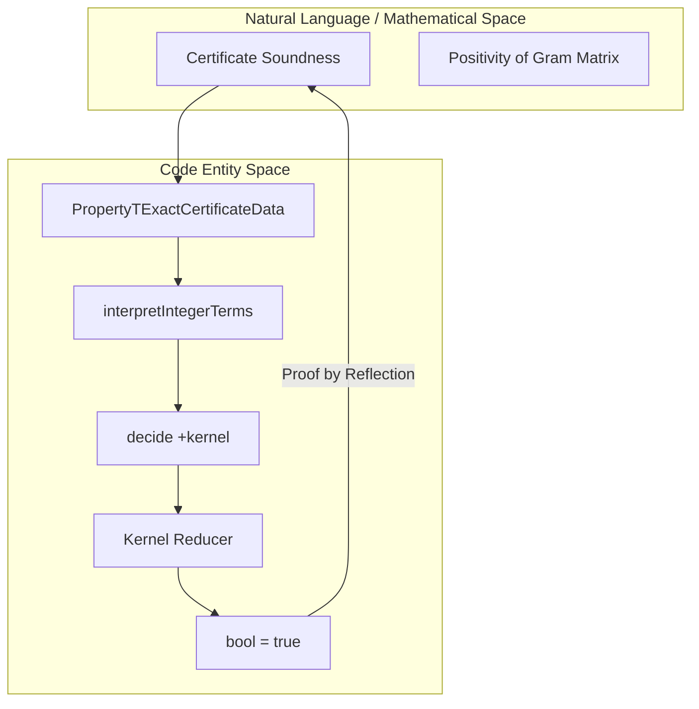
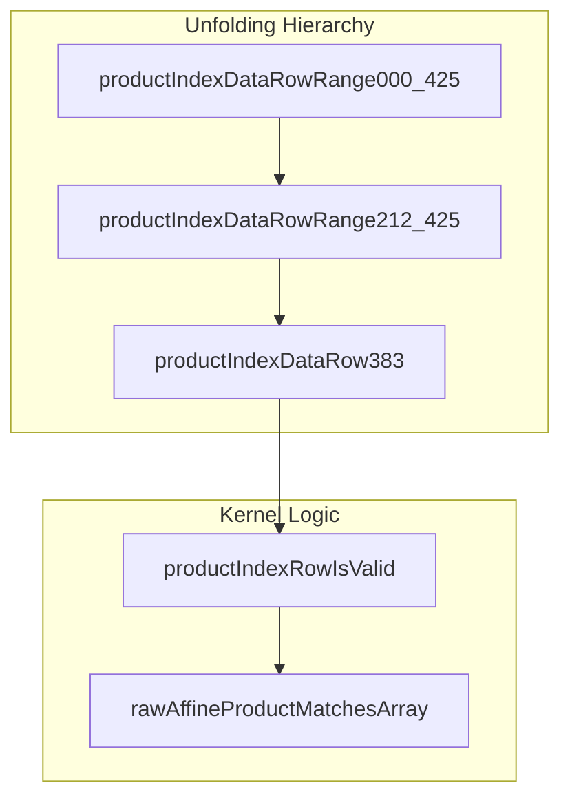

<!-- source: DeepWiki mcp.deepwiki.com · repo openai/ten-proofs · page 6.2 Kernel Computation and the decide +kernel Tactic · fetched 2026-10-26 -->

# Kernel Computation and the decide +kernel Tactic

<details>
<summary>Relevant source files</summary>

The following files were used as context for generating this wiki page:

- [ConnesRigidity/PropertyTExactCertificateCoefficientEdgePacketBridges/Negative000.lean](ConnesRigidity/PropertyTExactCertificateCoefficientEdgePacketBridges/Negative000.lean)
- [ConnesRigidity/PropertyTExactCertificateCoefficientEdgePacketBridges/Negative001.lean](ConnesRigidity/PropertyTExactCertificateCoefficientEdgePacketBridges/Negative001.lean)
- [ConnesRigidity/PropertyTExactCertificateCoefficientEdgePacketBridges/Negative010.lean](ConnesRigidity/PropertyTExactCertificateCoefficientEdgePacketBridges/Negative010.lean)
- [ConnesRigidity/PropertyTExactCertificateCoefficientEdgePacketBridges/Negative011.lean](ConnesRigidity/PropertyTExactCertificateCoefficientEdgePacketBridges/Negative011.lean)
- [ConnesRigidity/PropertyTExactCertificateCoefficientEdgePacketBridges/Negative013.lean](ConnesRigidity/PropertyTExactCertificateCoefficientEdgePacketBridges/Negative013.lean)
- [ConnesRigidity/PropertyTExactCertificateCoefficientEdgePacketBridges/Negative014.lean](ConnesRigidity/PropertyTExactCertificateCoefficientEdgePacketBridges/Negative014.lean)
- [ConnesRigidity/PropertyTExactCertificateCoefficientEdgePacketBridges/Negative016.lean](ConnesRigidity/PropertyTExactCertificateCoefficientEdgePacketBridges/Negative016.lean)
- [ConnesRigidity/PropertyTExactCertificateCoefficientEdgePacketBridges/Negative017.lean](ConnesRigidity/PropertyTExactCertificateCoefficientEdgePacketBridges/Negative017.lean)
- [ConnesRigidity/PropertyTExactCertificateCoefficientEdgePacketBridges/Negative019.lean](ConnesRigidity/PropertyTExactCertificateCoefficientEdgePacketBridges/Negative019.lean)
- [ConnesRigidity/PropertyTExactCertificateCoefficientEdgePacketBridges/Negative020.lean](ConnesRigidity/PropertyTExactCertificateCoefficientEdgePacketBridges/Negative020.lean)
- [ConnesRigidity/PropertyTExactCertificateCoefficientEdgePacketBridges/Negative021.lean](ConnesRigidity/PropertyTExactCertificateCoefficientEdgePacketBridges/Negative021.lean)
- [ConnesRigidity/PropertyTExactCertificateCoefficientEdgePacketBridges/Negative022.lean](ConnesRigidity/PropertyTExactCertificateCoefficientEdgePacketBridges/Negative022.lean)
- [ConnesRigidity/PropertyTExactCertificateCoefficientEdgePacketBridges/Negative023.lean](ConnesRigidity/PropertyTExactCertificateCoefficientEdgePacketBridges/Negative023.lean)
- [ConnesRigidity/PropertyTExactCertificateCoefficientEdgePacketBridges/Negative024.lean](ConnesRigidity/PropertyTExactCertificateCoefficientEdgePacketBridges/Negative024.lean)
- [ConnesRigidity/PropertyTExactCertificateCoefficientEdgePacketBridges/Negative027.lean](ConnesRigidity/PropertyTExactCertificateCoefficientEdgePacketBridges/Negative027.lean)
- [ConnesRigidity/PropertyTExactCertificateCoefficientEdgePacketBridges/Negative034.lean](ConnesRigidity/PropertyTExactCertificateCoefficientEdgePacketBridges/Negative034.lean)
- [ConnesRigidity/PropertyTExactCertificateCoefficientEdgePacketBridges/Negative035.lean](ConnesRigidity/PropertyTExactCertificateCoefficientEdgePacketBridges/Negative035.lean)
- [ConnesRigidity/PropertyTExactCertificateCoefficientEdgePacketBridges/Negative036.lean](ConnesRigidity/PropertyTExactCertificateCoefficientEdgePacketBridges/Negative036.lean)
- [ConnesRigidity/PropertyTExactCertificateCoefficientEdgePacketBridges/Negative038.lean](ConnesRigidity/PropertyTExactCertificateCoefficientEdgePacketBridges/Negative038.lean)
- [ConnesRigidity/PropertyTExactCertificateCoefficientEdgePacketBridges/Negative039.lean](ConnesRigidity/PropertyTExactCertificateCoefficientEdgePacketBridges/Negative039.lean)
- [ConnesRigidity/PropertyTExactCertificateCoefficientEdgePacketBridges/Negative044.lean](ConnesRigidity/PropertyTExactCertificateCoefficientEdgePacketBridges/Negative044.lean)
- [ConnesRigidity/PropertyTExactCertificateCoefficientEdgePacketBridges/Negative048.lean](ConnesRigidity/PropertyTExactCertificateCoefficientEdgePacketBridges/Negative048.lean)
- [ConnesRigidity/PropertyTExactCertificateCoefficientEdgePacketBridges/Negative049.lean](ConnesRigidity/PropertyTExactCertificateCoefficientEdgePacketBridges/Negative049.lean)
- [ConnesRigidity/PropertyTExactCertificateCoefficientEdgePacketBridges/Negative052.lean](ConnesRigidity/PropertyTExactCertificateCoefficientEdgePacketBridges/Negative052.lean)
- [ConnesRigidity/PropertyTExactCertificateCoefficientEdgePacketBridges/Negative053.lean](ConnesRigidity/PropertyTExactCertificateCoefficientEdgePacketBridges/Negative053.lean)
- [ConnesRigidity/PropertyTExactCertificateCoefficientEdgePacketBridges/Negative055.lean](ConnesRigidity/PropertyTExactCertificateCoefficientEdgePacketBridges/Negative055.lean)
- [ConnesRigidity/PropertyTExactCertificateCoefficientEdgePacketBridges/Negative056.lean](ConnesRigidity/PropertyTExactCertificateCoefficientEdgePacketBridges/Negative056.lean)
- [ConnesRigidity/PropertyTExactCertificateCoefficientEdgePacketBridges/Negative057.lean](ConnesRigidity/PropertyTExactCertificateCoefficientEdgePacketBridges/Negative057.lean)
- [ConnesRigidity/PropertyTExactCertificateCoefficientEdgePacketBridges/Negative058.lean](ConnesRigidity/PropertyTExactCertificateCoefficientEdgePacketBridges/Negative058.lean)
- [ConnesRigidity/PropertyTExactCertificateCoefficientEdgePacketBridges/Negative063.lean](ConnesRigidity/PropertyTExactCertificateCoefficientEdgePacketBridges/Negative063.lean)
- [ConnesRigidity/PropertyTExactCertificateCoefficientEdgePacketBridges/Negative066.lean](ConnesRigidity/PropertyTExactCertificateCoefficientEdgePacketBridges/Negative066.lean)
- [ConnesRigidity/PropertyTExactCertificateCoefficientEdgePacketBridges/Negative076.lean](ConnesRigidity/PropertyTExactCertificateCoefficientEdgePacketBridges/Negative076.lean)
- [ConnesRigidity/PropertyTExactCertificateCoefficientEdgePacketBridges/Negative077.lean](ConnesRigidity/PropertyTExactCertificateCoefficientEdgePacketBridges/Negative077.lean)
- [ConnesRigidity/PropertyTExactCertificateCoefficientEdgePacketBridges/Negative078.lean](ConnesRigidity/PropertyTExactCertificateCoefficientEdgePacketBridges/Negative078.lean)
- [ConnesRigidity/PropertyTExactCertificateCoefficientEdgePacketBridges/Negative079.lean](ConnesRigidity/PropertyTExactCertificateCoefficientEdgePacketBridges/Negative079.lean)
- [ConnesRigidity/PropertyTExactCertificateCoefficientEdgePacketBridges/Negative082.lean](ConnesRigidity/PropertyTExactCertificateCoefficientEdgePacketBridges/Negative082.lean)
- [ConnesRigidity/PropertyTExactCertificateCoefficientEdgePacketBridges/Negative083.lean](ConnesRigidity/PropertyTExactCertificateCoefficientEdgePacketBridges/Negative083.lean)
- [ConnesRigidity/PropertyTExactCertificateCoefficientEdgePacketBridges/Negative090.lean](ConnesRigidity/PropertyTExactCertificateCoefficientEdgePacketBridges/Negative090.lean)
- [ConnesRigidity/PropertyTExactCertificateCoefficientEdgePacketBridges/Negative091.lean](ConnesRigidity/PropertyTExactCertificateCoefficientEdgePacketBridges/Negative091.lean)
- [ConnesRigidity/PropertyTExactCertificateCoefficientEdgePacketBridges/Negative092.lean](ConnesRigidity/PropertyTExactCertificateCoefficientEdgePacketBridges/Negative092.lean)
- [ConnesRigidity/PropertyTExactCertificateCoefficientEdgePacketBridges/Negative093.lean](ConnesRigidity/PropertyTExactCertificateCoefficientEdgePacketBridges/Negative093.lean)
- [ConnesRigidity/PropertyTExactCertificateCoefficientEdgePacketBridges/Negative094.lean](ConnesRigidity/PropertyTExactCertificateCoefficientEdgePacketBridges/Negative094.lean)
- [ConnesRigidity/PropertyTExactCertificateCoefficientEdgePacketBridges/Negative095.lean](ConnesRigidity/PropertyTExactCertificateCoefficientEdgePacketBridges/Negative095.lean)
- [ConnesRigidity/PropertyTExactCertificateCoefficientEdgePacketBridges/Negative096.lean](ConnesRigidity/PropertyTExactCertificateCoefficientEdgePacketBridges/Negative096.lean)
- [ConnesRigidity/PropertyTExactCertificateCoefficientEdgePacketBridges/Negative097.lean](ConnesRigidity/PropertyTExactCertificateCoefficientEdgePacketBridges/Negative097.lean)
- [ConnesRigidity/PropertyTExactCertificateCoefficientEdgePacketBridges/Negative098.lean](ConnesRigidity/PropertyTExactCertificateCoefficientEdgePacketBridges/Negative098.lean)
- [ConnesRigidity/PropertyTExactCertificateCoefficientEdgePacketBridges/Negative099.lean](ConnesRigidity/PropertyTExactCertificateCoefficientEdgePacketBridges/Negative099.lean)
- [ConnesRigidity/PropertyTExactCertificateCoefficientEdgePacketBridges/Negative116.lean](ConnesRigidity/PropertyTExactCertificateCoefficientEdgePacketBridges/Negative116.lean)
- [ConnesRigidity/PropertyTExactCertificateCoefficientEdgePacketBridges/Negative123.lean](ConnesRigidity/PropertyTExactCertificateCoefficientEdgePacketBridges/Negative123.lean)
- [ConnesRigidity/PropertyTExactCertificateCoefficientEdgePacketBridges/Negative131.lean](ConnesRigidity/PropertyTExactCertificateCoefficientEdgePacketBridges/Negative131.lean)
- [ConnesRigidity/PropertyTExactCertificateCoefficientEdgePacketBridges/Negative135.lean](ConnesRigidity/PropertyTExactCertificateCoefficientEdgePacketBridges/Negative135.lean)
- [ConnesRigidity/PropertyTExactCertificateCoefficientEdgePacketBridges/Negative140.lean](ConnesRigidity/PropertyTExactCertificateCoefficientEdgePacketBridges/Negative140.lean)
- [ConnesRigidity/PropertyTExactCertificateCoefficientEdgePacketBridges/Negative145.lean](ConnesRigidity/PropertyTExactCertificateCoefficientEdgePacketBridges/Negative145.lean)
- [ConnesRigidity/PropertyTExactCertificateCoefficientEdgePacketBridges/Negative151.lean](ConnesRigidity/PropertyTExactCertificateCoefficientEdgePacketBridges/Negative151.lean)
- [ConnesRigidity/PropertyTExactCertificateGramRows/Row019.lean](ConnesRigidity/PropertyTExactCertificateGramRows/Row019.lean)
- [ConnesRigidity/PropertyTExactCertificateGramRows/Row020.lean](ConnesRigidity/PropertyTExactCertificateGramRows/Row020.lean)
- [ConnesRigidity/PropertyTExactCertificateGramRows/Row021.lean](ConnesRigidity/PropertyTExactCertificateGramRows/Row021.lean)
- [ConnesRigidity/PropertyTExactCertificateGramRows/Row024.lean](ConnesRigidity/PropertyTExactCertificateGramRows/Row024.lean)
- [ConnesRigidity/PropertyTExactCertificateGramRows/Row031.lean](ConnesRigidity/PropertyTExactCertificateGramRows/Row031.lean)
- [ConnesRigidity/PropertyTExactCertificateGramRows/Row037.lean](ConnesRigidity/PropertyTExactCertificateGramRows/Row037.lean)
- [ConnesRigidity/PropertyTExactCertificateGramRows/Row039.lean](ConnesRigidity/PropertyTExactCertificateGramRows/Row039.lean)
- [ConnesRigidity/PropertyTExactCertificateGramRows/Row085.lean](ConnesRigidity/PropertyTExactCertificateGramRows/Row085.lean)
- [ConnesRigidity/PropertyTExactCertificateGramRows/Row126.lean](ConnesRigidity/PropertyTExactCertificateGramRows/Row126.lean)
- [ConnesRigidity/PropertyTExactCertificateGramRows/Row212.lean](ConnesRigidity/PropertyTExactCertificateGramRows/Row212.lean)
- [ConnesRigidity/PropertyTExactCertificateGramRows/Row213.lean](ConnesRigidity/PropertyTExactCertificateGramRows/Row213.lean)
- [ConnesRigidity/PropertyTExactCertificateGramRows/Row225.lean](ConnesRigidity/PropertyTExactCertificateGramRows/Row225.lean)
- [ConnesRigidity/PropertyTExactCertificateGramRows/Row270.lean](ConnesRigidity/PropertyTExactCertificateGramRows/Row270.lean)
- [ConnesRigidity/PropertyTExactCertificateGramRows/Row285.lean](ConnesRigidity/PropertyTExactCertificateGramRows/Row285.lean)
- [ConnesRigidity/PropertyTExactCertificateGramRows/Row295.lean](ConnesRigidity/PropertyTExactCertificateGramRows/Row295.lean)
- [ConnesRigidity/PropertyTExactCertificateGramRows/Row296.lean](ConnesRigidity/PropertyTExactCertificateGramRows/Row296.lean)
- [ConnesRigidity/PropertyTExactCertificateGramRows/Row298.lean](ConnesRigidity/PropertyTExactCertificateGramRows/Row298.lean)
- [ConnesRigidity/PropertyTExactCertificateGramRows/Row316.lean](ConnesRigidity/PropertyTExactCertificateGramRows/Row316.lean)
- [ConnesRigidity/PropertyTExactCertificateGramRows/Row328.lean](ConnesRigidity/PropertyTExactCertificateGramRows/Row328.lean)
- [ConnesRigidity/PropertyTExactCertificateGramRows/Row373.lean](ConnesRigidity/PropertyTExactCertificateGramRows/Row373.lean)
- [ConnesRigidity/PropertyTExactCertificateGramRows/Row383.lean](ConnesRigidity/PropertyTExactCertificateGramRows/Row383.lean)
- [ConnesRigidity/PropertyTExactCertificateGramRows/Row393.lean](ConnesRigidity/PropertyTExactCertificateGramRows/Row393.lean)
- [ConnesRigidity/PropertyTExactCertificateGramRows/Row408.lean](ConnesRigidity/PropertyTExactCertificateGramRows/Row408.lean)
- [ConnesRigidity/PropertyTExactCertificateProductRows/Row148.lean](ConnesRigidity/PropertyTExactCertificateProductRows/Row148.lean)
- [ConnesRigidity/PropertyTExactCertificateProductRows/Row219.lean](ConnesRigidity/PropertyTExactCertificateProductRows/Row219.lean)
- [ConnesRigidity/PropertyTExactCertificateProductRows/Row273.lean](ConnesRigidity/PropertyTExactCertificateProductRows/Row273.lean)
- [ConnesRigidity/PropertyTExactCertificateProductRows/Row282.lean](ConnesRigidity/PropertyTExactCertificateProductRows/Row282.lean)
- [ConnesRigidity/PropertyTExactCertificateProductRows/Row306.lean](ConnesRigidity/PropertyTExactCertificateProductRows/Row306.lean)
- [ConnesRigidity/PropertyTExactCertificateProductRows/Row309.lean](ConnesRigidity/PropertyTExactCertificateProductRows/Row309.lean)
- [ConnesRigidity/PropertyTExactCertificateProductRows/Row349.lean](ConnesRigidity/PropertyTExactCertificateProductRows/Row349.lean)
- [ConnesRigidity/PropertyTExactCertificateProductRows/Row355.lean](ConnesRigidity/PropertyTExactCertificateProductRows/Row355.lean)
- [ConnesRigidity/PropertyTExactCertificateProductRows/Row358.lean](ConnesRigidity/PropertyTExactCertificateProductRows/Row358.lean)
- [ConnesRigidity/PropertyTExactCertificateProductRows/Row359.lean](ConnesRigidity/PropertyTExactCertificateProductRows/Row359.lean)
- [ConnesRigidity/PropertyTExactCertificateProductRows/Row368.lean](ConnesRigidity/PropertyTExactCertificateProductRows/Row368.lean)
- [ConnesRigidity/PropertyTExactCertificateProductRows/Row376.lean](ConnesRigidity/PropertyTExactCertificateProductRows/Row376.lean)
- [ConnesRigidity/PropertyTExactCertificateProductRows/Row383.lean](ConnesRigidity/PropertyTExactCertificateProductRows/Row383.lean)
- [ConnesRigidity/PropertyTExactCertificateProductRows/Row406.lean](ConnesRigidity/PropertyTExactCertificateProductRows/Row406.lean)
- [ConnesRigidity/PropertyTExactCertificateProductRows/Row419.lean](ConnesRigidity/PropertyTExactCertificateProductRows/Row419.lean)
- [ConnesRigidity/PropertyTExactCertificateProductRows/Row420.lean](ConnesRigidity/PropertyTExactCertificateProductRows/Row420.lean)
- [ConnesRigidity/PropertyTExactCertificateProductRows/Row421.lean](ConnesRigidity/PropertyTExactCertificateProductRows/Row421.lean)
- [ConnesRigidity/PropertyTExactCertificateProductRows/Row424.lean](ConnesRigidity/PropertyTExactCertificateProductRows/Row424.lean)

</details>


This page details the computational engine used to verify the Property T exact certificate. Given the massive scale of the certificate (tens of thousands of group elements and millions of coefficients), the proof relies on **Proof by Reflection** within the Lean 4 kernel. This is primarily achieved through the `decide +kernel` tactic, supported by specific compiler options and a hierarchical unfolding strategy to manage memory and recursion limits.

## The decide +kernel Tactic and Kernel Configuration

The `decide` tactic in Lean 4 attempts to prove a proposition of the form `P` where `P` is a `Decidable` proposition by reducing it to `true` [ConnesRigidity/PropertyTExactCertificateGramRows/Row295.lean:25-25](). The `+kernel` modifier forces this reduction to happen inside the Lean kernel's evaluator rather than using the virtual machine (VM). This provides the highest level of foundational assurance, as the verification relies solely on the kernel's consistency.

### Resource Management Options

Because the computations involve deeply nested data structures (such as large lists of integer vectors), two critical options are set for almost every computational theorem:

1.  **`set_option maxRecDepth 1000000`**: Increases the maximum recursion depth allowed during expression elaboration and reduction. This is necessary for unfolding the hierarchical range-based definitions used in the data layer [ConnesRigidity/PropertyTExactCertificateGramRows/Row295.lean:10-10]().
2.  **`set_option maxHeartbeats 0`**: Disables the heartbeat limit for the specific theorem, allowing the kernel to run as long as necessary to complete the reduction [ConnesRigidity/PropertyTExactCertificateGramRows/Row295.lean:12-12]().

### Data Flow in Kernel Verification

The following diagram illustrates how raw data is funneled into the kernel for verification using the `decide +kernel` tactic.

**Proof by Reflection Data Flow**

Sources: [ConnesRigidity/PropertyTExactCertificateGramRows/Row212.lean:14-25](), [ConnesRigidity/PropertyTExactCertificateProductRows/Row383.lean:12-33]()

---

## Hierarchical Unfolding Strategy

To prevent the kernel from being overwhelmed by trying to unfold a massive list of data all at once, the codebase uses a **hierarchical range-based unfolding** strategy. This is particularly evident in the verification of the multiplication table (`ProductRows`) and the Gram matrix (`GramRows`).

### Unfolding in ProductRows
For the 425-element basis, the product table is checked row by row. Instead of unfolding the entire `productIndexDataRows` list, the `first` tactic is used to attempt unfolding through a tree of ranges (e.g., `000_425` -> `212_425` -> `318_425`).

*   **Implementation**: In `productRowCheck_383`, the proof explicitly guides the kernel through specific ranges [ConnesRigidity/PropertyTExactCertificateProductRows/Row383.lean:17-26]().
*   **Target Definitions**: It unfolds `productIndexRowIsValid`, then the specific range, and finally `productIndexEntryIsValid` and `rawAffineProductMatchesArray` [ConnesRigidity/PropertyTExactCertificateProductRows/Row383.lean:14-31]().

### Unfolding in GramRows
The Gram matrix verification involves checking that the encoded Gram rows match the product of the factor rows.
*   **Strategy**: The proof unfolds specific `factorRowChunk` and `factorColumnChunk` definitions (e.g., `factorRowChunk011` and `factorColumnChunk009`) [ConnesRigidity/PropertyTExactCertificateGramRows/Row295.lean:19-21]().
*   **Validation**: It then calls `factorRowEncodingIsValid` and `fullGramRowEncodingIsValid` [ConnesRigidity/PropertyTExactCertificateGramRows/Row295.lean:15-17]().

### Hierarchical Entity Mapping

Sources: [ConnesRigidity/PropertyTExactCertificateProductRows/Row383.lean:17-31](), [ConnesRigidity/PropertyTExactCertificateProductRows/Row282.lean:17-31]()

---

## IntegerTableTerm Framework

The connection between static integer data (the "table") and the mathematical group ring elements is managed via `IntegerTableTerm` and the `interpretIntegerTerms` function. This framework allows the certificate to be stored as simple integers while being interpreted as coefficients of group elements during verification.

### Bridge Theorems for Packets
For edge coefficients, which are sharded into packets of 512, "bridge" theorems are used to prove that a specific sharded packet (e.g., `coefficientNegativePacketTerms063`) is exactly equal to a slice of the global `negativeEdgeTerms` list [ConnesRigidity/PropertyTExactCertificateCoefficientEdgePacketBridges/Negative063.lean:12-14]().

**Key components of the interpretation chain:**
1.  **`decodeCoefficientNegativePacket`**: Converts raw integer rows into structured packet data [ConnesRigidity/PropertyTExactCertificateCoefficientEdgePacketBridges/Negative063.lean:18-18]().
2.  **`coefficientEdgeTerm`**: The base structure for an individual term in the edge sum [ConnesRigidity/PropertyTExactCertificateCoefficientEdgePacketBridges/Negative063.lean:19-19]().
3.  **`decide +kernel`**: Final validation that the slice of the large list matches the decoded sharded data [ConnesRigidity/PropertyTExactCertificateCoefficientEdgePacketBridges/Negative063.lean:21-21]().

### Example Bridge Implementation
In `Negative013.lean`, the theorem `coefficientNegativePacketTermsBridge_013` proves:
```lean
coefficientNegativePacketTerms013 = (negativeEdgeTerms.drop 6656).take 512
```
This link ensures that the sharded data verified in isolation correctly represents the global certificate [ConnesRigidity/PropertyTExactCertificateCoefficientEdgePacketBridges/Negative013.lean:12-14]().

| File Category | Purpose | Key Tactics |
| :--- | :--- | :--- |
| `GramRows/*.lean` | Verifies Cholesky-like factorization of Gram matrix rows | `unfold`, `decide +kernel` |
| `ProductRows/*.lean` | Verifies the 425x425 multiplication table | `first | unfold ...`, `decide +kernel` |
| `CoefficientEdgePacketBridges/*.lean` | Connects sharded edge packets to global lists | `unfold`, `decide +kernel` |

Sources: [ConnesRigidity/PropertyTExactCertificateCoefficientEdgePacketBridges/Negative013.lean:12-21](), [ConnesRigidity/PropertyTExactCertificateCoefficientEdgePacketBridges/Negative063.lean:12-21](), [ConnesRigidity/PropertyTExactCertificateGramRows/Row270.lean:14-25]()

---

