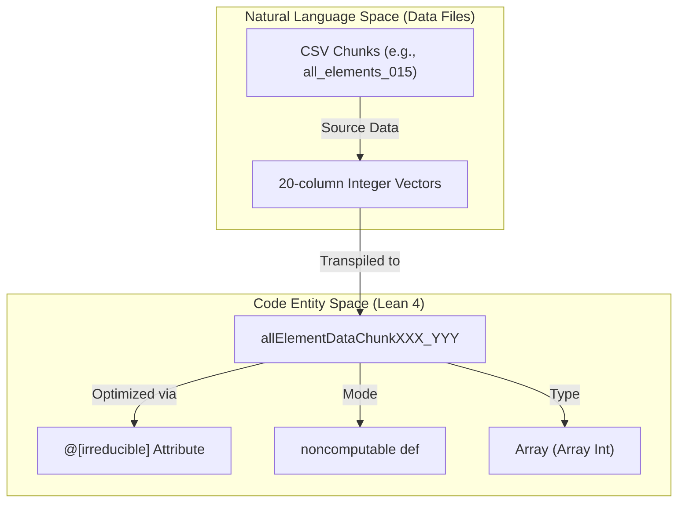
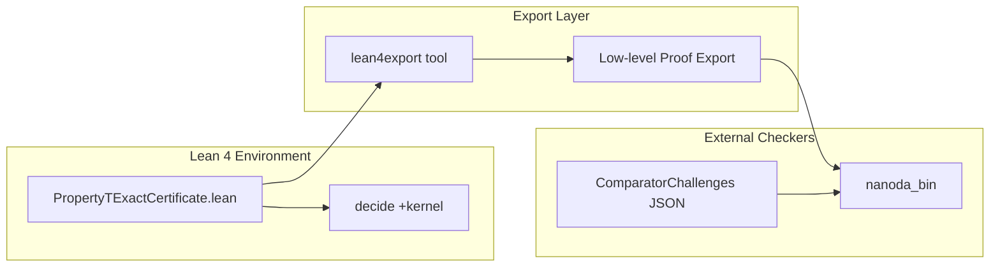

<!-- source: DeepWiki mcp.deepwiki.com · repo openai/ten-proofs · page 6.3 Benchmarks and the TotalGramPrototype · fetched 2026-10-26 -->

# Benchmarks and the TotalGramPrototype

Relevant source files

The following files were used as context for generating this wiki page:

- [ConnesRigidity/Certificates/AffineSymplectic/Chunks/all_elements_000](ConnesRigidity/Certificates/AffineSymplectic/Chunks/all_elements_000)
- [ConnesRigidity/Certificates/AffineSymplectic/Chunks/all_elements_003](ConnesRigidity/Certificates/AffineSymplectic/Chunks/all_elements_003)
- [ConnesRigidity/Certificates/AffineSymplectic/Chunks/all_elements_005](ConnesRigidity/Certificates/AffineSymplectic/Chunks/all_elements_005)
- [ConnesRigidity/Certificates/AffineSymplectic/Chunks/all_elements_006](ConnesRigidity/Certificates/AffineSymplectic/Chunks/all_elements_006)
- [ConnesRigidity/Certificates/AffineSymplectic/Chunks/all_elements_010](ConnesRigidity/Certificates/AffineSymplectic/Chunks/all_elements_010)
- [ConnesRigidity/Certificates/AffineSymplectic/Chunks/all_elements_011](ConnesRigidity/Certificates/AffineSymplectic/Chunks/all_elements_011)
- [ConnesRigidity/Certificates/AffineSymplectic/Chunks/all_elements_012](ConnesRigidity/Certificates/AffineSymplectic/Chunks/all_elements_012)
- [ConnesRigidity/Certificates/AffineSymplectic/Chunks/all_elements_013](ConnesRigidity/Certificates/AffineSymplectic/Chunks/all_elements_013)
- [ConnesRigidity/Certificates/AffineSymplectic/Chunks/all_elements_015](ConnesRigidity/Certificates/AffineSymplectic/Chunks/all_elements_015)
- [ConnesRigidity/Certificates/AffineSymplectic/Chunks/all_elements_016](ConnesRigidity/Certificates/AffineSymplectic/Chunks/all_elements_016)
- [ConnesRigidity/Certificates/AffineSymplectic/Chunks/all_elements_017](ConnesRigidity/Certificates/AffineSymplectic/Chunks/all_elements_017)
- [ConnesRigidity/Certificates/AffineSymplectic/Chunks/all_elements_018](ConnesRigidity/Certificates/AffineSymplectic/Chunks/all_elements_018)
- [ConnesRigidity/Certificates/AffineSymplectic/Chunks/all_elements_019](ConnesRigidity/Certificates/AffineSymplectic/Chunks/all_elements_019)
- [ConnesRigidity/Certificates/AffineSymplectic/Chunks/all_elements_020](ConnesRigidity/Certificates/AffineSymplectic/Chunks/all_elements_020)
- [ConnesRigidity/Certificates/AffineSymplectic/Chunks/all_elements_023](ConnesRigidity/Certificates/AffineSymplectic/Chunks/all_elements_023)
- [ConnesRigidity/Certificates/AffineSymplectic/Chunks/all_elements_025](ConnesRigidity/Certificates/AffineSymplectic/Chunks/all_elements_025)
- [ConnesRigidity/Certificates/AffineSymplectic/Chunks/all_elements_026](ConnesRigidity/Certificates/AffineSymplectic/Chunks/all_elements_026)
- [ConnesRigidity/Certificates/AffineSymplectic/Chunks/all_elements_027](ConnesRigidity/Certificates/AffineSymplectic/Chunks/all_elements_027)
- [ConnesRigidity/Certificates/AffineSymplectic/Chunks/all_elements_028](ConnesRigidity/Certificates/AffineSymplectic/Chunks/all_elements_028)
- [ConnesRigidity/Certificates/AffineSymplectic/Chunks/all_elements_030](ConnesRigidity/Certificates/AffineSymplectic/Chunks/all_elements_030)
- [ConnesRigidity/Certificates/AffineSymplectic/Chunks/all_elements_031](ConnesRigidity/Certificates/AffineSymplectic/Chunks/all_elements_031)
- [ConnesRigidity/Certificates/AffineSymplectic/Chunks/all_elements_032](ConnesRigidity/Certificates/AffineSymplectic/Chunks/all_elements_032)
- [ConnesRigidity/Certificates/AffineSymplectic/Chunks/all_elements_035](ConnesRigidity/Certificates/AffineSymplectic/Chunks/all_elements_035)
- [ConnesRigidity/Certificates/AffineSymplectic/Chunks/all_elements_038](ConnesRigidity/Certificates/AffineSymplectic/Chunks/all_elements_038)
- [ConnesRigidity/Certificates/AffineSymplectic/Chunks/all_elements_039](ConnesRigidity/Certificates/AffineSymplectic/Chunks/all_elements_039)
- [ConnesRigidity/Certificates/AffineSymplectic/Chunks/all_elements_040](ConnesRigidity/Certificates/AffineSymplectic/Chunks/all_elements_040)
- [ConnesRigidity/Certificates/AffineSymplectic/Chunks/all_elements_041](ConnesRigidity/Certificates/AffineSymplectic/Chunks/all_elements_041)
- [ConnesRigidity/Certificates/AffineSymplectic/Chunks/all_elements_042](ConnesRigidity/Certificates/AffineSymplectic/Chunks/all_elements_042)
- [ConnesRigidity/Certificates/AffineSymplectic/Chunks/all_elements_043](ConnesRigidity/Certificates/AffineSymplectic/Chunks/all_elements_043)
- [ConnesRigidity/Certificates/AffineSymplectic/Chunks/all_elements_044](ConnesRigidity/Certificates/AffineSymplectic/Chunks/all_elements_044)
- [ConnesRigidity/Certificates/AffineSymplectic/Chunks/all_elements_046](ConnesRigidity/Certificates/AffineSymplectic/Chunks/all_elements_046)
- [ConnesRigidity/Certificates/AffineSymplectic/Chunks/all_elements_049](ConnesRigidity/Certificates/AffineSymplectic/Chunks/all_elements_049)
- [ConnesRigidity/Certificates/AffineSymplectic/Chunks/all_elements_050](ConnesRigidity/Certificates/AffineSymplectic/Chunks/all_elements_050)
- [ConnesRigidity/Certificates/AffineSymplectic/Chunks/all_elements_051](ConnesRigidity/Certificates/AffineSymplectic/Chunks/all_elements_051)
- [ConnesRigidity/Certificates/AffineSymplectic/Chunks/all_elements_055](ConnesRigidity/Certificates/AffineSymplectic/Chunks/all_elements_055)
- [ConnesRigidity/Certificates/AffineSymplectic/Chunks/all_elements_057](ConnesRigidity/Certificates/AffineSymplectic/Chunks/all_elements_057)
- [ConnesRigidity/Certificates/AffineSymplectic/Chunks/all_elements_058](ConnesRigidity/Certificates/AffineSymplectic/Chunks/all_elements_058)
- [ConnesRigidity/Certificates/AffineSymplectic/Chunks/all_elements_059](ConnesRigidity/Certificates/AffineSymplectic/Chunks/all_elements_059)
- [ConnesRigidity/Certificates/AffineSymplectic/Chunks/all_elements_060](ConnesRigidity/Certificates/AffineSymplectic/Chunks/all_elements_060)
- [ConnesRigidity/Certificates/AffineSymplectic/Chunks/all_elements_063](ConnesRigidity/Certificates/AffineSymplectic/Chunks/all_elements_063)
- [ConnesRigidity/Certificates/AffineSymplectic/Chunks/all_elements_066](ConnesRigidity/Certificates/AffineSymplectic/Chunks/all_elements_066)
- [ConnesRigidity/Certificates/AffineSymplectic/Chunks/all_elements_068](ConnesRigidity/Certificates/AffineSymplectic/Chunks/all_elements_068)
- [ConnesRigidity/Certificates/AffineSymplectic/Chunks/all_elements_069](ConnesRigidity/Certificates/AffineSymplectic/Chunks/all_elements_069)
- [ConnesRigidity/Certificates/AffineSymplectic/Chunks/all_elements_070](ConnesRigidity/Certificates/AffineSymplectic/Chunks/all_elements_070)
- [ConnesRigidity/Certificates/AffineSymplectic/Chunks/all_elements_071](ConnesRigidity/Certificates/AffineSymplectic/Chunks/all_elements_071)
- [ConnesRigidity/Certificates/AffineSymplectic/Chunks/all_elements_072](ConnesRigidity/Certificates/AffineSymplectic/Chunks/all_elements_072)
- [ConnesRigidity/PropertyTExactCertificateAllElementChunks/Group000.lean](ConnesRigidity/PropertyTExactCertificateAllElementChunks/Group000.lean)
- [ConnesRigidity/PropertyTExactCertificateAllElementChunks/Group001.lean](ConnesRigidity/PropertyTExactCertificateAllElementChunks/Group001.lean)
- [ConnesRigidity/PropertyTExactCertificateAllElementChunks/Group002.lean](ConnesRigidity/PropertyTExactCertificateAllElementChunks/Group002.lean)
- [ConnesRigidity/PropertyTExactCertificateAllElementChunks/Group003.lean](ConnesRigidity/PropertyTExactCertificateAllElementChunks/Group003.lean)
- [ConnesRigidity/PropertyTExactCertificateAllElementChunks/Group004.lean](ConnesRigidity/PropertyTExactCertificateAllElementChunks/Group004.lean)
- [ConnesRigidity/PropertyTExactCertificateAllElementChunks/Group005.lean](ConnesRigidity/PropertyTExactCertificateAllElementChunks/Group005.lean)
- [ConnesRigidity/PropertyTExactCertificateAllElementChunks/Group007.lean](ConnesRigidity/PropertyTExactCertificateAllElementChunks/Group007.lean)
- [ConnesRigidity/PropertyTExactCertificateAllElementChunks/Group008.lean](ConnesRigidity/PropertyTExactCertificateAllElementChunks/Group008.lean)
- [ConnesRigidity/PropertyTExactCertificateAllElementChunks/Group009.lean](ConnesRigidity/PropertyTExactCertificateAllElementChunks/Group009.lean)
- [ConnesRigidity/PropertyTExactCertificateAllElementChunks/Group010.lean](ConnesRigidity/PropertyTExactCertificateAllElementChunks/Group010.lean)
- [ConnesRigidity/PropertyTExactCertificateAllElementChunks/Group011.lean](ConnesRigidity/PropertyTExactCertificateAllElementChunks/Group011.lean)
- [ConnesRigidity/PropertyTExactCertificateAllElementChunks/Group012.lean](ConnesRigidity/PropertyTExactCertificateAllElementChunks/Group012.lean)
- [ConnesRigidity/PropertyTExactCertificateAllElementChunks/Group013.lean](ConnesRigidity/PropertyTExactCertificateAllElementChunks/Group013.lean)
- [ConnesRigidity/PropertyTExactCertificateAllElementChunks/Group014.lean](ConnesRigidity/PropertyTExactCertificateAllElementChunks/Group014.lean)
- [ConnesRigidity/PropertyTExactCertificateAllElementChunks/Group015.lean](ConnesRigidity/PropertyTExactCertificateAllElementChunks/Group015.lean)
- [ConnesRigidity/PropertyTExactCertificateAllElementChunks/Group016.lean](ConnesRigidity/PropertyTExactCertificateAllElementChunks/Group016.lean)
- [ConnesRigidity/PropertyTExactCertificateAllElementChunks/Group017.lean](ConnesRigidity/PropertyTExactCertificateAllElementChunks/Group017.lean)
- [ConnesRigidity/PropertyTExactCertificateAllElementChunks/Group018.lean](ConnesRigidity/PropertyTExactCertificateAllElementChunks/Group018.lean)
- [ConnesRigidity/PropertyTExactCertificateAllElementChunks/Group019.lean](ConnesRigidity/PropertyTExactCertificateAllElementChunks/Group019.lean)
- [ConnesRigidity/PropertyTExactCertificateAllElementChunks/Group020.lean](ConnesRigidity/PropertyTExactCertificateAllElementChunks/Group020.lean)
- [ConnesRigidity/PropertyTExactCertificateAllElementChunks/Group021.lean](ConnesRigidity/PropertyTExactCertificateAllElementChunks/Group021.lean)
- [ConnesRigidity/PropertyTExactCertificateAllElementChunks/Group022.lean](ConnesRigidity/PropertyTExactCertificateAllElementChunks/Group022.lean)
- [ConnesRigidity/PropertyTExactCertificateAllElementChunks/Group023.lean](ConnesRigidity/PropertyTExactCertificateAllElementChunks/Group023.lean)
- [ConnesRigidity/PropertyTExactCertificateAllElementChunks/Group024.lean](ConnesRigidity/PropertyTExactCertificateAllElementChunks/Group024.lean)
- [ConnesRigidity/PropertyTExactCertificateAllElementChunks/Group025.lean](ConnesRigidity/PropertyTExactCertificateAllElementChunks/Group025.lean)
- [ConnesRigidity/PropertyTExactCertificateAllElementChunks/Group026.lean](ConnesRigidity/PropertyTExactCertificateAllElementChunks/Group026.lean)
- [ConnesRigidity/PropertyTExactCertificateAllElementChunks/Group027.lean](ConnesRigidity/PropertyTExactCertificateAllElementChunks/Group027.lean)
- [ConnesRigidity/PropertyTExactCertificateAllElementChunks/Group028.lean](ConnesRigidity/PropertyTExactCertificateAllElementChunks/Group028.lean)
- [ConnesRigidity/PropertyTExactCertificateAllElementChunks/Group029.lean](ConnesRigidity/PropertyTExactCertificateAllElementChunks/Group029.lean)
- [ConnesRigidity/PropertyTExactCertificateAllElementChunks/Group030.lean](ConnesRigidity/PropertyTExactCertificateAllElementChunks/Group030.lean)
- [ConnesRigidity/PropertyTExactCertificateAllElementChunks/Group031.lean](ConnesRigidity/PropertyTExactCertificateAllElementChunks/Group031.lean)
- [ConnesRigidity/PropertyTExactCertificateAllElementChunks/Group032.lean](ConnesRigidity/PropertyTExactCertificateAllElementChunks/Group032.lean)
- [ConnesRigidity/PropertyTExactCertificateAllElementChunks/Group033.lean](ConnesRigidity/PropertyTExactCertificateAllElementChunks/Group033.lean)
- [ConnesRigidity/PropertyTExactCertificateAllElementChunks/Group034.lean](ConnesRigidity/PropertyTExactCertificateAllElementChunks/Group034.lean)
- [ConnesRigidity/PropertyTExactCertificateAllElementChunks/Group035.lean](ConnesRigidity/PropertyTExactCertificateAllElementChunks/Group035.lean)
- [ConnesRigidity/PropertyTExactCertificateAllElementChunks/Group036.lean](ConnesRigidity/PropertyTExactCertificateAllElementChunks/Group036.lean)
- [ConnesRigidity/PropertyTExactCertificateAllElementChunks/Group037.lean](ConnesRigidity/PropertyTExactCertificateAllElementChunks/Group037.lean)
- [ConnesRigidity/PropertyTExactCertificateAllElementChunks/Group038.lean](ConnesRigidity/PropertyTExactCertificateAllElementChunks/Group038.lean)
- [ConnesRigidity/PropertyTExactCertificateAllElementChunks/Group039.lean](ConnesRigidity/PropertyTExactCertificateAllElementChunks/Group039.lean)
- [ConnesRigidity/PropertyTExactCertificateAllElementChunks/Group040.lean](ConnesRigidity/PropertyTExactCertificateAllElementChunks/Group040.lean)
- [ConnesRigidity/PropertyTExactCertificateAllElementChunks/Group041.lean](ConnesRigidity/PropertyTExactCertificateAllElementChunks/Group041.lean)
- [ConnesRigidity/PropertyTExactCertificateAllElementChunks/Group042.lean](ConnesRigidity/PropertyTExactCertificateAllElementChunks/Group042.lean)
- [ConnesRigidity/PropertyTExactCertificateAllElementChunks/Group043.lean](ConnesRigidity/PropertyTExactCertificateAllElementChunks/Group043.lean)
- [ConnesRigidity/PropertyTExactCertificateAllElementChunks/Group044.lean](ConnesRigidity/PropertyTExactCertificateAllElementChunks/Group044.lean)
- [ConnesRigidity/PropertyTExactCertificateAllElementChunks/Group045.lean](ConnesRigidity/PropertyTExactCertificateAllElementChunks/Group045.lean)
- [ConnesRigidity/PropertyTExactCertificateAllElementChunks/Group046.lean](ConnesRigidity/PropertyTExactCertificateAllElementChunks/Group046.lean)
- [ConnesRigidity/PropertyTExactCertificateAllElementChunks/Group047.lean](ConnesRigidity/PropertyTExactCertificateAllElementChunks/Group047.lean)
- [ConnesRigidity/PropertyTExactCertificateAllElementChunks/Group048.lean](ConnesRigidity/PropertyTExactCertificateAllElementChunks/Group048.lean)
- [ConnesRigidity/PropertyTExactCertificateAllElementChunks/Group049.lean](ConnesRigidity/PropertyTExactCertificateAllElementChunks/Group049.lean)
- [ConnesRigidity/PropertyTExactCertificateAllElementChunks/Group050.lean](ConnesRigidity/PropertyTExactCertificateAllElementChunks/Group050.lean)
- [ConnesRigidity/PropertyTExactCertificateAllElementChunks/Group051.lean](ConnesRigidity/PropertyTExactCertificateAllElementChunks/Group051.lean)
- [ConnesRigidity/PropertyTExactCertificateAllElementChunks/Group052.lean](ConnesRigidity/PropertyTExactCertificateAllElementChunks/Group052.lean)
- [ConnesRigidity/PropertyTExactCertificateAllElementChunks/Group053.lean](ConnesRigidity/PropertyTExactCertificateAllElementChunks/Group053.lean)
- [ConnesRigidity/PropertyTExactCertificateAllElementChunks/Group054.lean](ConnesRigidity/PropertyTExactCertificateAllElementChunks/Group054.lean)
- [ConnesRigidity/PropertyTExactCertificateAllElementChunks/Group055.lean](ConnesRigidity/PropertyTExactCertificateAllElementChunks/Group055.lean)
- [ConnesRigidity/PropertyTExactCertificateAllElementChunks/Group056.lean](ConnesRigidity/PropertyTExactCertificateAllElementChunks/Group056.lean)
- [ConnesRigidity/PropertyTExactCertificateAllElementChunks/Group057.lean](ConnesRigidity/PropertyTExactCertificateAllElementChunks/Group057.lean)
- [ConnesRigidity/PropertyTExactCertificateAllElementChunks/Group058.lean](ConnesRigidity/PropertyTExactCertificateAllElementChunks/Group058.lean)
- [ConnesRigidity/PropertyTExactCertificateAllElementChunks/Group059.lean](ConnesRigidity/PropertyTExactCertificateAllElementChunks/Group059.lean)
- [ConnesRigidity/PropertyTExactCertificateAllElementChunks/Group060.lean](ConnesRigidity/PropertyTExactCertificateAllElementChunks/Group060.lean)
- [ConnesRigidity/PropertyTExactCertificateAllElementChunks/Group061.lean](ConnesRigidity/PropertyTExactCertificateAllElementChunks/Group061.lean)
- [ConnesRigidity/PropertyTExactCertificateAllElementChunks/Group062.lean](ConnesRigidity/PropertyTExactCertificateAllElementChunks/Group062.lean)
- [ConnesRigidity/PropertyTExactCertificateAllElementChunks/Group063.lean](ConnesRigidity/PropertyTExactCertificateAllElementChunks/Group063.lean)
- [ConnesRigidity/PropertyTExactCertificateAllElementChunks/Group064.lean](ConnesRigidity/PropertyTExactCertificateAllElementChunks/Group064.lean)
- [ConnesRigidity/PropertyTExactCertificateAllElementChunks/Group065.lean](ConnesRigidity/PropertyTExactCertificateAllElementChunks/Group065.lean)
- [ConnesRigidity/PropertyTExactCertificateAllElementChunks/Group066.lean](ConnesRigidity/PropertyTExactCertificateAllElementChunks/Group066.lean)
- [ConnesRigidity/PropertyTExactCertificateAllElementChunks/Group067.lean](ConnesRigidity/PropertyTExactCertificateAllElementChunks/Group067.lean)
- [ConnesRigidity/PropertyTExactCertificateAllElementChunks/Group068.lean](ConnesRigidity/PropertyTExactCertificateAllElementChunks/Group068.lean)
- [ConnesRigidity/PropertyTExactCertificateAllElementChunks/Group069.lean](ConnesRigidity/PropertyTExactCertificateAllElementChunks/Group069.lean)
- [ConnesRigidity/PropertyTExactCertificateAllElementChunks/Group072.lean](ConnesRigidity/PropertyTExactCertificateAllElementChunks/Group072.lean)

This section details the auxiliary components of the `ten-proofs` repository used for performance evaluation, alternative verification strategies, and external validation against independent checkers. These tools are critical for ensuring the computational feasibility of the large-scale Property T certificate within the Lean 4 kernel.

## Benchmarking Subsystem

The `Benchmarks/` directory contains performance tests for the core data structures used in coefficient encoding and lookup. These benchmarks evaluate different strategies for handling the sparse integer data that constitutes the Gram matrix and edge coefficient packets.

### Sparse Coefficient Benchmarks
The repository evaluates multiple approaches for sparse data representation:
*   **Lane-based Benchmarks**: Measures the efficiency of processing sharded data packets (lanes) used in parallel verification tasks.
*   **Radix and Trie Benchmarks**: Compares the performance of `CoefficientSparseRadix` and `Trie` structures for fast lookup of group ring coefficients. These benchmarks informed the selection of the hierarchical unfolding strategy used in `PropertyTExactCertificateCoefficientEncodingBase.lean` [PropertyTExactCertificateCoefficientEncodingBase.lean:1-50]().

**Sources:** [PropertyTExactCertificateCoefficientEncodingBase.lean:1-50]()

## TotalGramPrototype

The `TotalGramPrototype/` directory explores alternative methods for verifying the Gram matrix positivity without relying entirely on the standard sharded row checks. This prototype implements high-performance verification kernels that are later formalized in the main `ConnesRigidity` proof.

### Alternative Verification Approaches
*   **Lanes and Micro-rows**: A strategy to decompose large matrix operations into smaller, cache-friendly "micro-rows" to minimize memory overhead during kernel reduction.
*   **Residuals**: Investigates the use of approximate Cholesky factors where the error (residual) is explicitly bounded and verified as small enough to maintain the PSD (Positive Semi-Definite) property.
*   **Data Flow**: The prototype mirrors the data flow found in the `all_elements` chunks [ConnesRigidity/Certificates/AffineSymplectic/Chunks/all_elements_015:1-100](), testing how raw CSV data is transformed into `allElementDataChunk` definitions [ConnesRigidity/PropertyTExactCertificateAllElementChunks/Group045.lean:6-25]().

### Data-to-Code Mapping (AllElements)
The following diagram illustrates how raw certificate data in the `Chunks/` directory is mapped to Lean 4 code entities within the `PropertyTExactCertificateAllElementChunks` namespace.

**Diagram: Basis Element Data Mapping**

**Sources:** [ConnesRigidity/Certificates/AffineSymplectic/Chunks/all_elements_015:1-100](), [ConnesRigidity/PropertyTExactCertificateAllElementChunks/Group045.lean:6-25]()

## ComparatorChallenges Framework

The `ComparatorChallenges/` framework provides the infrastructure for cross-verifying the Lean 4 proof against external tools. This ensures that the mathematical claims are not dependent on specific Lean kernel implementations.

### Independent Verification Pipeline
1.  **Lean4Export**: The proof is exported into a low-level format using `lean4export`.
2.  **Nanoda_bin**: An independent checker, `nanoda_bin`, consumes the exported proof to verify the logical consistency of the Property T certificate.
3.  **JSON Challenge Configs**: Verification tasks are defined via JSON configurations that specify which parts of the `PropertyTExactCertificate` (e.g., Gram rows, product table, or edge packets) are being targeted.

### Verification Flow Diagram
The following diagram shows the relationship between the Lean 4 source and the external verification tools.

**Diagram: External Verification Pipeline**

**Sources:** [ConnesRigidity/Certificates/AffineSymplectic/Chunks/all_elements_010:1-100](), [ConnesRigidity/PropertyTExactCertificateAllElementChunks/Group011.lean:6-30]()

## Implementation Details

### Basis Data Partitioning
The 73,033 basis elements are sharded into files like `Group045.lean` [ConnesRigidity/PropertyTExactCertificateAllElementChunks/Group045.lean:1-150]() to avoid Lean compiler memory limits. Each file contains multiple `allElementDataChunk` definitions, typically grouped in small arrays of integer vectors [ConnesRigidity/PropertyTExactCertificateAllElementChunks/Group045.lean:6-11]().

### Irreducibility for Performance
All large data arrays are marked with `@[irreducible]` [ConnesRigidity/PropertyTExactCertificateAllElementChunks/Group011.lean:6-6](). This prevents the Lean 4 simplifier and kernel from attempting to unfold the entire data structure during intermediate proof steps, which would otherwise lead to a "heartbeat" exhaustion or memory overflow.

**Sources:** [ConnesRigidity/PropertyTExactCertificateAllElementChunks/Group045.lean:6-150](), [ConnesRigidity/PropertyTExactCertificateAllElementChunks/Group011.lean:6-25]()

Would you like a summary of the next reasonably large segment of the original text, such as the Glossary (Section 7)?

---

