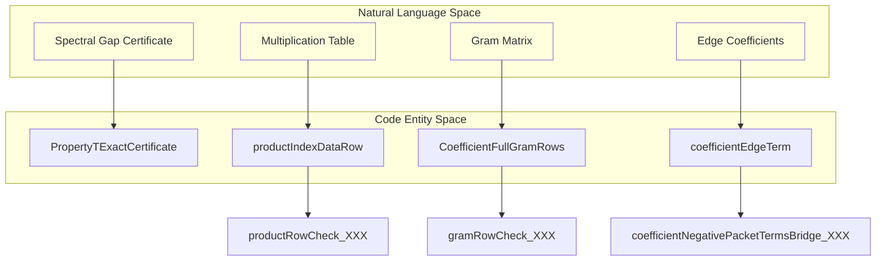
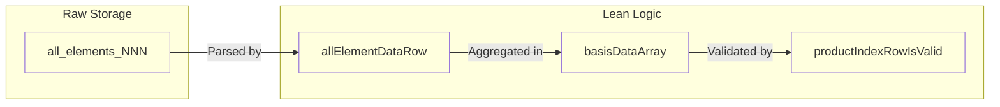

<!-- source: DeepWiki mcp.deepwiki.com · repo openai/ten-proofs · page 7 Glossary · fetched 2026-10-26 -->

# Glossary

Relevant source files

The following files were used as context for generating this wiki page:

- [ConnesRigidity/CertificateLiterals/PropertyTExactCertificateCoefficientEdgePackets/Positive024/Entry000.lean](ConnesRigidity/CertificateLiterals/PropertyTExactCertificateCoefficientEdgePackets/Positive024/Entry000.lean)
- [ConnesRigidity/CertificateLiterals/PropertyTExactCertificateCoefficientEdgePackets/Positive033/Entry000.lean](ConnesRigidity/CertificateLiterals/PropertyTExactCertificateCoefficientEdgePackets/Positive033/Entry000.lean)
- [ConnesRigidity/CertificateLiterals/PropertyTExactCertificateCoefficientEdgePackets/Positive052/Entry000.lean](ConnesRigidity/CertificateLiterals/PropertyTExactCertificateCoefficientEdgePackets/Positive052/Entry000.lean)
- [ConnesRigidity/CertificateLiterals/PropertyTExactCertificateCoefficientEdgePackets/Positive053/Entry000.lean](ConnesRigidity/CertificateLiterals/PropertyTExactCertificateCoefficientEdgePackets/Positive053/Entry000.lean)
- [ConnesRigidity/CertificateLiterals/PropertyTExactCertificateCoefficientEdgePackets/Positive057/Entry000.lean](ConnesRigidity/CertificateLiterals/PropertyTExactCertificateCoefficientEdgePackets/Positive057/Entry000.lean)
- [ConnesRigidity/CertificateLiterals/PropertyTExactCertificateCoefficientEdgePackets/Positive086/Entry000.lean](ConnesRigidity/CertificateLiterals/PropertyTExactCertificateCoefficientEdgePackets/Positive086/Entry000.lean)
- [ConnesRigidity/CertificateLiterals/PropertyTExactCertificateCoefficientEdgePackets/Positive113/Entry000.lean](ConnesRigidity/CertificateLiterals/PropertyTExactCertificateCoefficientEdgePackets/Positive113/Entry000.lean)
- [ConnesRigidity/CertificateLiterals/PropertyTExactCertificateCoefficientEdgePackets/Positive119/Entry000.lean](ConnesRigidity/CertificateLiterals/PropertyTExactCertificateCoefficientEdgePackets/Positive119/Entry000.lean)
- [ConnesRigidity/CertificateLiterals/PropertyTExactCertificateCoefficientEdgePackets/Positive122/Entry000.lean](ConnesRigidity/CertificateLiterals/PropertyTExactCertificateCoefficientEdgePackets/Positive122/Entry000.lean)
- [ConnesRigidity/CertificateLiterals/PropertyTExactCertificateCoefficientEdgePackets/Positive134/Entry000.lean](ConnesRigidity/CertificateLiterals/PropertyTExactCertificateCoefficientEdgePackets/Positive134/Entry000.lean)
- [ConnesRigidity/CertificateLiterals/PropertyTExactCertificateCoefficientEdgePackets/Positive140/Entry000.lean](ConnesRigidity/CertificateLiterals/PropertyTExactCertificateCoefficientEdgePackets/Positive140/Entry000.lean)
- [ConnesRigidity/CertificateLiterals/PropertyTExactCertificateCoefficientEdgePackets/Positive154/Entry000.lean](ConnesRigidity/CertificateLiterals/PropertyTExactCertificateCoefficientEdgePackets/Positive154/Entry000.lean)
- [ConnesRigidity/CertificateLiterals/PropertyTExactCertificateCoefficientEdgePackets/Positive162/Entry000.lean](ConnesRigidity/CertificateLiterals/PropertyTExactCertificateCoefficientEdgePackets/Positive162/Entry000.lean)
- [ConnesRigidity/CertificateLiterals/PropertyTExactCertificateCoefficientEdgePackets/Positive224/Entry000.lean](ConnesRigidity/CertificateLiterals/PropertyTExactCertificateCoefficientEdgePackets/Positive224/Entry000.lean)
- [ConnesRigidity/CertificateLiterals/PropertyTExactCertificateCoefficientEdgePackets/Positive227/Entry000.lean](ConnesRigidity/CertificateLiterals/PropertyTExactCertificateCoefficientEdgePackets/Positive227/Entry000.lean)
- [ConnesRigidity/CertificateLiterals/PropertyTExactCertificateCoefficientEdgePackets/Positive233/Entry000.lean](ConnesRigidity/CertificateLiterals/PropertyTExactCertificateCoefficientEdgePackets/Positive233/Entry000.lean)
- [ConnesRigidity/CertificateLiterals/PropertyTExactCertificateCoefficientEdgePackets/Positive236/Entry000.lean](ConnesRigidity/CertificateLiterals/PropertyTExactCertificateCoefficientEdgePackets/Positive236/Entry000.lean)
- [ConnesRigidity/CertificateLiterals/PropertyTExactCertificateCoefficientEdgePackets/Positive248/Entry000.lean](ConnesRigidity/CertificateLiterals/PropertyTExactCertificateCoefficientEdgePackets/Positive248/Entry000.lean)
- [ConnesRigidity/CertificateLiterals/PropertyTExactCertificateCoefficientEdgePackets/Positive258/Entry000.lean](ConnesRigidity/CertificateLiterals/PropertyTExactCertificateCoefficientEdgePackets/Positive258/Entry000.lean)
- [ConnesRigidity/CertificateLiterals/PropertyTExactCertificateCoefficientEdgePackets/Positive261/Entry000.lean](ConnesRigidity/CertificateLiterals/PropertyTExactCertificateCoefficientEdgePackets/Positive261/Entry000.lean)
- [ConnesRigidity/CertificateLiterals/PropertyTExactCertificateCoefficientEdgePackets/Positive265/Entry000.lean](ConnesRigidity/CertificateLiterals/PropertyTExactCertificateCoefficientEdgePackets/Positive265/Entry000.lean)
- [ConnesRigidity/CertificateLiterals/PropertyTExactCertificateFullGramRows/Entry048.lean](ConnesRigidity/CertificateLiterals/PropertyTExactCertificateFullGramRows/Entry048.lean)
- [ConnesRigidity/CertificateLiterals/PropertyTExactCertificateFullGramRows/Entry115.lean](ConnesRigidity/CertificateLiterals/PropertyTExactCertificateFullGramRows/Entry115.lean)
- [ConnesRigidity/CertificateLiterals/PropertyTExactCertificateFullGramRows/Entry120.lean](ConnesRigidity/CertificateLiterals/PropertyTExactCertificateFullGramRows/Entry120.lean)
- [ConnesRigidity/CertificateLiterals/PropertyTExactCertificateFullGramRows/Entry132.lean](ConnesRigidity/CertificateLiterals/PropertyTExactCertificateFullGramRows/Entry132.lean)
- [ConnesRigidity/CertificateLiterals/PropertyTExactCertificateFullGramRows/Entry149.lean](ConnesRigidity/CertificateLiterals/PropertyTExactCertificateFullGramRows/Entry149.lean)
- [ConnesRigidity/CertificateLiterals/PropertyTExactCertificateFullGramRows/Entry153.lean](ConnesRigidity/CertificateLiterals/PropertyTExactCertificateFullGramRows/Entry153.lean)
- [ConnesRigidity/CertificateLiterals/PropertyTExactCertificateFullGramRows/Entry159.lean](ConnesRigidity/CertificateLiterals/PropertyTExactCertificateFullGramRows/Entry159.lean)
- [ConnesRigidity/CertificateLiterals/PropertyTExactCertificateFullGramRows/Entry167.lean](ConnesRigidity/CertificateLiterals/PropertyTExactCertificateFullGramRows/Entry167.lean)
- [ConnesRigidity/CertificateLiterals/PropertyTExactCertificateFullGramRows/Entry174.lean](ConnesRigidity/CertificateLiterals/PropertyTExactCertificateFullGramRows/Entry174.lean)
- [ConnesRigidity/CertificateLiterals/PropertyTExactCertificateFullGramRows/Entry183.lean](ConnesRigidity/CertificateLiterals/PropertyTExactCertificateFullGramRows/Entry183.lean)
- [ConnesRigidity/CertificateLiterals/PropertyTExactCertificateFullGramRows/Entry188.lean](ConnesRigidity/CertificateLiterals/PropertyTExactCertificateFullGramRows/Entry188.lean)
- [ConnesRigidity/CertificateLiterals/PropertyTExactCertificateFullGramRows/Entry234.lean](ConnesRigidity/CertificateLiterals/PropertyTExactCertificateFullGramRows/Entry234.lean)
- [ConnesRigidity/CertificateLiterals/PropertyTExactCertificateFullGramRows/Entry256.lean](ConnesRigidity/CertificateLiterals/PropertyTExactCertificateFullGramRows/Entry256.lean)
- [ConnesRigidity/CertificateLiterals/PropertyTExactCertificateFullGramRows/Entry284.lean](ConnesRigidity/CertificateLiterals/PropertyTExactCertificateFullGramRows/Entry284.lean)
- [ConnesRigidity/CertificateLiterals/PropertyTExactCertificateFullGramRows/Entry288.lean](ConnesRigidity/CertificateLiterals/PropertyTExactCertificateFullGramRows/Entry288.lean)
- [ConnesRigidity/CertificateLiterals/PropertyTExactCertificateFullGramRows/Entry290.lean](ConnesRigidity/CertificateLiterals/PropertyTExactCertificateFullGramRows/Entry290.lean)
- [ConnesRigidity/CertificateLiterals/PropertyTExactCertificateFullGramRows/Entry292.lean](ConnesRigidity/CertificateLiterals/PropertyTExactCertificateFullGramRows/Entry292.lean)
- [ConnesRigidity/CertificateLiterals/PropertyTExactCertificateFullGramRows/Entry293.lean](ConnesRigidity/CertificateLiterals/PropertyTExactCertificateFullGramRows/Entry293.lean)
- [ConnesRigidity/CertificateLiterals/PropertyTExactCertificateFullGramRows/Entry296.lean](ConnesRigidity/CertificateLiterals/PropertyTExactCertificateFullGramRows/Entry296.lean)
- [ConnesRigidity/CertificateLiterals/PropertyTExactCertificateFullGramRows/Entry302.lean](ConnesRigidity/CertificateLiterals/PropertyTExactCertificateFullGramRows/Entry302.lean)
- [ConnesRigidity/CertificateLiterals/PropertyTExactCertificateFullGramRows/Entry303.lean](ConnesRigidity/CertificateLiterals/PropertyTExactCertificateFullGramRows/Entry303.lean)
- [ConnesRigidity/CertificateLiterals/PropertyTExactCertificateFullGramRows/Entry304.lean](ConnesRigidity/CertificateLiterals/PropertyTExactCertificateFullGramRows/Entry304.lean)
- [ConnesRigidity/CertificateLiterals/PropertyTExactCertificateFullGramRows/Entry305.lean](ConnesRigidity/CertificateLiterals/PropertyTExactCertificateFullGramRows/Entry305.lean)
- [ConnesRigidity/CertificateLiterals/PropertyTExactCertificateFullGramRows/Entry319.lean](ConnesRigidity/CertificateLiterals/PropertyTExactCertificateFullGramRows/Entry319.lean)
- [ConnesRigidity/CertificateLiterals/PropertyTExactCertificateFullGramRows/Entry321.lean](ConnesRigidity/CertificateLiterals/PropertyTExactCertificateFullGramRows/Entry321.lean)
- [ConnesRigidity/CertificateLiterals/PropertyTExactCertificateFullGramRows/Entry327.lean](ConnesRigidity/CertificateLiterals/PropertyTExactCertificateFullGramRows/Entry327.lean)
- [ConnesRigidity/CertificateLiterals/PropertyTExactCertificateFullGramRows/Entry340.lean](ConnesRigidity/CertificateLiterals/PropertyTExactCertificateFullGramRows/Entry340.lean)
- [ConnesRigidity/CertificateLiterals/PropertyTExactCertificateFullGramRows/Entry359.lean](ConnesRigidity/CertificateLiterals/PropertyTExactCertificateFullGramRows/Entry359.lean)
- [ConnesRigidity/CertificateLiterals/PropertyTExactCertificateFullGramRows/Entry362.lean](ConnesRigidity/CertificateLiterals/PropertyTExactCertificateFullGramRows/Entry362.lean)
- [ConnesRigidity/CertificateLiterals/PropertyTExactCertificateFullGramRows/Entry372.lean](ConnesRigidity/CertificateLiterals/PropertyTExactCertificateFullGramRows/Entry372.lean)
- [ConnesRigidity/CertificateLiterals/PropertyTExactCertificateFullGramRows/Entry386.lean](ConnesRigidity/CertificateLiterals/PropertyTExactCertificateFullGramRows/Entry386.lean)
- [ConnesRigidity/CertificateLiterals/PropertyTExactCertificateFullGramRows/Entry387.lean](ConnesRigidity/CertificateLiterals/PropertyTExactCertificateFullGramRows/Entry387.lean)
- [ConnesRigidity/CertificateLiterals/PropertyTExactCertificateFullGramRows/Entry393.lean](ConnesRigidity/CertificateLiterals/PropertyTExactCertificateFullGramRows/Entry393.lean)
- [ConnesRigidity/CertificateLiterals/PropertyTExactCertificateFullGramRows/Entry394.lean](ConnesRigidity/CertificateLiterals/PropertyTExactCertificateFullGramRows/Entry394.lean)
- [ConnesRigidity/CertificateLiterals/PropertyTExactCertificateFullGramRows/Entry408.lean](ConnesRigidity/CertificateLiterals/PropertyTExactCertificateFullGramRows/Entry408.lean)
- [ConnesRigidity/Certificates/AffineSymplectic/Chunks/all_elements_000](ConnesRigidity/Certificates/AffineSymplectic/Chunks/all_elements_000)
- [ConnesRigidity/Certificates/AffineSymplectic/Chunks/all_elements_003](ConnesRigidity/Certificates/AffineSymplectic/Chunks/all_elements_003)
- [ConnesRigidity/Certificates/AffineSymplectic/Chunks/all_elements_005](ConnesRigidity/Certificates/AffineSymplectic/Chunks/all_elements_005)
- [ConnesRigidity/Certificates/AffineSymplectic/Chunks/all_elements_006](ConnesRigidity/Certificates/AffineSymplectic/Chunks/all_elements_006)
- [ConnesRigidity/Certificates/AffineSymplectic/Chunks/all_elements_010](ConnesRigidity/Certificates/AffineSymplectic/Chunks/all_elements_010)
- [ConnesRigidity/Certificates/AffineSymplectic/Chunks/all_elements_011](ConnesRigidity/Certificates/AffineSymplectic/Chunks/all_elements_011)
- [ConnesRigidity/Certificates/AffineSymplectic/Chunks/all_elements_012](ConnesRigidity/Certificates/AffineSymplectic/Chunks/all_elements_012)
- [ConnesRigidity/Certificates/AffineSymplectic/Chunks/all_elements_013](ConnesRigidity/Certificates/AffineSymplectic/Chunks/all_elements_013)
- [ConnesRigidity/Certificates/AffineSymplectic/Chunks/all_elements_015](ConnesRigidity/Certificates/AffineSymplectic/Chunks/all_elements_015)
- [ConnesRigidity/Certificates/AffineSymplectic/Chunks/all_elements_016](ConnesRigidity/Certificates/AffineSymplectic/Chunks/all_elements_016)
- [ConnesRigidity/Certificates/AffineSymplectic/Chunks/all_elements_017](ConnesRigidity/Certificates/AffineSymplectic/Chunks/all_elements_017)
- [ConnesRigidity/Certificates/AffineSymplectic/Chunks/all_elements_018](ConnesRigidity/Certificates/AffineSymplectic/Chunks/all_elements_018)
- [ConnesRigidity/Certificates/AffineSymplectic/Chunks/all_elements_019](ConnesRigidity/Certificates/AffineSymplectic/Chunks/all_elements_019)
- [ConnesRigidity/Certificates/AffineSymplectic/Chunks/all_elements_020](ConnesRigidity/Certificates/AffineSymplectic/Chunks/all_elements_020)
- [ConnesRigidity/Certificates/AffineSymplectic/Chunks/all_elements_023](ConnesRigidity/Certificates/AffineSymplectic/Chunks/all_elements_023)
- [ConnesRigidity/Certificates/AffineSymplectic/Chunks/all_elements_025](ConnesRigidity/Certificates/AffineSymplectic/Chunks/all_elements_025)
- [ConnesRigidity/Certificates/AffineSymplectic/Chunks/all_elements_026](ConnesRigidity/Certificates/AffineSymplectic/Chunks/all_elements_026)
- [ConnesRigidity/Certificates/AffineSymplectic/Chunks/all_elements_027](ConnesRigidity/Certificates/AffineSymplectic/Chunks/all_elements_027)
- [ConnesRigidity/Certificates/AffineSymplectic/Chunks/all_elements_028](ConnesRigidity/Certificates/AffineSymplectic/Chunks/all_elements_028)
- [ConnesRigidity/Certificates/AffineSymplectic/Chunks/all_elements_030](ConnesRigidity/Certificates/AffineSymplectic/Chunks/all_elements_030)
- [ConnesRigidity/Certificates/AffineSymplectic/Chunks/all_elements_031](ConnesRigidity/Certificates/AffineSymplectic/Chunks/all_elements_031)
- [ConnesRigidity/Certificates/AffineSymplectic/Chunks/all_elements_032](ConnesRigidity/Certificates/AffineSymplectic/Chunks/all_elements_032)
- [ConnesRigidity/Certificates/AffineSymplectic/Chunks/all_elements_035](ConnesRigidity/Certificates/AffineSymplectic/Chunks/all_elements_035)
- [ConnesRigidity/Certificates/AffineSymplectic/Chunks/all_elements_038](ConnesRigidity/Certificates/AffineSymplectic/Chunks/all_elements_038)
- [ConnesRigidity/Certificates/AffineSymplectic/Chunks/all_elements_039](ConnesRigidity/Certificates/AffineSymplectic/Chunks/all_elements_039)
- [ConnesRigidity/Certificates/AffineSymplectic/Chunks/all_elements_040](ConnesRigidity/Certificates/AffineSymplectic/Chunks/all_elements_040)
- [ConnesRigidity/Certificates/AffineSymplectic/Chunks/all_elements_041](ConnesRigidity/Certificates/AffineSymplectic/Chunks/all_elements_041)
- [ConnesRigidity/Certificates/AffineSymplectic/Chunks/all_elements_042](ConnesRigidity/Certificates/AffineSymplectic/Chunks/all_elements_042)
- [ConnesRigidity/Certificates/AffineSymplectic/Chunks/all_elements_043](ConnesRigidity/Certificates/AffineSymplectic/Chunks/all_elements_043)
- [ConnesRigidity/Certificates/AffineSymplectic/Chunks/all_elements_044](ConnesRigidity/Certificates/AffineSymplectic/Chunks/all_elements_044)
- [ConnesRigidity/Certificates/AffineSymplectic/Chunks/all_elements_046](ConnesRigidity/Certificates/AffineSymplectic/Chunks/all_elements_046)
- [ConnesRigidity/Certificates/AffineSymplectic/Chunks/all_elements_049](ConnesRigidity/Certificates/AffineSymplectic/Chunks/all_elements_049)
- [ConnesRigidity/Certificates/AffineSymplectic/Chunks/all_elements_050](ConnesRigidity/Certificates/AffineSymplectic/Chunks/all_elements_050)
- [ConnesRigidity/Certificates/AffineSymplectic/Chunks/all_elements_051](ConnesRigidity/Certificates/AffineSymplectic/Chunks/all_elements_051)
- [ConnesRigidity/Certificates/AffineSymplectic/Chunks/all_elements_055](ConnesRigidity/Certificates/AffineSymplectic/Chunks/all_elements_055)
- [ConnesRigidity/Certificates/AffineSymplectic/Chunks/all_elements_057](ConnesRigidity/Certificates/AffineSymplectic/Chunks/all_elements_057)
- [ConnesRigidity/Certificates/AffineSymplectic/Chunks/all_elements_058](ConnesRigidity/Certificates/AffineSymplectic/Chunks/all_elements_058)
- [ConnesRigidity/Certificates/AffineSymplectic/Chunks/all_elements_059](ConnesRigidity/Certificates/AffineSymplectic/Chunks/all_elements_059)
- [ConnesRigidity/Certificates/AffineSymplectic/Chunks/all_elements_060](ConnesRigidity/Certificates/AffineSymplectic/Chunks/all_elements_060)
- [ConnesRigidity/Certificates/AffineSymplectic/Chunks/all_elements_063](ConnesRigidity/Certificates/AffineSymplectic/Chunks/all_elements_063)
- [ConnesRigidity/Certificates/AffineSymplectic/Chunks/all_elements_066](ConnesRigidity/Certificates/AffineSymplectic/Chunks/all_elements_066)
- [ConnesRigidity/Certificates/AffineSymplectic/Chunks/all_elements_068](ConnesRigidity/Certificates/AffineSymplectic/Chunks/all_elements_068)
- [ConnesRigidity/Certificates/AffineSymplectic/Chunks/all_elements_069](ConnesRigidity/Certificates/AffineSymplectic/Chunks/all_elements_069)
- [ConnesRigidity/Certificates/AffineSymplectic/Chunks/all_elements_070](ConnesRigidity/Certificates/AffineSymplectic/Chunks/all_elements_070)
- [ConnesRigidity/Certificates/AffineSymplectic/Chunks/all_elements_071](ConnesRigidity/Certificates/AffineSymplectic/Chunks/all_elements_071)
- [ConnesRigidity/Certificates/AffineSymplectic/Chunks/all_elements_072](ConnesRigidity/Certificates/AffineSymplectic/Chunks/all_elements_072)
- [ConnesRigidity/Certificates/AffineSymplectic/CoefficientEdgePackets/negative_002](ConnesRigidity/Certificates/AffineSymplectic/CoefficientEdgePackets/negative_002)
- [ConnesRigidity/Certificates/AffineSymplectic/CoefficientEdgePackets/negative_004](ConnesRigidity/Certificates/AffineSymplectic/CoefficientEdgePackets/negative_004)
- [ConnesRigidity/Certificates/AffineSymplectic/CoefficientEdgePackets/negative_006](ConnesRigidity/Certificates/AffineSymplectic/CoefficientEdgePackets/negative_006)
- [ConnesRigidity/Certificates/AffineSymplectic/CoefficientEdgePackets/negative_018](ConnesRigidity/Certificates/AffineSymplectic/CoefficientEdgePackets/negative_018)
- [ConnesRigidity/Certificates/AffineSymplectic/CoefficientEdgePackets/negative_020](ConnesRigidity/Certificates/AffineSymplectic/CoefficientEdgePackets/negative_020)
- [ConnesRigidity/Certificates/AffineSymplectic/CoefficientEdgePackets/negative_021](ConnesRigidity/Certificates/AffineSymplectic/CoefficientEdgePackets/negative_021)
- [ConnesRigidity/Certificates/AffineSymplectic/CoefficientEdgePackets/negative_022](ConnesRigidity/Certificates/AffineSymplectic/CoefficientEdgePackets/negative_022)
- [ConnesRigidity/Certificates/AffineSymplectic/CoefficientEdgePackets/negative_028](ConnesRigidity/Certificates/AffineSymplectic/CoefficientEdgePackets/negative_028)
- [ConnesRigidity/Certificates/AffineSymplectic/CoefficientEdgePackets/negative_032](ConnesRigidity/Certificates/AffineSymplectic/CoefficientEdgePackets/negative_032)
- [ConnesRigidity/Certificates/AffineSymplectic/CoefficientEdgePackets/negative_033](ConnesRigidity/Certificates/AffineSymplectic/CoefficientEdgePackets/negative_033)
- [ConnesRigidity/Certificates/AffineSymplectic/CoefficientEdgePackets/negative_034](ConnesRigidity/Certificates/AffineSymplectic/CoefficientEdgePackets/negative_034)
- [ConnesRigidity/Certificates/AffineSymplectic/CoefficientEdgePackets/negative_035](ConnesRigidity/Certificates/AffineSymplectic/CoefficientEdgePackets/negative_035)
- [ConnesRigidity/Certificates/AffineSymplectic/CoefficientEdgePackets/negative_039](ConnesRigidity/Certificates/AffineSymplectic/CoefficientEdgePackets/negative_039)
- [ConnesRigidity/Certificates/AffineSymplectic/CoefficientEdgePackets/negative_040](ConnesRigidity/Certificates/AffineSymplectic/CoefficientEdgePackets/negative_040)
- [ConnesRigidity/Certificates/AffineSymplectic/CoefficientEdgePackets/negative_043](ConnesRigidity/Certificates/AffineSymplectic/CoefficientEdgePackets/negative_043)
- [ConnesRigidity/Certificates/AffineSymplectic/CoefficientEdgePackets/negative_044](ConnesRigidity/Certificates/AffineSymplectic/CoefficientEdgePackets/negative_044)
- [ConnesRigidity/Certificates/AffineSymplectic/CoefficientEdgePackets/negative_045](ConnesRigidity/Certificates/AffineSymplectic/CoefficientEdgePackets/negative_045)
- [ConnesRigidity/Certificates/AffineSymplectic/CoefficientEdgePackets/negative_047](ConnesRigidity/Certificates/AffineSymplectic/CoefficientEdgePackets/negative_047)
- [ConnesRigidity/Certificates/AffineSymplectic/CoefficientEdgePackets/negative_053](ConnesRigidity/Certificates/AffineSymplectic/CoefficientEdgePackets/negative_053)
- [ConnesRigidity/Certificates/AffineSymplectic/CoefficientEdgePackets/negative_054](ConnesRigidity/Certificates/AffineSymplectic/CoefficientEdgePackets/negative_054)
- [ConnesRigidity/Certificates/AffineSymplectic/CoefficientEdgePackets/negative_056](ConnesRigidity/Certificates/AffineSymplectic/CoefficientEdgePackets/negative_056)
- [ConnesRigidity/Certificates/AffineSymplectic/CoefficientEdgePackets/negative_057](ConnesRigidity/Certificates/AffineSymplectic/CoefficientEdgePackets/negative_057)
- [ConnesRigidity/Certificates/AffineSymplectic/CoefficientEdgePackets/negative_058](ConnesRigidity/Certificates/AffineSymplectic/CoefficientEdgePackets/negative_058)
- [ConnesRigidity/Certificates/AffineSymplectic/CoefficientEdgePackets/negative_062](ConnesRigidity/Certificates/AffineSymplectic/CoefficientEdgePackets/negative_062)
- [ConnesRigidity/Certificates/AffineSymplectic/CoefficientEdgePackets/negative_066](ConnesRigidity/Certificates/AffineSymplectic/CoefficientEdgePackets/negative_066)
- [ConnesRigidity/Certificates/AffineSymplectic/CoefficientEdgePackets/negative_068](ConnesRigidity/Certificates/AffineSymplectic/CoefficientEdgePackets/negative_068)
- [ConnesRigidity/Certificates/AffineSymplectic/CoefficientEdgePackets/negative_071](ConnesRigidity/Certificates/AffineSymplectic/CoefficientEdgePackets/negative_071)
- [ConnesRigidity/Certificates/AffineSymplectic/CoefficientEdgePackets/negative_079](ConnesRigidity/Certificates/AffineSymplectic/CoefficientEdgePackets/negative_079)
- [ConnesRigidity/Certificates/AffineSymplectic/CoefficientEdgePackets/negative_082](ConnesRigidity/Certificates/AffineSymplectic/CoefficientEdgePackets/negative_082)
- [ConnesRigidity/Certificates/AffineSymplectic/CoefficientEdgePackets/negative_083](ConnesRigidity/Certificates/AffineSymplectic/CoefficientEdgePackets/negative_083)
- [ConnesRigidity/Certificates/AffineSymplectic/CoefficientEdgePackets/negative_087](ConnesRigidity/Certificates/AffineSymplectic/CoefficientEdgePackets/negative_087)
- [ConnesRigidity/Certificates/AffineSymplectic/CoefficientEdgePackets/negative_088](ConnesRigidity/Certificates/AffineSymplectic/CoefficientEdgePackets/negative_088)
- [ConnesRigidity/Certificates/AffineSymplectic/CoefficientEdgePackets/negative_089](ConnesRigidity/Certificates/AffineSymplectic/CoefficientEdgePackets/negative_089)
- [ConnesRigidity/Certificates/AffineSymplectic/CoefficientEdgePackets/negative_090](ConnesRigidity/Certificates/AffineSymplectic/CoefficientEdgePackets/negative_090)
- [ConnesRigidity/Certificates/AffineSymplectic/CoefficientEdgePackets/negative_094](ConnesRigidity/Certificates/AffineSymplectic/CoefficientEdgePackets/negative_094)
- [ConnesRigidity/Certificates/AffineSymplectic/CoefficientEdgePackets/negative_095](ConnesRigidity/Certificates/AffineSymplectic/CoefficientEdgePackets/negative_095)
- [ConnesRigidity/Certificates/AffineSymplectic/CoefficientEdgePackets/negative_097](ConnesRigidity/Certificates/AffineSymplectic/CoefficientEdgePackets/negative_097)
- [ConnesRigidity/Certificates/AffineSymplectic/CoefficientEdgePackets/negative_099](ConnesRigidity/Certificates/AffineSymplectic/CoefficientEdgePackets/negative_099)
- [ConnesRigidity/Certificates/AffineSymplectic/CoefficientEdgePackets/negative_112](ConnesRigidity/Certificates/AffineSymplectic/CoefficientEdgePackets/negative_112)
- [ConnesRigidity/Certificates/AffineSymplectic/CoefficientEdgePackets/negative_113](ConnesRigidity/Certificates/AffineSymplectic/CoefficientEdgePackets/negative_113)
- [ConnesRigidity/Certificates/AffineSymplectic/CoefficientEdgePackets/negative_116](ConnesRigidity/Certificates/AffineSymplectic/CoefficientEdgePackets/negative_116)
- [ConnesRigidity/Certificates/AffineSymplectic/CoefficientEdgePackets/negative_118](ConnesRigidity/Certificates/AffineSymplectic/CoefficientEdgePackets/negative_118)
- [ConnesRigidity/Certificates/AffineSymplectic/CoefficientEdgePackets/negative_119](ConnesRigidity/Certificates/AffineSymplectic/CoefficientEdgePackets/negative_119)
- [ConnesRigidity/Certificates/AffineSymplectic/CoefficientEdgePackets/negative_120](ConnesRigidity/Certificates/AffineSymplectic/CoefficientEdgePackets/negative_120)
- [ConnesRigidity/Certificates/AffineSymplectic/CoefficientEdgePackets/negative_128](ConnesRigidity/Certificates/AffineSymplectic/CoefficientEdgePackets/negative_128)
- [ConnesRigidity/Certificates/AffineSymplectic/CoefficientEdgePackets/negative_129](ConnesRigidity/Certificates/AffineSymplectic/CoefficientEdgePackets/negative_129)
- [ConnesRigidity/Certificates/AffineSymplectic/CoefficientEdgePackets/negative_132](ConnesRigidity/Certificates/AffineSymplectic/CoefficientEdgePackets/negative_132)
- [ConnesRigidity/Certificates/AffineSymplectic/CoefficientEdgePackets/negative_133](ConnesRigidity/Certificates/AffineSymplectic/CoefficientEdgePackets/negative_133)
- [ConnesRigidity/Certificates/AffineSymplectic/CoefficientEdgePackets/negative_135](ConnesRigidity/Certificates/AffineSymplectic/CoefficientEdgePackets/negative_135)
- [ConnesRigidity/Certificates/AffineSymplectic/CoefficientEdgePackets/negative_139](ConnesRigidity/Certificates/AffineSymplectic/CoefficientEdgePackets/negative_139)
- [ConnesRigidity/Certificates/AffineSymplectic/CoefficientEdgePackets/negative_143](ConnesRigidity/Certificates/AffineSymplectic/CoefficientEdgePackets/negative_143)
- [ConnesRigidity/Certificates/AffineSymplectic/CoefficientEdgePackets/positive_013](ConnesRigidity/Certificates/AffineSymplectic/CoefficientEdgePackets/positive_013)
- [ConnesRigidity/Certificates/AffineSymplectic/CoefficientEdgePackets/positive_053](ConnesRigidity/Certificates/AffineSymplectic/CoefficientEdgePackets/positive_053)
- [ConnesRigidity/Certificates/AffineSymplectic/CoefficientEdgePackets/positive_215](ConnesRigidity/Certificates/AffineSymplectic/CoefficientEdgePackets/positive_215)
- [ConnesRigidity/PropertyTExactCertificateAllElementChunks/Group000.lean](ConnesRigidity/PropertyTExactCertificateAllElementChunks/Group000.lean)
- [ConnesRigidity/PropertyTExactCertificateAllElementChunks/Group001.lean](ConnesRigidity/PropertyTExactCertificateAllElementChunks/Group001.lean)
- [ConnesRigidity/PropertyTExactCertificateAllElementChunks/Group002.lean](ConnesRigidity/PropertyTExactCertificateAllElementChunks/Group002.lean)
- [ConnesRigidity/PropertyTExactCertificateAllElementChunks/Group003.lean](ConnesRigidity/PropertyTExactCertificateAllElementChunks/Group003.lean)
- [ConnesRigidity/PropertyTExactCertificateAllElementChunks/Group004.lean](ConnesRigidity/PropertyTExactCertificateAllElementChunks/Group004.lean)
- [ConnesRigidity/PropertyTExactCertificateAllElementChunks/Group005.lean](ConnesRigidity/PropertyTExactCertificateAllElementChunks/Group005.lean)
- [ConnesRigidity/PropertyTExactCertificateAllElementChunks/Group007.lean](ConnesRigidity/PropertyTExactCertificateAllElementChunks/Group007.lean)
- [ConnesRigidity/PropertyTExactCertificateAllElementChunks/Group008.lean](ConnesRigidity/PropertyTExactCertificateAllElementChunks/Group008.lean)
- [ConnesRigidity/PropertyTExactCertificateAllElementChunks/Group009.lean](ConnesRigidity/PropertyTExactCertificateAllElementChunks/Group009.lean)
- [ConnesRigidity/PropertyTExactCertificateAllElementChunks/Group010.lean](ConnesRigidity/PropertyTExactCertificateAllElementChunks/Group010.lean)
- [ConnesRigidity/PropertyTExactCertificateAllElementChunks/Group011.lean](ConnesRigidity/PropertyTExactCertificateAllElementChunks/Group011.lean)
- [ConnesRigidity/PropertyTExactCertificateAllElementChunks/Group012.lean](ConnesRigidity/PropertyTExactCertificateAllElementChunks/Group012.lean)
- [ConnesRigidity/PropertyTExactCertificateAllElementChunks/Group013.lean](ConnesRigidity/PropertyTExactCertificateAllElementChunks/Group013.lean)
- [ConnesRigidity/PropertyTExactCertificateAllElementChunks/Group014.lean](ConnesRigidity/PropertyTExactCertificateAllElementChunks/Group014.lean)
- [ConnesRigidity/PropertyTExactCertificateAllElementChunks/Group015.lean](ConnesRigidity/PropertyTExactCertificateAllElementChunks/Group015.lean)
- [ConnesRigidity/PropertyTExactCertificateAllElementChunks/Group016.lean](ConnesRigidity/PropertyTExactCertificateAllElementChunks/Group016.lean)
- [ConnesRigidity/PropertyTExactCertificateAllElementChunks/Group017.lean](ConnesRigidity/PropertyTExactCertificateAllElementChunks/Group017.lean)
- [ConnesRigidity/PropertyTExactCertificateAllElementChunks/Group018.lean](ConnesRigidity/PropertyTExactCertificateAllElementChunks/Group018.lean)
- [ConnesRigidity/PropertyTExactCertificateAllElementChunks/Group019.lean](ConnesRigidity/PropertyTExactCertificateAllElementChunks/Group019.lean)
- [ConnesRigidity/PropertyTExactCertificateAllElementChunks/Group020.lean](ConnesRigidity/PropertyTExactCertificateAllElementChunks/Group020.lean)
- [ConnesRigidity/PropertyTExactCertificateAllElementChunks/Group021.lean](ConnesRigidity/PropertyTExactCertificateAllElementChunks/Group021.lean)
- [ConnesRigidity/PropertyTExactCertificateAllElementChunks/Group022.lean](ConnesRigidity/PropertyTExactCertificateAllElementChunks/Group022.lean)
- [ConnesRigidity/PropertyTExactCertificateAllElementChunks/Group023.lean](ConnesRigidity/PropertyTExactCertificateAllElementChunks/Group023.lean)
- [ConnesRigidity/PropertyTExactCertificateAllElementChunks/Group024.lean](ConnesRigidity/PropertyTExactCertificateAllElementChunks/Group024.lean)
- [ConnesRigidity/PropertyTExactCertificateAllElementChunks/Group025.lean](ConnesRigidity/PropertyTExactCertificateAllElementChunks/Group025.lean)
- [ConnesRigidity/PropertyTExactCertificateAllElementChunks/Group026.lean](ConnesRigidity/PropertyTExactCertificateAllElementChunks/Group026.lean)
- [ConnesRigidity/PropertyTExactCertificateAllElementChunks/Group027.lean](ConnesRigidity/PropertyTExactCertificateAllElementChunks/Group027.lean)
- [ConnesRigidity/PropertyTExactCertificateAllElementChunks/Group028.lean](ConnesRigidity/PropertyTExactCertificateAllElementChunks/Group028.lean)
- [ConnesRigidity/PropertyTExactCertificateAllElementChunks/Group029.lean](ConnesRigidity/PropertyTExactCertificateAllElementChunks/Group029.lean)
- [ConnesRigidity/PropertyTExactCertificateAllElementChunks/Group030.lean](ConnesRigidity/PropertyTExactCertificateAllElementChunks/Group030.lean)
- [ConnesRigidity/PropertyTExactCertificateAllElementChunks/Group031.lean](ConnesRigidity/PropertyTExactCertificateAllElementChunks/Group031.lean)
- [ConnesRigidity/PropertyTExactCertificateAllElementChunks/Group032.lean](ConnesRigidity/PropertyTExactCertificateAllElementChunks/Group032.lean)
- [ConnesRigidity/PropertyTExactCertificateAllElementChunks/Group033.lean](ConnesRigidity/PropertyTExactCertificateAllElementChunks/Group033.lean)
- [ConnesRigidity/PropertyTExactCertificateAllElementChunks/Group034.lean](ConnesRigidity/PropertyTExactCertificateAllElementChunks/Group034.lean)
- [ConnesRigidity/PropertyTExactCertificateAllElementChunks/Group035.lean](ConnesRigidity/PropertyTExactCertificateAllElementChunks/Group035.lean)
- [ConnesRigidity/PropertyTExactCertificateAllElementChunks/Group036.lean](ConnesRigidity/PropertyTExactCertificateAllElementChunks/Group036.lean)
- [ConnesRigidity/PropertyTExactCertificateAllElementChunks/Group037.lean](ConnesRigidity/PropertyTExactCertificateAllElementChunks/Group037.lean)
- [ConnesRigidity/PropertyTExactCertificateAllElementChunks/Group038.lean](ConnesRigidity/PropertyTExactCertificateAllElementChunks/Group038.lean)
- [ConnesRigidity/PropertyTExactCertificateAllElementChunks/Group039.lean](ConnesRigidity/PropertyTExactCertificateAllElementChunks/Group039.lean)
- [ConnesRigidity/PropertyTExactCertificateAllElementChunks/Group040.lean](ConnesRigidity/PropertyTExactCertificateAllElementChunks/Group040.lean)
- [ConnesRigidity/PropertyTExactCertificateAllElementChunks/Group041.lean](ConnesRigidity/PropertyTExactCertificateAllElementChunks/Group041.lean)
- [ConnesRigidity/PropertyTExactCertificateAllElementChunks/Group042.lean](ConnesRigidity/PropertyTExactCertificateAllElementChunks/Group042.lean)
- [ConnesRigidity/PropertyTExactCertificateAllElementChunks/Group043.lean](ConnesRigidity/PropertyTExactCertificateAllElementChunks/Group043.lean)
- [ConnesRigidity/PropertyTExactCertificateAllElementChunks/Group044.lean](ConnesRigidity/PropertyTExactCertificateAllElementChunks/Group044.lean)
- [ConnesRigidity/PropertyTExactCertificateAllElementChunks/Group045.lean](ConnesRigidity/PropertyTExactCertificateAllElementChunks/Group045.lean)
- [ConnesRigidity/PropertyTExactCertificateAllElementChunks/Group046.lean](ConnesRigidity/PropertyTExactCertificateAllElementChunks/Group046.lean)
- [ConnesRigidity/PropertyTExactCertificateAllElementChunks/Group047.lean](ConnesRigidity/PropertyTExactCertificateAllElementChunks/Group047.lean)
- [ConnesRigidity/PropertyTExactCertificateAllElementChunks/Group048.lean](ConnesRigidity/PropertyTExactCertificateAllElementChunks/Group048.lean)
- [ConnesRigidity/PropertyTExactCertificateAllElementChunks/Group049.lean](ConnesRigidity/PropertyTExactCertificateAllElementChunks/Group049.lean)
- [ConnesRigidity/PropertyTExactCertificateAllElementChunks/Group050.lean](ConnesRigidity/PropertyTExactCertificateAllElementChunks/Group050.lean)
- [ConnesRigidity/PropertyTExactCertificateAllElementChunks/Group051.lean](ConnesRigidity/PropertyTExactCertificateAllElementChunks/Group051.lean)
- [ConnesRigidity/PropertyTExactCertificateAllElementChunks/Group052.lean](ConnesRigidity/PropertyTExactCertificateAllElementChunks/Group052.lean)
- [ConnesRigidity/PropertyTExactCertificateAllElementChunks/Group053.lean](ConnesRigidity/PropertyTExactCertificateAllElementChunks/Group053.lean)
- [ConnesRigidity/PropertyTExactCertificateAllElementChunks/Group054.lean](ConnesRigidity/PropertyTExactCertificateAllElementChunks/Group054.lean)
- [ConnesRigidity/PropertyTExactCertificateAllElementChunks/Group055.lean](ConnesRigidity/PropertyTExactCertificateAllElementChunks/Group055.lean)
- [ConnesRigidity/PropertyTExactCertificateAllElementChunks/Group056.lean](ConnesRigidity/PropertyTExactCertificateAllElementChunks/Group056.lean)
- [ConnesRigidity/PropertyTExactCertificateAllElementChunks/Group057.lean](ConnesRigidity/PropertyTExactCertificateAllElementChunks/Group057.lean)
- [ConnesRigidity/PropertyTExactCertificateAllElementChunks/Group058.lean](ConnesRigidity/PropertyTExactCertificateAllElementChunks/Group058.lean)
- [ConnesRigidity/PropertyTExactCertificateAllElementChunks/Group059.lean](ConnesRigidity/PropertyTExactCertificateAllElementChunks/Group059.lean)
- [ConnesRigidity/PropertyTExactCertificateAllElementChunks/Group060.lean](ConnesRigidity/PropertyTExactCertificateAllElementChunks/Group060.lean)
- [ConnesRigidity/PropertyTExactCertificateAllElementChunks/Group061.lean](ConnesRigidity/PropertyTExactCertificateAllElementChunks/Group061.lean)
- [ConnesRigidity/PropertyTExactCertificateAllElementChunks/Group062.lean](ConnesRigidity/PropertyTExactCertificateAllElementChunks/Group062.lean)
- [ConnesRigidity/PropertyTExactCertificateAllElementChunks/Group063.lean](ConnesRigidity/PropertyTExactCertificateAllElementChunks/Group063.lean)
- [ConnesRigidity/PropertyTExactCertificateAllElementChunks/Group064.lean](ConnesRigidity/PropertyTExactCertificateAllElementChunks/Group064.lean)
- [ConnesRigidity/PropertyTExactCertificateAllElementChunks/Group065.lean](ConnesRigidity/PropertyTExactCertificateAllElementChunks/Group065.lean)
- [ConnesRigidity/PropertyTExactCertificateAllElementChunks/Group066.lean](ConnesRigidity/PropertyTExactCertificateAllElementChunks/Group066.lean)
- [ConnesRigidity/PropertyTExactCertificateAllElementChunks/Group067.lean](ConnesRigidity/PropertyTExactCertificateAllElementChunks/Group067.lean)
- [ConnesRigidity/PropertyTExactCertificateAllElementChunks/Group068.lean](ConnesRigidity/PropertyTExactCertificateAllElementChunks/Group068.lean)
- [ConnesRigidity/PropertyTExactCertificateAllElementChunks/Group069.lean](ConnesRigidity/PropertyTExactCertificateAllElementChunks/Group069.lean)
- [ConnesRigidity/PropertyTExactCertificateAllElementChunks/Group072.lean](ConnesRigidity/PropertyTExactCertificateAllElementChunks/Group072.lean)
- [ConnesRigidity/PropertyTExactCertificateCoefficientEdgePacketBridges/Negative000.lean](ConnesRigidity/PropertyTExactCertificateCoefficientEdgePacketBridges/Negative000.lean)
- [ConnesRigidity/PropertyTExactCertificateCoefficientEdgePacketBridges/Negative001.lean](ConnesRigidity/PropertyTExactCertificateCoefficientEdgePacketBridges/Negative001.lean)
- [ConnesRigidity/PropertyTExactCertificateCoefficientEdgePacketBridges/Negative010.lean](ConnesRigidity/PropertyTExactCertificateCoefficientEdgePacketBridges/Negative010.lean)
- [ConnesRigidity/PropertyTExactCertificateCoefficientEdgePacketBridges/Negative011.lean](ConnesRigidity/PropertyTExactCertificateCoefficientEdgePacketBridges/Negative011.lean)
- [ConnesRigidity/PropertyTExactCertificateCoefficientEdgePacketBridges/Negative013.lean](ConnesRigidity/PropertyTExactCertificateCoefficientEdgePacketBridges/Negative013.lean)
- [ConnesRigidity/PropertyTExactCertificateCoefficientEdgePacketBridges/Negative014.lean](ConnesRigidity/PropertyTExactCertificateCoefficientEdgePacketBridges/Negative014.lean)
- [ConnesRigidity/PropertyTExactCertificateCoefficientEdgePacketBridges/Negative016.lean](ConnesRigidity/PropertyTExactCertificateCoefficientEdgePacketBridges/Negative016.lean)
- [ConnesRigidity/PropertyTExactCertificateCoefficientEdgePacketBridges/Negative017.lean](ConnesRigidity/PropertyTExactCertificateCoefficientEdgePacketBridges/Negative017.lean)
- [ConnesRigidity/PropertyTExactCertificateCoefficientEdgePacketBridges/Negative019.lean](ConnesRigidity/PropertyTExactCertificateCoefficientEdgePacketBridges/Negative019.lean)
- [ConnesRigidity/PropertyTExactCertificateCoefficientEdgePacketBridges/Negative020.lean](ConnesRigidity/PropertyTExactCertificateCoefficientEdgePacketBridges/Negative020.lean)
- [ConnesRigidity/PropertyTExactCertificateCoefficientEdgePacketBridges/Negative021.lean](ConnesRigidity/PropertyTExactCertificateCoefficientEdgePacketBridges/Negative021.lean)
- [ConnesRigidity/PropertyTExactCertificateCoefficientEdgePacketBridges/Negative022.lean](ConnesRigidity/PropertyTExactCertificateCoefficientEdgePacketBridges/Negative022.lean)
- [ConnesRigidity/PropertyTExactCertificateCoefficientEdgePacketBridges/Negative023.lean](ConnesRigidity/PropertyTExactCertificateCoefficientEdgePacketBridges/Negative023.lean)
- [ConnesRigidity/PropertyTExactCertificateCoefficientEdgePacketBridges/Negative024.lean](ConnesRigidity/PropertyTExactCertificateCoefficientEdgePacketBridges/Negative024.lean)
- [ConnesRigidity/PropertyTExactCertificateCoefficientEdgePacketBridges/Negative027.lean](ConnesRigidity/PropertyTExactCertificateCoefficientEdgePacketBridges/Negative027.lean)
- [ConnesRigidity/PropertyTExactCertificateCoefficientEdgePacketBridges/Negative034.lean](ConnesRigidity/PropertyTExactCertificateCoefficientEdgePacketBridges/Negative034.lean)
- [ConnesRigidity/PropertyTExactCertificateCoefficientEdgePacketBridges/Negative035.lean](ConnesRigidity/PropertyTExactCertificateCoefficientEdgePacketBridges/Negative035.lean)
- [ConnesRigidity/PropertyTExactCertificateCoefficientEdgePacketBridges/Negative036.lean](ConnesRigidity/PropertyTExactCertificateCoefficientEdgePacketBridges/Negative036.lean)
- [ConnesRigidity/PropertyTExactCertificateCoefficientEdgePacketBridges/Negative038.lean](ConnesRigidity/PropertyTExactCertificateCoefficientEdgePacketBridges/Negative038.lean)
- [ConnesRigidity/PropertyTExactCertificateCoefficientEdgePacketBridges/Negative039.lean](ConnesRigidity/PropertyTExactCertificateCoefficientEdgePacketBridges/Negative039.lean)
- [ConnesRigidity/PropertyTExactCertificateCoefficientEdgePacketBridges/Negative044.lean](ConnesRigidity/PropertyTExactCertificateCoefficientEdgePacketBridges/Negative044.lean)
- [ConnesRigidity/PropertyTExactCertificateCoefficientEdgePacketBridges/Negative048.lean](ConnesRigidity/PropertyTExactCertificateCoefficientEdgePacketBridges/Negative048.lean)
- [ConnesRigidity/PropertyTExactCertificateCoefficientEdgePacketBridges/Negative049.lean](ConnesRigidity/PropertyTExactCertificateCoefficientEdgePacketBridges/Negative049.lean)
- [ConnesRigidity/PropertyTExactCertificateCoefficientEdgePacketBridges/Negative052.lean](ConnesRigidity/PropertyTExactCertificateCoefficientEdgePacketBridges/Negative052.lean)
- [ConnesRigidity/PropertyTExactCertificateCoefficientEdgePacketBridges/Negative053.lean](ConnesRigidity/PropertyTExactCertificateCoefficientEdgePacketBridges/Negative053.lean)
- [ConnesRigidity/PropertyTExactCertificateCoefficientEdgePacketBridges/Negative055.lean](ConnesRigidity/PropertyTExactCertificateCoefficientEdgePacketBridges/Negative055.lean)
- [ConnesRigidity/PropertyTExactCertificateCoefficientEdgePacketBridges/Negative056.lean](ConnesRigidity/PropertyTExactCertificateCoefficientEdgePacketBridges/Negative056.lean)
- [ConnesRigidity/PropertyTExactCertificateCoefficientEdgePacketBridges/Negative057.lean](ConnesRigidity/PropertyTExactCertificateCoefficientEdgePacketBridges/Negative057.lean)
- [ConnesRigidity/PropertyTExactCertificateCoefficientEdgePacketBridges/Negative058.lean](ConnesRigidity/PropertyTExactCertificateCoefficientEdgePacketBridges/Negative058.lean)
- [ConnesRigidity/PropertyTExactCertificateCoefficientEdgePacketBridges/Negative063.lean](ConnesRigidity/PropertyTExactCertificateCoefficientEdgePacketBridges/Negative063.lean)
- [ConnesRigidity/PropertyTExactCertificateCoefficientEdgePacketBridges/Negative066.lean](ConnesRigidity/PropertyTExactCertificateCoefficientEdgePacketBridges/Negative066.lean)
- [ConnesRigidity/PropertyTExactCertificateCoefficientEdgePacketBridges/Negative076.lean](ConnesRigidity/PropertyTExactCertificateCoefficientEdgePacketBridges/Negative076.lean)
- [ConnesRigidity/PropertyTExactCertificateCoefficientEdgePacketBridges/Negative077.lean](ConnesRigidity/PropertyTExactCertificateCoefficientEdgePacketBridges/Negative077.lean)
- [ConnesRigidity/PropertyTExactCertificateCoefficientEdgePacketBridges/Negative078.lean](ConnesRigidity/PropertyTExactCertificateCoefficientEdgePacketBridges/Negative078.lean)
- [ConnesRigidity/PropertyTExactCertificateCoefficientEdgePacketBridges/Negative079.lean](ConnesRigidity/PropertyTExactCertificateCoefficientEdgePacketBridges/Negative079.lean)
- [ConnesRigidity/PropertyTExactCertificateCoefficientEdgePacketBridges/Negative082.lean](ConnesRigidity/PropertyTExactCertificateCoefficientEdgePacketBridges/Negative082.lean)
- [ConnesRigidity/PropertyTExactCertificateCoefficientEdgePacketBridges/Negative083.lean](ConnesRigidity/PropertyTExactCertificateCoefficientEdgePacketBridges/Negative083.lean)
- [ConnesRigidity/PropertyTExactCertificateCoefficientEdgePacketBridges/Negative090.lean](ConnesRigidity/PropertyTExactCertificateCoefficientEdgePacketBridges/Negative090.lean)
- [ConnesRigidity/PropertyTExactCertificateCoefficientEdgePacketBridges/Negative091.lean](ConnesRigidity/PropertyTExactCertificateCoefficientEdgePacketBridges/Negative091.lean)
- [ConnesRigidity/PropertyTExactCertificateCoefficientEdgePacketBridges/Negative092.lean](ConnesRigidity/PropertyTExactCertificateCoefficientEdgePacketBridges/Negative092.lean)
- [ConnesRigidity/PropertyTExactCertificateCoefficientEdgePacketBridges/Negative093.lean](ConnesRigidity/PropertyTExactCertificateCoefficientEdgePacketBridges/Negative093.lean)
- [ConnesRigidity/PropertyTExactCertificateCoefficientEdgePacketBridges/Negative094.lean](ConnesRigidity/PropertyTExactCertificateCoefficientEdgePacketBridges/Negative094.lean)
- [ConnesRigidity/PropertyTExactCertificateCoefficientEdgePacketBridges/Negative095.lean](ConnesRigidity/PropertyTExactCertificateCoefficientEdgePacketBridges/Negative095.lean)
- [ConnesRigidity/PropertyTExactCertificateCoefficientEdgePacketBridges/Negative096.lean](ConnesRigidity/PropertyTExactCertificateCoefficientEdgePacketBridges/Negative096.lean)
- [ConnesRigidity/PropertyTExactCertificateCoefficientEdgePacketBridges/Negative097.lean](ConnesRigidity/PropertyTExactCertificateCoefficientEdgePacketBridges/Negative097.lean)
- [ConnesRigidity/PropertyTExactCertificateCoefficientEdgePacketBridges/Negative098.lean](ConnesRigidity/PropertyTExactCertificateCoefficientEdgePacketBridges/Negative098.lean)
- [ConnesRigidity/PropertyTExactCertificateCoefficientEdgePacketBridges/Negative099.lean](ConnesRigidity/PropertyTExactCertificateCoefficientEdgePacketBridges/Negative099.lean)
- [ConnesRigidity/PropertyTExactCertificateCoefficientEdgePacketBridges/Negative116.lean](ConnesRigidity/PropertyTExactCertificateCoefficientEdgePacketBridges/Negative116.lean)
- [ConnesRigidity/PropertyTExactCertificateCoefficientEdgePacketBridges/Negative123.lean](ConnesRigidity/PropertyTExactCertificateCoefficientEdgePacketBridges/Negative123.lean)
- [ConnesRigidity/PropertyTExactCertificateCoefficientEdgePacketBridges/Negative131.lean](ConnesRigidity/PropertyTExactCertificateCoefficientEdgePacketBridges/Negative131.lean)
- [ConnesRigidity/PropertyTExactCertificateCoefficientEdgePacketBridges/Negative135.lean](ConnesRigidity/PropertyTExactCertificateCoefficientEdgePacketBridges/Negative135.lean)
- [ConnesRigidity/PropertyTExactCertificateCoefficientEdgePacketBridges/Negative140.lean](ConnesRigidity/PropertyTExactCertificateCoefficientEdgePacketBridges/Negative140.lean)
- [ConnesRigidity/PropertyTExactCertificateCoefficientEdgePacketBridges/Negative145.lean](ConnesRigidity/PropertyTExactCertificateCoefficientEdgePacketBridges/Negative145.lean)
- [ConnesRigidity/PropertyTExactCertificateCoefficientEdgePacketBridges/Negative151.lean](ConnesRigidity/PropertyTExactCertificateCoefficientEdgePacketBridges/Negative151.lean)
- [ConnesRigidity/PropertyTExactCertificateCoefficientEdgePacketBridges/Positive003.lean](ConnesRigidity/PropertyTExactCertificateCoefficientEdgePacketBridges/Positive003.lean)
- [ConnesRigidity/PropertyTExactCertificateCoefficientEdgePacketBridges/Positive013.lean](ConnesRigidity/PropertyTExactCertificateCoefficientEdgePacketBridges/Positive013.lean)
- [ConnesRigidity/PropertyTExactCertificateCoefficientEdgePacketBridges/Positive018.lean](ConnesRigidity/PropertyTExactCertificateCoefficientEdgePacketBridges/Positive018.lean)
- [ConnesRigidity/PropertyTExactCertificateCoefficientEdgePacketBridges/Positive023.lean](ConnesRigidity/PropertyTExactCertificateCoefficientEdgePacketBridges/Positive023.lean)
- [ConnesRigidity/PropertyTExactCertificateCoefficientEdgePacketBridges/Positive026.lean](ConnesRigidity/PropertyTExactCertificateCoefficientEdgePacketBridges/Positive026.lean)
- [ConnesRigidity/PropertyTExactCertificateCoefficientEdgePacketBridges/Positive031.lean](ConnesRigidity/PropertyTExactCertificateCoefficientEdgePacketBridges/Positive031.lean)
- [ConnesRigidity/PropertyTExactCertificateCoefficientEdgePacketBridges/Positive038.lean](ConnesRigidity/PropertyTExactCertificateCoefficientEdgePacketBridges/Positive038.lean)
- [ConnesRigidity/PropertyTExactCertificateCoefficientEdgePacketBridges/Positive047.lean](ConnesRigidity/PropertyTExactCertificateCoefficientEdgePacketBridges/Positive047.lean)
- [ConnesRigidity/PropertyTExactCertificateCoefficientEdgePacketBridges/Positive062.lean](ConnesRigidity/PropertyTExactCertificateCoefficientEdgePacketBridges/Positive062.lean)
- [ConnesRigidity/PropertyTExactCertificateCoefficientEdgePacketBridges/Positive063.lean](ConnesRigidity/PropertyTExactCertificateCoefficientEdgePacketBridges/Positive063.lean)
- [ConnesRigidity/PropertyTExactCertificateCoefficientEdgePacketBridges/Positive098.lean](ConnesRigidity/PropertyTExactCertificateCoefficientEdgePacketBridges/Positive098.lean)
- [ConnesRigidity/PropertyTExactCertificateCoefficientEdgePacketBridges/Positive106.lean](ConnesRigidity/PropertyTExactCertificateCoefficientEdgePacketBridges/Positive106.lean)
- [ConnesRigidity/PropertyTExactCertificateCoefficientEdgePacketBridges/Positive123.lean](ConnesRigidity/PropertyTExactCertificateCoefficientEdgePacketBridges/Positive123.lean)
- [ConnesRigidity/PropertyTExactCertificateCoefficientEdgePacketBridges/Positive136.lean](ConnesRigidity/PropertyTExactCertificateCoefficientEdgePacketBridges/Positive136.lean)
- [ConnesRigidity/PropertyTExactCertificateCoefficientEdgePacketBridges/Positive141.lean](ConnesRigidity/PropertyTExactCertificateCoefficientEdgePacketBridges/Positive141.lean)
- [ConnesRigidity/PropertyTExactCertificateCoefficientEdgePacketBridges/Positive147.lean](ConnesRigidity/PropertyTExactCertificateCoefficientEdgePacketBridges/Positive147.lean)
- [ConnesRigidity/PropertyTExactCertificateCoefficientEdgePacketBridges/Positive156.lean](ConnesRigidity/PropertyTExactCertificateCoefficientEdgePacketBridges/Positive156.lean)
- [ConnesRigidity/PropertyTExactCertificateCoefficientEdgePacketBridges/Positive157.lean](ConnesRigidity/PropertyTExactCertificateCoefficientEdgePacketBridges/Positive157.lean)
- [ConnesRigidity/PropertyTExactCertificateCoefficientEdgePacketBridges/Positive161.lean](ConnesRigidity/PropertyTExactCertificateCoefficientEdgePacketBridges/Positive161.lean)
- [ConnesRigidity/PropertyTExactCertificateCoefficientEdgePacketBridges/Positive169.lean](ConnesRigidity/PropertyTExactCertificateCoefficientEdgePacketBridges/Positive169.lean)
- [ConnesRigidity/PropertyTExactCertificateCoefficientEdgePacketBridges/Positive190.lean](ConnesRigidity/PropertyTExactCertificateCoefficientEdgePacketBridges/Positive190.lean)
- [ConnesRigidity/PropertyTExactCertificateCoefficientEdgePacketBridges/Positive194.lean](ConnesRigidity/PropertyTExactCertificateCoefficientEdgePacketBridges/Positive194.lean)
- [ConnesRigidity/PropertyTExactCertificateCoefficientEdgePacketBridges/Positive203.lean](ConnesRigidity/PropertyTExactCertificateCoefficientEdgePacketBridges/Positive203.lean)
- [ConnesRigidity/PropertyTExactCertificateCoefficientEdgePacketBridges/Positive209.lean](ConnesRigidity/PropertyTExactCertificateCoefficientEdgePacketBridges/Positive209.lean)
- [ConnesRigidity/PropertyTExactCertificateCoefficientEdgePacketBridges/Positive224.lean](ConnesRigidity/PropertyTExactCertificateCoefficientEdgePacketBridges/Positive224.lean)
- [ConnesRigidity/PropertyTExactCertificateCoefficientEdgePacketBridges/Positive229.lean](ConnesRigidity/PropertyTExactCertificateCoefficientEdgePacketBridges/Positive229.lean)
- [ConnesRigidity/PropertyTExactCertificateCoefficientEdgePacketBridges/Positive239.lean](ConnesRigidity/PropertyTExactCertificateCoefficientEdgePacketBridges/Positive239.lean)
- [ConnesRigidity/PropertyTExactCertificateCoefficientEdgePackets/Positive112.lean](ConnesRigidity/PropertyTExactCertificateCoefficientEdgePackets/Positive112.lean)
- [ConnesRigidity/PropertyTExactCertificateCoefficientEdgePackets/Positive118.lean](ConnesRigidity/PropertyTExactCertificateCoefficientEdgePackets/Positive118.lean)
- [ConnesRigidity/PropertyTExactCertificateCoefficientEdgePackets/Positive120.lean](ConnesRigidity/PropertyTExactCertificateCoefficientEdgePackets/Positive120.lean)
- [ConnesRigidity/PropertyTExactCertificateCoefficientEdgePackets/Positive130.lean](ConnesRigidity/PropertyTExactCertificateCoefficientEdgePackets/Positive130.lean)
- [ConnesRigidity/PropertyTExactCertificateCoefficientEdgePackets/Positive131.lean](ConnesRigidity/PropertyTExactCertificateCoefficientEdgePackets/Positive131.lean)
- [ConnesRigidity/PropertyTExactCertificateCoefficientEdgePackets/Positive133.lean](ConnesRigidity/PropertyTExactCertificateCoefficientEdgePackets/Positive133.lean)
- [ConnesRigidity/PropertyTExactCertificateCoefficientEdgePackets/Positive148.lean](ConnesRigidity/PropertyTExactCertificateCoefficientEdgePackets/Positive148.lean)
- [ConnesRigidity/PropertyTExactCertificateCoefficientEdgePackets/Positive149.lean](ConnesRigidity/PropertyTExactCertificateCoefficientEdgePackets/Positive149.lean)
- [ConnesRigidity/PropertyTExactCertificateCoefficientEdgePackets/Positive155.lean](ConnesRigidity/PropertyTExactCertificateCoefficientEdgePackets/Positive155.lean)
- [ConnesRigidity/PropertyTExactCertificateCoefficientEdgePackets/Positive156.lean](ConnesRigidity/PropertyTExactCertificateCoefficientEdgePackets/Positive156.lean)
- [ConnesRigidity/PropertyTExactCertificateCoefficientEdgePackets/Positive157.lean](ConnesRigidity/PropertyTExactCertificateCoefficientEdgePackets/Positive157.lean)
- [ConnesRigidity/PropertyTExactCertificateCoefficientEdgePackets/Positive158.lean](ConnesRigidity/PropertyTExactCertificateCoefficientEdgePackets/Positive158.lean)
- [ConnesRigidity/PropertyTExactCertificateCoefficientEdgePackets/Positive159.lean](ConnesRigidity/PropertyTExactCertificateCoefficientEdgePackets/Positive159.lean)
- [ConnesRigidity/PropertyTExactCertificateCoefficientEdgePackets/Positive160.lean](ConnesRigidity/PropertyTExactCertificateCoefficientEdgePackets/Positive160.lean)
- [ConnesRigidity/PropertyTExactCertificateCoefficientEdgePackets/Positive166.lean](ConnesRigidity/PropertyTExactCertificateCoefficientEdgePackets/Positive166.lean)
- [ConnesRigidity/PropertyTExactCertificateCoefficientEdgePackets/Positive168.lean](ConnesRigidity/PropertyTExactCertificateCoefficientEdgePackets/Positive168.lean)
- [ConnesRigidity/PropertyTExactCertificateCoefficientEdgePackets/Positive172.lean](ConnesRigidity/PropertyTExactCertificateCoefficientEdgePackets/Positive172.lean)
- [ConnesRigidity/PropertyTExactCertificateCoefficientEdgePackets/Positive175.lean](ConnesRigidity/PropertyTExactCertificateCoefficientEdgePackets/Positive175.lean)
- [ConnesRigidity/PropertyTExactCertificateCoefficientEdgePackets/Positive176.lean](ConnesRigidity/PropertyTExactCertificateCoefficientEdgePackets/Positive176.lean)
- [ConnesRigidity/PropertyTExactCertificateCoefficientEdgePackets/Positive177.lean](ConnesRigidity/PropertyTExactCertificateCoefficientEdgePackets/Positive177.lean)
- [ConnesRigidity/PropertyTExactCertificateCoefficientEdgePackets/Positive178.lean](ConnesRigidity/PropertyTExactCertificateCoefficientEdgePackets/Positive178.lean)
- [ConnesRigidity/PropertyTExactCertificateCoefficientEdgePackets/Positive194.lean](ConnesRigidity/PropertyTExactCertificateCoefficientEdgePackets/Positive194.lean)
- [ConnesRigidity/PropertyTExactCertificateCoefficientEdgePackets/Positive209.lean](ConnesRigidity/PropertyTExactCertificateCoefficientEdgePackets/Positive209.lean)
- [ConnesRigidity/PropertyTExactCertificateCoefficientEdgePackets/Positive224.lean](ConnesRigidity/PropertyTExactCertificateCoefficientEdgePackets/Positive224.lean)
- [ConnesRigidity/PropertyTExactCertificateCoefficientEdgePackets/Positive229.lean](ConnesRigidity/PropertyTExactCertificateCoefficientEdgePackets/Positive229.lean)
- [ConnesRigidity/PropertyTExactCertificateCoefficientEdgePackets/Positive248.lean](ConnesRigidity/PropertyTExactCertificateCoefficientEdgePackets/Positive248.lean)
- [ConnesRigidity/PropertyTExactCertificateCoefficientEdgePackets/Positive250.lean](ConnesRigidity/PropertyTExactCertificateCoefficientEdgePackets/Positive250.lean)
- [ConnesRigidity/PropertyTExactCertificateCoefficientEdgePackets/Positive251.lean](ConnesRigidity/PropertyTExactCertificateCoefficientEdgePackets/Positive251.lean)
- [ConnesRigidity/PropertyTExactCertificateCoefficientEdgePackets/Positive256.lean](ConnesRigidity/PropertyTExactCertificateCoefficientEdgePackets/Positive256.lean)
- [ConnesRigidity/PropertyTExactCertificateCoefficientEdgePackets/Positive259.lean](ConnesRigidity/PropertyTExactCertificateCoefficientEdgePackets/Positive259.lean)
- [ConnesRigidity/PropertyTExactCertificateCoefficientEdgePackets/Positive260.lean](ConnesRigidity/PropertyTExactCertificateCoefficientEdgePackets/Positive260.lean)
- [ConnesRigidity/PropertyTExactCertificateGramRows/Row019.lean](ConnesRigidity/PropertyTExactCertificateGramRows/Row019.lean)
- [ConnesRigidity/PropertyTExactCertificateGramRows/Row020.lean](ConnesRigidity/PropertyTExactCertificateGramRows/Row020.lean)
- [ConnesRigidity/PropertyTExactCertificateGramRows/Row021.lean](ConnesRigidity/PropertyTExactCertificateGramRows/Row021.lean)
- [ConnesRigidity/PropertyTExactCertificateGramRows/Row024.lean](ConnesRigidity/PropertyTExactCertificateGramRows/Row024.lean)
- [ConnesRigidity/PropertyTExactCertificateGramRows/Row031.lean](ConnesRigidity/PropertyTExactCertificateGramRows/Row031.lean)
- [ConnesRigidity/PropertyTExactCertificateGramRows/Row037.lean](ConnesRigidity/PropertyTExactCertificateGramRows/Row037.lean)
- [ConnesRigidity/PropertyTExactCertificateGramRows/Row039.lean](ConnesRigidity/PropertyTExactCertificateGramRows/Row039.lean)
- [ConnesRigidity/PropertyTExactCertificateGramRows/Row085.lean](ConnesRigidity/PropertyTExactCertificateGramRows/Row085.lean)
- [ConnesRigidity/PropertyTExactCertificateGramRows/Row126.lean](ConnesRigidity/PropertyTExactCertificateGramRows/Row126.lean)
- [ConnesRigidity/PropertyTExactCertificateGramRows/Row212.lean](ConnesRigidity/PropertyTExactCertificateGramRows/Row212.lean)
- [ConnesRigidity/PropertyTExactCertificateGramRows/Row213.lean](ConnesRigidity/PropertyTExactCertificateGramRows/Row213.lean)
- [ConnesRigidity/PropertyTExactCertificateGramRows/Row225.lean](ConnesRigidity/PropertyTExactCertificateGramRows/Row225.lean)
- [ConnesRigidity/PropertyTExactCertificateGramRows/Row270.lean](ConnesRigidity/PropertyTExactCertificateGramRows/Row270.lean)
- [ConnesRigidity/PropertyTExactCertificateGramRows/Row285.lean](ConnesRigidity/PropertyTExactCertificateGramRows/Row285.lean)
- [ConnesRigidity/PropertyTExactCertificateGramRows/Row295.lean](ConnesRigidity/PropertyTExactCertificateGramRows/Row295.lean)
- [ConnesRigidity/PropertyTExactCertificateGramRows/Row296.lean](ConnesRigidity/PropertyTExactCertificateGramRows/Row296.lean)
- [ConnesRigidity/PropertyTExactCertificateGramRows/Row298.lean](ConnesRigidity/PropertyTExactCertificateGramRows/Row298.lean)
- [ConnesRigidity/PropertyTExactCertificateGramRows/Row316.lean](ConnesRigidity/PropertyTExactCertificateGramRows/Row316.lean)
- [ConnesRigidity/PropertyTExactCertificateGramRows/Row328.lean](ConnesRigidity/PropertyTExactCertificateGramRows/Row328.lean)
- [ConnesRigidity/PropertyTExactCertificateGramRows/Row373.lean](ConnesRigidity/PropertyTExactCertificateGramRows/Row373.lean)
- [ConnesRigidity/PropertyTExactCertificateGramRows/Row383.lean](ConnesRigidity/PropertyTExactCertificateGramRows/Row383.lean)
- [ConnesRigidity/PropertyTExactCertificateGramRows/Row393.lean](ConnesRigidity/PropertyTExactCertificateGramRows/Row393.lean)
- [ConnesRigidity/PropertyTExactCertificateGramRows/Row408.lean](ConnesRigidity/PropertyTExactCertificateGramRows/Row408.lean)
- [ConnesRigidity/PropertyTExactCertificateOrbitBlockValidations/Block00.lean](ConnesRigidity/PropertyTExactCertificateOrbitBlockValidations/Block00.lean)
- [ConnesRigidity/PropertyTExactCertificateOrbitBlockValidations/Block01.lean](ConnesRigidity/PropertyTExactCertificateOrbitBlockValidations/Block01.lean)
- [ConnesRigidity/PropertyTExactCertificateOrbitBlockValidations/Block02.lean](ConnesRigidity/PropertyTExactCertificateOrbitBlockValidations/Block02.lean)
- [ConnesRigidity/PropertyTExactCertificateOrbitBlockValidations/Block03.lean](ConnesRigidity/PropertyTExactCertificateOrbitBlockValidations/Block03.lean)
- [ConnesRigidity/PropertyTExactCertificateOrbitBlockValidations/Block04.lean](ConnesRigidity/PropertyTExactCertificateOrbitBlockValidations/Block04.lean)
- [ConnesRigidity/PropertyTExactCertificateOrbitBlockValidations/Block05.lean](ConnesRigidity/PropertyTExactCertificateOrbitBlockValidations/Block05.lean)
- [ConnesRigidity/PropertyTExactCertificateOrbitBlockValidations/Block06.lean](ConnesRigidity/PropertyTExactCertificateOrbitBlockValidations/Block06.lean)
- [ConnesRigidity/PropertyTExactCertificateOrbitBlockValidations/Block07.lean](ConnesRigidity/PropertyTExactCertificateOrbitBlockValidations/Block07.lean)
- [ConnesRigidity/PropertyTExactCertificateOrbitBlockValidations/Block08.lean](ConnesRigidity/PropertyTExactCertificateOrbitBlockValidations/Block08.lean)
- [ConnesRigidity/PropertyTExactCertificateOrbitBlockValidations/Block09.lean](ConnesRigidity/PropertyTExactCertificateOrbitBlockValidations/Block09.lean)
- [ConnesRigidity/PropertyTExactCertificateOrbitBlockValidations/Block10.lean](ConnesRigidity/PropertyTExactCertificateOrbitBlockValidations/Block10.lean)
- [ConnesRigidity/PropertyTExactCertificateOrbitBlockValidations/Block11.lean](ConnesRigidity/PropertyTExactCertificateOrbitBlockValidations/Block11.lean)
- [ConnesRigidity/PropertyTExactCertificateOrbitBlockValidations/Block12.lean](ConnesRigidity/PropertyTExactCertificateOrbitBlockValidations/Block12.lean)
- [ConnesRigidity/PropertyTExactCertificateOrbitBlockValidations/Block13.lean](ConnesRigidity/PropertyTExactCertificateOrbitBlockValidations/Block13.lean)
- [ConnesRigidity/PropertyTExactCertificateOrbitBlockValidations/Block14.lean](ConnesRigidity/PropertyTExactCertificateOrbitBlockValidations/Block14.lean)
- [ConnesRigidity/PropertyTExactCertificateOrbitBlockValidations/Block15.lean](ConnesRigidity/PropertyTExactCertificateOrbitBlockValidations/Block15.lean)
- [ConnesRigidity/PropertyTExactCertificateOrbitBlockValidations/Block16.lean](ConnesRigidity/PropertyTExactCertificateOrbitBlockValidations/Block16.lean)
- [ConnesRigidity/PropertyTExactCertificateOrbitBlockValidations/Block17.lean](ConnesRigidity/PropertyTExactCertificateOrbitBlockValidations/Block17.lean)
- [ConnesRigidity/PropertyTExactCertificateOrbitBlockValidations/Block18.lean](ConnesRigidity/PropertyTExactCertificateOrbitBlockValidations/Block18.lean)
- [ConnesRigidity/PropertyTExactCertificateOrbitBlockValidations/Block19.lean](ConnesRigidity/PropertyTExactCertificateOrbitBlockValidations/Block19.lean)
- [ConnesRigidity/PropertyTExactCertificateOrbitBlockValidations/Block20.lean](ConnesRigidity/PropertyTExactCertificateOrbitBlockValidations/Block20.lean)
- [ConnesRigidity/PropertyTExactCertificateOrbitBlockValidations/Block21.lean](ConnesRigidity/PropertyTExactCertificateOrbitBlockValidations/Block21.lean)
- [ConnesRigidity/PropertyTExactCertificateOrbitBlockValidations/Block22.lean](ConnesRigidity/PropertyTExactCertificateOrbitBlockValidations/Block22.lean)
- [ConnesRigidity/PropertyTExactCertificateOrbitBlockValidations/Block23.lean](ConnesRigidity/PropertyTExactCertificateOrbitBlockValidations/Block23.lean)
- [ConnesRigidity/PropertyTExactCertificateOrbitBlockValidations/Block24.lean](ConnesRigidity/PropertyTExactCertificateOrbitBlockValidations/Block24.lean)
- [ConnesRigidity/PropertyTExactCertificateOrbitBlockValidations/Block25.lean](ConnesRigidity/PropertyTExactCertificateOrbitBlockValidations/Block25.lean)
- [ConnesRigidity/PropertyTExactCertificateOrbitBlockValidations/Block26.lean](ConnesRigidity/PropertyTExactCertificateOrbitBlockValidations/Block26.lean)
- [ConnesRigidity/PropertyTExactCertificateOrbitBlockValidations/Block27.lean](ConnesRigidity/PropertyTExactCertificateOrbitBlockValidations/Block27.lean)
- [ConnesRigidity/PropertyTExactCertificateOrbitRadixValidations/Batch000.lean](ConnesRigidity/PropertyTExactCertificateOrbitRadixValidations/Batch000.lean)
- [ConnesRigidity/PropertyTExactCertificateOrbitRadixValidations/Batch001.lean](ConnesRigidity/PropertyTExactCertificateOrbitRadixValidations/Batch001.lean)
- [ConnesRigidity/PropertyTExactCertificateOrbitRadixValidations/Batch002.lean](ConnesRigidity/PropertyTExactCertificateOrbitRadixValidations/Batch002.lean)
- [ConnesRigidity/PropertyTExactCertificateOrbitRadixValidations/Batch003.lean](ConnesRigidity/PropertyTExactCertificateOrbitRadixValidations/Batch003.lean)
- [ConnesRigidity/PropertyTExactCertificateOrbitRadixValidations/Batch004.lean](ConnesRigidity/PropertyTExactCertificateOrbitRadixValidations/Batch004.lean)
- [ConnesRigidity/PropertyTExactCertificateOrbitRadixValidations/Batch005.lean](ConnesRigidity/PropertyTExactCertificateOrbitRadixValidations/Batch005.lean)
- [ConnesRigidity/PropertyTExactCertificateOrbitRadixValidations/Batch006.lean](ConnesRigidity/PropertyTExactCertificateOrbitRadixValidations/Batch006.lean)
- [ConnesRigidity/PropertyTExactCertificateOrbitRadixValidations/Batch007.lean](ConnesRigidity/PropertyTExactCertificateOrbitRadixValidations/Batch007.lean)
- [ConnesRigidity/PropertyTExactCertificateOrbitRadixValidations/Batch008.lean](ConnesRigidity/PropertyTExactCertificateOrbitRadixValidations/Batch008.lean)
- [ConnesRigidity/PropertyTExactCertificateOrbitRadixValidations/Batch009.lean](ConnesRigidity/PropertyTExactCertificateOrbitRadixValidations/Batch009.lean)
- [ConnesRigidity/PropertyTExactCertificateOrbitRadixValidations/Batch010.lean](ConnesRigidity/PropertyTExactCertificateOrbitRadixValidations/Batch010.lean)
- [ConnesRigidity/PropertyTExactCertificateOrbitRadixValidations/Batch011.lean](ConnesRigidity/PropertyTExactCertificateOrbitRadixValidations/Batch011.lean)
- [ConnesRigidity/PropertyTExactCertificateOrbitRadixValidations/Batch012.lean](ConnesRigidity/PropertyTExactCertificateOrbitRadixValidations/Batch012.lean)
- [ConnesRigidity/PropertyTExactCertificateOrbitRadixValidations/Batch013.lean](ConnesRigidity/PropertyTExactCertificateOrbitRadixValidations/Batch013.lean)
- [ConnesRigidity/PropertyTExactCertificateOrbitRadixValidations/Batch014.lean](ConnesRigidity/PropertyTExactCertificateOrbitRadixValidations/Batch014.lean)
- [ConnesRigidity/PropertyTExactCertificateOrbitRadixValidations/Batch015.lean](ConnesRigidity/PropertyTExactCertificateOrbitRadixValidations/Batch015.lean)
- [ConnesRigidity/PropertyTExactCertificateOrbitRadixValidations/Batch016.lean](ConnesRigidity/PropertyTExactCertificateOrbitRadixValidations/Batch016.lean)
- [ConnesRigidity/PropertyTExactCertificateOrbitRadixValidations/Batch017.lean](ConnesRigidity/PropertyTExactCertificateOrbitRadixValidations/Batch017.lean)
- [ConnesRigidity/PropertyTExactCertificateOrbitRadixValidations/Batch018.lean](ConnesRigidity/PropertyTExactCertificateOrbitRadixValidations/Batch018.lean)
- [ConnesRigidity/PropertyTExactCertificateOrbitRadixValidations/Batch019.lean](ConnesRigidity/PropertyTExactCertificateOrbitRadixValidations/Batch019.lean)
- [ConnesRigidity/PropertyTExactCertificateOrbitRadixValidations/Batch020.lean](ConnesRigidity/PropertyTExactCertificateOrbitRadixValidations/Batch020.lean)
- [ConnesRigidity/PropertyTExactCertificateOrbitRadixValidations/Batch021.lean](ConnesRigidity/PropertyTExactCertificateOrbitRadixValidations/Batch021.lean)
- [ConnesRigidity/PropertyTExactCertificateOrbitRadixValidations/Batch022.lean](ConnesRigidity/PropertyTExactCertificateOrbitRadixValidations/Batch022.lean)
- [ConnesRigidity/PropertyTExactCertificateOrbitRadixValidations/Batch023.lean](ConnesRigidity/PropertyTExactCertificateOrbitRadixValidations/Batch023.lean)
- [ConnesRigidity/PropertyTExactCertificateOrbitRadixValidations/Batch024.lean](ConnesRigidity/PropertyTExactCertificateOrbitRadixValidations/Batch024.lean)
- [ConnesRigidity/PropertyTExactCertificateOrbitRadixValidations/Batch025.lean](ConnesRigidity/PropertyTExactCertificateOrbitRadixValidations/Batch025.lean)
- [ConnesRigidity/PropertyTExactCertificateOrbitRadixValidations/Batch026.lean](ConnesRigidity/PropertyTExactCertificateOrbitRadixValidations/Batch026.lean)
- [ConnesRigidity/PropertyTExactCertificateOrbitRadixValidations/Batch027.lean](ConnesRigidity/PropertyTExactCertificateOrbitRadixValidations/Batch027.lean)
- [ConnesRigidity/PropertyTExactCertificateOrbitRadixValidations/Batch028.lean](ConnesRigidity/PropertyTExactCertificateOrbitRadixValidations/Batch028.lean)
- [ConnesRigidity/PropertyTExactCertificateOrbitRadixValidations/Batch029.lean](ConnesRigidity/PropertyTExactCertificateOrbitRadixValidations/Batch029.lean)
- [ConnesRigidity/PropertyTExactCertificateOrbitRadixValidations/Batch030.lean](ConnesRigidity/PropertyTExactCertificateOrbitRadixValidations/Batch030.lean)
- [ConnesRigidity/PropertyTExactCertificateOrbitRadixValidations/Batch031.lean](ConnesRigidity/PropertyTExactCertificateOrbitRadixValidations/Batch031.lean)
- [ConnesRigidity/PropertyTExactCertificateOrbitRadixValidations/Batch032.lean](ConnesRigidity/PropertyTExactCertificateOrbitRadixValidations/Batch032.lean)
- [ConnesRigidity/PropertyTExactCertificateOrbitRadixValidations/Batch033.lean](ConnesRigidity/PropertyTExactCertificateOrbitRadixValidations/Batch033.lean)
- [ConnesRigidity/PropertyTExactCertificateOrbitRadixValidations/Batch034.lean](ConnesRigidity/PropertyTExactCertificateOrbitRadixValidations/Batch034.lean)
- [ConnesRigidity/PropertyTExactCertificateOrbitRadixValidations/Batch035.lean](ConnesRigidity/PropertyTExactCertificateOrbitRadixValidations/Batch035.lean)
- [ConnesRigidity/PropertyTExactCertificateOrbitRadixValidations/Batch036.lean](ConnesRigidity/PropertyTExactCertificateOrbitRadixValidations/Batch036.lean)
- [ConnesRigidity/PropertyTExactCertificateOrbitRadixValidations/Batch037.lean](ConnesRigidity/PropertyTExactCertificateOrbitRadixValidations/Batch037.lean)
- [ConnesRigidity/PropertyTExactCertificateOrbitRadixValidations/Batch038.lean](ConnesRigidity/PropertyTExactCertificateOrbitRadixValidations/Batch038.lean)
- [ConnesRigidity/PropertyTExactCertificateOrbitRadixValidations/Batch039.lean](ConnesRigidity/PropertyTExactCertificateOrbitRadixValidations/Batch039.lean)
- [ConnesRigidity/PropertyTExactCertificateOrbitRadixValidations/Batch040.lean](ConnesRigidity/PropertyTExactCertificateOrbitRadixValidations/Batch040.lean)
- [ConnesRigidity/PropertyTExactCertificateOrbitRadixValidations/Batch041.lean](ConnesRigidity/PropertyTExactCertificateOrbitRadixValidations/Batch041.lean)
- [ConnesRigidity/PropertyTExactCertificateOrbitRadixValidations/Batch042.lean](ConnesRigidity/PropertyTExactCertificateOrbitRadixValidations/Batch042.lean)
- [ConnesRigidity/PropertyTExactCertificateOrbitRadixValidations/Batch043.lean](ConnesRigidity/PropertyTExactCertificateOrbitRadixValidations/Batch043.lean)
- [ConnesRigidity/PropertyTExactCertificateOrbitRadixValidations/Batch044.lean](ConnesRigidity/PropertyTExactCertificateOrbitRadixValidations/Batch044.lean)
- [ConnesRigidity/PropertyTExactCertificateOrbitRadixValidations/Batch045.lean](ConnesRigidity/PropertyTExactCertificateOrbitRadixValidations/Batch045.lean)
- [ConnesRigidity/PropertyTExactCertificateOrbitRadixValidations/Batch046.lean](ConnesRigidity/PropertyTExactCertificateOrbitRadixValidations/Batch046.lean)
- [ConnesRigidity/PropertyTExactCertificateOrbitRadixValidations/Batch047.lean](ConnesRigidity/PropertyTExactCertificateOrbitRadixValidations/Batch047.lean)
- [ConnesRigidity/PropertyTExactCertificateOrbitRadixValidations/Batch048.lean](ConnesRigidity/PropertyTExactCertificateOrbitRadixValidations/Batch048.lean)
- [ConnesRigidity/PropertyTExactCertificateOrbitRadixValidations/Batch049.lean](ConnesRigidity/PropertyTExactCertificateOrbitRadixValidations/Batch049.lean)
- [ConnesRigidity/PropertyTExactCertificateOrbitRadixValidations/Batch050.lean](ConnesRigidity/PropertyTExactCertificateOrbitRadixValidations/Batch050.lean)
- [ConnesRigidity/PropertyTExactCertificateOrbitRadixValidations/Batch051.lean](ConnesRigidity/PropertyTExactCertificateOrbitRadixValidations/Batch051.lean)
- [ConnesRigidity/PropertyTExactCertificateOrbitRadixValidations/Batch052.lean](ConnesRigidity/PropertyTExactCertificateOrbitRadixValidations/Batch052.lean)
- [ConnesRigidity/PropertyTExactCertificateProductRows/Row003.lean](ConnesRigidity/PropertyTExactCertificateProductRows/Row003.lean)
- [ConnesRigidity/PropertyTExactCertificateProductRows/Row028.lean](ConnesRigidity/PropertyTExactCertificateProductRows/Row028.lean)
- [ConnesRigidity/PropertyTExactCertificateProductRows/Row033.lean](ConnesRigidity/PropertyTExactCertificateProductRows/Row033.lean)
- [ConnesRigidity/PropertyTExactCertificateProductRows/Row037.lean](ConnesRigidity/PropertyTExactCertificateProductRows/Row037.lean)
- [ConnesRigidity/PropertyTExactCertificateProductRows/Row039.lean](ConnesRigidity/PropertyTExactCertificateProductRows/Row039.lean)
- [ConnesRigidity/PropertyTExactCertificateProductRows/Row062.lean](ConnesRigidity/PropertyTExactCertificateProductRows/Row062.lean)
- [ConnesRigidity/PropertyTExactCertificateProductRows/Row083.lean](ConnesRigidity/PropertyTExactCertificateProductRows/Row083.lean)
- [ConnesRigidity/PropertyTExactCertificateProductRows/Row093.lean](ConnesRigidity/PropertyTExactCertificateProductRows/Row093.lean)
- [ConnesRigidity/PropertyTExactCertificateProductRows/Row104.lean](ConnesRigidity/PropertyTExactCertificateProductRows/Row104.lean)
- [ConnesRigidity/PropertyTExactCertificateProductRows/Row105.lean](ConnesRigidity/PropertyTExactCertificateProductRows/Row105.lean)
- [ConnesRigidity/PropertyTExactCertificateProductRows/Row116.lean](ConnesRigidity/PropertyTExactCertificateProductRows/Row116.lean)
- [ConnesRigidity/PropertyTExactCertificateProductRows/Row148.lean](ConnesRigidity/PropertyTExactCertificateProductRows/Row148.lean)
- [ConnesRigidity/PropertyTExactCertificateProductRows/Row173.lean](ConnesRigidity/PropertyTExactCertificateProductRows/Row173.lean)
- [ConnesRigidity/PropertyTExactCertificateProductRows/Row176.lean](ConnesRigidity/PropertyTExactCertificateProductRows/Row176.lean)
- [ConnesRigidity/PropertyTExactCertificateProductRows/Row217.lean](ConnesRigidity/PropertyTExactCertificateProductRows/Row217.lean)
- [ConnesRigidity/PropertyTExactCertificateProductRows/Row219.lean](ConnesRigidity/PropertyTExactCertificateProductRows/Row219.lean)
- [ConnesRigidity/PropertyTExactCertificateProductRows/Row220.lean](ConnesRigidity/PropertyTExactCertificateProductRows/Row220.lean)
- [ConnesRigidity/PropertyTExactCertificateProductRows/Row222.lean](ConnesRigidity/PropertyTExactCertificateProductRows/Row222.lean)
- [ConnesRigidity/PropertyTExactCertificateProductRows/Row228.lean](ConnesRigidity/PropertyTExactCertificateProductRows/Row228.lean)
- [ConnesRigidity/PropertyTExactCertificateProductRows/Row229.lean](ConnesRigidity/PropertyTExactCertificateProductRows/Row229.lean)
- [ConnesRigidity/PropertyTExactCertificateProductRows/Row230.lean](ConnesRigidity/PropertyTExactCertificateProductRows/Row230.lean)
- [ConnesRigidity/PropertyTExactCertificateProductRows/Row231.lean](ConnesRigidity/PropertyTExactCertificateProductRows/Row231.lean)
- [ConnesRigidity/PropertyTExactCertificateProductRows/Row232.lean](ConnesRigidity/PropertyTExactCertificateProductRows/Row232.lean)
- [ConnesRigidity/PropertyTExactCertificateProductRows/Row233.lean](ConnesRigidity/PropertyTExactCertificateProductRows/Row233.lean)
- [ConnesRigidity/PropertyTExactCertificateProductRows/Row235.lean](ConnesRigidity/PropertyTExactCertificateProductRows/Row235.lean)
- [ConnesRigidity/PropertyTExactCertificateProductRows/Row237.lean](ConnesRigidity/PropertyTExactCertificateProductRows/Row237.lean)
- [ConnesRigidity/PropertyTExactCertificateProductRows/Row238.lean](ConnesRigidity/PropertyTExactCertificateProductRows/Row238.lean)
- [ConnesRigidity/PropertyTExactCertificateProductRows/Row239.lean](ConnesRigidity/PropertyTExactCertificateProductRows/Row239.lean)
- [ConnesRigidity/PropertyTExactCertificateProductRows/Row254.lean](ConnesRigidity/PropertyTExactCertificateProductRows/Row254.lean)
- [ConnesRigidity/PropertyTExactCertificateProductRows/Row271.lean](ConnesRigidity/PropertyTExactCertificateProductRows/Row271.lean)
- [ConnesRigidity/PropertyTExactCertificateProductRows/Row272.lean](ConnesRigidity/PropertyTExactCertificateProductRows/Row272.lean)
- [ConnesRigidity/PropertyTExactCertificateProductRows/Row273.lean](ConnesRigidity/PropertyTExactCertificateProductRows/Row273.lean)
- [ConnesRigidity/PropertyTExactCertificateProductRows/Row278.lean](ConnesRigidity/PropertyTExactCertificateProductRows/Row278.lean)
- [ConnesRigidity/PropertyTExactCertificateProductRows/Row282.lean](ConnesRigidity/PropertyTExactCertificateProductRows/Row282.lean)
- [ConnesRigidity/PropertyTExactCertificateProductRows/Row288.lean](ConnesRigidity/PropertyTExactCertificateProductRows/Row288.lean)
- [ConnesRigidity/PropertyTExactCertificateProductRows/Row306.lean](ConnesRigidity/PropertyTExactCertificateProductRows/Row306.lean)
- [ConnesRigidity/PropertyTExactCertificateProductRows/Row309.lean](ConnesRigidity/PropertyTExactCertificateProductRows/Row309.lean)
- [ConnesRigidity/PropertyTExactCertificateProductRows/Row334.lean](ConnesRigidity/PropertyTExactCertificateProductRows/Row334.lean)
- [ConnesRigidity/PropertyTExactCertificateProductRows/Row344.lean](ConnesRigidity/PropertyTExactCertificateProductRows/Row344.lean)
- [ConnesRigidity/PropertyTExactCertificateProductRows/Row349.lean](ConnesRigidity/PropertyTExactCertificateProductRows/Row349.lean)
- [ConnesRigidity/PropertyTExactCertificateProductRows/Row350.lean](ConnesRigidity/PropertyTExactCertificateProductRows/Row350.lean)
- [ConnesRigidity/PropertyTExactCertificateProductRows/Row355.lean](ConnesRigidity/PropertyTExactCertificateProductRows/Row355.lean)
- [ConnesRigidity/PropertyTExactCertificateProductRows/Row357.lean](ConnesRigidity/PropertyTExactCertificateProductRows/Row357.lean)
- [ConnesRigidity/PropertyTExactCertificateProductRows/Row358.lean](ConnesRigidity/PropertyTExactCertificateProductRows/Row358.lean)
- [ConnesRigidity/PropertyTExactCertificateProductRows/Row359.lean](ConnesRigidity/PropertyTExactCertificateProductRows/Row359.lean)
- [ConnesRigidity/PropertyTExactCertificateProductRows/Row368.lean](ConnesRigidity/PropertyTExactCertificateProductRows/Row368.lean)
- [ConnesRigidity/PropertyTExactCertificateProductRows/Row369.lean](ConnesRigidity/PropertyTExactCertificateProductRows/Row369.lean)
- [ConnesRigidity/PropertyTExactCertificateProductRows/Row376.lean](ConnesRigidity/PropertyTExactCertificateProductRows/Row376.lean)
- [ConnesRigidity/PropertyTExactCertificateProductRows/Row377.lean](ConnesRigidity/PropertyTExactCertificateProductRows/Row377.lean)
- [ConnesRigidity/PropertyTExactCertificateProductRows/Row382.lean](ConnesRigidity/PropertyTExactCertificateProductRows/Row382.lean)
- [ConnesRigidity/PropertyTExactCertificateProductRows/Row383.lean](ConnesRigidity/PropertyTExactCertificateProductRows/Row383.lean)
- [ConnesRigidity/PropertyTExactCertificateProductRows/Row384.lean](ConnesRigidity/PropertyTExactCertificateProductRows/Row384.lean)
- [ConnesRigidity/PropertyTExactCertificateProductRows/Row400.lean](ConnesRigidity/PropertyTExactCertificateProductRows/Row400.lean)
- [ConnesRigidity/PropertyTExactCertificateProductRows/Row406.lean](ConnesRigidity/PropertyTExactCertificateProductRows/Row406.lean)
- [ConnesRigidity/PropertyTExactCertificateProductRows/Row409.lean](ConnesRigidity/PropertyTExactCertificateProductRows/Row409.lean)
- [ConnesRigidity/PropertyTExactCertificateProductRows/Row419.lean](ConnesRigidity/PropertyTExactCertificateProductRows/Row419.lean)
- [ConnesRigidity/PropertyTExactCertificateProductRows/Row420.lean](ConnesRigidity/PropertyTExactCertificateProductRows/Row420.lean)
- [ConnesRigidity/PropertyTExactCertificateProductRows/Row421.lean](ConnesRigidity/PropertyTExactCertificateProductRows/Row421.lean)
- [ConnesRigidity/PropertyTExactCertificateProductRows/Row424.lean](ConnesRigidity/PropertyTExactCertificateProductRows/Row424.lean)

This glossary defines the technical terms, mathematical concepts, and Lean 4 implementation patterns specific to the `ten-proofs` repository. It serves as a reference for engineers onboarding onto the formal verification of the Connes Rigidity Conjecture disproof.

## Mathematical Concepts

| Term | Definition | Code Reference |
| :--- | :--- | :--- |
| **$\Gamma_0$ (GammaZero)** | The discrete group constructed as a cocycle extension of $Sp(4, \mathbb{Z})$ that possesses Property (T). | `GammaZero` |
| **$\Gamma_1$ (GammaOne)** | The discrete group constructed as a cocycle extension of $Sp(4, \mathbb{Z})$ that does *not* possess Property (T). | `GammaOne` |
| **Property (T)** | A rigidity property of groups related to the existence of a spectral gap in unitary representations. | [ConnesRigidity/PropertyT.lean:1-20]() |
| **Spectral Gap Certificate** | A group ring element $L$ (the Laplacian) and a Sum-of-Squares decomposition that proves the positivity of $L - \varepsilon$. | [ConnesRigidity/PropertyTSumOfSquares.lean:5-25]() |
| **Customary Laplacian** | The specific element $\Delta = k \cdot 1 - \sum s_i$ used to verify Property (T). | [ConnesRigidity/PropertyT.lean:30-50]() |

## Data & Sharding Patterns

### Three-Tier Data Architecture
To bypass Lean 4 compiler limits on large literals, the project uses a sharded architecture:
1.  **Raw Data**: CSV-like files containing integer vectors (e.g., [ConnesRigidity/Certificates/AffineSymplectic/Chunks/all_elements_015:1-20]()).
2.  **CertificateLiterals**: Lean files wrapping raw data in `private def rowsXXXX` blocks to isolate them from the global namespace (e.g., [ConnesRigidity/CertificateLiterals/PropertyTExactCertificateCoefficientEdgePackets/Positive122/Entry000.lean:6-25]()).
3.  **Bridge/Soundness Modules**: High-level theorems that connect these literals to the mathematical objects (e.g., [ConnesRigidity/PropertyTExactCertificateCoefficientEdgePacketBridges/Negative063.lean:12-21]()).

### Packet Encoding
Large lists of coefficients are grouped into **Packets** (typically size 512 or 576) to facilitate parallel verification and modular unfolding in the kernel.
*   **Negative Edge Packets**: [ConnesRigidity/PropertyTExactCertificateCoefficientEdgePacketBridges/Negative063.lean:14-14]()
*   **Positive Edge Packets**: [ConnesRigidity/PropertyTExactCertificateCoefficientEdgePacketBridges/Positive122/Entry000.lean:27-28]()

## System Entities & Code Mapping

### Group Ring Certificate Entities
The following diagram maps the components of the Property (T) certificate to their Lean implementations.

**Certificate Structure to Code Mapping**

*Sources: [ConnesRigidity/PropertyTExactCertificateProductRows/Row383.lean:12-33](), [ConnesRigidity/PropertyTExactCertificateGramRows/Row295.lean:14-25](), [ConnesRigidity/PropertyTExactCertificateCoefficientEdgePacketBridges/Negative063.lean:12-21]()*

### Basis and Element Handling
The proof operates on a basis of 73,033 elements of $\Gamma_0$. These are managed via "Chunks".

**Basis Element Data Flow**

*Sources: [ConnesRigidity/Certificates/AffineSymplectic/Chunks/all_elements_010:1-100](), [ConnesRigidity/PropertyTExactCertificateProductRows/Row383.lean:29-33]()*

## Key Lean 4 Tactics & Options

*   **`decide +kernel`**: Used to invoke the Lean kernel's decision procedure for large-scale boolean checks. This is the primary mechanism for verifying the certificate's numerical validity. [ConnesRigidity/PropertyTExactCertificateProductRows/Row383.lean:33-33]()
*   **`set_option maxHeartbeats 0`**: Disables the timeout for the tactic engine, necessary for processing large Gram matrix rows. [ConnesRigidity/PropertyTExactCertificateGramRows/Row295.lean:12-12]()
*   **`set_option maxRecDepth 1000000`**: Increases the recursion limit to allow deep unfolding of sharded data structures. [ConnesRigidity/PropertyTExactCertificateCoefficientEdgePacketBridges/Negative063.lean:9-9]()
*   **`unfold ...`**: A sequence of `unfold` commands is used to guide the kernel in expanding the sharded definitions in a specific order to prevent memory exhaustion. [ConnesRigidity/PropertyTExactCertificateProductRows/Row383.lean:14-32]()

## Abbreviations

*   **ICC**: Infinite Conjugacy Class. A property required for the group von Neumann algebra to be a factor.
*   **SDD**: Strictly Diagonally Dominant. A matrix property used in the orbit-based certificate to prove positivity.
*   **Sp(4, Z)**: The integral symplectic group of rank 2, which serves as the base group for the extensions. [ConnesRigidity/Certificates/AffineSymplectic/Chunks/all_elements_013:22-30]()

*Sources: [ConnesRigidity/PropertyTExactCertificateGramRows/Row295.lean:1-30](), [ConnesRigidity/PropertyTExactCertificateProductRows/Row383.lean:1-38](), [ConnesRigidity/PropertyTExactCertificateCoefficientEdgePacketBridges/Negative063.lean:1-26]()*