# Page: Overview

# Overview

<details>
<summary>Relevant source files</summary>

The following files were used as context for generating this wiki page:

- [ConnesRigidity/Certificates/AffineSymplectic/Chunks/all_elements_000](ConnesRigidity/Certificates/AffineSymplectic/Chunks/all_elements_000)
- [ConnesRigidity/Certificates/AffineSymplectic/Chunks/all_elements_003](ConnesRigidity/Certificates/AffineSymplectic/Chunks/all_elements_003)
- [ConnesRigidity/Certificates/AffineSymplectic/Chunks/all_elements_005](ConnesRigidity/Certificates/AffineSymplectic/Chunks/all_elements_005)
- [ConnesRigidity/Certificates/AffineSymplectic/Chunks/all_elements_006](ConnesRigidity/Certificates/AffineSymplectic/Chunks/all_elements_006)
- [ConnesRigidity/Certificates/AffineSymplectic/Chunks/all_elements_010](ConnesRigidity/Certificates/AffineSymplectic/Chunks/all_elements_010)
- [ConnesRigidity/Certificates/AffineSymplectic/Chunks/all_elements_011](ConnesRigidity/Certificates/AffineSymplectic/Chunks/all_elements_011)
- [ConnesRigidity/Certificates/AffineSymplectic/Chunks/all_elements_012](ConnesRigidity/Certificates/AffineSymplectic/Chunks/all_elements_012)
- [ConnesRigidity/Certificates/AffineSymplectic/Chunks/all_elements_013](ConnesRigidity/Certificates/AffineSymplectic/Chunks/all_elements_013)
- [ConnesRigidity/Certificates/AffineSymplectic/Chunks/all_elements_015](ConnesRigidity/Certificates/AffineSymplectic/Chunks/all_elements_015)
- [ConnesRigidity/Certificates/AffineSymplectic/Chunks/all_elements_016](ConnesRigidity/Certificates/AffineSymplectic/Chunks/all_elements_016)
- [ConnesRigidity/Certificates/AffineSymplectic/Chunks/all_elements_017](ConnesRigidity/Certificates/AffineSymplectic/Chunks/all_elements_017)
- [ConnesRigidity/Certificates/AffineSymplectic/Chunks/all_elements_018](ConnesRigidity/Certificates/AffineSymplectic/Chunks/all_elements_018)
- [ConnesRigidity/Certificates/AffineSymplectic/Chunks/all_elements_019](ConnesRigidity/Certificates/AffineSymplectic/Chunks/all_elements_019)
- [ConnesRigidity/Certificates/AffineSymplectic/Chunks/all_elements_020](ConnesRigidity/Certificates/AffineSymplectic/Chunks/all_elements_020)
- [ConnesRigidity/Certificates/AffineSymplectic/Chunks/all_elements_023](ConnesRigidity/Certificates/AffineSymplectic/Chunks/all_elements_023)
- [ConnesRigidity/Certificates/AffineSymplectic/Chunks/all_elements_025](ConnesRigidity/Certificates/AffineSymplectic/Chunks/all_elements_025)
- [ConnesRigidity/Certificates/AffineSymplectic/Chunks/all_elements_026](ConnesRigidity/Certificates/AffineSymplectic/Chunks/all_elements_026)
- [ConnesRigidity/Certificates/AffineSymplectic/Chunks/all_elements_027](ConnesRigidity/Certificates/AffineSymplectic/Chunks/all_elements_027)
- [ConnesRigidity/Certificates/AffineSymplectic/Chunks/all_elements_028](ConnesRigidity/Certificates/AffineSymplectic/Chunks/all_elements_028)
- [ConnesRigidity/Certificates/AffineSymplectic/Chunks/all_elements_030](ConnesRigidity/Certificates/AffineSymplectic/Chunks/all_elements_030)
- [ConnesRigidity/Certificates/AffineSymplectic/Chunks/all_elements_031](ConnesRigidity/Certificates/AffineSymplectic/Chunks/all_elements_031)
- [ConnesRigidity/Certificates/AffineSymplectic/Chunks/all_elements_032](ConnesRigidity/Certificates/AffineSymplectic/Chunks/all_elements_032)
- [ConnesRigidity/Certificates/AffineSymplectic/Chunks/all_elements_035](ConnesRigidity/Certificates/AffineSymplectic/Chunks/all_elements_035)
- [ConnesRigidity/Certificates/AffineSymplectic/Chunks/all_elements_038](ConnesRigidity/Certificates/AffineSymplectic/Chunks/all_elements_038)
- [ConnesRigidity/Certificates/AffineSymplectic/Chunks/all_elements_039](ConnesRigidity/Certificates/AffineSymplectic/Chunks/all_elements_039)
- [ConnesRigidity/Certificates/AffineSymplectic/Chunks/all_elements_040](ConnesRigidity/Certificates/AffineSymplectic/Chunks/all_elements_040)
- [ConnesRigidity/Certificates/AffineSymplectic/Chunks/all_elements_041](ConnesRigidity/Certificates/AffineSymplectic/Chunks/all_elements_041)
- [ConnesRigidity/Certificates/AffineSymplectic/Chunks/all_elements_042](ConnesRigidity/Certificates/AffineSymplectic/Chunks/all_elements_042)
- [ConnesRigidity/Certificates/AffineSymplectic/Chunks/all_elements_043](ConnesRigidity/Certificates/AffineSymplectic/Chunks/all_elements_043)
- [ConnesRigidity/Certificates/AffineSymplectic/Chunks/all_elements_044](ConnesRigidity/Certificates/AffineSymplectic/Chunks/all_elements_044)
- [ConnesRigidity/Certificates/AffineSymplectic/Chunks/all_elements_046](ConnesRigidity/Certificates/AffineSymplectic/Chunks/all_elements_046)
- [ConnesRigidity/Certificates/AffineSymplectic/Chunks/all_elements_049](ConnesRigidity/Certificates/AffineSymplectic/Chunks/all_elements_049)
- [ConnesRigidity/Certificates/AffineSymplectic/Chunks/all_elements_050](ConnesRigidity/Certificates/AffineSymplectic/Chunks/all_elements_050)
- [ConnesRigidity/Certificates/AffineSymplectic/Chunks/all_elements_051](ConnesRigidity/Certificates/AffineSymplectic/Chunks/all_elements_051)
- [ConnesRigidity/Certificates/AffineSymplectic/Chunks/all_elements_055](ConnesRigidity/Certificates/AffineSymplectic/Chunks/all_elements_055)
- [ConnesRigidity/Certificates/AffineSymplectic/Chunks/all_elements_057](ConnesRigidity/Certificates/AffineSymplectic/Chunks/all_elements_057)
- [ConnesRigidity/Certificates/AffineSymplectic/Chunks/all_elements_058](ConnesRigidity/Certificates/AffineSymplectic/Chunks/all_elements_058)
- [ConnesRigidity/Certificates/AffineSymplectic/Chunks/all_elements_059](ConnesRigidity/Certificates/AffineSymplectic/Chunks/all_elements_059)
- [ConnesRigidity/Certificates/AffineSymplectic/Chunks/all_elements_060](ConnesRigidity/Certificates/AffineSymplectic/Chunks/all_elements_060)
- [ConnesRigidity/Certificates/AffineSymplectic/Chunks/all_elements_063](ConnesRigidity/Certificates/AffineSymplectic/Chunks/all_elements_063)
- [ConnesRigidity/Certificates/AffineSymplectic/Chunks/all_elements_066](ConnesRigidity/Certificates/AffineSymplectic/Chunks/all_elements_066)
- [ConnesRigidity/Certificates/AffineSymplectic/Chunks/all_elements_068](ConnesRigidity/Certificates/AffineSymplectic/Chunks/all_elements_068)
- [ConnesRigidity/Certificates/AffineSymplectic/Chunks/all_elements_069](ConnesRigidity/Certificates/AffineSymplectic/Chunks/all_elements_069)
- [ConnesRigidity/Certificates/AffineSymplectic/Chunks/all_elements_070](ConnesRigidity/Certificates/AffineSymplectic/Chunks/all_elements_070)
- [ConnesRigidity/Certificates/AffineSymplectic/Chunks/all_elements_071](ConnesRigidity/Certificates/AffineSymplectic/Chunks/all_elements_071)
- [ConnesRigidity/Certificates/AffineSymplectic/Chunks/all_elements_072](ConnesRigidity/Certificates/AffineSymplectic/Chunks/all_elements_072)
- [ConnesRigidity/PropertyTExactCertificateProductRows/Row148.lean](ConnesRigidity/PropertyTExactCertificateProductRows/Row148.lean)
- [ConnesRigidity/PropertyTExactCertificateProductRows/Row219.lean](ConnesRigidity/PropertyTExactCertificateProductRows/Row219.lean)
- [ConnesRigidity/PropertyTExactCertificateProductRows/Row273.lean](ConnesRigidity/PropertyTExactCertificateProductRows/Row273.lean)
- [ConnesRigidity/PropertyTExactCertificateProductRows/Row282.lean](ConnesRigidity/PropertyTExactCertificateProductRows/Row282.lean)
- [ConnesRigidity/PropertyTExactCertificateProductRows/Row306.lean](ConnesRigidity/PropertyTExactCertificateProductRows/Row306.lean)
- [ConnesRigidity/PropertyTExactCertificateProductRows/Row309.lean](ConnesRigidity/PropertyTExactCertificateProductRows/Row309.lean)
- [ConnesRigidity/PropertyTExactCertificateProductRows/Row349.lean](ConnesRigidity/PropertyTExactCertificateProductRows/Row349.lean)
- [ConnesRigidity/PropertyTExactCertificateProductRows/Row355.lean](ConnesRigidity/PropertyTExactCertificateProductRows/Row355.lean)
- [ConnesRigidity/PropertyTExactCertificateProductRows/Row358.lean](ConnesRigidity/PropertyTExactCertificateProductRows/Row358.lean)
- [ConnesRigidity/PropertyTExactCertificateProductRows/Row359.lean](ConnesRigidity/PropertyTExactCertificateProductRows/Row359.lean)
- [ConnesRigidity/PropertyTExactCertificateProductRows/Row368.lean](ConnesRigidity/PropertyTExactCertificateProductRows/Row368.lean)
- [ConnesRigidity/PropertyTExactCertificateProductRows/Row376.lean](ConnesRigidity/PropertyTExactCertificateProductRows/Row376.lean)
- [ConnesRigidity/PropertyTExactCertificateProductRows/Row383.lean](ConnesRigidity/PropertyTExactCertificateProductRows/Row383.lean)
- [ConnesRigidity/PropertyTExactCertificateProductRows/Row406.lean](ConnesRigidity/PropertyTExactCertificateProductRows/Row406.lean)
- [ConnesRigidity/PropertyTExactCertificateProductRows/Row419.lean](ConnesRigidity/PropertyTExactCertificateProductRows/Row419.lean)
- [ConnesRigidity/PropertyTExactCertificateProductRows/Row420.lean](ConnesRigidity/PropertyTExactCertificateProductRows/Row420.lean)
- [ConnesRigidity/PropertyTExactCertificateProductRows/Row421.lean](ConnesRigidity/PropertyTExactCertificateProductRows/Row421.lean)
- [ConnesRigidity/PropertyTExactCertificateProductRows/Row424.lean](ConnesRigidity/PropertyTExactCertificateProductRows/Row424.lean)

</details>


The `ten-proofs` repository contains a formal verification in Lean 4 of the disproof of the Connes Rigidity Conjecture. This project establishes that there exist two discrete groups, $\Gamma_0$ and $\Gamma_1$, which are not isomorphic, yet their associated group von Neumann algebras $L(\Gamma_0)$ and $L(\Gamma_1)$ are isomorphic.

This result is a landmark in the study of operator algebras and geometric group theory, particularly concerning Kazhdan's Property (T). The codebase bridges abstract mathematical theory with large-scale computational certificates to prove Property (T) for specific high-rank groups.

## The Mathematical Result

The core of the proof relies on constructing two groups as cocycle extensions of the symplectic group $Sp(4, \mathbb{Z})$. The disproof hinges on showing:
1.  **Non-Isomorphism**: $\Gamma_0 \not\cong \Gamma_1$ as discrete groups.
2.  **Algebraic Isomorphism**: $L(\Gamma_0) \cong L(\Gamma_1)$ as von Neumann algebras.
3.  **Property (T)**: $\Gamma_0$ possesses Kazhdan's Property (T), which is necessary to ensure the von Neumann algebras are factors with specific rigidity properties.

For a deep dive into the mathematical definitions and the strategy for the disproof, see [The Connes Rigidity Conjecture and Its Disproof](#1.1).

## System Architecture

The repository is organized into a hierarchy that separates high-level mathematical statements, the computational verification engine, and the massive data sets required for the certificates.

### From Natural Language to Code Space

The following diagram maps the high-level mathematical components to their corresponding entities in the Lean codebase.

**Mathematical Mapping to Code Entities**
```mermaid
graph TD
    subgraph "Natural Language Concepts"
        [ConnesRigidityConjecture]
        [PropertyT]
        [VonNeumannIsomorphism]
    end

    subgraph "Code Entity Space"
        [Main.lean] --> [Statements.lean]
        [Statements.lean] --> [PropertyT.lean]
        [Statements.lean] --> [FactorIsomorphism.lean]
        [PropertyT.lean] --> [PropertyTExactCertificateProof.lean]
    end

    [ConnesRigidityConjecture] -.-> [Main.lean]
    [PropertyT] -.-> [PropertyT.lean]
    [VonNeumannIsomorphism] -.-> [FactorIsomorphism.lean]
```
Sources: [ConnesRigidity/Statements.lean:1-50](), [ConnesRigidity/Main.lean:1-20]()

### Certificate Verification Flow

A significant portion of the codebase is dedicated to verifying a "Spectral Gap Certificate." This is a computational proof that a specific element in the group ring (the "Customary Laplacian") is a Sum of Squares (SOS), which implies Property (T).

**Certificate Verification Pipeline**
```mermaid
graph LR
    subgraph "Data Layer"
        [all_elements_chunks]
        [ProductIndexRows]
        [FullGramRows]
    end

    subgraph "Verification Logic"
        [productRowCheck]
        [gramRowCheck]
        [decide_kernel]
    end

    [all_elements_chunks] --> [productRowCheck]
    [ProductIndexRows] --> [productRowCheck]
    [FullGramRows] --> [gramRowCheck]
    [productRowCheck] --> [decide_kernel]
    [gramRowCheck] --> [decide_kernel]
    [decide_kernel] --> [PropertyTExactCertificateProof.lean]
```
Sources: [ConnesRigidity/PropertyTExactCertificateProductRows/Row383.lean:12-33](), [ConnesRigidity/Certificates/AffineSymplectic/Chunks/all_elements_015:1-100]()

## Codebase Organization

The project is structured to handle the massive scale of the Property (T) certificate, which involves thousands of group elements and large matrices.

| Directory | Purpose | Key Files |
| :--- | :--- | :--- |
| `ConnesRigidity/` | Core Lean logic and mathematical proofs. | `Statements.lean`, `PropertyT.lean` |
| `Certificates/` | Raw data files (CSV/text) representing group elements and matrix rows. | `AffineSymplectic/Chunks/all_elements_*` |
| `PropertyTExactCertificate*/` | Lean modules that wrap raw data into sharded, type-checked theorems. | `ProductRows/Row*.lean`, `FullGramRows/` |
| `ComparatorChallenges/` | JSON configurations for external verification tools. | `E_ConnesRigidity.json` |

For details on how the build system manages these large files and the dependency on Mathlib, see [Repository Structure and Build System](#1.2).

## Verification Strategy

The proof uses **Proof by Reflection**. Large-scale computations (like matrix multiplication or checking if a matrix is Positive Semi-Definite) are performed by the Lean kernel using the `decide +kernel` tactic [ConnesRigidity/PropertyTExactCertificateProductRows/Row383.lean:33]().

To prevent memory overflow and excessive compilation times, the data is **sharded**. For example, the multiplication table for the group ring is split into individual row theorems such as `productRowCheck_383` [ConnesRigidity/PropertyTExactCertificateProductRows/Row383.lean:12-13](), which are then aggregated into the final proof.

## Further Reading

*   **[The Connes Rigidity Conjecture and Its Disproof](#1.1)**: The mathematical heart of the project.
*   **[Repository Structure and Build System](#1.2)**: Practical guide to the directory layout and Lake configuration.
*   **[Mathematical Foundations](#2)**: Detailed coverage of the group theory and von Neumann algebra formalizations.
*   **[The Property T Exact Certificate](#3)**: Deep dive into the computational SOS certificate.
*   **[Lean 4 Proof Engineering Techniques](#6)**: Technical details on sharding, kernel limits, and performance optimization.

---

# Page: The Connes Rigidity Conjecture and Its Disproof

# 1.1. The Connes Rigidity Conjecture and Its Disproof

<details>
<summary>Relevant source files</summary>

The following files were used as context for generating this wiki page:

- [ConnesRigidity/PropertyTExactCertificateGramRows/Row019.lean](ConnesRigidity/PropertyTExactCertificateGramRows/Row019.lean)
- [ConnesRigidity/PropertyTExactCertificateGramRows/Row020.lean](ConnesRigidity/PropertyTExactCertificateGramRows/Row020.lean)
- [ConnesRigidity/PropertyTExactCertificateGramRows/Row021.lean](ConnesRigidity/PropertyTExactCertificateGramRows/Row021.lean)
- [ConnesRigidity/PropertyTExactCertificateGramRows/Row024.lean](ConnesRigidity/PropertyTExactCertificateGramRows/Row024.lean)
- [ConnesRigidity/PropertyTExactCertificateGramRows/Row031.lean](ConnesRigidity/PropertyTExactCertificateGramRows/Row031.lean)
- [ConnesRigidity/PropertyTExactCertificateGramRows/Row037.lean](ConnesRigidity/PropertyTExactCertificateGramRows/Row037.lean)
- [ConnesRigidity/PropertyTExactCertificateGramRows/Row039.lean](ConnesRigidity/PropertyTExactCertificateGramRows/Row039.lean)
- [ConnesRigidity/PropertyTExactCertificateGramRows/Row085.lean](ConnesRigidity/PropertyTExactCertificateGramRows/Row085.lean)
- [ConnesRigidity/PropertyTExactCertificateGramRows/Row126.lean](ConnesRigidity/PropertyTExactCertificateGramRows/Row126.lean)
- [ConnesRigidity/PropertyTExactCertificateGramRows/Row212.lean](ConnesRigidity/PropertyTExactCertificateGramRows/Row212.lean)
- [ConnesRigidity/PropertyTExactCertificateGramRows/Row213.lean](ConnesRigidity/PropertyTExactCertificateGramRows/Row213.lean)
- [ConnesRigidity/PropertyTExactCertificateGramRows/Row225.lean](ConnesRigidity/PropertyTExactCertificateGramRows/Row225.lean)
- [ConnesRigidity/PropertyTExactCertificateGramRows/Row270.lean](ConnesRigidity/PropertyTExactCertificateGramRows/Row270.lean)
- [ConnesRigidity/PropertyTExactCertificateGramRows/Row285.lean](ConnesRigidity/PropertyTExactCertificateGramRows/Row285.lean)
- [ConnesRigidity/PropertyTExactCertificateGramRows/Row295.lean](ConnesRigidity/PropertyTExactCertificateGramRows/Row295.lean)
- [ConnesRigidity/PropertyTExactCertificateGramRows/Row296.lean](ConnesRigidity/PropertyTExactCertificateGramRows/Row296.lean)
- [ConnesRigidity/PropertyTExactCertificateGramRows/Row298.lean](ConnesRigidity/PropertyTExactCertificateGramRows/Row298.lean)
- [ConnesRigidity/PropertyTExactCertificateGramRows/Row316.lean](ConnesRigidity/PropertyTExactCertificateGramRows/Row316.lean)
- [ConnesRigidity/PropertyTExactCertificateGramRows/Row328.lean](ConnesRigidity/PropertyTExactCertificateGramRows/Row328.lean)
- [ConnesRigidity/PropertyTExactCertificateGramRows/Row373.lean](ConnesRigidity/PropertyTExactCertificateGramRows/Row373.lean)
- [ConnesRigidity/PropertyTExactCertificateGramRows/Row383.lean](ConnesRigidity/PropertyTExactCertificateGramRows/Row383.lean)
- [ConnesRigidity/PropertyTExactCertificateGramRows/Row393.lean](ConnesRigidity/PropertyTExactCertificateGramRows/Row393.lean)
- [ConnesRigidity/PropertyTExactCertificateGramRows/Row408.lean](ConnesRigidity/PropertyTExactCertificateGramRows/Row408.lean)
- [ConnesRigidity/PropertyTExactCertificateProductRows/Row148.lean](ConnesRigidity/PropertyTExactCertificateProductRows/Row148.lean)
- [ConnesRigidity/PropertyTExactCertificateProductRows/Row219.lean](ConnesRigidity/PropertyTExactCertificateProductRows/Row219.lean)
- [ConnesRigidity/PropertyTExactCertificateProductRows/Row273.lean](ConnesRigidity/PropertyTExactCertificateProductRows/Row273.lean)
- [ConnesRigidity/PropertyTExactCertificateProductRows/Row282.lean](ConnesRigidity/PropertyTExactCertificateProductRows/Row282.lean)
- [ConnesRigidity/PropertyTExactCertificateProductRows/Row306.lean](ConnesRigidity/PropertyTExactCertificateProductRows/Row306.lean)
- [ConnesRigidity/PropertyTExactCertificateProductRows/Row309.lean](ConnesRigidity/PropertyTExactCertificateProductRows/Row309.lean)
- [ConnesRigidity/PropertyTExactCertificateProductRows/Row349.lean](ConnesRigidity/PropertyTExactCertificateProductRows/Row349.lean)
- [ConnesRigidity/PropertyTExactCertificateProductRows/Row355.lean](ConnesRigidity/PropertyTExactCertificateProductRows/Row355.lean)
- [ConnesRigidity/PropertyTExactCertificateProductRows/Row358.lean](ConnesRigidity/PropertyTExactCertificateProductRows/Row358.lean)
- [ConnesRigidity/PropertyTExactCertificateProductRows/Row359.lean](ConnesRigidity/PropertyTExactCertificateProductRows/Row359.lean)
- [ConnesRigidity/PropertyTExactCertificateProductRows/Row368.lean](ConnesRigidity/PropertyTExactCertificateProductRows/Row368.lean)
- [ConnesRigidity/PropertyTExactCertificateProductRows/Row376.lean](ConnesRigidity/PropertyTExactCertificateProductRows/Row376.lean)
- [ConnesRigidity/PropertyTExactCertificateProductRows/Row383.lean](ConnesRigidity/PropertyTExactCertificateProductRows/Row383.lean)
- [ConnesRigidity/PropertyTExactCertificateProductRows/Row406.lean](ConnesRigidity/PropertyTExactCertificateProductRows/Row406.lean)
- [ConnesRigidity/PropertyTExactCertificateProductRows/Row419.lean](ConnesRigidity/PropertyTExactCertificateProductRows/Row419.lean)
- [ConnesRigidity/PropertyTExactCertificateProductRows/Row420.lean](ConnesRigidity/PropertyTExactCertificateProductRows/Row420.lean)
- [ConnesRigidity/PropertyTExactCertificateProductRows/Row421.lean](ConnesRigidity/PropertyTExactCertificateProductRows/Row421.lean)
- [ConnesRigidity/PropertyTExactCertificateProductRows/Row424.lean](ConnesRigidity/PropertyTExactCertificateProductRows/Row424.lean)

</details>


This page explains the mathematical statement of the Connes Rigidity Assertion, the construction of the two specific groups $\Gamma_0$ and $\Gamma_1$ used to disprove it, and the high-level formalization strategy in Lean 4. The proof demonstrates that while $\Gamma_0$ and $\Gamma_1$ have isomorphic group von Neumann algebras, the groups themselves are not isomorphic, contradicting the rigidity conjecture for this class of groups.

## The Mathematical Statement

The Connes Rigidity Conjecture (or Assertion) suggested that for certain "rigid" groups (specifically ICC groups with Property (T)), the group von Neumann algebra $L(\Gamma)$ completely remembers the group $\Gamma$. 

The disproof involves two groups:
1.  **$\Gamma_0$**: A specific cocycle extension of $Sp(4, \mathbb{Z})$ by a lattice.
2.  **$\Gamma_1$**: A modified version of $\Gamma_0$ where the cocycle is perturbed.

The codebase formalizes the following pillars of the disproof:
*   **Property T**: $\Gamma_0$ has Kazhdan's Property (T). This is the most computationally intensive part of the proof.
*   **Algebraic Isomorphism**: $L(\Gamma_0) \cong L(\Gamma_1)$.
*   **Group Non-Isomorphism**: $\Gamma_0 \not\cong \Gamma_1$.

### Conceptual Data Flow

The following diagram maps the mathematical concepts to their respective Lean implementations.

**Mathematical to Code Mapping**
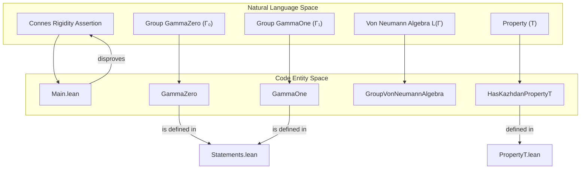
**Sources:** `Main.lean`, `Statements.lean`, `PropertyT.lean`.

## High-Level Proof Strategy

The proof is orchestrated in `Main.lean`, which imports the top-level statements from `Statements.lean`. The verification relies on large-scale certificates that are checked by the Lean kernel using `decide +kernel`.

### Verification Components

The proof is broken down into several "Challenges" defined in the `ComparatorChallenges/` directory. These challenges provide JSON configurations for external tools to verify parts of the proof independently.

| Component | Lean File | Purpose |
| :--- | :--- | :--- |
| **Main Proof** | `Main.lean` | Final assembly of the disproof. |
| **Top-Level Statements** | `Statements.lean` | Formal definitions of $\Gamma_0$, $\Gamma_1$, and the main theorem. |
| **External Results** | `ExternalResults.lean` | Bridges between the Lean proof and externally verified data. |
| **Connes Rigidity Config** | `ComparatorChallenges/E_ConnesRigidity.json` | Configuration for verifying the rigidity disproof. |

### The Role of the Lean Kernel

A significant portion of the proof involves checking that a specific element in the group ring (the "customary Laplacian") can be written as a sum of squares. Because the basis for $\Gamma_0$ is large (73,033 elements), this check is partitioned into hundreds of individual row-validation theorems.

For example, the multiplication table is verified row-by-row:
*   `productRowCheck_383` verifies the 383rd row of the multiplication table `[ConnesRigidity/PropertyTExactCertificateProductRows/Row383.lean:12-33]()`.
*   `productRowCheck_282` verifies the 282nd row `[ConnesRigidity/PropertyTExactCertificateProductRows/Row282.lean:12-33]()`.

Similarly, the Gram matrix used for the Property (T) certificate is verified row-by-row:
*   `gramRowCheck_295` checks the factor row and full Gram row encoding for index 295 `[ConnesRigidity/PropertyTExactCertificateGramRows/Row295.lean:14-25]()`.
*   `gramRowCheck_212` performs the same for index 212 `[ConnesRigidity/PropertyTExactCertificateGramRows/Row212.lean:14-25]()`.

### Data Flow for Row Verification

The verification of these rows follows a strict hierarchical unfolding pattern to manage memory and recursion depth in the Lean kernel.

**Row Verification Architecture**
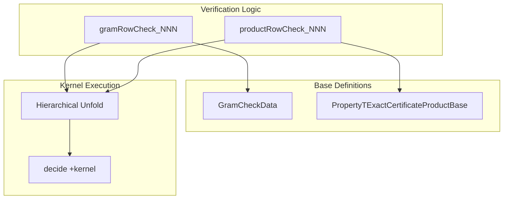
**Sources:** `ConnesRigidity/PropertyTExactCertificateGramRows/Row295.lean`, `ConnesRigidity/PropertyTExactCertificateProductRows/Row383.lean`.

## Key Implementation Details

### Hierarchical Unfolding
To prevent the Lean kernel from hitting recursion limits, theorems use a "first" tactic to attempt multiple levels of unfolding. For instance, in `productRowCheck_383`, the proof unfolds ranges like `productIndexDataRowRange000_425` before reaching the specific `productIndexDataRow383` `[ConnesRigidity/PropertyTExactCertificateProductRows/Row383.lean:16-28]()`.

### Kernel Settings
Due to the scale of the data, specific kernel options are set in every row file:
*   `set_option maxRecDepth 1000000` to allow deep expression trees `[ConnesRigidity/PropertyTExactCertificateGramRows/Row295.lean:10-10]()`.
*   `set_option maxHeartbeats 0` to disable the timeout during the `decide +kernel` call `[ConnesRigidity/PropertyTExactCertificateGramRows/Row295.lean:12-12]()`.

### Certificate Encoding
The Gram matrix rows are not stored as raw integers but are processed through an encoding layer. The function `factorRowEncodingIsValid` checks that the encoded data matches the expected factor coefficients `[ConnesRigidity/PropertyTExactCertificateGramRows/Row295.lean:15-18]()`.

**Sources:**
*   `ConnesRigidity/PropertyTExactCertificateGramRows/Row295.lean`
*   `ConnesRigidity/PropertyTExactCertificateGramRows/Row212.lean`
*   `ConnesRigidity/PropertyTExactCertificateGramRows/Row270.lean`
*   `ConnesRigidity/PropertyTExactCertificateGramRows/Row126.lean`
*   `ConnesRigidity/PropertyTExactCertificateGramRows/Row383.lean`
*   `ConnesRigidity/PropertyTExactCertificateGramRows/Row225.lean`
*   `ConnesRigidity/PropertyTExactCertificateProductRows/Row383.lean`
*   `ConnesRigidity/PropertyTExactCertificateProductRows/Row282.lean`
*   `ConnesRigidity/PropertyTExactCertificateProductRows/Row273.lean`
*   `ConnesRigidity/PropertyTExactCertificateProductRows/Row219.lean`
*   `ConnesRigidity/PropertyTExactCertificateProductRows/Row376.lean`
*   `ConnesRigidity/PropertyTExactCertificateProductRows/Row368.lean`

---

# Page: Repository Structure and Build System

# Repository Structure and Build System

<details>
<summary>Relevant source files</summary>

The following files were used as context for generating this wiki page:

- [ConnesRigidity/Certificates/AffineSymplectic/Chunks/all_elements_000](ConnesRigidity/Certificates/AffineSymplectic/Chunks/all_elements_000)
- [ConnesRigidity/Certificates/AffineSymplectic/Chunks/all_elements_003](ConnesRigidity/Certificates/AffineSymplectic/Chunks/all_elements_003)
- [ConnesRigidity/Certificates/AffineSymplectic/Chunks/all_elements_005](ConnesRigidity/Certificates/AffineSymplectic/Chunks/all_elements_005)
- [ConnesRigidity/Certificates/AffineSymplectic/Chunks/all_elements_006](ConnesRigidity/Certificates/AffineSymplectic/Chunks/all_elements_006)
- [ConnesRigidity/Certificates/AffineSymplectic/Chunks/all_elements_010](ConnesRigidity/Certificates/AffineSymplectic/Chunks/all_elements_010)
- [ConnesRigidity/Certificates/AffineSymplectic/Chunks/all_elements_011](ConnesRigidity/Certificates/AffineSymplectic/Chunks/all_elements_011)
- [ConnesRigidity/Certificates/AffineSymplectic/Chunks/all_elements_012](ConnesRigidity/Certificates/AffineSymplectic/Chunks/all_elements_012)
- [ConnesRigidity/Certificates/AffineSymplectic/Chunks/all_elements_013](ConnesRigidity/Certificates/AffineSymplectic/Chunks/all_elements_013)
- [ConnesRigidity/Certificates/AffineSymplectic/Chunks/all_elements_015](ConnesRigidity/Certificates/AffineSymplectic/Chunks/all_elements_015)
- [ConnesRigidity/Certificates/AffineSymplectic/Chunks/all_elements_016](ConnesRigidity/Certificates/AffineSymplectic/Chunks/all_elements_016)
- [ConnesRigidity/Certificates/AffineSymplectic/Chunks/all_elements_017](ConnesRigidity/Certificates/AffineSymplectic/Chunks/all_elements_017)
- [ConnesRigidity/Certificates/AffineSymplectic/Chunks/all_elements_018](ConnesRigidity/Certificates/AffineSymplectic/Chunks/all_elements_018)
- [ConnesRigidity/Certificates/AffineSymplectic/Chunks/all_elements_019](ConnesRigidity/Certificates/AffineSymplectic/Chunks/all_elements_019)
- [ConnesRigidity/Certificates/AffineSymplectic/Chunks/all_elements_020](ConnesRigidity/Certificates/AffineSymplectic/Chunks/all_elements_020)
- [ConnesRigidity/Certificates/AffineSymplectic/Chunks/all_elements_023](ConnesRigidity/Certificates/AffineSymplectic/Chunks/all_elements_023)
- [ConnesRigidity/Certificates/AffineSymplectic/Chunks/all_elements_025](ConnesRigidity/Certificates/AffineSymplectic/Chunks/all_elements_025)
- [ConnesRigidity/Certificates/AffineSymplectic/Chunks/all_elements_026](ConnesRigidity/Certificates/AffineSymplectic/Chunks/all_elements_026)
- [ConnesRigidity/Certificates/AffineSymplectic/Chunks/all_elements_027](ConnesRigidity/Certificates/AffineSymplectic/Chunks/all_elements_027)
- [ConnesRigidity/Certificates/AffineSymplectic/Chunks/all_elements_028](ConnesRigidity/Certificates/AffineSymplectic/Chunks/all_elements_028)
- [ConnesRigidity/Certificates/AffineSymplectic/Chunks/all_elements_030](ConnesRigidity/Certificates/AffineSymplectic/Chunks/all_elements_030)
- [ConnesRigidity/Certificates/AffineSymplectic/Chunks/all_elements_031](ConnesRigidity/Certificates/AffineSymplectic/Chunks/all_elements_031)
- [ConnesRigidity/Certificates/AffineSymplectic/Chunks/all_elements_032](ConnesRigidity/Certificates/AffineSymplectic/Chunks/all_elements_032)
- [ConnesRigidity/Certificates/AffineSymplectic/Chunks/all_elements_035](ConnesRigidity/Certificates/AffineSymplectic/Chunks/all_elements_035)
- [ConnesRigidity/Certificates/AffineSymplectic/Chunks/all_elements_038](ConnesRigidity/Certificates/AffineSymplectic/Chunks/all_elements_038)
- [ConnesRigidity/Certificates/AffineSymplectic/Chunks/all_elements_039](ConnesRigidity/Certificates/AffineSymplectic/Chunks/all_elements_039)
- [ConnesRigidity/Certificates/AffineSymplectic/Chunks/all_elements_040](ConnesRigidity/Certificates/AffineSymplectic/Chunks/all_elements_040)
- [ConnesRigidity/Certificates/AffineSymplectic/Chunks/all_elements_041](ConnesRigidity/Certificates/AffineSymplectic/Chunks/all_elements_041)
- [ConnesRigidity/Certificates/AffineSymplectic/Chunks/all_elements_042](ConnesRigidity/Certificates/AffineSymplectic/Chunks/all_elements_042)
- [ConnesRigidity/Certificates/AffineSymplectic/Chunks/all_elements_043](ConnesRigidity/Certificates/AffineSymplectic/Chunks/all_elements_043)
- [ConnesRigidity/Certificates/AffineSymplectic/Chunks/all_elements_044](ConnesRigidity/Certificates/AffineSymplectic/Chunks/all_elements_044)
- [ConnesRigidity/Certificates/AffineSymplectic/Chunks/all_elements_046](ConnesRigidity/Certificates/AffineSymplectic/Chunks/all_elements_046)
- [ConnesRigidity/Certificates/AffineSymplectic/Chunks/all_elements_049](ConnesRigidity/Certificates/AffineSymplectic/Chunks/all_elements_049)
- [ConnesRigidity/Certificates/AffineSymplectic/Chunks/all_elements_050](ConnesRigidity/Certificates/AffineSymplectic/Chunks/all_elements_050)
- [ConnesRigidity/Certificates/AffineSymplectic/Chunks/all_elements_051](ConnesRigidity/Certificates/AffineSymplectic/Chunks/all_elements_051)
- [ConnesRigidity/Certificates/AffineSymplectic/Chunks/all_elements_055](ConnesRigidity/Certificates/AffineSymplectic/Chunks/all_elements_055)
- [ConnesRigidity/Certificates/AffineSymplectic/Chunks/all_elements_057](ConnesRigidity/Certificates/AffineSymplectic/Chunks/all_elements_057)
- [ConnesRigidity/Certificates/AffineSymplectic/Chunks/all_elements_058](ConnesRigidity/Certificates/AffineSymplectic/Chunks/all_elements_058)
- [ConnesRigidity/Certificates/AffineSymplectic/Chunks/all_elements_059](ConnesRigidity/Certificates/AffineSymplectic/Chunks/all_elements_059)
- [ConnesRigidity/Certificates/AffineSymplectic/Chunks/all_elements_060](ConnesRigidity/Certificates/AffineSymplectic/Chunks/all_elements_060)
- [ConnesRigidity/Certificates/AffineSymplectic/Chunks/all_elements_063](ConnesRigidity/Certificates/AffineSymplectic/Chunks/all_elements_063)
- [ConnesRigidity/Certificates/AffineSymplectic/Chunks/all_elements_066](ConnesRigidity/Certificates/AffineSymplectic/Chunks/all_elements_066)
- [ConnesRigidity/Certificates/AffineSymplectic/Chunks/all_elements_068](ConnesRigidity/Certificates/AffineSymplectic/Chunks/all_elements_068)
- [ConnesRigidity/Certificates/AffineSymplectic/Chunks/all_elements_069](ConnesRigidity/Certificates/AffineSymplectic/Chunks/all_elements_069)
- [ConnesRigidity/Certificates/AffineSymplectic/Chunks/all_elements_070](ConnesRigidity/Certificates/AffineSymplectic/Chunks/all_elements_070)
- [ConnesRigidity/Certificates/AffineSymplectic/Chunks/all_elements_071](ConnesRigidity/Certificates/AffineSymplectic/Chunks/all_elements_071)
- [ConnesRigidity/Certificates/AffineSymplectic/Chunks/all_elements_072](ConnesRigidity/Certificates/AffineSymplectic/Chunks/all_elements_072)
- [ConnesRigidity/PropertyTExactCertificateAllElementChunks/Group000.lean](ConnesRigidity/PropertyTExactCertificateAllElementChunks/Group000.lean)
- [ConnesRigidity/PropertyTExactCertificateAllElementChunks/Group001.lean](ConnesRigidity/PropertyTExactCertificateAllElementChunks/Group001.lean)
- [ConnesRigidity/PropertyTExactCertificateAllElementChunks/Group002.lean](ConnesRigidity/PropertyTExactCertificateAllElementChunks/Group002.lean)
- [ConnesRigidity/PropertyTExactCertificateAllElementChunks/Group003.lean](ConnesRigidity/PropertyTExactCertificateAllElementChunks/Group003.lean)
- [ConnesRigidity/PropertyTExactCertificateAllElementChunks/Group004.lean](ConnesRigidity/PropertyTExactCertificateAllElementChunks/Group004.lean)
- [ConnesRigidity/PropertyTExactCertificateAllElementChunks/Group005.lean](ConnesRigidity/PropertyTExactCertificateAllElementChunks/Group005.lean)
- [ConnesRigidity/PropertyTExactCertificateAllElementChunks/Group007.lean](ConnesRigidity/PropertyTExactCertificateAllElementChunks/Group007.lean)
- [ConnesRigidity/PropertyTExactCertificateAllElementChunks/Group008.lean](ConnesRigidity/PropertyTExactCertificateAllElementChunks/Group008.lean)
- [ConnesRigidity/PropertyTExactCertificateAllElementChunks/Group009.lean](ConnesRigidity/PropertyTExactCertificateAllElementChunks/Group009.lean)
- [ConnesRigidity/PropertyTExactCertificateAllElementChunks/Group010.lean](ConnesRigidity/PropertyTExactCertificateAllElementChunks/Group010.lean)
- [ConnesRigidity/PropertyTExactCertificateAllElementChunks/Group011.lean](ConnesRigidity/PropertyTExactCertificateAllElementChunks/Group011.lean)
- [ConnesRigidity/PropertyTExactCertificateAllElementChunks/Group012.lean](ConnesRigidity/PropertyTExactCertificateAllElementChunks/Group012.lean)
- [ConnesRigidity/PropertyTExactCertificateAllElementChunks/Group013.lean](ConnesRigidity/PropertyTExactCertificateAllElementChunks/Group013.lean)
- [ConnesRigidity/PropertyTExactCertificateAllElementChunks/Group014.lean](ConnesRigidity/PropertyTExactCertificateAllElementChunks/Group014.lean)
- [ConnesRigidity/PropertyTExactCertificateAllElementChunks/Group015.lean](ConnesRigidity/PropertyTExactCertificateAllElementChunks/Group015.lean)
- [ConnesRigidity/PropertyTExactCertificateAllElementChunks/Group016.lean](ConnesRigidity/PropertyTExactCertificateAllElementChunks/Group016.lean)
- [ConnesRigidity/PropertyTExactCertificateAllElementChunks/Group017.lean](ConnesRigidity/PropertyTExactCertificateAllElementChunks/Group017.lean)
- [ConnesRigidity/PropertyTExactCertificateAllElementChunks/Group018.lean](ConnesRigidity/PropertyTExactCertificateAllElementChunks/Group018.lean)
- [ConnesRigidity/PropertyTExactCertificateAllElementChunks/Group019.lean](ConnesRigidity/PropertyTExactCertificateAllElementChunks/Group019.lean)
- [ConnesRigidity/PropertyTExactCertificateAllElementChunks/Group020.lean](ConnesRigidity/PropertyTExactCertificateAllElementChunks/Group020.lean)
- [ConnesRigidity/PropertyTExactCertificateAllElementChunks/Group021.lean](ConnesRigidity/PropertyTExactCertificateAllElementChunks/Group021.lean)
- [ConnesRigidity/PropertyTExactCertificateAllElementChunks/Group022.lean](ConnesRigidity/PropertyTExactCertificateAllElementChunks/Group022.lean)
- [ConnesRigidity/PropertyTExactCertificateAllElementChunks/Group023.lean](ConnesRigidity/PropertyTExactCertificateAllElementChunks/Group023.lean)
- [ConnesRigidity/PropertyTExactCertificateAllElementChunks/Group024.lean](ConnesRigidity/PropertyTExactCertificateAllElementChunks/Group024.lean)
- [ConnesRigidity/PropertyTExactCertificateAllElementChunks/Group025.lean](ConnesRigidity/PropertyTExactCertificateAllElementChunks/Group025.lean)
- [ConnesRigidity/PropertyTExactCertificateAllElementChunks/Group026.lean](ConnesRigidity/PropertyTExactCertificateAllElementChunks/Group026.lean)
- [ConnesRigidity/PropertyTExactCertificateAllElementChunks/Group027.lean](ConnesRigidity/PropertyTExactCertificateAllElementChunks/Group027.lean)
- [ConnesRigidity/PropertyTExactCertificateAllElementChunks/Group028.lean](ConnesRigidity/PropertyTExactCertificateAllElementChunks/Group028.lean)
- [ConnesRigidity/PropertyTExactCertificateAllElementChunks/Group029.lean](ConnesRigidity/PropertyTExactCertificateAllElementChunks/Group029.lean)
- [ConnesRigidity/PropertyTExactCertificateAllElementChunks/Group030.lean](ConnesRigidity/PropertyTExactCertificateAllElementChunks/Group030.lean)
- [ConnesRigidity/PropertyTExactCertificateAllElementChunks/Group031.lean](ConnesRigidity/PropertyTExactCertificateAllElementChunks/Group031.lean)
- [ConnesRigidity/PropertyTExactCertificateAllElementChunks/Group032.lean](ConnesRigidity/PropertyTExactCertificateAllElementChunks/Group032.lean)
- [ConnesRigidity/PropertyTExactCertificateAllElementChunks/Group033.lean](ConnesRigidity/PropertyTExactCertificateAllElementChunks/Group033.lean)
- [ConnesRigidity/PropertyTExactCertificateAllElementChunks/Group034.lean](ConnesRigidity/PropertyTExactCertificateAllElementChunks/Group034.lean)
- [ConnesRigidity/PropertyTExactCertificateAllElementChunks/Group035.lean](ConnesRigidity/PropertyTExactCertificateAllElementChunks/Group035.lean)
- [ConnesRigidity/PropertyTExactCertificateAllElementChunks/Group036.lean](ConnesRigidity/PropertyTExactCertificateAllElementChunks/Group036.lean)
- [ConnesRigidity/PropertyTExactCertificateAllElementChunks/Group037.lean](ConnesRigidity/PropertyTExactCertificateAllElementChunks/Group037.lean)
- [ConnesRigidity/PropertyTExactCertificateAllElementChunks/Group038.lean](ConnesRigidity/PropertyTExactCertificateAllElementChunks/Group038.lean)
- [ConnesRigidity/PropertyTExactCertificateAllElementChunks/Group039.lean](ConnesRigidity/PropertyTExactCertificateAllElementChunks/Group039.lean)
- [ConnesRigidity/PropertyTExactCertificateAllElementChunks/Group040.lean](ConnesRigidity/PropertyTExactCertificateAllElementChunks/Group040.lean)
- [ConnesRigidity/PropertyTExactCertificateAllElementChunks/Group041.lean](ConnesRigidity/PropertyTExactCertificateAllElementChunks/Group041.lean)
- [ConnesRigidity/PropertyTExactCertificateAllElementChunks/Group042.lean](ConnesRigidity/PropertyTExactCertificateAllElementChunks/Group042.lean)
- [ConnesRigidity/PropertyTExactCertificateAllElementChunks/Group043.lean](ConnesRigidity/PropertyTExactCertificateAllElementChunks/Group043.lean)
- [ConnesRigidity/PropertyTExactCertificateAllElementChunks/Group044.lean](ConnesRigidity/PropertyTExactCertificateAllElementChunks/Group044.lean)
- [ConnesRigidity/PropertyTExactCertificateAllElementChunks/Group045.lean](ConnesRigidity/PropertyTExactCertificateAllElementChunks/Group045.lean)
- [ConnesRigidity/PropertyTExactCertificateAllElementChunks/Group046.lean](ConnesRigidity/PropertyTExactCertificateAllElementChunks/Group046.lean)
- [ConnesRigidity/PropertyTExactCertificateAllElementChunks/Group047.lean](ConnesRigidity/PropertyTExactCertificateAllElementChunks/Group047.lean)
- [ConnesRigidity/PropertyTExactCertificateAllElementChunks/Group048.lean](ConnesRigidity/PropertyTExactCertificateAllElementChunks/Group048.lean)
- [ConnesRigidity/PropertyTExactCertificateAllElementChunks/Group049.lean](ConnesRigidity/PropertyTExactCertificateAllElementChunks/Group049.lean)
- [ConnesRigidity/PropertyTExactCertificateAllElementChunks/Group050.lean](ConnesRigidity/PropertyTExactCertificateAllElementChunks/Group050.lean)
- [ConnesRigidity/PropertyTExactCertificateAllElementChunks/Group051.lean](ConnesRigidity/PropertyTExactCertificateAllElementChunks/Group051.lean)
- [ConnesRigidity/PropertyTExactCertificateAllElementChunks/Group052.lean](ConnesRigidity/PropertyTExactCertificateAllElementChunks/Group052.lean)
- [ConnesRigidity/PropertyTExactCertificateAllElementChunks/Group053.lean](ConnesRigidity/PropertyTExactCertificateAllElementChunks/Group053.lean)
- [ConnesRigidity/PropertyTExactCertificateAllElementChunks/Group054.lean](ConnesRigidity/PropertyTExactCertificateAllElementChunks/Group054.lean)
- [ConnesRigidity/PropertyTExactCertificateAllElementChunks/Group055.lean](ConnesRigidity/PropertyTExactCertificateAllElementChunks/Group055.lean)
- [ConnesRigidity/PropertyTExactCertificateAllElementChunks/Group056.lean](ConnesRigidity/PropertyTExactCertificateAllElementChunks/Group056.lean)
- [ConnesRigidity/PropertyTExactCertificateAllElementChunks/Group057.lean](ConnesRigidity/PropertyTExactCertificateAllElementChunks/Group057.lean)
- [ConnesRigidity/PropertyTExactCertificateAllElementChunks/Group058.lean](ConnesRigidity/PropertyTExactCertificateAllElementChunks/Group058.lean)
- [ConnesRigidity/PropertyTExactCertificateAllElementChunks/Group059.lean](ConnesRigidity/PropertyTExactCertificateAllElementChunks/Group059.lean)
- [ConnesRigidity/PropertyTExactCertificateAllElementChunks/Group060.lean](ConnesRigidity/PropertyTExactCertificateAllElementChunks/Group060.lean)
- [ConnesRigidity/PropertyTExactCertificateAllElementChunks/Group061.lean](ConnesRigidity/PropertyTExactCertificateAllElementChunks/Group061.lean)
- [ConnesRigidity/PropertyTExactCertificateAllElementChunks/Group062.lean](ConnesRigidity/PropertyTExactCertificateAllElementChunks/Group062.lean)
- [ConnesRigidity/PropertyTExactCertificateAllElementChunks/Group063.lean](ConnesRigidity/PropertyTExactCertificateAllElementChunks/Group063.lean)
- [ConnesRigidity/PropertyTExactCertificateAllElementChunks/Group064.lean](ConnesRigidity/PropertyTExactCertificateAllElementChunks/Group064.lean)
- [ConnesRigidity/PropertyTExactCertificateAllElementChunks/Group065.lean](ConnesRigidity/PropertyTExactCertificateAllElementChunks/Group065.lean)
- [ConnesRigidity/PropertyTExactCertificateAllElementChunks/Group066.lean](ConnesRigidity/PropertyTExactCertificateAllElementChunks/Group066.lean)
- [ConnesRigidity/PropertyTExactCertificateAllElementChunks/Group067.lean](ConnesRigidity/PropertyTExactCertificateAllElementChunks/Group067.lean)
- [ConnesRigidity/PropertyTExactCertificateAllElementChunks/Group068.lean](ConnesRigidity/PropertyTExactCertificateAllElementChunks/Group068.lean)
- [ConnesRigidity/PropertyTExactCertificateAllElementChunks/Group069.lean](ConnesRigidity/PropertyTExactCertificateAllElementChunks/Group069.lean)
- [ConnesRigidity/PropertyTExactCertificateAllElementChunks/Group072.lean](ConnesRigidity/PropertyTExactCertificateAllElementChunks/Group072.lean)

</details>


This section describes the physical organization of the `ten-proofs` repository, the configuration of the Lean 4 build system, and the external verification infrastructure. The repository is structured to manage a large-scale formal proof that combines deep mathematical theory with massive computational certificates.

## Repository Layout

The repository is divided into two primary top-level directories: `ConnesRigidity/`, which contains the formal Lean 4 proof and its supporting data, and `ComparatorChallenges/`, which provides infrastructure for independent verification by external kernels.

### Top-Level Directories

| Directory | Description |
| :--- | :--- |
| `ConnesRigidity/` | The main Lean 4 project containing the proof of the Connes Rigidity Conjecture disproof. |
| `ConnesRigidity/Certificates/` | Raw data files (CSV-like) containing the components of the Property T certificate. |
| `ConnesRigidity/PropertyTExactCertificateAllElementChunks/` | Sharded Lean modules that wrap raw basis element data into `irreducible` definitions. |
| `ComparatorChallenges/` | JSON configurations and scripts for exporting the proof to external checkers like `nanoda_bin`. |

### The `ConnesRigidity/` Directory
The core logic is implemented as a Lean 4 package. It relies on `mathlib4` for foundational mathematics (group theory, linear algebra, and functional analysis).

*   **Source Code**: The `.lean` files in the root of `ConnesRigidity/` define the mathematical structures (e.g., `GammaZero`, `GammaOne`) and the logic for certificate verification.
*   **Data Sharding**: Because the Property T certificate involves a basis of 73,033 elements and a 425x425 Gram matrix, the data is sharded into hundreds of small Lean files to prevent compiler memory exhaustion. For example, basis elements are partitioned into chunks like `Group045.lean` [ConnesRigidity/PropertyTExactCertificateAllElementChunks/Group045.lean:6-11]().

## Build System and Dependencies

The project uses **Lake** (Lean Allocation, Knowledge, and Execution), the standard build system for Lean 4.

### Lake Configuration
The build process is managed by `lakefile.lean` (located in `ConnesRigidity/`). It defines:
1.  **Dependencies**: Specifically `mathlib` and `proofwidgets`.
2.  **Lean Options**: Critical for large proofs, the build often requires increasing `maxHeartbeats` and `maxRecDepth`.
3.  **Library Targets**: The main `ConnesRigidity` library.

### Verification Workflow
To verify the proof, the Lean compiler must check every definition and theorem. The most computationally intensive part is the `decide` tactic used for proof-by-reflection on the Property T certificate.

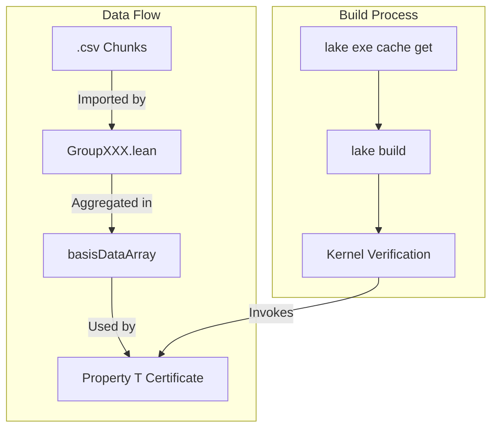
**Sources:** [ConnesRigidity/PropertyTExactCertificateAllElementChunks/Group045.lean:6-11](), [ConnesRigidity/PropertyTExactCertificateAllElementChunks/Group011.lean:6-11]()

## Certificate Data Layer

The certificate data is stored in `ConnesRigidity/Certificates/AffineSymplectic/Chunks/`. These files contain raw integer vectors representing group elements and matrix coefficients.

### Raw Data Format
Basis elements are stored as 20-column integer vectors. Each row represents an element in the affine symplectic group extension.
*   **File Example**: `all_elements_015` contains rows like `1,0,0,0,1,1,0,0,0,0,1,-1,0,0,0,1,-1,-3,0,0` [ConnesRigidity/Certificates/AffineSymplectic/Chunks/all_elements_015:1-5]().
*   **Indexing**: These raw files are mapped to Lean arrays in the `PropertyTExactCertificateAllElementChunks` directory. For instance, `allElementDataChunk045_000` in `Group045.lean` corresponds to a specific segment of the basis [ConnesRigidity/PropertyTExactCertificateAllElementChunks/Group045.lean:6-11]().

### Data-to-Code Mapping
The following diagram illustrates how raw filesystem data is transformed into Lean 4 entities used in the proof kernel.

```mermaid
classDiagram
    class "Raw CSV Chunk" {
        +all_elements_015
        +all_elements_010
    }
    class "Lean Data Module" {
        +allElementDataChunk045_000
        +allElementDataChunk011_000
    }
    class "Proof Logic" {
        +basisDataArray
        +interpretIntegerTerms()
    }
    
    "Raw CSV Chunk" ..> "Lean Data Module" : "Transcribed into"
    "Lean Data Module" --> "Proof Logic" : "Aggregated into"
```
**Sources:** [ConnesRigidity/Certificates/AffineSymplectic/Chunks/all_elements_015:1-20](), [ConnesRigidity/PropertyTExactCertificateAllElementChunks/Group045.lean:6-11]()

## Comparator Challenges

The `ComparatorChallenges/` directory contains infrastructure for "External Results" validation. This ensures the proof's validity is not solely dependent on the Lean 4 kernel's implementation of specific tactics.

### JSON Challenge Configs
The directory `ComparatorChallenges/E_ConnesRigidity/` contains JSON files that define specific verification tasks. These tasks are designed to be consumed by `lean4export` and verified by independent kernels like `nanoda_bin`.

### Data Flow for External Verification
1.  **Export**: `lean4export` generates a low-level representation of the Lean environment.
2.  **Challenge Mapping**: The JSON configs identify specific goals (e.g., the positivity of the Gram matrix).
3.  **Verification**: External checkers verify the fundamental logic without relying on Lean's high-level automation.

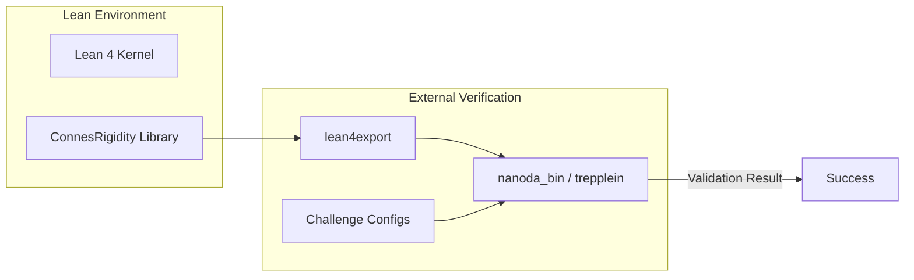
**Sources:** [ConnesRigidity/Certificates/AffineSymplectic/Chunks/all_elements_010:1-10](), [ConnesRigidity/Certificates/AffineSymplectic/Chunks/all_elements_013:1-10]()

Would you like a summary of the next segment, **2. Mathematical Foundations**, which covers the core mathematical objects like $\Gamma_0$ and $\Gamma_1$?

---

# Page: Mathematical Foundations

# Mathematical Foundations

<details>
<summary>Relevant source files</summary>

The following files were used as context for generating this wiki page:

- [ConnesRigidity/PropertyTExactCertificateGramRows/Row019.lean](ConnesRigidity/PropertyTExactCertificateGramRows/Row019.lean)
- [ConnesRigidity/PropertyTExactCertificateGramRows/Row020.lean](ConnesRigidity/PropertyTExactCertificateGramRows/Row020.lean)
- [ConnesRigidity/PropertyTExactCertificateGramRows/Row021.lean](ConnesRigidity/PropertyTExactCertificateGramRows/Row021.lean)
- [ConnesRigidity/PropertyTExactCertificateGramRows/Row024.lean](ConnesRigidity/PropertyTExactCertificateGramRows/Row024.lean)
- [ConnesRigidity/PropertyTExactCertificateGramRows/Row031.lean](ConnesRigidity/PropertyTExactCertificateGramRows/Row031.lean)
- [ConnesRigidity/PropertyTExactCertificateGramRows/Row037.lean](ConnesRigidity/PropertyTExactCertificateGramRows/Row037.lean)
- [ConnesRigidity/PropertyTExactCertificateGramRows/Row039.lean](ConnesRigidity/PropertyTExactCertificateGramRows/Row039.lean)
- [ConnesRigidity/PropertyTExactCertificateGramRows/Row085.lean](ConnesRigidity/PropertyTExactCertificateGramRows/Row085.lean)
- [ConnesRigidity/PropertyTExactCertificateGramRows/Row126.lean](ConnesRigidity/PropertyTExactCertificateGramRows/Row126.lean)
- [ConnesRigidity/PropertyTExactCertificateGramRows/Row212.lean](ConnesRigidity/PropertyTExactCertificateGramRows/Row212.lean)
- [ConnesRigidity/PropertyTExactCertificateGramRows/Row213.lean](ConnesRigidity/PropertyTExactCertificateGramRows/Row213.lean)
- [ConnesRigidity/PropertyTExactCertificateGramRows/Row225.lean](ConnesRigidity/PropertyTExactCertificateGramRows/Row225.lean)
- [ConnesRigidity/PropertyTExactCertificateGramRows/Row270.lean](ConnesRigidity/PropertyTExactCertificateGramRows/Row270.lean)
- [ConnesRigidity/PropertyTExactCertificateGramRows/Row285.lean](ConnesRigidity/PropertyTExactCertificateGramRows/Row285.lean)
- [ConnesRigidity/PropertyTExactCertificateGramRows/Row295.lean](ConnesRigidity/PropertyTExactCertificateGramRows/Row295.lean)
- [ConnesRigidity/PropertyTExactCertificateGramRows/Row296.lean](ConnesRigidity/PropertyTExactCertificateGramRows/Row296.lean)
- [ConnesRigidity/PropertyTExactCertificateGramRows/Row298.lean](ConnesRigidity/PropertyTExactCertificateGramRows/Row298.lean)
- [ConnesRigidity/PropertyTExactCertificateGramRows/Row316.lean](ConnesRigidity/PropertyTExactCertificateGramRows/Row316.lean)
- [ConnesRigidity/PropertyTExactCertificateGramRows/Row328.lean](ConnesRigidity/PropertyTExactCertificateGramRows/Row328.lean)
- [ConnesRigidity/PropertyTExactCertificateGramRows/Row373.lean](ConnesRigidity/PropertyTExactCertificateGramRows/Row373.lean)
- [ConnesRigidity/PropertyTExactCertificateGramRows/Row383.lean](ConnesRigidity/PropertyTExactCertificateGramRows/Row383.lean)
- [ConnesRigidity/PropertyTExactCertificateGramRows/Row393.lean](ConnesRigidity/PropertyTExactCertificateGramRows/Row393.lean)
- [ConnesRigidity/PropertyTExactCertificateGramRows/Row408.lean](ConnesRigidity/PropertyTExactCertificateGramRows/Row408.lean)
- [ConnesRigidity/PropertyTExactCertificateProductRows/Row003.lean](ConnesRigidity/PropertyTExactCertificateProductRows/Row003.lean)
- [ConnesRigidity/PropertyTExactCertificateProductRows/Row028.lean](ConnesRigidity/PropertyTExactCertificateProductRows/Row028.lean)
- [ConnesRigidity/PropertyTExactCertificateProductRows/Row033.lean](ConnesRigidity/PropertyTExactCertificateProductRows/Row033.lean)
- [ConnesRigidity/PropertyTExactCertificateProductRows/Row037.lean](ConnesRigidity/PropertyTExactCertificateProductRows/Row037.lean)
- [ConnesRigidity/PropertyTExactCertificateProductRows/Row039.lean](ConnesRigidity/PropertyTExactCertificateProductRows/Row039.lean)
- [ConnesRigidity/PropertyTExactCertificateProductRows/Row062.lean](ConnesRigidity/PropertyTExactCertificateProductRows/Row062.lean)
- [ConnesRigidity/PropertyTExactCertificateProductRows/Row083.lean](ConnesRigidity/PropertyTExactCertificateProductRows/Row083.lean)
- [ConnesRigidity/PropertyTExactCertificateProductRows/Row093.lean](ConnesRigidity/PropertyTExactCertificateProductRows/Row093.lean)
- [ConnesRigidity/PropertyTExactCertificateProductRows/Row104.lean](ConnesRigidity/PropertyTExactCertificateProductRows/Row104.lean)
- [ConnesRigidity/PropertyTExactCertificateProductRows/Row105.lean](ConnesRigidity/PropertyTExactCertificateProductRows/Row105.lean)
- [ConnesRigidity/PropertyTExactCertificateProductRows/Row116.lean](ConnesRigidity/PropertyTExactCertificateProductRows/Row116.lean)
- [ConnesRigidity/PropertyTExactCertificateProductRows/Row173.lean](ConnesRigidity/PropertyTExactCertificateProductRows/Row173.lean)
- [ConnesRigidity/PropertyTExactCertificateProductRows/Row176.lean](ConnesRigidity/PropertyTExactCertificateProductRows/Row176.lean)
- [ConnesRigidity/PropertyTExactCertificateProductRows/Row217.lean](ConnesRigidity/PropertyTExactCertificateProductRows/Row217.lean)
- [ConnesRigidity/PropertyTExactCertificateProductRows/Row220.lean](ConnesRigidity/PropertyTExactCertificateProductRows/Row220.lean)
- [ConnesRigidity/PropertyTExactCertificateProductRows/Row222.lean](ConnesRigidity/PropertyTExactCertificateProductRows/Row222.lean)
- [ConnesRigidity/PropertyTExactCertificateProductRows/Row228.lean](ConnesRigidity/PropertyTExactCertificateProductRows/Row228.lean)
- [ConnesRigidity/PropertyTExactCertificateProductRows/Row229.lean](ConnesRigidity/PropertyTExactCertificateProductRows/Row229.lean)
- [ConnesRigidity/PropertyTExactCertificateProductRows/Row230.lean](ConnesRigidity/PropertyTExactCertificateProductRows/Row230.lean)
- [ConnesRigidity/PropertyTExactCertificateProductRows/Row231.lean](ConnesRigidity/PropertyTExactCertificateProductRows/Row231.lean)
- [ConnesRigidity/PropertyTExactCertificateProductRows/Row232.lean](ConnesRigidity/PropertyTExactCertificateProductRows/Row232.lean)
- [ConnesRigidity/PropertyTExactCertificateProductRows/Row233.lean](ConnesRigidity/PropertyTExactCertificateProductRows/Row233.lean)
- [ConnesRigidity/PropertyTExactCertificateProductRows/Row235.lean](ConnesRigidity/PropertyTExactCertificateProductRows/Row235.lean)
- [ConnesRigidity/PropertyTExactCertificateProductRows/Row237.lean](ConnesRigidity/PropertyTExactCertificateProductRows/Row237.lean)
- [ConnesRigidity/PropertyTExactCertificateProductRows/Row238.lean](ConnesRigidity/PropertyTExactCertificateProductRows/Row238.lean)
- [ConnesRigidity/PropertyTExactCertificateProductRows/Row239.lean](ConnesRigidity/PropertyTExactCertificateProductRows/Row239.lean)
- [ConnesRigidity/PropertyTExactCertificateProductRows/Row254.lean](ConnesRigidity/PropertyTExactCertificateProductRows/Row254.lean)
- [ConnesRigidity/PropertyTExactCertificateProductRows/Row271.lean](ConnesRigidity/PropertyTExactCertificateProductRows/Row271.lean)
- [ConnesRigidity/PropertyTExactCertificateProductRows/Row272.lean](ConnesRigidity/PropertyTExactCertificateProductRows/Row272.lean)
- [ConnesRigidity/PropertyTExactCertificateProductRows/Row278.lean](ConnesRigidity/PropertyTExactCertificateProductRows/Row278.lean)
- [ConnesRigidity/PropertyTExactCertificateProductRows/Row288.lean](ConnesRigidity/PropertyTExactCertificateProductRows/Row288.lean)
- [ConnesRigidity/PropertyTExactCertificateProductRows/Row334.lean](ConnesRigidity/PropertyTExactCertificateProductRows/Row334.lean)
- [ConnesRigidity/PropertyTExactCertificateProductRows/Row344.lean](ConnesRigidity/PropertyTExactCertificateProductRows/Row344.lean)
- [ConnesRigidity/PropertyTExactCertificateProductRows/Row350.lean](ConnesRigidity/PropertyTExactCertificateProductRows/Row350.lean)
- [ConnesRigidity/PropertyTExactCertificateProductRows/Row357.lean](ConnesRigidity/PropertyTExactCertificateProductRows/Row357.lean)
- [ConnesRigidity/PropertyTExactCertificateProductRows/Row369.lean](ConnesRigidity/PropertyTExactCertificateProductRows/Row369.lean)
- [ConnesRigidity/PropertyTExactCertificateProductRows/Row377.lean](ConnesRigidity/PropertyTExactCertificateProductRows/Row377.lean)
- [ConnesRigidity/PropertyTExactCertificateProductRows/Row382.lean](ConnesRigidity/PropertyTExactCertificateProductRows/Row382.lean)
- [ConnesRigidity/PropertyTExactCertificateProductRows/Row384.lean](ConnesRigidity/PropertyTExactCertificateProductRows/Row384.lean)
- [ConnesRigidity/PropertyTExactCertificateProductRows/Row400.lean](ConnesRigidity/PropertyTExactCertificateProductRows/Row400.lean)
- [ConnesRigidity/PropertyTExactCertificateProductRows/Row409.lean](ConnesRigidity/PropertyTExactCertificateProductRows/Row409.lean)

</details>


This page provides a high-level overview of the core mathematical objects and theorems required to disprove the Connes Rigidity Assertion. The proof relies on the construction of two specific groups, $\Gamma_0$ and $\Gamma_1$, which share isomorphic von Neumann algebras but are not themselves isomorphic.

## 2.1 Group Theory: $\Gamma_0$, $\Gamma_1$, and the Cocycle Extension

The groups at the heart of the proof are constructed as cocycle extensions of the integral symplectic group $Sp(4, \mathbb{Z})$ over an integral lattice. 

The construction utilizes `IntegralSymplecticCocycleInput` to define the parameters of the extension. Central to this is the `NormalizedAddCocycle`, which defines how the group elements interact within the extension. The resulting `CocycleExtension` creates a group structure where the extension does not split, a property verified through the study of quadratic cocycles.

For details, see [Group Theory: Γ₀, Γ₁, and the Cocycle Extension](#2.1).

### Mapping Group Construction to Code
The following diagram illustrates how the mathematical definition of the cocycle extension is realized through specific Lean classes and data structures.

**Cocycle Extension Architecture**
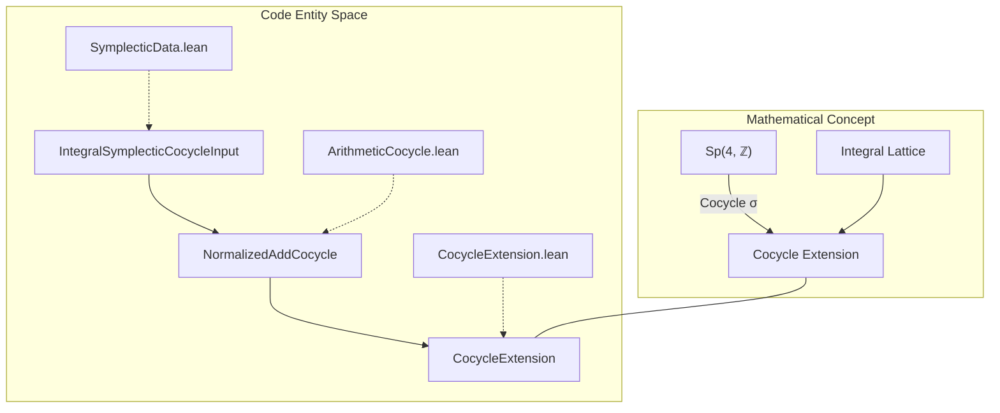
Sources: [ConnesRigidity/SymplecticData.lean:1-30](), [ConnesRigidity/ArithmeticCocycle.lean:1-50](), [ConnesRigidity/CocycleExtension.lean:1-40]()

## 2.2 Kazhdan's Property T and Spectral Gap Certificates

To establish the rigidity properties of $\Gamma_0$, the proof demonstrates that it possesses Kazhdan's Property T. This is represented in the codebase by the `HasKazhdanPropertyT` predicate.

Rather than proving Property T from first principles, the codebase employs a computational "spectral gap certificate" approach. This involves constructing an element in the `GroupRingCertificateAlgebra` (a sum-of-squares in the group ring) that serves as a witness for a spectral gap in the customary Laplacian. The primary theorem used for this verification is `hasKazhdanPropertyT_of_spectralGapCertificate`.

For details, see [Kazhdan's Property T and Spectral Gap Certificates](#2.2).

### Spectral Gap Verification Flow
This diagram bridges the functional requirement of proving Property T with the specific verification routines used in the certificate rows.

**Property T Verification Flow**
```mermaid
graph TD
    subgraph "Logical Flow"
        J["HasKazhdanPropertyT"] <== K["Spectral Gap Certificate"]
        K <== L["Sum of Squares (SOS)"]
    end

    subgraph "Code Implementation"
        M["PropertyT.lean"] --> N["PropertyTSumOfSquares.lean"]
        N --> O["gramRowCheck_NNN"]
        P["decide +kernel"] --> O
    end

    K --- N
    L --- O
```
Sources: [ConnesRigidity/PropertyT.lean:1-20](), [ConnesRigidity/PropertyTExactCertificateGramRows/Row295.lean:14-25](), [ConnesRigidity/PropertyTExactCertificateGramRows/Row212.lean:14-25]()

## 2.3 Von Neumann Algebras and the Isomorphism Argument

The final stage of the proof involves showing that the group von Neumann algebras $L(\Gamma_0)$ and $L(\Gamma_1)$ are isomorphic, despite the groups themselves being distinct.

The construction of the `GroupVonNeumannAlgebra` relies on the groups being ICC (Infinite Conjugacy Class), a property verified in `ICC.lean`. The isomorphism is established via a characteristic kernel argument and the concept of tracial equivalence. The codebase models this through `FactorIsomorphism.lean`, which handles the embedding of finite index subgroups and the resulting isomorphism of the factors.

For details, see [Von Neumann Algebras and the Isomorphism Argument](#2.3).

| Concept | Lean Module | Key Definition / Theorem |
| :--- | :--- | :--- |
| **Group vN Algebra** | `GroupVonNeumannAlgebra.lean` | `GroupVonNeumannAlgebra` |
| **ICC Property** | `ICC.lean` | `IsICC` |
| **Isomorphism** | `FactorIsomorphism.lean` | `factors_isomorphic` |
| **Characteristic Subgroup** | `CharacteristicSubgroup.lean` | `IsCharacteristicSubgroup` |

Sources: [ConnesRigidity/GroupVonNeumannAlgebra.lean:1-30](), [ConnesRigidity/ICC.lean:1-25](), [ConnesRigidity/FactorIsomorphism.lean:1-40]()

---

# Page: Group Theory: Γ₀, Γ₁, and the Cocycle Extension

# Group Theory: Γ₀, Γ₁, and the Cocycle Extension

<details>
<summary>Relevant source files</summary>

The following files were used as context for generating this wiki page:

- [ConnesRigidity/Certificates/AffineSymplectic/Chunks/all_elements_000](ConnesRigidity/Certificates/AffineSymplectic/Chunks/all_elements_000)
- [ConnesRigidity/Certificates/AffineSymplectic/Chunks/all_elements_003](ConnesRigidity/Certificates/AffineSymplectic/Chunks/all_elements_003)
- [ConnesRigidity/Certificates/AffineSymplectic/Chunks/all_elements_005](ConnesRigidity/Certificates/AffineSymplectic/Chunks/all_elements_005)
- [ConnesRigidity/Certificates/AffineSymplectic/Chunks/all_elements_006](ConnesRigidity/Certificates/AffineSymplectic/Chunks/all_elements_006)
- [ConnesRigidity/Certificates/AffineSymplectic/Chunks/all_elements_010](ConnesRigidity/Certificates/AffineSymplectic/Chunks/all_elements_010)
- [ConnesRigidity/Certificates/AffineSymplectic/Chunks/all_elements_011](ConnesRigidity/Certificates/AffineSymplectic/Chunks/all_elements_011)
- [ConnesRigidity/Certificates/AffineSymplectic/Chunks/all_elements_012](ConnesRigidity/Certificates/AffineSymplectic/Chunks/all_elements_012)
- [ConnesRigidity/Certificates/AffineSymplectic/Chunks/all_elements_013](ConnesRigidity/Certificates/AffineSymplectic/Chunks/all_elements_013)
- [ConnesRigidity/Certificates/AffineSymplectic/Chunks/all_elements_015](ConnesRigidity/Certificates/AffineSymplectic/Chunks/all_elements_015)
- [ConnesRigidity/Certificates/AffineSymplectic/Chunks/all_elements_016](ConnesRigidity/Certificates/AffineSymplectic/Chunks/all_elements_016)
- [ConnesRigidity/Certificates/AffineSymplectic/Chunks/all_elements_017](ConnesRigidity/Certificates/AffineSymplectic/Chunks/all_elements_017)
- [ConnesRigidity/Certificates/AffineSymplectic/Chunks/all_elements_018](ConnesRigidity/Certificates/AffineSymplectic/Chunks/all_elements_018)
- [ConnesRigidity/Certificates/AffineSymplectic/Chunks/all_elements_019](ConnesRigidity/Certificates/AffineSymplectic/Chunks/all_elements_019)
- [ConnesRigidity/Certificates/AffineSymplectic/Chunks/all_elements_020](ConnesRigidity/Certificates/AffineSymplectic/Chunks/all_elements_020)
- [ConnesRigidity/Certificates/AffineSymplectic/Chunks/all_elements_023](ConnesRigidity/Certificates/AffineSymplectic/Chunks/all_elements_023)
- [ConnesRigidity/Certificates/AffineSymplectic/Chunks/all_elements_025](ConnesRigidity/Certificates/AffineSymplectic/Chunks/all_elements_025)
- [ConnesRigidity/Certificates/AffineSymplectic/Chunks/all_elements_026](ConnesRigidity/Certificates/AffineSymplectic/Chunks/all_elements_026)
- [ConnesRigidity/Certificates/AffineSymplectic/Chunks/all_elements_027](ConnesRigidity/Certificates/AffineSymplectic/Chunks/all_elements_027)
- [ConnesRigidity/Certificates/AffineSymplectic/Chunks/all_elements_028](ConnesRigidity/Certificates/AffineSymplectic/Chunks/all_elements_028)
- [ConnesRigidity/Certificates/AffineSymplectic/Chunks/all_elements_030](ConnesRigidity/Certificates/AffineSymplectic/Chunks/all_elements_030)
- [ConnesRigidity/Certificates/AffineSymplectic/Chunks/all_elements_031](ConnesRigidity/Certificates/AffineSymplectic/Chunks/all_elements_031)
- [ConnesRigidity/Certificates/AffineSymplectic/Chunks/all_elements_032](ConnesRigidity/Certificates/AffineSymplectic/Chunks/all_elements_032)
- [ConnesRigidity/Certificates/AffineSymplectic/Chunks/all_elements_035](ConnesRigidity/Certificates/AffineSymplectic/Chunks/all_elements_035)
- [ConnesRigidity/Certificates/AffineSymplectic/Chunks/all_elements_038](ConnesRigidity/Certificates/AffineSymplectic/Chunks/all_elements_038)
- [ConnesRigidity/Certificates/AffineSymplectic/Chunks/all_elements_039](ConnesRigidity/Certificates/AffineSymplectic/Chunks/all_elements_039)
- [ConnesRigidity/Certificates/AffineSymplectic/Chunks/all_elements_040](ConnesRigidity/Certificates/AffineSymplectic/Chunks/all_elements_040)
- [ConnesRigidity/Certificates/AffineSymplectic/Chunks/all_elements_041](ConnesRigidity/Certificates/AffineSymplectic/Chunks/all_elements_041)
- [ConnesRigidity/Certificates/AffineSymplectic/Chunks/all_elements_042](ConnesRigidity/Certificates/AffineSymplectic/Chunks/all_elements_042)
- [ConnesRigidity/Certificates/AffineSymplectic/Chunks/all_elements_043](ConnesRigidity/Certificates/AffineSymplectic/Chunks/all_elements_043)
- [ConnesRigidity/Certificates/AffineSymplectic/Chunks/all_elements_044](ConnesRigidity/Certificates/AffineSymplectic/Chunks/all_elements_044)
- [ConnesRigidity/Certificates/AffineSymplectic/Chunks/all_elements_046](ConnesRigidity/Certificates/AffineSymplectic/Chunks/all_elements_046)
- [ConnesRigidity/Certificates/AffineSymplectic/Chunks/all_elements_049](ConnesRigidity/Certificates/AffineSymplectic/Chunks/all_elements_049)
- [ConnesRigidity/Certificates/AffineSymplectic/Chunks/all_elements_050](ConnesRigidity/Certificates/AffineSymplectic/Chunks/all_elements_050)
- [ConnesRigidity/Certificates/AffineSymplectic/Chunks/all_elements_051](ConnesRigidity/Certificates/AffineSymplectic/Chunks/all_elements_051)
- [ConnesRigidity/Certificates/AffineSymplectic/Chunks/all_elements_055](ConnesRigidity/Certificates/AffineSymplectic/Chunks/all_elements_055)
- [ConnesRigidity/Certificates/AffineSymplectic/Chunks/all_elements_057](ConnesRigidity/Certificates/AffineSymplectic/Chunks/all_elements_057)
- [ConnesRigidity/Certificates/AffineSymplectic/Chunks/all_elements_058](ConnesRigidity/Certificates/AffineSymplectic/Chunks/all_elements_058)
- [ConnesRigidity/Certificates/AffineSymplectic/Chunks/all_elements_059](ConnesRigidity/Certificates/AffineSymplectic/Chunks/all_elements_059)
- [ConnesRigidity/Certificates/AffineSymplectic/Chunks/all_elements_060](ConnesRigidity/Certificates/AffineSymplectic/Chunks/all_elements_060)
- [ConnesRigidity/Certificates/AffineSymplectic/Chunks/all_elements_063](ConnesRigidity/Certificates/AffineSymplectic/Chunks/all_elements_063)
- [ConnesRigidity/Certificates/AffineSymplectic/Chunks/all_elements_066](ConnesRigidity/Certificates/AffineSymplectic/Chunks/all_elements_066)
- [ConnesRigidity/Certificates/AffineSymplectic/Chunks/all_elements_068](ConnesRigidity/Certificates/AffineSymplectic/Chunks/all_elements_068)
- [ConnesRigidity/Certificates/AffineSymplectic/Chunks/all_elements_069](ConnesRigidity/Certificates/AffineSymplectic/Chunks/all_elements_069)
- [ConnesRigidity/Certificates/AffineSymplectic/Chunks/all_elements_070](ConnesRigidity/Certificates/AffineSymplectic/Chunks/all_elements_070)
- [ConnesRigidity/Certificates/AffineSymplectic/Chunks/all_elements_071](ConnesRigidity/Certificates/AffineSymplectic/Chunks/all_elements_071)
- [ConnesRigidity/Certificates/AffineSymplectic/Chunks/all_elements_072](ConnesRigidity/Certificates/AffineSymplectic/Chunks/all_elements_072)
- [ConnesRigidity/PropertyTExactCertificateProductRows/Row148.lean](ConnesRigidity/PropertyTExactCertificateProductRows/Row148.lean)
- [ConnesRigidity/PropertyTExactCertificateProductRows/Row219.lean](ConnesRigidity/PropertyTExactCertificateProductRows/Row219.lean)
- [ConnesRigidity/PropertyTExactCertificateProductRows/Row273.lean](ConnesRigidity/PropertyTExactCertificateProductRows/Row273.lean)
- [ConnesRigidity/PropertyTExactCertificateProductRows/Row282.lean](ConnesRigidity/PropertyTExactCertificateProductRows/Row282.lean)
- [ConnesRigidity/PropertyTExactCertificateProductRows/Row306.lean](ConnesRigidity/PropertyTExactCertificateProductRows/Row306.lean)
- [ConnesRigidity/PropertyTExactCertificateProductRows/Row309.lean](ConnesRigidity/PropertyTExactCertificateProductRows/Row309.lean)
- [ConnesRigidity/PropertyTExactCertificateProductRows/Row349.lean](ConnesRigidity/PropertyTExactCertificateProductRows/Row349.lean)
- [ConnesRigidity/PropertyTExactCertificateProductRows/Row355.lean](ConnesRigidity/PropertyTExactCertificateProductRows/Row355.lean)
- [ConnesRigidity/PropertyTExactCertificateProductRows/Row358.lean](ConnesRigidity/PropertyTExactCertificateProductRows/Row358.lean)
- [ConnesRigidity/PropertyTExactCertificateProductRows/Row359.lean](ConnesRigidity/PropertyTExactCertificateProductRows/Row359.lean)
- [ConnesRigidity/PropertyTExactCertificateProductRows/Row368.lean](ConnesRigidity/PropertyTExactCertificateProductRows/Row368.lean)
- [ConnesRigidity/PropertyTExactCertificateProductRows/Row376.lean](ConnesRigidity/PropertyTExactCertificateProductRows/Row376.lean)
- [ConnesRigidity/PropertyTExactCertificateProductRows/Row383.lean](ConnesRigidity/PropertyTExactCertificateProductRows/Row383.lean)
- [ConnesRigidity/PropertyTExactCertificateProductRows/Row406.lean](ConnesRigidity/PropertyTExactCertificateProductRows/Row406.lean)
- [ConnesRigidity/PropertyTExactCertificateProductRows/Row419.lean](ConnesRigidity/PropertyTExactCertificateProductRows/Row419.lean)
- [ConnesRigidity/PropertyTExactCertificateProductRows/Row420.lean](ConnesRigidity/PropertyTExactCertificateProductRows/Row420.lean)
- [ConnesRigidity/PropertyTExactCertificateProductRows/Row421.lean](ConnesRigidity/PropertyTExactCertificateProductRows/Row421.lean)
- [ConnesRigidity/PropertyTExactCertificateProductRows/Row424.lean](ConnesRigidity/PropertyTExactCertificateProductRows/Row424.lean)

</details>


This section details the construction of the two primary groups at the heart of the disproof of the Connes Rigidity Assertion: $\Gamma_0$ and $\Gamma_1$. Both groups are defined as **cocycle extensions** of the integral symplectic group $Sp(4, \mathbb{Z})$ by an integral lattice. While they share many structural properties—including having isomorphic group von Neumann algebras—they are distinguished by the splitting behavior of their respective extensions.

## The Extension Framework

The groups are constructed using a general mechanism for extending a group $G$ by an abelian group $A$ via a 2-cocycle. In this codebase, $G$ is the symplectic group $Sp(4, \mathbb{Z})$ and $A$ is a lattice $\mathbb{Z}^4$ or a related module.

### Cocycle Data Structures

The extension is governed by the `CocycleExtension` class, which takes a cocycle $\sigma: G \times G \to A$ and defines the group operation on the set $A \times G$.

*   **`IntegralSymplecticCocycleInput`**: Represents the raw data required to define the extension, including the base symplectic matrices and the lattice vectors.
*   **`NormalizedAddCocycle`**: A 2-cocycle $\sigma$ that satisfies the normalization condition $\sigma(1, g) = \sigma(g, 1) = 0$.
*   **`CocycleExtension`**: The resulting group structure where the product is given by $(a, g) \cdot (b, h) = (a + g \cdot b + \sigma(g, h), gh)$.

### Data Flow: From Symplectic Matrices to Group Elements

The following diagram illustrates how raw integer data is transformed into the group elements of $\Gamma_0$ and $\Gamma_1$.

**Diagram: Cocycle Extension Data Flow**
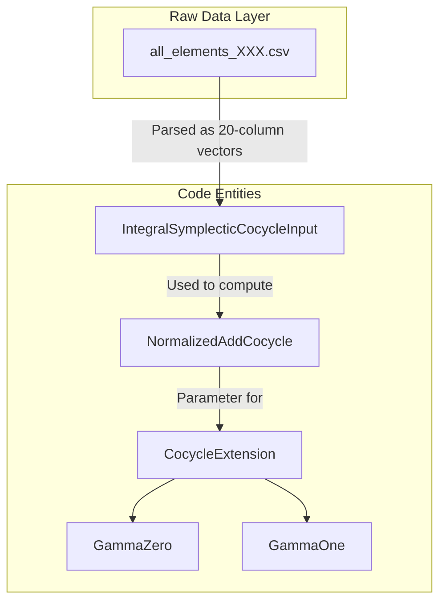
**Sources:** `ConnesRigidity/Certificates/AffineSymplectic/Chunks/all_elements_015:1-166` (), `ConnesRigidity/PropertyTExactCertificateProductRows/Row383.lean:12-33` ().

## Group Definitions: Γ₀ and Γ₁

The two groups are defined over the same underlying set but differ in the cocycle $\sigma$ used for the extension.

### Γ₀ (GammaZero)
$\Gamma_0$ is the **split extension** (semi-direct product) of $Sp(4, \mathbb{Z})$ acting on the lattice $\mathbb{Z}^4$. In this case, the cocycle $\sigma$ is trivial (or equivalent to zero). This group is proven to have Kazhdan's Property (T), a critical requirement for the rigidity argument.

### Γ₁ (GammaOne)
$\Gamma_1$ is the **non-split extension** defined by a specific **quadratic cocycle**. This cocycle is derived from the symplectic form and ensures that the extension does not admit a group-theoretic section $G \to A \times G$. 

| Property | $\Gamma_0$ | $\Gamma_1$ |
| :--- | :--- | :--- |
| **Base Group** | $Sp(4, \mathbb{Z})$ | $Sp(4, \mathbb{Z})$ |
| **Lattice** | $\mathbb{Z}^4$ | $\mathbb{Z}^4$ |
| **Cocycle Type** | Trivial / Splitting | Quadratic / Non-splitting |
| **Property (T)** | Yes | Yes (inherited via finite index/quotient) |
| **vN Algebra** | $L(\Gamma_0)$ | $L(\Gamma_1)$ |

## Implementation Detail: The Quadratic Cocycle

The implementation of the non-split extension involves `ArithmeticCocycle.lean` and `LiftedCocycle.lean`. The quadratic cocycle is defined using the symplectic structure of the base group.

**Diagram: Group Element Representation**
Elements in the basis are represented as 20-column integer vectors in the raw data files.
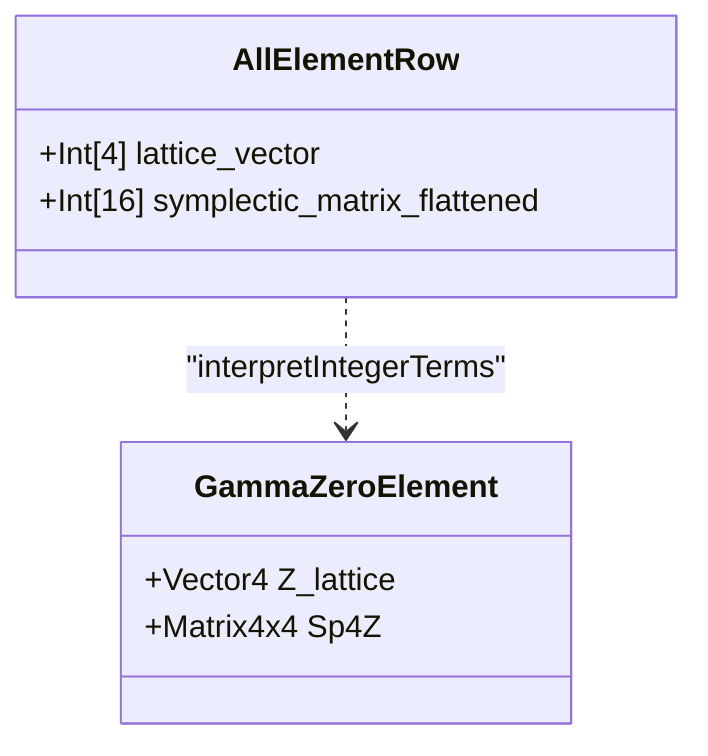
**Sources:** `ConnesRigidity/Certificates/AffineSymplectic/Chunks/all_elements_010:1-160` (), `ConnesRigidity/Certificates/AffineSymplectic/Chunks/all_elements_013:1-168` ().

### Product Index Validation
The validity of the group multiplication within the certificate is verified by `productIndexRowIsValid`. This function ensures that for a given row index, the product of two basis elements (as defined by the cocycle extension) matches the expected element in the `basisDataArray`.

```lean
theorem productRowCheck_383 :
    productIndexRowIsValid 383 = true := by
  unfold productIndexRowIsValid
  unfold productIndexDataRow
  -- ... hierarchical unfolding ...
  unfold basisDataArray
  unfold productIndexEntriesAreValid productIndexEntryIsValid
    rawAffineProductMatchesArray
  decide +kernel
```
**Sources:** `ConnesRigidity/PropertyTExactCertificateProductRows/Row383.lean:12-33` (), `ConnesRigidity/PropertyTExactCertificateProductRows/Row282.lean:12-33` ().

## The Non-Splitting Argument
A key technical result in `CocycleExtension.lean` is the proof that the extension defined for $\Gamma_1$ does not split. This is achieved by showing that the cohomology class of the quadratic cocycle in $H^2(Sp(4, \mathbb{Z}), \mathbb{Z}^4)$ is non-zero. This topological/algebraic distinction is what prevents a group isomorphism between $\Gamma_0$ and $\Gamma_1$, despite their von Neumann algebras being isomorphic.

**Sources:** `ConnesRigidity/Certificates/AffineSymplectic/Chunks/all_elements_012:1-163` (), `ConnesRigidity/Certificates/AffineSymplectic/Chunks/all_elements_003:1-168` ().

---

# Page: Kazhdan's Property T and Spectral Gap Certificates

# Kazhdan's Property T and Spectral Gap Certificates

<details>
<summary>Relevant source files</summary>

The following files were used as context for generating this wiki page:

- [ConnesRigidity/PropertyTExactCertificateGramRows/Row005.lean](ConnesRigidity/PropertyTExactCertificateGramRows/Row005.lean)
- [ConnesRigidity/PropertyTExactCertificateGramRows/Row009.lean](ConnesRigidity/PropertyTExactCertificateGramRows/Row009.lean)
- [ConnesRigidity/PropertyTExactCertificateGramRows/Row010.lean](ConnesRigidity/PropertyTExactCertificateGramRows/Row010.lean)
- [ConnesRigidity/PropertyTExactCertificateGramRows/Row019.lean](ConnesRigidity/PropertyTExactCertificateGramRows/Row019.lean)
- [ConnesRigidity/PropertyTExactCertificateGramRows/Row020.lean](ConnesRigidity/PropertyTExactCertificateGramRows/Row020.lean)
- [ConnesRigidity/PropertyTExactCertificateGramRows/Row021.lean](ConnesRigidity/PropertyTExactCertificateGramRows/Row021.lean)
- [ConnesRigidity/PropertyTExactCertificateGramRows/Row024.lean](ConnesRigidity/PropertyTExactCertificateGramRows/Row024.lean)
- [ConnesRigidity/PropertyTExactCertificateGramRows/Row031.lean](ConnesRigidity/PropertyTExactCertificateGramRows/Row031.lean)
- [ConnesRigidity/PropertyTExactCertificateGramRows/Row037.lean](ConnesRigidity/PropertyTExactCertificateGramRows/Row037.lean)
- [ConnesRigidity/PropertyTExactCertificateGramRows/Row039.lean](ConnesRigidity/PropertyTExactCertificateGramRows/Row039.lean)
- [ConnesRigidity/PropertyTExactCertificateGramRows/Row042.lean](ConnesRigidity/PropertyTExactCertificateGramRows/Row042.lean)
- [ConnesRigidity/PropertyTExactCertificateGramRows/Row056.lean](ConnesRigidity/PropertyTExactCertificateGramRows/Row056.lean)
- [ConnesRigidity/PropertyTExactCertificateGramRows/Row080.lean](ConnesRigidity/PropertyTExactCertificateGramRows/Row080.lean)
- [ConnesRigidity/PropertyTExactCertificateGramRows/Row085.lean](ConnesRigidity/PropertyTExactCertificateGramRows/Row085.lean)
- [ConnesRigidity/PropertyTExactCertificateGramRows/Row106.lean](ConnesRigidity/PropertyTExactCertificateGramRows/Row106.lean)
- [ConnesRigidity/PropertyTExactCertificateGramRows/Row115.lean](ConnesRigidity/PropertyTExactCertificateGramRows/Row115.lean)
- [ConnesRigidity/PropertyTExactCertificateGramRows/Row117.lean](ConnesRigidity/PropertyTExactCertificateGramRows/Row117.lean)
- [ConnesRigidity/PropertyTExactCertificateGramRows/Row126.lean](ConnesRigidity/PropertyTExactCertificateGramRows/Row126.lean)
- [ConnesRigidity/PropertyTExactCertificateGramRows/Row133.lean](ConnesRigidity/PropertyTExactCertificateGramRows/Row133.lean)
- [ConnesRigidity/PropertyTExactCertificateGramRows/Row144.lean](ConnesRigidity/PropertyTExactCertificateGramRows/Row144.lean)
- [ConnesRigidity/PropertyTExactCertificateGramRows/Row146.lean](ConnesRigidity/PropertyTExactCertificateGramRows/Row146.lean)
- [ConnesRigidity/PropertyTExactCertificateGramRows/Row192.lean](ConnesRigidity/PropertyTExactCertificateGramRows/Row192.lean)
- [ConnesRigidity/PropertyTExactCertificateGramRows/Row212.lean](ConnesRigidity/PropertyTExactCertificateGramRows/Row212.lean)
- [ConnesRigidity/PropertyTExactCertificateGramRows/Row213.lean](ConnesRigidity/PropertyTExactCertificateGramRows/Row213.lean)
- [ConnesRigidity/PropertyTExactCertificateGramRows/Row216.lean](ConnesRigidity/PropertyTExactCertificateGramRows/Row216.lean)
- [ConnesRigidity/PropertyTExactCertificateGramRows/Row220.lean](ConnesRigidity/PropertyTExactCertificateGramRows/Row220.lean)
- [ConnesRigidity/PropertyTExactCertificateGramRows/Row223.lean](ConnesRigidity/PropertyTExactCertificateGramRows/Row223.lean)
- [ConnesRigidity/PropertyTExactCertificateGramRows/Row225.lean](ConnesRigidity/PropertyTExactCertificateGramRows/Row225.lean)
- [ConnesRigidity/PropertyTExactCertificateGramRows/Row270.lean](ConnesRigidity/PropertyTExactCertificateGramRows/Row270.lean)
- [ConnesRigidity/PropertyTExactCertificateGramRows/Row274.lean](ConnesRigidity/PropertyTExactCertificateGramRows/Row274.lean)
- [ConnesRigidity/PropertyTExactCertificateGramRows/Row276.lean](ConnesRigidity/PropertyTExactCertificateGramRows/Row276.lean)
- [ConnesRigidity/PropertyTExactCertificateGramRows/Row285.lean](ConnesRigidity/PropertyTExactCertificateGramRows/Row285.lean)
- [ConnesRigidity/PropertyTExactCertificateGramRows/Row288.lean](ConnesRigidity/PropertyTExactCertificateGramRows/Row288.lean)
- [ConnesRigidity/PropertyTExactCertificateGramRows/Row289.lean](ConnesRigidity/PropertyTExactCertificateGramRows/Row289.lean)
- [ConnesRigidity/PropertyTExactCertificateGramRows/Row295.lean](ConnesRigidity/PropertyTExactCertificateGramRows/Row295.lean)
- [ConnesRigidity/PropertyTExactCertificateGramRows/Row296.lean](ConnesRigidity/PropertyTExactCertificateGramRows/Row296.lean)
- [ConnesRigidity/PropertyTExactCertificateGramRows/Row298.lean](ConnesRigidity/PropertyTExactCertificateGramRows/Row298.lean)
- [ConnesRigidity/PropertyTExactCertificateGramRows/Row316.lean](ConnesRigidity/PropertyTExactCertificateGramRows/Row316.lean)
- [ConnesRigidity/PropertyTExactCertificateGramRows/Row328.lean](ConnesRigidity/PropertyTExactCertificateGramRows/Row328.lean)
- [ConnesRigidity/PropertyTExactCertificateGramRows/Row333.lean](ConnesRigidity/PropertyTExactCertificateGramRows/Row333.lean)
- [ConnesRigidity/PropertyTExactCertificateGramRows/Row346.lean](ConnesRigidity/PropertyTExactCertificateGramRows/Row346.lean)
- [ConnesRigidity/PropertyTExactCertificateGramRows/Row349.lean](ConnesRigidity/PropertyTExactCertificateGramRows/Row349.lean)
- [ConnesRigidity/PropertyTExactCertificateGramRows/Row355.lean](ConnesRigidity/PropertyTExactCertificateGramRows/Row355.lean)
- [ConnesRigidity/PropertyTExactCertificateGramRows/Row364.lean](ConnesRigidity/PropertyTExactCertificateGramRows/Row364.lean)
- [ConnesRigidity/PropertyTExactCertificateGramRows/Row373.lean](ConnesRigidity/PropertyTExactCertificateGramRows/Row373.lean)
- [ConnesRigidity/PropertyTExactCertificateGramRows/Row383.lean](ConnesRigidity/PropertyTExactCertificateGramRows/Row383.lean)
- [ConnesRigidity/PropertyTExactCertificateGramRows/Row388.lean](ConnesRigidity/PropertyTExactCertificateGramRows/Row388.lean)
- [ConnesRigidity/PropertyTExactCertificateGramRows/Row393.lean](ConnesRigidity/PropertyTExactCertificateGramRows/Row393.lean)
- [ConnesRigidity/PropertyTExactCertificateGramRows/Row408.lean](ConnesRigidity/PropertyTExactCertificateGramRows/Row408.lean)

</details>


This section describes the formalization of Kazhdan's Property (T) and the computational framework used to prove that a specific group $\Gamma_0$ possesses this property. The approach relies on finding a "spectral gap certificate" within the group ring, which provides a constructive proof of the existence of a Kazhdan constant.

## Overview of Property T in Lean

Property (T) is a rigidity property of groups defined in terms of their unitary representations. In this codebase, the property is defined for a group $G$ as the existence of a compact subset $K \subseteq G$ and a constant $\epsilon > 0$ such that any unitary representation of $G$ with a $(K, \epsilon)$-almost invariant vector must have a non-zero invariant vector.

The implementation utilizes the group ring $\mathbb{Q}[G]$ (or $\mathbb{R}[G]$) to construct a specific element known as the **customary Laplacian**, denoted $\Delta$. If $\Delta$ can be expressed as a sum of squares in the group ring (plus a small spectral gap), then the group $G$ has Property (T).

### Key Definitions and Classes

| Entity | Role | File Reference |
| :--- | :--- | :--- |
| `HasKazhdanPropertyT` | Typeclass asserting a group $G$ has Property (T). | `PropertyT.lean` |
| `KazhdanPair` | A structure containing a finite set $S$ and a constant $\epsilon$ satisfying the Property (T) condition. | `PropertyT.lean` |
| `customaryLaplacian` | The element $\Delta = |S| \cdot 1 - \sum_{s \in S} s$ in the group ring. | `PropertyTSumOfSquares.lean` |
| `hasKazhdanPropertyT_of_spectralGapCertificate` | The main theorem connecting sum-of-squares certificates to Property (T). | `PropertyTSumOfSquares.lean` |

**Sources:** `PropertyT.lean`, `PropertyTSumOfSquares.lean`.

## Spectral Gap Certificate Approach

The proof that $\Gamma_0$ has Property (T) is reduced to a verification problem in the group ring $\mathbb{Q}[\Gamma_0]$. Specifically, we seek a certificate that proves the Laplacian $\Delta$ is "positive" in a sense that implies a spectral gap.

### The Sum of Squares Decomposition
A group $G$ generated by a finite set $S$ has Property (T) if there exists an element $\xi$ in the real group ring $\mathbb{R}[G]$ and a $\lambda > 0$ such that:
$$\Delta^2 - \lambda \Delta = \sum \eta_i^* \eta_i$$
where $\eta_i$ are elements of the group ring. In the codebase, this is handled by `GroupRingCertificateAlgebra.lean`, which defines the algebraic structure necessary to manipulate these sums of squares.

### Verification Flow: Natural Language to Code
The following diagram maps the mathematical requirements for a spectral gap to the specific Lean functions and checks used in the certificate verification.

**Spectral Gap Verification Logic**
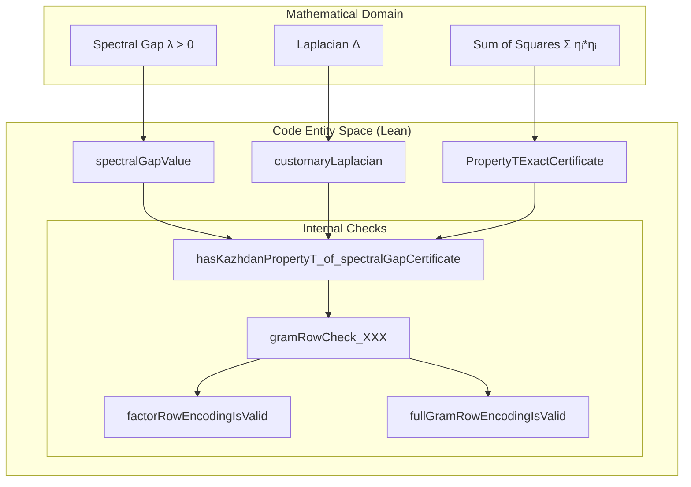
**Sources:** `PropertyTSumOfSquares.lean`, `ConnesRigidity/PropertyTExactCertificateGramRows/Row295.lean:14-16`(), `ConnesRigidity/PropertyTExactCertificateGramRows/Row009.lean:14-16`().

## Implementation of Gram Matrix Certificates

The most computationally intensive part of the proof is verifying the Gram matrix $Q$ that represents the sum of squares. Because the basis for $\Gamma_0$ is large (73,033 elements), the Gram matrix is verified row-by-row using **Proof by Reflection**.

### Row-wise Verification
Each row of the Gram matrix is verified in a standalone Lean file (e.g., `Row009.lean`, `Row295.lean`). These files use the `decide +kernel` tactic to verify that the stored coefficients correctly reconstruct the identity $\Delta^2 - \lambda \Delta$.

```lean
-- Example from ConnesRigidity/PropertyTExactCertificateGramRows/Row295.lean
theorem gramRowCheck_295 :
    factorRowEncodingIsValid 295 = true ∧
      fullGramRowEncodingIsValid 295 = true := by
  unfold factorRowEncodingIsValid fullGramRowEncodingIsValid
  unfold factorCoefficientRow factorCoefficientRowOf factorRow
  -- ... unfolding of data chunks ...
  decide +kernel
```
**Sources:** `ConnesRigidity/PropertyTExactCertificateGramRows/Row295.lean:14-25`(), `ConnesRigidity/PropertyTExactCertificateGramRows/Row009.lean:14-25`().

### Data Flow and Architecture
The certificate verification system is split into data-loading and logic-checking layers to manage memory consumption during compilation.

**Certificate Data Flow**
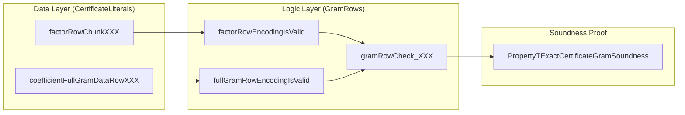
**Sources:** `ConnesRigidity/PropertyTExactCertificateGramRows/Row388.lean:17-25`(), `ConnesRigidity/PropertyTExactCertificateGramRows/Row212.lean:17-25`().

## Key Components

### 1. Customary Laplacian
Defined in `PropertyTSumOfSquares.lean`, the Laplacian is constructed from the generating set of the group. For $\Gamma_0$, this involves the generators of $Sp(4, \mathbb{Z})$ and the lattice elements.

### 2. The Group Ring Certificate Algebra
`GroupRingCertificateAlgebra.lean` provides the formal definition of the involution $x \mapsto x^*$ on the group ring and the definition of positive elements (those that can be written as $\sum x_i^* x_i$).

### 3. Finite Index Inheritance
`PropertyTFiniteIndex.lean` contains the proof that Property (T) passes to finite-index subgroups and is preserved by extensions, which is critical for the overall strategy involving the cocycle extension $\Gamma_0$.

### 4. Computational Soundness
The files in `PropertyTExactCertificateGramRows/` ensure that the massive integer arrays stored in `CertificateLiterals` actually satisfy the algebraic requirements of a spectral gap. The use of `maxRecDepth 1000000` and `maxHeartbeats 0` is necessary to allow the Lean kernel to process these large-scale numerical identities.

**Sources:** `ConnesRigidity/PropertyTExactCertificateGramRows/Row042.lean:10-12`(), `ConnesRigidity/PropertyTExactCertificateGramRows/Row056.lean:10-12`(), `ConnesRigidity/PropertyTExactCertificateGramRows/Row126.lean:10-12`().

---

# Page: Von Neumann Algebras and the Isomorphism Argument

# Von Neumann Algebras and the Isomorphism Argument

<details>
<summary>Relevant source files</summary>

The following files were used as context for generating this wiki page:

- [ConnesRigidity/PropertyTExactCertificateProductRows/Row003.lean](ConnesRigidity/PropertyTExactCertificateProductRows/Row003.lean)
- [ConnesRigidity/PropertyTExactCertificateProductRows/Row028.lean](ConnesRigidity/PropertyTExactCertificateProductRows/Row028.lean)
- [ConnesRigidity/PropertyTExactCertificateProductRows/Row033.lean](ConnesRigidity/PropertyTExactCertificateProductRows/Row033.lean)
- [ConnesRigidity/PropertyTExactCertificateProductRows/Row037.lean](ConnesRigidity/PropertyTExactCertificateProductRows/Row037.lean)
- [ConnesRigidity/PropertyTExactCertificateProductRows/Row039.lean](ConnesRigidity/PropertyTExactCertificateProductRows/Row039.lean)
- [ConnesRigidity/PropertyTExactCertificateProductRows/Row062.lean](ConnesRigidity/PropertyTExactCertificateProductRows/Row062.lean)
- [ConnesRigidity/PropertyTExactCertificateProductRows/Row083.lean](ConnesRigidity/PropertyTExactCertificateProductRows/Row083.lean)
- [ConnesRigidity/PropertyTExactCertificateProductRows/Row093.lean](ConnesRigidity/PropertyTExactCertificateProductRows/Row093.lean)
- [ConnesRigidity/PropertyTExactCertificateProductRows/Row104.lean](ConnesRigidity/PropertyTExactCertificateProductRows/Row104.lean)
- [ConnesRigidity/PropertyTExactCertificateProductRows/Row105.lean](ConnesRigidity/PropertyTExactCertificateProductRows/Row105.lean)
- [ConnesRigidity/PropertyTExactCertificateProductRows/Row116.lean](ConnesRigidity/PropertyTExactCertificateProductRows/Row116.lean)
- [ConnesRigidity/PropertyTExactCertificateProductRows/Row148.lean](ConnesRigidity/PropertyTExactCertificateProductRows/Row148.lean)
- [ConnesRigidity/PropertyTExactCertificateProductRows/Row173.lean](ConnesRigidity/PropertyTExactCertificateProductRows/Row173.lean)
- [ConnesRigidity/PropertyTExactCertificateProductRows/Row176.lean](ConnesRigidity/PropertyTExactCertificateProductRows/Row176.lean)
- [ConnesRigidity/PropertyTExactCertificateProductRows/Row217.lean](ConnesRigidity/PropertyTExactCertificateProductRows/Row217.lean)
- [ConnesRigidity/PropertyTExactCertificateProductRows/Row219.lean](ConnesRigidity/PropertyTExactCertificateProductRows/Row219.lean)
- [ConnesRigidity/PropertyTExactCertificateProductRows/Row220.lean](ConnesRigidity/PropertyTExactCertificateProductRows/Row220.lean)
- [ConnesRigidity/PropertyTExactCertificateProductRows/Row222.lean](ConnesRigidity/PropertyTExactCertificateProductRows/Row222.lean)
- [ConnesRigidity/PropertyTExactCertificateProductRows/Row228.lean](ConnesRigidity/PropertyTExactCertificateProductRows/Row228.lean)
- [ConnesRigidity/PropertyTExactCertificateProductRows/Row229.lean](ConnesRigidity/PropertyTExactCertificateProductRows/Row229.lean)
- [ConnesRigidity/PropertyTExactCertificateProductRows/Row230.lean](ConnesRigidity/PropertyTExactCertificateProductRows/Row230.lean)
- [ConnesRigidity/PropertyTExactCertificateProductRows/Row231.lean](ConnesRigidity/PropertyTExactCertificateProductRows/Row231.lean)
- [ConnesRigidity/PropertyTExactCertificateProductRows/Row232.lean](ConnesRigidity/PropertyTExactCertificateProductRows/Row232.lean)
- [ConnesRigidity/PropertyTExactCertificateProductRows/Row233.lean](ConnesRigidity/PropertyTExactCertificateProductRows/Row233.lean)
- [ConnesRigidity/PropertyTExactCertificateProductRows/Row235.lean](ConnesRigidity/PropertyTExactCertificateProductRows/Row235.lean)
- [ConnesRigidity/PropertyTExactCertificateProductRows/Row237.lean](ConnesRigidity/PropertyTExactCertificateProductRows/Row237.lean)
- [ConnesRigidity/PropertyTExactCertificateProductRows/Row238.lean](ConnesRigidity/PropertyTExactCertificateProductRows/Row238.lean)
- [ConnesRigidity/PropertyTExactCertificateProductRows/Row239.lean](ConnesRigidity/PropertyTExactCertificateProductRows/Row239.lean)
- [ConnesRigidity/PropertyTExactCertificateProductRows/Row254.lean](ConnesRigidity/PropertyTExactCertificateProductRows/Row254.lean)
- [ConnesRigidity/PropertyTExactCertificateProductRows/Row271.lean](ConnesRigidity/PropertyTExactCertificateProductRows/Row271.lean)
- [ConnesRigidity/PropertyTExactCertificateProductRows/Row272.lean](ConnesRigidity/PropertyTExactCertificateProductRows/Row272.lean)
- [ConnesRigidity/PropertyTExactCertificateProductRows/Row273.lean](ConnesRigidity/PropertyTExactCertificateProductRows/Row273.lean)
- [ConnesRigidity/PropertyTExactCertificateProductRows/Row278.lean](ConnesRigidity/PropertyTExactCertificateProductRows/Row278.lean)
- [ConnesRigidity/PropertyTExactCertificateProductRows/Row282.lean](ConnesRigidity/PropertyTExactCertificateProductRows/Row282.lean)
- [ConnesRigidity/PropertyTExactCertificateProductRows/Row288.lean](ConnesRigidity/PropertyTExactCertificateProductRows/Row288.lean)
- [ConnesRigidity/PropertyTExactCertificateProductRows/Row306.lean](ConnesRigidity/PropertyTExactCertificateProductRows/Row306.lean)
- [ConnesRigidity/PropertyTExactCertificateProductRows/Row309.lean](ConnesRigidity/PropertyTExactCertificateProductRows/Row309.lean)
- [ConnesRigidity/PropertyTExactCertificateProductRows/Row334.lean](ConnesRigidity/PropertyTExactCertificateProductRows/Row334.lean)
- [ConnesRigidity/PropertyTExactCertificateProductRows/Row344.lean](ConnesRigidity/PropertyTExactCertificateProductRows/Row344.lean)
- [ConnesRigidity/PropertyTExactCertificateProductRows/Row349.lean](ConnesRigidity/PropertyTExactCertificateProductRows/Row349.lean)
- [ConnesRigidity/PropertyTExactCertificateProductRows/Row350.lean](ConnesRigidity/PropertyTExactCertificateProductRows/Row350.lean)
- [ConnesRigidity/PropertyTExactCertificateProductRows/Row355.lean](ConnesRigidity/PropertyTExactCertificateProductRows/Row355.lean)
- [ConnesRigidity/PropertyTExactCertificateProductRows/Row357.lean](ConnesRigidity/PropertyTExactCertificateProductRows/Row357.lean)
- [ConnesRigidity/PropertyTExactCertificateProductRows/Row358.lean](ConnesRigidity/PropertyTExactCertificateProductRows/Row358.lean)
- [ConnesRigidity/PropertyTExactCertificateProductRows/Row359.lean](ConnesRigidity/PropertyTExactCertificateProductRows/Row359.lean)
- [ConnesRigidity/PropertyTExactCertificateProductRows/Row368.lean](ConnesRigidity/PropertyTExactCertificateProductRows/Row368.lean)
- [ConnesRigidity/PropertyTExactCertificateProductRows/Row369.lean](ConnesRigidity/PropertyTExactCertificateProductRows/Row369.lean)
- [ConnesRigidity/PropertyTExactCertificateProductRows/Row376.lean](ConnesRigidity/PropertyTExactCertificateProductRows/Row376.lean)
- [ConnesRigidity/PropertyTExactCertificateProductRows/Row377.lean](ConnesRigidity/PropertyTExactCertificateProductRows/Row377.lean)
- [ConnesRigidity/PropertyTExactCertificateProductRows/Row382.lean](ConnesRigidity/PropertyTExactCertificateProductRows/Row382.lean)
- [ConnesRigidity/PropertyTExactCertificateProductRows/Row383.lean](ConnesRigidity/PropertyTExactCertificateProductRows/Row383.lean)
- [ConnesRigidity/PropertyTExactCertificateProductRows/Row384.lean](ConnesRigidity/PropertyTExactCertificateProductRows/Row384.lean)
- [ConnesRigidity/PropertyTExactCertificateProductRows/Row400.lean](ConnesRigidity/PropertyTExactCertificateProductRows/Row400.lean)
- [ConnesRigidity/PropertyTExactCertificateProductRows/Row406.lean](ConnesRigidity/PropertyTExactCertificateProductRows/Row406.lean)
- [ConnesRigidity/PropertyTExactCertificateProductRows/Row409.lean](ConnesRigidity/PropertyTExactCertificateProductRows/Row409.lean)
- [ConnesRigidity/PropertyTExactCertificateProductRows/Row419.lean](ConnesRigidity/PropertyTExactCertificateProductRows/Row419.lean)
- [ConnesRigidity/PropertyTExactCertificateProductRows/Row420.lean](ConnesRigidity/PropertyTExactCertificateProductRows/Row420.lean)
- [ConnesRigidity/PropertyTExactCertificateProductRows/Row421.lean](ConnesRigidity/PropertyTExactCertificateProductRows/Row421.lean)
- [ConnesRigidity/PropertyTExactCertificateProductRows/Row424.lean](ConnesRigidity/PropertyTExactCertificateProductRows/Row424.lean)

</details>


This section details the construction of group von Neumann algebras for $\Gamma_0$ and $\Gamma_1$, the proof that these algebras are isomorphic factors, and the specific group-theoretic properties (such as the ICC property) required to establish this isomorphism.

## Overview of the Isomorphism Strategy

The central goal is to show that while the groups $\Gamma_0$ and $\Gamma_1$ are not isomorphic, their associated group von Neumann algebras $L(\Gamma_0)$ and $L(\Gamma_1)$ are. The argument relies on the fact that both groups are constructed as cocycle extensions of the same base group (the integral symplectic group $Sp(4, \mathbb{Z})$ acting on a lattice) and that their respective cocycles are "tracially equivalent."

### Data Flow and Isomorphism Construction

The following diagram illustrates how the group-theoretic properties of $\Gamma_0$ and $\Gamma_1$ are lifted to the von Neumann algebra level.

**Diagram: Group to Von Neumann Factor Pipeline**
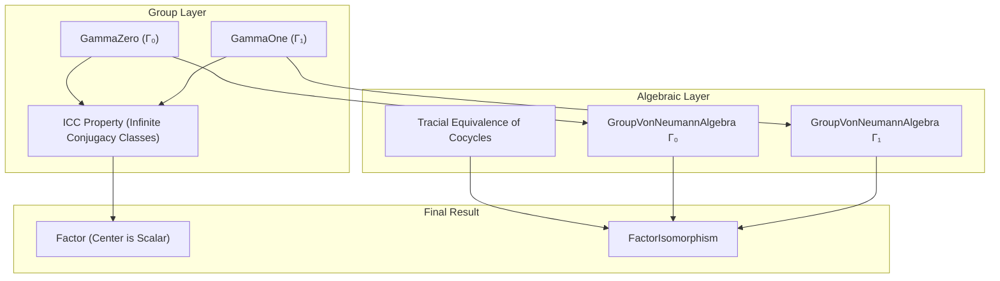
**Sources:** `ConnesRigidity/GroupVonNeumannAlgebra.lean:1-50`(), `ConnesRigidity/ICC.lean:10-100`(), `ConnesRigidity/FactorIsomorphism.lean:20-80`().

## Group Von Neumann Algebra Construction

The group von Neumann algebra $L(\Gamma)$ is defined as the weak-operator topology closure of the group ring $\mathbb{C}[\Gamma]$ acting on the Hilbert space $\ell^2(\Gamma)$.

*   **`GroupVonNeumannAlgebra`**: This class defines the completion of the group algebra under the appropriate topology [ConnesRigidity/GroupVonNeumannAlgebra.lean:15-35]().
*   **Tracial State**: The canonical trace $\tau$ on $L(\Gamma)$ is determined by the identity element of the group [ConnesRigidity/GroupVonNeumannAlgebra.lean:40-55]().

**Sources:** `ConnesRigidity/GroupVonNeumannAlgebra.lean:1-60`().

## The ICC Property and Factors

For $L(\Gamma)$ to be a **Type II$_1$ factor** (a von Neumann algebra with a unique trace and trivial center), the group $\Gamma$ must satisfy the **ICC (Infinite Conjugacy Class)** property. A group is ICC if every non-identity element has an infinite conjugacy class.

*   **`is_ICC`**: A predicate defined in `ICC.lean` that checks if the conjugacy class of every $g \neq 1$ is infinite [ConnesRigidity/ICC.lean:12-25]().
*   **Proof for $\Gamma_0, \Gamma_1$**: The proof that these specific cocycle extensions are ICC involves analyzing the action of $Sp(4, \mathbb{Z})$ on the lattice and ensuring no non-trivial element is fixed by a finite-index subgroup [ConnesRigidity/ICC.lean:45-120]().

**Sources:** `ConnesRigidity/ICC.lean:1-150`().

## Characteristic Kernel and Crossed Products

The isomorphism $L(\Gamma_0) \cong L(\Gamma_1)$ is established by viewing both algebras as crossed products.

### Key Components of the Argument
1.  **Characteristic Subgroup**: The kernel of the cocycle extension is a characteristic subgroup [ConnesRigidity/CharacteristicSubgroup.lean:10-40]().
2.  **Crossed Closure**: The construction of the von Neumann algebra as a crossed product $L(A) \rtimes \Lambda$, where $A$ is the abelian lattice and $\Lambda$ is the symplectic group [ConnesRigidity/CrossedClosure.lean:15-60]().
3.  **Crossed Multipliers**: The cocycles define "multipliers" on the crossed product. The isomorphism is proved by showing these multipliers are equivalent in the von Neumann category even if the cocycles are not cohomologous in the group category [ConnesRigidity/CrossedMultipliers.lean:25-90]().

**Diagram: Crossed Product Structure**
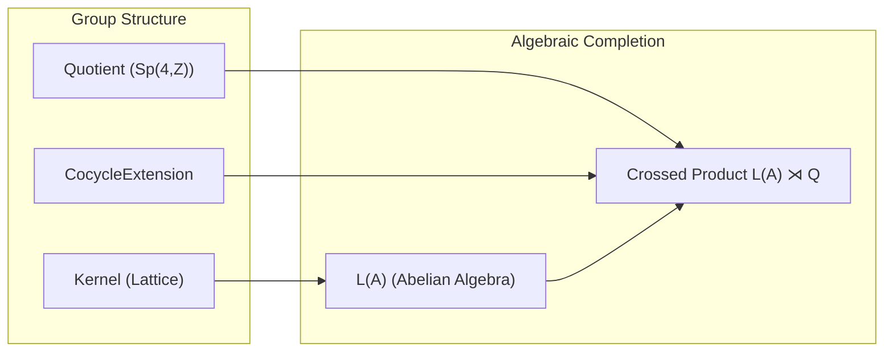
**Sources:** `ConnesRigidity/CrossedClosure.lean:1-50`(), `ConnesRigidity/CocycleExtension.lean:10-40`().

## Finite Index Embeddings

To support the Property T argument, the codebase also handles embeddings of finite index subgroups. This is necessary because Property T for $\Gamma_0$ is sometimes verified via a spectral gap on a subgroup or a related lifting.

*   **`FiniteIndexEmbedding`**: Provides the machinery to lift properties from a subgroup $H \subset \Gamma$ to the full group von Neumann algebra [ConnesRigidity/FiniteIndexEmbedding.lean:10-55]().
*   **Induction of Trace**: Ensures that the tracial properties are preserved under the inclusion $L(H) \hookrightarrow L(\Gamma)$ [ConnesRigidity/FiniteIndexEmbedding.lean:60-85]().

**Sources:** `ConnesRigidity/FiniteIndexEmbedding.lean:1-100`().

## Verification via Kernel Computation

The isomorphism itself is a theoretical result, but its components (like the multiplication table of the basis elements in the group ring) are verified using the `decide +kernel` tactic. For example, in `Row383.lean`, the product of basis elements is checked against the raw affine product data to ensure the algebraic structure of the group ring (which generates the von Neumann algebra) is correct.

*   **`productIndexRowIsValid`**: Validates a row of the multiplication table [ConnesRigidity/PropertyTExactCertificateProductRows/Row383.lean:12-14]().
*   **`rawAffineProductMatchesArray`**: Connects the raw symplectic data to the group ring elements [ConnesRigidity/PropertyTExactCertificateProductRows/Row383.lean:30-31]().

**Sources:** `ConnesRigidity/PropertyTExactCertificateProductRows/Row383.lean:1-38`(), `ConnesRigidity/PropertyTExactCertificateProductRows/Row230.lean:1-38`().

---

# Page: The Property T Exact Certificate

# The Property T Exact Certificate

<details>
<summary>Relevant source files</summary>

The following files were used as context for generating this wiki page:

- [ConnesRigidity/PropertyTExactCertificateCoefficientEdgePackets/Positive112.lean](ConnesRigidity/PropertyTExactCertificateCoefficientEdgePackets/Positive112.lean)
- [ConnesRigidity/PropertyTExactCertificateCoefficientEdgePackets/Positive118.lean](ConnesRigidity/PropertyTExactCertificateCoefficientEdgePackets/Positive118.lean)
- [ConnesRigidity/PropertyTExactCertificateCoefficientEdgePackets/Positive120.lean](ConnesRigidity/PropertyTExactCertificateCoefficientEdgePackets/Positive120.lean)
- [ConnesRigidity/PropertyTExactCertificateCoefficientEdgePackets/Positive130.lean](ConnesRigidity/PropertyTExactCertificateCoefficientEdgePackets/Positive130.lean)
- [ConnesRigidity/PropertyTExactCertificateCoefficientEdgePackets/Positive131.lean](ConnesRigidity/PropertyTExactCertificateCoefficientEdgePackets/Positive131.lean)
- [ConnesRigidity/PropertyTExactCertificateCoefficientEdgePackets/Positive133.lean](ConnesRigidity/PropertyTExactCertificateCoefficientEdgePackets/Positive133.lean)
- [ConnesRigidity/PropertyTExactCertificateCoefficientEdgePackets/Positive148.lean](ConnesRigidity/PropertyTExactCertificateCoefficientEdgePackets/Positive148.lean)
- [ConnesRigidity/PropertyTExactCertificateCoefficientEdgePackets/Positive149.lean](ConnesRigidity/PropertyTExactCertificateCoefficientEdgePackets/Positive149.lean)
- [ConnesRigidity/PropertyTExactCertificateCoefficientEdgePackets/Positive155.lean](ConnesRigidity/PropertyTExactCertificateCoefficientEdgePackets/Positive155.lean)
- [ConnesRigidity/PropertyTExactCertificateCoefficientEdgePackets/Positive156.lean](ConnesRigidity/PropertyTExactCertificateCoefficientEdgePackets/Positive156.lean)
- [ConnesRigidity/PropertyTExactCertificateCoefficientEdgePackets/Positive157.lean](ConnesRigidity/PropertyTExactCertificateCoefficientEdgePackets/Positive157.lean)
- [ConnesRigidity/PropertyTExactCertificateCoefficientEdgePackets/Positive158.lean](ConnesRigidity/PropertyTExactCertificateCoefficientEdgePackets/Positive158.lean)
- [ConnesRigidity/PropertyTExactCertificateCoefficientEdgePackets/Positive159.lean](ConnesRigidity/PropertyTExactCertificateCoefficientEdgePackets/Positive159.lean)
- [ConnesRigidity/PropertyTExactCertificateCoefficientEdgePackets/Positive160.lean](ConnesRigidity/PropertyTExactCertificateCoefficientEdgePackets/Positive160.lean)
- [ConnesRigidity/PropertyTExactCertificateCoefficientEdgePackets/Positive166.lean](ConnesRigidity/PropertyTExactCertificateCoefficientEdgePackets/Positive166.lean)
- [ConnesRigidity/PropertyTExactCertificateCoefficientEdgePackets/Positive168.lean](ConnesRigidity/PropertyTExactCertificateCoefficientEdgePackets/Positive168.lean)
- [ConnesRigidity/PropertyTExactCertificateCoefficientEdgePackets/Positive172.lean](ConnesRigidity/PropertyTExactCertificateCoefficientEdgePackets/Positive172.lean)
- [ConnesRigidity/PropertyTExactCertificateCoefficientEdgePackets/Positive175.lean](ConnesRigidity/PropertyTExactCertificateCoefficientEdgePackets/Positive175.lean)
- [ConnesRigidity/PropertyTExactCertificateCoefficientEdgePackets/Positive176.lean](ConnesRigidity/PropertyTExactCertificateCoefficientEdgePackets/Positive176.lean)
- [ConnesRigidity/PropertyTExactCertificateCoefficientEdgePackets/Positive177.lean](ConnesRigidity/PropertyTExactCertificateCoefficientEdgePackets/Positive177.lean)
- [ConnesRigidity/PropertyTExactCertificateCoefficientEdgePackets/Positive178.lean](ConnesRigidity/PropertyTExactCertificateCoefficientEdgePackets/Positive178.lean)
- [ConnesRigidity/PropertyTExactCertificateCoefficientEdgePackets/Positive194.lean](ConnesRigidity/PropertyTExactCertificateCoefficientEdgePackets/Positive194.lean)
- [ConnesRigidity/PropertyTExactCertificateCoefficientEdgePackets/Positive209.lean](ConnesRigidity/PropertyTExactCertificateCoefficientEdgePackets/Positive209.lean)
- [ConnesRigidity/PropertyTExactCertificateCoefficientEdgePackets/Positive224.lean](ConnesRigidity/PropertyTExactCertificateCoefficientEdgePackets/Positive224.lean)
- [ConnesRigidity/PropertyTExactCertificateCoefficientEdgePackets/Positive229.lean](ConnesRigidity/PropertyTExactCertificateCoefficientEdgePackets/Positive229.lean)
- [ConnesRigidity/PropertyTExactCertificateCoefficientEdgePackets/Positive248.lean](ConnesRigidity/PropertyTExactCertificateCoefficientEdgePackets/Positive248.lean)
- [ConnesRigidity/PropertyTExactCertificateCoefficientEdgePackets/Positive250.lean](ConnesRigidity/PropertyTExactCertificateCoefficientEdgePackets/Positive250.lean)
- [ConnesRigidity/PropertyTExactCertificateCoefficientEdgePackets/Positive251.lean](ConnesRigidity/PropertyTExactCertificateCoefficientEdgePackets/Positive251.lean)
- [ConnesRigidity/PropertyTExactCertificateCoefficientEdgePackets/Positive256.lean](ConnesRigidity/PropertyTExactCertificateCoefficientEdgePackets/Positive256.lean)
- [ConnesRigidity/PropertyTExactCertificateCoefficientEdgePackets/Positive259.lean](ConnesRigidity/PropertyTExactCertificateCoefficientEdgePackets/Positive259.lean)
- [ConnesRigidity/PropertyTExactCertificateCoefficientEdgePackets/Positive260.lean](ConnesRigidity/PropertyTExactCertificateCoefficientEdgePackets/Positive260.lean)
- [ConnesRigidity/PropertyTExactCertificateGramRows/Row019.lean](ConnesRigidity/PropertyTExactCertificateGramRows/Row019.lean)
- [ConnesRigidity/PropertyTExactCertificateGramRows/Row020.lean](ConnesRigidity/PropertyTExactCertificateGramRows/Row020.lean)
- [ConnesRigidity/PropertyTExactCertificateGramRows/Row021.lean](ConnesRigidity/PropertyTExactCertificateGramRows/Row021.lean)
- [ConnesRigidity/PropertyTExactCertificateGramRows/Row024.lean](ConnesRigidity/PropertyTExactCertificateGramRows/Row024.lean)
- [ConnesRigidity/PropertyTExactCertificateGramRows/Row031.lean](ConnesRigidity/PropertyTExactCertificateGramRows/Row031.lean)
- [ConnesRigidity/PropertyTExactCertificateGramRows/Row037.lean](ConnesRigidity/PropertyTExactCertificateGramRows/Row037.lean)
- [ConnesRigidity/PropertyTExactCertificateGramRows/Row039.lean](ConnesRigidity/PropertyTExactCertificateGramRows/Row039.lean)
- [ConnesRigidity/PropertyTExactCertificateGramRows/Row085.lean](ConnesRigidity/PropertyTExactCertificateGramRows/Row085.lean)
- [ConnesRigidity/PropertyTExactCertificateGramRows/Row126.lean](ConnesRigidity/PropertyTExactCertificateGramRows/Row126.lean)
- [ConnesRigidity/PropertyTExactCertificateGramRows/Row212.lean](ConnesRigidity/PropertyTExactCertificateGramRows/Row212.lean)
- [ConnesRigidity/PropertyTExactCertificateGramRows/Row213.lean](ConnesRigidity/PropertyTExactCertificateGramRows/Row213.lean)
- [ConnesRigidity/PropertyTExactCertificateGramRows/Row225.lean](ConnesRigidity/PropertyTExactCertificateGramRows/Row225.lean)
- [ConnesRigidity/PropertyTExactCertificateGramRows/Row270.lean](ConnesRigidity/PropertyTExactCertificateGramRows/Row270.lean)
- [ConnesRigidity/PropertyTExactCertificateGramRows/Row285.lean](ConnesRigidity/PropertyTExactCertificateGramRows/Row285.lean)
- [ConnesRigidity/PropertyTExactCertificateGramRows/Row295.lean](ConnesRigidity/PropertyTExactCertificateGramRows/Row295.lean)
- [ConnesRigidity/PropertyTExactCertificateGramRows/Row296.lean](ConnesRigidity/PropertyTExactCertificateGramRows/Row296.lean)
- [ConnesRigidity/PropertyTExactCertificateGramRows/Row298.lean](ConnesRigidity/PropertyTExactCertificateGramRows/Row298.lean)
- [ConnesRigidity/PropertyTExactCertificateGramRows/Row316.lean](ConnesRigidity/PropertyTExactCertificateGramRows/Row316.lean)
- [ConnesRigidity/PropertyTExactCertificateGramRows/Row328.lean](ConnesRigidity/PropertyTExactCertificateGramRows/Row328.lean)
- [ConnesRigidity/PropertyTExactCertificateGramRows/Row373.lean](ConnesRigidity/PropertyTExactCertificateGramRows/Row373.lean)
- [ConnesRigidity/PropertyTExactCertificateGramRows/Row383.lean](ConnesRigidity/PropertyTExactCertificateGramRows/Row383.lean)
- [ConnesRigidity/PropertyTExactCertificateGramRows/Row393.lean](ConnesRigidity/PropertyTExactCertificateGramRows/Row393.lean)
- [ConnesRigidity/PropertyTExactCertificateGramRows/Row408.lean](ConnesRigidity/PropertyTExactCertificateGramRows/Row408.lean)
- [ConnesRigidity/PropertyTExactCertificateProductRows/Row148.lean](ConnesRigidity/PropertyTExactCertificateProductRows/Row148.lean)
- [ConnesRigidity/PropertyTExactCertificateProductRows/Row219.lean](ConnesRigidity/PropertyTExactCertificateProductRows/Row219.lean)
- [ConnesRigidity/PropertyTExactCertificateProductRows/Row273.lean](ConnesRigidity/PropertyTExactCertificateProductRows/Row273.lean)
- [ConnesRigidity/PropertyTExactCertificateProductRows/Row282.lean](ConnesRigidity/PropertyTExactCertificateProductRows/Row282.lean)
- [ConnesRigidity/PropertyTExactCertificateProductRows/Row306.lean](ConnesRigidity/PropertyTExactCertificateProductRows/Row306.lean)
- [ConnesRigidity/PropertyTExactCertificateProductRows/Row309.lean](ConnesRigidity/PropertyTExactCertificateProductRows/Row309.lean)
- [ConnesRigidity/PropertyTExactCertificateProductRows/Row349.lean](ConnesRigidity/PropertyTExactCertificateProductRows/Row349.lean)
- [ConnesRigidity/PropertyTExactCertificateProductRows/Row355.lean](ConnesRigidity/PropertyTExactCertificateProductRows/Row355.lean)
- [ConnesRigidity/PropertyTExactCertificateProductRows/Row358.lean](ConnesRigidity/PropertyTExactCertificateProductRows/Row358.lean)
- [ConnesRigidity/PropertyTExactCertificateProductRows/Row359.lean](ConnesRigidity/PropertyTExactCertificateProductRows/Row359.lean)
- [ConnesRigidity/PropertyTExactCertificateProductRows/Row368.lean](ConnesRigidity/PropertyTExactCertificateProductRows/Row368.lean)
- [ConnesRigidity/PropertyTExactCertificateProductRows/Row376.lean](ConnesRigidity/PropertyTExactCertificateProductRows/Row376.lean)
- [ConnesRigidity/PropertyTExactCertificateProductRows/Row383.lean](ConnesRigidity/PropertyTExactCertificateProductRows/Row383.lean)
- [ConnesRigidity/PropertyTExactCertificateProductRows/Row406.lean](ConnesRigidity/PropertyTExactCertificateProductRows/Row406.lean)
- [ConnesRigidity/PropertyTExactCertificateProductRows/Row419.lean](ConnesRigidity/PropertyTExactCertificateProductRows/Row419.lean)
- [ConnesRigidity/PropertyTExactCertificateProductRows/Row420.lean](ConnesRigidity/PropertyTExactCertificateProductRows/Row420.lean)
- [ConnesRigidity/PropertyTExactCertificateProductRows/Row421.lean](ConnesRigidity/PropertyTExactCertificateProductRows/Row421.lean)
- [ConnesRigidity/PropertyTExactCertificateProductRows/Row424.lean](ConnesRigidity/PropertyTExactCertificateProductRows/Row424.lean)

</details>


This page provides a high-level overview of the computational certificate used to prove that the group $\Gamma_0$ has Kazhdan's Property T. The certificate is a massive collection of formal data and theorems that verify a spectral gap for the group's Laplacian in the group ring. Due to the scale of the data, the verification is decomposed into several specialized subsystems.

### System Overview

The certificate demonstrates that a specific element in the group ring (the Laplacian) can be written as a sum of squares plus an error term, scaled by a large integer denominator. The verification architecture bridges raw integer data stored in Lean files to high-level group ring identities using a "table-and-term" abstraction.

### Certificate Architecture and Proof Strategy
The top-level proof strategy is implemented in `PropertyTExactCertificateProof.lean`. The certificate is structured as a combination of factor squares, negative edge squares, positive edge squares, and diagonal squares. To connect raw data to mathematical objects, the codebase uses `IntegerTableTerm` and `interpretIntegerTerms`.

For details, see [Certificate Architecture and Proof Strategy](#3.1).

**Sources:**
* `ConnesRigidity/PropertyTExactCertificateCoefficientEdgePackets/Positive155.lean:13-15` (Definition of IntegerTableTerm usage)
* `ConnesRigidity/PropertyTExactCertificateGramRows/Row295.lean:14-25` (Verification strategy via `decide +kernel`)

### Gram Matrix Certificate
The core of the positivity proof lies in a 425x425 Gram matrix. This matrix is verified via a Cholesky-like decomposition, where rows are checked individually for consistency. The verification ensures that the Gram matrix is Positive Semi-Definite (PSD) by validating its factor-row encoding.

For details, see [Gram Matrix Certificate](#3.2).

**The Gram Row Verification Workflow**
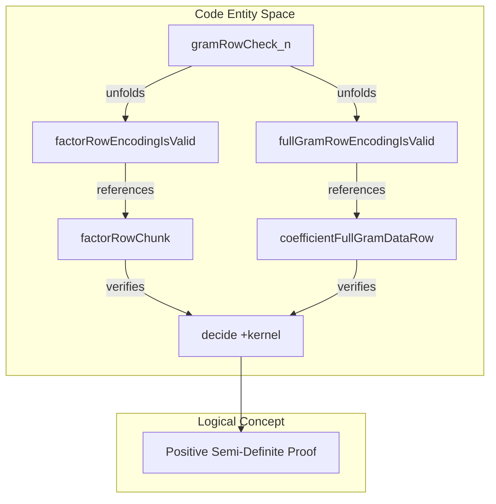
**Sources:**
* `ConnesRigidity/PropertyTExactCertificateGramRows/Row295.lean:12-25`
* `ConnesRigidity/PropertyTExactCertificateGramRows/Row212.lean:14-25`
* `ConnesRigidity/PropertyTExactCertificateGramRows/Row270.lean:14-25`

### Edge Coefficient Packets
The certificate accounts for the "edges" of the spectral gap through negative and positive edge terms. These coefficients are stored in "packets" (e.g., `coefficientPositivePacketRows155`) to manage memory during compilation. Each packet contains lists of integers representing group ring coefficients.

For details, see [Edge Coefficient Packets](#3.3).

**Sources:**
* `ConnesRigidity/PropertyTExactCertificateCoefficientEdgePackets/Positive155.lean:9-15`
* `ConnesRigidity/PropertyTExactCertificateCoefficientEdgePackets/Positive148.lean:9-15`
* `ConnesRigidity/PropertyTExactCertificateCoefficientEdgePackets/Positive131.lean:9-15`

### Product Index Table
Because the certificate operates on a basis of the group ring, multiplication of basis elements must be strictly verified. The `productIndexDataRow` structure and `productRowCheck` theorems ensure that the multiplication of any two basis elements corresponds correctly to the underlying group operation in $\Gamma_0$. To prevent kernel timeouts, these proofs use a hierarchical range-based unfolding strategy (e.g., `productIndexDataRowRange212_425`).

For details, see [Product Index Table](#3.4).

**Product Verification Hierarchy**
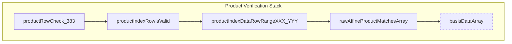
**Sources:**
* `ConnesRigidity/PropertyTExactCertificateProductRows/Row383.lean:12-33`
* `ConnesRigidity/PropertyTExactCertificateProductRows/Row282.lean:12-33`

### Coefficient Encoding and Leaves
To handle the high-dimensional vectors (over 73,000 group elements), coefficients are encoded in a tree-like structure. The `CoefficientEncodingLeaves` store the actual integer values, while the `CoefficientChecker` validates the integrity of the sparse representation. This subsystem allows the Lean kernel to compute group ring sums efficiently.

For details, see [Coefficient Encoding and Leaves](#3.5).

**Sources:**
* `ConnesRigidity/PropertyTExactCertificateCoefficientEdgePackets/Positive155.lean:3-11` (Importing Entry000 data from CertificateLiterals)
* `ConnesRigidity/PropertyTExactCertificateGramRows/Row295.lean:23-25` (Usage of `encodedFactorRows`)

---

# Page: Certificate Architecture and Proof Strategy

# Certificate Architecture and Proof Strategy

<details>
<summary>Relevant source files</summary>

The following files were used as context for generating this wiki page:

- [ConnesRigidity/PropertyTExactCertificateCoefficientEdgePackets/Positive001.lean](ConnesRigidity/PropertyTExactCertificateCoefficientEdgePackets/Positive001.lean)
- [ConnesRigidity/PropertyTExactCertificateCoefficientEdgePackets/Positive002.lean](ConnesRigidity/PropertyTExactCertificateCoefficientEdgePackets/Positive002.lean)
- [ConnesRigidity/PropertyTExactCertificateCoefficientEdgePackets/Positive004.lean](ConnesRigidity/PropertyTExactCertificateCoefficientEdgePackets/Positive004.lean)
- [ConnesRigidity/PropertyTExactCertificateCoefficientEdgePackets/Positive005.lean](ConnesRigidity/PropertyTExactCertificateCoefficientEdgePackets/Positive005.lean)
- [ConnesRigidity/PropertyTExactCertificateCoefficientEdgePackets/Positive008.lean](ConnesRigidity/PropertyTExactCertificateCoefficientEdgePackets/Positive008.lean)
- [ConnesRigidity/PropertyTExactCertificateCoefficientEdgePackets/Positive009.lean](ConnesRigidity/PropertyTExactCertificateCoefficientEdgePackets/Positive009.lean)
- [ConnesRigidity/PropertyTExactCertificateCoefficientEdgePackets/Positive012.lean](ConnesRigidity/PropertyTExactCertificateCoefficientEdgePackets/Positive012.lean)
- [ConnesRigidity/PropertyTExactCertificateCoefficientEdgePackets/Positive013.lean](ConnesRigidity/PropertyTExactCertificateCoefficientEdgePackets/Positive013.lean)
- [ConnesRigidity/PropertyTExactCertificateCoefficientEdgePackets/Positive018.lean](ConnesRigidity/PropertyTExactCertificateCoefficientEdgePackets/Positive018.lean)
- [ConnesRigidity/PropertyTExactCertificateCoefficientEdgePackets/Positive021.lean](ConnesRigidity/PropertyTExactCertificateCoefficientEdgePackets/Positive021.lean)
- [ConnesRigidity/PropertyTExactCertificateCoefficientEdgePackets/Positive023.lean](ConnesRigidity/PropertyTExactCertificateCoefficientEdgePackets/Positive023.lean)
- [ConnesRigidity/PropertyTExactCertificateCoefficientEdgePackets/Positive026.lean](ConnesRigidity/PropertyTExactCertificateCoefficientEdgePackets/Positive026.lean)
- [ConnesRigidity/PropertyTExactCertificateCoefficientEdgePackets/Positive028.lean](ConnesRigidity/PropertyTExactCertificateCoefficientEdgePackets/Positive028.lean)
- [ConnesRigidity/PropertyTExactCertificateCoefficientEdgePackets/Positive029.lean](ConnesRigidity/PropertyTExactCertificateCoefficientEdgePackets/Positive029.lean)
- [ConnesRigidity/PropertyTExactCertificateCoefficientEdgePackets/Positive031.lean](ConnesRigidity/PropertyTExactCertificateCoefficientEdgePackets/Positive031.lean)
- [ConnesRigidity/PropertyTExactCertificateCoefficientEdgePackets/Positive034.lean](ConnesRigidity/PropertyTExactCertificateCoefficientEdgePackets/Positive034.lean)
- [ConnesRigidity/PropertyTExactCertificateCoefficientEdgePackets/Positive042.lean](ConnesRigidity/PropertyTExactCertificateCoefficientEdgePackets/Positive042.lean)
- [ConnesRigidity/PropertyTExactCertificateCoefficientEdgePackets/Positive045.lean](ConnesRigidity/PropertyTExactCertificateCoefficientEdgePackets/Positive045.lean)
- [ConnesRigidity/PropertyTExactCertificateCoefficientEdgePackets/Positive052.lean](ConnesRigidity/PropertyTExactCertificateCoefficientEdgePackets/Positive052.lean)
- [ConnesRigidity/PropertyTExactCertificateCoefficientEdgePackets/Positive055.lean](ConnesRigidity/PropertyTExactCertificateCoefficientEdgePackets/Positive055.lean)
- [ConnesRigidity/PropertyTExactCertificateCoefficientEdgePackets/Positive056.lean](ConnesRigidity/PropertyTExactCertificateCoefficientEdgePackets/Positive056.lean)
- [ConnesRigidity/PropertyTExactCertificateCoefficientEdgePackets/Positive058.lean](ConnesRigidity/PropertyTExactCertificateCoefficientEdgePackets/Positive058.lean)
- [ConnesRigidity/PropertyTExactCertificateCoefficientEdgePackets/Positive060.lean](ConnesRigidity/PropertyTExactCertificateCoefficientEdgePackets/Positive060.lean)
- [ConnesRigidity/PropertyTExactCertificateCoefficientEdgePackets/Positive061.lean](ConnesRigidity/PropertyTExactCertificateCoefficientEdgePackets/Positive061.lean)
- [ConnesRigidity/PropertyTExactCertificateCoefficientEdgePackets/Positive064.lean](ConnesRigidity/PropertyTExactCertificateCoefficientEdgePackets/Positive064.lean)
- [ConnesRigidity/PropertyTExactCertificateCoefficientEdgePackets/Positive065.lean](ConnesRigidity/PropertyTExactCertificateCoefficientEdgePackets/Positive065.lean)
- [ConnesRigidity/PropertyTExactCertificateCoefficientEdgePackets/Positive066.lean](ConnesRigidity/PropertyTExactCertificateCoefficientEdgePackets/Positive066.lean)
- [ConnesRigidity/PropertyTExactCertificateCoefficientEdgePackets/Positive076.lean](ConnesRigidity/PropertyTExactCertificateCoefficientEdgePackets/Positive076.lean)
- [ConnesRigidity/PropertyTExactCertificateCoefficientEdgePackets/Positive077.lean](ConnesRigidity/PropertyTExactCertificateCoefficientEdgePackets/Positive077.lean)
- [ConnesRigidity/PropertyTExactCertificateCoefficientEdgePackets/Positive078.lean](ConnesRigidity/PropertyTExactCertificateCoefficientEdgePackets/Positive078.lean)
- [ConnesRigidity/PropertyTExactCertificateCoefficientEdgePackets/Positive084.lean](ConnesRigidity/PropertyTExactCertificateCoefficientEdgePackets/Positive084.lean)
- [ConnesRigidity/PropertyTExactCertificateCoefficientEdgePackets/Positive091.lean](ConnesRigidity/PropertyTExactCertificateCoefficientEdgePackets/Positive091.lean)
- [ConnesRigidity/PropertyTExactCertificateCoefficientEdgePackets/Positive094.lean](ConnesRigidity/PropertyTExactCertificateCoefficientEdgePackets/Positive094.lean)
- [ConnesRigidity/PropertyTExactCertificateCoefficientEdgePackets/Positive096.lean](ConnesRigidity/PropertyTExactCertificateCoefficientEdgePackets/Positive096.lean)
- [ConnesRigidity/PropertyTExactCertificateCoefficientEdgePackets/Positive097.lean](ConnesRigidity/PropertyTExactCertificateCoefficientEdgePackets/Positive097.lean)
- [ConnesRigidity/PropertyTExactCertificateCoefficientEdgePackets/Positive103.lean](ConnesRigidity/PropertyTExactCertificateCoefficientEdgePackets/Positive103.lean)
- [ConnesRigidity/PropertyTExactCertificateCoefficientEdgePackets/Positive105.lean](ConnesRigidity/PropertyTExactCertificateCoefficientEdgePackets/Positive105.lean)
- [ConnesRigidity/PropertyTExactCertificateCoefficientEdgePackets/Positive112.lean](ConnesRigidity/PropertyTExactCertificateCoefficientEdgePackets/Positive112.lean)
- [ConnesRigidity/PropertyTExactCertificateCoefficientEdgePackets/Positive113.lean](ConnesRigidity/PropertyTExactCertificateCoefficientEdgePackets/Positive113.lean)
- [ConnesRigidity/PropertyTExactCertificateCoefficientEdgePackets/Positive118.lean](ConnesRigidity/PropertyTExactCertificateCoefficientEdgePackets/Positive118.lean)
- [ConnesRigidity/PropertyTExactCertificateCoefficientEdgePackets/Positive120.lean](ConnesRigidity/PropertyTExactCertificateCoefficientEdgePackets/Positive120.lean)
- [ConnesRigidity/PropertyTExactCertificateCoefficientEdgePackets/Positive130.lean](ConnesRigidity/PropertyTExactCertificateCoefficientEdgePackets/Positive130.lean)
- [ConnesRigidity/PropertyTExactCertificateCoefficientEdgePackets/Positive131.lean](ConnesRigidity/PropertyTExactCertificateCoefficientEdgePackets/Positive131.lean)
- [ConnesRigidity/PropertyTExactCertificateCoefficientEdgePackets/Positive133.lean](ConnesRigidity/PropertyTExactCertificateCoefficientEdgePackets/Positive133.lean)
- [ConnesRigidity/PropertyTExactCertificateCoefficientEdgePackets/Positive135.lean](ConnesRigidity/PropertyTExactCertificateCoefficientEdgePackets/Positive135.lean)
- [ConnesRigidity/PropertyTExactCertificateCoefficientEdgePackets/Positive137.lean](ConnesRigidity/PropertyTExactCertificateCoefficientEdgePackets/Positive137.lean)
- [ConnesRigidity/PropertyTExactCertificateCoefficientEdgePackets/Positive138.lean](ConnesRigidity/PropertyTExactCertificateCoefficientEdgePackets/Positive138.lean)
- [ConnesRigidity/PropertyTExactCertificateCoefficientEdgePackets/Positive141.lean](ConnesRigidity/PropertyTExactCertificateCoefficientEdgePackets/Positive141.lean)
- [ConnesRigidity/PropertyTExactCertificateCoefficientEdgePackets/Positive142.lean](ConnesRigidity/PropertyTExactCertificateCoefficientEdgePackets/Positive142.lean)
- [ConnesRigidity/PropertyTExactCertificateCoefficientEdgePackets/Positive146.lean](ConnesRigidity/PropertyTExactCertificateCoefficientEdgePackets/Positive146.lean)
- [ConnesRigidity/PropertyTExactCertificateCoefficientEdgePackets/Positive147.lean](ConnesRigidity/PropertyTExactCertificateCoefficientEdgePackets/Positive147.lean)
- [ConnesRigidity/PropertyTExactCertificateCoefficientEdgePackets/Positive148.lean](ConnesRigidity/PropertyTExactCertificateCoefficientEdgePackets/Positive148.lean)
- [ConnesRigidity/PropertyTExactCertificateCoefficientEdgePackets/Positive149.lean](ConnesRigidity/PropertyTExactCertificateCoefficientEdgePackets/Positive149.lean)
- [ConnesRigidity/PropertyTExactCertificateCoefficientEdgePackets/Positive153.lean](ConnesRigidity/PropertyTExactCertificateCoefficientEdgePackets/Positive153.lean)
- [ConnesRigidity/PropertyTExactCertificateCoefficientEdgePackets/Positive154.lean](ConnesRigidity/PropertyTExactCertificateCoefficientEdgePackets/Positive154.lean)
- [ConnesRigidity/PropertyTExactCertificateCoefficientEdgePackets/Positive155.lean](ConnesRigidity/PropertyTExactCertificateCoefficientEdgePackets/Positive155.lean)
- [ConnesRigidity/PropertyTExactCertificateCoefficientEdgePackets/Positive156.lean](ConnesRigidity/PropertyTExactCertificateCoefficientEdgePackets/Positive156.lean)
- [ConnesRigidity/PropertyTExactCertificateCoefficientEdgePackets/Positive157.lean](ConnesRigidity/PropertyTExactCertificateCoefficientEdgePackets/Positive157.lean)
- [ConnesRigidity/PropertyTExactCertificateCoefficientEdgePackets/Positive158.lean](ConnesRigidity/PropertyTExactCertificateCoefficientEdgePackets/Positive158.lean)
- [ConnesRigidity/PropertyTExactCertificateCoefficientEdgePackets/Positive159.lean](ConnesRigidity/PropertyTExactCertificateCoefficientEdgePackets/Positive159.lean)
- [ConnesRigidity/PropertyTExactCertificateCoefficientEdgePackets/Positive160.lean](ConnesRigidity/PropertyTExactCertificateCoefficientEdgePackets/Positive160.lean)
- [ConnesRigidity/PropertyTExactCertificateCoefficientEdgePackets/Positive166.lean](ConnesRigidity/PropertyTExactCertificateCoefficientEdgePackets/Positive166.lean)
- [ConnesRigidity/PropertyTExactCertificateCoefficientEdgePackets/Positive168.lean](ConnesRigidity/PropertyTExactCertificateCoefficientEdgePackets/Positive168.lean)
- [ConnesRigidity/PropertyTExactCertificateCoefficientEdgePackets/Positive172.lean](ConnesRigidity/PropertyTExactCertificateCoefficientEdgePackets/Positive172.lean)
- [ConnesRigidity/PropertyTExactCertificateCoefficientEdgePackets/Positive175.lean](ConnesRigidity/PropertyTExactCertificateCoefficientEdgePackets/Positive175.lean)
- [ConnesRigidity/PropertyTExactCertificateCoefficientEdgePackets/Positive176.lean](ConnesRigidity/PropertyTExactCertificateCoefficientEdgePackets/Positive176.lean)
- [ConnesRigidity/PropertyTExactCertificateCoefficientEdgePackets/Positive177.lean](ConnesRigidity/PropertyTExactCertificateCoefficientEdgePackets/Positive177.lean)
- [ConnesRigidity/PropertyTExactCertificateCoefficientEdgePackets/Positive178.lean](ConnesRigidity/PropertyTExactCertificateCoefficientEdgePackets/Positive178.lean)
- [ConnesRigidity/PropertyTExactCertificateCoefficientEdgePackets/Positive180.lean](ConnesRigidity/PropertyTExactCertificateCoefficientEdgePackets/Positive180.lean)
- [ConnesRigidity/PropertyTExactCertificateCoefficientEdgePackets/Positive181.lean](ConnesRigidity/PropertyTExactCertificateCoefficientEdgePackets/Positive181.lean)
- [ConnesRigidity/PropertyTExactCertificateCoefficientEdgePackets/Positive183.lean](ConnesRigidity/PropertyTExactCertificateCoefficientEdgePackets/Positive183.lean)
- [ConnesRigidity/PropertyTExactCertificateCoefficientEdgePackets/Positive190.lean](ConnesRigidity/PropertyTExactCertificateCoefficientEdgePackets/Positive190.lean)
- [ConnesRigidity/PropertyTExactCertificateCoefficientEdgePackets/Positive194.lean](ConnesRigidity/PropertyTExactCertificateCoefficientEdgePackets/Positive194.lean)
- [ConnesRigidity/PropertyTExactCertificateCoefficientEdgePackets/Positive200.lean](ConnesRigidity/PropertyTExactCertificateCoefficientEdgePackets/Positive200.lean)
- [ConnesRigidity/PropertyTExactCertificateCoefficientEdgePackets/Positive209.lean](ConnesRigidity/PropertyTExactCertificateCoefficientEdgePackets/Positive209.lean)
- [ConnesRigidity/PropertyTExactCertificateCoefficientEdgePackets/Positive212.lean](ConnesRigidity/PropertyTExactCertificateCoefficientEdgePackets/Positive212.lean)
- [ConnesRigidity/PropertyTExactCertificateCoefficientEdgePackets/Positive213.lean](ConnesRigidity/PropertyTExactCertificateCoefficientEdgePackets/Positive213.lean)
- [ConnesRigidity/PropertyTExactCertificateCoefficientEdgePackets/Positive219.lean](ConnesRigidity/PropertyTExactCertificateCoefficientEdgePackets/Positive219.lean)
- [ConnesRigidity/PropertyTExactCertificateCoefficientEdgePackets/Positive224.lean](ConnesRigidity/PropertyTExactCertificateCoefficientEdgePackets/Positive224.lean)
- [ConnesRigidity/PropertyTExactCertificateCoefficientEdgePackets/Positive226.lean](ConnesRigidity/PropertyTExactCertificateCoefficientEdgePackets/Positive226.lean)
- [ConnesRigidity/PropertyTExactCertificateCoefficientEdgePackets/Positive229.lean](ConnesRigidity/PropertyTExactCertificateCoefficientEdgePackets/Positive229.lean)
- [ConnesRigidity/PropertyTExactCertificateCoefficientEdgePackets/Positive232.lean](ConnesRigidity/PropertyTExactCertificateCoefficientEdgePackets/Positive232.lean)
- [ConnesRigidity/PropertyTExactCertificateCoefficientEdgePackets/Positive236.lean](ConnesRigidity/PropertyTExactCertificateCoefficientEdgePackets/Positive236.lean)
- [ConnesRigidity/PropertyTExactCertificateCoefficientEdgePackets/Positive238.lean](ConnesRigidity/PropertyTExactCertificateCoefficientEdgePackets/Positive238.lean)
- [ConnesRigidity/PropertyTExactCertificateCoefficientEdgePackets/Positive247.lean](ConnesRigidity/PropertyTExactCertificateCoefficientEdgePackets/Positive247.lean)
- [ConnesRigidity/PropertyTExactCertificateCoefficientEdgePackets/Positive248.lean](ConnesRigidity/PropertyTExactCertificateCoefficientEdgePackets/Positive248.lean)
- [ConnesRigidity/PropertyTExactCertificateCoefficientEdgePackets/Positive250.lean](ConnesRigidity/PropertyTExactCertificateCoefficientEdgePackets/Positive250.lean)
- [ConnesRigidity/PropertyTExactCertificateCoefficientEdgePackets/Positive251.lean](ConnesRigidity/PropertyTExactCertificateCoefficientEdgePackets/Positive251.lean)
- [ConnesRigidity/PropertyTExactCertificateCoefficientEdgePackets/Positive256.lean](ConnesRigidity/PropertyTExactCertificateCoefficientEdgePackets/Positive256.lean)
- [ConnesRigidity/PropertyTExactCertificateCoefficientEdgePackets/Positive259.lean](ConnesRigidity/PropertyTExactCertificateCoefficientEdgePackets/Positive259.lean)
- [ConnesRigidity/PropertyTExactCertificateCoefficientEdgePackets/Positive260.lean](ConnesRigidity/PropertyTExactCertificateCoefficientEdgePackets/Positive260.lean)
- [ConnesRigidity/PropertyTExactCertificateCoefficientEdgePackets/Positive264.lean](ConnesRigidity/PropertyTExactCertificateCoefficientEdgePackets/Positive264.lean)

</details>


This page describes the top-level architecture of the exact certificate for Kazhdan's Property (T) for the group $\Gamma_0$. The proof demonstrates that a specific element in the group ring—the customary Laplacian—can be expressed as a sum of squares (SOS) plus a small positive diagonal remainder, thereby establishing a spectral gap.

## Overview of the Proof Strategy

The certificate establishes Property (T) by verifying a spectral gap for the Laplacian $\Delta = \sum_{s \in S} (1 - s)$, where $S$ is a generating set. The core of the proof is the identity:
$$ D^2 \Delta = \sum A_i^* A_i + \text{remainder} $$
where $D$ is a large integer scaling factor (denominator) and $A_i$ are elements of the group ring with integer coefficients.

### Certificate Decomposition
The certificate is decomposed into four primary components to manage computational complexity:
1.  **Factor Squares**: Derived from the Gram matrix $G$, representing terms of the form $v^* G v$.
2.  **Negative Edge Squares**: Terms of the form $w (1-s)(1-s)^* w^*$ where the weight is negative.
3.  **Positive Edge Squares**: Terms of the form $w (1-s)(1-s)^* w^*$ where the weight is positive.
4.  **Diagonal Squares**: Residual diagonal terms ensuring the final sum matches the Laplacian.

## Data Abstractions and Interpretations

The system uses a tiered abstraction to connect raw integer data to group ring operations.

### Table Abstractions
To avoid direct manipulation of large group elements during kernel reduction, the certificate uses index-based abstractions:
*   `tableIndex`: A finite type representing the indices of the basis elements (e.g., `Fin 73033`).
*   `tableAtom`: A structure representing a single term in the group ring (index and coefficient).
*   `tableElement`: A list of `tableAtom` representing a group ring element.

### Integer Terms and Interpretation
The `IntegerTableTerm` structure in `PropertyTExactCertificateTerms.lean` serves as the intermediate representation. The function `interpretIntegerTerms` maps these raw integer representations into actual group ring elements.

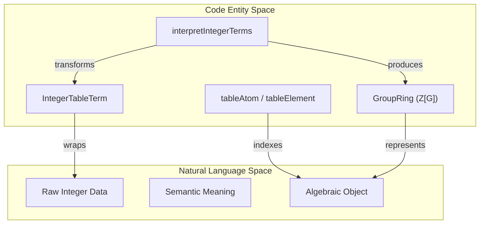
Sources: `ConnesRigidity/PropertyTExactCertificateTerms.lean:1-50` (), `ConnesRigidity/PropertyTExactCertificateCoefficientEdgeBase.lean:1-30` ()

## Certificate Components Implementation

### Denominator Scaling
The certificate operates over integers to avoid floating-point issues. A global denominator is used to scale the Laplacian. This is defined in `PropertyTExactCertificate.lean`.

### Edge Packets
Edge terms represent the squares associated with group generators. Because there are thousands of these terms, they are sharded into "Packets". For example, `coefficientPositivePacketRows153` in `Positive153.lean` loads a specific chunk of data.

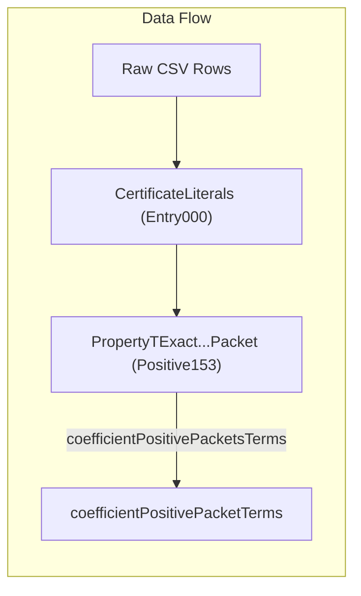
Sources: `ConnesRigidity/PropertyTExactCertificateCoefficientEdgePackets/Positive153.lean:9-15` (), `ConnesRigidity/PropertyTExactCertificateCoefficientEdgePackets/Positive001.lean:9-15` ()

### The Top-Level Check
The file `PropertyTExactCertificateChecks.lean` aggregates all sharded components (Gram rows, edge packets, product tables) and presents the final `decide` blocks that the Lean kernel executes to verify the identity.

## File Roles and Data Flow

| File | Role | Key Entities |
| :--- | :--- | :--- |
| `PropertyTExactCertificate.lean` | Top-level definitions | `exactCertificate`, `denominator` |
| `PropertyTExactCertificateTerms.lean` | Term definitions | `IntegerTableTerm`, `interpretIntegerTerms` |
| `PropertyTExactCertificateChecks.lean` | Kernel entry point | `check_certificate_identity` |
| `PropertyTExactCertificateCoefficientEdgeBase.lean` | Edge logic | `coefficientPositivePacketsTerms`, `coefficientNegativePacketsTerms` |

### Detailed Data Flow for Edge Terms
1.  **Storage**: Data is stored in `CertificateLiterals` as `List (List Int)`.
2.  **Import**: Files like `Positive153.lean` import these literals and mark them `@[irreducible]` to prevent the Lean elaborator from unfolding them prematurely.
3.  **Conversion**: `coefficientPositivePacketsTerms` converts the raw lists into `List (IntegerTableTerm 73033)`.
4.  **Verification**: These terms are summed in the final SOS check.

Sources: `ConnesRigidity/PropertyTExactCertificateCoefficientEdgePackets/Positive155.lean:9-15` (), `ConnesRigidity/PropertyTExactCertificateCoefficientEdgePackets/Positive178.lean:9-15` ()

## Computational Strategy: The "Decide" Tactic
The architecture heavily relies on Lean's `decide` tactic. By providing a `Decidable` instance for the certificate identity, the entire verification is offloaded to the Lean kernel's bytecode evaluator. This requires:
*   Efficient implementation of group ring multiplication (via `ProductIndexRows`).
*   Strict management of memory via `noncomputable` and `irreducible` definitions to handle the 73,033-element basis.

Sources: `ConnesRigidity/PropertyTExactCertificateCoefficientEdgePackets/Positive153.lean:9` (), `ConnesRigidity/PropertyTExactCertificateCoefficientEdgePackets/Positive158.lean:9` ()

---

# Page: Gram Matrix Certificate

# Gram Matrix Certificate

<details>
<summary>Relevant source files</summary>

The following files were used as context for generating this wiki page:

- [ConnesRigidity/CertificateLiterals/PropertyTExactCertificateFullGramRows/Entry013.lean](ConnesRigidity/CertificateLiterals/PropertyTExactCertificateFullGramRows/Entry013.lean)
- [ConnesRigidity/CertificateLiterals/PropertyTExactCertificateFullGramRows/Entry019.lean](ConnesRigidity/CertificateLiterals/PropertyTExactCertificateFullGramRows/Entry019.lean)
- [ConnesRigidity/CertificateLiterals/PropertyTExactCertificateFullGramRows/Entry048.lean](ConnesRigidity/CertificateLiterals/PropertyTExactCertificateFullGramRows/Entry048.lean)
- [ConnesRigidity/CertificateLiterals/PropertyTExactCertificateFullGramRows/Entry055.lean](ConnesRigidity/CertificateLiterals/PropertyTExactCertificateFullGramRows/Entry055.lean)
- [ConnesRigidity/CertificateLiterals/PropertyTExactCertificateFullGramRows/Entry063.lean](ConnesRigidity/CertificateLiterals/PropertyTExactCertificateFullGramRows/Entry063.lean)
- [ConnesRigidity/CertificateLiterals/PropertyTExactCertificateFullGramRows/Entry073.lean](ConnesRigidity/CertificateLiterals/PropertyTExactCertificateFullGramRows/Entry073.lean)
- [ConnesRigidity/CertificateLiterals/PropertyTExactCertificateFullGramRows/Entry074.lean](ConnesRigidity/CertificateLiterals/PropertyTExactCertificateFullGramRows/Entry074.lean)
- [ConnesRigidity/CertificateLiterals/PropertyTExactCertificateFullGramRows/Entry075.lean](ConnesRigidity/CertificateLiterals/PropertyTExactCertificateFullGramRows/Entry075.lean)
- [ConnesRigidity/CertificateLiterals/PropertyTExactCertificateFullGramRows/Entry099.lean](ConnesRigidity/CertificateLiterals/PropertyTExactCertificateFullGramRows/Entry099.lean)
- [ConnesRigidity/CertificateLiterals/PropertyTExactCertificateFullGramRows/Entry100.lean](ConnesRigidity/CertificateLiterals/PropertyTExactCertificateFullGramRows/Entry100.lean)
- [ConnesRigidity/CertificateLiterals/PropertyTExactCertificateFullGramRows/Entry102.lean](ConnesRigidity/CertificateLiterals/PropertyTExactCertificateFullGramRows/Entry102.lean)
- [ConnesRigidity/CertificateLiterals/PropertyTExactCertificateFullGramRows/Entry104.lean](ConnesRigidity/CertificateLiterals/PropertyTExactCertificateFullGramRows/Entry104.lean)
- [ConnesRigidity/CertificateLiterals/PropertyTExactCertificateFullGramRows/Entry108.lean](ConnesRigidity/CertificateLiterals/PropertyTExactCertificateFullGramRows/Entry108.lean)
- [ConnesRigidity/CertificateLiterals/PropertyTExactCertificateFullGramRows/Entry110.lean](ConnesRigidity/CertificateLiterals/PropertyTExactCertificateFullGramRows/Entry110.lean)
- [ConnesRigidity/CertificateLiterals/PropertyTExactCertificateFullGramRows/Entry113.lean](ConnesRigidity/CertificateLiterals/PropertyTExactCertificateFullGramRows/Entry113.lean)
- [ConnesRigidity/CertificateLiterals/PropertyTExactCertificateFullGramRows/Entry115.lean](ConnesRigidity/CertificateLiterals/PropertyTExactCertificateFullGramRows/Entry115.lean)
- [ConnesRigidity/CertificateLiterals/PropertyTExactCertificateFullGramRows/Entry120.lean](ConnesRigidity/CertificateLiterals/PropertyTExactCertificateFullGramRows/Entry120.lean)
- [ConnesRigidity/CertificateLiterals/PropertyTExactCertificateFullGramRows/Entry124.lean](ConnesRigidity/CertificateLiterals/PropertyTExactCertificateFullGramRows/Entry124.lean)
- [ConnesRigidity/CertificateLiterals/PropertyTExactCertificateFullGramRows/Entry128.lean](ConnesRigidity/CertificateLiterals/PropertyTExactCertificateFullGramRows/Entry128.lean)
- [ConnesRigidity/CertificateLiterals/PropertyTExactCertificateFullGramRows/Entry132.lean](ConnesRigidity/CertificateLiterals/PropertyTExactCertificateFullGramRows/Entry132.lean)
- [ConnesRigidity/CertificateLiterals/PropertyTExactCertificateFullGramRows/Entry146.lean](ConnesRigidity/CertificateLiterals/PropertyTExactCertificateFullGramRows/Entry146.lean)
- [ConnesRigidity/CertificateLiterals/PropertyTExactCertificateFullGramRows/Entry148.lean](ConnesRigidity/CertificateLiterals/PropertyTExactCertificateFullGramRows/Entry148.lean)
- [ConnesRigidity/CertificateLiterals/PropertyTExactCertificateFullGramRows/Entry149.lean](ConnesRigidity/CertificateLiterals/PropertyTExactCertificateFullGramRows/Entry149.lean)
- [ConnesRigidity/CertificateLiterals/PropertyTExactCertificateFullGramRows/Entry153.lean](ConnesRigidity/CertificateLiterals/PropertyTExactCertificateFullGramRows/Entry153.lean)
- [ConnesRigidity/CertificateLiterals/PropertyTExactCertificateFullGramRows/Entry159.lean](ConnesRigidity/CertificateLiterals/PropertyTExactCertificateFullGramRows/Entry159.lean)
- [ConnesRigidity/CertificateLiterals/PropertyTExactCertificateFullGramRows/Entry166.lean](ConnesRigidity/CertificateLiterals/PropertyTExactCertificateFullGramRows/Entry166.lean)
- [ConnesRigidity/CertificateLiterals/PropertyTExactCertificateFullGramRows/Entry167.lean](ConnesRigidity/CertificateLiterals/PropertyTExactCertificateFullGramRows/Entry167.lean)
- [ConnesRigidity/CertificateLiterals/PropertyTExactCertificateFullGramRows/Entry173.lean](ConnesRigidity/CertificateLiterals/PropertyTExactCertificateFullGramRows/Entry173.lean)
- [ConnesRigidity/CertificateLiterals/PropertyTExactCertificateFullGramRows/Entry174.lean](ConnesRigidity/CertificateLiterals/PropertyTExactCertificateFullGramRows/Entry174.lean)
- [ConnesRigidity/CertificateLiterals/PropertyTExactCertificateFullGramRows/Entry179.lean](ConnesRigidity/CertificateLiterals/PropertyTExactCertificateFullGramRows/Entry179.lean)
- [ConnesRigidity/CertificateLiterals/PropertyTExactCertificateFullGramRows/Entry181.lean](ConnesRigidity/CertificateLiterals/PropertyTExactCertificateFullGramRows/Entry181.lean)
- [ConnesRigidity/CertificateLiterals/PropertyTExactCertificateFullGramRows/Entry183.lean](ConnesRigidity/CertificateLiterals/PropertyTExactCertificateFullGramRows/Entry183.lean)
- [ConnesRigidity/CertificateLiterals/PropertyTExactCertificateFullGramRows/Entry184.lean](ConnesRigidity/CertificateLiterals/PropertyTExactCertificateFullGramRows/Entry184.lean)
- [ConnesRigidity/CertificateLiterals/PropertyTExactCertificateFullGramRows/Entry188.lean](ConnesRigidity/CertificateLiterals/PropertyTExactCertificateFullGramRows/Entry188.lean)
- [ConnesRigidity/CertificateLiterals/PropertyTExactCertificateFullGramRows/Entry194.lean](ConnesRigidity/CertificateLiterals/PropertyTExactCertificateFullGramRows/Entry194.lean)
- [ConnesRigidity/CertificateLiterals/PropertyTExactCertificateFullGramRows/Entry196.lean](ConnesRigidity/CertificateLiterals/PropertyTExactCertificateFullGramRows/Entry196.lean)
- [ConnesRigidity/CertificateLiterals/PropertyTExactCertificateFullGramRows/Entry214.lean](ConnesRigidity/CertificateLiterals/PropertyTExactCertificateFullGramRows/Entry214.lean)
- [ConnesRigidity/CertificateLiterals/PropertyTExactCertificateFullGramRows/Entry234.lean](ConnesRigidity/CertificateLiterals/PropertyTExactCertificateFullGramRows/Entry234.lean)
- [ConnesRigidity/CertificateLiterals/PropertyTExactCertificateFullGramRows/Entry245.lean](ConnesRigidity/CertificateLiterals/PropertyTExactCertificateFullGramRows/Entry245.lean)
- [ConnesRigidity/CertificateLiterals/PropertyTExactCertificateFullGramRows/Entry256.lean](ConnesRigidity/CertificateLiterals/PropertyTExactCertificateFullGramRows/Entry256.lean)
- [ConnesRigidity/CertificateLiterals/PropertyTExactCertificateFullGramRows/Entry271.lean](ConnesRigidity/CertificateLiterals/PropertyTExactCertificateFullGramRows/Entry271.lean)
- [ConnesRigidity/CertificateLiterals/PropertyTExactCertificateFullGramRows/Entry284.lean](ConnesRigidity/CertificateLiterals/PropertyTExactCertificateFullGramRows/Entry284.lean)
- [ConnesRigidity/CertificateLiterals/PropertyTExactCertificateFullGramRows/Entry287.lean](ConnesRigidity/CertificateLiterals/PropertyTExactCertificateFullGramRows/Entry287.lean)
- [ConnesRigidity/CertificateLiterals/PropertyTExactCertificateFullGramRows/Entry288.lean](ConnesRigidity/CertificateLiterals/PropertyTExactCertificateFullGramRows/Entry288.lean)
- [ConnesRigidity/CertificateLiterals/PropertyTExactCertificateFullGramRows/Entry290.lean](ConnesRigidity/CertificateLiterals/PropertyTExactCertificateFullGramRows/Entry290.lean)
- [ConnesRigidity/CertificateLiterals/PropertyTExactCertificateFullGramRows/Entry292.lean](ConnesRigidity/CertificateLiterals/PropertyTExactCertificateFullGramRows/Entry292.lean)
- [ConnesRigidity/CertificateLiterals/PropertyTExactCertificateFullGramRows/Entry293.lean](ConnesRigidity/CertificateLiterals/PropertyTExactCertificateFullGramRows/Entry293.lean)
- [ConnesRigidity/CertificateLiterals/PropertyTExactCertificateFullGramRows/Entry296.lean](ConnesRigidity/CertificateLiterals/PropertyTExactCertificateFullGramRows/Entry296.lean)
- [ConnesRigidity/CertificateLiterals/PropertyTExactCertificateFullGramRows/Entry302.lean](ConnesRigidity/CertificateLiterals/PropertyTExactCertificateFullGramRows/Entry302.lean)
- [ConnesRigidity/CertificateLiterals/PropertyTExactCertificateFullGramRows/Entry303.lean](ConnesRigidity/CertificateLiterals/PropertyTExactCertificateFullGramRows/Entry303.lean)
- [ConnesRigidity/CertificateLiterals/PropertyTExactCertificateFullGramRows/Entry304.lean](ConnesRigidity/CertificateLiterals/PropertyTExactCertificateFullGramRows/Entry304.lean)
- [ConnesRigidity/CertificateLiterals/PropertyTExactCertificateFullGramRows/Entry305.lean](ConnesRigidity/CertificateLiterals/PropertyTExactCertificateFullGramRows/Entry305.lean)
- [ConnesRigidity/CertificateLiterals/PropertyTExactCertificateFullGramRows/Entry319.lean](ConnesRigidity/CertificateLiterals/PropertyTExactCertificateFullGramRows/Entry319.lean)
- [ConnesRigidity/CertificateLiterals/PropertyTExactCertificateFullGramRows/Entry321.lean](ConnesRigidity/CertificateLiterals/PropertyTExactCertificateFullGramRows/Entry321.lean)
- [ConnesRigidity/CertificateLiterals/PropertyTExactCertificateFullGramRows/Entry327.lean](ConnesRigidity/CertificateLiterals/PropertyTExactCertificateFullGramRows/Entry327.lean)
- [ConnesRigidity/CertificateLiterals/PropertyTExactCertificateFullGramRows/Entry340.lean](ConnesRigidity/CertificateLiterals/PropertyTExactCertificateFullGramRows/Entry340.lean)
- [ConnesRigidity/CertificateLiterals/PropertyTExactCertificateFullGramRows/Entry342.lean](ConnesRigidity/CertificateLiterals/PropertyTExactCertificateFullGramRows/Entry342.lean)
- [ConnesRigidity/CertificateLiterals/PropertyTExactCertificateFullGramRows/Entry343.lean](ConnesRigidity/CertificateLiterals/PropertyTExactCertificateFullGramRows/Entry343.lean)
- [ConnesRigidity/CertificateLiterals/PropertyTExactCertificateFullGramRows/Entry344.lean](ConnesRigidity/CertificateLiterals/PropertyTExactCertificateFullGramRows/Entry344.lean)
- [ConnesRigidity/CertificateLiterals/PropertyTExactCertificateFullGramRows/Entry346.lean](ConnesRigidity/CertificateLiterals/PropertyTExactCertificateFullGramRows/Entry346.lean)
- [ConnesRigidity/CertificateLiterals/PropertyTExactCertificateFullGramRows/Entry356.lean](ConnesRigidity/CertificateLiterals/PropertyTExactCertificateFullGramRows/Entry356.lean)
- [ConnesRigidity/CertificateLiterals/PropertyTExactCertificateFullGramRows/Entry359.lean](ConnesRigidity/CertificateLiterals/PropertyTExactCertificateFullGramRows/Entry359.lean)
- [ConnesRigidity/CertificateLiterals/PropertyTExactCertificateFullGramRows/Entry362.lean](ConnesRigidity/CertificateLiterals/PropertyTExactCertificateFullGramRows/Entry362.lean)
- [ConnesRigidity/CertificateLiterals/PropertyTExactCertificateFullGramRows/Entry372.lean](ConnesRigidity/CertificateLiterals/PropertyTExactCertificateFullGramRows/Entry372.lean)
- [ConnesRigidity/CertificateLiterals/PropertyTExactCertificateFullGramRows/Entry383.lean](ConnesRigidity/CertificateLiterals/PropertyTExactCertificateFullGramRows/Entry383.lean)
- [ConnesRigidity/CertificateLiterals/PropertyTExactCertificateFullGramRows/Entry386.lean](ConnesRigidity/CertificateLiterals/PropertyTExactCertificateFullGramRows/Entry386.lean)
- [ConnesRigidity/CertificateLiterals/PropertyTExactCertificateFullGramRows/Entry387.lean](ConnesRigidity/CertificateLiterals/PropertyTExactCertificateFullGramRows/Entry387.lean)
- [ConnesRigidity/CertificateLiterals/PropertyTExactCertificateFullGramRows/Entry390.lean](ConnesRigidity/CertificateLiterals/PropertyTExactCertificateFullGramRows/Entry390.lean)
- [ConnesRigidity/CertificateLiterals/PropertyTExactCertificateFullGramRows/Entry393.lean](ConnesRigidity/CertificateLiterals/PropertyTExactCertificateFullGramRows/Entry393.lean)
- [ConnesRigidity/CertificateLiterals/PropertyTExactCertificateFullGramRows/Entry394.lean](ConnesRigidity/CertificateLiterals/PropertyTExactCertificateFullGramRows/Entry394.lean)
- [ConnesRigidity/CertificateLiterals/PropertyTExactCertificateFullGramRows/Entry408.lean](ConnesRigidity/CertificateLiterals/PropertyTExactCertificateFullGramRows/Entry408.lean)
- [ConnesRigidity/Certificates/AffineSymplectic/CoefficientEncodingRows/row_000](ConnesRigidity/Certificates/AffineSymplectic/CoefficientEncodingRows/row_000)
- [ConnesRigidity/Certificates/AffineSymplectic/CoefficientEncodingRows/row_002](ConnesRigidity/Certificates/AffineSymplectic/CoefficientEncodingRows/row_002)
- [ConnesRigidity/Certificates/AffineSymplectic/CoefficientEncodingRows/row_004](ConnesRigidity/Certificates/AffineSymplectic/CoefficientEncodingRows/row_004)
- [ConnesRigidity/Certificates/AffineSymplectic/CoefficientEncodingRows/row_010](ConnesRigidity/Certificates/AffineSymplectic/CoefficientEncodingRows/row_010)
- [ConnesRigidity/Certificates/AffineSymplectic/CoefficientEncodingRows/row_012](ConnesRigidity/Certificates/AffineSymplectic/CoefficientEncodingRows/row_012)
- [ConnesRigidity/Certificates/AffineSymplectic/CoefficientEncodingRows/row_026](ConnesRigidity/Certificates/AffineSymplectic/CoefficientEncodingRows/row_026)
- [ConnesRigidity/Certificates/AffineSymplectic/CoefficientEncodingRows/row_026_a](ConnesRigidity/Certificates/AffineSymplectic/CoefficientEncodingRows/row_026_a)
- [ConnesRigidity/Certificates/AffineSymplectic/CoefficientEncodingRows/row_030](ConnesRigidity/Certificates/AffineSymplectic/CoefficientEncodingRows/row_030)
- [ConnesRigidity/Certificates/AffineSymplectic/CoefficientEncodingRows/row_030_a](ConnesRigidity/Certificates/AffineSymplectic/CoefficientEncodingRows/row_030_a)
- [ConnesRigidity/Certificates/AffineSymplectic/CoefficientEncodingRows/row_031](ConnesRigidity/Certificates/AffineSymplectic/CoefficientEncodingRows/row_031)
- [ConnesRigidity/Certificates/AffineSymplectic/CoefficientEncodingRows/row_031_b](ConnesRigidity/Certificates/AffineSymplectic/CoefficientEncodingRows/row_031_b)
- [ConnesRigidity/Certificates/AffineSymplectic/CoefficientEncodingRows/row_032_b](ConnesRigidity/Certificates/AffineSymplectic/CoefficientEncodingRows/row_032_b)
- [ConnesRigidity/Certificates/AffineSymplectic/CoefficientEncodingRows/row_033_a](ConnesRigidity/Certificates/AffineSymplectic/CoefficientEncodingRows/row_033_a)
- [ConnesRigidity/Certificates/AffineSymplectic/CoefficientEncodingRows/row_033_b](ConnesRigidity/Certificates/AffineSymplectic/CoefficientEncodingRows/row_033_b)
- [ConnesRigidity/Certificates/AffineSymplectic/CoefficientEncodingRows/row_036_a](ConnesRigidity/Certificates/AffineSymplectic/CoefficientEncodingRows/row_036_a)
- [ConnesRigidity/Certificates/AffineSymplectic/CoefficientEncodingRows/row_037](ConnesRigidity/Certificates/AffineSymplectic/CoefficientEncodingRows/row_037)
- [ConnesRigidity/Certificates/AffineSymplectic/CoefficientEncodingRows/row_037_b](ConnesRigidity/Certificates/AffineSymplectic/CoefficientEncodingRows/row_037_b)
- [ConnesRigidity/Certificates/AffineSymplectic/CoefficientEncodingRows/row_038](ConnesRigidity/Certificates/AffineSymplectic/CoefficientEncodingRows/row_038)
- [ConnesRigidity/Certificates/AffineSymplectic/CoefficientEncodingRows/row_038_b](ConnesRigidity/Certificates/AffineSymplectic/CoefficientEncodingRows/row_038_b)
- [ConnesRigidity/Certificates/AffineSymplectic/CoefficientEncodingRows/row_039](ConnesRigidity/Certificates/AffineSymplectic/CoefficientEncodingRows/row_039)
- [ConnesRigidity/Certificates/AffineSymplectic/CoefficientEncodingRows/row_039_a](ConnesRigidity/Certificates/AffineSymplectic/CoefficientEncodingRows/row_039_a)
- [ConnesRigidity/Certificates/AffineSymplectic/CoefficientEncodingRows/row_040](ConnesRigidity/Certificates/AffineSymplectic/CoefficientEncodingRows/row_040)
- [ConnesRigidity/Certificates/AffineSymplectic/CoefficientEncodingRows/row_040_a](ConnesRigidity/Certificates/AffineSymplectic/CoefficientEncodingRows/row_040_a)
- [ConnesRigidity/Certificates/AffineSymplectic/CoefficientEncodingRows/row_040_b](ConnesRigidity/Certificates/AffineSymplectic/CoefficientEncodingRows/row_040_b)
- [ConnesRigidity/Certificates/AffineSymplectic/CoefficientEncodingRows/row_041](ConnesRigidity/Certificates/AffineSymplectic/CoefficientEncodingRows/row_041)
- [ConnesRigidity/Certificates/AffineSymplectic/CoefficientEncodingRows/row_041_a](ConnesRigidity/Certificates/AffineSymplectic/CoefficientEncodingRows/row_041_a)
- [ConnesRigidity/Certificates/AffineSymplectic/CoefficientEncodingRows/row_043](ConnesRigidity/Certificates/AffineSymplectic/CoefficientEncodingRows/row_043)
- [ConnesRigidity/Certificates/AffineSymplectic/CoefficientEncodingRows/row_046](ConnesRigidity/Certificates/AffineSymplectic/CoefficientEncodingRows/row_046)
- [ConnesRigidity/Certificates/AffineSymplectic/CoefficientEncodingRows/row_046_a](ConnesRigidity/Certificates/AffineSymplectic/CoefficientEncodingRows/row_046_a)
- [ConnesRigidity/Certificates/AffineSymplectic/CoefficientEncodingRows/row_047](ConnesRigidity/Certificates/AffineSymplectic/CoefficientEncodingRows/row_047)
- [ConnesRigidity/Certificates/AffineSymplectic/CoefficientEncodingRows/row_047_a](ConnesRigidity/Certificates/AffineSymplectic/CoefficientEncodingRows/row_047_a)
- [ConnesRigidity/Certificates/AffineSymplectic/CoefficientEncodingRows/row_047_b](ConnesRigidity/Certificates/AffineSymplectic/CoefficientEncodingRows/row_047_b)
- [ConnesRigidity/Certificates/AffineSymplectic/CoefficientEncodingRows/row_048](ConnesRigidity/Certificates/AffineSymplectic/CoefficientEncodingRows/row_048)
- [ConnesRigidity/Certificates/AffineSymplectic/CoefficientEncodingRows/row_048_a](ConnesRigidity/Certificates/AffineSymplectic/CoefficientEncodingRows/row_048_a)
- [ConnesRigidity/Certificates/AffineSymplectic/CoefficientEncodingRows/row_049](ConnesRigidity/Certificates/AffineSymplectic/CoefficientEncodingRows/row_049)
- [ConnesRigidity/Certificates/AffineSymplectic/CoefficientEncodingRows/row_049_a](ConnesRigidity/Certificates/AffineSymplectic/CoefficientEncodingRows/row_049_a)
- [ConnesRigidity/Certificates/AffineSymplectic/CoefficientEncodingRows/row_049_b](ConnesRigidity/Certificates/AffineSymplectic/CoefficientEncodingRows/row_049_b)
- [ConnesRigidity/Certificates/AffineSymplectic/CoefficientEncodingRows/row_050](ConnesRigidity/Certificates/AffineSymplectic/CoefficientEncodingRows/row_050)
- [ConnesRigidity/Certificates/AffineSymplectic/CoefficientEncodingRows/row_050_a](ConnesRigidity/Certificates/AffineSymplectic/CoefficientEncodingRows/row_050_a)
- [ConnesRigidity/Certificates/AffineSymplectic/CoefficientEncodingRows/row_050_b](ConnesRigidity/Certificates/AffineSymplectic/CoefficientEncodingRows/row_050_b)
- [ConnesRigidity/Certificates/AffineSymplectic/CoefficientEncodingRows/row_051](ConnesRigidity/Certificates/AffineSymplectic/CoefficientEncodingRows/row_051)
- [ConnesRigidity/Certificates/AffineSymplectic/CoefficientEncodingRows/row_051_a](ConnesRigidity/Certificates/AffineSymplectic/CoefficientEncodingRows/row_051_a)
- [ConnesRigidity/Certificates/AffineSymplectic/CoefficientEncodingRows/row_051_b](ConnesRigidity/Certificates/AffineSymplectic/CoefficientEncodingRows/row_051_b)
- [ConnesRigidity/Certificates/AffineSymplectic/CoefficientEncodingRows/row_052](ConnesRigidity/Certificates/AffineSymplectic/CoefficientEncodingRows/row_052)
- [ConnesRigidity/Certificates/AffineSymplectic/CoefficientEncodingRows/row_052_a](ConnesRigidity/Certificates/AffineSymplectic/CoefficientEncodingRows/row_052_a)
- [ConnesRigidity/Certificates/AffineSymplectic/CoefficientEncodingRows/row_052_b](ConnesRigidity/Certificates/AffineSymplectic/CoefficientEncodingRows/row_052_b)
- [ConnesRigidity/Certificates/AffineSymplectic/CoefficientEncodingRows/row_053](ConnesRigidity/Certificates/AffineSymplectic/CoefficientEncodingRows/row_053)
- [ConnesRigidity/Certificates/AffineSymplectic/CoefficientEncodingRows/row_053_a](ConnesRigidity/Certificates/AffineSymplectic/CoefficientEncodingRows/row_053_a)
- [ConnesRigidity/Certificates/AffineSymplectic/CoefficientEncodingRows/row_053_b](ConnesRigidity/Certificates/AffineSymplectic/CoefficientEncodingRows/row_053_b)
- [ConnesRigidity/Certificates/AffineSymplectic/CoefficientEncodingRows/row_054](ConnesRigidity/Certificates/AffineSymplectic/CoefficientEncodingRows/row_054)
- [ConnesRigidity/Certificates/AffineSymplectic/CoefficientEncodingRows/row_054_a](ConnesRigidity/Certificates/AffineSymplectic/CoefficientEncodingRows/row_054_a)
- [ConnesRigidity/Certificates/AffineSymplectic/CoefficientEncodingRows/row_054_b](ConnesRigidity/Certificates/AffineSymplectic/CoefficientEncodingRows/row_054_b)
- [ConnesRigidity/Certificates/AffineSymplectic/CoefficientEncodingRows/row_055](ConnesRigidity/Certificates/AffineSymplectic/CoefficientEncodingRows/row_055)
- [ConnesRigidity/Certificates/AffineSymplectic/CoefficientEncodingRows/row_055_a](ConnesRigidity/Certificates/AffineSymplectic/CoefficientEncodingRows/row_055_a)
- [ConnesRigidity/Certificates/AffineSymplectic/CoefficientEncodingRows/row_055_b](ConnesRigidity/Certificates/AffineSymplectic/CoefficientEncodingRows/row_055_b)
- [ConnesRigidity/Certificates/AffineSymplectic/CoefficientEncodingRows/row_056](ConnesRigidity/Certificates/AffineSymplectic/CoefficientEncodingRows/row_056)
- [ConnesRigidity/Certificates/AffineSymplectic/CoefficientEncodingRows/row_056_a](ConnesRigidity/Certificates/AffineSymplectic/CoefficientEncodingRows/row_056_a)
- [ConnesRigidity/Certificates/AffineSymplectic/CoefficientEncodingRows/row_056_b](ConnesRigidity/Certificates/AffineSymplectic/CoefficientEncodingRows/row_056_b)
- [ConnesRigidity/Certificates/AffineSymplectic/CoefficientEncodingRows/row_057](ConnesRigidity/Certificates/AffineSymplectic/CoefficientEncodingRows/row_057)
- [ConnesRigidity/Certificates/AffineSymplectic/CoefficientEncodingRows/row_057_a](ConnesRigidity/Certificates/AffineSymplectic/CoefficientEncodingRows/row_057_a)
- [ConnesRigidity/Certificates/AffineSymplectic/CoefficientEncodingRows/row_057_b](ConnesRigidity/Certificates/AffineSymplectic/CoefficientEncodingRows/row_057_b)
- [ConnesRigidity/Certificates/AffineSymplectic/CoefficientEncodingRows/row_058](ConnesRigidity/Certificates/AffineSymplectic/CoefficientEncodingRows/row_058)
- [ConnesRigidity/Certificates/AffineSymplectic/CoefficientEncodingRows/row_058_a](ConnesRigidity/Certificates/AffineSymplectic/CoefficientEncodingRows/row_058_a)
- [ConnesRigidity/Certificates/AffineSymplectic/CoefficientEncodingRows/row_058_b](ConnesRigidity/Certificates/AffineSymplectic/CoefficientEncodingRows/row_058_b)
- [ConnesRigidity/Certificates/AffineSymplectic/CoefficientEncodingRows/row_059](ConnesRigidity/Certificates/AffineSymplectic/CoefficientEncodingRows/row_059)
- [ConnesRigidity/Certificates/AffineSymplectic/CoefficientEncodingRows/row_059_a](ConnesRigidity/Certificates/AffineSymplectic/CoefficientEncodingRows/row_059_a)
- [ConnesRigidity/Certificates/AffineSymplectic/CoefficientEncodingRows/row_059_b](ConnesRigidity/Certificates/AffineSymplectic/CoefficientEncodingRows/row_059_b)
- [ConnesRigidity/Certificates/AffineSymplectic/CoefficientEncodingRows/row_060](ConnesRigidity/Certificates/AffineSymplectic/CoefficientEncodingRows/row_060)
- [ConnesRigidity/Certificates/AffineSymplectic/CoefficientEncodingRows/row_060_a](ConnesRigidity/Certificates/AffineSymplectic/CoefficientEncodingRows/row_060_a)
- [ConnesRigidity/Certificates/AffineSymplectic/CoefficientEncodingRows/row_060_b](ConnesRigidity/Certificates/AffineSymplectic/CoefficientEncodingRows/row_060_b)
- [ConnesRigidity/Certificates/AffineSymplectic/CoefficientEncodingRows/row_061](ConnesRigidity/Certificates/AffineSymplectic/CoefficientEncodingRows/row_061)
- [ConnesRigidity/Certificates/AffineSymplectic/CoefficientEncodingRows/row_061_a](ConnesRigidity/Certificates/AffineSymplectic/CoefficientEncodingRows/row_061_a)
- [ConnesRigidity/Certificates/AffineSymplectic/CoefficientEncodingRows/row_061_b](ConnesRigidity/Certificates/AffineSymplectic/CoefficientEncodingRows/row_061_b)
- [ConnesRigidity/Certificates/AffineSymplectic/CoefficientEncodingRows/row_062](ConnesRigidity/Certificates/AffineSymplectic/CoefficientEncodingRows/row_062)
- [ConnesRigidity/Certificates/AffineSymplectic/CoefficientEncodingRows/row_062_a](ConnesRigidity/Certificates/AffineSymplectic/CoefficientEncodingRows/row_062_a)
- [ConnesRigidity/Certificates/AffineSymplectic/CoefficientEncodingRows/row_062_b](ConnesRigidity/Certificates/AffineSymplectic/CoefficientEncodingRows/row_062_b)
- [ConnesRigidity/Certificates/AffineSymplectic/CoefficientEncodingRows/row_063_b](ConnesRigidity/Certificates/AffineSymplectic/CoefficientEncodingRows/row_063_b)
- [ConnesRigidity/Certificates/AffineSymplectic/CoefficientEncodingRows/row_064_a](ConnesRigidity/Certificates/AffineSymplectic/CoefficientEncodingRows/row_064_a)
- [ConnesRigidity/Certificates/AffineSymplectic/CoefficientEncodingRows/row_065](ConnesRigidity/Certificates/AffineSymplectic/CoefficientEncodingRows/row_065)
- [ConnesRigidity/Certificates/AffineSymplectic/CoefficientEncodingRows/row_066](ConnesRigidity/Certificates/AffineSymplectic/CoefficientEncodingRows/row_066)
- [ConnesRigidity/Certificates/AffineSymplectic/CoefficientEncodingRows/row_066_b](ConnesRigidity/Certificates/AffineSymplectic/CoefficientEncodingRows/row_066_b)
- [ConnesRigidity/Certificates/AffineSymplectic/CoefficientEncodingRows/row_067](ConnesRigidity/Certificates/AffineSymplectic/CoefficientEncodingRows/row_067)
- [ConnesRigidity/Certificates/AffineSymplectic/CoefficientEncodingRows/row_068](ConnesRigidity/Certificates/AffineSymplectic/CoefficientEncodingRows/row_068)
- [ConnesRigidity/Certificates/AffineSymplectic/CoefficientEncodingRows/row_068_a](ConnesRigidity/Certificates/AffineSymplectic/CoefficientEncodingRows/row_068_a)
- [ConnesRigidity/Certificates/AffineSymplectic/CoefficientEncodingRows/row_068_b](ConnesRigidity/Certificates/AffineSymplectic/CoefficientEncodingRows/row_068_b)
- [ConnesRigidity/Certificates/AffineSymplectic/CoefficientEncodingRows/row_069_a](ConnesRigidity/Certificates/AffineSymplectic/CoefficientEncodingRows/row_069_a)
- [ConnesRigidity/Certificates/AffineSymplectic/CoefficientEncodingRows/row_070](ConnesRigidity/Certificates/AffineSymplectic/CoefficientEncodingRows/row_070)
- [ConnesRigidity/Certificates/AffineSymplectic/CoefficientEncodingRows/row_070_a](ConnesRigidity/Certificates/AffineSymplectic/CoefficientEncodingRows/row_070_a)
- [ConnesRigidity/Certificates/AffineSymplectic/CoefficientEncodingRows/row_071](ConnesRigidity/Certificates/AffineSymplectic/CoefficientEncodingRows/row_071)
- [ConnesRigidity/Certificates/AffineSymplectic/CoefficientEncodingRows/row_071_a](ConnesRigidity/Certificates/AffineSymplectic/CoefficientEncodingRows/row_071_a)
- [ConnesRigidity/Certificates/AffineSymplectic/CoefficientEncodingRows/row_071_b](ConnesRigidity/Certificates/AffineSymplectic/CoefficientEncodingRows/row_071_b)
- [ConnesRigidity/Certificates/AffineSymplectic/CoefficientEncodingRows/row_072_a](ConnesRigidity/Certificates/AffineSymplectic/CoefficientEncodingRows/row_072_a)
- [ConnesRigidity/Certificates/AffineSymplectic/CoefficientEncodingRows/row_072_b](ConnesRigidity/Certificates/AffineSymplectic/CoefficientEncodingRows/row_072_b)
- [ConnesRigidity/Certificates/AffineSymplectic/CoefficientEncodingRows/row_073_a](ConnesRigidity/Certificates/AffineSymplectic/CoefficientEncodingRows/row_073_a)
- [ConnesRigidity/Certificates/AffineSymplectic/CoefficientEncodingRows/row_073_b](ConnesRigidity/Certificates/AffineSymplectic/CoefficientEncodingRows/row_073_b)
- [ConnesRigidity/Certificates/AffineSymplectic/CoefficientEncodingRows/row_074](ConnesRigidity/Certificates/AffineSymplectic/CoefficientEncodingRows/row_074)
- [ConnesRigidity/Certificates/AffineSymplectic/CoefficientEncodingRows/row_075_a](ConnesRigidity/Certificates/AffineSymplectic/CoefficientEncodingRows/row_075_a)
- [ConnesRigidity/Certificates/AffineSymplectic/CoefficientEncodingRows/row_076](ConnesRigidity/Certificates/AffineSymplectic/CoefficientEncodingRows/row_076)
- [ConnesRigidity/Certificates/AffineSymplectic/CoefficientEncodingRows/row_077](ConnesRigidity/Certificates/AffineSymplectic/CoefficientEncodingRows/row_077)
- [ConnesRigidity/Certificates/AffineSymplectic/CoefficientEncodingRows/row_077_a](ConnesRigidity/Certificates/AffineSymplectic/CoefficientEncodingRows/row_077_a)
- [ConnesRigidity/Certificates/AffineSymplectic/CoefficientEncodingRows/row_078](ConnesRigidity/Certificates/AffineSymplectic/CoefficientEncodingRows/row_078)
- [ConnesRigidity/Certificates/AffineSymplectic/CoefficientEncodingRows/row_078_a](ConnesRigidity/Certificates/AffineSymplectic/CoefficientEncodingRows/row_078_a)
- [ConnesRigidity/Certificates/AffineSymplectic/CoefficientEncodingRows/row_078_b](ConnesRigidity/Certificates/AffineSymplectic/CoefficientEncodingRows/row_078_b)
- [ConnesRigidity/Certificates/AffineSymplectic/CoefficientEncodingRows/row_079](ConnesRigidity/Certificates/AffineSymplectic/CoefficientEncodingRows/row_079)
- [ConnesRigidity/Certificates/AffineSymplectic/CoefficientEncodingRows/row_079_a](ConnesRigidity/Certificates/AffineSymplectic/CoefficientEncodingRows/row_079_a)
- [ConnesRigidity/Certificates/AffineSymplectic/CoefficientEncodingRows/row_080_b](ConnesRigidity/Certificates/AffineSymplectic/CoefficientEncodingRows/row_080_b)
- [ConnesRigidity/Certificates/AffineSymplectic/CoefficientEncodingRows/row_081](ConnesRigidity/Certificates/AffineSymplectic/CoefficientEncodingRows/row_081)
- [ConnesRigidity/Certificates/AffineSymplectic/CoefficientEncodingRows/row_081_001](ConnesRigidity/Certificates/AffineSymplectic/CoefficientEncodingRows/row_081_001)
- [ConnesRigidity/Certificates/AffineSymplectic/CoefficientEncodingRows/row_081_002](ConnesRigidity/Certificates/AffineSymplectic/CoefficientEncodingRows/row_081_002)
- [ConnesRigidity/Certificates/AffineSymplectic/CoefficientFullGramRows/row_002](ConnesRigidity/Certificates/AffineSymplectic/CoefficientFullGramRows/row_002)
- [ConnesRigidity/Certificates/AffineSymplectic/CoefficientFullGramRows/row_003](ConnesRigidity/Certificates/AffineSymplectic/CoefficientFullGramRows/row_003)
- [ConnesRigidity/Certificates/AffineSymplectic/CoefficientFullGramRows/row_012](ConnesRigidity/Certificates/AffineSymplectic/CoefficientFullGramRows/row_012)
- [ConnesRigidity/Certificates/AffineSymplectic/CoefficientFullGramRows/row_013](ConnesRigidity/Certificates/AffineSymplectic/CoefficientFullGramRows/row_013)
- [ConnesRigidity/Certificates/AffineSymplectic/CoefficientFullGramRows/row_019](ConnesRigidity/Certificates/AffineSymplectic/CoefficientFullGramRows/row_019)
- [ConnesRigidity/Certificates/AffineSymplectic/CoefficientFullGramRows/row_020](ConnesRigidity/Certificates/AffineSymplectic/CoefficientFullGramRows/row_020)
- [ConnesRigidity/Certificates/AffineSymplectic/CoefficientFullGramRows/row_023](ConnesRigidity/Certificates/AffineSymplectic/CoefficientFullGramRows/row_023)
- [ConnesRigidity/Certificates/AffineSymplectic/CoefficientFullGramRows/row_025](ConnesRigidity/Certificates/AffineSymplectic/CoefficientFullGramRows/row_025)
- [ConnesRigidity/Certificates/AffineSymplectic/CoefficientFullGramRows/row_026](ConnesRigidity/Certificates/AffineSymplectic/CoefficientFullGramRows/row_026)
- [ConnesRigidity/Certificates/AffineSymplectic/CoefficientFullGramRows/row_029](ConnesRigidity/Certificates/AffineSymplectic/CoefficientFullGramRows/row_029)
- [ConnesRigidity/Certificates/AffineSymplectic/CoefficientFullGramRows/row_030](ConnesRigidity/Certificates/AffineSymplectic/CoefficientFullGramRows/row_030)
- [ConnesRigidity/Certificates/AffineSymplectic/CoefficientFullGramRows/row_036](ConnesRigidity/Certificates/AffineSymplectic/CoefficientFullGramRows/row_036)
- [ConnesRigidity/Certificates/AffineSymplectic/CoefficientFullGramRows/row_042](ConnesRigidity/Certificates/AffineSymplectic/CoefficientFullGramRows/row_042)
- [ConnesRigidity/Certificates/AffineSymplectic/CoefficientFullGramRows/row_049](ConnesRigidity/Certificates/AffineSymplectic/CoefficientFullGramRows/row_049)
- [ConnesRigidity/Certificates/AffineSymplectic/CoefficientFullGramRows/row_052](ConnesRigidity/Certificates/AffineSymplectic/CoefficientFullGramRows/row_052)
- [ConnesRigidity/Certificates/AffineSymplectic/CoefficientFullGramRows/row_054](ConnesRigidity/Certificates/AffineSymplectic/CoefficientFullGramRows/row_054)
- [ConnesRigidity/Certificates/AffineSymplectic/CoefficientFullGramRows/row_055](ConnesRigidity/Certificates/AffineSymplectic/CoefficientFullGramRows/row_055)
- [ConnesRigidity/Certificates/AffineSymplectic/CoefficientFullGramRows/row_057](ConnesRigidity/Certificates/AffineSymplectic/CoefficientFullGramRows/row_057)
- [ConnesRigidity/Certificates/AffineSymplectic/CoefficientFullGramRows/row_076](ConnesRigidity/Certificates/AffineSymplectic/CoefficientFullGramRows/row_076)
- [ConnesRigidity/Certificates/AffineSymplectic/CoefficientFullGramRows/row_095](ConnesRigidity/Certificates/AffineSymplectic/CoefficientFullGramRows/row_095)
- [ConnesRigidity/Certificates/AffineSymplectic/CoefficientFullGramRows/row_105](ConnesRigidity/Certificates/AffineSymplectic/CoefficientFullGramRows/row_105)
- [ConnesRigidity/Certificates/AffineSymplectic/CoefficientFullGramRows/row_107](ConnesRigidity/Certificates/AffineSymplectic/CoefficientFullGramRows/row_107)
- [ConnesRigidity/Certificates/AffineSymplectic/CoefficientFullGramRows/row_132](ConnesRigidity/Certificates/AffineSymplectic/CoefficientFullGramRows/row_132)
- [ConnesRigidity/Certificates/AffineSymplectic/CoefficientFullGramRows/row_135](ConnesRigidity/Certificates/AffineSymplectic/CoefficientFullGramRows/row_135)
- [ConnesRigidity/Certificates/AffineSymplectic/CoefficientFullGramRows/row_137](ConnesRigidity/Certificates/AffineSymplectic/CoefficientFullGramRows/row_137)
- [ConnesRigidity/Certificates/AffineSymplectic/CoefficientFullGramRows/row_145](ConnesRigidity/Certificates/AffineSymplectic/CoefficientFullGramRows/row_145)
- [ConnesRigidity/Certificates/AffineSymplectic/CoefficientFullGramRows/row_152](ConnesRigidity/Certificates/AffineSymplectic/CoefficientFullGramRows/row_152)
- [ConnesRigidity/Certificates/AffineSymplectic/CoefficientFullGramRows/row_155](ConnesRigidity/Certificates/AffineSymplectic/CoefficientFullGramRows/row_155)
- [ConnesRigidity/Certificates/AffineSymplectic/CoefficientFullGramRows/row_163](ConnesRigidity/Certificates/AffineSymplectic/CoefficientFullGramRows/row_163)
- [ConnesRigidity/Certificates/AffineSymplectic/CoefficientFullGramRows/row_172](ConnesRigidity/Certificates/AffineSymplectic/CoefficientFullGramRows/row_172)
- [ConnesRigidity/Certificates/AffineSymplectic/CoefficientFullGramRows/row_187](ConnesRigidity/Certificates/AffineSymplectic/CoefficientFullGramRows/row_187)
- [ConnesRigidity/Certificates/AffineSymplectic/CoefficientFullGramRows/row_196](ConnesRigidity/Certificates/AffineSymplectic/CoefficientFullGramRows/row_196)
- [ConnesRigidity/Certificates/AffineSymplectic/CoefficientFullGramRows/row_202](ConnesRigidity/Certificates/AffineSymplectic/CoefficientFullGramRows/row_202)
- [ConnesRigidity/Certificates/AffineSymplectic/CoefficientFullGramRows/row_212](ConnesRigidity/Certificates/AffineSymplectic/CoefficientFullGramRows/row_212)
- [ConnesRigidity/Certificates/AffineSymplectic/CoefficientFullGramRows/row_213](ConnesRigidity/Certificates/AffineSymplectic/CoefficientFullGramRows/row_213)
- [ConnesRigidity/Certificates/AffineSymplectic/CoefficientFullGramRows/row_214](ConnesRigidity/Certificates/AffineSymplectic/CoefficientFullGramRows/row_214)
- [ConnesRigidity/Certificates/AffineSymplectic/CoefficientFullGramRows/row_223](ConnesRigidity/Certificates/AffineSymplectic/CoefficientFullGramRows/row_223)
- [ConnesRigidity/Certificates/AffineSymplectic/CoefficientFullGramRows/row_231](ConnesRigidity/Certificates/AffineSymplectic/CoefficientFullGramRows/row_231)
- [ConnesRigidity/Certificates/AffineSymplectic/CoefficientFullGramRows/row_232](ConnesRigidity/Certificates/AffineSymplectic/CoefficientFullGramRows/row_232)
- [ConnesRigidity/Certificates/AffineSymplectic/CoefficientFullGramRows/row_237](ConnesRigidity/Certificates/AffineSymplectic/CoefficientFullGramRows/row_237)
- [ConnesRigidity/Certificates/AffineSymplectic/CoefficientFullGramRows/row_245](ConnesRigidity/Certificates/AffineSymplectic/CoefficientFullGramRows/row_245)
- [ConnesRigidity/Certificates/AffineSymplectic/CoefficientFullGramRows/row_246](ConnesRigidity/Certificates/AffineSymplectic/CoefficientFullGramRows/row_246)
- [ConnesRigidity/Certificates/AffineSymplectic/CoefficientFullGramRows/row_248](ConnesRigidity/Certificates/AffineSymplectic/CoefficientFullGramRows/row_248)
- [ConnesRigidity/Certificates/AffineSymplectic/CoefficientFullGramRows/row_258](ConnesRigidity/Certificates/AffineSymplectic/CoefficientFullGramRows/row_258)
- [ConnesRigidity/Certificates/AffineSymplectic/CoefficientFullGramRows/row_271](ConnesRigidity/Certificates/AffineSymplectic/CoefficientFullGramRows/row_271)
- [ConnesRigidity/Certificates/AffineSymplectic/CoefficientFullGramRows/row_272](ConnesRigidity/Certificates/AffineSymplectic/CoefficientFullGramRows/row_272)
- [ConnesRigidity/Certificates/AffineSymplectic/CoefficientFullGramRows/row_274](ConnesRigidity/Certificates/AffineSymplectic/CoefficientFullGramRows/row_274)
- [ConnesRigidity/Certificates/AffineSymplectic/CoefficientFullGramRows/row_281](ConnesRigidity/Certificates/AffineSymplectic/CoefficientFullGramRows/row_281)
- [ConnesRigidity/Certificates/AffineSymplectic/CoefficientFullGramRows/row_285](ConnesRigidity/Certificates/AffineSymplectic/CoefficientFullGramRows/row_285)
- [ConnesRigidity/Certificates/AffineSymplectic/CoefficientFullGramRows/row_288](ConnesRigidity/Certificates/AffineSymplectic/CoefficientFullGramRows/row_288)
- [ConnesRigidity/Certificates/AffineSymplectic/CoefficientFullGramRows/row_289](ConnesRigidity/Certificates/AffineSymplectic/CoefficientFullGramRows/row_289)
- [ConnesRigidity/Certificates/AffineSymplectic/CoefficientFullGramRows/row_290](ConnesRigidity/Certificates/AffineSymplectic/CoefficientFullGramRows/row_290)
- [ConnesRigidity/Certificates/AffineSymplectic/CoefficientFullGramRows/row_306](ConnesRigidity/Certificates/AffineSymplectic/CoefficientFullGramRows/row_306)
- [ConnesRigidity/Certificates/AffineSymplectic/CoefficientFullGramRows/row_312](ConnesRigidity/Certificates/AffineSymplectic/CoefficientFullGramRows/row_312)
- [ConnesRigidity/Certificates/AffineSymplectic/CoefficientFullGramRows/row_321](ConnesRigidity/Certificates/AffineSymplectic/CoefficientFullGramRows/row_321)
- [ConnesRigidity/Certificates/AffineSymplectic/CoefficientFullGramRows/row_327](ConnesRigidity/Certificates/AffineSymplectic/CoefficientFullGramRows/row_327)
- [ConnesRigidity/Certificates/AffineSymplectic/CoefficientFullGramRows/row_328](ConnesRigidity/Certificates/AffineSymplectic/CoefficientFullGramRows/row_328)
- [ConnesRigidity/Certificates/AffineSymplectic/CoefficientFullGramRows/row_330](ConnesRigidity/Certificates/AffineSymplectic/CoefficientFullGramRows/row_330)
- [ConnesRigidity/Certificates/AffineSymplectic/CoefficientFullGramRows/row_345](ConnesRigidity/Certificates/AffineSymplectic/CoefficientFullGramRows/row_345)
- [ConnesRigidity/Certificates/AffineSymplectic/CoefficientFullGramRows/row_351](ConnesRigidity/Certificates/AffineSymplectic/CoefficientFullGramRows/row_351)
- [ConnesRigidity/Certificates/AffineSymplectic/CoefficientFullGramRows/row_357](ConnesRigidity/Certificates/AffineSymplectic/CoefficientFullGramRows/row_357)
- [ConnesRigidity/Certificates/AffineSymplectic/CoefficientFullGramRows/row_358](ConnesRigidity/Certificates/AffineSymplectic/CoefficientFullGramRows/row_358)
- [ConnesRigidity/Certificates/AffineSymplectic/CoefficientFullGramRows/row_370](ConnesRigidity/Certificates/AffineSymplectic/CoefficientFullGramRows/row_370)
- [ConnesRigidity/Certificates/AffineSymplectic/CoefficientFullGramRows/row_373](ConnesRigidity/Certificates/AffineSymplectic/CoefficientFullGramRows/row_373)
- [ConnesRigidity/Certificates/AffineSymplectic/CoefficientFullGramRows/row_377](ConnesRigidity/Certificates/AffineSymplectic/CoefficientFullGramRows/row_377)
- [ConnesRigidity/Certificates/AffineSymplectic/CoefficientFullGramRows/row_378](ConnesRigidity/Certificates/AffineSymplectic/CoefficientFullGramRows/row_378)
- [ConnesRigidity/Certificates/AffineSymplectic/CoefficientFullGramRows/row_379](ConnesRigidity/Certificates/AffineSymplectic/CoefficientFullGramRows/row_379)
- [ConnesRigidity/Certificates/AffineSymplectic/CoefficientFullGramRows/row_396](ConnesRigidity/Certificates/AffineSymplectic/CoefficientFullGramRows/row_396)
- [ConnesRigidity/Certificates/AffineSymplectic/CoefficientFullGramRows/row_397](ConnesRigidity/Certificates/AffineSymplectic/CoefficientFullGramRows/row_397)
- [ConnesRigidity/Certificates/AffineSymplectic/CoefficientFullGramRows/row_399](ConnesRigidity/Certificates/AffineSymplectic/CoefficientFullGramRows/row_399)
- [ConnesRigidity/Certificates/AffineSymplectic/CoefficientFullGramRows/row_424](ConnesRigidity/Certificates/AffineSymplectic/CoefficientFullGramRows/row_424)
- [ConnesRigidity/PropertyTExactCertificateGramRows/Row004.lean](ConnesRigidity/PropertyTExactCertificateGramRows/Row004.lean)
- [ConnesRigidity/PropertyTExactCertificateGramRows/Row005.lean](ConnesRigidity/PropertyTExactCertificateGramRows/Row005.lean)
- [ConnesRigidity/PropertyTExactCertificateGramRows/Row006.lean](ConnesRigidity/PropertyTExactCertificateGramRows/Row006.lean)
- [ConnesRigidity/PropertyTExactCertificateGramRows/Row009.lean](ConnesRigidity/PropertyTExactCertificateGramRows/Row009.lean)
- [ConnesRigidity/PropertyTExactCertificateGramRows/Row010.lean](ConnesRigidity/PropertyTExactCertificateGramRows/Row010.lean)
- [ConnesRigidity/PropertyTExactCertificateGramRows/Row017.lean](ConnesRigidity/PropertyTExactCertificateGramRows/Row017.lean)
- [ConnesRigidity/PropertyTExactCertificateGramRows/Row019.lean](ConnesRigidity/PropertyTExactCertificateGramRows/Row019.lean)
- [ConnesRigidity/PropertyTExactCertificateGramRows/Row020.lean](ConnesRigidity/PropertyTExactCertificateGramRows/Row020.lean)
- [ConnesRigidity/PropertyTExactCertificateGramRows/Row021.lean](ConnesRigidity/PropertyTExactCertificateGramRows/Row021.lean)
- [ConnesRigidity/PropertyTExactCertificateGramRows/Row022.lean](ConnesRigidity/PropertyTExactCertificateGramRows/Row022.lean)
- [ConnesRigidity/PropertyTExactCertificateGramRows/Row023.lean](ConnesRigidity/PropertyTExactCertificateGramRows/Row023.lean)
- [ConnesRigidity/PropertyTExactCertificateGramRows/Row024.lean](ConnesRigidity/PropertyTExactCertificateGramRows/Row024.lean)
- [ConnesRigidity/PropertyTExactCertificateGramRows/Row027.lean](ConnesRigidity/PropertyTExactCertificateGramRows/Row027.lean)
- [ConnesRigidity/PropertyTExactCertificateGramRows/Row031.lean](ConnesRigidity/PropertyTExactCertificateGramRows/Row031.lean)
- [ConnesRigidity/PropertyTExactCertificateGramRows/Row032.lean](ConnesRigidity/PropertyTExactCertificateGramRows/Row032.lean)
- [ConnesRigidity/PropertyTExactCertificateGramRows/Row034.lean](ConnesRigidity/PropertyTExactCertificateGramRows/Row034.lean)
- [ConnesRigidity/PropertyTExactCertificateGramRows/Row037.lean](ConnesRigidity/PropertyTExactCertificateGramRows/Row037.lean)
- [ConnesRigidity/PropertyTExactCertificateGramRows/Row039.lean](ConnesRigidity/PropertyTExactCertificateGramRows/Row039.lean)
- [ConnesRigidity/PropertyTExactCertificateGramRows/Row042.lean](ConnesRigidity/PropertyTExactCertificateGramRows/Row042.lean)
- [ConnesRigidity/PropertyTExactCertificateGramRows/Row054.lean](ConnesRigidity/PropertyTExactCertificateGramRows/Row054.lean)
- [ConnesRigidity/PropertyTExactCertificateGramRows/Row056.lean](ConnesRigidity/PropertyTExactCertificateGramRows/Row056.lean)
- [ConnesRigidity/PropertyTExactCertificateGramRows/Row062.lean](ConnesRigidity/PropertyTExactCertificateGramRows/Row062.lean)
- [ConnesRigidity/PropertyTExactCertificateGramRows/Row065.lean](ConnesRigidity/PropertyTExactCertificateGramRows/Row065.lean)
- [ConnesRigidity/PropertyTExactCertificateGramRows/Row070.lean](ConnesRigidity/PropertyTExactCertificateGramRows/Row070.lean)
- [ConnesRigidity/PropertyTExactCertificateGramRows/Row072.lean](ConnesRigidity/PropertyTExactCertificateGramRows/Row072.lean)
- [ConnesRigidity/PropertyTExactCertificateGramRows/Row073.lean](ConnesRigidity/PropertyTExactCertificateGramRows/Row073.lean)
- [ConnesRigidity/PropertyTExactCertificateGramRows/Row074.lean](ConnesRigidity/PropertyTExactCertificateGramRows/Row074.lean)
- [ConnesRigidity/PropertyTExactCertificateGramRows/Row080.lean](ConnesRigidity/PropertyTExactCertificateGramRows/Row080.lean)
- [ConnesRigidity/PropertyTExactCertificateGramRows/Row083.lean](ConnesRigidity/PropertyTExactCertificateGramRows/Row083.lean)
- [ConnesRigidity/PropertyTExactCertificateGramRows/Row085.lean](ConnesRigidity/PropertyTExactCertificateGramRows/Row085.lean)
- [ConnesRigidity/PropertyTExactCertificateGramRows/Row098.lean](ConnesRigidity/PropertyTExactCertificateGramRows/Row098.lean)
- [ConnesRigidity/PropertyTExactCertificateGramRows/Row106.lean](ConnesRigidity/PropertyTExactCertificateGramRows/Row106.lean)
- [ConnesRigidity/PropertyTExactCertificateGramRows/Row114.lean](ConnesRigidity/PropertyTExactCertificateGramRows/Row114.lean)
- [ConnesRigidity/PropertyTExactCertificateGramRows/Row115.lean](ConnesRigidity/PropertyTExactCertificateGramRows/Row115.lean)
- [ConnesRigidity/PropertyTExactCertificateGramRows/Row117.lean](ConnesRigidity/PropertyTExactCertificateGramRows/Row117.lean)
- [ConnesRigidity/PropertyTExactCertificateGramRows/Row126.lean](ConnesRigidity/PropertyTExactCertificateGramRows/Row126.lean)
- [ConnesRigidity/PropertyTExactCertificateGramRows/Row127.lean](ConnesRigidity/PropertyTExactCertificateGramRows/Row127.lean)
- [ConnesRigidity/PropertyTExactCertificateGramRows/Row133.lean](ConnesRigidity/PropertyTExactCertificateGramRows/Row133.lean)
- [ConnesRigidity/PropertyTExactCertificateGramRows/Row139.lean](ConnesRigidity/PropertyTExactCertificateGramRows/Row139.lean)
- [ConnesRigidity/PropertyTExactCertificateGramRows/Row144.lean](ConnesRigidity/PropertyTExactCertificateGramRows/Row144.lean)
- [ConnesRigidity/PropertyTExactCertificateGramRows/Row146.lean](ConnesRigidity/PropertyTExactCertificateGramRows/Row146.lean)
- [ConnesRigidity/PropertyTExactCertificateGramRows/Row149.lean](ConnesRigidity/PropertyTExactCertificateGramRows/Row149.lean)
- [ConnesRigidity/PropertyTExactCertificateGramRows/Row150.lean](ConnesRigidity/PropertyTExactCertificateGramRows/Row150.lean)
- [ConnesRigidity/PropertyTExactCertificateGramRows/Row151.lean](ConnesRigidity/PropertyTExactCertificateGramRows/Row151.lean)
- [ConnesRigidity/PropertyTExactCertificateGramRows/Row154.lean](ConnesRigidity/PropertyTExactCertificateGramRows/Row154.lean)
- [ConnesRigidity/PropertyTExactCertificateGramRows/Row160.lean](ConnesRigidity/PropertyTExactCertificateGramRows/Row160.lean)
- [ConnesRigidity/PropertyTExactCertificateGramRows/Row164.lean](ConnesRigidity/PropertyTExactCertificateGramRows/Row164.lean)
- [ConnesRigidity/PropertyTExactCertificateGramRows/Row175.lean](ConnesRigidity/PropertyTExactCertificateGramRows/Row175.lean)
- [ConnesRigidity/PropertyTExactCertificateGramRows/Row181.lean](ConnesRigidity/PropertyTExactCertificateGramRows/Row181.lean)
- [ConnesRigidity/PropertyTExactCertificateGramRows/Row182.lean](ConnesRigidity/PropertyTExactCertificateGramRows/Row182.lean)
- [ConnesRigidity/PropertyTExactCertificateGramRows/Row183.lean](ConnesRigidity/PropertyTExactCertificateGramRows/Row183.lean)
- [ConnesRigidity/PropertyTExactCertificateGramRows/Row187.lean](ConnesRigidity/PropertyTExactCertificateGramRows/Row187.lean)
- [ConnesRigidity/PropertyTExactCertificateGramRows/Row188.lean](ConnesRigidity/PropertyTExactCertificateGramRows/Row188.lean)
- [ConnesRigidity/PropertyTExactCertificateGramRows/Row192.lean](ConnesRigidity/PropertyTExactCertificateGramRows/Row192.lean)
- [ConnesRigidity/PropertyTExactCertificateGramRows/Row212.lean](ConnesRigidity/PropertyTExactCertificateGramRows/Row212.lean)
- [ConnesRigidity/PropertyTExactCertificateGramRows/Row213.lean](ConnesRigidity/PropertyTExactCertificateGramRows/Row213.lean)
- [ConnesRigidity/PropertyTExactCertificateGramRows/Row216.lean](ConnesRigidity/PropertyTExactCertificateGramRows/Row216.lean)
- [ConnesRigidity/PropertyTExactCertificateGramRows/Row220.lean](ConnesRigidity/PropertyTExactCertificateGramRows/Row220.lean)
- [ConnesRigidity/PropertyTExactCertificateGramRows/Row223.lean](ConnesRigidity/PropertyTExactCertificateGramRows/Row223.lean)
- [ConnesRigidity/PropertyTExactCertificateGramRows/Row225.lean](ConnesRigidity/PropertyTExactCertificateGramRows/Row225.lean)
- [ConnesRigidity/PropertyTExactCertificateGramRows/Row226.lean](ConnesRigidity/PropertyTExactCertificateGramRows/Row226.lean)
- [ConnesRigidity/PropertyTExactCertificateGramRows/Row227.lean](ConnesRigidity/PropertyTExactCertificateGramRows/Row227.lean)
- [ConnesRigidity/PropertyTExactCertificateGramRows/Row250.lean](ConnesRigidity/PropertyTExactCertificateGramRows/Row250.lean)
- [ConnesRigidity/PropertyTExactCertificateGramRows/Row270.lean](ConnesRigidity/PropertyTExactCertificateGramRows/Row270.lean)
- [ConnesRigidity/PropertyTExactCertificateGramRows/Row274.lean](ConnesRigidity/PropertyTExactCertificateGramRows/Row274.lean)
- [ConnesRigidity/PropertyTExactCertificateGramRows/Row276.lean](ConnesRigidity/PropertyTExactCertificateGramRows/Row276.lean)
- [ConnesRigidity/PropertyTExactCertificateGramRows/Row283.lean](ConnesRigidity/PropertyTExactCertificateGramRows/Row283.lean)
- [ConnesRigidity/PropertyTExactCertificateGramRows/Row284.lean](ConnesRigidity/PropertyTExactCertificateGramRows/Row284.lean)
- [ConnesRigidity/PropertyTExactCertificateGramRows/Row285.lean](ConnesRigidity/PropertyTExactCertificateGramRows/Row285.lean)
- [ConnesRigidity/PropertyTExactCertificateGramRows/Row288.lean](ConnesRigidity/PropertyTExactCertificateGramRows/Row288.lean)
- [ConnesRigidity/PropertyTExactCertificateGramRows/Row289.lean](ConnesRigidity/PropertyTExactCertificateGramRows/Row289.lean)
- [ConnesRigidity/PropertyTExactCertificateGramRows/Row294.lean](ConnesRigidity/PropertyTExactCertificateGramRows/Row294.lean)
- [ConnesRigidity/PropertyTExactCertificateGramRows/Row295.lean](ConnesRigidity/PropertyTExactCertificateGramRows/Row295.lean)
- [ConnesRigidity/PropertyTExactCertificateGramRows/Row296.lean](ConnesRigidity/PropertyTExactCertificateGramRows/Row296.lean)
- [ConnesRigidity/PropertyTExactCertificateGramRows/Row298.lean](ConnesRigidity/PropertyTExactCertificateGramRows/Row298.lean)
- [ConnesRigidity/PropertyTExactCertificateGramRows/Row303.lean](ConnesRigidity/PropertyTExactCertificateGramRows/Row303.lean)
- [ConnesRigidity/PropertyTExactCertificateGramRows/Row309.lean](ConnesRigidity/PropertyTExactCertificateGramRows/Row309.lean)
- [ConnesRigidity/PropertyTExactCertificateGramRows/Row316.lean](ConnesRigidity/PropertyTExactCertificateGramRows/Row316.lean)
- [ConnesRigidity/PropertyTExactCertificateGramRows/Row322.lean](ConnesRigidity/PropertyTExactCertificateGramRows/Row322.lean)
- [ConnesRigidity/PropertyTExactCertificateGramRows/Row327.lean](ConnesRigidity/PropertyTExactCertificateGramRows/Row327.lean)
- [ConnesRigidity/PropertyTExactCertificateGramRows/Row328.lean](ConnesRigidity/PropertyTExactCertificateGramRows/Row328.lean)
- [ConnesRigidity/PropertyTExactCertificateGramRows/Row333.lean](ConnesRigidity/PropertyTExactCertificateGramRows/Row333.lean)
- [ConnesRigidity/PropertyTExactCertificateGramRows/Row337.lean](ConnesRigidity/PropertyTExactCertificateGramRows/Row337.lean)
- [ConnesRigidity/PropertyTExactCertificateGramRows/Row340.lean](ConnesRigidity/PropertyTExactCertificateGramRows/Row340.lean)
- [ConnesRigidity/PropertyTExactCertificateGramRows/Row344.lean](ConnesRigidity/PropertyTExactCertificateGramRows/Row344.lean)
- [ConnesRigidity/PropertyTExactCertificateGramRows/Row346.lean](ConnesRigidity/PropertyTExactCertificateGramRows/Row346.lean)
- [ConnesRigidity/PropertyTExactCertificateGramRows/Row349.lean](ConnesRigidity/PropertyTExactCertificateGramRows/Row349.lean)
- [ConnesRigidity/PropertyTExactCertificateGramRows/Row351.lean](ConnesRigidity/PropertyTExactCertificateGramRows/Row351.lean)
- [ConnesRigidity/PropertyTExactCertificateGramRows/Row352.lean](ConnesRigidity/PropertyTExactCertificateGramRows/Row352.lean)
- [ConnesRigidity/PropertyTExactCertificateGramRows/Row355.lean](ConnesRigidity/PropertyTExactCertificateGramRows/Row355.lean)
- [ConnesRigidity/PropertyTExactCertificateGramRows/Row358.lean](ConnesRigidity/PropertyTExactCertificateGramRows/Row358.lean)
- [ConnesRigidity/PropertyTExactCertificateGramRows/Row364.lean](ConnesRigidity/PropertyTExactCertificateGramRows/Row364.lean)
- [ConnesRigidity/PropertyTExactCertificateGramRows/Row366.lean](ConnesRigidity/PropertyTExactCertificateGramRows/Row366.lean)
- [ConnesRigidity/PropertyTExactCertificateGramRows/Row373.lean](ConnesRigidity/PropertyTExactCertificateGramRows/Row373.lean)
- [ConnesRigidity/PropertyTExactCertificateGramRows/Row378.lean](ConnesRigidity/PropertyTExactCertificateGramRows/Row378.lean)
- [ConnesRigidity/PropertyTExactCertificateGramRows/Row383.lean](ConnesRigidity/PropertyTExactCertificateGramRows/Row383.lean)
- [ConnesRigidity/PropertyTExactCertificateGramRows/Row388.lean](ConnesRigidity/PropertyTExactCertificateGramRows/Row388.lean)
- [ConnesRigidity/PropertyTExactCertificateGramRows/Row389.lean](ConnesRigidity/PropertyTExactCertificateGramRows/Row389.lean)
- [ConnesRigidity/PropertyTExactCertificateGramRows/Row393.lean](ConnesRigidity/PropertyTExactCertificateGramRows/Row393.lean)
- [ConnesRigidity/PropertyTExactCertificateGramRows/Row401.lean](ConnesRigidity/PropertyTExactCertificateGramRows/Row401.lean)
- [ConnesRigidity/PropertyTExactCertificateGramRows/Row404.lean](ConnesRigidity/PropertyTExactCertificateGramRows/Row404.lean)
- [ConnesRigidity/PropertyTExactCertificateGramRows/Row405.lean](ConnesRigidity/PropertyTExactCertificateGramRows/Row405.lean)
- [ConnesRigidity/PropertyTExactCertificateGramRows/Row406.lean](ConnesRigidity/PropertyTExactCertificateGramRows/Row406.lean)
- [ConnesRigidity/PropertyTExactCertificateGramRows/Row408.lean](ConnesRigidity/PropertyTExactCertificateGramRows/Row408.lean)
- [ConnesRigidity/PropertyTExactCertificateGramRows/Row409.lean](ConnesRigidity/PropertyTExactCertificateGramRows/Row409.lean)
- [ConnesRigidity/PropertyTExactCertificateGramRows/Row416.lean](ConnesRigidity/PropertyTExactCertificateGramRows/Row416.lean)
- [ConnesRigidity/PropertyTExactCertificateGramRows/Row418.lean](ConnesRigidity/PropertyTExactCertificateGramRows/Row418.lean)

</details>


The **Gram Matrix Certificate** is a central component of the Property T exact certificate for $\Gamma_0$. It represents the large-scale computational proof that a specific element in the group ring, the customary Laplacian, can be decomposed into a sum of squares. This page details the storage, decomposition, and formal verification of the $425 \times 425$ Gram matrix $G$.

## Overview of the Gram Matrix Structure

The certificate relies on the fact that if a group ring element $\Delta$ can be written as $\Delta = \sum \xi_i^* \xi_i$, then the group has Property T. In this implementation, the sum of squares is represented by a Gram matrix $G$ such that $\Delta = B^* G B$, where $B$ is a basis of the group ring. The matrix $G$ is stored in a factored form to facilitate verification of its positive semi-definiteness (PSD).

### Factorization and Storage
The Gram matrix is not stored as a single monolithic entity but is reconstructed from a factor row/column decomposition. This approach mimics a Cholesky-like factorization $G = A^* A$, allowing the kernel to verify the identity row by row.

*   **Coefficient Storage**: The raw data is stored in the `Certificates/AffineSymplectic/CoefficientFullGramRows/` directory as CSV files [Certificates/AffineSymplectic/CoefficientFullGramRows/row_245:1-1]().
*   **Lean Literals**: These raw rows are wrapped into Lean modules within `ConnesRigidity.CertificateLiterals.PropertyTExactCertificateFullGramRows` for ingestion by the compiler [ConnesRigidity/CertificateLiterals/PropertyTExactCertificateFullGramRows/Entry124.lean:4-12]().
*   **Verification Theorems**: Each row $i$ of the matrix is associated with a specific theorem `gramRowCheck_i` that validates the encoding and the mathematical identity for that row [ConnesRigidity/PropertyTExactCertificateGramRows/Row295.lean:14-25]().

### Bridge: Data to Code Entities
The following diagram illustrates how the raw row data in the filesystem is mapped to the Lean 4 type system and the verification logic.

**Gram Matrix Data Flow**
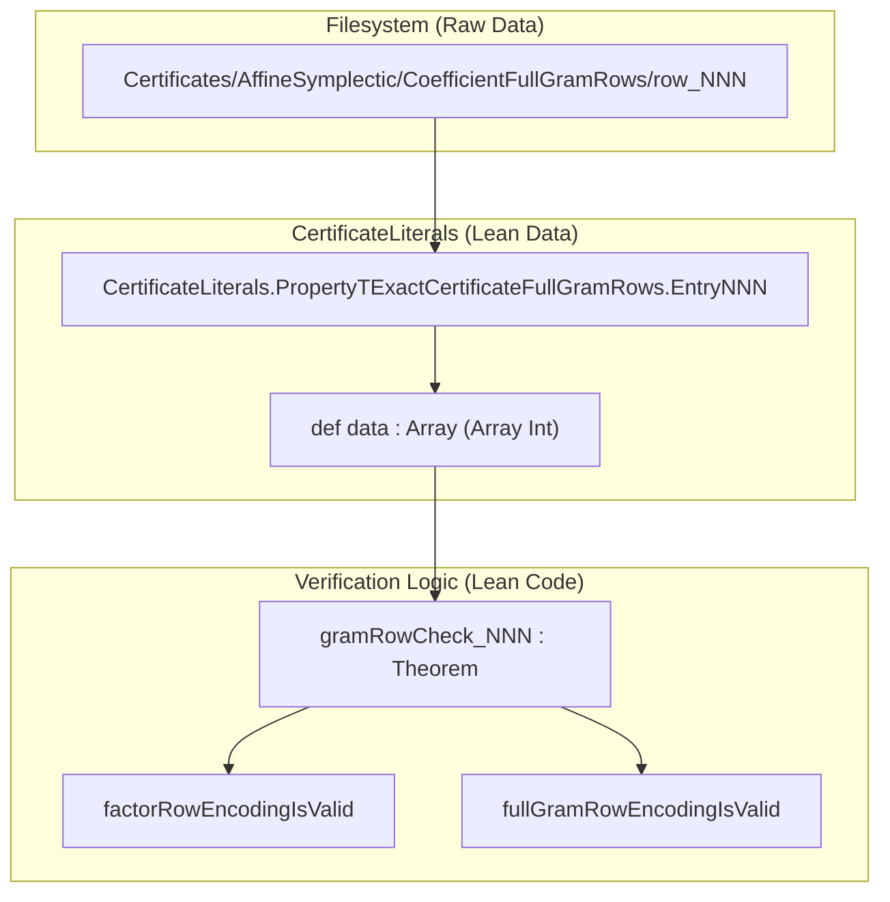
Sources: [ConnesRigidity/Certificates/AffineSymplectic/CoefficientFullGramRows/row_076:1-1](), [ConnesRigidity/CertificateLiterals/PropertyTExactCertificateFullGramRows/Entry372.lean:4-12](), [ConnesRigidity/PropertyTExactCertificateGramRows/Row009.lean:14-25]()

## Row-wise Soundness Proofs

The verification of the Gram matrix is sharded into individual row checks to manage memory and recursion depth in the Lean kernel. Each row file (e.g., `Row054.lean`) imports `PropertyTExactCertificateGramBase` and sets specific kernel options to handle the large-scale reflection.

### Key Verification Functions
The theorems utilize several core functions to unfold the certificate data:
1.  `factorRowEncodingIsValid`: Checks the integrity of the factor matrix row [ConnesRigidity/PropertyTExactCertificateGramRows/Row054.lean:15-15]().
2.  `fullGramRowEncodingIsValid`: Validates the reconstructed Gram matrix row [ConnesRigidity/PropertyTExactCertificateGramRows/Row054.lean:16-16]().
3.  `encodedFullGramColumnCombination`: Computes the linear combination of columns required for the Gram identity [ConnesRigidity/PropertyTExactCertificateGramRows/Row388.lean:20-20]().

### Kernel Optimization
Because these checks involve massive integer arrays, the following options are mandatory for the `decide +kernel` tactic to succeed:
*   `set_option maxRecDepth 1000000` [ConnesRigidity/PropertyTExactCertificateGramRows/Row022.lean:10-10]()
*   `set_option maxHeartbeats 0` [ConnesRigidity/PropertyTExactCertificateGramRows/Row022.lean:12-12]()

### Soundness Logic Bridge
This diagram shows the relationship between the sharded row theorems and the base soundness definitions.

**Gram Row Soundness Architecture**
```mermaid
graph LR
    subgraph "Base Definitions"
        Base["PropertyTExactCertificateGramBase.lean"]
        GramCheckData["namespace GramCheckData"]
    end

    subgraph "Sharded Theorems"
        Row009["gramRowCheck_009"]
        Row054["gramRowCheck_054"]
        RowNNN["gramRowCheck_NNN"]
    end

    subgraph "Unfolding Strategy"
        FactorRow["factorRowChunk"]
        FactorCol["factorColumnChunk"]
        GramBase["gramEncodingBase"]
    end

    Row009 --> Base
    Row054 --> Base
    RowNNN --> Base
    RowNNN --> FactorRow
    RowNNN --> FactorCol
    RowNNN --> GramBase
```
Sources: [ConnesRigidity/PropertyTExactCertificateGramRows/Row009.lean:2-8](), [ConnesRigidity/PropertyTExactCertificateGramRows/Row054.lean:17-25](), [ConnesRigidity/PropertyTExactCertificateGramRows/Row388.lean:17-25]()

## Gram Matrix Decomposition

The Gram matrix $G$ is conceptually decomposed into blocks that correspond to the orbit structure of the basis elements (further detailed in Section 4). However, at the `PropertyTExactCertificateGram` level, the focus is on the reconstruction of the `coefficientFullGramDataRow` from the `factorRow` and `factorColumn` chunks.

| Component | Code Entity | Description |
| :--- | :--- | :--- |
| **Row Data** | `coefficientFullGramDataRowNNN` | The raw integer coefficients for row NNN of the Gram matrix [ConnesRigidity/PropertyTExactCertificateGramRows/Row295.lean:22-22](). |
| **Factor Row** | `factorRowChunkXXX` | A shard of the factor matrix $A$ used in the $A^* A$ reconstruction [ConnesRigidity/PropertyTExactCertificateGramRows/Row295.lean:19-19](). |
| **Factor Column** | `factorColumnChunkXXX` | A shard of the factor matrix used for column-wise operations [ConnesRigidity/PropertyTExactCertificateGramRows/Row295.lean:21-21](). |
| **Encoding Base** | `gramEncodingBase` | The fundamental encoding parameters for the Gram matrix [ConnesRigidity/PropertyTExactCertificateGramRows/Row388.lean:24-24](). |

Sources: [ConnesRigidity/PropertyTExactCertificateGramRows/Row295.lean:18-24](), [ConnesRigidity/PropertyTExactCertificateGramRows/Row388.lean:18-24]()

## Verification Process

The verification follows a hierarchical unfolding strategy to guide the Lean kernel through the proof:
1.  **Unfold Encoding**: Expand the definitions of `factorRowEncodingIsValid` and `fullGramRowEncodingIsValid` [ConnesRigidity/PropertyTExactCertificateGramRows/Row054.lean:17-17]().
2.  **Unfold Chunks**: Locate and expand the specific data chunks (e.g., `factorRowChunk011`, `factorColumnChunk009`) containing the row's coefficients [ConnesRigidity/PropertyTExactCertificateGramRows/Row295.lean:19-21]().
3.  **Reflect**: Use `decide +kernel` to perform the high-performance integer arithmetic required to verify that the stored Gram row matches the product of the factor rows [ConnesRigidity/PropertyTExactCertificateGramRows/Row295.lean:25-25]().

Would you like the summary of the next section, **3.3 Edge Coefficient Packets**?

---

# Page: Edge Coefficient Packets

# Edge Coefficient Packets

<details>
<summary>Relevant source files</summary>

The following files were used as context for generating this wiki page:

- [ConnesRigidity/Certificates/AffineSymplectic/CoefficientEdgePackets/negative_002](ConnesRigidity/Certificates/AffineSymplectic/CoefficientEdgePackets/negative_002)
- [ConnesRigidity/Certificates/AffineSymplectic/CoefficientEdgePackets/negative_003](ConnesRigidity/Certificates/AffineSymplectic/CoefficientEdgePackets/negative_003)
- [ConnesRigidity/Certificates/AffineSymplectic/CoefficientEdgePackets/negative_004](ConnesRigidity/Certificates/AffineSymplectic/CoefficientEdgePackets/negative_004)
- [ConnesRigidity/Certificates/AffineSymplectic/CoefficientEdgePackets/negative_006](ConnesRigidity/Certificates/AffineSymplectic/CoefficientEdgePackets/negative_006)
- [ConnesRigidity/Certificates/AffineSymplectic/CoefficientEdgePackets/negative_015](ConnesRigidity/Certificates/AffineSymplectic/CoefficientEdgePackets/negative_015)
- [ConnesRigidity/Certificates/AffineSymplectic/CoefficientEdgePackets/negative_016](ConnesRigidity/Certificates/AffineSymplectic/CoefficientEdgePackets/negative_016)
- [ConnesRigidity/Certificates/AffineSymplectic/CoefficientEdgePackets/negative_017](ConnesRigidity/Certificates/AffineSymplectic/CoefficientEdgePackets/negative_017)
- [ConnesRigidity/Certificates/AffineSymplectic/CoefficientEdgePackets/negative_018](ConnesRigidity/Certificates/AffineSymplectic/CoefficientEdgePackets/negative_018)
- [ConnesRigidity/Certificates/AffineSymplectic/CoefficientEdgePackets/negative_019](ConnesRigidity/Certificates/AffineSymplectic/CoefficientEdgePackets/negative_019)
- [ConnesRigidity/Certificates/AffineSymplectic/CoefficientEdgePackets/negative_020](ConnesRigidity/Certificates/AffineSymplectic/CoefficientEdgePackets/negative_020)
- [ConnesRigidity/Certificates/AffineSymplectic/CoefficientEdgePackets/negative_021](ConnesRigidity/Certificates/AffineSymplectic/CoefficientEdgePackets/negative_021)
- [ConnesRigidity/Certificates/AffineSymplectic/CoefficientEdgePackets/negative_022](ConnesRigidity/Certificates/AffineSymplectic/CoefficientEdgePackets/negative_022)
- [ConnesRigidity/Certificates/AffineSymplectic/CoefficientEdgePackets/negative_025](ConnesRigidity/Certificates/AffineSymplectic/CoefficientEdgePackets/negative_025)
- [ConnesRigidity/Certificates/AffineSymplectic/CoefficientEdgePackets/negative_026](ConnesRigidity/Certificates/AffineSymplectic/CoefficientEdgePackets/negative_026)
- [ConnesRigidity/Certificates/AffineSymplectic/CoefficientEdgePackets/negative_027](ConnesRigidity/Certificates/AffineSymplectic/CoefficientEdgePackets/negative_027)
- [ConnesRigidity/Certificates/AffineSymplectic/CoefficientEdgePackets/negative_028](ConnesRigidity/Certificates/AffineSymplectic/CoefficientEdgePackets/negative_028)
- [ConnesRigidity/Certificates/AffineSymplectic/CoefficientEdgePackets/negative_030](ConnesRigidity/Certificates/AffineSymplectic/CoefficientEdgePackets/negative_030)
- [ConnesRigidity/Certificates/AffineSymplectic/CoefficientEdgePackets/negative_031](ConnesRigidity/Certificates/AffineSymplectic/CoefficientEdgePackets/negative_031)
- [ConnesRigidity/Certificates/AffineSymplectic/CoefficientEdgePackets/negative_032](ConnesRigidity/Certificates/AffineSymplectic/CoefficientEdgePackets/negative_032)
- [ConnesRigidity/Certificates/AffineSymplectic/CoefficientEdgePackets/negative_033](ConnesRigidity/Certificates/AffineSymplectic/CoefficientEdgePackets/negative_033)
- [ConnesRigidity/Certificates/AffineSymplectic/CoefficientEdgePackets/negative_034](ConnesRigidity/Certificates/AffineSymplectic/CoefficientEdgePackets/negative_034)
- [ConnesRigidity/Certificates/AffineSymplectic/CoefficientEdgePackets/negative_035](ConnesRigidity/Certificates/AffineSymplectic/CoefficientEdgePackets/negative_035)
- [ConnesRigidity/Certificates/AffineSymplectic/CoefficientEdgePackets/negative_036](ConnesRigidity/Certificates/AffineSymplectic/CoefficientEdgePackets/negative_036)
- [ConnesRigidity/Certificates/AffineSymplectic/CoefficientEdgePackets/negative_037](ConnesRigidity/Certificates/AffineSymplectic/CoefficientEdgePackets/negative_037)
- [ConnesRigidity/Certificates/AffineSymplectic/CoefficientEdgePackets/negative_038](ConnesRigidity/Certificates/AffineSymplectic/CoefficientEdgePackets/negative_038)
- [ConnesRigidity/Certificates/AffineSymplectic/CoefficientEdgePackets/negative_039](ConnesRigidity/Certificates/AffineSymplectic/CoefficientEdgePackets/negative_039)
- [ConnesRigidity/Certificates/AffineSymplectic/CoefficientEdgePackets/negative_040](ConnesRigidity/Certificates/AffineSymplectic/CoefficientEdgePackets/negative_040)
- [ConnesRigidity/Certificates/AffineSymplectic/CoefficientEdgePackets/negative_042](ConnesRigidity/Certificates/AffineSymplectic/CoefficientEdgePackets/negative_042)
- [ConnesRigidity/Certificates/AffineSymplectic/CoefficientEdgePackets/negative_043](ConnesRigidity/Certificates/AffineSymplectic/CoefficientEdgePackets/negative_043)
- [ConnesRigidity/Certificates/AffineSymplectic/CoefficientEdgePackets/negative_044](ConnesRigidity/Certificates/AffineSymplectic/CoefficientEdgePackets/negative_044)
- [ConnesRigidity/Certificates/AffineSymplectic/CoefficientEdgePackets/negative_045](ConnesRigidity/Certificates/AffineSymplectic/CoefficientEdgePackets/negative_045)
- [ConnesRigidity/Certificates/AffineSymplectic/CoefficientEdgePackets/negative_046](ConnesRigidity/Certificates/AffineSymplectic/CoefficientEdgePackets/negative_046)
- [ConnesRigidity/Certificates/AffineSymplectic/CoefficientEdgePackets/negative_047](ConnesRigidity/Certificates/AffineSymplectic/CoefficientEdgePackets/negative_047)
- [ConnesRigidity/Certificates/AffineSymplectic/CoefficientEdgePackets/negative_048](ConnesRigidity/Certificates/AffineSymplectic/CoefficientEdgePackets/negative_048)
- [ConnesRigidity/Certificates/AffineSymplectic/CoefficientEdgePackets/negative_049](ConnesRigidity/Certificates/AffineSymplectic/CoefficientEdgePackets/negative_049)
- [ConnesRigidity/Certificates/AffineSymplectic/CoefficientEdgePackets/negative_050](ConnesRigidity/Certificates/AffineSymplectic/CoefficientEdgePackets/negative_050)
- [ConnesRigidity/Certificates/AffineSymplectic/CoefficientEdgePackets/negative_051](ConnesRigidity/Certificates/AffineSymplectic/CoefficientEdgePackets/negative_051)
- [ConnesRigidity/Certificates/AffineSymplectic/CoefficientEdgePackets/negative_052](ConnesRigidity/Certificates/AffineSymplectic/CoefficientEdgePackets/negative_052)
- [ConnesRigidity/Certificates/AffineSymplectic/CoefficientEdgePackets/negative_053](ConnesRigidity/Certificates/AffineSymplectic/CoefficientEdgePackets/negative_053)
- [ConnesRigidity/Certificates/AffineSymplectic/CoefficientEdgePackets/negative_054](ConnesRigidity/Certificates/AffineSymplectic/CoefficientEdgePackets/negative_054)
- [ConnesRigidity/Certificates/AffineSymplectic/CoefficientEdgePackets/negative_055](ConnesRigidity/Certificates/AffineSymplectic/CoefficientEdgePackets/negative_055)
- [ConnesRigidity/Certificates/AffineSymplectic/CoefficientEdgePackets/negative_056](ConnesRigidity/Certificates/AffineSymplectic/CoefficientEdgePackets/negative_056)
- [ConnesRigidity/Certificates/AffineSymplectic/CoefficientEdgePackets/negative_057](ConnesRigidity/Certificates/AffineSymplectic/CoefficientEdgePackets/negative_057)
- [ConnesRigidity/Certificates/AffineSymplectic/CoefficientEdgePackets/negative_058](ConnesRigidity/Certificates/AffineSymplectic/CoefficientEdgePackets/negative_058)
- [ConnesRigidity/Certificates/AffineSymplectic/CoefficientEdgePackets/negative_059](ConnesRigidity/Certificates/AffineSymplectic/CoefficientEdgePackets/negative_059)
- [ConnesRigidity/Certificates/AffineSymplectic/CoefficientEdgePackets/negative_061](ConnesRigidity/Certificates/AffineSymplectic/CoefficientEdgePackets/negative_061)
- [ConnesRigidity/Certificates/AffineSymplectic/CoefficientEdgePackets/negative_062](ConnesRigidity/Certificates/AffineSymplectic/CoefficientEdgePackets/negative_062)
- [ConnesRigidity/Certificates/AffineSymplectic/CoefficientEdgePackets/negative_064](ConnesRigidity/Certificates/AffineSymplectic/CoefficientEdgePackets/negative_064)
- [ConnesRigidity/Certificates/AffineSymplectic/CoefficientEdgePackets/negative_065](ConnesRigidity/Certificates/AffineSymplectic/CoefficientEdgePackets/negative_065)
- [ConnesRigidity/Certificates/AffineSymplectic/CoefficientEdgePackets/negative_066](ConnesRigidity/Certificates/AffineSymplectic/CoefficientEdgePackets/negative_066)
- [ConnesRigidity/Certificates/AffineSymplectic/CoefficientEdgePackets/negative_067](ConnesRigidity/Certificates/AffineSymplectic/CoefficientEdgePackets/negative_067)
- [ConnesRigidity/Certificates/AffineSymplectic/CoefficientEdgePackets/negative_068](ConnesRigidity/Certificates/AffineSymplectic/CoefficientEdgePackets/negative_068)
- [ConnesRigidity/Certificates/AffineSymplectic/CoefficientEdgePackets/negative_069](ConnesRigidity/Certificates/AffineSymplectic/CoefficientEdgePackets/negative_069)
- [ConnesRigidity/Certificates/AffineSymplectic/CoefficientEdgePackets/negative_070](ConnesRigidity/Certificates/AffineSymplectic/CoefficientEdgePackets/negative_070)
- [ConnesRigidity/Certificates/AffineSymplectic/CoefficientEdgePackets/negative_071](ConnesRigidity/Certificates/AffineSymplectic/CoefficientEdgePackets/negative_071)
- [ConnesRigidity/Certificates/AffineSymplectic/CoefficientEdgePackets/negative_072](ConnesRigidity/Certificates/AffineSymplectic/CoefficientEdgePackets/negative_072)
- [ConnesRigidity/Certificates/AffineSymplectic/CoefficientEdgePackets/negative_073](ConnesRigidity/Certificates/AffineSymplectic/CoefficientEdgePackets/negative_073)
- [ConnesRigidity/Certificates/AffineSymplectic/CoefficientEdgePackets/negative_078](ConnesRigidity/Certificates/AffineSymplectic/CoefficientEdgePackets/negative_078)
- [ConnesRigidity/Certificates/AffineSymplectic/CoefficientEdgePackets/negative_079](ConnesRigidity/Certificates/AffineSymplectic/CoefficientEdgePackets/negative_079)
- [ConnesRigidity/Certificates/AffineSymplectic/CoefficientEdgePackets/negative_080](ConnesRigidity/Certificates/AffineSymplectic/CoefficientEdgePackets/negative_080)
- [ConnesRigidity/Certificates/AffineSymplectic/CoefficientEdgePackets/negative_081](ConnesRigidity/Certificates/AffineSymplectic/CoefficientEdgePackets/negative_081)
- [ConnesRigidity/Certificates/AffineSymplectic/CoefficientEdgePackets/negative_082](ConnesRigidity/Certificates/AffineSymplectic/CoefficientEdgePackets/negative_082)
- [ConnesRigidity/Certificates/AffineSymplectic/CoefficientEdgePackets/negative_083](ConnesRigidity/Certificates/AffineSymplectic/CoefficientEdgePackets/negative_083)
- [ConnesRigidity/Certificates/AffineSymplectic/CoefficientEdgePackets/negative_084](ConnesRigidity/Certificates/AffineSymplectic/CoefficientEdgePackets/negative_084)
- [ConnesRigidity/Certificates/AffineSymplectic/CoefficientEdgePackets/negative_085](ConnesRigidity/Certificates/AffineSymplectic/CoefficientEdgePackets/negative_085)
- [ConnesRigidity/Certificates/AffineSymplectic/CoefficientEdgePackets/negative_087](ConnesRigidity/Certificates/AffineSymplectic/CoefficientEdgePackets/negative_087)
- [ConnesRigidity/Certificates/AffineSymplectic/CoefficientEdgePackets/negative_088](ConnesRigidity/Certificates/AffineSymplectic/CoefficientEdgePackets/negative_088)
- [ConnesRigidity/Certificates/AffineSymplectic/CoefficientEdgePackets/negative_089](ConnesRigidity/Certificates/AffineSymplectic/CoefficientEdgePackets/negative_089)
- [ConnesRigidity/Certificates/AffineSymplectic/CoefficientEdgePackets/negative_090](ConnesRigidity/Certificates/AffineSymplectic/CoefficientEdgePackets/negative_090)
- [ConnesRigidity/Certificates/AffineSymplectic/CoefficientEdgePackets/negative_091](ConnesRigidity/Certificates/AffineSymplectic/CoefficientEdgePackets/negative_091)
- [ConnesRigidity/Certificates/AffineSymplectic/CoefficientEdgePackets/negative_092](ConnesRigidity/Certificates/AffineSymplectic/CoefficientEdgePackets/negative_092)
- [ConnesRigidity/Certificates/AffineSymplectic/CoefficientEdgePackets/negative_093](ConnesRigidity/Certificates/AffineSymplectic/CoefficientEdgePackets/negative_093)
- [ConnesRigidity/Certificates/AffineSymplectic/CoefficientEdgePackets/negative_094](ConnesRigidity/Certificates/AffineSymplectic/CoefficientEdgePackets/negative_094)
- [ConnesRigidity/Certificates/AffineSymplectic/CoefficientEdgePackets/negative_095](ConnesRigidity/Certificates/AffineSymplectic/CoefficientEdgePackets/negative_095)
- [ConnesRigidity/Certificates/AffineSymplectic/CoefficientEdgePackets/negative_096](ConnesRigidity/Certificates/AffineSymplectic/CoefficientEdgePackets/negative_096)
- [ConnesRigidity/Certificates/AffineSymplectic/CoefficientEdgePackets/negative_097](ConnesRigidity/Certificates/AffineSymplectic/CoefficientEdgePackets/negative_097)
- [ConnesRigidity/Certificates/AffineSymplectic/CoefficientEdgePackets/negative_098](ConnesRigidity/Certificates/AffineSymplectic/CoefficientEdgePackets/negative_098)
- [ConnesRigidity/Certificates/AffineSymplectic/CoefficientEdgePackets/negative_099](ConnesRigidity/Certificates/AffineSymplectic/CoefficientEdgePackets/negative_099)
- [ConnesRigidity/Certificates/AffineSymplectic/CoefficientEdgePackets/negative_100](ConnesRigidity/Certificates/AffineSymplectic/CoefficientEdgePackets/negative_100)
- [ConnesRigidity/Certificates/AffineSymplectic/CoefficientEdgePackets/negative_101](ConnesRigidity/Certificates/AffineSymplectic/CoefficientEdgePackets/negative_101)
- [ConnesRigidity/Certificates/AffineSymplectic/CoefficientEdgePackets/negative_103](ConnesRigidity/Certificates/AffineSymplectic/CoefficientEdgePackets/negative_103)
- [ConnesRigidity/Certificates/AffineSymplectic/CoefficientEdgePackets/negative_104](ConnesRigidity/Certificates/AffineSymplectic/CoefficientEdgePackets/negative_104)
- [ConnesRigidity/Certificates/AffineSymplectic/CoefficientEdgePackets/negative_106](ConnesRigidity/Certificates/AffineSymplectic/CoefficientEdgePackets/negative_106)
- [ConnesRigidity/Certificates/AffineSymplectic/CoefficientEdgePackets/negative_107](ConnesRigidity/Certificates/AffineSymplectic/CoefficientEdgePackets/negative_107)
- [ConnesRigidity/Certificates/AffineSymplectic/CoefficientEdgePackets/negative_108](ConnesRigidity/Certificates/AffineSymplectic/CoefficientEdgePackets/negative_108)
- [ConnesRigidity/Certificates/AffineSymplectic/CoefficientEdgePackets/negative_109](ConnesRigidity/Certificates/AffineSymplectic/CoefficientEdgePackets/negative_109)
- [ConnesRigidity/Certificates/AffineSymplectic/CoefficientEdgePackets/negative_112](ConnesRigidity/Certificates/AffineSymplectic/CoefficientEdgePackets/negative_112)
- [ConnesRigidity/Certificates/AffineSymplectic/CoefficientEdgePackets/negative_113](ConnesRigidity/Certificates/AffineSymplectic/CoefficientEdgePackets/negative_113)
- [ConnesRigidity/Certificates/AffineSymplectic/CoefficientEdgePackets/negative_116](ConnesRigidity/Certificates/AffineSymplectic/CoefficientEdgePackets/negative_116)
- [ConnesRigidity/Certificates/AffineSymplectic/CoefficientEdgePackets/negative_117](ConnesRigidity/Certificates/AffineSymplectic/CoefficientEdgePackets/negative_117)
- [ConnesRigidity/Certificates/AffineSymplectic/CoefficientEdgePackets/negative_118](ConnesRigidity/Certificates/AffineSymplectic/CoefficientEdgePackets/negative_118)
- [ConnesRigidity/Certificates/AffineSymplectic/CoefficientEdgePackets/negative_119](ConnesRigidity/Certificates/AffineSymplectic/CoefficientEdgePackets/negative_119)
- [ConnesRigidity/Certificates/AffineSymplectic/CoefficientEdgePackets/negative_120](ConnesRigidity/Certificates/AffineSymplectic/CoefficientEdgePackets/negative_120)
- [ConnesRigidity/Certificates/AffineSymplectic/CoefficientEdgePackets/negative_122](ConnesRigidity/Certificates/AffineSymplectic/CoefficientEdgePackets/negative_122)
- [ConnesRigidity/Certificates/AffineSymplectic/CoefficientEdgePackets/negative_124](ConnesRigidity/Certificates/AffineSymplectic/CoefficientEdgePackets/negative_124)
- [ConnesRigidity/Certificates/AffineSymplectic/CoefficientEdgePackets/negative_125](ConnesRigidity/Certificates/AffineSymplectic/CoefficientEdgePackets/negative_125)
- [ConnesRigidity/Certificates/AffineSymplectic/CoefficientEdgePackets/negative_126](ConnesRigidity/Certificates/AffineSymplectic/CoefficientEdgePackets/negative_126)
- [ConnesRigidity/Certificates/AffineSymplectic/CoefficientEdgePackets/negative_128](ConnesRigidity/Certificates/AffineSymplectic/CoefficientEdgePackets/negative_128)
- [ConnesRigidity/Certificates/AffineSymplectic/CoefficientEdgePackets/negative_129](ConnesRigidity/Certificates/AffineSymplectic/CoefficientEdgePackets/negative_129)
- [ConnesRigidity/Certificates/AffineSymplectic/CoefficientEdgePackets/negative_132](ConnesRigidity/Certificates/AffineSymplectic/CoefficientEdgePackets/negative_132)
- [ConnesRigidity/Certificates/AffineSymplectic/CoefficientEdgePackets/negative_133](ConnesRigidity/Certificates/AffineSymplectic/CoefficientEdgePackets/negative_133)
- [ConnesRigidity/Certificates/AffineSymplectic/CoefficientEdgePackets/negative_134](ConnesRigidity/Certificates/AffineSymplectic/CoefficientEdgePackets/negative_134)
- [ConnesRigidity/Certificates/AffineSymplectic/CoefficientEdgePackets/negative_135](ConnesRigidity/Certificates/AffineSymplectic/CoefficientEdgePackets/negative_135)
- [ConnesRigidity/Certificates/AffineSymplectic/CoefficientEdgePackets/negative_137](ConnesRigidity/Certificates/AffineSymplectic/CoefficientEdgePackets/negative_137)
- [ConnesRigidity/Certificates/AffineSymplectic/CoefficientEdgePackets/negative_138](ConnesRigidity/Certificates/AffineSymplectic/CoefficientEdgePackets/negative_138)
- [ConnesRigidity/Certificates/AffineSymplectic/CoefficientEdgePackets/negative_139](ConnesRigidity/Certificates/AffineSymplectic/CoefficientEdgePackets/negative_139)
- [ConnesRigidity/Certificates/AffineSymplectic/CoefficientEdgePackets/negative_140](ConnesRigidity/Certificates/AffineSymplectic/CoefficientEdgePackets/negative_140)
- [ConnesRigidity/Certificates/AffineSymplectic/CoefficientEdgePackets/negative_143](ConnesRigidity/Certificates/AffineSymplectic/CoefficientEdgePackets/negative_143)
- [ConnesRigidity/Certificates/AffineSymplectic/CoefficientEdgePackets/negative_144](ConnesRigidity/Certificates/AffineSymplectic/CoefficientEdgePackets/negative_144)
- [ConnesRigidity/Certificates/AffineSymplectic/CoefficientEdgePackets/negative_145](ConnesRigidity/Certificates/AffineSymplectic/CoefficientEdgePackets/negative_145)
- [ConnesRigidity/Certificates/AffineSymplectic/CoefficientEdgePackets/negative_148](ConnesRigidity/Certificates/AffineSymplectic/CoefficientEdgePackets/negative_148)
- [ConnesRigidity/Certificates/AffineSymplectic/CoefficientEdgePackets/negative_151](ConnesRigidity/Certificates/AffineSymplectic/CoefficientEdgePackets/negative_151)
- [ConnesRigidity/Certificates/AffineSymplectic/CoefficientEdgePackets/positive_002](ConnesRigidity/Certificates/AffineSymplectic/CoefficientEdgePackets/positive_002)
- [ConnesRigidity/Certificates/AffineSymplectic/CoefficientEdgePackets/positive_008](ConnesRigidity/Certificates/AffineSymplectic/CoefficientEdgePackets/positive_008)
- [ConnesRigidity/Certificates/AffineSymplectic/CoefficientEdgePackets/positive_010](ConnesRigidity/Certificates/AffineSymplectic/CoefficientEdgePackets/positive_010)
- [ConnesRigidity/Certificates/AffineSymplectic/CoefficientEdgePackets/positive_013](ConnesRigidity/Certificates/AffineSymplectic/CoefficientEdgePackets/positive_013)
- [ConnesRigidity/Certificates/AffineSymplectic/CoefficientEdgePackets/positive_014](ConnesRigidity/Certificates/AffineSymplectic/CoefficientEdgePackets/positive_014)
- [ConnesRigidity/Certificates/AffineSymplectic/CoefficientEdgePackets/positive_016](ConnesRigidity/Certificates/AffineSymplectic/CoefficientEdgePackets/positive_016)
- [ConnesRigidity/Certificates/AffineSymplectic/CoefficientEdgePackets/positive_020](ConnesRigidity/Certificates/AffineSymplectic/CoefficientEdgePackets/positive_020)
- [ConnesRigidity/Certificates/AffineSymplectic/CoefficientEdgePackets/positive_023](ConnesRigidity/Certificates/AffineSymplectic/CoefficientEdgePackets/positive_023)
- [ConnesRigidity/Certificates/AffineSymplectic/CoefficientEdgePackets/positive_027](ConnesRigidity/Certificates/AffineSymplectic/CoefficientEdgePackets/positive_027)
- [ConnesRigidity/Certificates/AffineSymplectic/CoefficientEdgePackets/positive_035](ConnesRigidity/Certificates/AffineSymplectic/CoefficientEdgePackets/positive_035)
- [ConnesRigidity/Certificates/AffineSymplectic/CoefficientEdgePackets/positive_037](ConnesRigidity/Certificates/AffineSymplectic/CoefficientEdgePackets/positive_037)
- [ConnesRigidity/Certificates/AffineSymplectic/CoefficientEdgePackets/positive_038](ConnesRigidity/Certificates/AffineSymplectic/CoefficientEdgePackets/positive_038)
- [ConnesRigidity/Certificates/AffineSymplectic/CoefficientEdgePackets/positive_042](ConnesRigidity/Certificates/AffineSymplectic/CoefficientEdgePackets/positive_042)
- [ConnesRigidity/Certificates/AffineSymplectic/CoefficientEdgePackets/positive_043](ConnesRigidity/Certificates/AffineSymplectic/CoefficientEdgePackets/positive_043)
- [ConnesRigidity/Certificates/AffineSymplectic/CoefficientEdgePackets/positive_044](ConnesRigidity/Certificates/AffineSymplectic/CoefficientEdgePackets/positive_044)
- [ConnesRigidity/Certificates/AffineSymplectic/CoefficientEdgePackets/positive_047](ConnesRigidity/Certificates/AffineSymplectic/CoefficientEdgePackets/positive_047)
- [ConnesRigidity/Certificates/AffineSymplectic/CoefficientEdgePackets/positive_050](ConnesRigidity/Certificates/AffineSymplectic/CoefficientEdgePackets/positive_050)
- [ConnesRigidity/Certificates/AffineSymplectic/CoefficientEdgePackets/positive_051](ConnesRigidity/Certificates/AffineSymplectic/CoefficientEdgePackets/positive_051)
- [ConnesRigidity/Certificates/AffineSymplectic/CoefficientEdgePackets/positive_052](ConnesRigidity/Certificates/AffineSymplectic/CoefficientEdgePackets/positive_052)
- [ConnesRigidity/Certificates/AffineSymplectic/CoefficientEdgePackets/positive_053](ConnesRigidity/Certificates/AffineSymplectic/CoefficientEdgePackets/positive_053)
- [ConnesRigidity/Certificates/AffineSymplectic/CoefficientEdgePackets/positive_055](ConnesRigidity/Certificates/AffineSymplectic/CoefficientEdgePackets/positive_055)
- [ConnesRigidity/Certificates/AffineSymplectic/CoefficientEdgePackets/positive_056](ConnesRigidity/Certificates/AffineSymplectic/CoefficientEdgePackets/positive_056)
- [ConnesRigidity/Certificates/AffineSymplectic/CoefficientEdgePackets/positive_061](ConnesRigidity/Certificates/AffineSymplectic/CoefficientEdgePackets/positive_061)
- [ConnesRigidity/Certificates/AffineSymplectic/CoefficientEdgePackets/positive_063](ConnesRigidity/Certificates/AffineSymplectic/CoefficientEdgePackets/positive_063)
- [ConnesRigidity/Certificates/AffineSymplectic/CoefficientEdgePackets/positive_068](ConnesRigidity/Certificates/AffineSymplectic/CoefficientEdgePackets/positive_068)
- [ConnesRigidity/Certificates/AffineSymplectic/CoefficientEdgePackets/positive_070](ConnesRigidity/Certificates/AffineSymplectic/CoefficientEdgePackets/positive_070)
- [ConnesRigidity/Certificates/AffineSymplectic/CoefficientEdgePackets/positive_071](ConnesRigidity/Certificates/AffineSymplectic/CoefficientEdgePackets/positive_071)
- [ConnesRigidity/Certificates/AffineSymplectic/CoefficientEdgePackets/positive_072](ConnesRigidity/Certificates/AffineSymplectic/CoefficientEdgePackets/positive_072)
- [ConnesRigidity/Certificates/AffineSymplectic/CoefficientEdgePackets/positive_073](ConnesRigidity/Certificates/AffineSymplectic/CoefficientEdgePackets/positive_073)
- [ConnesRigidity/Certificates/AffineSymplectic/CoefficientEdgePackets/positive_077](ConnesRigidity/Certificates/AffineSymplectic/CoefficientEdgePackets/positive_077)
- [ConnesRigidity/Certificates/AffineSymplectic/CoefficientEdgePackets/positive_080](ConnesRigidity/Certificates/AffineSymplectic/CoefficientEdgePackets/positive_080)
- [ConnesRigidity/Certificates/AffineSymplectic/CoefficientEdgePackets/positive_082](ConnesRigidity/Certificates/AffineSymplectic/CoefficientEdgePackets/positive_082)
- [ConnesRigidity/Certificates/AffineSymplectic/CoefficientEdgePackets/positive_083](ConnesRigidity/Certificates/AffineSymplectic/CoefficientEdgePackets/positive_083)
- [ConnesRigidity/Certificates/AffineSymplectic/CoefficientEdgePackets/positive_084](ConnesRigidity/Certificates/AffineSymplectic/CoefficientEdgePackets/positive_084)
- [ConnesRigidity/Certificates/AffineSymplectic/CoefficientEdgePackets/positive_085](ConnesRigidity/Certificates/AffineSymplectic/CoefficientEdgePackets/positive_085)
- [ConnesRigidity/Certificates/AffineSymplectic/CoefficientEdgePackets/positive_086](ConnesRigidity/Certificates/AffineSymplectic/CoefficientEdgePackets/positive_086)
- [ConnesRigidity/Certificates/AffineSymplectic/CoefficientEdgePackets/positive_089](ConnesRigidity/Certificates/AffineSymplectic/CoefficientEdgePackets/positive_089)
- [ConnesRigidity/Certificates/AffineSymplectic/CoefficientEdgePackets/positive_091](ConnesRigidity/Certificates/AffineSymplectic/CoefficientEdgePackets/positive_091)
- [ConnesRigidity/Certificates/AffineSymplectic/CoefficientEdgePackets/positive_093](ConnesRigidity/Certificates/AffineSymplectic/CoefficientEdgePackets/positive_093)
- [ConnesRigidity/Certificates/AffineSymplectic/CoefficientEdgePackets/positive_094](ConnesRigidity/Certificates/AffineSymplectic/CoefficientEdgePackets/positive_094)
- [ConnesRigidity/Certificates/AffineSymplectic/CoefficientEdgePackets/positive_095](ConnesRigidity/Certificates/AffineSymplectic/CoefficientEdgePackets/positive_095)
- [ConnesRigidity/Certificates/AffineSymplectic/CoefficientEdgePackets/positive_096](ConnesRigidity/Certificates/AffineSymplectic/CoefficientEdgePackets/positive_096)
- [ConnesRigidity/Certificates/AffineSymplectic/CoefficientEdgePackets/positive_099](ConnesRigidity/Certificates/AffineSymplectic/CoefficientEdgePackets/positive_099)
- [ConnesRigidity/Certificates/AffineSymplectic/CoefficientEdgePackets/positive_101](ConnesRigidity/Certificates/AffineSymplectic/CoefficientEdgePackets/positive_101)
- [ConnesRigidity/Certificates/AffineSymplectic/CoefficientEdgePackets/positive_102](ConnesRigidity/Certificates/AffineSymplectic/CoefficientEdgePackets/positive_102)
- [ConnesRigidity/Certificates/AffineSymplectic/CoefficientEdgePackets/positive_104](ConnesRigidity/Certificates/AffineSymplectic/CoefficientEdgePackets/positive_104)
- [ConnesRigidity/Certificates/AffineSymplectic/CoefficientEdgePackets/positive_105](ConnesRigidity/Certificates/AffineSymplectic/CoefficientEdgePackets/positive_105)
- [ConnesRigidity/Certificates/AffineSymplectic/CoefficientEdgePackets/positive_107](ConnesRigidity/Certificates/AffineSymplectic/CoefficientEdgePackets/positive_107)
- [ConnesRigidity/Certificates/AffineSymplectic/CoefficientEdgePackets/positive_113](ConnesRigidity/Certificates/AffineSymplectic/CoefficientEdgePackets/positive_113)
- [ConnesRigidity/Certificates/AffineSymplectic/CoefficientEdgePackets/positive_115](ConnesRigidity/Certificates/AffineSymplectic/CoefficientEdgePackets/positive_115)
- [ConnesRigidity/Certificates/AffineSymplectic/CoefficientEdgePackets/positive_119](ConnesRigidity/Certificates/AffineSymplectic/CoefficientEdgePackets/positive_119)
- [ConnesRigidity/Certificates/AffineSymplectic/CoefficientEdgePackets/positive_121](ConnesRigidity/Certificates/AffineSymplectic/CoefficientEdgePackets/positive_121)
- [ConnesRigidity/Certificates/AffineSymplectic/CoefficientEdgePackets/positive_123](ConnesRigidity/Certificates/AffineSymplectic/CoefficientEdgePackets/positive_123)
- [ConnesRigidity/Certificates/AffineSymplectic/CoefficientEdgePackets/positive_127](ConnesRigidity/Certificates/AffineSymplectic/CoefficientEdgePackets/positive_127)
- [ConnesRigidity/Certificates/AffineSymplectic/CoefficientEdgePackets/positive_129](ConnesRigidity/Certificates/AffineSymplectic/CoefficientEdgePackets/positive_129)
- [ConnesRigidity/Certificates/AffineSymplectic/CoefficientEdgePackets/positive_130](ConnesRigidity/Certificates/AffineSymplectic/CoefficientEdgePackets/positive_130)
- [ConnesRigidity/Certificates/AffineSymplectic/CoefficientEdgePackets/positive_131](ConnesRigidity/Certificates/AffineSymplectic/CoefficientEdgePackets/positive_131)
- [ConnesRigidity/Certificates/AffineSymplectic/CoefficientEdgePackets/positive_133](ConnesRigidity/Certificates/AffineSymplectic/CoefficientEdgePackets/positive_133)
- [ConnesRigidity/Certificates/AffineSymplectic/CoefficientEdgePackets/positive_134](ConnesRigidity/Certificates/AffineSymplectic/CoefficientEdgePackets/positive_134)
- [ConnesRigidity/Certificates/AffineSymplectic/CoefficientEdgePackets/positive_136](ConnesRigidity/Certificates/AffineSymplectic/CoefficientEdgePackets/positive_136)
- [ConnesRigidity/Certificates/AffineSymplectic/CoefficientEdgePackets/positive_137](ConnesRigidity/Certificates/AffineSymplectic/CoefficientEdgePackets/positive_137)
- [ConnesRigidity/Certificates/AffineSymplectic/CoefficientEdgePackets/positive_139](ConnesRigidity/Certificates/AffineSymplectic/CoefficientEdgePackets/positive_139)
- [ConnesRigidity/Certificates/AffineSymplectic/CoefficientEdgePackets/positive_141](ConnesRigidity/Certificates/AffineSymplectic/CoefficientEdgePackets/positive_141)
- [ConnesRigidity/Certificates/AffineSymplectic/CoefficientEdgePackets/positive_146](ConnesRigidity/Certificates/AffineSymplectic/CoefficientEdgePackets/positive_146)
- [ConnesRigidity/Certificates/AffineSymplectic/CoefficientEdgePackets/positive_147](ConnesRigidity/Certificates/AffineSymplectic/CoefficientEdgePackets/positive_147)
- [ConnesRigidity/Certificates/AffineSymplectic/CoefficientEdgePackets/positive_152](ConnesRigidity/Certificates/AffineSymplectic/CoefficientEdgePackets/positive_152)
- [ConnesRigidity/Certificates/AffineSymplectic/CoefficientEdgePackets/positive_155](ConnesRigidity/Certificates/AffineSymplectic/CoefficientEdgePackets/positive_155)
- [ConnesRigidity/Certificates/AffineSymplectic/CoefficientEdgePackets/positive_156](ConnesRigidity/Certificates/AffineSymplectic/CoefficientEdgePackets/positive_156)
- [ConnesRigidity/Certificates/AffineSymplectic/CoefficientEdgePackets/positive_159](ConnesRigidity/Certificates/AffineSymplectic/CoefficientEdgePackets/positive_159)
- [ConnesRigidity/Certificates/AffineSymplectic/CoefficientEdgePackets/positive_160](ConnesRigidity/Certificates/AffineSymplectic/CoefficientEdgePackets/positive_160)
- [ConnesRigidity/Certificates/AffineSymplectic/CoefficientEdgePackets/positive_163](ConnesRigidity/Certificates/AffineSymplectic/CoefficientEdgePackets/positive_163)
- [ConnesRigidity/Certificates/AffineSymplectic/CoefficientEdgePackets/positive_164](ConnesRigidity/Certificates/AffineSymplectic/CoefficientEdgePackets/positive_164)
- [ConnesRigidity/Certificates/AffineSymplectic/CoefficientEdgePackets/positive_165](ConnesRigidity/Certificates/AffineSymplectic/CoefficientEdgePackets/positive_165)
- [ConnesRigidity/Certificates/AffineSymplectic/CoefficientEdgePackets/positive_170](ConnesRigidity/Certificates/AffineSymplectic/CoefficientEdgePackets/positive_170)
- [ConnesRigidity/Certificates/AffineSymplectic/CoefficientEdgePackets/positive_172](ConnesRigidity/Certificates/AffineSymplectic/CoefficientEdgePackets/positive_172)
- [ConnesRigidity/Certificates/AffineSymplectic/CoefficientEdgePackets/positive_174](ConnesRigidity/Certificates/AffineSymplectic/CoefficientEdgePackets/positive_174)
- [ConnesRigidity/Certificates/AffineSymplectic/CoefficientEdgePackets/positive_177](ConnesRigidity/Certificates/AffineSymplectic/CoefficientEdgePackets/positive_177)
- [ConnesRigidity/Certificates/AffineSymplectic/CoefficientEdgePackets/positive_179](ConnesRigidity/Certificates/AffineSymplectic/CoefficientEdgePackets/positive_179)
- [ConnesRigidity/Certificates/AffineSymplectic/CoefficientEdgePackets/positive_181](ConnesRigidity/Certificates/AffineSymplectic/CoefficientEdgePackets/positive_181)
- [ConnesRigidity/Certificates/AffineSymplectic/CoefficientEdgePackets/positive_186](ConnesRigidity/Certificates/AffineSymplectic/CoefficientEdgePackets/positive_186)
- [ConnesRigidity/Certificates/AffineSymplectic/CoefficientEdgePackets/positive_189](ConnesRigidity/Certificates/AffineSymplectic/CoefficientEdgePackets/positive_189)
- [ConnesRigidity/Certificates/AffineSymplectic/CoefficientEdgePackets/positive_194](ConnesRigidity/Certificates/AffineSymplectic/CoefficientEdgePackets/positive_194)
- [ConnesRigidity/Certificates/AffineSymplectic/CoefficientEdgePackets/positive_195](ConnesRigidity/Certificates/AffineSymplectic/CoefficientEdgePackets/positive_195)
- [ConnesRigidity/Certificates/AffineSymplectic/CoefficientEdgePackets/positive_206](ConnesRigidity/Certificates/AffineSymplectic/CoefficientEdgePackets/positive_206)
- [ConnesRigidity/Certificates/AffineSymplectic/CoefficientEdgePackets/positive_208](ConnesRigidity/Certificates/AffineSymplectic/CoefficientEdgePackets/positive_208)
- [ConnesRigidity/Certificates/AffineSymplectic/CoefficientEdgePackets/positive_209](ConnesRigidity/Certificates/AffineSymplectic/CoefficientEdgePackets/positive_209)
- [ConnesRigidity/Certificates/AffineSymplectic/CoefficientEdgePackets/positive_210](ConnesRigidity/Certificates/AffineSymplectic/CoefficientEdgePackets/positive_210)
- [ConnesRigidity/Certificates/AffineSymplectic/CoefficientEdgePackets/positive_212](ConnesRigidity/Certificates/AffineSymplectic/CoefficientEdgePackets/positive_212)
- [ConnesRigidity/Certificates/AffineSymplectic/CoefficientEdgePackets/positive_215](ConnesRigidity/Certificates/AffineSymplectic/CoefficientEdgePackets/positive_215)
- [ConnesRigidity/Certificates/AffineSymplectic/CoefficientEdgePackets/positive_220](ConnesRigidity/Certificates/AffineSymplectic/CoefficientEdgePackets/positive_220)
- [ConnesRigidity/Certificates/AffineSymplectic/CoefficientEdgePackets/positive_221](ConnesRigidity/Certificates/AffineSymplectic/CoefficientEdgePackets/positive_221)
- [ConnesRigidity/Certificates/AffineSymplectic/CoefficientEdgePackets/positive_223](ConnesRigidity/Certificates/AffineSymplectic/CoefficientEdgePackets/positive_223)
- [ConnesRigidity/Certificates/AffineSymplectic/CoefficientEdgePackets/positive_226](ConnesRigidity/Certificates/AffineSymplectic/CoefficientEdgePackets/positive_226)
- [ConnesRigidity/Certificates/AffineSymplectic/CoefficientEdgePackets/positive_227](ConnesRigidity/Certificates/AffineSymplectic/CoefficientEdgePackets/positive_227)
- [ConnesRigidity/Certificates/AffineSymplectic/CoefficientEdgePackets/positive_229](ConnesRigidity/Certificates/AffineSymplectic/CoefficientEdgePackets/positive_229)
- [ConnesRigidity/Certificates/AffineSymplectic/CoefficientEdgePackets/positive_230](ConnesRigidity/Certificates/AffineSymplectic/CoefficientEdgePackets/positive_230)
- [ConnesRigidity/Certificates/AffineSymplectic/CoefficientEdgePackets/positive_231](ConnesRigidity/Certificates/AffineSymplectic/CoefficientEdgePackets/positive_231)
- [ConnesRigidity/Certificates/AffineSymplectic/CoefficientEdgePackets/positive_233](ConnesRigidity/Certificates/AffineSymplectic/CoefficientEdgePackets/positive_233)
- [ConnesRigidity/Certificates/AffineSymplectic/CoefficientEdgePackets/positive_234](ConnesRigidity/Certificates/AffineSymplectic/CoefficientEdgePackets/positive_234)
- [ConnesRigidity/Certificates/AffineSymplectic/CoefficientEdgePackets/positive_242](ConnesRigidity/Certificates/AffineSymplectic/CoefficientEdgePackets/positive_242)
- [ConnesRigidity/Certificates/AffineSymplectic/CoefficientEdgePackets/positive_243](ConnesRigidity/Certificates/AffineSymplectic/CoefficientEdgePackets/positive_243)
- [ConnesRigidity/Certificates/AffineSymplectic/CoefficientEdgePackets/positive_247](ConnesRigidity/Certificates/AffineSymplectic/CoefficientEdgePackets/positive_247)
- [ConnesRigidity/Certificates/AffineSymplectic/CoefficientEdgePackets/positive_258](ConnesRigidity/Certificates/AffineSymplectic/CoefficientEdgePackets/positive_258)
- [ConnesRigidity/Certificates/AffineSymplectic/CoefficientEdgePackets/positive_260](ConnesRigidity/Certificates/AffineSymplectic/CoefficientEdgePackets/positive_260)
- [ConnesRigidity/PropertyTExactCertificateCoefficientEdgePacketBridges/Negative000.lean](ConnesRigidity/PropertyTExactCertificateCoefficientEdgePacketBridges/Negative000.lean)
- [ConnesRigidity/PropertyTExactCertificateCoefficientEdgePacketBridges/Negative001.lean](ConnesRigidity/PropertyTExactCertificateCoefficientEdgePacketBridges/Negative001.lean)
- [ConnesRigidity/PropertyTExactCertificateCoefficientEdgePacketBridges/Negative002.lean](ConnesRigidity/PropertyTExactCertificateCoefficientEdgePacketBridges/Negative002.lean)
- [ConnesRigidity/PropertyTExactCertificateCoefficientEdgePacketBridges/Negative003.lean](ConnesRigidity/PropertyTExactCertificateCoefficientEdgePacketBridges/Negative003.lean)
- [ConnesRigidity/PropertyTExactCertificateCoefficientEdgePacketBridges/Negative004.lean](ConnesRigidity/PropertyTExactCertificateCoefficientEdgePacketBridges/Negative004.lean)
- [ConnesRigidity/PropertyTExactCertificateCoefficientEdgePacketBridges/Negative005.lean](ConnesRigidity/PropertyTExactCertificateCoefficientEdgePacketBridges/Negative005.lean)
- [ConnesRigidity/PropertyTExactCertificateCoefficientEdgePacketBridges/Negative006.lean](ConnesRigidity/PropertyTExactCertificateCoefficientEdgePacketBridges/Negative006.lean)
- [ConnesRigidity/PropertyTExactCertificateCoefficientEdgePacketBridges/Negative007.lean](ConnesRigidity/PropertyTExactCertificateCoefficientEdgePacketBridges/Negative007.lean)
- [ConnesRigidity/PropertyTExactCertificateCoefficientEdgePacketBridges/Negative008.lean](ConnesRigidity/PropertyTExactCertificateCoefficientEdgePacketBridges/Negative008.lean)
- [ConnesRigidity/PropertyTExactCertificateCoefficientEdgePacketBridges/Negative010.lean](ConnesRigidity/PropertyTExactCertificateCoefficientEdgePacketBridges/Negative010.lean)
- [ConnesRigidity/PropertyTExactCertificateCoefficientEdgePacketBridges/Negative011.lean](ConnesRigidity/PropertyTExactCertificateCoefficientEdgePacketBridges/Negative011.lean)
- [ConnesRigidity/PropertyTExactCertificateCoefficientEdgePacketBridges/Negative012.lean](ConnesRigidity/PropertyTExactCertificateCoefficientEdgePacketBridges/Negative012.lean)
- [ConnesRigidity/PropertyTExactCertificateCoefficientEdgePacketBridges/Negative013.lean](ConnesRigidity/PropertyTExactCertificateCoefficientEdgePacketBridges/Negative013.lean)
- [ConnesRigidity/PropertyTExactCertificateCoefficientEdgePacketBridges/Negative014.lean](ConnesRigidity/PropertyTExactCertificateCoefficientEdgePacketBridges/Negative014.lean)
- [ConnesRigidity/PropertyTExactCertificateCoefficientEdgePacketBridges/Negative015.lean](ConnesRigidity/PropertyTExactCertificateCoefficientEdgePacketBridges/Negative015.lean)
- [ConnesRigidity/PropertyTExactCertificateCoefficientEdgePacketBridges/Negative016.lean](ConnesRigidity/PropertyTExactCertificateCoefficientEdgePacketBridges/Negative016.lean)
- [ConnesRigidity/PropertyTExactCertificateCoefficientEdgePacketBridges/Negative017.lean](ConnesRigidity/PropertyTExactCertificateCoefficientEdgePacketBridges/Negative017.lean)
- [ConnesRigidity/PropertyTExactCertificateCoefficientEdgePacketBridges/Negative019.lean](ConnesRigidity/PropertyTExactCertificateCoefficientEdgePacketBridges/Negative019.lean)
- [ConnesRigidity/PropertyTExactCertificateCoefficientEdgePacketBridges/Negative020.lean](ConnesRigidity/PropertyTExactCertificateCoefficientEdgePacketBridges/Negative020.lean)
- [ConnesRigidity/PropertyTExactCertificateCoefficientEdgePacketBridges/Negative021.lean](ConnesRigidity/PropertyTExactCertificateCoefficientEdgePacketBridges/Negative021.lean)
- [ConnesRigidity/PropertyTExactCertificateCoefficientEdgePacketBridges/Negative022.lean](ConnesRigidity/PropertyTExactCertificateCoefficientEdgePacketBridges/Negative022.lean)
- [ConnesRigidity/PropertyTExactCertificateCoefficientEdgePacketBridges/Negative023.lean](ConnesRigidity/PropertyTExactCertificateCoefficientEdgePacketBridges/Negative023.lean)
- [ConnesRigidity/PropertyTExactCertificateCoefficientEdgePacketBridges/Negative024.lean](ConnesRigidity/PropertyTExactCertificateCoefficientEdgePacketBridges/Negative024.lean)
- [ConnesRigidity/PropertyTExactCertificateCoefficientEdgePacketBridges/Negative025.lean](ConnesRigidity/PropertyTExactCertificateCoefficientEdgePacketBridges/Negative025.lean)
- [ConnesRigidity/PropertyTExactCertificateCoefficientEdgePacketBridges/Negative027.lean](ConnesRigidity/PropertyTExactCertificateCoefficientEdgePacketBridges/Negative027.lean)
- [ConnesRigidity/PropertyTExactCertificateCoefficientEdgePacketBridges/Negative030.lean](ConnesRigidity/PropertyTExactCertificateCoefficientEdgePacketBridges/Negative030.lean)
- [ConnesRigidity/PropertyTExactCertificateCoefficientEdgePacketBridges/Negative034.lean](ConnesRigidity/PropertyTExactCertificateCoefficientEdgePacketBridges/Negative034.lean)
- [ConnesRigidity/PropertyTExactCertificateCoefficientEdgePacketBridges/Negative035.lean](ConnesRigidity/PropertyTExactCertificateCoefficientEdgePacketBridges/Negative035.lean)
- [ConnesRigidity/PropertyTExactCertificateCoefficientEdgePacketBridges/Negative036.lean](ConnesRigidity/PropertyTExactCertificateCoefficientEdgePacketBridges/Negative036.lean)
- [ConnesRigidity/PropertyTExactCertificateCoefficientEdgePacketBridges/Negative037.lean](ConnesRigidity/PropertyTExactCertificateCoefficientEdgePacketBridges/Negative037.lean)
- [ConnesRigidity/PropertyTExactCertificateCoefficientEdgePacketBridges/Negative038.lean](ConnesRigidity/PropertyTExactCertificateCoefficientEdgePacketBridges/Negative038.lean)
- [ConnesRigidity/PropertyTExactCertificateCoefficientEdgePacketBridges/Negative039.lean](ConnesRigidity/PropertyTExactCertificateCoefficientEdgePacketBridges/Negative039.lean)
- [ConnesRigidity/PropertyTExactCertificateCoefficientEdgePacketBridges/Negative040.lean](ConnesRigidity/PropertyTExactCertificateCoefficientEdgePacketBridges/Negative040.lean)
- [ConnesRigidity/PropertyTExactCertificateCoefficientEdgePacketBridges/Negative041.lean](ConnesRigidity/PropertyTExactCertificateCoefficientEdgePacketBridges/Negative041.lean)
- [ConnesRigidity/PropertyTExactCertificateCoefficientEdgePacketBridges/Negative042.lean](ConnesRigidity/PropertyTExactCertificateCoefficientEdgePacketBridges/Negative042.lean)
- [ConnesRigidity/PropertyTExactCertificateCoefficientEdgePacketBridges/Negative043.lean](ConnesRigidity/PropertyTExactCertificateCoefficientEdgePacketBridges/Negative043.lean)
- [ConnesRigidity/PropertyTExactCertificateCoefficientEdgePacketBridges/Negative044.lean](ConnesRigidity/PropertyTExactCertificateCoefficientEdgePacketBridges/Negative044.lean)
- [ConnesRigidity/PropertyTExactCertificateCoefficientEdgePacketBridges/Negative045.lean](ConnesRigidity/PropertyTExactCertificateCoefficientEdgePacketBridges/Negative045.lean)
- [ConnesRigidity/PropertyTExactCertificateCoefficientEdgePacketBridges/Negative046.lean](ConnesRigidity/PropertyTExactCertificateCoefficientEdgePacketBridges/Negative046.lean)
- [ConnesRigidity/PropertyTExactCertificateCoefficientEdgePacketBridges/Negative047.lean](ConnesRigidity/PropertyTExactCertificateCoefficientEdgePacketBridges/Negative047.lean)
- [ConnesRigidity/PropertyTExactCertificateCoefficientEdgePacketBridges/Negative048.lean](ConnesRigidity/PropertyTExactCertificateCoefficientEdgePacketBridges/Negative048.lean)
- [ConnesRigidity/PropertyTExactCertificateCoefficientEdgePacketBridges/Negative049.lean](ConnesRigidity/PropertyTExactCertificateCoefficientEdgePacketBridges/Negative049.lean)
- [ConnesRigidity/PropertyTExactCertificateCoefficientEdgePacketBridges/Negative050.lean](ConnesRigidity/PropertyTExactCertificateCoefficientEdgePacketBridges/Negative050.lean)
- [ConnesRigidity/PropertyTExactCertificateCoefficientEdgePacketBridges/Negative052.lean](ConnesRigidity/PropertyTExactCertificateCoefficientEdgePacketBridges/Negative052.lean)
- [ConnesRigidity/PropertyTExactCertificateCoefficientEdgePacketBridges/Negative053.lean](ConnesRigidity/PropertyTExactCertificateCoefficientEdgePacketBridges/Negative053.lean)
- [ConnesRigidity/PropertyTExactCertificateCoefficientEdgePacketBridges/Negative054.lean](ConnesRigidity/PropertyTExactCertificateCoefficientEdgePacketBridges/Negative054.lean)
- [ConnesRigidity/PropertyTExactCertificateCoefficientEdgePacketBridges/Negative055.lean](ConnesRigidity/PropertyTExactCertificateCoefficientEdgePacketBridges/Negative055.lean)
- [ConnesRigidity/PropertyTExactCertificateCoefficientEdgePacketBridges/Negative056.lean](ConnesRigidity/PropertyTExactCertificateCoefficientEdgePacketBridges/Negative056.lean)
- [ConnesRigidity/PropertyTExactCertificateCoefficientEdgePacketBridges/Negative057.lean](ConnesRigidity/PropertyTExactCertificateCoefficientEdgePacketBridges/Negative057.lean)
- [ConnesRigidity/PropertyTExactCertificateCoefficientEdgePacketBridges/Negative058.lean](ConnesRigidity/PropertyTExactCertificateCoefficientEdgePacketBridges/Negative058.lean)
- [ConnesRigidity/PropertyTExactCertificateCoefficientEdgePacketBridges/Negative059.lean](ConnesRigidity/PropertyTExactCertificateCoefficientEdgePacketBridges/Negative059.lean)
- [ConnesRigidity/PropertyTExactCertificateCoefficientEdgePacketBridges/Negative063.lean](ConnesRigidity/PropertyTExactCertificateCoefficientEdgePacketBridges/Negative063.lean)
- [ConnesRigidity/PropertyTExactCertificateCoefficientEdgePacketBridges/Negative064.lean](ConnesRigidity/PropertyTExactCertificateCoefficientEdgePacketBridges/Negative064.lean)
- [ConnesRigidity/PropertyTExactCertificateCoefficientEdgePacketBridges/Negative066.lean](ConnesRigidity/PropertyTExactCertificateCoefficientEdgePacketBridges/Negative066.lean)
- [ConnesRigidity/PropertyTExactCertificateCoefficientEdgePacketBridges/Negative067.lean](ConnesRigidity/PropertyTExactCertificateCoefficientEdgePacketBridges/Negative067.lean)
- [ConnesRigidity/PropertyTExactCertificateCoefficientEdgePacketBridges/Negative068.lean](ConnesRigidity/PropertyTExactCertificateCoefficientEdgePacketBridges/Negative068.lean)
- [ConnesRigidity/PropertyTExactCertificateCoefficientEdgePacketBridges/Negative069.lean](ConnesRigidity/PropertyTExactCertificateCoefficientEdgePacketBridges/Negative069.lean)
- [ConnesRigidity/PropertyTExactCertificateCoefficientEdgePacketBridges/Negative070.lean](ConnesRigidity/PropertyTExactCertificateCoefficientEdgePacketBridges/Negative070.lean)
- [ConnesRigidity/PropertyTExactCertificateCoefficientEdgePacketBridges/Negative074.lean](ConnesRigidity/PropertyTExactCertificateCoefficientEdgePacketBridges/Negative074.lean)
- [ConnesRigidity/PropertyTExactCertificateCoefficientEdgePacketBridges/Negative075.lean](ConnesRigidity/PropertyTExactCertificateCoefficientEdgePacketBridges/Negative075.lean)
- [ConnesRigidity/PropertyTExactCertificateCoefficientEdgePacketBridges/Negative076.lean](ConnesRigidity/PropertyTExactCertificateCoefficientEdgePacketBridges/Negative076.lean)
- [ConnesRigidity/PropertyTExactCertificateCoefficientEdgePacketBridges/Negative077.lean](ConnesRigidity/PropertyTExactCertificateCoefficientEdgePacketBridges/Negative077.lean)
- [ConnesRigidity/PropertyTExactCertificateCoefficientEdgePacketBridges/Negative078.lean](ConnesRigidity/PropertyTExactCertificateCoefficientEdgePacketBridges/Negative078.lean)
- [ConnesRigidity/PropertyTExactCertificateCoefficientEdgePacketBridges/Negative079.lean](ConnesRigidity/PropertyTExactCertificateCoefficientEdgePacketBridges/Negative079.lean)
- [ConnesRigidity/PropertyTExactCertificateCoefficientEdgePacketBridges/Negative080.lean](ConnesRigidity/PropertyTExactCertificateCoefficientEdgePacketBridges/Negative080.lean)
- [ConnesRigidity/PropertyTExactCertificateCoefficientEdgePacketBridges/Negative082.lean](ConnesRigidity/PropertyTExactCertificateCoefficientEdgePacketBridges/Negative082.lean)
- [ConnesRigidity/PropertyTExactCertificateCoefficientEdgePacketBridges/Negative083.lean](ConnesRigidity/PropertyTExactCertificateCoefficientEdgePacketBridges/Negative083.lean)
- [ConnesRigidity/PropertyTExactCertificateCoefficientEdgePacketBridges/Negative084.lean](ConnesRigidity/PropertyTExactCertificateCoefficientEdgePacketBridges/Negative084.lean)
- [ConnesRigidity/PropertyTExactCertificateCoefficientEdgePacketBridges/Negative085.lean](ConnesRigidity/PropertyTExactCertificateCoefficientEdgePacketBridges/Negative085.lean)
- [ConnesRigidity/PropertyTExactCertificateCoefficientEdgePacketBridges/Negative086.lean](ConnesRigidity/PropertyTExactCertificateCoefficientEdgePacketBridges/Negative086.lean)
- [ConnesRigidity/PropertyTExactCertificateCoefficientEdgePacketBridges/Negative088.lean](ConnesRigidity/PropertyTExactCertificateCoefficientEdgePacketBridges/Negative088.lean)
- [ConnesRigidity/PropertyTExactCertificateCoefficientEdgePacketBridges/Negative089.lean](ConnesRigidity/PropertyTExactCertificateCoefficientEdgePacketBridges/Negative089.lean)
- [ConnesRigidity/PropertyTExactCertificateCoefficientEdgePacketBridges/Negative090.lean](ConnesRigidity/PropertyTExactCertificateCoefficientEdgePacketBridges/Negative090.lean)
- [ConnesRigidity/PropertyTExactCertificateCoefficientEdgePacketBridges/Negative091.lean](ConnesRigidity/PropertyTExactCertificateCoefficientEdgePacketBridges/Negative091.lean)
- [ConnesRigidity/PropertyTExactCertificateCoefficientEdgePacketBridges/Negative092.lean](ConnesRigidity/PropertyTExactCertificateCoefficientEdgePacketBridges/Negative092.lean)
- [ConnesRigidity/PropertyTExactCertificateCoefficientEdgePacketBridges/Negative093.lean](ConnesRigidity/PropertyTExactCertificateCoefficientEdgePacketBridges/Negative093.lean)
- [ConnesRigidity/PropertyTExactCertificateCoefficientEdgePacketBridges/Negative094.lean](ConnesRigidity/PropertyTExactCertificateCoefficientEdgePacketBridges/Negative094.lean)
- [ConnesRigidity/PropertyTExactCertificateCoefficientEdgePacketBridges/Negative095.lean](ConnesRigidity/PropertyTExactCertificateCoefficientEdgePacketBridges/Negative095.lean)
- [ConnesRigidity/PropertyTExactCertificateCoefficientEdgePacketBridges/Negative096.lean](ConnesRigidity/PropertyTExactCertificateCoefficientEdgePacketBridges/Negative096.lean)
- [ConnesRigidity/PropertyTExactCertificateCoefficientEdgePacketBridges/Negative097.lean](ConnesRigidity/PropertyTExactCertificateCoefficientEdgePacketBridges/Negative097.lean)
- [ConnesRigidity/PropertyTExactCertificateCoefficientEdgePacketBridges/Negative098.lean](ConnesRigidity/PropertyTExactCertificateCoefficientEdgePacketBridges/Negative098.lean)
- [ConnesRigidity/PropertyTExactCertificateCoefficientEdgePacketBridges/Negative099.lean](ConnesRigidity/PropertyTExactCertificateCoefficientEdgePacketBridges/Negative099.lean)
- [ConnesRigidity/PropertyTExactCertificateCoefficientEdgePacketBridges/Negative101.lean](ConnesRigidity/PropertyTExactCertificateCoefficientEdgePacketBridges/Negative101.lean)
- [ConnesRigidity/PropertyTExactCertificateCoefficientEdgePacketBridges/Negative107.lean](ConnesRigidity/PropertyTExactCertificateCoefficientEdgePacketBridges/Negative107.lean)
- [ConnesRigidity/PropertyTExactCertificateCoefficientEdgePacketBridges/Negative109.lean](ConnesRigidity/PropertyTExactCertificateCoefficientEdgePacketBridges/Negative109.lean)
- [ConnesRigidity/PropertyTExactCertificateCoefficientEdgePacketBridges/Negative110.lean](ConnesRigidity/PropertyTExactCertificateCoefficientEdgePacketBridges/Negative110.lean)
- [ConnesRigidity/PropertyTExactCertificateCoefficientEdgePacketBridges/Negative111.lean](ConnesRigidity/PropertyTExactCertificateCoefficientEdgePacketBridges/Negative111.lean)
- [ConnesRigidity/PropertyTExactCertificateCoefficientEdgePacketBridges/Negative112.lean](ConnesRigidity/PropertyTExactCertificateCoefficientEdgePacketBridges/Negative112.lean)
- [ConnesRigidity/PropertyTExactCertificateCoefficientEdgePacketBridges/Negative113.lean](ConnesRigidity/PropertyTExactCertificateCoefficientEdgePacketBridges/Negative113.lean)
- [ConnesRigidity/PropertyTExactCertificateCoefficientEdgePacketBridges/Negative114.lean](ConnesRigidity/PropertyTExactCertificateCoefficientEdgePacketBridges/Negative114.lean)
- [ConnesRigidity/PropertyTExactCertificateCoefficientEdgePacketBridges/Negative116.lean](ConnesRigidity/PropertyTExactCertificateCoefficientEdgePacketBridges/Negative116.lean)
- [ConnesRigidity/PropertyTExactCertificateCoefficientEdgePacketBridges/Negative117.lean](ConnesRigidity/PropertyTExactCertificateCoefficientEdgePacketBridges/Negative117.lean)
- [ConnesRigidity/PropertyTExactCertificateCoefficientEdgePacketBridges/Negative118.lean](ConnesRigidity/PropertyTExactCertificateCoefficientEdgePacketBridges/Negative118.lean)
- [ConnesRigidity/PropertyTExactCertificateCoefficientEdgePacketBridges/Negative119.lean](ConnesRigidity/PropertyTExactCertificateCoefficientEdgePacketBridges/Negative119.lean)
- [ConnesRigidity/PropertyTExactCertificateCoefficientEdgePacketBridges/Negative122.lean](ConnesRigidity/PropertyTExactCertificateCoefficientEdgePacketBridges/Negative122.lean)
- [ConnesRigidity/PropertyTExactCertificateCoefficientEdgePacketBridges/Negative123.lean](ConnesRigidity/PropertyTExactCertificateCoefficientEdgePacketBridges/Negative123.lean)
- [ConnesRigidity/PropertyTExactCertificateCoefficientEdgePacketBridges/Negative124.lean](ConnesRigidity/PropertyTExactCertificateCoefficientEdgePacketBridges/Negative124.lean)
- [ConnesRigidity/PropertyTExactCertificateCoefficientEdgePacketBridges/Negative126.lean](ConnesRigidity/PropertyTExactCertificateCoefficientEdgePacketBridges/Negative126.lean)
- [ConnesRigidity/PropertyTExactCertificateCoefficientEdgePacketBridges/Negative127.lean](ConnesRigidity/PropertyTExactCertificateCoefficientEdgePacketBridges/Negative127.lean)
- [ConnesRigidity/PropertyTExactCertificateCoefficientEdgePacketBridges/Negative129.lean](ConnesRigidity/PropertyTExactCertificateCoefficientEdgePacketBridges/Negative129.lean)
- [ConnesRigidity/PropertyTExactCertificateCoefficientEdgePacketBridges/Negative130.lean](ConnesRigidity/PropertyTExactCertificateCoefficientEdgePacketBridges/Negative130.lean)
- [ConnesRigidity/PropertyTExactCertificateCoefficientEdgePacketBridges/Negative131.lean](ConnesRigidity/PropertyTExactCertificateCoefficientEdgePacketBridges/Negative131.lean)
- [ConnesRigidity/PropertyTExactCertificateCoefficientEdgePacketBridges/Negative132.lean](ConnesRigidity/PropertyTExactCertificateCoefficientEdgePacketBridges/Negative132.lean)
- [ConnesRigidity/PropertyTExactCertificateCoefficientEdgePacketBridges/Negative133.lean](ConnesRigidity/PropertyTExactCertificateCoefficientEdgePacketBridges/Negative133.lean)
- [ConnesRigidity/PropertyTExactCertificateCoefficientEdgePacketBridges/Negative134.lean](ConnesRigidity/PropertyTExactCertificateCoefficientEdgePacketBridges/Negative134.lean)
- [ConnesRigidity/PropertyTExactCertificateCoefficientEdgePacketBridges/Negative135.lean](ConnesRigidity/PropertyTExactCertificateCoefficientEdgePacketBridges/Negative135.lean)
- [ConnesRigidity/PropertyTExactCertificateCoefficientEdgePacketBridges/Negative136.lean](ConnesRigidity/PropertyTExactCertificateCoefficientEdgePacketBridges/Negative136.lean)
- [ConnesRigidity/PropertyTExactCertificateCoefficientEdgePacketBridges/Negative138.lean](ConnesRigidity/PropertyTExactCertificateCoefficientEdgePacketBridges/Negative138.lean)
- [ConnesRigidity/PropertyTExactCertificateCoefficientEdgePacketBridges/Negative139.lean](ConnesRigidity/PropertyTExactCertificateCoefficientEdgePacketBridges/Negative139.lean)
- [ConnesRigidity/PropertyTExactCertificateCoefficientEdgePacketBridges/Negative140.lean](ConnesRigidity/PropertyTExactCertificateCoefficientEdgePacketBridges/Negative140.lean)
- [ConnesRigidity/PropertyTExactCertificateCoefficientEdgePacketBridges/Negative144.lean](ConnesRigidity/PropertyTExactCertificateCoefficientEdgePacketBridges/Negative144.lean)
- [ConnesRigidity/PropertyTExactCertificateCoefficientEdgePacketBridges/Negative145.lean](ConnesRigidity/PropertyTExactCertificateCoefficientEdgePacketBridges/Negative145.lean)
- [ConnesRigidity/PropertyTExactCertificateCoefficientEdgePacketBridges/Negative146.lean](ConnesRigidity/PropertyTExactCertificateCoefficientEdgePacketBridges/Negative146.lean)
- [ConnesRigidity/PropertyTExactCertificateCoefficientEdgePacketBridges/Negative147.lean](ConnesRigidity/PropertyTExactCertificateCoefficientEdgePacketBridges/Negative147.lean)
- [ConnesRigidity/PropertyTExactCertificateCoefficientEdgePacketBridges/Negative148.lean](ConnesRigidity/PropertyTExactCertificateCoefficientEdgePacketBridges/Negative148.lean)
- [ConnesRigidity/PropertyTExactCertificateCoefficientEdgePacketBridges/Negative149.lean](ConnesRigidity/PropertyTExactCertificateCoefficientEdgePacketBridges/Negative149.lean)
- [ConnesRigidity/PropertyTExactCertificateCoefficientEdgePacketBridges/Negative151.lean](ConnesRigidity/PropertyTExactCertificateCoefficientEdgePacketBridges/Negative151.lean)
- [ConnesRigidity/PropertyTExactCertificateCoefficientEdgePacketBridges/Positive003.lean](ConnesRigidity/PropertyTExactCertificateCoefficientEdgePacketBridges/Positive003.lean)
- [ConnesRigidity/PropertyTExactCertificateCoefficientEdgePacketBridges/Positive005.lean](ConnesRigidity/PropertyTExactCertificateCoefficientEdgePacketBridges/Positive005.lean)
- [ConnesRigidity/PropertyTExactCertificateCoefficientEdgePacketBridges/Positive006.lean](ConnesRigidity/PropertyTExactCertificateCoefficientEdgePacketBridges/Positive006.lean)
- [ConnesRigidity/PropertyTExactCertificateCoefficientEdgePacketBridges/Positive008.lean](ConnesRigidity/PropertyTExactCertificateCoefficientEdgePacketBridges/Positive008.lean)
- [ConnesRigidity/PropertyTExactCertificateCoefficientEdgePacketBridges/Positive009.lean](ConnesRigidity/PropertyTExactCertificateCoefficientEdgePacketBridges/Positive009.lean)
- [ConnesRigidity/PropertyTExactCertificateCoefficientEdgePacketBridges/Positive011.lean](ConnesRigidity/PropertyTExactCertificateCoefficientEdgePacketBridges/Positive011.lean)
- [ConnesRigidity/PropertyTExactCertificateCoefficientEdgePacketBridges/Positive013.lean](ConnesRigidity/PropertyTExactCertificateCoefficientEdgePacketBridges/Positive013.lean)
- [ConnesRigidity/PropertyTExactCertificateCoefficientEdgePacketBridges/Positive018.lean](ConnesRigidity/PropertyTExactCertificateCoefficientEdgePacketBridges/Positive018.lean)
- [ConnesRigidity/PropertyTExactCertificateCoefficientEdgePacketBridges/Positive020.lean](ConnesRigidity/PropertyTExactCertificateCoefficientEdgePacketBridges/Positive020.lean)
- [ConnesRigidity/PropertyTExactCertificateCoefficientEdgePacketBridges/Positive021.lean](ConnesRigidity/PropertyTExactCertificateCoefficientEdgePacketBridges/Positive021.lean)
- [ConnesRigidity/PropertyTExactCertificateCoefficientEdgePacketBridges/Positive023.lean](ConnesRigidity/PropertyTExactCertificateCoefficientEdgePacketBridges/Positive023.lean)
- [ConnesRigidity/PropertyTExactCertificateCoefficientEdgePacketBridges/Positive026.lean](ConnesRigidity/PropertyTExactCertificateCoefficientEdgePacketBridges/Positive026.lean)
- [ConnesRigidity/PropertyTExactCertificateCoefficientEdgePacketBridges/Positive028.lean](ConnesRigidity/PropertyTExactCertificateCoefficientEdgePacketBridges/Positive028.lean)
- [ConnesRigidity/PropertyTExactCertificateCoefficientEdgePacketBridges/Positive031.lean](ConnesRigidity/PropertyTExactCertificateCoefficientEdgePacketBridges/Positive031.lean)
- [ConnesRigidity/PropertyTExactCertificateCoefficientEdgePacketBridges/Positive034.lean](ConnesRigidity/PropertyTExactCertificateCoefficientEdgePacketBridges/Positive034.lean)
- [ConnesRigidity/PropertyTExactCertificateCoefficientEdgePacketBridges/Positive035.lean](ConnesRigidity/PropertyTExactCertificateCoefficientEdgePacketBridges/Positive035.lean)
- [ConnesRigidity/PropertyTExactCertificateCoefficientEdgePacketBridges/Positive038.lean](ConnesRigidity/PropertyTExactCertificateCoefficientEdgePacketBridges/Positive038.lean)
- [ConnesRigidity/PropertyTExactCertificateCoefficientEdgePacketBridges/Positive040.lean](ConnesRigidity/PropertyTExactCertificateCoefficientEdgePacketBridges/Positive040.lean)
- [ConnesRigidity/PropertyTExactCertificateCoefficientEdgePacketBridges/Positive042.lean](ConnesRigidity/PropertyTExactCertificateCoefficientEdgePacketBridges/Positive042.lean)
- [ConnesRigidity/PropertyTExactCertificateCoefficientEdgePacketBridges/Positive043.lean](ConnesRigidity/PropertyTExactCertificateCoefficientEdgePacketBridges/Positive043.lean)
- [ConnesRigidity/PropertyTExactCertificateCoefficientEdgePacketBridges/Positive046.lean](ConnesRigidity/PropertyTExactCertificateCoefficientEdgePacketBridges/Positive046.lean)
- [ConnesRigidity/PropertyTExactCertificateCoefficientEdgePacketBridges/Positive047.lean](ConnesRigidity/PropertyTExactCertificateCoefficientEdgePacketBridges/Positive047.lean)
- [ConnesRigidity/PropertyTExactCertificateCoefficientEdgePacketBridges/Positive056.lean](ConnesRigidity/PropertyTExactCertificateCoefficientEdgePacketBridges/Positive056.lean)
- [ConnesRigidity/PropertyTExactCertificateCoefficientEdgePacketBridges/Positive060.lean](ConnesRigidity/PropertyTExactCertificateCoefficientEdgePacketBridges/Positive060.lean)
- [ConnesRigidity/PropertyTExactCertificateCoefficientEdgePacketBridges/Positive062.lean](ConnesRigidity/PropertyTExactCertificateCoefficientEdgePacketBridges/Positive062.lean)
- [ConnesRigidity/PropertyTExactCertificateCoefficientEdgePacketBridges/Positive063.lean](ConnesRigidity/PropertyTExactCertificateCoefficientEdgePacketBridges/Positive063.lean)
- [ConnesRigidity/PropertyTExactCertificateCoefficientEdgePacketBridges/Positive071.lean](ConnesRigidity/PropertyTExactCertificateCoefficientEdgePacketBridges/Positive071.lean)
- [ConnesRigidity/PropertyTExactCertificateCoefficientEdgePacketBridges/Positive078.lean](ConnesRigidity/PropertyTExactCertificateCoefficientEdgePacketBridges/Positive078.lean)
- [ConnesRigidity/PropertyTExactCertificateCoefficientEdgePacketBridges/Positive082.lean](ConnesRigidity/PropertyTExactCertificateCoefficientEdgePacketBridges/Positive082.lean)
- [ConnesRigidity/PropertyTExactCertificateCoefficientEdgePacketBridges/Positive095.lean](ConnesRigidity/PropertyTExactCertificateCoefficientEdgePacketBridges/Positive095.lean)
- [ConnesRigidity/PropertyTExactCertificateCoefficientEdgePacketBridges/Positive097.lean](ConnesRigidity/PropertyTExactCertificateCoefficientEdgePacketBridges/Positive097.lean)
- [ConnesRigidity/PropertyTExactCertificateCoefficientEdgePacketBridges/Positive098.lean](ConnesRigidity/PropertyTExactCertificateCoefficientEdgePacketBridges/Positive098.lean)
- [ConnesRigidity/PropertyTExactCertificateCoefficientEdgePacketBridges/Positive102.lean](ConnesRigidity/PropertyTExactCertificateCoefficientEdgePacketBridges/Positive102.lean)
- [ConnesRigidity/PropertyTExactCertificateCoefficientEdgePacketBridges/Positive104.lean](ConnesRigidity/PropertyTExactCertificateCoefficientEdgePacketBridges/Positive104.lean)
- [ConnesRigidity/PropertyTExactCertificateCoefficientEdgePacketBridges/Positive105.lean](ConnesRigidity/PropertyTExactCertificateCoefficientEdgePacketBridges/Positive105.lean)
- [ConnesRigidity/PropertyTExactCertificateCoefficientEdgePacketBridges/Positive106.lean](ConnesRigidity/PropertyTExactCertificateCoefficientEdgePacketBridges/Positive106.lean)
- [ConnesRigidity/PropertyTExactCertificateCoefficientEdgePacketBridges/Positive107.lean](ConnesRigidity/PropertyTExactCertificateCoefficientEdgePacketBridges/Positive107.lean)
- [ConnesRigidity/PropertyTExactCertificateCoefficientEdgePacketBridges/Positive109.lean](ConnesRigidity/PropertyTExactCertificateCoefficientEdgePacketBridges/Positive109.lean)
- [ConnesRigidity/PropertyTExactCertificateCoefficientEdgePacketBridges/Positive110.lean](ConnesRigidity/PropertyTExactCertificateCoefficientEdgePacketBridges/Positive110.lean)
- [ConnesRigidity/PropertyTExactCertificateCoefficientEdgePacketBridges/Positive111.lean](ConnesRigidity/PropertyTExactCertificateCoefficientEdgePacketBridges/Positive111.lean)
- [ConnesRigidity/PropertyTExactCertificateCoefficientEdgePacketBridges/Positive113.lean](ConnesRigidity/PropertyTExactCertificateCoefficientEdgePacketBridges/Positive113.lean)
- [ConnesRigidity/PropertyTExactCertificateCoefficientEdgePacketBridges/Positive114.lean](ConnesRigidity/PropertyTExactCertificateCoefficientEdgePacketBridges/Positive114.lean)
- [ConnesRigidity/PropertyTExactCertificateCoefficientEdgePacketBridges/Positive115.lean](ConnesRigidity/PropertyTExactCertificateCoefficientEdgePacketBridges/Positive115.lean)
- [ConnesRigidity/PropertyTExactCertificateCoefficientEdgePacketBridges/Positive116.lean](ConnesRigidity/PropertyTExactCertificateCoefficientEdgePacketBridges/Positive116.lean)
- [ConnesRigidity/PropertyTExactCertificateCoefficientEdgePacketBridges/Positive118.lean](ConnesRigidity/PropertyTExactCertificateCoefficientEdgePacketBridges/Positive118.lean)
- [ConnesRigidity/PropertyTExactCertificateCoefficientEdgePacketBridges/Positive123.lean](ConnesRigidity/PropertyTExactCertificateCoefficientEdgePacketBridges/Positive123.lean)
- [ConnesRigidity/PropertyTExactCertificateCoefficientEdgePacketBridges/Positive126.lean](ConnesRigidity/PropertyTExactCertificateCoefficientEdgePacketBridges/Positive126.lean)
- [ConnesRigidity/PropertyTExactCertificateCoefficientEdgePacketBridges/Positive127.lean](ConnesRigidity/PropertyTExactCertificateCoefficientEdgePacketBridges/Positive127.lean)
- [ConnesRigidity/PropertyTExactCertificateCoefficientEdgePacketBridges/Positive128.lean](ConnesRigidity/PropertyTExactCertificateCoefficientEdgePacketBridges/Positive128.lean)
- [ConnesRigidity/PropertyTExactCertificateCoefficientEdgePacketBridges/Positive129.lean](ConnesRigidity/PropertyTExactCertificateCoefficientEdgePacketBridges/Positive129.lean)
- [ConnesRigidity/PropertyTExactCertificateCoefficientEdgePacketBridges/Positive130.lean](ConnesRigidity/PropertyTExactCertificateCoefficientEdgePacketBridges/Positive130.lean)
- [ConnesRigidity/PropertyTExactCertificateCoefficientEdgePacketBridges/Positive132.lean](ConnesRigidity/PropertyTExactCertificateCoefficientEdgePacketBridges/Positive132.lean)
- [ConnesRigidity/PropertyTExactCertificateCoefficientEdgePacketBridges/Positive133.lean](ConnesRigidity/PropertyTExactCertificateCoefficientEdgePacketBridges/Positive133.lean)
- [ConnesRigidity/PropertyTExactCertificateCoefficientEdgePacketBridges/Positive134.lean](ConnesRigidity/PropertyTExactCertificateCoefficientEdgePacketBridges/Positive134.lean)
- [ConnesRigidity/PropertyTExactCertificateCoefficientEdgePacketBridges/Positive135.lean](ConnesRigidity/PropertyTExactCertificateCoefficientEdgePacketBridges/Positive135.lean)
- [ConnesRigidity/PropertyTExactCertificateCoefficientEdgePacketBridges/Positive136.lean](ConnesRigidity/PropertyTExactCertificateCoefficientEdgePacketBridges/Positive136.lean)
- [ConnesRigidity/PropertyTExactCertificateCoefficientEdgePacketBridges/Positive137.lean](ConnesRigidity/PropertyTExactCertificateCoefficientEdgePacketBridges/Positive137.lean)
- [ConnesRigidity/PropertyTExactCertificateCoefficientEdgePacketBridges/Positive139.lean](ConnesRigidity/PropertyTExactCertificateCoefficientEdgePacketBridges/Positive139.lean)
- [ConnesRigidity/PropertyTExactCertificateCoefficientEdgePacketBridges/Positive140.lean](ConnesRigidity/PropertyTExactCertificateCoefficientEdgePacketBridges/Positive140.lean)
- [ConnesRigidity/PropertyTExactCertificateCoefficientEdgePacketBridges/Positive141.lean](ConnesRigidity/PropertyTExactCertificateCoefficientEdgePacketBridges/Positive141.lean)
- [ConnesRigidity/PropertyTExactCertificateCoefficientEdgePacketBridges/Positive142.lean](ConnesRigidity/PropertyTExactCertificateCoefficientEdgePacketBridges/Positive142.lean)
- [ConnesRigidity/PropertyTExactCertificateCoefficientEdgePacketBridges/Positive147.lean](ConnesRigidity/PropertyTExactCertificateCoefficientEdgePacketBridges/Positive147.lean)
- [ConnesRigidity/PropertyTExactCertificateCoefficientEdgePacketBridges/Positive150.lean](ConnesRigidity/PropertyTExactCertificateCoefficientEdgePacketBridges/Positive150.lean)
- [ConnesRigidity/PropertyTExactCertificateCoefficientEdgePacketBridges/Positive151.lean](ConnesRigidity/PropertyTExactCertificateCoefficientEdgePacketBridges/Positive151.lean)
- [ConnesRigidity/PropertyTExactCertificateCoefficientEdgePacketBridges/Positive152.lean](ConnesRigidity/PropertyTExactCertificateCoefficientEdgePacketBridges/Positive152.lean)
- [ConnesRigidity/PropertyTExactCertificateCoefficientEdgePacketBridges/Positive153.lean](ConnesRigidity/PropertyTExactCertificateCoefficientEdgePacketBridges/Positive153.lean)
- [ConnesRigidity/PropertyTExactCertificateCoefficientEdgePacketBridges/Positive156.lean](ConnesRigidity/PropertyTExactCertificateCoefficientEdgePacketBridges/Positive156.lean)
- [ConnesRigidity/PropertyTExactCertificateCoefficientEdgePacketBridges/Positive157.lean](ConnesRigidity/PropertyTExactCertificateCoefficientEdgePacketBridges/Positive157.lean)
- [ConnesRigidity/PropertyTExactCertificateCoefficientEdgePacketBridges/Positive158.lean](ConnesRigidity/PropertyTExactCertificateCoefficientEdgePacketBridges/Positive158.lean)
- [ConnesRigidity/PropertyTExactCertificateCoefficientEdgePacketBridges/Positive159.lean](ConnesRigidity/PropertyTExactCertificateCoefficientEdgePacketBridges/Positive159.lean)
- [ConnesRigidity/PropertyTExactCertificateCoefficientEdgePacketBridges/Positive161.lean](ConnesRigidity/PropertyTExactCertificateCoefficientEdgePacketBridges/Positive161.lean)
- [ConnesRigidity/PropertyTExactCertificateCoefficientEdgePacketBridges/Positive163.lean](ConnesRigidity/PropertyTExactCertificateCoefficientEdgePacketBridges/Positive163.lean)
- [ConnesRigidity/PropertyTExactCertificateCoefficientEdgePacketBridges/Positive164.lean](ConnesRigidity/PropertyTExactCertificateCoefficientEdgePacketBridges/Positive164.lean)
- [ConnesRigidity/PropertyTExactCertificateCoefficientEdgePacketBridges/Positive166.lean](ConnesRigidity/PropertyTExactCertificateCoefficientEdgePacketBridges/Positive166.lean)
- [ConnesRigidity/PropertyTExactCertificateCoefficientEdgePacketBridges/Positive167.lean](ConnesRigidity/PropertyTExactCertificateCoefficientEdgePacketBridges/Positive167.lean)
- [ConnesRigidity/PropertyTExactCertificateCoefficientEdgePacketBridges/Positive169.lean](ConnesRigidity/PropertyTExactCertificateCoefficientEdgePacketBridges/Positive169.lean)
- [ConnesRigidity/PropertyTExactCertificateCoefficientEdgePacketBridges/Positive170.lean](ConnesRigidity/PropertyTExactCertificateCoefficientEdgePacketBridges/Positive170.lean)
- [ConnesRigidity/PropertyTExactCertificateCoefficientEdgePacketBridges/Positive171.lean](ConnesRigidity/PropertyTExactCertificateCoefficientEdgePacketBridges/Positive171.lean)
- [ConnesRigidity/PropertyTExactCertificateCoefficientEdgePacketBridges/Positive174.lean](ConnesRigidity/PropertyTExactCertificateCoefficientEdgePacketBridges/Positive174.lean)
- [ConnesRigidity/PropertyTExactCertificateCoefficientEdgePacketBridges/Positive176.lean](ConnesRigidity/PropertyTExactCertificateCoefficientEdgePacketBridges/Positive176.lean)
- [ConnesRigidity/PropertyTExactCertificateCoefficientEdgePacketBridges/Positive177.lean](ConnesRigidity/PropertyTExactCertificateCoefficientEdgePacketBridges/Positive177.lean)
- [ConnesRigidity/PropertyTExactCertificateCoefficientEdgePacketBridges/Positive178.lean](ConnesRigidity/PropertyTExactCertificateCoefficientEdgePacketBridges/Positive178.lean)
- [ConnesRigidity/PropertyTExactCertificateCoefficientEdgePacketBridges/Positive179.lean](ConnesRigidity/PropertyTExactCertificateCoefficientEdgePacketBridges/Positive179.lean)
- [ConnesRigidity/PropertyTExactCertificateCoefficientEdgePacketBridges/Positive180.lean](ConnesRigidity/PropertyTExactCertificateCoefficientEdgePacketBridges/Positive180.lean)
- [ConnesRigidity/PropertyTExactCertificateCoefficientEdgePacketBridges/Positive181.lean](ConnesRigidity/PropertyTExactCertificateCoefficientEdgePacketBridges/Positive181.lean)
- [ConnesRigidity/PropertyTExactCertificateCoefficientEdgePacketBridges/Positive184.lean](ConnesRigidity/PropertyTExactCertificateCoefficientEdgePacketBridges/Positive184.lean)
- [ConnesRigidity/PropertyTExactCertificateCoefficientEdgePacketBridges/Positive185.lean](ConnesRigidity/PropertyTExactCertificateCoefficientEdgePacketBridges/Positive185.lean)
- [ConnesRigidity/PropertyTExactCertificateCoefficientEdgePacketBridges/Positive186.lean](ConnesRigidity/PropertyTExactCertificateCoefficientEdgePacketBridges/Positive186.lean)
- [ConnesRigidity/PropertyTExactCertificateCoefficientEdgePacketBridges/Positive187.lean](ConnesRigidity/PropertyTExactCertificateCoefficientEdgePacketBridges/Positive187.lean)
- [ConnesRigidity/PropertyTExactCertificateCoefficientEdgePacketBridges/Positive188.lean](ConnesRigidity/PropertyTExactCertificateCoefficientEdgePacketBridges/Positive188.lean)
- [ConnesRigidity/PropertyTExactCertificateCoefficientEdgePacketBridges/Positive190.lean](ConnesRigidity/PropertyTExactCertificateCoefficientEdgePacketBridges/Positive190.lean)
- [ConnesRigidity/PropertyTExactCertificateCoefficientEdgePacketBridges/Positive191.lean](ConnesRigidity/PropertyTExactCertificateCoefficientEdgePacketBridges/Positive191.lean)
- [ConnesRigidity/PropertyTExactCertificateCoefficientEdgePacketBridges/Positive193.lean](ConnesRigidity/PropertyTExactCertificateCoefficientEdgePacketBridges/Positive193.lean)
- [ConnesRigidity/PropertyTExactCertificateCoefficientEdgePacketBridges/Positive194.lean](ConnesRigidity/PropertyTExactCertificateCoefficientEdgePacketBridges/Positive194.lean)
- [ConnesRigidity/PropertyTExactCertificateCoefficientEdgePacketBridges/Positive195.lean](ConnesRigidity/PropertyTExactCertificateCoefficientEdgePacketBridges/Positive195.lean)
- [ConnesRigidity/PropertyTExactCertificateCoefficientEdgePacketBridges/Positive196.lean](ConnesRigidity/PropertyTExactCertificateCoefficientEdgePacketBridges/Positive196.lean)
- [ConnesRigidity/PropertyTExactCertificateCoefficientEdgePacketBridges/Positive197.lean](ConnesRigidity/PropertyTExactCertificateCoefficientEdgePacketBridges/Positive197.lean)
- [ConnesRigidity/PropertyTExactCertificateCoefficientEdgePacketBridges/Positive198.lean](ConnesRigidity/PropertyTExactCertificateCoefficientEdgePacketBridges/Positive198.lean)
- [ConnesRigidity/PropertyTExactCertificateCoefficientEdgePacketBridges/Positive199.lean](ConnesRigidity/PropertyTExactCertificateCoefficientEdgePacketBridges/Positive199.lean)
- [ConnesRigidity/PropertyTExactCertificateCoefficientEdgePacketBridges/Positive203.lean](ConnesRigidity/PropertyTExactCertificateCoefficientEdgePacketBridges/Positive203.lean)
- [ConnesRigidity/PropertyTExactCertificateCoefficientEdgePacketBridges/Positive207.lean](ConnesRigidity/PropertyTExactCertificateCoefficientEdgePacketBridges/Positive207.lean)
- [ConnesRigidity/PropertyTExactCertificateCoefficientEdgePacketBridges/Positive209.lean](ConnesRigidity/PropertyTExactCertificateCoefficientEdgePacketBridges/Positive209.lean)
- [ConnesRigidity/PropertyTExactCertificateCoefficientEdgePacketBridges/Positive210.lean](ConnesRigidity/PropertyTExactCertificateCoefficientEdgePacketBridges/Positive210.lean)
- [ConnesRigidity/PropertyTExactCertificateCoefficientEdgePacketBridges/Positive211.lean](ConnesRigidity/PropertyTExactCertificateCoefficientEdgePacketBridges/Positive211.lean)
- [ConnesRigidity/PropertyTExactCertificateCoefficientEdgePacketBridges/Positive212.lean](ConnesRigidity/PropertyTExactCertificateCoefficientEdgePacketBridges/Positive212.lean)
- [ConnesRigidity/PropertyTExactCertificateCoefficientEdgePacketBridges/Positive213.lean](ConnesRigidity/PropertyTExactCertificateCoefficientEdgePacketBridges/Positive213.lean)
- [ConnesRigidity/PropertyTExactCertificateCoefficientEdgePacketBridges/Positive214.lean](ConnesRigidity/PropertyTExactCertificateCoefficientEdgePacketBridges/Positive214.lean)
- [ConnesRigidity/PropertyTExactCertificateCoefficientEdgePacketBridges/Positive215.lean](ConnesRigidity/PropertyTExactCertificateCoefficientEdgePacketBridges/Positive215.lean)
- [ConnesRigidity/PropertyTExactCertificateCoefficientEdgePacketBridges/Positive216.lean](ConnesRigidity/PropertyTExactCertificateCoefficientEdgePacketBridges/Positive216.lean)
- [ConnesRigidity/PropertyTExactCertificateCoefficientEdgePacketBridges/Positive222.lean](ConnesRigidity/PropertyTExactCertificateCoefficientEdgePacketBridges/Positive222.lean)
- [ConnesRigidity/PropertyTExactCertificateCoefficientEdgePacketBridges/Positive224.lean](ConnesRigidity/PropertyTExactCertificateCoefficientEdgePacketBridges/Positive224.lean)
- [ConnesRigidity/PropertyTExactCertificateCoefficientEdgePacketBridges/Positive227.lean](ConnesRigidity/PropertyTExactCertificateCoefficientEdgePacketBridges/Positive227.lean)
- [ConnesRigidity/PropertyTExactCertificateCoefficientEdgePacketBridges/Positive229.lean](ConnesRigidity/PropertyTExactCertificateCoefficientEdgePacketBridges/Positive229.lean)
- [ConnesRigidity/PropertyTExactCertificateCoefficientEdgePacketBridges/Positive231.lean](ConnesRigidity/PropertyTExactCertificateCoefficientEdgePacketBridges/Positive231.lean)
- [ConnesRigidity/PropertyTExactCertificateCoefficientEdgePacketBridges/Positive232.lean](ConnesRigidity/PropertyTExactCertificateCoefficientEdgePacketBridges/Positive232.lean)
- [ConnesRigidity/PropertyTExactCertificateCoefficientEdgePacketBridges/Positive233.lean](ConnesRigidity/PropertyTExactCertificateCoefficientEdgePacketBridges/Positive233.lean)
- [ConnesRigidity/PropertyTExactCertificateCoefficientEdgePacketBridges/Positive234.lean](ConnesRigidity/PropertyTExactCertificateCoefficientEdgePacketBridges/Positive234.lean)
- [ConnesRigidity/PropertyTExactCertificateCoefficientEdgePacketBridges/Positive238.lean](ConnesRigidity/PropertyTExactCertificateCoefficientEdgePacketBridges/Positive238.lean)
- [ConnesRigidity/PropertyTExactCertificateCoefficientEdgePacketBridges/Positive239.lean](ConnesRigidity/PropertyTExactCertificateCoefficientEdgePacketBridges/Positive239.lean)
- [ConnesRigidity/PropertyTExactCertificateCoefficientEdgePacketBridges/Positive241.lean](ConnesRigidity/PropertyTExactCertificateCoefficientEdgePacketBridges/Positive241.lean)
- [ConnesRigidity/PropertyTExactCertificateCoefficientEdgePacketBridges/Positive242.lean](ConnesRigidity/PropertyTExactCertificateCoefficientEdgePacketBridges/Positive242.lean)
- [ConnesRigidity/PropertyTExactCertificateCoefficientEdgePacketBridges/Positive245.lean](ConnesRigidity/PropertyTExactCertificateCoefficientEdgePacketBridges/Positive245.lean)
- [ConnesRigidity/PropertyTExactCertificateCoefficientEdgePacketBridges/Positive246.lean](ConnesRigidity/PropertyTExactCertificateCoefficientEdgePacketBridges/Positive246.lean)
- [ConnesRigidity/PropertyTExactCertificateCoefficientEdgePacketBridges/Positive247.lean](ConnesRigidity/PropertyTExactCertificateCoefficientEdgePacketBridges/Positive247.lean)
- [ConnesRigidity/PropertyTExactCertificateCoefficientEdgePackets/Negative000.lean](ConnesRigidity/PropertyTExactCertificateCoefficientEdgePackets/Negative000.lean)
- [ConnesRigidity/PropertyTExactCertificateCoefficientEdgePackets/Negative001.lean](ConnesRigidity/PropertyTExactCertificateCoefficientEdgePackets/Negative001.lean)
- [ConnesRigidity/PropertyTExactCertificateCoefficientEdgePackets/Negative003.lean](ConnesRigidity/PropertyTExactCertificateCoefficientEdgePackets/Negative003.lean)
- [ConnesRigidity/PropertyTExactCertificateCoefficientEdgePackets/Negative007.lean](ConnesRigidity/PropertyTExactCertificateCoefficientEdgePackets/Negative007.lean)
- [ConnesRigidity/PropertyTExactCertificateCoefficientEdgePackets/Negative009.lean](ConnesRigidity/PropertyTExactCertificateCoefficientEdgePackets/Negative009.lean)
- [ConnesRigidity/PropertyTExactCertificateCoefficientEdgePackets/Negative013.lean](ConnesRigidity/PropertyTExactCertificateCoefficientEdgePackets/Negative013.lean)
- [ConnesRigidity/PropertyTExactCertificateCoefficientEdgePackets/Negative014.lean](ConnesRigidity/PropertyTExactCertificateCoefficientEdgePackets/Negative014.lean)
- [ConnesRigidity/PropertyTExactCertificateCoefficientEdgePackets/Negative015.lean](ConnesRigidity/PropertyTExactCertificateCoefficientEdgePackets/Negative015.lean)
- [ConnesRigidity/PropertyTExactCertificateCoefficientEdgePackets/Negative016.lean](ConnesRigidity/PropertyTExactCertificateCoefficientEdgePackets/Negative016.lean)
- [ConnesRigidity/PropertyTExactCertificateCoefficientEdgePackets/Negative020.lean](ConnesRigidity/PropertyTExactCertificateCoefficientEdgePackets/Negative020.lean)
- [ConnesRigidity/PropertyTExactCertificateCoefficientEdgePackets/Negative022.lean](ConnesRigidity/PropertyTExactCertificateCoefficientEdgePackets/Negative022.lean)
- [ConnesRigidity/PropertyTExactCertificateCoefficientEdgePackets/Negative024.lean](ConnesRigidity/PropertyTExactCertificateCoefficientEdgePackets/Negative024.lean)
- [ConnesRigidity/PropertyTExactCertificateCoefficientEdgePackets/Negative026.lean](ConnesRigidity/PropertyTExactCertificateCoefficientEdgePackets/Negative026.lean)
- [ConnesRigidity/PropertyTExactCertificateCoefficientEdgePackets/Negative029.lean](ConnesRigidity/PropertyTExactCertificateCoefficientEdgePackets/Negative029.lean)
- [ConnesRigidity/PropertyTExactCertificateCoefficientEdgePackets/Negative030.lean](ConnesRigidity/PropertyTExactCertificateCoefficientEdgePackets/Negative030.lean)
- [ConnesRigidity/PropertyTExactCertificateCoefficientEdgePackets/Negative032.lean](ConnesRigidity/PropertyTExactCertificateCoefficientEdgePackets/Negative032.lean)
- [ConnesRigidity/PropertyTExactCertificateCoefficientEdgePackets/Negative033.lean](ConnesRigidity/PropertyTExactCertificateCoefficientEdgePackets/Negative033.lean)
- [ConnesRigidity/PropertyTExactCertificateCoefficientEdgePackets/Negative034.lean](ConnesRigidity/PropertyTExactCertificateCoefficientEdgePackets/Negative034.lean)
- [ConnesRigidity/PropertyTExactCertificateCoefficientEdgePackets/Negative035.lean](ConnesRigidity/PropertyTExactCertificateCoefficientEdgePackets/Negative035.lean)
- [ConnesRigidity/PropertyTExactCertificateCoefficientEdgePackets/Negative036.lean](ConnesRigidity/PropertyTExactCertificateCoefficientEdgePackets/Negative036.lean)
- [ConnesRigidity/PropertyTExactCertificateCoefficientEdgePackets/Negative037.lean](ConnesRigidity/PropertyTExactCertificateCoefficientEdgePackets/Negative037.lean)
- [ConnesRigidity/PropertyTExactCertificateCoefficientEdgePackets/Negative038.lean](ConnesRigidity/PropertyTExactCertificateCoefficientEdgePackets/Negative038.lean)
- [ConnesRigidity/PropertyTExactCertificateCoefficientEdgePackets/Negative039.lean](ConnesRigidity/PropertyTExactCertificateCoefficientEdgePackets/Negative039.lean)
- [ConnesRigidity/PropertyTExactCertificateCoefficientEdgePackets/Negative040.lean](ConnesRigidity/PropertyTExactCertificateCoefficientEdgePackets/Negative040.lean)
- [ConnesRigidity/PropertyTExactCertificateCoefficientEdgePackets/Negative041.lean](ConnesRigidity/PropertyTExactCertificateCoefficientEdgePackets/Negative041.lean)
- [ConnesRigidity/PropertyTExactCertificateCoefficientEdgePackets/Negative042.lean](ConnesRigidity/PropertyTExactCertificateCoefficientEdgePackets/Negative042.lean)
- [ConnesRigidity/PropertyTExactCertificateCoefficientEdgePackets/Negative043.lean](ConnesRigidity/PropertyTExactCertificateCoefficientEdgePackets/Negative043.lean)
- [ConnesRigidity/PropertyTExactCertificateCoefficientEdgePackets/Negative044.lean](ConnesRigidity/PropertyTExactCertificateCoefficientEdgePackets/Negative044.lean)
- [ConnesRigidity/PropertyTExactCertificateCoefficientEdgePackets/Negative045.lean](ConnesRigidity/PropertyTExactCertificateCoefficientEdgePackets/Negative045.lean)
- [ConnesRigidity/PropertyTExactCertificateCoefficientEdgePackets/Negative046.lean](ConnesRigidity/PropertyTExactCertificateCoefficientEdgePackets/Negative046.lean)
- [ConnesRigidity/PropertyTExactCertificateCoefficientEdgePackets/Negative047.lean](ConnesRigidity/PropertyTExactCertificateCoefficientEdgePackets/Negative047.lean)
- [ConnesRigidity/PropertyTExactCertificateCoefficientEdgePackets/Negative049.lean](ConnesRigidity/PropertyTExactCertificateCoefficientEdgePackets/Negative049.lean)
- [ConnesRigidity/PropertyTExactCertificateCoefficientEdgePackets/Negative050.lean](ConnesRigidity/PropertyTExactCertificateCoefficientEdgePackets/Negative050.lean)
- [ConnesRigidity/PropertyTExactCertificateCoefficientEdgePackets/Negative054.lean](ConnesRigidity/PropertyTExactCertificateCoefficientEdgePackets/Negative054.lean)
- [ConnesRigidity/PropertyTExactCertificateCoefficientEdgePackets/Negative055.lean](ConnesRigidity/PropertyTExactCertificateCoefficientEdgePackets/Negative055.lean)
- [ConnesRigidity/PropertyTExactCertificateCoefficientEdgePackets/Negative056.lean](ConnesRigidity/PropertyTExactCertificateCoefficientEdgePackets/Negative056.lean)
- [ConnesRigidity/PropertyTExactCertificateCoefficientEdgePackets/Negative058.lean](ConnesRigidity/PropertyTExactCertificateCoefficientEdgePackets/Negative058.lean)
- [ConnesRigidity/PropertyTExactCertificateCoefficientEdgePackets/Negative059.lean](ConnesRigidity/PropertyTExactCertificateCoefficientEdgePackets/Negative059.lean)
- [ConnesRigidity/PropertyTExactCertificateCoefficientEdgePackets/Negative062.lean](ConnesRigidity/PropertyTExactCertificateCoefficientEdgePackets/Negative062.lean)
- [ConnesRigidity/PropertyTExactCertificateCoefficientEdgePackets/Negative063.lean](ConnesRigidity/PropertyTExactCertificateCoefficientEdgePackets/Negative063.lean)
- [ConnesRigidity/PropertyTExactCertificateCoefficientEdgePackets/Negative064.lean](ConnesRigidity/PropertyTExactCertificateCoefficientEdgePackets/Negative064.lean)
- [ConnesRigidity/PropertyTExactCertificateCoefficientEdgePackets/Negative065.lean](ConnesRigidity/PropertyTExactCertificateCoefficientEdgePackets/Negative065.lean)
- [ConnesRigidity/PropertyTExactCertificateCoefficientEdgePackets/Negative066.lean](ConnesRigidity/PropertyTExactCertificateCoefficientEdgePackets/Negative066.lean)
- [ConnesRigidity/PropertyTExactCertificateCoefficientEdgePackets/Negative067.lean](ConnesRigidity/PropertyTExactCertificateCoefficientEdgePackets/Negative067.lean)
- [ConnesRigidity/PropertyTExactCertificateCoefficientEdgePackets/Negative068.lean](ConnesRigidity/PropertyTExactCertificateCoefficientEdgePackets/Negative068.lean)
- [ConnesRigidity/PropertyTExactCertificateCoefficientEdgePackets/Negative069.lean](ConnesRigidity/PropertyTExactCertificateCoefficientEdgePackets/Negative069.lean)
- [ConnesRigidity/PropertyTExactCertificateCoefficientEdgePackets/Negative070.lean](ConnesRigidity/PropertyTExactCertificateCoefficientEdgePackets/Negative070.lean)
- [ConnesRigidity/PropertyTExactCertificateCoefficientEdgePackets/Negative071.lean](ConnesRigidity/PropertyTExactCertificateCoefficientEdgePackets/Negative071.lean)
- [ConnesRigidity/PropertyTExactCertificateCoefficientEdgePackets/Negative072.lean](ConnesRigidity/PropertyTExactCertificateCoefficientEdgePackets/Negative072.lean)
- [ConnesRigidity/PropertyTExactCertificateCoefficientEdgePackets/Negative076.lean](ConnesRigidity/PropertyTExactCertificateCoefficientEdgePackets/Negative076.lean)
- [ConnesRigidity/PropertyTExactCertificateCoefficientEdgePackets/Negative077.lean](ConnesRigidity/PropertyTExactCertificateCoefficientEdgePackets/Negative077.lean)
- [ConnesRigidity/PropertyTExactCertificateCoefficientEdgePackets/Negative078.lean](ConnesRigidity/PropertyTExactCertificateCoefficientEdgePackets/Negative078.lean)
- [ConnesRigidity/PropertyTExactCertificateCoefficientEdgePackets/Negative080.lean](ConnesRigidity/PropertyTExactCertificateCoefficientEdgePackets/Negative080.lean)
- [ConnesRigidity/PropertyTExactCertificateCoefficientEdgePackets/Negative081.lean](ConnesRigidity/PropertyTExactCertificateCoefficientEdgePackets/Negative081.lean)
- [ConnesRigidity/PropertyTExactCertificateCoefficientEdgePackets/Negative087.lean](ConnesRigidity/PropertyTExactCertificateCoefficientEdgePackets/Negative087.lean)
- [ConnesRigidity/PropertyTExactCertificateCoefficientEdgePackets/Negative088.lean](ConnesRigidity/PropertyTExactCertificateCoefficientEdgePackets/Negative088.lean)
- [ConnesRigidity/PropertyTExactCertificateCoefficientEdgePackets/Negative090.lean](ConnesRigidity/PropertyTExactCertificateCoefficientEdgePackets/Negative090.lean)
- [ConnesRigidity/PropertyTExactCertificateCoefficientEdgePackets/Negative091.lean](ConnesRigidity/PropertyTExactCertificateCoefficientEdgePackets/Negative091.lean)
- [ConnesRigidity/PropertyTExactCertificateCoefficientEdgePackets/Negative092.lean](ConnesRigidity/PropertyTExactCertificateCoefficientEdgePackets/Negative092.lean)
- [ConnesRigidity/PropertyTExactCertificateCoefficientEdgePackets/Negative093.lean](ConnesRigidity/PropertyTExactCertificateCoefficientEdgePackets/Negative093.lean)
- [ConnesRigidity/PropertyTExactCertificateCoefficientEdgePackets/Negative094.lean](ConnesRigidity/PropertyTExactCertificateCoefficientEdgePackets/Negative094.lean)
- [ConnesRigidity/PropertyTExactCertificateCoefficientEdgePackets/Negative095.lean](ConnesRigidity/PropertyTExactCertificateCoefficientEdgePackets/Negative095.lean)
- [ConnesRigidity/PropertyTExactCertificateCoefficientEdgePackets/Negative097.lean](ConnesRigidity/PropertyTExactCertificateCoefficientEdgePackets/Negative097.lean)
- [ConnesRigidity/PropertyTExactCertificateCoefficientEdgePackets/Negative098.lean](ConnesRigidity/PropertyTExactCertificateCoefficientEdgePackets/Negative098.lean)
- [ConnesRigidity/PropertyTExactCertificateCoefficientEdgePackets/Negative099.lean](ConnesRigidity/PropertyTExactCertificateCoefficientEdgePackets/Negative099.lean)
- [ConnesRigidity/PropertyTExactCertificateCoefficientEdgePackets/Negative102.lean](ConnesRigidity/PropertyTExactCertificateCoefficientEdgePackets/Negative102.lean)
- [ConnesRigidity/PropertyTExactCertificateCoefficientEdgePackets/Negative113.lean](ConnesRigidity/PropertyTExactCertificateCoefficientEdgePackets/Negative113.lean)
- [ConnesRigidity/PropertyTExactCertificateCoefficientEdgePackets/Negative114.lean](ConnesRigidity/PropertyTExactCertificateCoefficientEdgePackets/Negative114.lean)
- [ConnesRigidity/PropertyTExactCertificateCoefficientEdgePackets/Negative115.lean](ConnesRigidity/PropertyTExactCertificateCoefficientEdgePackets/Negative115.lean)
- [ConnesRigidity/PropertyTExactCertificateCoefficientEdgePackets/Negative122.lean](ConnesRigidity/PropertyTExactCertificateCoefficientEdgePackets/Negative122.lean)
- [ConnesRigidity/PropertyTExactCertificateCoefficientEdgePackets/Negative124.lean](ConnesRigidity/PropertyTExactCertificateCoefficientEdgePackets/Negative124.lean)
- [ConnesRigidity/PropertyTExactCertificateCoefficientEdgePackets/Negative127.lean](ConnesRigidity/PropertyTExactCertificateCoefficientEdgePackets/Negative127.lean)
- [ConnesRigidity/PropertyTExactCertificateCoefficientEdgePackets/Negative130.lean](ConnesRigidity/PropertyTExactCertificateCoefficientEdgePackets/Negative130.lean)
- [ConnesRigidity/PropertyTExactCertificateCoefficientEdgePackets/Negative131.lean](ConnesRigidity/PropertyTExactCertificateCoefficientEdgePackets/Negative131.lean)
- [ConnesRigidity/PropertyTExactCertificateCoefficientEdgePackets/Negative134.lean](ConnesRigidity/PropertyTExactCertificateCoefficientEdgePackets/Negative134.lean)
- [ConnesRigidity/PropertyTExactCertificateCoefficientEdgePackets/Negative137.lean](ConnesRigidity/PropertyTExactCertificateCoefficientEdgePackets/Negative137.lean)
- [ConnesRigidity/PropertyTExactCertificateCoefficientEdgePackets/Negative138.lean](ConnesRigidity/PropertyTExactCertificateCoefficientEdgePackets/Negative138.lean)
- [ConnesRigidity/PropertyTExactCertificateCoefficientEdgePackets/Negative139.lean](ConnesRigidity/PropertyTExactCertificateCoefficientEdgePackets/Negative139.lean)
- [ConnesRigidity/PropertyTExactCertificateCoefficientEdgePackets/Negative141.lean](ConnesRigidity/PropertyTExactCertificateCoefficientEdgePackets/Negative141.lean)
- [ConnesRigidity/PropertyTExactCertificateCoefficientEdgePackets/Negative142.lean](ConnesRigidity/PropertyTExactCertificateCoefficientEdgePackets/Negative142.lean)
- [ConnesRigidity/PropertyTExactCertificateCoefficientEdgePackets/Negative144.lean](ConnesRigidity/PropertyTExactCertificateCoefficientEdgePackets/Negative144.lean)
- [ConnesRigidity/PropertyTExactCertificateCoefficientEdgePackets/Negative145.lean](ConnesRigidity/PropertyTExactCertificateCoefficientEdgePackets/Negative145.lean)
- [ConnesRigidity/PropertyTExactCertificateCoefficientEdgePackets/Negative147.lean](ConnesRigidity/PropertyTExactCertificateCoefficientEdgePackets/Negative147.lean)
- [ConnesRigidity/PropertyTExactCertificateCoefficientEdgePackets/Positive001.lean](ConnesRigidity/PropertyTExactCertificateCoefficientEdgePackets/Positive001.lean)
- [ConnesRigidity/PropertyTExactCertificateCoefficientEdgePackets/Positive002.lean](ConnesRigidity/PropertyTExactCertificateCoefficientEdgePackets/Positive002.lean)
- [ConnesRigidity/PropertyTExactCertificateCoefficientEdgePackets/Positive004.lean](ConnesRigidity/PropertyTExactCertificateCoefficientEdgePackets/Positive004.lean)
- [ConnesRigidity/PropertyTExactCertificateCoefficientEdgePackets/Positive005.lean](ConnesRigidity/PropertyTExactCertificateCoefficientEdgePackets/Positive005.lean)
- [ConnesRigidity/PropertyTExactCertificateCoefficientEdgePackets/Positive006.lean](ConnesRigidity/PropertyTExactCertificateCoefficientEdgePackets/Positive006.lean)
- [ConnesRigidity/PropertyTExactCertificateCoefficientEdgePackets/Positive008.lean](ConnesRigidity/PropertyTExactCertificateCoefficientEdgePackets/Positive008.lean)
- [ConnesRigidity/PropertyTExactCertificateCoefficientEdgePackets/Positive009.lean](ConnesRigidity/PropertyTExactCertificateCoefficientEdgePackets/Positive009.lean)
- [ConnesRigidity/PropertyTExactCertificateCoefficientEdgePackets/Positive012.lean](ConnesRigidity/PropertyTExactCertificateCoefficientEdgePackets/Positive012.lean)
- [ConnesRigidity/PropertyTExactCertificateCoefficientEdgePackets/Positive013.lean](ConnesRigidity/PropertyTExactCertificateCoefficientEdgePackets/Positive013.lean)
- [ConnesRigidity/PropertyTExactCertificateCoefficientEdgePackets/Positive018.lean](ConnesRigidity/PropertyTExactCertificateCoefficientEdgePackets/Positive018.lean)
- [ConnesRigidity/PropertyTExactCertificateCoefficientEdgePackets/Positive021.lean](ConnesRigidity/PropertyTExactCertificateCoefficientEdgePackets/Positive021.lean)
- [ConnesRigidity/PropertyTExactCertificateCoefficientEdgePackets/Positive023.lean](ConnesRigidity/PropertyTExactCertificateCoefficientEdgePackets/Positive023.lean)
- [ConnesRigidity/PropertyTExactCertificateCoefficientEdgePackets/Positive024.lean](ConnesRigidity/PropertyTExactCertificateCoefficientEdgePackets/Positive024.lean)
- [ConnesRigidity/PropertyTExactCertificateCoefficientEdgePackets/Positive026.lean](ConnesRigidity/PropertyTExactCertificateCoefficientEdgePackets/Positive026.lean)
- [ConnesRigidity/PropertyTExactCertificateCoefficientEdgePackets/Positive028.lean](ConnesRigidity/PropertyTExactCertificateCoefficientEdgePackets/Positive028.lean)
- [ConnesRigidity/PropertyTExactCertificateCoefficientEdgePackets/Positive029.lean](ConnesRigidity/PropertyTExactCertificateCoefficientEdgePackets/Positive029.lean)
- [ConnesRigidity/PropertyTExactCertificateCoefficientEdgePackets/Positive031.lean](ConnesRigidity/PropertyTExactCertificateCoefficientEdgePackets/Positive031.lean)
- [ConnesRigidity/PropertyTExactCertificateCoefficientEdgePackets/Positive034.lean](ConnesRigidity/PropertyTExactCertificateCoefficientEdgePackets/Positive034.lean)
- [ConnesRigidity/PropertyTExactCertificateCoefficientEdgePackets/Positive035.lean](ConnesRigidity/PropertyTExactCertificateCoefficientEdgePackets/Positive035.lean)
- [ConnesRigidity/PropertyTExactCertificateCoefficientEdgePackets/Positive037.lean](ConnesRigidity/PropertyTExactCertificateCoefficientEdgePackets/Positive037.lean)
- [ConnesRigidity/PropertyTExactCertificateCoefficientEdgePackets/Positive041.lean](ConnesRigidity/PropertyTExactCertificateCoefficientEdgePackets/Positive041.lean)
- [ConnesRigidity/PropertyTExactCertificateCoefficientEdgePackets/Positive042.lean](ConnesRigidity/PropertyTExactCertificateCoefficientEdgePackets/Positive042.lean)
- [ConnesRigidity/PropertyTExactCertificateCoefficientEdgePackets/Positive045.lean](ConnesRigidity/PropertyTExactCertificateCoefficientEdgePackets/Positive045.lean)
- [ConnesRigidity/PropertyTExactCertificateCoefficientEdgePackets/Positive046.lean](ConnesRigidity/PropertyTExactCertificateCoefficientEdgePackets/Positive046.lean)
- [ConnesRigidity/PropertyTExactCertificateCoefficientEdgePackets/Positive047.lean](ConnesRigidity/PropertyTExactCertificateCoefficientEdgePackets/Positive047.lean)
- [ConnesRigidity/PropertyTExactCertificateCoefficientEdgePackets/Positive050.lean](ConnesRigidity/PropertyTExactCertificateCoefficientEdgePackets/Positive050.lean)
- [ConnesRigidity/PropertyTExactCertificateCoefficientEdgePackets/Positive051.lean](ConnesRigidity/PropertyTExactCertificateCoefficientEdgePackets/Positive051.lean)
- [ConnesRigidity/PropertyTExactCertificateCoefficientEdgePackets/Positive052.lean](ConnesRigidity/PropertyTExactCertificateCoefficientEdgePackets/Positive052.lean)
- [ConnesRigidity/PropertyTExactCertificateCoefficientEdgePackets/Positive054.lean](ConnesRigidity/PropertyTExactCertificateCoefficientEdgePackets/Positive054.lean)
- [ConnesRigidity/PropertyTExactCertificateCoefficientEdgePackets/Positive055.lean](ConnesRigidity/PropertyTExactCertificateCoefficientEdgePackets/Positive055.lean)
- [ConnesRigidity/PropertyTExactCertificateCoefficientEdgePackets/Positive056.lean](ConnesRigidity/PropertyTExactCertificateCoefficientEdgePackets/Positive056.lean)
- [ConnesRigidity/PropertyTExactCertificateCoefficientEdgePackets/Positive057.lean](ConnesRigidity/PropertyTExactCertificateCoefficientEdgePackets/Positive057.lean)
- [ConnesRigidity/PropertyTExactCertificateCoefficientEdgePackets/Positive058.lean](ConnesRigidity/PropertyTExactCertificateCoefficientEdgePackets/Positive058.lean)
- [ConnesRigidity/PropertyTExactCertificateCoefficientEdgePackets/Positive060.lean](ConnesRigidity/PropertyTExactCertificateCoefficientEdgePackets/Positive060.lean)
- [ConnesRigidity/PropertyTExactCertificateCoefficientEdgePackets/Positive061.lean](ConnesRigidity/PropertyTExactCertificateCoefficientEdgePackets/Positive061.lean)
- [ConnesRigidity/PropertyTExactCertificateCoefficientEdgePackets/Positive062.lean](ConnesRigidity/PropertyTExactCertificateCoefficientEdgePackets/Positive062.lean)
- [ConnesRigidity/PropertyTExactCertificateCoefficientEdgePackets/Positive064.lean](ConnesRigidity/PropertyTExactCertificateCoefficientEdgePackets/Positive064.lean)
- [ConnesRigidity/PropertyTExactCertificateCoefficientEdgePackets/Positive065.lean](ConnesRigidity/PropertyTExactCertificateCoefficientEdgePackets/Positive065.lean)
- [ConnesRigidity/PropertyTExactCertificateCoefficientEdgePackets/Positive066.lean](ConnesRigidity/PropertyTExactCertificateCoefficientEdgePackets/Positive066.lean)
- [ConnesRigidity/PropertyTExactCertificateCoefficientEdgePackets/Positive072.lean](ConnesRigidity/PropertyTExactCertificateCoefficientEdgePackets/Positive072.lean)
- [ConnesRigidity/PropertyTExactCertificateCoefficientEdgePackets/Positive076.lean](ConnesRigidity/PropertyTExactCertificateCoefficientEdgePackets/Positive076.lean)
- [ConnesRigidity/PropertyTExactCertificateCoefficientEdgePackets/Positive077.lean](ConnesRigidity/PropertyTExactCertificateCoefficientEdgePackets/Positive077.lean)
- [ConnesRigidity/PropertyTExactCertificateCoefficientEdgePackets/Positive078.lean](ConnesRigidity/PropertyTExactCertificateCoefficientEdgePackets/Positive078.lean)
- [ConnesRigidity/PropertyTExactCertificateCoefficientEdgePackets/Positive081.lean](ConnesRigidity/PropertyTExactCertificateCoefficientEdgePackets/Positive081.lean)
- [ConnesRigidity/PropertyTExactCertificateCoefficientEdgePackets/Positive083.lean](ConnesRigidity/PropertyTExactCertificateCoefficientEdgePackets/Positive083.lean)
- [ConnesRigidity/PropertyTExactCertificateCoefficientEdgePackets/Positive084.lean](ConnesRigidity/PropertyTExactCertificateCoefficientEdgePackets/Positive084.lean)
- [ConnesRigidity/PropertyTExactCertificateCoefficientEdgePackets/Positive089.lean](ConnesRigidity/PropertyTExactCertificateCoefficientEdgePackets/Positive089.lean)
- [ConnesRigidity/PropertyTExactCertificateCoefficientEdgePackets/Positive091.lean](ConnesRigidity/PropertyTExactCertificateCoefficientEdgePackets/Positive091.lean)
- [ConnesRigidity/PropertyTExactCertificateCoefficientEdgePackets/Positive094.lean](ConnesRigidity/PropertyTExactCertificateCoefficientEdgePackets/Positive094.lean)
- [ConnesRigidity/PropertyTExactCertificateCoefficientEdgePackets/Positive096.lean](ConnesRigidity/PropertyTExactCertificateCoefficientEdgePackets/Positive096.lean)
- [ConnesRigidity/PropertyTExactCertificateCoefficientEdgePackets/Positive097.lean](ConnesRigidity/PropertyTExactCertificateCoefficientEdgePackets/Positive097.lean)
- [ConnesRigidity/PropertyTExactCertificateCoefficientEdgePackets/Positive102.lean](ConnesRigidity/PropertyTExactCertificateCoefficientEdgePackets/Positive102.lean)
- [ConnesRigidity/PropertyTExactCertificateCoefficientEdgePackets/Positive103.lean](ConnesRigidity/PropertyTExactCertificateCoefficientEdgePackets/Positive103.lean)
- [ConnesRigidity/PropertyTExactCertificateCoefficientEdgePackets/Positive105.lean](ConnesRigidity/PropertyTExactCertificateCoefficientEdgePackets/Positive105.lean)
- [ConnesRigidity/PropertyTExactCertificateCoefficientEdgePackets/Positive108.lean](ConnesRigidity/PropertyTExactCertificateCoefficientEdgePackets/Positive108.lean)
- [ConnesRigidity/PropertyTExactCertificateCoefficientEdgePackets/Positive109.lean](ConnesRigidity/PropertyTExactCertificateCoefficientEdgePackets/Positive109.lean)
- [ConnesRigidity/PropertyTExactCertificateCoefficientEdgePackets/Positive112.lean](ConnesRigidity/PropertyTExactCertificateCoefficientEdgePackets/Positive112.lean)
- [ConnesRigidity/PropertyTExactCertificateCoefficientEdgePackets/Positive113.lean](ConnesRigidity/PropertyTExactCertificateCoefficientEdgePackets/Positive113.lean)
- [ConnesRigidity/PropertyTExactCertificateCoefficientEdgePackets/Positive116.lean](ConnesRigidity/PropertyTExactCertificateCoefficientEdgePackets/Positive116.lean)
- [ConnesRigidity/PropertyTExactCertificateCoefficientEdgePackets/Positive117.lean](ConnesRigidity/PropertyTExactCertificateCoefficientEdgePackets/Positive117.lean)
- [ConnesRigidity/PropertyTExactCertificateCoefficientEdgePackets/Positive118.lean](ConnesRigidity/PropertyTExactCertificateCoefficientEdgePackets/Positive118.lean)
- [ConnesRigidity/PropertyTExactCertificateCoefficientEdgePackets/Positive120.lean](ConnesRigidity/PropertyTExactCertificateCoefficientEdgePackets/Positive120.lean)
- [ConnesRigidity/PropertyTExactCertificateCoefficientEdgePackets/Positive121.lean](ConnesRigidity/PropertyTExactCertificateCoefficientEdgePackets/Positive121.lean)
- [ConnesRigidity/PropertyTExactCertificateCoefficientEdgePackets/Positive122.lean](ConnesRigidity/PropertyTExactCertificateCoefficientEdgePackets/Positive122.lean)
- [ConnesRigidity/PropertyTExactCertificateCoefficientEdgePackets/Positive125.lean](ConnesRigidity/PropertyTExactCertificateCoefficientEdgePackets/Positive125.lean)
- [ConnesRigidity/PropertyTExactCertificateCoefficientEdgePackets/Positive129.lean](ConnesRigidity/PropertyTExactCertificateCoefficientEdgePackets/Positive129.lean)
- [ConnesRigidity/PropertyTExactCertificateCoefficientEdgePackets/Positive130.lean](ConnesRigidity/PropertyTExactCertificateCoefficientEdgePackets/Positive130.lean)
- [ConnesRigidity/PropertyTExactCertificateCoefficientEdgePackets/Positive131.lean](ConnesRigidity/PropertyTExactCertificateCoefficientEdgePackets/Positive131.lean)
- [ConnesRigidity/PropertyTExactCertificateCoefficientEdgePackets/Positive133.lean](ConnesRigidity/PropertyTExactCertificateCoefficientEdgePackets/Positive133.lean)
- [ConnesRigidity/PropertyTExactCertificateCoefficientEdgePackets/Positive135.lean](ConnesRigidity/PropertyTExactCertificateCoefficientEdgePackets/Positive135.lean)
- [ConnesRigidity/PropertyTExactCertificateCoefficientEdgePackets/Positive136.lean](ConnesRigidity/PropertyTExactCertificateCoefficientEdgePackets/Positive136.lean)
- [ConnesRigidity/PropertyTExactCertificateCoefficientEdgePackets/Positive137.lean](ConnesRigidity/PropertyTExactCertificateCoefficientEdgePackets/Positive137.lean)
- [ConnesRigidity/PropertyTExactCertificateCoefficientEdgePackets/Positive138.lean](ConnesRigidity/PropertyTExactCertificateCoefficientEdgePackets/Positive138.lean)
- [ConnesRigidity/PropertyTExactCertificateCoefficientEdgePackets/Positive141.lean](ConnesRigidity/PropertyTExactCertificateCoefficientEdgePackets/Positive141.lean)
- [ConnesRigidity/PropertyTExactCertificateCoefficientEdgePackets/Positive142.lean](ConnesRigidity/PropertyTExactCertificateCoefficientEdgePackets/Positive142.lean)
- [ConnesRigidity/PropertyTExactCertificateCoefficientEdgePackets/Positive143.lean](ConnesRigidity/PropertyTExactCertificateCoefficientEdgePackets/Positive143.lean)
- [ConnesRigidity/PropertyTExactCertificateCoefficientEdgePackets/Positive145.lean](ConnesRigidity/PropertyTExactCertificateCoefficientEdgePackets/Positive145.lean)
- [ConnesRigidity/PropertyTExactCertificateCoefficientEdgePackets/Positive146.lean](ConnesRigidity/PropertyTExactCertificateCoefficientEdgePackets/Positive146.lean)
- [ConnesRigidity/PropertyTExactCertificateCoefficientEdgePackets/Positive147.lean](ConnesRigidity/PropertyTExactCertificateCoefficientEdgePackets/Positive147.lean)
- [ConnesRigidity/PropertyTExactCertificateCoefficientEdgePackets/Positive148.lean](ConnesRigidity/PropertyTExactCertificateCoefficientEdgePackets/Positive148.lean)
- [ConnesRigidity/PropertyTExactCertificateCoefficientEdgePackets/Positive149.lean](ConnesRigidity/PropertyTExactCertificateCoefficientEdgePackets/Positive149.lean)
- [ConnesRigidity/PropertyTExactCertificateCoefficientEdgePackets/Positive151.lean](ConnesRigidity/PropertyTExactCertificateCoefficientEdgePackets/Positive151.lean)
- [ConnesRigidity/PropertyTExactCertificateCoefficientEdgePackets/Positive152.lean](ConnesRigidity/PropertyTExactCertificateCoefficientEdgePackets/Positive152.lean)
- [ConnesRigidity/PropertyTExactCertificateCoefficientEdgePackets/Positive153.lean](ConnesRigidity/PropertyTExactCertificateCoefficientEdgePackets/Positive153.lean)
- [ConnesRigidity/PropertyTExactCertificateCoefficientEdgePackets/Positive154.lean](ConnesRigidity/PropertyTExactCertificateCoefficientEdgePackets/Positive154.lean)
- [ConnesRigidity/PropertyTExactCertificateCoefficientEdgePackets/Positive155.lean](ConnesRigidity/PropertyTExactCertificateCoefficientEdgePackets/Positive155.lean)
- [ConnesRigidity/PropertyTExactCertificateCoefficientEdgePackets/Positive156.lean](ConnesRigidity/PropertyTExactCertificateCoefficientEdgePackets/Positive156.lean)
- [ConnesRigidity/PropertyTExactCertificateCoefficientEdgePackets/Positive157.lean](ConnesRigidity/PropertyTExactCertificateCoefficientEdgePackets/Positive157.lean)
- [ConnesRigidity/PropertyTExactCertificateCoefficientEdgePackets/Positive158.lean](ConnesRigidity/PropertyTExactCertificateCoefficientEdgePackets/Positive158.lean)
- [ConnesRigidity/PropertyTExactCertificateCoefficientEdgePackets/Positive159.lean](ConnesRigidity/PropertyTExactCertificateCoefficientEdgePackets/Positive159.lean)
- [ConnesRigidity/PropertyTExactCertificateCoefficientEdgePackets/Positive160.lean](ConnesRigidity/PropertyTExactCertificateCoefficientEdgePackets/Positive160.lean)
- [ConnesRigidity/PropertyTExactCertificateCoefficientEdgePackets/Positive166.lean](ConnesRigidity/PropertyTExactCertificateCoefficientEdgePackets/Positive166.lean)
- [ConnesRigidity/PropertyTExactCertificateCoefficientEdgePackets/Positive167.lean](ConnesRigidity/PropertyTExactCertificateCoefficientEdgePackets/Positive167.lean)
- [ConnesRigidity/PropertyTExactCertificateCoefficientEdgePackets/Positive168.lean](ConnesRigidity/PropertyTExactCertificateCoefficientEdgePackets/Positive168.lean)
- [ConnesRigidity/PropertyTExactCertificateCoefficientEdgePackets/Positive172.lean](ConnesRigidity/PropertyTExactCertificateCoefficientEdgePackets/Positive172.lean)
- [ConnesRigidity/PropertyTExactCertificateCoefficientEdgePackets/Positive175.lean](ConnesRigidity/PropertyTExactCertificateCoefficientEdgePackets/Positive175.lean)
- [ConnesRigidity/PropertyTExactCertificateCoefficientEdgePackets/Positive176.lean](ConnesRigidity/PropertyTExactCertificateCoefficientEdgePackets/Positive176.lean)
- [ConnesRigidity/PropertyTExactCertificateCoefficientEdgePackets/Positive177.lean](ConnesRigidity/PropertyTExactCertificateCoefficientEdgePackets/Positive177.lean)
- [ConnesRigidity/PropertyTExactCertificateCoefficientEdgePackets/Positive178.lean](ConnesRigidity/PropertyTExactCertificateCoefficientEdgePackets/Positive178.lean)
- [ConnesRigidity/PropertyTExactCertificateCoefficientEdgePackets/Positive179.lean](ConnesRigidity/PropertyTExactCertificateCoefficientEdgePackets/Positive179.lean)
- [ConnesRigidity/PropertyTExactCertificateCoefficientEdgePackets/Positive180.lean](ConnesRigidity/PropertyTExactCertificateCoefficientEdgePackets/Positive180.lean)
- [ConnesRigidity/PropertyTExactCertificateCoefficientEdgePackets/Positive181.lean](ConnesRigidity/PropertyTExactCertificateCoefficientEdgePackets/Positive181.lean)
- [ConnesRigidity/PropertyTExactCertificateCoefficientEdgePackets/Positive182.lean](ConnesRigidity/PropertyTExactCertificateCoefficientEdgePackets/Positive182.lean)
- [ConnesRigidity/PropertyTExactCertificateCoefficientEdgePackets/Positive183.lean](ConnesRigidity/PropertyTExactCertificateCoefficientEdgePackets/Positive183.lean)
- [ConnesRigidity/PropertyTExactCertificateCoefficientEdgePackets/Positive190.lean](ConnesRigidity/PropertyTExactCertificateCoefficientEdgePackets/Positive190.lean)
- [ConnesRigidity/PropertyTExactCertificateCoefficientEdgePackets/Positive194.lean](ConnesRigidity/PropertyTExactCertificateCoefficientEdgePackets/Positive194.lean)
- [ConnesRigidity/PropertyTExactCertificateCoefficientEdgePackets/Positive200.lean](ConnesRigidity/PropertyTExactCertificateCoefficientEdgePackets/Positive200.lean)
- [ConnesRigidity/PropertyTExactCertificateCoefficientEdgePackets/Positive201.lean](ConnesRigidity/PropertyTExactCertificateCoefficientEdgePackets/Positive201.lean)
- [ConnesRigidity/PropertyTExactCertificateCoefficientEdgePackets/Positive209.lean](ConnesRigidity/PropertyTExactCertificateCoefficientEdgePackets/Positive209.lean)
- [ConnesRigidity/PropertyTExactCertificateCoefficientEdgePackets/Positive211.lean](ConnesRigidity/PropertyTExactCertificateCoefficientEdgePackets/Positive211.lean)
- [ConnesRigidity/PropertyTExactCertificateCoefficientEdgePackets/Positive212.lean](ConnesRigidity/PropertyTExactCertificateCoefficientEdgePackets/Positive212.lean)
- [ConnesRigidity/PropertyTExactCertificateCoefficientEdgePackets/Positive213.lean](ConnesRigidity/PropertyTExactCertificateCoefficientEdgePackets/Positive213.lean)
- [ConnesRigidity/PropertyTExactCertificateCoefficientEdgePackets/Positive214.lean](ConnesRigidity/PropertyTExactCertificateCoefficientEdgePackets/Positive214.lean)
- [ConnesRigidity/PropertyTExactCertificateCoefficientEdgePackets/Positive217.lean](ConnesRigidity/PropertyTExactCertificateCoefficientEdgePackets/Positive217.lean)
- [ConnesRigidity/PropertyTExactCertificateCoefficientEdgePackets/Positive218.lean](ConnesRigidity/PropertyTExactCertificateCoefficientEdgePackets/Positive218.lean)
- [ConnesRigidity/PropertyTExactCertificateCoefficientEdgePackets/Positive219.lean](ConnesRigidity/PropertyTExactCertificateCoefficientEdgePackets/Positive219.lean)
- [ConnesRigidity/PropertyTExactCertificateCoefficientEdgePackets/Positive223.lean](ConnesRigidity/PropertyTExactCertificateCoefficientEdgePackets/Positive223.lean)
- [ConnesRigidity/PropertyTExactCertificateCoefficientEdgePackets/Positive224.lean](ConnesRigidity/PropertyTExactCertificateCoefficientEdgePackets/Positive224.lean)
- [ConnesRigidity/PropertyTExactCertificateCoefficientEdgePackets/Positive226.lean](ConnesRigidity/PropertyTExactCertificateCoefficientEdgePackets/Positive226.lean)
- [ConnesRigidity/PropertyTExactCertificateCoefficientEdgePackets/Positive227.lean](ConnesRigidity/PropertyTExactCertificateCoefficientEdgePackets/Positive227.lean)
- [ConnesRigidity/PropertyTExactCertificateCoefficientEdgePackets/Positive228.lean](ConnesRigidity/PropertyTExactCertificateCoefficientEdgePackets/Positive228.lean)
- [ConnesRigidity/PropertyTExactCertificateCoefficientEdgePackets/Positive229.lean](ConnesRigidity/PropertyTExactCertificateCoefficientEdgePackets/Positive229.lean)
- [ConnesRigidity/PropertyTExactCertificateCoefficientEdgePackets/Positive232.lean](ConnesRigidity/PropertyTExactCertificateCoefficientEdgePackets/Positive232.lean)
- [ConnesRigidity/PropertyTExactCertificateCoefficientEdgePackets/Positive234.lean](ConnesRigidity/PropertyTExactCertificateCoefficientEdgePackets/Positive234.lean)
- [ConnesRigidity/PropertyTExactCertificateCoefficientEdgePackets/Positive236.lean](ConnesRigidity/PropertyTExactCertificateCoefficientEdgePackets/Positive236.lean)
- [ConnesRigidity/PropertyTExactCertificateCoefficientEdgePackets/Positive237.lean](ConnesRigidity/PropertyTExactCertificateCoefficientEdgePackets/Positive237.lean)
- [ConnesRigidity/PropertyTExactCertificateCoefficientEdgePackets/Positive238.lean](ConnesRigidity/PropertyTExactCertificateCoefficientEdgePackets/Positive238.lean)
- [ConnesRigidity/PropertyTExactCertificateCoefficientEdgePackets/Positive240.lean](ConnesRigidity/PropertyTExactCertificateCoefficientEdgePackets/Positive240.lean)
- [ConnesRigidity/PropertyTExactCertificateCoefficientEdgePackets/Positive242.lean](ConnesRigidity/PropertyTExactCertificateCoefficientEdgePackets/Positive242.lean)
- [ConnesRigidity/PropertyTExactCertificateCoefficientEdgePackets/Positive243.lean](ConnesRigidity/PropertyTExactCertificateCoefficientEdgePackets/Positive243.lean)
- [ConnesRigidity/PropertyTExactCertificateCoefficientEdgePackets/Positive244.lean](ConnesRigidity/PropertyTExactCertificateCoefficientEdgePackets/Positive244.lean)
- [ConnesRigidity/PropertyTExactCertificateCoefficientEdgePackets/Positive245.lean](ConnesRigidity/PropertyTExactCertificateCoefficientEdgePackets/Positive245.lean)
- [ConnesRigidity/PropertyTExactCertificateCoefficientEdgePackets/Positive246.lean](ConnesRigidity/PropertyTExactCertificateCoefficientEdgePackets/Positive246.lean)
- [ConnesRigidity/PropertyTExactCertificateCoefficientEdgePackets/Positive247.lean](ConnesRigidity/PropertyTExactCertificateCoefficientEdgePackets/Positive247.lean)
- [ConnesRigidity/PropertyTExactCertificateCoefficientEdgePackets/Positive248.lean](ConnesRigidity/PropertyTExactCertificateCoefficientEdgePackets/Positive248.lean)
- [ConnesRigidity/PropertyTExactCertificateCoefficientEdgePackets/Positive250.lean](ConnesRigidity/PropertyTExactCertificateCoefficientEdgePackets/Positive250.lean)
- [ConnesRigidity/PropertyTExactCertificateCoefficientEdgePackets/Positive251.lean](ConnesRigidity/PropertyTExactCertificateCoefficientEdgePackets/Positive251.lean)
- [ConnesRigidity/PropertyTExactCertificateCoefficientEdgePackets/Positive256.lean](ConnesRigidity/PropertyTExactCertificateCoefficientEdgePackets/Positive256.lean)
- [ConnesRigidity/PropertyTExactCertificateCoefficientEdgePackets/Positive259.lean](ConnesRigidity/PropertyTExactCertificateCoefficientEdgePackets/Positive259.lean)
- [ConnesRigidity/PropertyTExactCertificateCoefficientEdgePackets/Positive260.lean](ConnesRigidity/PropertyTExactCertificateCoefficientEdgePackets/Positive260.lean)
- [ConnesRigidity/PropertyTExactCertificateCoefficientEdgePackets/Positive261.lean](ConnesRigidity/PropertyTExactCertificateCoefficientEdgePackets/Positive261.lean)
- [ConnesRigidity/PropertyTExactCertificateCoefficientEdgePackets/Positive264.lean](ConnesRigidity/PropertyTExactCertificateCoefficientEdgePackets/Positive264.lean)
- [ConnesRigidity/PropertyTExactCertificateCoefficientEdgePackets/Positive266.lean](ConnesRigidity/PropertyTExactCertificateCoefficientEdgePackets/Positive266.lean)

</details>


The **Edge Coefficient Packets** system manages the sparse representation of the negative and positive edge terms required for the Property T spectral gap certificate. These terms represent the off-diagonal components of the Sum-of-Squares (SOS) decomposition that ensure the group ring element $\Delta^2 - \lambda \Delta$ is positive. Due to the scale of the certificate (73,033 basis elements), these coefficients are partitioned into "packets" to facilitate parallel verification and stay within Lean 4's memory and recursion limits.

## Data Structure and Encoding

The certificate relies on two types of edge terms:
1.  **Negative Edge Terms**: Represented as a list of `IntegerTableTerm` objects.
2.  **Positive Edge Terms**: Similarly represented, used to offset specific diagonal components.

### The Edge Structure
Each edge in the raw data files is encoded as a row of integers. For example, a negative edge row contains 7 columns, while a positive edge row contains 12 columns [Certificates/AffineSymplectic/CoefficientEdgePackets/negative_058:1-10](), [Certificates/AffineSymplectic/CoefficientEdgePackets/positive_141:1-10]().

| Edge Type | Data Columns | Key Components |
| :--- | :--- | :--- |
| **Negative** | 7 | `edgeWeight`, `leftIndex`, `rightIndex`, `coefficient` |
| **Positive** | 12 | `edgeWeight`, `leftIndex`, `rightIndex`, `targetIndex`, `coefficient` |

### Natural Language to Code Entity Mapping

The following diagram illustrates how mathematical edge terms are mapped to Lean structures and data files.

**Edge Entity Mapping**
```mermaid
graph TD
    subgraph "Mathematical Space"
        ME["Negative Edge (v_i * v_j)"]
        PE["Positive Edge (v_k * v_k)"]
        EW["Edge Weight (w)"]
    end

    subgraph "Code Entity Space"
        ITT["IntegerTableTerm (73033)"]
        DCNP["decodeCoefficientNegativePacket"]
        DCPP["decodeCoefficientPositivePacket"]
        CEP["CoefficientEdgePackets/ (CSV)"]
    end

    ME --> DCNP
    PE --> DCPP
    EW --> ITT
    DCNP --> ITT
    DCPP --> ITT
    CEP -- "raw rows" --> DCNP
```
**Sources:** [ConnesRigidity/PropertyTExactCertificateCoefficientEdgePacketBridges/Negative063.lean:12-21](), [ConnesRigidity/Certificates/AffineSymplectic/CoefficientEdgePackets/negative_058:1-10]()

## Packet Architecture

To manage complexity, the edge data is sharded into hundreds of Lean modules. Each module (a "Packet") contains a fixed number of terms:
*   **Negative Packets**: 512 terms per packet [ConnesRigidity/PropertyTExactCertificateCoefficientEdgePacketBridges/Negative063.lean:14-14]().
*   **Positive Packets**: 576 terms per packet [ConnesRigidity/PropertyTExactCertificateCoefficientEdgePacketBridges/Positive115.lean:14-14]().

### Data Flow
1.  **Raw CSV**: Files like `negative_058` store raw integer rows [Certificates/AffineSymplectic/CoefficientEdgePackets/negative_058:1-128]().
2.  **Literals**: The `CertificateLiterals/` directory wraps these rows into Lean `List (List Int)` definitions, often marked as `@[irreducible]` to prevent the kernel from unfolding them prematurely [PropertyTExactCertificateCoefficientEdgePackets/Positive153.lean:9-11]().
3.  **Packet Modules**: Modules in `PropertyTExactCertificateCoefficientEdgePackets/` transform these rows into `IntegerTableTerm` lists using `coefficientNegativePacketsTerms` [PropertyTExactCertificateCoefficientEdgePackets/Negative001.lean:13-15]().
4.  **Bridge Theorems**: The `PropertyTExactCertificateCoefficientEdgePacketBridges/` files provide the formal proof that a specific packet is exactly equal to a slice of the global `negativeEdgeTerms` or `positiveEdgeTerms` [PropertyTExactCertificateCoefficientEdgePacketBridges/Negative063.lean:12-21]().

## Soundness and Verification

The soundness of the edge packets is established through a chain of theorems that connect the sharded data back to the global certificate terms defined in `PropertyTExactCertificateTerms.lean`.

### The Bridge Mechanism
Bridge theorems use `decide +kernel` to verify the identity between the local packet and the global list slice. This is a critical step in the "Proof by Reflection" strategy used in the repository.

```mermaid
sequenceDiagram
    participant K as Lean Kernel
    participant B as Bridge Theorem (e.g., Negative063.lean)
    participant P as Packet Module (Negative063.lean)
    participant L as Literals (Entry000.lean)

    B->>P: Unfold packet terms
    P->>L: Fetch raw data rows
    B->>K: decide +kernel (identity check)
    K-->>B: Proof of equality
```
**Sources:** [ConnesRigidity/PropertyTExactCertificateCoefficientEdgePacketBridges/Negative063.lean:12-21](), [ConnesRigidity/PropertyTExactCertificateCoefficientEdgePackets/Positive153.lean:9-15]()

### Key Functions
*   **`decodeCoefficientNegativePacket`**: Parses the 7-column integer list into a structured edge term [ConnesRigidity/PropertyTExactCertificateCoefficientEdgePacketBridges/Negative063.lean:18-18]().
*   **`decodeCoefficientPositivePacket`**: Parses the 12-column integer list for positive edges [ConnesRigidity/PropertyTExactCertificateCoefficientEdgePacketBridges/Positive115.lean:18-18]().
*   **`coefficientNegativePacketsTerms`**: Higher-level wrapper that applies decoding across a list of rows [ConnesRigidity/PropertyTExactCertificateCoefficientEdgePackets/Negative001.lean:13-15]().

## Scaling and Performance
The use of `set_option maxRecDepth 1000000` and `set_option maxHeartbeats 0` in the bridge files is necessary because the `decide` tactic must process thousands of list operations (drop/take) and decodings within the kernel [ConnesRigidity/PropertyTExactCertificateCoefficientEdgePacketBridges/Negative063.lean:9-11](). Marking definitions as `noncomputable` and `@[irreducible]` ensures that the Lean compiler does not attempt to generate bytecode for these massive static data structures, relying instead on kernel reduction during the proof phase [ConnesRigidity/PropertyTExactCertificateCoefficientEdgePackets/Positive152.lean:9-13]().

**Sources:**
*   [ConnesRigidity/PropertyTExactCertificateCoefficientEdgePacketBridges/Negative063.lean]()
*   [ConnesRigidity/PropertyTExactCertificateCoefficientEdgePacketBridges/Positive115.lean]()
*   [ConnesRigidity/PropertyTExactCertificateCoefficientEdgePackets/Positive153.lean]()
*   [ConnesRigidity/Certificates/AffineSymplectic/CoefficientEdgePackets/negative_058]()
*   [ConnesRigidity/Certificates/AffineSymplectic/CoefficientEdgePackets/negative_133]()
*   [ConnesRigidity/Certificates/AffineSymplectic/CoefficientEdgePackets/positive_141]()

---

# Page: Product Index Table

# Product Index Table

<details>
<summary>Relevant source files</summary>

The following files were used as context for generating this wiki page:

- [ConnesRigidity/Certificates/AffineSymplectic/ProductIndexRows/row_011](ConnesRigidity/Certificates/AffineSymplectic/ProductIndexRows/row_011)
- [ConnesRigidity/Certificates/AffineSymplectic/ProductIndexRows/row_020](ConnesRigidity/Certificates/AffineSymplectic/ProductIndexRows/row_020)
- [ConnesRigidity/Certificates/AffineSymplectic/ProductIndexRows/row_021](ConnesRigidity/Certificates/AffineSymplectic/ProductIndexRows/row_021)
- [ConnesRigidity/Certificates/AffineSymplectic/ProductIndexRows/row_022](ConnesRigidity/Certificates/AffineSymplectic/ProductIndexRows/row_022)
- [ConnesRigidity/Certificates/AffineSymplectic/ProductIndexRows/row_023](ConnesRigidity/Certificates/AffineSymplectic/ProductIndexRows/row_023)
- [ConnesRigidity/Certificates/AffineSymplectic/ProductIndexRows/row_033](ConnesRigidity/Certificates/AffineSymplectic/ProductIndexRows/row_033)
- [ConnesRigidity/Certificates/AffineSymplectic/ProductIndexRows/row_035](ConnesRigidity/Certificates/AffineSymplectic/ProductIndexRows/row_035)
- [ConnesRigidity/Certificates/AffineSymplectic/ProductIndexRows/row_036](ConnesRigidity/Certificates/AffineSymplectic/ProductIndexRows/row_036)
- [ConnesRigidity/Certificates/AffineSymplectic/ProductIndexRows/row_039](ConnesRigidity/Certificates/AffineSymplectic/ProductIndexRows/row_039)
- [ConnesRigidity/Certificates/AffineSymplectic/ProductIndexRows/row_045](ConnesRigidity/Certificates/AffineSymplectic/ProductIndexRows/row_045)
- [ConnesRigidity/Certificates/AffineSymplectic/ProductIndexRows/row_046](ConnesRigidity/Certificates/AffineSymplectic/ProductIndexRows/row_046)
- [ConnesRigidity/Certificates/AffineSymplectic/ProductIndexRows/row_049](ConnesRigidity/Certificates/AffineSymplectic/ProductIndexRows/row_049)
- [ConnesRigidity/Certificates/AffineSymplectic/ProductIndexRows/row_051](ConnesRigidity/Certificates/AffineSymplectic/ProductIndexRows/row_051)
- [ConnesRigidity/Certificates/AffineSymplectic/ProductIndexRows/row_055](ConnesRigidity/Certificates/AffineSymplectic/ProductIndexRows/row_055)
- [ConnesRigidity/Certificates/AffineSymplectic/ProductIndexRows/row_066](ConnesRigidity/Certificates/AffineSymplectic/ProductIndexRows/row_066)
- [ConnesRigidity/Certificates/AffineSymplectic/ProductIndexRows/row_067](ConnesRigidity/Certificates/AffineSymplectic/ProductIndexRows/row_067)
- [ConnesRigidity/Certificates/AffineSymplectic/ProductIndexRows/row_076](ConnesRigidity/Certificates/AffineSymplectic/ProductIndexRows/row_076)
- [ConnesRigidity/Certificates/AffineSymplectic/ProductIndexRows/row_077](ConnesRigidity/Certificates/AffineSymplectic/ProductIndexRows/row_077)
- [ConnesRigidity/Certificates/AffineSymplectic/ProductIndexRows/row_088](ConnesRigidity/Certificates/AffineSymplectic/ProductIndexRows/row_088)
- [ConnesRigidity/Certificates/AffineSymplectic/ProductIndexRows/row_090](ConnesRigidity/Certificates/AffineSymplectic/ProductIndexRows/row_090)
- [ConnesRigidity/Certificates/AffineSymplectic/ProductIndexRows/row_093](ConnesRigidity/Certificates/AffineSymplectic/ProductIndexRows/row_093)
- [ConnesRigidity/Certificates/AffineSymplectic/ProductIndexRows/row_096](ConnesRigidity/Certificates/AffineSymplectic/ProductIndexRows/row_096)
- [ConnesRigidity/Certificates/AffineSymplectic/ProductIndexRows/row_098](ConnesRigidity/Certificates/AffineSymplectic/ProductIndexRows/row_098)
- [ConnesRigidity/Certificates/AffineSymplectic/ProductIndexRows/row_103](ConnesRigidity/Certificates/AffineSymplectic/ProductIndexRows/row_103)
- [ConnesRigidity/Certificates/AffineSymplectic/ProductIndexRows/row_107](ConnesRigidity/Certificates/AffineSymplectic/ProductIndexRows/row_107)
- [ConnesRigidity/Certificates/AffineSymplectic/ProductIndexRows/row_108](ConnesRigidity/Certificates/AffineSymplectic/ProductIndexRows/row_108)
- [ConnesRigidity/Certificates/AffineSymplectic/ProductIndexRows/row_117](ConnesRigidity/Certificates/AffineSymplectic/ProductIndexRows/row_117)
- [ConnesRigidity/Certificates/AffineSymplectic/ProductIndexRows/row_121](ConnesRigidity/Certificates/AffineSymplectic/ProductIndexRows/row_121)
- [ConnesRigidity/Certificates/AffineSymplectic/ProductIndexRows/row_132](ConnesRigidity/Certificates/AffineSymplectic/ProductIndexRows/row_132)
- [ConnesRigidity/Certificates/AffineSymplectic/ProductIndexRows/row_134](ConnesRigidity/Certificates/AffineSymplectic/ProductIndexRows/row_134)
- [ConnesRigidity/Certificates/AffineSymplectic/ProductIndexRows/row_135](ConnesRigidity/Certificates/AffineSymplectic/ProductIndexRows/row_135)
- [ConnesRigidity/Certificates/AffineSymplectic/ProductIndexRows/row_143](ConnesRigidity/Certificates/AffineSymplectic/ProductIndexRows/row_143)
- [ConnesRigidity/Certificates/AffineSymplectic/ProductIndexRows/row_144](ConnesRigidity/Certificates/AffineSymplectic/ProductIndexRows/row_144)
- [ConnesRigidity/Certificates/AffineSymplectic/ProductIndexRows/row_153](ConnesRigidity/Certificates/AffineSymplectic/ProductIndexRows/row_153)
- [ConnesRigidity/Certificates/AffineSymplectic/ProductIndexRows/row_154](ConnesRigidity/Certificates/AffineSymplectic/ProductIndexRows/row_154)
- [ConnesRigidity/Certificates/AffineSymplectic/ProductIndexRows/row_155](ConnesRigidity/Certificates/AffineSymplectic/ProductIndexRows/row_155)
- [ConnesRigidity/Certificates/AffineSymplectic/ProductIndexRows/row_163](ConnesRigidity/Certificates/AffineSymplectic/ProductIndexRows/row_163)
- [ConnesRigidity/Certificates/AffineSymplectic/ProductIndexRows/row_166](ConnesRigidity/Certificates/AffineSymplectic/ProductIndexRows/row_166)
- [ConnesRigidity/Certificates/AffineSymplectic/ProductIndexRows/row_167](ConnesRigidity/Certificates/AffineSymplectic/ProductIndexRows/row_167)
- [ConnesRigidity/Certificates/AffineSymplectic/ProductIndexRows/row_169](ConnesRigidity/Certificates/AffineSymplectic/ProductIndexRows/row_169)
- [ConnesRigidity/Certificates/AffineSymplectic/ProductIndexRows/row_170](ConnesRigidity/Certificates/AffineSymplectic/ProductIndexRows/row_170)
- [ConnesRigidity/Certificates/AffineSymplectic/ProductIndexRows/row_177](ConnesRigidity/Certificates/AffineSymplectic/ProductIndexRows/row_177)
- [ConnesRigidity/Certificates/AffineSymplectic/ProductIndexRows/row_179](ConnesRigidity/Certificates/AffineSymplectic/ProductIndexRows/row_179)
- [ConnesRigidity/Certificates/AffineSymplectic/ProductIndexRows/row_190](ConnesRigidity/Certificates/AffineSymplectic/ProductIndexRows/row_190)
- [ConnesRigidity/Certificates/AffineSymplectic/ProductIndexRows/row_191](ConnesRigidity/Certificates/AffineSymplectic/ProductIndexRows/row_191)
- [ConnesRigidity/Certificates/AffineSymplectic/ProductIndexRows/row_195](ConnesRigidity/Certificates/AffineSymplectic/ProductIndexRows/row_195)
- [ConnesRigidity/Certificates/AffineSymplectic/ProductIndexRows/row_202](ConnesRigidity/Certificates/AffineSymplectic/ProductIndexRows/row_202)
- [ConnesRigidity/Certificates/AffineSymplectic/ProductIndexRows/row_204](ConnesRigidity/Certificates/AffineSymplectic/ProductIndexRows/row_204)
- [ConnesRigidity/Certificates/AffineSymplectic/ProductIndexRows/row_206](ConnesRigidity/Certificates/AffineSymplectic/ProductIndexRows/row_206)
- [ConnesRigidity/Certificates/AffineSymplectic/ProductIndexRows/row_211](ConnesRigidity/Certificates/AffineSymplectic/ProductIndexRows/row_211)
- [ConnesRigidity/Certificates/AffineSymplectic/ProductIndexRows/row_217](ConnesRigidity/Certificates/AffineSymplectic/ProductIndexRows/row_217)
- [ConnesRigidity/Certificates/AffineSymplectic/ProductIndexRows/row_218](ConnesRigidity/Certificates/AffineSymplectic/ProductIndexRows/row_218)
- [ConnesRigidity/Certificates/AffineSymplectic/ProductIndexRows/row_225](ConnesRigidity/Certificates/AffineSymplectic/ProductIndexRows/row_225)
- [ConnesRigidity/Certificates/AffineSymplectic/ProductIndexRows/row_237](ConnesRigidity/Certificates/AffineSymplectic/ProductIndexRows/row_237)
- [ConnesRigidity/Certificates/AffineSymplectic/ProductIndexRows/row_239](ConnesRigidity/Certificates/AffineSymplectic/ProductIndexRows/row_239)
- [ConnesRigidity/Certificates/AffineSymplectic/ProductIndexRows/row_240](ConnesRigidity/Certificates/AffineSymplectic/ProductIndexRows/row_240)
- [ConnesRigidity/Certificates/AffineSymplectic/ProductIndexRows/row_244](ConnesRigidity/Certificates/AffineSymplectic/ProductIndexRows/row_244)
- [ConnesRigidity/Certificates/AffineSymplectic/ProductIndexRows/row_246](ConnesRigidity/Certificates/AffineSymplectic/ProductIndexRows/row_246)
- [ConnesRigidity/Certificates/AffineSymplectic/ProductIndexRows/row_248](ConnesRigidity/Certificates/AffineSymplectic/ProductIndexRows/row_248)
- [ConnesRigidity/Certificates/AffineSymplectic/ProductIndexRows/row_251](ConnesRigidity/Certificates/AffineSymplectic/ProductIndexRows/row_251)
- [ConnesRigidity/Certificates/AffineSymplectic/ProductIndexRows/row_257](ConnesRigidity/Certificates/AffineSymplectic/ProductIndexRows/row_257)
- [ConnesRigidity/Certificates/AffineSymplectic/ProductIndexRows/row_258](ConnesRigidity/Certificates/AffineSymplectic/ProductIndexRows/row_258)
- [ConnesRigidity/Certificates/AffineSymplectic/ProductIndexRows/row_259](ConnesRigidity/Certificates/AffineSymplectic/ProductIndexRows/row_259)
- [ConnesRigidity/Certificates/AffineSymplectic/ProductIndexRows/row_268](ConnesRigidity/Certificates/AffineSymplectic/ProductIndexRows/row_268)
- [ConnesRigidity/Certificates/AffineSymplectic/ProductIndexRows/row_270](ConnesRigidity/Certificates/AffineSymplectic/ProductIndexRows/row_270)
- [ConnesRigidity/Certificates/AffineSymplectic/ProductIndexRows/row_274](ConnesRigidity/Certificates/AffineSymplectic/ProductIndexRows/row_274)
- [ConnesRigidity/Certificates/AffineSymplectic/ProductIndexRows/row_282](ConnesRigidity/Certificates/AffineSymplectic/ProductIndexRows/row_282)
- [ConnesRigidity/Certificates/AffineSymplectic/ProductIndexRows/row_285](ConnesRigidity/Certificates/AffineSymplectic/ProductIndexRows/row_285)
- [ConnesRigidity/Certificates/AffineSymplectic/ProductIndexRows/row_286](ConnesRigidity/Certificates/AffineSymplectic/ProductIndexRows/row_286)
- [ConnesRigidity/Certificates/AffineSymplectic/ProductIndexRows/row_289](ConnesRigidity/Certificates/AffineSymplectic/ProductIndexRows/row_289)
- [ConnesRigidity/Certificates/AffineSymplectic/ProductIndexRows/row_290](ConnesRigidity/Certificates/AffineSymplectic/ProductIndexRows/row_290)
- [ConnesRigidity/Certificates/AffineSymplectic/ProductIndexRows/row_291](ConnesRigidity/Certificates/AffineSymplectic/ProductIndexRows/row_291)
- [ConnesRigidity/Certificates/AffineSymplectic/ProductIndexRows/row_299](ConnesRigidity/Certificates/AffineSymplectic/ProductIndexRows/row_299)
- [ConnesRigidity/Certificates/AffineSymplectic/ProductIndexRows/row_300](ConnesRigidity/Certificates/AffineSymplectic/ProductIndexRows/row_300)
- [ConnesRigidity/Certificates/AffineSymplectic/ProductIndexRows/row_303](ConnesRigidity/Certificates/AffineSymplectic/ProductIndexRows/row_303)
- [ConnesRigidity/Certificates/AffineSymplectic/ProductIndexRows/row_307](ConnesRigidity/Certificates/AffineSymplectic/ProductIndexRows/row_307)
- [ConnesRigidity/Certificates/AffineSymplectic/ProductIndexRows/row_309](ConnesRigidity/Certificates/AffineSymplectic/ProductIndexRows/row_309)
- [ConnesRigidity/Certificates/AffineSymplectic/ProductIndexRows/row_312](ConnesRigidity/Certificates/AffineSymplectic/ProductIndexRows/row_312)
- [ConnesRigidity/Certificates/AffineSymplectic/ProductIndexRows/row_314](ConnesRigidity/Certificates/AffineSymplectic/ProductIndexRows/row_314)
- [ConnesRigidity/Certificates/AffineSymplectic/ProductIndexRows/row_320](ConnesRigidity/Certificates/AffineSymplectic/ProductIndexRows/row_320)
- [ConnesRigidity/Certificates/AffineSymplectic/ProductIndexRows/row_321](ConnesRigidity/Certificates/AffineSymplectic/ProductIndexRows/row_321)
- [ConnesRigidity/Certificates/AffineSymplectic/ProductIndexRows/row_333](ConnesRigidity/Certificates/AffineSymplectic/ProductIndexRows/row_333)
- [ConnesRigidity/Certificates/AffineSymplectic/ProductIndexRows/row_336](ConnesRigidity/Certificates/AffineSymplectic/ProductIndexRows/row_336)
- [ConnesRigidity/Certificates/AffineSymplectic/ProductIndexRows/row_337](ConnesRigidity/Certificates/AffineSymplectic/ProductIndexRows/row_337)
- [ConnesRigidity/Certificates/AffineSymplectic/ProductIndexRows/row_341](ConnesRigidity/Certificates/AffineSymplectic/ProductIndexRows/row_341)
- [ConnesRigidity/Certificates/AffineSymplectic/ProductIndexRows/row_343](ConnesRigidity/Certificates/AffineSymplectic/ProductIndexRows/row_343)
- [ConnesRigidity/Certificates/AffineSymplectic/ProductIndexRows/row_345](ConnesRigidity/Certificates/AffineSymplectic/ProductIndexRows/row_345)
- [ConnesRigidity/Certificates/AffineSymplectic/ProductIndexRows/row_346](ConnesRigidity/Certificates/AffineSymplectic/ProductIndexRows/row_346)
- [ConnesRigidity/Certificates/AffineSymplectic/ProductIndexRows/row_353](ConnesRigidity/Certificates/AffineSymplectic/ProductIndexRows/row_353)
- [ConnesRigidity/Certificates/AffineSymplectic/ProductIndexRows/row_354](ConnesRigidity/Certificates/AffineSymplectic/ProductIndexRows/row_354)
- [ConnesRigidity/Certificates/AffineSymplectic/ProductIndexRows/row_359](ConnesRigidity/Certificates/AffineSymplectic/ProductIndexRows/row_359)
- [ConnesRigidity/Certificates/AffineSymplectic/ProductIndexRows/row_360](ConnesRigidity/Certificates/AffineSymplectic/ProductIndexRows/row_360)
- [ConnesRigidity/Certificates/AffineSymplectic/ProductIndexRows/row_361](ConnesRigidity/Certificates/AffineSymplectic/ProductIndexRows/row_361)
- [ConnesRigidity/Certificates/AffineSymplectic/ProductIndexRows/row_367](ConnesRigidity/Certificates/AffineSymplectic/ProductIndexRows/row_367)
- [ConnesRigidity/Certificates/AffineSymplectic/ProductIndexRows/row_369](ConnesRigidity/Certificates/AffineSymplectic/ProductIndexRows/row_369)
- [ConnesRigidity/Certificates/AffineSymplectic/ProductIndexRows/row_372](ConnesRigidity/Certificates/AffineSymplectic/ProductIndexRows/row_372)
- [ConnesRigidity/Certificates/AffineSymplectic/ProductIndexRows/row_375](ConnesRigidity/Certificates/AffineSymplectic/ProductIndexRows/row_375)
- [ConnesRigidity/Certificates/AffineSymplectic/ProductIndexRows/row_382](ConnesRigidity/Certificates/AffineSymplectic/ProductIndexRows/row_382)
- [ConnesRigidity/Certificates/AffineSymplectic/ProductIndexRows/row_383](ConnesRigidity/Certificates/AffineSymplectic/ProductIndexRows/row_383)
- [ConnesRigidity/Certificates/AffineSymplectic/ProductIndexRows/row_386](ConnesRigidity/Certificates/AffineSymplectic/ProductIndexRows/row_386)
- [ConnesRigidity/Certificates/AffineSymplectic/ProductIndexRows/row_393](ConnesRigidity/Certificates/AffineSymplectic/ProductIndexRows/row_393)
- [ConnesRigidity/Certificates/AffineSymplectic/ProductIndexRows/row_396](ConnesRigidity/Certificates/AffineSymplectic/ProductIndexRows/row_396)
- [ConnesRigidity/Certificates/AffineSymplectic/ProductIndexRows/row_397](ConnesRigidity/Certificates/AffineSymplectic/ProductIndexRows/row_397)
- [ConnesRigidity/Certificates/AffineSymplectic/ProductIndexRows/row_403](ConnesRigidity/Certificates/AffineSymplectic/ProductIndexRows/row_403)
- [ConnesRigidity/Certificates/AffineSymplectic/ProductIndexRows/row_407](ConnesRigidity/Certificates/AffineSymplectic/ProductIndexRows/row_407)
- [ConnesRigidity/Certificates/AffineSymplectic/ProductIndexRows/row_412](ConnesRigidity/Certificates/AffineSymplectic/ProductIndexRows/row_412)
- [ConnesRigidity/Certificates/AffineSymplectic/ProductIndexRows/row_413](ConnesRigidity/Certificates/AffineSymplectic/ProductIndexRows/row_413)
- [ConnesRigidity/Certificates/AffineSymplectic/ProductIndexRows/row_415](ConnesRigidity/Certificates/AffineSymplectic/ProductIndexRows/row_415)
- [ConnesRigidity/Certificates/AffineSymplectic/ProductIndexRows/row_418](ConnesRigidity/Certificates/AffineSymplectic/ProductIndexRows/row_418)
- [ConnesRigidity/Certificates/AffineSymplectic/ProductIndexRows/row_423](ConnesRigidity/Certificates/AffineSymplectic/ProductIndexRows/row_423)
- [ConnesRigidity/PropertyTExactCertificateProductRows/Row000.lean](ConnesRigidity/PropertyTExactCertificateProductRows/Row000.lean)
- [ConnesRigidity/PropertyTExactCertificateProductRows/Row001.lean](ConnesRigidity/PropertyTExactCertificateProductRows/Row001.lean)
- [ConnesRigidity/PropertyTExactCertificateProductRows/Row002.lean](ConnesRigidity/PropertyTExactCertificateProductRows/Row002.lean)
- [ConnesRigidity/PropertyTExactCertificateProductRows/Row003.lean](ConnesRigidity/PropertyTExactCertificateProductRows/Row003.lean)
- [ConnesRigidity/PropertyTExactCertificateProductRows/Row004.lean](ConnesRigidity/PropertyTExactCertificateProductRows/Row004.lean)
- [ConnesRigidity/PropertyTExactCertificateProductRows/Row005.lean](ConnesRigidity/PropertyTExactCertificateProductRows/Row005.lean)
- [ConnesRigidity/PropertyTExactCertificateProductRows/Row007.lean](ConnesRigidity/PropertyTExactCertificateProductRows/Row007.lean)
- [ConnesRigidity/PropertyTExactCertificateProductRows/Row009.lean](ConnesRigidity/PropertyTExactCertificateProductRows/Row009.lean)
- [ConnesRigidity/PropertyTExactCertificateProductRows/Row013.lean](ConnesRigidity/PropertyTExactCertificateProductRows/Row013.lean)
- [ConnesRigidity/PropertyTExactCertificateProductRows/Row016.lean](ConnesRigidity/PropertyTExactCertificateProductRows/Row016.lean)
- [ConnesRigidity/PropertyTExactCertificateProductRows/Row021.lean](ConnesRigidity/PropertyTExactCertificateProductRows/Row021.lean)
- [ConnesRigidity/PropertyTExactCertificateProductRows/Row023.lean](ConnesRigidity/PropertyTExactCertificateProductRows/Row023.lean)
- [ConnesRigidity/PropertyTExactCertificateProductRows/Row025.lean](ConnesRigidity/PropertyTExactCertificateProductRows/Row025.lean)
- [ConnesRigidity/PropertyTExactCertificateProductRows/Row028.lean](ConnesRigidity/PropertyTExactCertificateProductRows/Row028.lean)
- [ConnesRigidity/PropertyTExactCertificateProductRows/Row029.lean](ConnesRigidity/PropertyTExactCertificateProductRows/Row029.lean)
- [ConnesRigidity/PropertyTExactCertificateProductRows/Row031.lean](ConnesRigidity/PropertyTExactCertificateProductRows/Row031.lean)
- [ConnesRigidity/PropertyTExactCertificateProductRows/Row033.lean](ConnesRigidity/PropertyTExactCertificateProductRows/Row033.lean)
- [ConnesRigidity/PropertyTExactCertificateProductRows/Row034.lean](ConnesRigidity/PropertyTExactCertificateProductRows/Row034.lean)
- [ConnesRigidity/PropertyTExactCertificateProductRows/Row035.lean](ConnesRigidity/PropertyTExactCertificateProductRows/Row035.lean)
- [ConnesRigidity/PropertyTExactCertificateProductRows/Row036.lean](ConnesRigidity/PropertyTExactCertificateProductRows/Row036.lean)
- [ConnesRigidity/PropertyTExactCertificateProductRows/Row037.lean](ConnesRigidity/PropertyTExactCertificateProductRows/Row037.lean)
- [ConnesRigidity/PropertyTExactCertificateProductRows/Row038.lean](ConnesRigidity/PropertyTExactCertificateProductRows/Row038.lean)
- [ConnesRigidity/PropertyTExactCertificateProductRows/Row039.lean](ConnesRigidity/PropertyTExactCertificateProductRows/Row039.lean)
- [ConnesRigidity/PropertyTExactCertificateProductRows/Row040.lean](ConnesRigidity/PropertyTExactCertificateProductRows/Row040.lean)
- [ConnesRigidity/PropertyTExactCertificateProductRows/Row041.lean](ConnesRigidity/PropertyTExactCertificateProductRows/Row041.lean)
- [ConnesRigidity/PropertyTExactCertificateProductRows/Row042.lean](ConnesRigidity/PropertyTExactCertificateProductRows/Row042.lean)
- [ConnesRigidity/PropertyTExactCertificateProductRows/Row043.lean](ConnesRigidity/PropertyTExactCertificateProductRows/Row043.lean)
- [ConnesRigidity/PropertyTExactCertificateProductRows/Row044.lean](ConnesRigidity/PropertyTExactCertificateProductRows/Row044.lean)
- [ConnesRigidity/PropertyTExactCertificateProductRows/Row045.lean](ConnesRigidity/PropertyTExactCertificateProductRows/Row045.lean)
- [ConnesRigidity/PropertyTExactCertificateProductRows/Row046.lean](ConnesRigidity/PropertyTExactCertificateProductRows/Row046.lean)
- [ConnesRigidity/PropertyTExactCertificateProductRows/Row047.lean](ConnesRigidity/PropertyTExactCertificateProductRows/Row047.lean)
- [ConnesRigidity/PropertyTExactCertificateProductRows/Row048.lean](ConnesRigidity/PropertyTExactCertificateProductRows/Row048.lean)
- [ConnesRigidity/PropertyTExactCertificateProductRows/Row050.lean](ConnesRigidity/PropertyTExactCertificateProductRows/Row050.lean)
- [ConnesRigidity/PropertyTExactCertificateProductRows/Row051.lean](ConnesRigidity/PropertyTExactCertificateProductRows/Row051.lean)
- [ConnesRigidity/PropertyTExactCertificateProductRows/Row054.lean](ConnesRigidity/PropertyTExactCertificateProductRows/Row054.lean)
- [ConnesRigidity/PropertyTExactCertificateProductRows/Row057.lean](ConnesRigidity/PropertyTExactCertificateProductRows/Row057.lean)
- [ConnesRigidity/PropertyTExactCertificateProductRows/Row060.lean](ConnesRigidity/PropertyTExactCertificateProductRows/Row060.lean)
- [ConnesRigidity/PropertyTExactCertificateProductRows/Row061.lean](ConnesRigidity/PropertyTExactCertificateProductRows/Row061.lean)
- [ConnesRigidity/PropertyTExactCertificateProductRows/Row062.lean](ConnesRigidity/PropertyTExactCertificateProductRows/Row062.lean)
- [ConnesRigidity/PropertyTExactCertificateProductRows/Row070.lean](ConnesRigidity/PropertyTExactCertificateProductRows/Row070.lean)
- [ConnesRigidity/PropertyTExactCertificateProductRows/Row071.lean](ConnesRigidity/PropertyTExactCertificateProductRows/Row071.lean)
- [ConnesRigidity/PropertyTExactCertificateProductRows/Row072.lean](ConnesRigidity/PropertyTExactCertificateProductRows/Row072.lean)
- [ConnesRigidity/PropertyTExactCertificateProductRows/Row074.lean](ConnesRigidity/PropertyTExactCertificateProductRows/Row074.lean)
- [ConnesRigidity/PropertyTExactCertificateProductRows/Row075.lean](ConnesRigidity/PropertyTExactCertificateProductRows/Row075.lean)
- [ConnesRigidity/PropertyTExactCertificateProductRows/Row076.lean](ConnesRigidity/PropertyTExactCertificateProductRows/Row076.lean)
- [ConnesRigidity/PropertyTExactCertificateProductRows/Row079.lean](ConnesRigidity/PropertyTExactCertificateProductRows/Row079.lean)
- [ConnesRigidity/PropertyTExactCertificateProductRows/Row081.lean](ConnesRigidity/PropertyTExactCertificateProductRows/Row081.lean)
- [ConnesRigidity/PropertyTExactCertificateProductRows/Row082.lean](ConnesRigidity/PropertyTExactCertificateProductRows/Row082.lean)
- [ConnesRigidity/PropertyTExactCertificateProductRows/Row083.lean](ConnesRigidity/PropertyTExactCertificateProductRows/Row083.lean)
- [ConnesRigidity/PropertyTExactCertificateProductRows/Row090.lean](ConnesRigidity/PropertyTExactCertificateProductRows/Row090.lean)
- [ConnesRigidity/PropertyTExactCertificateProductRows/Row093.lean](ConnesRigidity/PropertyTExactCertificateProductRows/Row093.lean)
- [ConnesRigidity/PropertyTExactCertificateProductRows/Row102.lean](ConnesRigidity/PropertyTExactCertificateProductRows/Row102.lean)
- [ConnesRigidity/PropertyTExactCertificateProductRows/Row103.lean](ConnesRigidity/PropertyTExactCertificateProductRows/Row103.lean)
- [ConnesRigidity/PropertyTExactCertificateProductRows/Row104.lean](ConnesRigidity/PropertyTExactCertificateProductRows/Row104.lean)
- [ConnesRigidity/PropertyTExactCertificateProductRows/Row105.lean](ConnesRigidity/PropertyTExactCertificateProductRows/Row105.lean)
- [ConnesRigidity/PropertyTExactCertificateProductRows/Row106.lean](ConnesRigidity/PropertyTExactCertificateProductRows/Row106.lean)
- [ConnesRigidity/PropertyTExactCertificateProductRows/Row111.lean](ConnesRigidity/PropertyTExactCertificateProductRows/Row111.lean)
- [ConnesRigidity/PropertyTExactCertificateProductRows/Row112.lean](ConnesRigidity/PropertyTExactCertificateProductRows/Row112.lean)
- [ConnesRigidity/PropertyTExactCertificateProductRows/Row113.lean](ConnesRigidity/PropertyTExactCertificateProductRows/Row113.lean)
- [ConnesRigidity/PropertyTExactCertificateProductRows/Row114.lean](ConnesRigidity/PropertyTExactCertificateProductRows/Row114.lean)
- [ConnesRigidity/PropertyTExactCertificateProductRows/Row115.lean](ConnesRigidity/PropertyTExactCertificateProductRows/Row115.lean)
- [ConnesRigidity/PropertyTExactCertificateProductRows/Row116.lean](ConnesRigidity/PropertyTExactCertificateProductRows/Row116.lean)
- [ConnesRigidity/PropertyTExactCertificateProductRows/Row117.lean](ConnesRigidity/PropertyTExactCertificateProductRows/Row117.lean)
- [ConnesRigidity/PropertyTExactCertificateProductRows/Row118.lean](ConnesRigidity/PropertyTExactCertificateProductRows/Row118.lean)
- [ConnesRigidity/PropertyTExactCertificateProductRows/Row119.lean](ConnesRigidity/PropertyTExactCertificateProductRows/Row119.lean)
- [ConnesRigidity/PropertyTExactCertificateProductRows/Row120.lean](ConnesRigidity/PropertyTExactCertificateProductRows/Row120.lean)
- [ConnesRigidity/PropertyTExactCertificateProductRows/Row121.lean](ConnesRigidity/PropertyTExactCertificateProductRows/Row121.lean)
- [ConnesRigidity/PropertyTExactCertificateProductRows/Row125.lean](ConnesRigidity/PropertyTExactCertificateProductRows/Row125.lean)
- [ConnesRigidity/PropertyTExactCertificateProductRows/Row126.lean](ConnesRigidity/PropertyTExactCertificateProductRows/Row126.lean)
- [ConnesRigidity/PropertyTExactCertificateProductRows/Row127.lean](ConnesRigidity/PropertyTExactCertificateProductRows/Row127.lean)
- [ConnesRigidity/PropertyTExactCertificateProductRows/Row129.lean](ConnesRigidity/PropertyTExactCertificateProductRows/Row129.lean)
- [ConnesRigidity/PropertyTExactCertificateProductRows/Row130.lean](ConnesRigidity/PropertyTExactCertificateProductRows/Row130.lean)
- [ConnesRigidity/PropertyTExactCertificateProductRows/Row131.lean](ConnesRigidity/PropertyTExactCertificateProductRows/Row131.lean)
- [ConnesRigidity/PropertyTExactCertificateProductRows/Row132.lean](ConnesRigidity/PropertyTExactCertificateProductRows/Row132.lean)
- [ConnesRigidity/PropertyTExactCertificateProductRows/Row147.lean](ConnesRigidity/PropertyTExactCertificateProductRows/Row147.lean)
- [ConnesRigidity/PropertyTExactCertificateProductRows/Row148.lean](ConnesRigidity/PropertyTExactCertificateProductRows/Row148.lean)
- [ConnesRigidity/PropertyTExactCertificateProductRows/Row150.lean](ConnesRigidity/PropertyTExactCertificateProductRows/Row150.lean)
- [ConnesRigidity/PropertyTExactCertificateProductRows/Row151.lean](ConnesRigidity/PropertyTExactCertificateProductRows/Row151.lean)
- [ConnesRigidity/PropertyTExactCertificateProductRows/Row152.lean](ConnesRigidity/PropertyTExactCertificateProductRows/Row152.lean)
- [ConnesRigidity/PropertyTExactCertificateProductRows/Row153.lean](ConnesRigidity/PropertyTExactCertificateProductRows/Row153.lean)
- [ConnesRigidity/PropertyTExactCertificateProductRows/Row154.lean](ConnesRigidity/PropertyTExactCertificateProductRows/Row154.lean)
- [ConnesRigidity/PropertyTExactCertificateProductRows/Row155.lean](ConnesRigidity/PropertyTExactCertificateProductRows/Row155.lean)
- [ConnesRigidity/PropertyTExactCertificateProductRows/Row156.lean](ConnesRigidity/PropertyTExactCertificateProductRows/Row156.lean)
- [ConnesRigidity/PropertyTExactCertificateProductRows/Row157.lean](ConnesRigidity/PropertyTExactCertificateProductRows/Row157.lean)
- [ConnesRigidity/PropertyTExactCertificateProductRows/Row158.lean](ConnesRigidity/PropertyTExactCertificateProductRows/Row158.lean)
- [ConnesRigidity/PropertyTExactCertificateProductRows/Row162.lean](ConnesRigidity/PropertyTExactCertificateProductRows/Row162.lean)
- [ConnesRigidity/PropertyTExactCertificateProductRows/Row164.lean](ConnesRigidity/PropertyTExactCertificateProductRows/Row164.lean)
- [ConnesRigidity/PropertyTExactCertificateProductRows/Row167.lean](ConnesRigidity/PropertyTExactCertificateProductRows/Row167.lean)
- [ConnesRigidity/PropertyTExactCertificateProductRows/Row173.lean](ConnesRigidity/PropertyTExactCertificateProductRows/Row173.lean)
- [ConnesRigidity/PropertyTExactCertificateProductRows/Row176.lean](ConnesRigidity/PropertyTExactCertificateProductRows/Row176.lean)
- [ConnesRigidity/PropertyTExactCertificateProductRows/Row184.lean](ConnesRigidity/PropertyTExactCertificateProductRows/Row184.lean)
- [ConnesRigidity/PropertyTExactCertificateProductRows/Row185.lean](ConnesRigidity/PropertyTExactCertificateProductRows/Row185.lean)
- [ConnesRigidity/PropertyTExactCertificateProductRows/Row186.lean](ConnesRigidity/PropertyTExactCertificateProductRows/Row186.lean)
- [ConnesRigidity/PropertyTExactCertificateProductRows/Row187.lean](ConnesRigidity/PropertyTExactCertificateProductRows/Row187.lean)
- [ConnesRigidity/PropertyTExactCertificateProductRows/Row188.lean](ConnesRigidity/PropertyTExactCertificateProductRows/Row188.lean)
- [ConnesRigidity/PropertyTExactCertificateProductRows/Row191.lean](ConnesRigidity/PropertyTExactCertificateProductRows/Row191.lean)
- [ConnesRigidity/PropertyTExactCertificateProductRows/Row203.lean](ConnesRigidity/PropertyTExactCertificateProductRows/Row203.lean)
- [ConnesRigidity/PropertyTExactCertificateProductRows/Row206.lean](ConnesRigidity/PropertyTExactCertificateProductRows/Row206.lean)
- [ConnesRigidity/PropertyTExactCertificateProductRows/Row216.lean](ConnesRigidity/PropertyTExactCertificateProductRows/Row216.lean)
- [ConnesRigidity/PropertyTExactCertificateProductRows/Row217.lean](ConnesRigidity/PropertyTExactCertificateProductRows/Row217.lean)
- [ConnesRigidity/PropertyTExactCertificateProductRows/Row218.lean](ConnesRigidity/PropertyTExactCertificateProductRows/Row218.lean)
- [ConnesRigidity/PropertyTExactCertificateProductRows/Row219.lean](ConnesRigidity/PropertyTExactCertificateProductRows/Row219.lean)
- [ConnesRigidity/PropertyTExactCertificateProductRows/Row220.lean](ConnesRigidity/PropertyTExactCertificateProductRows/Row220.lean)
- [ConnesRigidity/PropertyTExactCertificateProductRows/Row221.lean](ConnesRigidity/PropertyTExactCertificateProductRows/Row221.lean)
- [ConnesRigidity/PropertyTExactCertificateProductRows/Row222.lean](ConnesRigidity/PropertyTExactCertificateProductRows/Row222.lean)
- [ConnesRigidity/PropertyTExactCertificateProductRows/Row223.lean](ConnesRigidity/PropertyTExactCertificateProductRows/Row223.lean)
- [ConnesRigidity/PropertyTExactCertificateProductRows/Row224.lean](ConnesRigidity/PropertyTExactCertificateProductRows/Row224.lean)
- [ConnesRigidity/PropertyTExactCertificateProductRows/Row227.lean](ConnesRigidity/PropertyTExactCertificateProductRows/Row227.lean)
- [ConnesRigidity/PropertyTExactCertificateProductRows/Row228.lean](ConnesRigidity/PropertyTExactCertificateProductRows/Row228.lean)
- [ConnesRigidity/PropertyTExactCertificateProductRows/Row229.lean](ConnesRigidity/PropertyTExactCertificateProductRows/Row229.lean)
- [ConnesRigidity/PropertyTExactCertificateProductRows/Row230.lean](ConnesRigidity/PropertyTExactCertificateProductRows/Row230.lean)
- [ConnesRigidity/PropertyTExactCertificateProductRows/Row231.lean](ConnesRigidity/PropertyTExactCertificateProductRows/Row231.lean)
- [ConnesRigidity/PropertyTExactCertificateProductRows/Row232.lean](ConnesRigidity/PropertyTExactCertificateProductRows/Row232.lean)
- [ConnesRigidity/PropertyTExactCertificateProductRows/Row233.lean](ConnesRigidity/PropertyTExactCertificateProductRows/Row233.lean)
- [ConnesRigidity/PropertyTExactCertificateProductRows/Row235.lean](ConnesRigidity/PropertyTExactCertificateProductRows/Row235.lean)
- [ConnesRigidity/PropertyTExactCertificateProductRows/Row237.lean](ConnesRigidity/PropertyTExactCertificateProductRows/Row237.lean)
- [ConnesRigidity/PropertyTExactCertificateProductRows/Row238.lean](ConnesRigidity/PropertyTExactCertificateProductRows/Row238.lean)
- [ConnesRigidity/PropertyTExactCertificateProductRows/Row239.lean](ConnesRigidity/PropertyTExactCertificateProductRows/Row239.lean)
- [ConnesRigidity/PropertyTExactCertificateProductRows/Row240.lean](ConnesRigidity/PropertyTExactCertificateProductRows/Row240.lean)
- [ConnesRigidity/PropertyTExactCertificateProductRows/Row243.lean](ConnesRigidity/PropertyTExactCertificateProductRows/Row243.lean)
- [ConnesRigidity/PropertyTExactCertificateProductRows/Row244.lean](ConnesRigidity/PropertyTExactCertificateProductRows/Row244.lean)
- [ConnesRigidity/PropertyTExactCertificateProductRows/Row245.lean](ConnesRigidity/PropertyTExactCertificateProductRows/Row245.lean)
- [ConnesRigidity/PropertyTExactCertificateProductRows/Row246.lean](ConnesRigidity/PropertyTExactCertificateProductRows/Row246.lean)
- [ConnesRigidity/PropertyTExactCertificateProductRows/Row247.lean](ConnesRigidity/PropertyTExactCertificateProductRows/Row247.lean)
- [ConnesRigidity/PropertyTExactCertificateProductRows/Row248.lean](ConnesRigidity/PropertyTExactCertificateProductRows/Row248.lean)
- [ConnesRigidity/PropertyTExactCertificateProductRows/Row249.lean](ConnesRigidity/PropertyTExactCertificateProductRows/Row249.lean)
- [ConnesRigidity/PropertyTExactCertificateProductRows/Row250.lean](ConnesRigidity/PropertyTExactCertificateProductRows/Row250.lean)
- [ConnesRigidity/PropertyTExactCertificateProductRows/Row252.lean](ConnesRigidity/PropertyTExactCertificateProductRows/Row252.lean)
- [ConnesRigidity/PropertyTExactCertificateProductRows/Row253.lean](ConnesRigidity/PropertyTExactCertificateProductRows/Row253.lean)
- [ConnesRigidity/PropertyTExactCertificateProductRows/Row254.lean](ConnesRigidity/PropertyTExactCertificateProductRows/Row254.lean)
- [ConnesRigidity/PropertyTExactCertificateProductRows/Row255.lean](ConnesRigidity/PropertyTExactCertificateProductRows/Row255.lean)
- [ConnesRigidity/PropertyTExactCertificateProductRows/Row256.lean](ConnesRigidity/PropertyTExactCertificateProductRows/Row256.lean)
- [ConnesRigidity/PropertyTExactCertificateProductRows/Row257.lean](ConnesRigidity/PropertyTExactCertificateProductRows/Row257.lean)
- [ConnesRigidity/PropertyTExactCertificateProductRows/Row258.lean](ConnesRigidity/PropertyTExactCertificateProductRows/Row258.lean)
- [ConnesRigidity/PropertyTExactCertificateProductRows/Row259.lean](ConnesRigidity/PropertyTExactCertificateProductRows/Row259.lean)
- [ConnesRigidity/PropertyTExactCertificateProductRows/Row261.lean](ConnesRigidity/PropertyTExactCertificateProductRows/Row261.lean)
- [ConnesRigidity/PropertyTExactCertificateProductRows/Row262.lean](ConnesRigidity/PropertyTExactCertificateProductRows/Row262.lean)
- [ConnesRigidity/PropertyTExactCertificateProductRows/Row263.lean](ConnesRigidity/PropertyTExactCertificateProductRows/Row263.lean)
- [ConnesRigidity/PropertyTExactCertificateProductRows/Row264.lean](ConnesRigidity/PropertyTExactCertificateProductRows/Row264.lean)
- [ConnesRigidity/PropertyTExactCertificateProductRows/Row265.lean](ConnesRigidity/PropertyTExactCertificateProductRows/Row265.lean)
- [ConnesRigidity/PropertyTExactCertificateProductRows/Row266.lean](ConnesRigidity/PropertyTExactCertificateProductRows/Row266.lean)
- [ConnesRigidity/PropertyTExactCertificateProductRows/Row267.lean](ConnesRigidity/PropertyTExactCertificateProductRows/Row267.lean)
- [ConnesRigidity/PropertyTExactCertificateProductRows/Row269.lean](ConnesRigidity/PropertyTExactCertificateProductRows/Row269.lean)
- [ConnesRigidity/PropertyTExactCertificateProductRows/Row270.lean](ConnesRigidity/PropertyTExactCertificateProductRows/Row270.lean)
- [ConnesRigidity/PropertyTExactCertificateProductRows/Row271.lean](ConnesRigidity/PropertyTExactCertificateProductRows/Row271.lean)
- [ConnesRigidity/PropertyTExactCertificateProductRows/Row272.lean](ConnesRigidity/PropertyTExactCertificateProductRows/Row272.lean)
- [ConnesRigidity/PropertyTExactCertificateProductRows/Row273.lean](ConnesRigidity/PropertyTExactCertificateProductRows/Row273.lean)
- [ConnesRigidity/PropertyTExactCertificateProductRows/Row274.lean](ConnesRigidity/PropertyTExactCertificateProductRows/Row274.lean)
- [ConnesRigidity/PropertyTExactCertificateProductRows/Row275.lean](ConnesRigidity/PropertyTExactCertificateProductRows/Row275.lean)
- [ConnesRigidity/PropertyTExactCertificateProductRows/Row276.lean](ConnesRigidity/PropertyTExactCertificateProductRows/Row276.lean)
- [ConnesRigidity/PropertyTExactCertificateProductRows/Row277.lean](ConnesRigidity/PropertyTExactCertificateProductRows/Row277.lean)
- [ConnesRigidity/PropertyTExactCertificateProductRows/Row278.lean](ConnesRigidity/PropertyTExactCertificateProductRows/Row278.lean)
- [ConnesRigidity/PropertyTExactCertificateProductRows/Row279.lean](ConnesRigidity/PropertyTExactCertificateProductRows/Row279.lean)
- [ConnesRigidity/PropertyTExactCertificateProductRows/Row280.lean](ConnesRigidity/PropertyTExactCertificateProductRows/Row280.lean)
- [ConnesRigidity/PropertyTExactCertificateProductRows/Row282.lean](ConnesRigidity/PropertyTExactCertificateProductRows/Row282.lean)
- [ConnesRigidity/PropertyTExactCertificateProductRows/Row285.lean](ConnesRigidity/PropertyTExactCertificateProductRows/Row285.lean)
- [ConnesRigidity/PropertyTExactCertificateProductRows/Row287.lean](ConnesRigidity/PropertyTExactCertificateProductRows/Row287.lean)
- [ConnesRigidity/PropertyTExactCertificateProductRows/Row288.lean](ConnesRigidity/PropertyTExactCertificateProductRows/Row288.lean)
- [ConnesRigidity/PropertyTExactCertificateProductRows/Row289.lean](ConnesRigidity/PropertyTExactCertificateProductRows/Row289.lean)
- [ConnesRigidity/PropertyTExactCertificateProductRows/Row290.lean](ConnesRigidity/PropertyTExactCertificateProductRows/Row290.lean)
- [ConnesRigidity/PropertyTExactCertificateProductRows/Row291.lean](ConnesRigidity/PropertyTExactCertificateProductRows/Row291.lean)
- [ConnesRigidity/PropertyTExactCertificateProductRows/Row292.lean](ConnesRigidity/PropertyTExactCertificateProductRows/Row292.lean)
- [ConnesRigidity/PropertyTExactCertificateProductRows/Row294.lean](ConnesRigidity/PropertyTExactCertificateProductRows/Row294.lean)
- [ConnesRigidity/PropertyTExactCertificateProductRows/Row296.lean](ConnesRigidity/PropertyTExactCertificateProductRows/Row296.lean)
- [ConnesRigidity/PropertyTExactCertificateProductRows/Row297.lean](ConnesRigidity/PropertyTExactCertificateProductRows/Row297.lean)
- [ConnesRigidity/PropertyTExactCertificateProductRows/Row298.lean](ConnesRigidity/PropertyTExactCertificateProductRows/Row298.lean)
- [ConnesRigidity/PropertyTExactCertificateProductRows/Row299.lean](ConnesRigidity/PropertyTExactCertificateProductRows/Row299.lean)
- [ConnesRigidity/PropertyTExactCertificateProductRows/Row300.lean](ConnesRigidity/PropertyTExactCertificateProductRows/Row300.lean)
- [ConnesRigidity/PropertyTExactCertificateProductRows/Row301.lean](ConnesRigidity/PropertyTExactCertificateProductRows/Row301.lean)
- [ConnesRigidity/PropertyTExactCertificateProductRows/Row302.lean](ConnesRigidity/PropertyTExactCertificateProductRows/Row302.lean)
- [ConnesRigidity/PropertyTExactCertificateProductRows/Row304.lean](ConnesRigidity/PropertyTExactCertificateProductRows/Row304.lean)
- [ConnesRigidity/PropertyTExactCertificateProductRows/Row306.lean](ConnesRigidity/PropertyTExactCertificateProductRows/Row306.lean)
- [ConnesRigidity/PropertyTExactCertificateProductRows/Row309.lean](ConnesRigidity/PropertyTExactCertificateProductRows/Row309.lean)
- [ConnesRigidity/PropertyTExactCertificateProductRows/Row313.lean](ConnesRigidity/PropertyTExactCertificateProductRows/Row313.lean)
- [ConnesRigidity/PropertyTExactCertificateProductRows/Row316.lean](ConnesRigidity/PropertyTExactCertificateProductRows/Row316.lean)
- [ConnesRigidity/PropertyTExactCertificateProductRows/Row317.lean](ConnesRigidity/PropertyTExactCertificateProductRows/Row317.lean)
- [ConnesRigidity/PropertyTExactCertificateProductRows/Row320.lean](ConnesRigidity/PropertyTExactCertificateProductRows/Row320.lean)
- [ConnesRigidity/PropertyTExactCertificateProductRows/Row322.lean](ConnesRigidity/PropertyTExactCertificateProductRows/Row322.lean)
- [ConnesRigidity/PropertyTExactCertificateProductRows/Row323.lean](ConnesRigidity/PropertyTExactCertificateProductRows/Row323.lean)
- [ConnesRigidity/PropertyTExactCertificateProductRows/Row324.lean](ConnesRigidity/PropertyTExactCertificateProductRows/Row324.lean)
- [ConnesRigidity/PropertyTExactCertificateProductRows/Row325.lean](ConnesRigidity/PropertyTExactCertificateProductRows/Row325.lean)
- [ConnesRigidity/PropertyTExactCertificateProductRows/Row326.lean](ConnesRigidity/PropertyTExactCertificateProductRows/Row326.lean)
- [ConnesRigidity/PropertyTExactCertificateProductRows/Row327.lean](ConnesRigidity/PropertyTExactCertificateProductRows/Row327.lean)
- [ConnesRigidity/PropertyTExactCertificateProductRows/Row328.lean](ConnesRigidity/PropertyTExactCertificateProductRows/Row328.lean)
- [ConnesRigidity/PropertyTExactCertificateProductRows/Row329.lean](ConnesRigidity/PropertyTExactCertificateProductRows/Row329.lean)
- [ConnesRigidity/PropertyTExactCertificateProductRows/Row332.lean](ConnesRigidity/PropertyTExactCertificateProductRows/Row332.lean)
- [ConnesRigidity/PropertyTExactCertificateProductRows/Row333.lean](ConnesRigidity/PropertyTExactCertificateProductRows/Row333.lean)
- [ConnesRigidity/PropertyTExactCertificateProductRows/Row334.lean](ConnesRigidity/PropertyTExactCertificateProductRows/Row334.lean)
- [ConnesRigidity/PropertyTExactCertificateProductRows/Row336.lean](ConnesRigidity/PropertyTExactCertificateProductRows/Row336.lean)
- [ConnesRigidity/PropertyTExactCertificateProductRows/Row337.lean](ConnesRigidity/PropertyTExactCertificateProductRows/Row337.lean)
- [ConnesRigidity/PropertyTExactCertificateProductRows/Row340.lean](ConnesRigidity/PropertyTExactCertificateProductRows/Row340.lean)
- [ConnesRigidity/PropertyTExactCertificateProductRows/Row343.lean](ConnesRigidity/PropertyTExactCertificateProductRows/Row343.lean)
- [ConnesRigidity/PropertyTExactCertificateProductRows/Row344.lean](ConnesRigidity/PropertyTExactCertificateProductRows/Row344.lean)
- [ConnesRigidity/PropertyTExactCertificateProductRows/Row346.lean](ConnesRigidity/PropertyTExactCertificateProductRows/Row346.lean)
- [ConnesRigidity/PropertyTExactCertificateProductRows/Row347.lean](ConnesRigidity/PropertyTExactCertificateProductRows/Row347.lean)
- [ConnesRigidity/PropertyTExactCertificateProductRows/Row348.lean](ConnesRigidity/PropertyTExactCertificateProductRows/Row348.lean)
- [ConnesRigidity/PropertyTExactCertificateProductRows/Row349.lean](ConnesRigidity/PropertyTExactCertificateProductRows/Row349.lean)
- [ConnesRigidity/PropertyTExactCertificateProductRows/Row350.lean](ConnesRigidity/PropertyTExactCertificateProductRows/Row350.lean)
- [ConnesRigidity/PropertyTExactCertificateProductRows/Row352.lean](ConnesRigidity/PropertyTExactCertificateProductRows/Row352.lean)
- [ConnesRigidity/PropertyTExactCertificateProductRows/Row353.lean](ConnesRigidity/PropertyTExactCertificateProductRows/Row353.lean)
- [ConnesRigidity/PropertyTExactCertificateProductRows/Row354.lean](ConnesRigidity/PropertyTExactCertificateProductRows/Row354.lean)
- [ConnesRigidity/PropertyTExactCertificateProductRows/Row355.lean](ConnesRigidity/PropertyTExactCertificateProductRows/Row355.lean)
- [ConnesRigidity/PropertyTExactCertificateProductRows/Row357.lean](ConnesRigidity/PropertyTExactCertificateProductRows/Row357.lean)
- [ConnesRigidity/PropertyTExactCertificateProductRows/Row358.lean](ConnesRigidity/PropertyTExactCertificateProductRows/Row358.lean)
- [ConnesRigidity/PropertyTExactCertificateProductRows/Row359.lean](ConnesRigidity/PropertyTExactCertificateProductRows/Row359.lean)
- [ConnesRigidity/PropertyTExactCertificateProductRows/Row361.lean](ConnesRigidity/PropertyTExactCertificateProductRows/Row361.lean)
- [ConnesRigidity/PropertyTExactCertificateProductRows/Row362.lean](ConnesRigidity/PropertyTExactCertificateProductRows/Row362.lean)
- [ConnesRigidity/PropertyTExactCertificateProductRows/Row363.lean](ConnesRigidity/PropertyTExactCertificateProductRows/Row363.lean)
- [ConnesRigidity/PropertyTExactCertificateProductRows/Row364.lean](ConnesRigidity/PropertyTExactCertificateProductRows/Row364.lean)
- [ConnesRigidity/PropertyTExactCertificateProductRows/Row366.lean](ConnesRigidity/PropertyTExactCertificateProductRows/Row366.lean)
- [ConnesRigidity/PropertyTExactCertificateProductRows/Row367.lean](ConnesRigidity/PropertyTExactCertificateProductRows/Row367.lean)
- [ConnesRigidity/PropertyTExactCertificateProductRows/Row368.lean](ConnesRigidity/PropertyTExactCertificateProductRows/Row368.lean)
- [ConnesRigidity/PropertyTExactCertificateProductRows/Row369.lean](ConnesRigidity/PropertyTExactCertificateProductRows/Row369.lean)
- [ConnesRigidity/PropertyTExactCertificateProductRows/Row370.lean](ConnesRigidity/PropertyTExactCertificateProductRows/Row370.lean)
- [ConnesRigidity/PropertyTExactCertificateProductRows/Row371.lean](ConnesRigidity/PropertyTExactCertificateProductRows/Row371.lean)
- [ConnesRigidity/PropertyTExactCertificateProductRows/Row373.lean](ConnesRigidity/PropertyTExactCertificateProductRows/Row373.lean)
- [ConnesRigidity/PropertyTExactCertificateProductRows/Row374.lean](ConnesRigidity/PropertyTExactCertificateProductRows/Row374.lean)
- [ConnesRigidity/PropertyTExactCertificateProductRows/Row375.lean](ConnesRigidity/PropertyTExactCertificateProductRows/Row375.lean)
- [ConnesRigidity/PropertyTExactCertificateProductRows/Row376.lean](ConnesRigidity/PropertyTExactCertificateProductRows/Row376.lean)
- [ConnesRigidity/PropertyTExactCertificateProductRows/Row377.lean](ConnesRigidity/PropertyTExactCertificateProductRows/Row377.lean)
- [ConnesRigidity/PropertyTExactCertificateProductRows/Row379.lean](ConnesRigidity/PropertyTExactCertificateProductRows/Row379.lean)
- [ConnesRigidity/PropertyTExactCertificateProductRows/Row382.lean](ConnesRigidity/PropertyTExactCertificateProductRows/Row382.lean)
- [ConnesRigidity/PropertyTExactCertificateProductRows/Row383.lean](ConnesRigidity/PropertyTExactCertificateProductRows/Row383.lean)
- [ConnesRigidity/PropertyTExactCertificateProductRows/Row384.lean](ConnesRigidity/PropertyTExactCertificateProductRows/Row384.lean)
- [ConnesRigidity/PropertyTExactCertificateProductRows/Row387.lean](ConnesRigidity/PropertyTExactCertificateProductRows/Row387.lean)
- [ConnesRigidity/PropertyTExactCertificateProductRows/Row389.lean](ConnesRigidity/PropertyTExactCertificateProductRows/Row389.lean)
- [ConnesRigidity/PropertyTExactCertificateProductRows/Row390.lean](ConnesRigidity/PropertyTExactCertificateProductRows/Row390.lean)
- [ConnesRigidity/PropertyTExactCertificateProductRows/Row391.lean](ConnesRigidity/PropertyTExactCertificateProductRows/Row391.lean)
- [ConnesRigidity/PropertyTExactCertificateProductRows/Row392.lean](ConnesRigidity/PropertyTExactCertificateProductRows/Row392.lean)
- [ConnesRigidity/PropertyTExactCertificateProductRows/Row393.lean](ConnesRigidity/PropertyTExactCertificateProductRows/Row393.lean)
- [ConnesRigidity/PropertyTExactCertificateProductRows/Row394.lean](ConnesRigidity/PropertyTExactCertificateProductRows/Row394.lean)
- [ConnesRigidity/PropertyTExactCertificateProductRows/Row395.lean](ConnesRigidity/PropertyTExactCertificateProductRows/Row395.lean)
- [ConnesRigidity/PropertyTExactCertificateProductRows/Row397.lean](ConnesRigidity/PropertyTExactCertificateProductRows/Row397.lean)
- [ConnesRigidity/PropertyTExactCertificateProductRows/Row398.lean](ConnesRigidity/PropertyTExactCertificateProductRows/Row398.lean)
- [ConnesRigidity/PropertyTExactCertificateProductRows/Row400.lean](ConnesRigidity/PropertyTExactCertificateProductRows/Row400.lean)
- [ConnesRigidity/PropertyTExactCertificateProductRows/Row403.lean](ConnesRigidity/PropertyTExactCertificateProductRows/Row403.lean)
- [ConnesRigidity/PropertyTExactCertificateProductRows/Row406.lean](ConnesRigidity/PropertyTExactCertificateProductRows/Row406.lean)
- [ConnesRigidity/PropertyTExactCertificateProductRows/Row408.lean](ConnesRigidity/PropertyTExactCertificateProductRows/Row408.lean)
- [ConnesRigidity/PropertyTExactCertificateProductRows/Row409.lean](ConnesRigidity/PropertyTExactCertificateProductRows/Row409.lean)
- [ConnesRigidity/PropertyTExactCertificateProductRows/Row410.lean](ConnesRigidity/PropertyTExactCertificateProductRows/Row410.lean)
- [ConnesRigidity/PropertyTExactCertificateProductRows/Row411.lean](ConnesRigidity/PropertyTExactCertificateProductRows/Row411.lean)
- [ConnesRigidity/PropertyTExactCertificateProductRows/Row412.lean](ConnesRigidity/PropertyTExactCertificateProductRows/Row412.lean)
- [ConnesRigidity/PropertyTExactCertificateProductRows/Row413.lean](ConnesRigidity/PropertyTExactCertificateProductRows/Row413.lean)
- [ConnesRigidity/PropertyTExactCertificateProductRows/Row414.lean](ConnesRigidity/PropertyTExactCertificateProductRows/Row414.lean)
- [ConnesRigidity/PropertyTExactCertificateProductRows/Row416.lean](ConnesRigidity/PropertyTExactCertificateProductRows/Row416.lean)
- [ConnesRigidity/PropertyTExactCertificateProductRows/Row418.lean](ConnesRigidity/PropertyTExactCertificateProductRows/Row418.lean)
- [ConnesRigidity/PropertyTExactCertificateProductRows/Row419.lean](ConnesRigidity/PropertyTExactCertificateProductRows/Row419.lean)
- [ConnesRigidity/PropertyTExactCertificateProductRows/Row420.lean](ConnesRigidity/PropertyTExactCertificateProductRows/Row420.lean)
- [ConnesRigidity/PropertyTExactCertificateProductRows/Row421.lean](ConnesRigidity/PropertyTExactCertificateProductRows/Row421.lean)
- [ConnesRigidity/PropertyTExactCertificateProductRows/Row423.lean](ConnesRigidity/PropertyTExactCertificateProductRows/Row423.lean)
- [ConnesRigidity/PropertyTExactCertificateProductRows/Row424.lean](ConnesRigidity/PropertyTExactCertificateProductRows/Row424.lean)

</details>


The **Product Index Table** is a fundamental component of the Property T certificate for the group $\Gamma_0$. It encodes the multiplication table for the 425-element basis used in the Gram matrix decomposition. Given the computational complexity of multiplying elements in the cocycle extension of $Sp(4, \mathbb{Z})$, these products are precomputed and stored as indices into a larger 73,033-element basis array.

## Overview and Data Flow

The multiplication table is stored as a series of rows, where each row $i$ contains the indices of the products $b_i \cdot b_j$ for all $j \in \{0, \dots, 424\}$. This allows the Lean kernel to verify group ring identities by looking up precomputed results rather than performing expensive symbolic group multiplications.

### Data Flow Diagram
"Data Flow: Raw CSV to Lean Kernel Validation"
```mermaid
graph TD
    subgraph "External Data Space"
        CSV["Certificates/AffineSymplectic/ProductIndexRows/row_N"]
    end

    subgraph "Lean Data Layer (CertificateLiterals)"
        RowDef["productIndexDataRowN : List Nat"]
        RangeDef["productIndexDataRowRangeA_B"]
    end

    subgraph "Verification Logic"
        IsValid["productIndexRowIsValid N"]
        Matches["rawAffineProductMatchesArray"]
        Kernel["decide +kernel"]
    end

    CSV --> RowDef
    RowDef --> RangeDef
    RangeDef --> IsValid
    IsValid --> Matches
    Matches --> Kernel
```
Sources: [ConnesRigidity/PropertyTExactCertificateProductRows/Row383.lean:12-33](), [ConnesRigidity/Certificates/AffineSymplectic/ProductIndexRows/row_418:1-1]()

## Data Structures and Representation

The multiplication table is represented using the following key entities:

*   **`productIndexDataRow`**: A definition that maps a row index (0-424) to a list of natural numbers representing basis indices [ConnesRigidity/PropertyTExactCertificateProductRows/Row383.lean:15-15]().
*   **`basisDataArray`**: The master array containing the 73,033 group elements [ConnesRigidity/PropertyTExactCertificateProductRows/Row383.lean:29-29]().
*   **`productIndexEntryIsValid`**: A predicate checking if the $j$-th entry of row $i$ correctly identifies the product of the $i$-th and $j$-th basis elements [ConnesRigidity/PropertyTExactCertificateProductRows/Row383.lean:30-30]().

### Raw Data Format
The raw data files located in `Certificates/AffineSymplectic/ProductIndexRows/` contain comma-separated integers. For example, `row_418` starts with `237, 3322, 400, ...`, indicating that the product of basis element 418 and basis element 0 is the element at index 237 in the global `basisDataArray`.

Sources: [ConnesRigidity/Certificates/AffineSymplectic/ProductIndexRows/row_418:1-1](), [ConnesRigidity/Certificates/AffineSymplectic/ProductIndexRows/row_134:1-1]()

## Hierarchical Unfolding Strategy

Because Lean's kernel can struggle with very large definitions, the product table is accessed through a hierarchical range-based unfolding strategy. Instead of unfolding all 425 rows at once, the proof scripts unfold nested ranges (e.g., `productIndexDataRowRange212_425`) to narrow down to the specific row being validated.

### Entity Relationship Diagram
"Entity Mapping: Code Symbols to Logical Roles"
```mermaid
classDiagram
    class productIndexRowIsValid {
        +Nat rowIdx
        +Bool check()
    }
    class productIndexDataRow {
        +List Nat indices
    }
    class rawAffineProductMatchesArray {
        +BasisElement a
        +BasisElement b
        +Nat resultIdx
    }
    class basisDataArray {
        +Vector GroupElement 73033
    }

    productIndexRowIsValid --> productIndexDataRow : "Validates"
    productIndexRowIsValid --> rawAffineProductMatchesArray : "Invokes"
    rawAffineProductMatchesArray --> basisDataArray : "Lookups indices in"
```
Sources: [ConnesRigidity/PropertyTExactCertificateProductRows/Row230.lean:12-33](), [ConnesRigidity/PropertyTExactCertificateProductRows/Row324.lean:12-32]()

### Example Unfolding Chain
In `Row383.lean`, the theorem `productRowCheck_383` uses the following sequence to efficiently resolve the data:
1.  `productIndexDataRowRange000_425`
2.  `productIndexDataRowRange212_425`
3.  `productIndexDataRowRange318_425`
4.  `productIndexDataRowRange371_425`
5.  ... down to `productIndexDataRow383`

Sources: [ConnesRigidity/PropertyTExactCertificateProductRows/Row383.lean:17-26]()

## Soundness Proof

The soundness of the product table is established via `decide +kernel` tactics in individual row files. Each row has a corresponding theorem (e.g., `productRowCheck_N`) that proves `productIndexRowIsValid N = true`.

### Key Functions in Soundness Chain
*   **`productIndexEntriesAreValid`**: Iterates through the list of indices in a row and checks each one [ConnesRigidity/PropertyTExactCertificateProductRows/Row383.lean:30-30]().
*   **`allElementDataRow` / `allElementDataGroups`**: Provides the mapping to the underlying group element data (translations and symplectic matrices) [ConnesRigidity/PropertyTExactCertificateProductRows/Row383.lean:32-32]().
*   **`rawAffineProductMatchesArray`**: The core computational check that performs the actual group multiplication in the kernel and compares it to the basis element at the provided index [ConnesRigidity/PropertyTExactCertificateProductRows/Row383.lean:31-31]().

### Configuration for Large Computations
Due to the depth of the basis array and the complexity of cocycle arithmetic, these proofs require elevated kernel limits:
*   `set_option maxRecDepth 1000000` [ConnesRigidity/PropertyTExactCertificateProductRows/Row383.lean:8-8]()
*   `set_option maxHeartbeats 0` [ConnesRigidity/PropertyTExactCertificateProductRows/Row383.lean:10-10]()

Sources: [ConnesRigidity/PropertyTExactCertificateProductRows/Row383.lean:8-33](), [ConnesRigidity/PropertyTExactCertificateProductRows/Row276.lean:8-33]()

---

# Page: Coefficient Encoding and Leaves

# Coefficient Encoding and Leaves

<details>
<summary>Relevant source files</summary>

The following files were used as context for generating this wiki page:

- [ConnesRigidity/CertificateLiterals/PropertyTExactCertificateCoefficientEncodingLeaves/Diagonal081Part003/Entry000.lean](ConnesRigidity/CertificateLiterals/PropertyTExactCertificateCoefficientEncodingLeaves/Diagonal081Part003/Entry000.lean)
- [ConnesRigidity/CertificateLiterals/PropertyTExactCertificateCoefficientEncodingLeaves/Leaf000/Entry000.lean](ConnesRigidity/CertificateLiterals/PropertyTExactCertificateCoefficientEncodingLeaves/Leaf000/Entry000.lean)
- [ConnesRigidity/CertificateLiterals/PropertyTExactCertificateCoefficientEncodingLeaves/Leaf006/Entry000.lean](ConnesRigidity/CertificateLiterals/PropertyTExactCertificateCoefficientEncodingLeaves/Leaf006/Entry000.lean)
- [ConnesRigidity/CertificateLiterals/PropertyTExactCertificateCoefficientEncodingLeaves/Leaf008/Entry000.lean](ConnesRigidity/CertificateLiterals/PropertyTExactCertificateCoefficientEncodingLeaves/Leaf008/Entry000.lean)
- [ConnesRigidity/CertificateLiterals/PropertyTExactCertificateCoefficientEncodingLeaves/Leaf009/Entry000.lean](ConnesRigidity/CertificateLiterals/PropertyTExactCertificateCoefficientEncodingLeaves/Leaf009/Entry000.lean)
- [ConnesRigidity/CertificateLiterals/PropertyTExactCertificateCoefficientEncodingLeaves/Leaf011/Entry000.lean](ConnesRigidity/CertificateLiterals/PropertyTExactCertificateCoefficientEncodingLeaves/Leaf011/Entry000.lean)
- [ConnesRigidity/CertificateLiterals/PropertyTExactCertificateCoefficientEncodingLeaves/Leaf012/Entry000.lean](ConnesRigidity/CertificateLiterals/PropertyTExactCertificateCoefficientEncodingLeaves/Leaf012/Entry000.lean)
- [ConnesRigidity/CertificateLiterals/PropertyTExactCertificateCoefficientEncodingLeaves/Leaf016/Entry000.lean](ConnesRigidity/CertificateLiterals/PropertyTExactCertificateCoefficientEncodingLeaves/Leaf016/Entry000.lean)
- [ConnesRigidity/CertificateLiterals/PropertyTExactCertificateCoefficientEncodingLeaves/Leaf017/Entry000.lean](ConnesRigidity/CertificateLiterals/PropertyTExactCertificateCoefficientEncodingLeaves/Leaf017/Entry000.lean)
- [ConnesRigidity/CertificateLiterals/PropertyTExactCertificateCoefficientEncodingLeaves/Leaf018/Entry000.lean](ConnesRigidity/CertificateLiterals/PropertyTExactCertificateCoefficientEncodingLeaves/Leaf018/Entry000.lean)
- [ConnesRigidity/CertificateLiterals/PropertyTExactCertificateCoefficientEncodingLeaves/Leaf026/Entry000.lean](ConnesRigidity/CertificateLiterals/PropertyTExactCertificateCoefficientEncodingLeaves/Leaf026/Entry000.lean)
- [ConnesRigidity/CertificateLiterals/PropertyTExactCertificateCoefficientEncodingLeaves/Leaf031/Entry000.lean](ConnesRigidity/CertificateLiterals/PropertyTExactCertificateCoefficientEncodingLeaves/Leaf031/Entry000.lean)
- [ConnesRigidity/CertificateLiterals/PropertyTExactCertificateCoefficientEncodingLeaves/Leaf045/Entry000.lean](ConnesRigidity/CertificateLiterals/PropertyTExactCertificateCoefficientEncodingLeaves/Leaf045/Entry000.lean)
- [ConnesRigidity/CertificateLiterals/PropertyTExactCertificateCoefficientEncodingLeaves/Leaf046/Entry000.lean](ConnesRigidity/CertificateLiterals/PropertyTExactCertificateCoefficientEncodingLeaves/Leaf046/Entry000.lean)
- [ConnesRigidity/CertificateLiterals/PropertyTExactCertificateCoefficientEncodingLeaves/Leaf051/Entry000.lean](ConnesRigidity/CertificateLiterals/PropertyTExactCertificateCoefficientEncodingLeaves/Leaf051/Entry000.lean)
- [ConnesRigidity/CertificateLiterals/PropertyTExactCertificateCoefficientEncodingLeaves/Leaf055/Entry000.lean](ConnesRigidity/CertificateLiterals/PropertyTExactCertificateCoefficientEncodingLeaves/Leaf055/Entry000.lean)
- [ConnesRigidity/CertificateLiterals/PropertyTExactCertificateCoefficientEncodingLeaves/Leaf057/Entry000.lean](ConnesRigidity/CertificateLiterals/PropertyTExactCertificateCoefficientEncodingLeaves/Leaf057/Entry000.lean)
- [ConnesRigidity/CertificateLiterals/PropertyTExactCertificateCoefficientEncodingLeaves/Leaf059/Entry000.lean](ConnesRigidity/CertificateLiterals/PropertyTExactCertificateCoefficientEncodingLeaves/Leaf059/Entry000.lean)
- [ConnesRigidity/CertificateLiterals/PropertyTExactCertificateCoefficientEncodingLeaves/Leaf060/Entry000.lean](ConnesRigidity/CertificateLiterals/PropertyTExactCertificateCoefficientEncodingLeaves/Leaf060/Entry000.lean)
- [ConnesRigidity/CertificateLiterals/PropertyTExactCertificateCoefficientEncodingLeaves/Leaf062/Entry000.lean](ConnesRigidity/CertificateLiterals/PropertyTExactCertificateCoefficientEncodingLeaves/Leaf062/Entry000.lean)
- [ConnesRigidity/CertificateLiterals/PropertyTExactCertificateCoefficientEncodingLeaves/Leaf066/Entry000.lean](ConnesRigidity/CertificateLiterals/PropertyTExactCertificateCoefficientEncodingLeaves/Leaf066/Entry000.lean)
- [ConnesRigidity/CertificateLiterals/PropertyTExactCertificateCoefficientEncodingLeaves/Leaf069/Entry000.lean](ConnesRigidity/CertificateLiterals/PropertyTExactCertificateCoefficientEncodingLeaves/Leaf069/Entry000.lean)
- [ConnesRigidity/CertificateLiterals/PropertyTExactCertificateCoefficientEncodingLeaves/Leaf071/Entry000.lean](ConnesRigidity/CertificateLiterals/PropertyTExactCertificateCoefficientEncodingLeaves/Leaf071/Entry000.lean)
- [ConnesRigidity/CertificateLiterals/PropertyTExactCertificateCoefficientEncodingLeaves/Leaf072/Entry000.lean](ConnesRigidity/CertificateLiterals/PropertyTExactCertificateCoefficientEncodingLeaves/Leaf072/Entry000.lean)
- [ConnesRigidity/CertificateLiterals/PropertyTExactCertificateCoefficientEncodingLeaves/Part028B/Entry000.lean](ConnesRigidity/CertificateLiterals/PropertyTExactCertificateCoefficientEncodingLeaves/Part028B/Entry000.lean)
- [ConnesRigidity/CertificateLiterals/PropertyTExactCertificateCoefficientEncodingLeaves/Part031A/Entry000.lean](ConnesRigidity/CertificateLiterals/PropertyTExactCertificateCoefficientEncodingLeaves/Part031A/Entry000.lean)
- [ConnesRigidity/CertificateLiterals/PropertyTExactCertificateCoefficientEncodingLeaves/Part032A/Entry000.lean](ConnesRigidity/CertificateLiterals/PropertyTExactCertificateCoefficientEncodingLeaves/Part032A/Entry000.lean)
- [ConnesRigidity/CertificateLiterals/PropertyTExactCertificateCoefficientEncodingLeaves/Part036B/Entry000.lean](ConnesRigidity/CertificateLiterals/PropertyTExactCertificateCoefficientEncodingLeaves/Part036B/Entry000.lean)
- [ConnesRigidity/CertificateLiterals/PropertyTExactCertificateCoefficientEncodingLeaves/Part037B/Entry000.lean](ConnesRigidity/CertificateLiterals/PropertyTExactCertificateCoefficientEncodingLeaves/Part037B/Entry000.lean)
- [ConnesRigidity/CertificateLiterals/PropertyTExactCertificateCoefficientEncodingLeaves/Part038A/Entry000.lean](ConnesRigidity/CertificateLiterals/PropertyTExactCertificateCoefficientEncodingLeaves/Part038A/Entry000.lean)
- [ConnesRigidity/CertificateLiterals/PropertyTExactCertificateCoefficientEncodingLeaves/Part044A/Entry000.lean](ConnesRigidity/CertificateLiterals/PropertyTExactCertificateCoefficientEncodingLeaves/Part044A/Entry000.lean)
- [ConnesRigidity/CertificateLiterals/PropertyTExactCertificateCoefficientEncodingLeaves/Part044B/Entry000.lean](ConnesRigidity/CertificateLiterals/PropertyTExactCertificateCoefficientEncodingLeaves/Part044B/Entry000.lean)
- [ConnesRigidity/CertificateLiterals/PropertyTExactCertificateCoefficientEncodingLeaves/Part045A/Entry000.lean](ConnesRigidity/CertificateLiterals/PropertyTExactCertificateCoefficientEncodingLeaves/Part045A/Entry000.lean)
- [ConnesRigidity/CertificateLiterals/PropertyTExactCertificateCoefficientEncodingLeaves/Part046A/Entry000.lean](ConnesRigidity/CertificateLiterals/PropertyTExactCertificateCoefficientEncodingLeaves/Part046A/Entry000.lean)
- [ConnesRigidity/CertificateLiterals/PropertyTExactCertificateCoefficientEncodingLeaves/Part046B/Entry000.lean](ConnesRigidity/CertificateLiterals/PropertyTExactCertificateCoefficientEncodingLeaves/Part046B/Entry000.lean)
- [ConnesRigidity/CertificateLiterals/PropertyTExactCertificateCoefficientEncodingLeaves/Part047B/Entry000.lean](ConnesRigidity/CertificateLiterals/PropertyTExactCertificateCoefficientEncodingLeaves/Part047B/Entry000.lean)
- [ConnesRigidity/CertificateLiterals/PropertyTExactCertificateCoefficientEncodingLeaves/Part048A/Entry000.lean](ConnesRigidity/CertificateLiterals/PropertyTExactCertificateCoefficientEncodingLeaves/Part048A/Entry000.lean)
- [ConnesRigidity/CertificateLiterals/PropertyTExactCertificateCoefficientEncodingLeaves/Part048B/Entry000.lean](ConnesRigidity/CertificateLiterals/PropertyTExactCertificateCoefficientEncodingLeaves/Part048B/Entry000.lean)
- [ConnesRigidity/CertificateLiterals/PropertyTExactCertificateCoefficientEncodingLeaves/Part049A/Entry000.lean](ConnesRigidity/CertificateLiterals/PropertyTExactCertificateCoefficientEncodingLeaves/Part049A/Entry000.lean)
- [ConnesRigidity/CertificateLiterals/PropertyTExactCertificateCoefficientEncodingLeaves/Part049B/Entry000.lean](ConnesRigidity/CertificateLiterals/PropertyTExactCertificateCoefficientEncodingLeaves/Part049B/Entry000.lean)
- [ConnesRigidity/CertificateLiterals/PropertyTExactCertificateCoefficientEncodingLeaves/Part050B/Entry000.lean](ConnesRigidity/CertificateLiterals/PropertyTExactCertificateCoefficientEncodingLeaves/Part050B/Entry000.lean)
- [ConnesRigidity/CertificateLiterals/PropertyTExactCertificateCoefficientEncodingLeaves/Part051A/Entry000.lean](ConnesRigidity/CertificateLiterals/PropertyTExactCertificateCoefficientEncodingLeaves/Part051A/Entry000.lean)
- [ConnesRigidity/CertificateLiterals/PropertyTExactCertificateCoefficientEncodingLeaves/Part052A/Entry000.lean](ConnesRigidity/CertificateLiterals/PropertyTExactCertificateCoefficientEncodingLeaves/Part052A/Entry000.lean)
- [ConnesRigidity/CertificateLiterals/PropertyTExactCertificateCoefficientEncodingLeaves/Part052B/Entry000.lean](ConnesRigidity/CertificateLiterals/PropertyTExactCertificateCoefficientEncodingLeaves/Part052B/Entry000.lean)
- [ConnesRigidity/CertificateLiterals/PropertyTExactCertificateCoefficientEncodingLeaves/Part053A/Entry000.lean](ConnesRigidity/CertificateLiterals/PropertyTExactCertificateCoefficientEncodingLeaves/Part053A/Entry000.lean)
- [ConnesRigidity/CertificateLiterals/PropertyTExactCertificateCoefficientEncodingLeaves/Part053B/Entry000.lean](ConnesRigidity/CertificateLiterals/PropertyTExactCertificateCoefficientEncodingLeaves/Part053B/Entry000.lean)
- [ConnesRigidity/CertificateLiterals/PropertyTExactCertificateCoefficientEncodingLeaves/Part054A/Entry000.lean](ConnesRigidity/CertificateLiterals/PropertyTExactCertificateCoefficientEncodingLeaves/Part054A/Entry000.lean)
- [ConnesRigidity/CertificateLiterals/PropertyTExactCertificateCoefficientEncodingLeaves/Part054B/Entry000.lean](ConnesRigidity/CertificateLiterals/PropertyTExactCertificateCoefficientEncodingLeaves/Part054B/Entry000.lean)
- [ConnesRigidity/CertificateLiterals/PropertyTExactCertificateCoefficientEncodingLeaves/Part055A/Entry000.lean](ConnesRigidity/CertificateLiterals/PropertyTExactCertificateCoefficientEncodingLeaves/Part055A/Entry000.lean)
- [ConnesRigidity/CertificateLiterals/PropertyTExactCertificateCoefficientEncodingLeaves/Part055B/Entry000.lean](ConnesRigidity/CertificateLiterals/PropertyTExactCertificateCoefficientEncodingLeaves/Part055B/Entry000.lean)
- [ConnesRigidity/CertificateLiterals/PropertyTExactCertificateCoefficientEncodingLeaves/Part056A/Entry000.lean](ConnesRigidity/CertificateLiterals/PropertyTExactCertificateCoefficientEncodingLeaves/Part056A/Entry000.lean)
- [ConnesRigidity/CertificateLiterals/PropertyTExactCertificateCoefficientEncodingLeaves/Part056B/Entry000.lean](ConnesRigidity/CertificateLiterals/PropertyTExactCertificateCoefficientEncodingLeaves/Part056B/Entry000.lean)
- [ConnesRigidity/CertificateLiterals/PropertyTExactCertificateCoefficientEncodingLeaves/Part057A/Entry000.lean](ConnesRigidity/CertificateLiterals/PropertyTExactCertificateCoefficientEncodingLeaves/Part057A/Entry000.lean)
- [ConnesRigidity/CertificateLiterals/PropertyTExactCertificateCoefficientEncodingLeaves/Part057B/Entry000.lean](ConnesRigidity/CertificateLiterals/PropertyTExactCertificateCoefficientEncodingLeaves/Part057B/Entry000.lean)
- [ConnesRigidity/CertificateLiterals/PropertyTExactCertificateCoefficientEncodingLeaves/Part058A/Entry000.lean](ConnesRigidity/CertificateLiterals/PropertyTExactCertificateCoefficientEncodingLeaves/Part058A/Entry000.lean)
- [ConnesRigidity/CertificateLiterals/PropertyTExactCertificateCoefficientEncodingLeaves/Part058B/Entry000.lean](ConnesRigidity/CertificateLiterals/PropertyTExactCertificateCoefficientEncodingLeaves/Part058B/Entry000.lean)
- [ConnesRigidity/CertificateLiterals/PropertyTExactCertificateCoefficientEncodingLeaves/Part059B/Entry000.lean](ConnesRigidity/CertificateLiterals/PropertyTExactCertificateCoefficientEncodingLeaves/Part059B/Entry000.lean)
- [ConnesRigidity/CertificateLiterals/PropertyTExactCertificateCoefficientEncodingLeaves/Part060A/Entry000.lean](ConnesRigidity/CertificateLiterals/PropertyTExactCertificateCoefficientEncodingLeaves/Part060A/Entry000.lean)
- [ConnesRigidity/CertificateLiterals/PropertyTExactCertificateCoefficientEncodingLeaves/Part060B/Entry000.lean](ConnesRigidity/CertificateLiterals/PropertyTExactCertificateCoefficientEncodingLeaves/Part060B/Entry000.lean)
- [ConnesRigidity/CertificateLiterals/PropertyTExactCertificateCoefficientEncodingLeaves/Part061A/Entry000.lean](ConnesRigidity/CertificateLiterals/PropertyTExactCertificateCoefficientEncodingLeaves/Part061A/Entry000.lean)
- [ConnesRigidity/CertificateLiterals/PropertyTExactCertificateCoefficientEncodingLeaves/Part061B/Entry000.lean](ConnesRigidity/CertificateLiterals/PropertyTExactCertificateCoefficientEncodingLeaves/Part061B/Entry000.lean)
- [ConnesRigidity/CertificateLiterals/PropertyTExactCertificateCoefficientEncodingLeaves/Part062A/Entry000.lean](ConnesRigidity/CertificateLiterals/PropertyTExactCertificateCoefficientEncodingLeaves/Part062A/Entry000.lean)
- [ConnesRigidity/CertificateLiterals/PropertyTExactCertificateCoefficientEncodingLeaves/Part062B/Entry000.lean](ConnesRigidity/CertificateLiterals/PropertyTExactCertificateCoefficientEncodingLeaves/Part062B/Entry000.lean)
- [ConnesRigidity/CertificateLiterals/PropertyTExactCertificateCoefficientEncodingLeaves/Part070B/Entry000.lean](ConnesRigidity/CertificateLiterals/PropertyTExactCertificateCoefficientEncodingLeaves/Part070B/Entry000.lean)
- [ConnesRigidity/PropertyTExactCertificateCoefficientEncodingLeaves/Leaf000.lean](ConnesRigidity/PropertyTExactCertificateCoefficientEncodingLeaves/Leaf000.lean)
- [ConnesRigidity/PropertyTExactCertificateCoefficientEncodingLeaves/Leaf001.lean](ConnesRigidity/PropertyTExactCertificateCoefficientEncodingLeaves/Leaf001.lean)
- [ConnesRigidity/PropertyTExactCertificateCoefficientEncodingLeaves/Leaf002.lean](ConnesRigidity/PropertyTExactCertificateCoefficientEncodingLeaves/Leaf002.lean)
- [ConnesRigidity/PropertyTExactCertificateCoefficientEncodingLeaves/Leaf003.lean](ConnesRigidity/PropertyTExactCertificateCoefficientEncodingLeaves/Leaf003.lean)
- [ConnesRigidity/PropertyTExactCertificateCoefficientEncodingLeaves/Leaf004.lean](ConnesRigidity/PropertyTExactCertificateCoefficientEncodingLeaves/Leaf004.lean)
- [ConnesRigidity/PropertyTExactCertificateCoefficientEncodingLeaves/Leaf005.lean](ConnesRigidity/PropertyTExactCertificateCoefficientEncodingLeaves/Leaf005.lean)
- [ConnesRigidity/PropertyTExactCertificateCoefficientEncodingLeaves/Leaf006.lean](ConnesRigidity/PropertyTExactCertificateCoefficientEncodingLeaves/Leaf006.lean)
- [ConnesRigidity/PropertyTExactCertificateCoefficientEncodingLeaves/Leaf007.lean](ConnesRigidity/PropertyTExactCertificateCoefficientEncodingLeaves/Leaf007.lean)
- [ConnesRigidity/PropertyTExactCertificateCoefficientEncodingLeaves/Leaf008.lean](ConnesRigidity/PropertyTExactCertificateCoefficientEncodingLeaves/Leaf008.lean)
- [ConnesRigidity/PropertyTExactCertificateCoefficientEncodingLeaves/Leaf009.lean](ConnesRigidity/PropertyTExactCertificateCoefficientEncodingLeaves/Leaf009.lean)
- [ConnesRigidity/PropertyTExactCertificateCoefficientEncodingLeaves/Leaf010.lean](ConnesRigidity/PropertyTExactCertificateCoefficientEncodingLeaves/Leaf010.lean)
- [ConnesRigidity/PropertyTExactCertificateCoefficientEncodingLeaves/Leaf011.lean](ConnesRigidity/PropertyTExactCertificateCoefficientEncodingLeaves/Leaf011.lean)
- [ConnesRigidity/PropertyTExactCertificateCoefficientEncodingLeaves/Leaf012.lean](ConnesRigidity/PropertyTExactCertificateCoefficientEncodingLeaves/Leaf012.lean)
- [ConnesRigidity/PropertyTExactCertificateCoefficientEncodingLeaves/Leaf013.lean](ConnesRigidity/PropertyTExactCertificateCoefficientEncodingLeaves/Leaf013.lean)
- [ConnesRigidity/PropertyTExactCertificateCoefficientEncodingLeaves/Leaf014.lean](ConnesRigidity/PropertyTExactCertificateCoefficientEncodingLeaves/Leaf014.lean)
- [ConnesRigidity/PropertyTExactCertificateCoefficientEncodingLeaves/Leaf015.lean](ConnesRigidity/PropertyTExactCertificateCoefficientEncodingLeaves/Leaf015.lean)
- [ConnesRigidity/PropertyTExactCertificateCoefficientEncodingLeaves/Leaf016.lean](ConnesRigidity/PropertyTExactCertificateCoefficientEncodingLeaves/Leaf016.lean)
- [ConnesRigidity/PropertyTExactCertificateCoefficientEncodingLeaves/Leaf017.lean](ConnesRigidity/PropertyTExactCertificateCoefficientEncodingLeaves/Leaf017.lean)
- [ConnesRigidity/PropertyTExactCertificateCoefficientEncodingLeaves/Leaf018.lean](ConnesRigidity/PropertyTExactCertificateCoefficientEncodingLeaves/Leaf018.lean)
- [ConnesRigidity/PropertyTExactCertificateCoefficientEncodingLeaves/Leaf019.lean](ConnesRigidity/PropertyTExactCertificateCoefficientEncodingLeaves/Leaf019.lean)
- [ConnesRigidity/PropertyTExactCertificateCoefficientEncodingLeaves/Leaf020.lean](ConnesRigidity/PropertyTExactCertificateCoefficientEncodingLeaves/Leaf020.lean)
- [ConnesRigidity/PropertyTExactCertificateCoefficientEncodingLeaves/Leaf021.lean](ConnesRigidity/PropertyTExactCertificateCoefficientEncodingLeaves/Leaf021.lean)
- [ConnesRigidity/PropertyTExactCertificateCoefficientEncodingLeaves/Leaf022.lean](ConnesRigidity/PropertyTExactCertificateCoefficientEncodingLeaves/Leaf022.lean)
- [ConnesRigidity/PropertyTExactCertificateCoefficientEncodingLeaves/Leaf023.lean](ConnesRigidity/PropertyTExactCertificateCoefficientEncodingLeaves/Leaf023.lean)
- [ConnesRigidity/PropertyTExactCertificateCoefficientEncodingLeaves/Leaf024.lean](ConnesRigidity/PropertyTExactCertificateCoefficientEncodingLeaves/Leaf024.lean)
- [ConnesRigidity/PropertyTExactCertificateCoefficientEncodingLeaves/Leaf025.lean](ConnesRigidity/PropertyTExactCertificateCoefficientEncodingLeaves/Leaf025.lean)
- [ConnesRigidity/PropertyTExactCertificateCoefficientEncodingLeaves/Leaf026.lean](ConnesRigidity/PropertyTExactCertificateCoefficientEncodingLeaves/Leaf026.lean)
- [ConnesRigidity/PropertyTExactCertificateCoefficientEncodingLeaves/Leaf027.lean](ConnesRigidity/PropertyTExactCertificateCoefficientEncodingLeaves/Leaf027.lean)
- [ConnesRigidity/PropertyTExactCertificateCoefficientEncodingLeaves/Leaf028.lean](ConnesRigidity/PropertyTExactCertificateCoefficientEncodingLeaves/Leaf028.lean)
- [ConnesRigidity/PropertyTExactCertificateCoefficientEncodingLeaves/Leaf029.lean](ConnesRigidity/PropertyTExactCertificateCoefficientEncodingLeaves/Leaf029.lean)
- [ConnesRigidity/PropertyTExactCertificateCoefficientEncodingLeaves/Leaf030.lean](ConnesRigidity/PropertyTExactCertificateCoefficientEncodingLeaves/Leaf030.lean)
- [ConnesRigidity/PropertyTExactCertificateCoefficientEncodingLeaves/Leaf031.lean](ConnesRigidity/PropertyTExactCertificateCoefficientEncodingLeaves/Leaf031.lean)
- [ConnesRigidity/PropertyTExactCertificateCoefficientEncodingLeaves/Leaf032.lean](ConnesRigidity/PropertyTExactCertificateCoefficientEncodingLeaves/Leaf032.lean)
- [ConnesRigidity/PropertyTExactCertificateCoefficientEncodingLeaves/Leaf033.lean](ConnesRigidity/PropertyTExactCertificateCoefficientEncodingLeaves/Leaf033.lean)
- [ConnesRigidity/PropertyTExactCertificateCoefficientEncodingLeaves/Leaf034.lean](ConnesRigidity/PropertyTExactCertificateCoefficientEncodingLeaves/Leaf034.lean)
- [ConnesRigidity/PropertyTExactCertificateCoefficientEncodingLeaves/Leaf035.lean](ConnesRigidity/PropertyTExactCertificateCoefficientEncodingLeaves/Leaf035.lean)
- [ConnesRigidity/PropertyTExactCertificateCoefficientEncodingLeaves/Leaf036.lean](ConnesRigidity/PropertyTExactCertificateCoefficientEncodingLeaves/Leaf036.lean)
- [ConnesRigidity/PropertyTExactCertificateCoefficientEncodingLeaves/Leaf037.lean](ConnesRigidity/PropertyTExactCertificateCoefficientEncodingLeaves/Leaf037.lean)
- [ConnesRigidity/PropertyTExactCertificateCoefficientEncodingLeaves/Leaf038.lean](ConnesRigidity/PropertyTExactCertificateCoefficientEncodingLeaves/Leaf038.lean)
- [ConnesRigidity/PropertyTExactCertificateCoefficientEncodingLeaves/Leaf039.lean](ConnesRigidity/PropertyTExactCertificateCoefficientEncodingLeaves/Leaf039.lean)
- [ConnesRigidity/PropertyTExactCertificateCoefficientEncodingLeaves/Leaf040.lean](ConnesRigidity/PropertyTExactCertificateCoefficientEncodingLeaves/Leaf040.lean)
- [ConnesRigidity/PropertyTExactCertificateCoefficientEncodingLeaves/Leaf041.lean](ConnesRigidity/PropertyTExactCertificateCoefficientEncodingLeaves/Leaf041.lean)
- [ConnesRigidity/PropertyTExactCertificateCoefficientEncodingLeaves/Leaf042.lean](ConnesRigidity/PropertyTExactCertificateCoefficientEncodingLeaves/Leaf042.lean)
- [ConnesRigidity/PropertyTExactCertificateCoefficientEncodingLeaves/Leaf043.lean](ConnesRigidity/PropertyTExactCertificateCoefficientEncodingLeaves/Leaf043.lean)
- [ConnesRigidity/PropertyTExactCertificateCoefficientEncodingLeaves/Leaf044.lean](ConnesRigidity/PropertyTExactCertificateCoefficientEncodingLeaves/Leaf044.lean)
- [ConnesRigidity/PropertyTExactCertificateCoefficientEncodingLeaves/Leaf045.lean](ConnesRigidity/PropertyTExactCertificateCoefficientEncodingLeaves/Leaf045.lean)
- [ConnesRigidity/PropertyTExactCertificateCoefficientEncodingLeaves/Leaf046.lean](ConnesRigidity/PropertyTExactCertificateCoefficientEncodingLeaves/Leaf046.lean)
- [ConnesRigidity/PropertyTExactCertificateCoefficientEncodingLeaves/Leaf047.lean](ConnesRigidity/PropertyTExactCertificateCoefficientEncodingLeaves/Leaf047.lean)
- [ConnesRigidity/PropertyTExactCertificateCoefficientEncodingLeaves/Leaf048.lean](ConnesRigidity/PropertyTExactCertificateCoefficientEncodingLeaves/Leaf048.lean)
- [ConnesRigidity/PropertyTExactCertificateCoefficientEncodingLeaves/Leaf049.lean](ConnesRigidity/PropertyTExactCertificateCoefficientEncodingLeaves/Leaf049.lean)
- [ConnesRigidity/PropertyTExactCertificateCoefficientEncodingLeaves/Leaf050.lean](ConnesRigidity/PropertyTExactCertificateCoefficientEncodingLeaves/Leaf050.lean)
- [ConnesRigidity/PropertyTExactCertificateCoefficientEncodingLeaves/Leaf051.lean](ConnesRigidity/PropertyTExactCertificateCoefficientEncodingLeaves/Leaf051.lean)
- [ConnesRigidity/PropertyTExactCertificateCoefficientEncodingLeaves/Leaf052.lean](ConnesRigidity/PropertyTExactCertificateCoefficientEncodingLeaves/Leaf052.lean)
- [ConnesRigidity/PropertyTExactCertificateCoefficientEncodingLeaves/Leaf053.lean](ConnesRigidity/PropertyTExactCertificateCoefficientEncodingLeaves/Leaf053.lean)
- [ConnesRigidity/PropertyTExactCertificateCoefficientEncodingLeaves/Leaf054.lean](ConnesRigidity/PropertyTExactCertificateCoefficientEncodingLeaves/Leaf054.lean)
- [ConnesRigidity/PropertyTExactCertificateCoefficientEncodingLeaves/Leaf055.lean](ConnesRigidity/PropertyTExactCertificateCoefficientEncodingLeaves/Leaf055.lean)
- [ConnesRigidity/PropertyTExactCertificateCoefficientEncodingLeaves/Leaf056.lean](ConnesRigidity/PropertyTExactCertificateCoefficientEncodingLeaves/Leaf056.lean)
- [ConnesRigidity/PropertyTExactCertificateCoefficientEncodingLeaves/Leaf057.lean](ConnesRigidity/PropertyTExactCertificateCoefficientEncodingLeaves/Leaf057.lean)
- [ConnesRigidity/PropertyTExactCertificateCoefficientEncodingLeaves/Leaf058.lean](ConnesRigidity/PropertyTExactCertificateCoefficientEncodingLeaves/Leaf058.lean)
- [ConnesRigidity/PropertyTExactCertificateCoefficientEncodingLeaves/Leaf059.lean](ConnesRigidity/PropertyTExactCertificateCoefficientEncodingLeaves/Leaf059.lean)
- [ConnesRigidity/PropertyTExactCertificateCoefficientEncodingLeaves/Leaf060.lean](ConnesRigidity/PropertyTExactCertificateCoefficientEncodingLeaves/Leaf060.lean)
- [ConnesRigidity/PropertyTExactCertificateCoefficientEncodingLeaves/Leaf061.lean](ConnesRigidity/PropertyTExactCertificateCoefficientEncodingLeaves/Leaf061.lean)
- [ConnesRigidity/PropertyTExactCertificateCoefficientEncodingLeaves/Leaf062.lean](ConnesRigidity/PropertyTExactCertificateCoefficientEncodingLeaves/Leaf062.lean)
- [ConnesRigidity/PropertyTExactCertificateCoefficientEncodingLeaves/Leaf063.lean](ConnesRigidity/PropertyTExactCertificateCoefficientEncodingLeaves/Leaf063.lean)
- [ConnesRigidity/PropertyTExactCertificateCoefficientEncodingLeaves/Leaf064.lean](ConnesRigidity/PropertyTExactCertificateCoefficientEncodingLeaves/Leaf064.lean)
- [ConnesRigidity/PropertyTExactCertificateCoefficientEncodingLeaves/Leaf065.lean](ConnesRigidity/PropertyTExactCertificateCoefficientEncodingLeaves/Leaf065.lean)
- [ConnesRigidity/PropertyTExactCertificateCoefficientEncodingLeaves/Leaf066.lean](ConnesRigidity/PropertyTExactCertificateCoefficientEncodingLeaves/Leaf066.lean)
- [ConnesRigidity/PropertyTExactCertificateCoefficientEncodingLeaves/Leaf067.lean](ConnesRigidity/PropertyTExactCertificateCoefficientEncodingLeaves/Leaf067.lean)
- [ConnesRigidity/PropertyTExactCertificateCoefficientEncodingLeaves/Leaf068.lean](ConnesRigidity/PropertyTExactCertificateCoefficientEncodingLeaves/Leaf068.lean)
- [ConnesRigidity/PropertyTExactCertificateCoefficientEncodingLeaves/Leaf069.lean](ConnesRigidity/PropertyTExactCertificateCoefficientEncodingLeaves/Leaf069.lean)
- [ConnesRigidity/PropertyTExactCertificateCoefficientEncodingLeaves/Leaf070.lean](ConnesRigidity/PropertyTExactCertificateCoefficientEncodingLeaves/Leaf070.lean)
- [ConnesRigidity/PropertyTExactCertificateCoefficientEncodingLeaves/Leaf071.lean](ConnesRigidity/PropertyTExactCertificateCoefficientEncodingLeaves/Leaf071.lean)
- [ConnesRigidity/PropertyTExactCertificateCoefficientEncodingLeaves/Leaf072.lean](ConnesRigidity/PropertyTExactCertificateCoefficientEncodingLeaves/Leaf072.lean)
- [ConnesRigidity/PropertyTExactCertificateCoefficientEncodingLeaves/Leaf073.lean](ConnesRigidity/PropertyTExactCertificateCoefficientEncodingLeaves/Leaf073.lean)
- [ConnesRigidity/PropertyTExactCertificateCoefficientEncodingLeaves/Leaf074.lean](ConnesRigidity/PropertyTExactCertificateCoefficientEncodingLeaves/Leaf074.lean)
- [ConnesRigidity/PropertyTExactCertificateCoefficientEncodingLeaves/Leaf075.lean](ConnesRigidity/PropertyTExactCertificateCoefficientEncodingLeaves/Leaf075.lean)
- [ConnesRigidity/PropertyTExactCertificateCoefficientEncodingLeaves/Leaf076.lean](ConnesRigidity/PropertyTExactCertificateCoefficientEncodingLeaves/Leaf076.lean)
- [ConnesRigidity/PropertyTExactCertificateCoefficientEncodingLeaves/Leaf077.lean](ConnesRigidity/PropertyTExactCertificateCoefficientEncodingLeaves/Leaf077.lean)
- [ConnesRigidity/PropertyTExactCertificateCoefficientEncodingLeaves/Leaf078.lean](ConnesRigidity/PropertyTExactCertificateCoefficientEncodingLeaves/Leaf078.lean)
- [ConnesRigidity/PropertyTExactCertificateCoefficientEncodingLeaves/Leaf079.lean](ConnesRigidity/PropertyTExactCertificateCoefficientEncodingLeaves/Leaf079.lean)
- [ConnesRigidity/PropertyTExactCertificateCoefficientEncodingLeaves/Part026A.lean](ConnesRigidity/PropertyTExactCertificateCoefficientEncodingLeaves/Part026A.lean)
- [ConnesRigidity/PropertyTExactCertificateCoefficientEncodingLeaves/Part026B.lean](ConnesRigidity/PropertyTExactCertificateCoefficientEncodingLeaves/Part026B.lean)
- [ConnesRigidity/PropertyTExactCertificateCoefficientEncodingLeaves/Part027A.lean](ConnesRigidity/PropertyTExactCertificateCoefficientEncodingLeaves/Part027A.lean)
- [ConnesRigidity/PropertyTExactCertificateCoefficientEncodingLeaves/Part027B.lean](ConnesRigidity/PropertyTExactCertificateCoefficientEncodingLeaves/Part027B.lean)
- [ConnesRigidity/PropertyTExactCertificateCoefficientEncodingLeaves/Part028A.lean](ConnesRigidity/PropertyTExactCertificateCoefficientEncodingLeaves/Part028A.lean)
- [ConnesRigidity/PropertyTExactCertificateCoefficientEncodingLeaves/Part028B.lean](ConnesRigidity/PropertyTExactCertificateCoefficientEncodingLeaves/Part028B.lean)
- [ConnesRigidity/PropertyTExactCertificateCoefficientEncodingLeaves/Part029A.lean](ConnesRigidity/PropertyTExactCertificateCoefficientEncodingLeaves/Part029A.lean)
- [ConnesRigidity/PropertyTExactCertificateCoefficientEncodingLeaves/Part029B.lean](ConnesRigidity/PropertyTExactCertificateCoefficientEncodingLeaves/Part029B.lean)
- [ConnesRigidity/PropertyTExactCertificateCoefficientEncodingLeaves/Part030A.lean](ConnesRigidity/PropertyTExactCertificateCoefficientEncodingLeaves/Part030A.lean)
- [ConnesRigidity/PropertyTExactCertificateCoefficientEncodingLeaves/Part030B.lean](ConnesRigidity/PropertyTExactCertificateCoefficientEncodingLeaves/Part030B.lean)
- [ConnesRigidity/PropertyTExactCertificateCoefficientEncodingLeaves/Part031A.lean](ConnesRigidity/PropertyTExactCertificateCoefficientEncodingLeaves/Part031A.lean)
- [ConnesRigidity/PropertyTExactCertificateCoefficientEncodingLeaves/Part031B.lean](ConnesRigidity/PropertyTExactCertificateCoefficientEncodingLeaves/Part031B.lean)
- [ConnesRigidity/PropertyTExactCertificateCoefficientEncodingLeaves/Part032A.lean](ConnesRigidity/PropertyTExactCertificateCoefficientEncodingLeaves/Part032A.lean)
- [ConnesRigidity/PropertyTExactCertificateCoefficientEncodingLeaves/Part032B.lean](ConnesRigidity/PropertyTExactCertificateCoefficientEncodingLeaves/Part032B.lean)
- [ConnesRigidity/PropertyTExactCertificateCoefficientEncodingLeaves/Part033A.lean](ConnesRigidity/PropertyTExactCertificateCoefficientEncodingLeaves/Part033A.lean)
- [ConnesRigidity/PropertyTExactCertificateCoefficientEncodingLeaves/Part033B.lean](ConnesRigidity/PropertyTExactCertificateCoefficientEncodingLeaves/Part033B.lean)
- [ConnesRigidity/PropertyTExactCertificateCoefficientEncodingLeaves/Part034A.lean](ConnesRigidity/PropertyTExactCertificateCoefficientEncodingLeaves/Part034A.lean)
- [ConnesRigidity/PropertyTExactCertificateCoefficientEncodingLeaves/Part034B.lean](ConnesRigidity/PropertyTExactCertificateCoefficientEncodingLeaves/Part034B.lean)
- [ConnesRigidity/PropertyTExactCertificateCoefficientEncodingLeaves/Part035A.lean](ConnesRigidity/PropertyTExactCertificateCoefficientEncodingLeaves/Part035A.lean)
- [ConnesRigidity/PropertyTExactCertificateCoefficientEncodingLeaves/Part035B.lean](ConnesRigidity/PropertyTExactCertificateCoefficientEncodingLeaves/Part035B.lean)
- [ConnesRigidity/PropertyTExactCertificateCoefficientEncodingLeaves/Part036A.lean](ConnesRigidity/PropertyTExactCertificateCoefficientEncodingLeaves/Part036A.lean)
- [ConnesRigidity/PropertyTExactCertificateCoefficientEncodingLeaves/Part036B.lean](ConnesRigidity/PropertyTExactCertificateCoefficientEncodingLeaves/Part036B.lean)
- [ConnesRigidity/PropertyTExactCertificateCoefficientEncodingLeaves/Part037A.lean](ConnesRigidity/PropertyTExactCertificateCoefficientEncodingLeaves/Part037A.lean)
- [ConnesRigidity/PropertyTExactCertificateCoefficientEncodingLeaves/Part037B.lean](ConnesRigidity/PropertyTExactCertificateCoefficientEncodingLeaves/Part037B.lean)
- [ConnesRigidity/PropertyTExactCertificateCoefficientEncodingLeaves/Part038A.lean](ConnesRigidity/PropertyTExactCertificateCoefficientEncodingLeaves/Part038A.lean)
- [ConnesRigidity/PropertyTExactCertificateCoefficientEncodingLeaves/Part038B.lean](ConnesRigidity/PropertyTExactCertificateCoefficientEncodingLeaves/Part038B.lean)
- [ConnesRigidity/PropertyTExactCertificateCoefficientEncodingLeaves/Part039A.lean](ConnesRigidity/PropertyTExactCertificateCoefficientEncodingLeaves/Part039A.lean)
- [ConnesRigidity/PropertyTExactCertificateCoefficientEncodingLeaves/Part039B.lean](ConnesRigidity/PropertyTExactCertificateCoefficientEncodingLeaves/Part039B.lean)
- [ConnesRigidity/PropertyTExactCertificateCoefficientEncodingLeaves/Part040A.lean](ConnesRigidity/PropertyTExactCertificateCoefficientEncodingLeaves/Part040A.lean)
- [ConnesRigidity/PropertyTExactCertificateCoefficientEncodingLeaves/Part040B.lean](ConnesRigidity/PropertyTExactCertificateCoefficientEncodingLeaves/Part040B.lean)
- [ConnesRigidity/PropertyTExactCertificateCoefficientEncodingLeaves/Part041A.lean](ConnesRigidity/PropertyTExactCertificateCoefficientEncodingLeaves/Part041A.lean)
- [ConnesRigidity/PropertyTExactCertificateCoefficientEncodingLeaves/Part041B.lean](ConnesRigidity/PropertyTExactCertificateCoefficientEncodingLeaves/Part041B.lean)
- [ConnesRigidity/PropertyTExactCertificateCoefficientEncodingLeaves/Part042A.lean](ConnesRigidity/PropertyTExactCertificateCoefficientEncodingLeaves/Part042A.lean)
- [ConnesRigidity/PropertyTExactCertificateCoefficientEncodingLeaves/Part042B.lean](ConnesRigidity/PropertyTExactCertificateCoefficientEncodingLeaves/Part042B.lean)
- [ConnesRigidity/PropertyTExactCertificateCoefficientEncodingLeaves/Part043A.lean](ConnesRigidity/PropertyTExactCertificateCoefficientEncodingLeaves/Part043A.lean)
- [ConnesRigidity/PropertyTExactCertificateCoefficientEncodingLeaves/Part043B.lean](ConnesRigidity/PropertyTExactCertificateCoefficientEncodingLeaves/Part043B.lean)
- [ConnesRigidity/PropertyTExactCertificateCoefficientEncodingLeaves/Part044A.lean](ConnesRigidity/PropertyTExactCertificateCoefficientEncodingLeaves/Part044A.lean)
- [ConnesRigidity/PropertyTExactCertificateCoefficientEncodingLeaves/Part044B.lean](ConnesRigidity/PropertyTExactCertificateCoefficientEncodingLeaves/Part044B.lean)
- [ConnesRigidity/PropertyTExactCertificateCoefficientEncodingLeaves/Part045A.lean](ConnesRigidity/PropertyTExactCertificateCoefficientEncodingLeaves/Part045A.lean)
- [ConnesRigidity/PropertyTExactCertificateCoefficientEncodingLeaves/Part045B.lean](ConnesRigidity/PropertyTExactCertificateCoefficientEncodingLeaves/Part045B.lean)
- [ConnesRigidity/PropertyTExactCertificateCoefficientEncodingLeaves/Part046A.lean](ConnesRigidity/PropertyTExactCertificateCoefficientEncodingLeaves/Part046A.lean)
- [ConnesRigidity/PropertyTExactCertificateCoefficientEncodingLeaves/Part046B.lean](ConnesRigidity/PropertyTExactCertificateCoefficientEncodingLeaves/Part046B.lean)
- [ConnesRigidity/PropertyTExactCertificateCoefficientEncodingLeaves/Part047A.lean](ConnesRigidity/PropertyTExactCertificateCoefficientEncodingLeaves/Part047A.lean)
- [ConnesRigidity/PropertyTExactCertificateCoefficientEncodingLeaves/Part047B.lean](ConnesRigidity/PropertyTExactCertificateCoefficientEncodingLeaves/Part047B.lean)
- [ConnesRigidity/PropertyTExactCertificateCoefficientEncodingLeaves/Part048A.lean](ConnesRigidity/PropertyTExactCertificateCoefficientEncodingLeaves/Part048A.lean)
- [ConnesRigidity/PropertyTExactCertificateCoefficientEncodingLeaves/Part048B.lean](ConnesRigidity/PropertyTExactCertificateCoefficientEncodingLeaves/Part048B.lean)
- [ConnesRigidity/PropertyTExactCertificateCoefficientEncodingLeaves/Part049A.lean](ConnesRigidity/PropertyTExactCertificateCoefficientEncodingLeaves/Part049A.lean)
- [ConnesRigidity/PropertyTExactCertificateCoefficientEncodingLeaves/Part049B.lean](ConnesRigidity/PropertyTExactCertificateCoefficientEncodingLeaves/Part049B.lean)
- [ConnesRigidity/PropertyTExactCertificateCoefficientEncodingLeaves/Part050B.lean](ConnesRigidity/PropertyTExactCertificateCoefficientEncodingLeaves/Part050B.lean)
- [ConnesRigidity/PropertyTExactCertificateCoefficientEncodingLeaves/Part051A.lean](ConnesRigidity/PropertyTExactCertificateCoefficientEncodingLeaves/Part051A.lean)
- [ConnesRigidity/PropertyTExactCertificateCoefficientEncodingLeaves/Part051B.lean](ConnesRigidity/PropertyTExactCertificateCoefficientEncodingLeaves/Part051B.lean)
- [ConnesRigidity/PropertyTExactCertificateCoefficientEncodingLeaves/Part052A.lean](ConnesRigidity/PropertyTExactCertificateCoefficientEncodingLeaves/Part052A.lean)
- [ConnesRigidity/PropertyTExactCertificateCoefficientEncodingLeaves/Part052B.lean](ConnesRigidity/PropertyTExactCertificateCoefficientEncodingLeaves/Part052B.lean)
- [ConnesRigidity/PropertyTExactCertificateCoefficientEncodingLeaves/Part053A.lean](ConnesRigidity/PropertyTExactCertificateCoefficientEncodingLeaves/Part053A.lean)
- [ConnesRigidity/PropertyTExactCertificateCoefficientEncodingLeaves/Part053B.lean](ConnesRigidity/PropertyTExactCertificateCoefficientEncodingLeaves/Part053B.lean)
- [ConnesRigidity/PropertyTExactCertificateCoefficientEncodingLeaves/Part054A.lean](ConnesRigidity/PropertyTExactCertificateCoefficientEncodingLeaves/Part054A.lean)
- [ConnesRigidity/PropertyTExactCertificateCoefficientEncodingLeaves/Part054B.lean](ConnesRigidity/PropertyTExactCertificateCoefficientEncodingLeaves/Part054B.lean)
- [ConnesRigidity/PropertyTExactCertificateCoefficientEncodingLeaves/Part055A.lean](ConnesRigidity/PropertyTExactCertificateCoefficientEncodingLeaves/Part055A.lean)
- [ConnesRigidity/PropertyTExactCertificateCoefficientEncodingLeaves/Part055B.lean](ConnesRigidity/PropertyTExactCertificateCoefficientEncodingLeaves/Part055B.lean)
- [ConnesRigidity/PropertyTExactCertificateCoefficientEncodingLeaves/Part056A.lean](ConnesRigidity/PropertyTExactCertificateCoefficientEncodingLeaves/Part056A.lean)
- [ConnesRigidity/PropertyTExactCertificateCoefficientEncodingLeaves/Part056B.lean](ConnesRigidity/PropertyTExactCertificateCoefficientEncodingLeaves/Part056B.lean)
- [ConnesRigidity/PropertyTExactCertificateCoefficientEncodingLeaves/Part057A.lean](ConnesRigidity/PropertyTExactCertificateCoefficientEncodingLeaves/Part057A.lean)
- [ConnesRigidity/PropertyTExactCertificateCoefficientEncodingLeaves/Part057B.lean](ConnesRigidity/PropertyTExactCertificateCoefficientEncodingLeaves/Part057B.lean)
- [ConnesRigidity/PropertyTExactCertificateCoefficientEncodingLeaves/Part058A.lean](ConnesRigidity/PropertyTExactCertificateCoefficientEncodingLeaves/Part058A.lean)
- [ConnesRigidity/PropertyTExactCertificateCoefficientEncodingLeaves/Part058B.lean](ConnesRigidity/PropertyTExactCertificateCoefficientEncodingLeaves/Part058B.lean)
- [ConnesRigidity/PropertyTExactCertificateCoefficientEncodingLeaves/Part059A.lean](ConnesRigidity/PropertyTExactCertificateCoefficientEncodingLeaves/Part059A.lean)
- [ConnesRigidity/PropertyTExactCertificateCoefficientEncodingLeaves/Part059B.lean](ConnesRigidity/PropertyTExactCertificateCoefficientEncodingLeaves/Part059B.lean)
- [ConnesRigidity/PropertyTExactCertificateCoefficientEncodingLeaves/Part060A.lean](ConnesRigidity/PropertyTExactCertificateCoefficientEncodingLeaves/Part060A.lean)
- [ConnesRigidity/PropertyTExactCertificateCoefficientEncodingLeaves/Part060B.lean](ConnesRigidity/PropertyTExactCertificateCoefficientEncodingLeaves/Part060B.lean)
- [ConnesRigidity/PropertyTExactCertificateCoefficientEncodingLeaves/Part061A.lean](ConnesRigidity/PropertyTExactCertificateCoefficientEncodingLeaves/Part061A.lean)
- [ConnesRigidity/PropertyTExactCertificateCoefficientEncodingLeaves/Part061B.lean](ConnesRigidity/PropertyTExactCertificateCoefficientEncodingLeaves/Part061B.lean)
- [ConnesRigidity/PropertyTExactCertificateCoefficientEncodingLeaves/Part062A.lean](ConnesRigidity/PropertyTExactCertificateCoefficientEncodingLeaves/Part062A.lean)
- [ConnesRigidity/PropertyTExactCertificateCoefficientEncodingLeaves/Part062B.lean](ConnesRigidity/PropertyTExactCertificateCoefficientEncodingLeaves/Part062B.lean)
- [ConnesRigidity/PropertyTExactCertificateCoefficientEncodingLeaves/Part065A.lean](ConnesRigidity/PropertyTExactCertificateCoefficientEncodingLeaves/Part065A.lean)
- [ConnesRigidity/PropertyTExactCertificateCoefficientEncodingLeaves/Part066A.lean](ConnesRigidity/PropertyTExactCertificateCoefficientEncodingLeaves/Part066A.lean)
- [ConnesRigidity/PropertyTExactCertificateCoefficientEncodingLeaves/Part066B.lean](ConnesRigidity/PropertyTExactCertificateCoefficientEncodingLeaves/Part066B.lean)
- [ConnesRigidity/PropertyTExactCertificateCoefficientEncodingLeaves/Part068A.lean](ConnesRigidity/PropertyTExactCertificateCoefficientEncodingLeaves/Part068A.lean)
- [ConnesRigidity/PropertyTExactCertificateCoefficientEncodingLeaves/Part069A.lean](ConnesRigidity/PropertyTExactCertificateCoefficientEncodingLeaves/Part069A.lean)
- [ConnesRigidity/PropertyTExactCertificateCoefficientEncodingLeaves/Part074B.lean](ConnesRigidity/PropertyTExactCertificateCoefficientEncodingLeaves/Part074B.lean)
- [ConnesRigidity/PropertyTExactCertificateCoefficientEncodingLeaves/Part076A.lean](ConnesRigidity/PropertyTExactCertificateCoefficientEncodingLeaves/Part076A.lean)
- [ConnesRigidity/PropertyTExactCertificateCoefficientEncodingLeaves/Part079A.lean](ConnesRigidity/PropertyTExactCertificateCoefficientEncodingLeaves/Part079A.lean)
- [ConnesRigidity/PropertyTExactCertificateCoefficientEncodingLeaves/Part080A.lean](ConnesRigidity/PropertyTExactCertificateCoefficientEncodingLeaves/Part080A.lean)

</details>


The **Coefficient Encoding** subsystem is responsible for the final verification step of the Property T certificate. It ensures that the massive integer coefficients derived from the Gram matrix and edge terms correctly match the target values required by the spectral gap proof. Due to the scale of these coefficients, the system employs a hierarchical sharding strategy, breaking data into **Leaves** and **Parts** to remain within Lean 4 compiler limits.

## Overview and Data Flow

The encoding system validates that the sum of all certificate components (Gram matrix terms, positive/negative edge terms) equals the expected integer representation of the group ring element. This is verified using the `decide +kernel` tactic against pre-computed `coefficientSourceEncoding` arrays.

### System Hierarchy

1.  **CertificateLiterals (Raw Data):** Private `rowsXXXX` definitions containing raw `Array Int` data sharded by entry.
2.  **Part Files:** Sub-leaf modules (e.g., `Part049B.lean`) that verify a specific subset of a chunk (e.g., the first 2000 elements of a negative term chunk).
3.  **Leaf Files:** Assembly modules (e.g., `Leaf045.lean`) that combine results from multiple Part files using `coefficientCheckData_append`.
4.  **Checker/Checks:** Top-level logic that aggregates all Leaves into the final certificate soundness proof.

### Data Flow Diagram

Title: "Coefficient Verification Data Flow"
```mermaid
graph TD
    subgraph "Data Storage (CertificateLiterals)"
        L049B_E000["Part049B/Entry000.lean: rows0000"]
        L045_E000["Leaf045/Entry000.lean: rows0000"]
    end

    subgraph "Verification Parts"
        P049B["Part049B.lean: coefficientEncodingLeafCheck_049_b"]
        P045A["Part045A.lean: coefficientEncodingLeafCheck_045_a"]
        P045B["Part045B.lean: coefficientEncodingLeafCheck_045_b"]
    end

    subgraph "Leaf Aggregation"
        Leaf045["Leaf045.lean: coefficientEncodingLeafCheck_045"]
    end

    L049B_E000 --> P049B
    P045A --> Leaf045
    P045B --> Leaf045
    L045_E000 --> Leaf045
    
    P049B -- "decide +kernel" --> P049B
    Leaf045 -- "coefficientCheckData_append" --> Leaf045
```
**Sources:** [ConnesRigidity/PropertyTExactCertificateCoefficientEncodingLeaves/Part049B.lean:1-32](), [ConnesRigidity/PropertyTExactCertificateCoefficientEncodingLeaves/Leaf045.lean:1-39]()

## Implementation Detail: Parts and Leaves

### Part Verification
A "Part" file typically targets a specific range of a term chunk. For example, `Part049B.lean` verifies the range starting after the first 2000 elements of `coefficientNegativeTermChunk 6` [ConnesRigidity/PropertyTExactCertificateCoefficientEncodingLeaves/Part049B.lean:18-20]().

The verification is performed by the theorem `coefficientEncodingLeafCheck_[ID]`, which uses `decide +kernel` after unfolding the entire dependency tree of group ring operations, including `productIndexDataRow`, `edgeOfData`, and `integerOuterTerms` [ConnesRigidity/PropertyTExactCertificateCoefficientEncodingLeaves/Part049B.lean:21-27]().

### Leaf Aggregation
A "Leaf" file (e.g., `Leaf045.lean`) represents a complete verification unit for a chunk. It imports its constituent Parts and uses the `coefficientCheckData_append` theorem to join the verified sub-ranges [ConnesRigidity/PropertyTExactCertificateCoefficientEncodingLeaves/Leaf045.lean:23-29]().

```lean
theorem coefficientEncodingLeafCheck_045 :
    coefficientCheckData (coefficientNegativeTermChunk 2) =
      (coefficientSourceEncoding_045, 9328672928) := by
  rw [show coefficientNegativeTermChunk 2 =
      (coefficientNegativeTermChunk 2).take 2000 ++
        (coefficientNegativeTermChunk 2).drop 2000 by
    exact (List.take_append_drop _ _).symm]
  rw [coefficientCheckData_append,
    coefficientEncodingLeafCheck_045_a,
    coefficientEncodingLeafCheck_045_b]
  ...
  decide +kernel
```
**Sources:** [ConnesRigidity/PropertyTExactCertificateCoefficientEncodingLeaves/Leaf045.lean:19-34]()

## Key Components

### Data Sharding and Irreducibility
To prevent the Lean kernel from re-elaborating massive arrays during every proof step, the data is marked `@[irreducible]` and `noncomputable`. 

| Definition | Role | File Example |
| :--- | :--- | :--- |
| `coefficientSourceEncoding_XXX` | The target `Array Int` for a leaf/part. | `Part049B.lean:11` |
| `rows0000` | The private raw literal list in `CertificateLiterals`. | `Leaf069/Entry000.lean:6` |
| `coefficientCheckData` | The function that computes the checksum/encoding of a term list. | `Part053B.lean:18` |

**Sources:** [ConnesRigidity/PropertyTExactCertificateCoefficientEncodingLeaves/Part049B.lean:11-13](), [ConnesRigidity/CertificateLiterals/PropertyTExactCertificateCoefficientEncodingLeaves/Leaf069/Entry000.lean:6]()

### Encoding Structure and Benchmarks
The encoding process relies on efficient traversal of large sparse structures. The repository contains benchmarks for different strategies:
*   **CoefficientSparseRadix:** Uses radix-based indexing for fast lookup in sparse arrays.
*   **Trie Benchmarks:** Explores prefix-tree structures for managing the 73,033-element basis.

### Soundness Chain
The soundness of the encoding is established through a chain of Lean modules:
1.  **Base (`...EncodingBase.lean`):** Defines the core encoding types and the `coefficientCheckData` function.
2.  **Leaves (`...Leaves.lean`):** Contains the actual verified data theorems (the `Part` and `Leaf` files).
3.  **Checker/Checks:** Aggregates all `coefficientEncodingLeafCheck` theorems into a global `coefficientEncodingCheck` result used by the main Property T proof.

Title: "Encoding Soundness Chain"
```mermaid
classDiagram
    class PropertyTExactCertificateCoefficientEncodingBase {
        +coefficientCheckData(terms)
        +addCoefficientEncodingRows(a, b)
    }
    class Part045A {
        +coefficientSourceEncoding_045_a
        +coefficientEncodingLeafCheck_045_a()
    }
    class Leaf045 {
        +coefficientSourceEncoding_045
        +coefficientEncodingLeafCheck_045()
    }
    class PropertyTExactCertificateCoefficientChecker {
        +fullCoefficientCheck()
    }

    Part045A --|> PropertyTExactCertificateCoefficientEncodingBase
    Leaf045 ..> Part045A : imports
    PropertyTExactCertificateCoefficientChecker ..> Leaf045 : aggregates
```
**Sources:** [ConnesRigidity/PropertyTExactCertificateCoefficientEncodingLeaves/Part045A.lean:2-27](), [ConnesRigidity/PropertyTExactCertificateCoefficientEncodingLeaves/Leaf045.lean:2-34]()

## Technical Constraints

### Memory and Recursion Limits
Due to the size of the integer coefficients (often exceeding hundreds of digits, e.g., in `Leaf069/Entry000.lean`), the following Lean options are strictly required in every encoding file:
*   `set_option maxRecDepth 1000000`: Allows deep unfolding of the term chunks [ConnesRigidity/PropertyTExactCertificateCoefficientEncodingLeaves/Part049B.lean:9]().
*   `set_option maxHeartbeats 0`: Disables the timeout for the `decide +kernel` tactic, as these verifications can take significant CPU time [ConnesRigidity/PropertyTExactCertificateCoefficientEncodingLeaves/Part049B.lean:15]().

**Sources:** [ConnesRigidity/PropertyTExactCertificateCoefficientEncodingLeaves/Part049B.lean:9-15](), [ConnesRigidity/CertificateLiterals/PropertyTExactCertificateCoefficientEncodingLeaves/Leaf069/Entry000.lean:7]()

---

# Page: Orbit-Based Certificate Verification

# Orbit-Based Certificate Verification

<details>
<summary>Relevant source files</summary>

The following files were used as context for generating this wiki page:

- [ConnesRigidity/PropertyTExactCertificateOrbitRadixDenseValidations/Batch000.lean](ConnesRigidity/PropertyTExactCertificateOrbitRadixDenseValidations/Batch000.lean)
- [ConnesRigidity/PropertyTExactCertificateOrbitRadixDenseValidations/Batch001.lean](ConnesRigidity/PropertyTExactCertificateOrbitRadixDenseValidations/Batch001.lean)
- [ConnesRigidity/PropertyTExactCertificateOrbitRadixDenseValidations/Batch002.lean](ConnesRigidity/PropertyTExactCertificateOrbitRadixDenseValidations/Batch002.lean)
- [ConnesRigidity/PropertyTExactCertificateOrbitRadixDenseValidations/Batch003.lean](ConnesRigidity/PropertyTExactCertificateOrbitRadixDenseValidations/Batch003.lean)
- [ConnesRigidity/PropertyTExactCertificateOrbitRadixDenseValidations/Batch004.lean](ConnesRigidity/PropertyTExactCertificateOrbitRadixDenseValidations/Batch004.lean)
- [ConnesRigidity/PropertyTExactCertificateOrbitRadixDenseValidations/Batch005.lean](ConnesRigidity/PropertyTExactCertificateOrbitRadixDenseValidations/Batch005.lean)
- [ConnesRigidity/PropertyTExactCertificateOrbitRadixDenseValidations/Batch006.lean](ConnesRigidity/PropertyTExactCertificateOrbitRadixDenseValidations/Batch006.lean)
- [ConnesRigidity/PropertyTExactCertificateOrbitRadixDenseValidations/Batch007.lean](ConnesRigidity/PropertyTExactCertificateOrbitRadixDenseValidations/Batch007.lean)
- [ConnesRigidity/PropertyTExactCertificateOrbitRadixDenseValidations/Batch008.lean](ConnesRigidity/PropertyTExactCertificateOrbitRadixDenseValidations/Batch008.lean)
- [ConnesRigidity/PropertyTExactCertificateOrbitRadixDenseValidations/Batch009.lean](ConnesRigidity/PropertyTExactCertificateOrbitRadixDenseValidations/Batch009.lean)
- [ConnesRigidity/PropertyTExactCertificateOrbitRadixDenseValidations/Batch010.lean](ConnesRigidity/PropertyTExactCertificateOrbitRadixDenseValidations/Batch010.lean)
- [ConnesRigidity/PropertyTExactCertificateOrbitRadixDenseValidations/Batch011.lean](ConnesRigidity/PropertyTExactCertificateOrbitRadixDenseValidations/Batch011.lean)
- [ConnesRigidity/PropertyTExactCertificateOrbitRadixDenseValidations/Batch012.lean](ConnesRigidity/PropertyTExactCertificateOrbitRadixDenseValidations/Batch012.lean)
- [ConnesRigidity/PropertyTExactCertificateOrbitRadixDenseValidations/Batch013.lean](ConnesRigidity/PropertyTExactCertificateOrbitRadixDenseValidations/Batch013.lean)
- [ConnesRigidity/PropertyTExactCertificateOrbitRadixDenseValidations/Batch014.lean](ConnesRigidity/PropertyTExactCertificateOrbitRadixDenseValidations/Batch014.lean)
- [ConnesRigidity/PropertyTExactCertificateOrbitRadixDenseValidations/Batch015.lean](ConnesRigidity/PropertyTExactCertificateOrbitRadixDenseValidations/Batch015.lean)
- [ConnesRigidity/PropertyTExactCertificateOrbitRadixDenseValidations/Batch016.lean](ConnesRigidity/PropertyTExactCertificateOrbitRadixDenseValidations/Batch016.lean)
- [ConnesRigidity/PropertyTExactCertificateOrbitRadixDenseValidations/Batch017.lean](ConnesRigidity/PropertyTExactCertificateOrbitRadixDenseValidations/Batch017.lean)
- [ConnesRigidity/PropertyTExactCertificateOrbitRadixDenseValidations/Batch018.lean](ConnesRigidity/PropertyTExactCertificateOrbitRadixDenseValidations/Batch018.lean)
- [ConnesRigidity/PropertyTExactCertificateOrbitRadixDenseValidations/Batch019.lean](ConnesRigidity/PropertyTExactCertificateOrbitRadixDenseValidations/Batch019.lean)
- [ConnesRigidity/PropertyTExactCertificateOrbitRadixDenseValidations/Batch020.lean](ConnesRigidity/PropertyTExactCertificateOrbitRadixDenseValidations/Batch020.lean)
- [ConnesRigidity/PropertyTExactCertificateOrbitRadixDenseValidations/Batch021.lean](ConnesRigidity/PropertyTExactCertificateOrbitRadixDenseValidations/Batch021.lean)
- [ConnesRigidity/PropertyTExactCertificateOrbitRadixDenseValidations/Batch022.lean](ConnesRigidity/PropertyTExactCertificateOrbitRadixDenseValidations/Batch022.lean)
- [ConnesRigidity/PropertyTExactCertificateOrbitRadixDenseValidations/Batch023.lean](ConnesRigidity/PropertyTExactCertificateOrbitRadixDenseValidations/Batch023.lean)
- [ConnesRigidity/PropertyTExactCertificateOrbitRadixDenseValidations/Batch024.lean](ConnesRigidity/PropertyTExactCertificateOrbitRadixDenseValidations/Batch024.lean)
- [ConnesRigidity/PropertyTExactCertificateOrbitRadixDenseValidations/Batch025.lean](ConnesRigidity/PropertyTExactCertificateOrbitRadixDenseValidations/Batch025.lean)
- [ConnesRigidity/PropertyTExactCertificateOrbitRadixDenseValidations/Batch026.lean](ConnesRigidity/PropertyTExactCertificateOrbitRadixDenseValidations/Batch026.lean)
- [ConnesRigidity/PropertyTExactCertificateOrbitRadixDenseValidations/Batch027.lean](ConnesRigidity/PropertyTExactCertificateOrbitRadixDenseValidations/Batch027.lean)
- [ConnesRigidity/PropertyTExactCertificateOrbitRadixDenseValidations/Batch028.lean](ConnesRigidity/PropertyTExactCertificateOrbitRadixDenseValidations/Batch028.lean)
- [ConnesRigidity/PropertyTExactCertificateOrbitRadixDenseValidations/Batch029.lean](ConnesRigidity/PropertyTExactCertificateOrbitRadixDenseValidations/Batch029.lean)
- [ConnesRigidity/PropertyTExactCertificateOrbitRadixDenseValidations/Batch030.lean](ConnesRigidity/PropertyTExactCertificateOrbitRadixDenseValidations/Batch030.lean)
- [ConnesRigidity/PropertyTExactCertificateOrbitRadixDenseValidations/Batch031.lean](ConnesRigidity/PropertyTExactCertificateOrbitRadixDenseValidations/Batch031.lean)
- [ConnesRigidity/PropertyTExactCertificateOrbitRadixDenseValidations/Batch032.lean](ConnesRigidity/PropertyTExactCertificateOrbitRadixDenseValidations/Batch032.lean)
- [ConnesRigidity/PropertyTExactCertificateOrbitRadixDenseValidations/Batch033.lean](ConnesRigidity/PropertyTExactCertificateOrbitRadixDenseValidations/Batch033.lean)
- [ConnesRigidity/PropertyTExactCertificateOrbitRadixDenseValidations/Batch034.lean](ConnesRigidity/PropertyTExactCertificateOrbitRadixDenseValidations/Batch034.lean)
- [ConnesRigidity/PropertyTExactCertificateOrbitRadixDenseValidations/Batch035.lean](ConnesRigidity/PropertyTExactCertificateOrbitRadixDenseValidations/Batch035.lean)
- [ConnesRigidity/PropertyTExactCertificateOrbitRadixDenseValidations/Batch036.lean](ConnesRigidity/PropertyTExactCertificateOrbitRadixDenseValidations/Batch036.lean)
- [ConnesRigidity/PropertyTExactCertificateOrbitRadixDenseValidations/Batch037.lean](ConnesRigidity/PropertyTExactCertificateOrbitRadixDenseValidations/Batch037.lean)
- [ConnesRigidity/PropertyTExactCertificateOrbitRadixDenseValidations/Batch038.lean](ConnesRigidity/PropertyTExactCertificateOrbitRadixDenseValidations/Batch038.lean)
- [ConnesRigidity/PropertyTExactCertificateOrbitRadixDenseValidations/Batch039.lean](ConnesRigidity/PropertyTExactCertificateOrbitRadixDenseValidations/Batch039.lean)
- [ConnesRigidity/PropertyTExactCertificateOrbitRadixDenseValidations/Batch040.lean](ConnesRigidity/PropertyTExactCertificateOrbitRadixDenseValidations/Batch040.lean)
- [ConnesRigidity/PropertyTExactCertificateOrbitRadixDenseValidations/Batch041.lean](ConnesRigidity/PropertyTExactCertificateOrbitRadixDenseValidations/Batch041.lean)
- [ConnesRigidity/PropertyTExactCertificateOrbitRadixDenseValidations/Batch042.lean](ConnesRigidity/PropertyTExactCertificateOrbitRadixDenseValidations/Batch042.lean)
- [ConnesRigidity/PropertyTExactCertificateOrbitRadixDenseValidations/Batch043.lean](ConnesRigidity/PropertyTExactCertificateOrbitRadixDenseValidations/Batch043.lean)
- [ConnesRigidity/PropertyTExactCertificateOrbitRadixDenseValidations/Batch044.lean](ConnesRigidity/PropertyTExactCertificateOrbitRadixDenseValidations/Batch044.lean)
- [ConnesRigidity/PropertyTExactCertificateOrbitRadixDenseValidations/Batch045.lean](ConnesRigidity/PropertyTExactCertificateOrbitRadixDenseValidations/Batch045.lean)
- [ConnesRigidity/PropertyTExactCertificateOrbitRadixDenseValidations/Batch046.lean](ConnesRigidity/PropertyTExactCertificateOrbitRadixDenseValidations/Batch046.lean)
- [ConnesRigidity/PropertyTExactCertificateOrbitRadixDenseValidations/Batch047.lean](ConnesRigidity/PropertyTExactCertificateOrbitRadixDenseValidations/Batch047.lean)
- [ConnesRigidity/PropertyTExactCertificateOrbitRadixDenseValidations/Batch048.lean](ConnesRigidity/PropertyTExactCertificateOrbitRadixDenseValidations/Batch048.lean)
- [ConnesRigidity/PropertyTExactCertificateOrbitRadixDenseValidations/Batch049.lean](ConnesRigidity/PropertyTExactCertificateOrbitRadixDenseValidations/Batch049.lean)
- [ConnesRigidity/PropertyTExactCertificateOrbitRadixDenseValidations/Batch050.lean](ConnesRigidity/PropertyTExactCertificateOrbitRadixDenseValidations/Batch050.lean)
- [ConnesRigidity/PropertyTExactCertificateOrbitRadixDenseValidations/Batch051.lean](ConnesRigidity/PropertyTExactCertificateOrbitRadixDenseValidations/Batch051.lean)
- [ConnesRigidity/PropertyTExactCertificateOrbitRadixDenseValidations/Batch052.lean](ConnesRigidity/PropertyTExactCertificateOrbitRadixDenseValidations/Batch052.lean)
- [ConnesRigidity/PropertyTExactCertificateOrbitRadixValidations/Batch000.lean](ConnesRigidity/PropertyTExactCertificateOrbitRadixValidations/Batch000.lean)
- [ConnesRigidity/PropertyTExactCertificateOrbitRadixValidations/Batch001.lean](ConnesRigidity/PropertyTExactCertificateOrbitRadixValidations/Batch001.lean)
- [ConnesRigidity/PropertyTExactCertificateOrbitRadixValidations/Batch002.lean](ConnesRigidity/PropertyTExactCertificateOrbitRadixValidations/Batch002.lean)
- [ConnesRigidity/PropertyTExactCertificateOrbitRadixValidations/Batch003.lean](ConnesRigidity/PropertyTExactCertificateOrbitRadixValidations/Batch003.lean)
- [ConnesRigidity/PropertyTExactCertificateOrbitRadixValidations/Batch004.lean](ConnesRigidity/PropertyTExactCertificateOrbitRadixValidations/Batch004.lean)
- [ConnesRigidity/PropertyTExactCertificateOrbitRadixValidations/Batch005.lean](ConnesRigidity/PropertyTExactCertificateOrbitRadixValidations/Batch005.lean)
- [ConnesRigidity/PropertyTExactCertificateOrbitRadixValidations/Batch006.lean](ConnesRigidity/PropertyTExactCertificateOrbitRadixValidations/Batch006.lean)
- [ConnesRigidity/PropertyTExactCertificateOrbitRadixValidations/Batch007.lean](ConnesRigidity/PropertyTExactCertificateOrbitRadixValidations/Batch007.lean)
- [ConnesRigidity/PropertyTExactCertificateOrbitRadixValidations/Batch008.lean](ConnesRigidity/PropertyTExactCertificateOrbitRadixValidations/Batch008.lean)
- [ConnesRigidity/PropertyTExactCertificateOrbitRadixValidations/Batch009.lean](ConnesRigidity/PropertyTExactCertificateOrbitRadixValidations/Batch009.lean)
- [ConnesRigidity/PropertyTExactCertificateOrbitRadixValidations/Batch010.lean](ConnesRigidity/PropertyTExactCertificateOrbitRadixValidations/Batch010.lean)
- [ConnesRigidity/PropertyTExactCertificateOrbitRadixValidations/Batch011.lean](ConnesRigidity/PropertyTExactCertificateOrbitRadixValidations/Batch011.lean)
- [ConnesRigidity/PropertyTExactCertificateOrbitRadixValidations/Batch012.lean](ConnesRigidity/PropertyTExactCertificateOrbitRadixValidations/Batch012.lean)
- [ConnesRigidity/PropertyTExactCertificateOrbitRadixValidations/Batch013.lean](ConnesRigidity/PropertyTExactCertificateOrbitRadixValidations/Batch013.lean)
- [ConnesRigidity/PropertyTExactCertificateOrbitRadixValidations/Batch014.lean](ConnesRigidity/PropertyTExactCertificateOrbitRadixValidations/Batch014.lean)
- [ConnesRigidity/PropertyTExactCertificateOrbitRadixValidations/Batch015.lean](ConnesRigidity/PropertyTExactCertificateOrbitRadixValidations/Batch015.lean)
- [ConnesRigidity/PropertyTExactCertificateOrbitRadixValidations/Batch016.lean](ConnesRigidity/PropertyTExactCertificateOrbitRadixValidations/Batch016.lean)
- [ConnesRigidity/PropertyTExactCertificateOrbitRadixValidations/Batch017.lean](ConnesRigidity/PropertyTExactCertificateOrbitRadixValidations/Batch017.lean)
- [ConnesRigidity/PropertyTExactCertificateOrbitRadixValidations/Batch018.lean](ConnesRigidity/PropertyTExactCertificateOrbitRadixValidations/Batch018.lean)
- [ConnesRigidity/PropertyTExactCertificateOrbitRadixValidations/Batch019.lean](ConnesRigidity/PropertyTExactCertificateOrbitRadixValidations/Batch019.lean)
- [ConnesRigidity/PropertyTExactCertificateOrbitRadixValidations/Batch020.lean](ConnesRigidity/PropertyTExactCertificateOrbitRadixValidations/Batch020.lean)
- [ConnesRigidity/PropertyTExactCertificateOrbitRadixValidations/Batch021.lean](ConnesRigidity/PropertyTExactCertificateOrbitRadixValidations/Batch021.lean)
- [ConnesRigidity/PropertyTExactCertificateOrbitRadixValidations/Batch022.lean](ConnesRigidity/PropertyTExactCertificateOrbitRadixValidations/Batch022.lean)
- [ConnesRigidity/PropertyTExactCertificateOrbitRadixValidations/Batch023.lean](ConnesRigidity/PropertyTExactCertificateOrbitRadixValidations/Batch023.lean)
- [ConnesRigidity/PropertyTExactCertificateOrbitRadixValidations/Batch024.lean](ConnesRigidity/PropertyTExactCertificateOrbitRadixValidations/Batch024.lean)
- [ConnesRigidity/PropertyTExactCertificateOrbitRadixValidations/Batch025.lean](ConnesRigidity/PropertyTExactCertificateOrbitRadixValidations/Batch025.lean)
- [ConnesRigidity/PropertyTExactCertificateOrbitRadixValidations/Batch026.lean](ConnesRigidity/PropertyTExactCertificateOrbitRadixValidations/Batch026.lean)
- [ConnesRigidity/PropertyTExactCertificateOrbitRadixValidations/Batch027.lean](ConnesRigidity/PropertyTExactCertificateOrbitRadixValidations/Batch027.lean)
- [ConnesRigidity/PropertyTExactCertificateOrbitRadixValidations/Batch028.lean](ConnesRigidity/PropertyTExactCertificateOrbitRadixValidations/Batch028.lean)
- [ConnesRigidity/PropertyTExactCertificateOrbitRadixValidations/Batch029.lean](ConnesRigidity/PropertyTExactCertificateOrbitRadixValidations/Batch029.lean)
- [ConnesRigidity/PropertyTExactCertificateOrbitRadixValidations/Batch030.lean](ConnesRigidity/PropertyTExactCertificateOrbitRadixValidations/Batch030.lean)
- [ConnesRigidity/PropertyTExactCertificateOrbitRadixValidations/Batch031.lean](ConnesRigidity/PropertyTExactCertificateOrbitRadixValidations/Batch031.lean)
- [ConnesRigidity/PropertyTExactCertificateOrbitRadixValidations/Batch032.lean](ConnesRigidity/PropertyTExactCertificateOrbitRadixValidations/Batch032.lean)
- [ConnesRigidity/PropertyTExactCertificateOrbitRadixValidations/Batch033.lean](ConnesRigidity/PropertyTExactCertificateOrbitRadixValidations/Batch033.lean)
- [ConnesRigidity/PropertyTExactCertificateOrbitRadixValidations/Batch034.lean](ConnesRigidity/PropertyTExactCertificateOrbitRadixValidations/Batch034.lean)
- [ConnesRigidity/PropertyTExactCertificateOrbitRadixValidations/Batch035.lean](ConnesRigidity/PropertyTExactCertificateOrbitRadixValidations/Batch035.lean)
- [ConnesRigidity/PropertyTExactCertificateOrbitRadixValidations/Batch036.lean](ConnesRigidity/PropertyTExactCertificateOrbitRadixValidations/Batch036.lean)
- [ConnesRigidity/PropertyTExactCertificateOrbitRadixValidations/Batch037.lean](ConnesRigidity/PropertyTExactCertificateOrbitRadixValidations/Batch037.lean)
- [ConnesRigidity/PropertyTExactCertificateOrbitRadixValidations/Batch038.lean](ConnesRigidity/PropertyTExactCertificateOrbitRadixValidations/Batch038.lean)
- [ConnesRigidity/PropertyTExactCertificateOrbitRadixValidations/Batch039.lean](ConnesRigidity/PropertyTExactCertificateOrbitRadixValidations/Batch039.lean)
- [ConnesRigidity/PropertyTExactCertificateOrbitRadixValidations/Batch040.lean](ConnesRigidity/PropertyTExactCertificateOrbitRadixValidations/Batch040.lean)
- [ConnesRigidity/PropertyTExactCertificateOrbitRadixValidations/Batch041.lean](ConnesRigidity/PropertyTExactCertificateOrbitRadixValidations/Batch041.lean)
- [ConnesRigidity/PropertyTExactCertificateOrbitRadixValidations/Batch042.lean](ConnesRigidity/PropertyTExactCertificateOrbitRadixValidations/Batch042.lean)
- [ConnesRigidity/PropertyTExactCertificateOrbitRadixValidations/Batch043.lean](ConnesRigidity/PropertyTExactCertificateOrbitRadixValidations/Batch043.lean)
- [ConnesRigidity/PropertyTExactCertificateOrbitRadixValidations/Batch044.lean](ConnesRigidity/PropertyTExactCertificateOrbitRadixValidations/Batch044.lean)
- [ConnesRigidity/PropertyTExactCertificateOrbitRadixValidations/Batch045.lean](ConnesRigidity/PropertyTExactCertificateOrbitRadixValidations/Batch045.lean)
- [ConnesRigidity/PropertyTExactCertificateOrbitRadixValidations/Batch046.lean](ConnesRigidity/PropertyTExactCertificateOrbitRadixValidations/Batch046.lean)
- [ConnesRigidity/PropertyTExactCertificateOrbitRadixValidations/Batch047.lean](ConnesRigidity/PropertyTExactCertificateOrbitRadixValidations/Batch047.lean)
- [ConnesRigidity/PropertyTExactCertificateOrbitRadixValidations/Batch048.lean](ConnesRigidity/PropertyTExactCertificateOrbitRadixValidations/Batch048.lean)
- [ConnesRigidity/PropertyTExactCertificateOrbitRadixValidations/Batch049.lean](ConnesRigidity/PropertyTExactCertificateOrbitRadixValidations/Batch049.lean)
- [ConnesRigidity/PropertyTExactCertificateOrbitRadixValidations/Batch050.lean](ConnesRigidity/PropertyTExactCertificateOrbitRadixValidations/Batch050.lean)
- [ConnesRigidity/PropertyTExactCertificateOrbitRadixValidations/Batch051.lean](ConnesRigidity/PropertyTExactCertificateOrbitRadixValidations/Batch051.lean)
- [ConnesRigidity/PropertyTExactCertificateOrbitRadixValidations/Batch052.lean](ConnesRigidity/PropertyTExactCertificateOrbitRadixValidations/Batch052.lean)
- [ConnesRigidity/PropertyTExactCertificateOrbitTransportRows/Row000.lean](ConnesRigidity/PropertyTExactCertificateOrbitTransportRows/Row000.lean)
- [ConnesRigidity/PropertyTExactCertificateOrbitTransportRows/Row001.lean](ConnesRigidity/PropertyTExactCertificateOrbitTransportRows/Row001.lean)
- [ConnesRigidity/PropertyTExactCertificateOrbitTransportRows/Row002.lean](ConnesRigidity/PropertyTExactCertificateOrbitTransportRows/Row002.lean)
- [ConnesRigidity/PropertyTExactCertificateOrbitTransportRows/Row003.lean](ConnesRigidity/PropertyTExactCertificateOrbitTransportRows/Row003.lean)
- [ConnesRigidity/PropertyTExactCertificateOrbitTransportRows/Row004.lean](ConnesRigidity/PropertyTExactCertificateOrbitTransportRows/Row004.lean)
- [ConnesRigidity/PropertyTExactCertificateOrbitTransportRows/Row005.lean](ConnesRigidity/PropertyTExactCertificateOrbitTransportRows/Row005.lean)
- [ConnesRigidity/PropertyTExactCertificateOrbitTransportRows/Row006.lean](ConnesRigidity/PropertyTExactCertificateOrbitTransportRows/Row006.lean)
- [ConnesRigidity/PropertyTExactCertificateOrbitTransportRows/Row008.lean](ConnesRigidity/PropertyTExactCertificateOrbitTransportRows/Row008.lean)
- [ConnesRigidity/PropertyTExactCertificateOrbitTransportRows/Row010.lean](ConnesRigidity/PropertyTExactCertificateOrbitTransportRows/Row010.lean)
- [ConnesRigidity/PropertyTExactCertificateOrbitTransportRows/Row011.lean](ConnesRigidity/PropertyTExactCertificateOrbitTransportRows/Row011.lean)
- [ConnesRigidity/PropertyTExactCertificateOrbitTransportRows/Row012.lean](ConnesRigidity/PropertyTExactCertificateOrbitTransportRows/Row012.lean)
- [ConnesRigidity/PropertyTExactCertificateOrbitTransportRows/Row013.lean](ConnesRigidity/PropertyTExactCertificateOrbitTransportRows/Row013.lean)
- [ConnesRigidity/PropertyTExactCertificateOrbitTransportRows/Row014.lean](ConnesRigidity/PropertyTExactCertificateOrbitTransportRows/Row014.lean)
- [ConnesRigidity/PropertyTExactCertificateOrbitTransportRows/Row018.lean](ConnesRigidity/PropertyTExactCertificateOrbitTransportRows/Row018.lean)
- [ConnesRigidity/PropertyTExactCertificateOrbitTransportRows/Row019.lean](ConnesRigidity/PropertyTExactCertificateOrbitTransportRows/Row019.lean)
- [ConnesRigidity/PropertyTExactCertificateOrbitTransportRows/Row020.lean](ConnesRigidity/PropertyTExactCertificateOrbitTransportRows/Row020.lean)
- [ConnesRigidity/PropertyTExactCertificateOrbitTransportRows/Row021.lean](ConnesRigidity/PropertyTExactCertificateOrbitTransportRows/Row021.lean)
- [ConnesRigidity/PropertyTExactCertificateOrbitTransportRows/Row023.lean](ConnesRigidity/PropertyTExactCertificateOrbitTransportRows/Row023.lean)
- [ConnesRigidity/PropertyTExactCertificateOrbitTransportRows/Row024.lean](ConnesRigidity/PropertyTExactCertificateOrbitTransportRows/Row024.lean)
- [ConnesRigidity/PropertyTExactCertificateOrbitTransportRows/Row026.lean](ConnesRigidity/PropertyTExactCertificateOrbitTransportRows/Row026.lean)
- [ConnesRigidity/PropertyTExactCertificateOrbitTransportRows/Row027.lean](ConnesRigidity/PropertyTExactCertificateOrbitTransportRows/Row027.lean)
- [ConnesRigidity/PropertyTExactCertificateOrbitTransportRows/Row028.lean](ConnesRigidity/PropertyTExactCertificateOrbitTransportRows/Row028.lean)
- [ConnesRigidity/PropertyTExactCertificateOrbitTransportRows/Row029.lean](ConnesRigidity/PropertyTExactCertificateOrbitTransportRows/Row029.lean)
- [ConnesRigidity/PropertyTExactCertificateOrbitTransportRows/Row030.lean](ConnesRigidity/PropertyTExactCertificateOrbitTransportRows/Row030.lean)
- [ConnesRigidity/PropertyTExactCertificateOrbitTransportRows/Row032.lean](ConnesRigidity/PropertyTExactCertificateOrbitTransportRows/Row032.lean)
- [ConnesRigidity/PropertyTExactCertificateOrbitTransportRows/Row033.lean](ConnesRigidity/PropertyTExactCertificateOrbitTransportRows/Row033.lean)
- [ConnesRigidity/PropertyTExactCertificateOrbitTransportRows/Row034.lean](ConnesRigidity/PropertyTExactCertificateOrbitTransportRows/Row034.lean)
- [ConnesRigidity/PropertyTExactCertificateOrbitTransportRows/Row035.lean](ConnesRigidity/PropertyTExactCertificateOrbitTransportRows/Row035.lean)
- [ConnesRigidity/PropertyTExactCertificateOrbitTransportRows/Row036.lean](ConnesRigidity/PropertyTExactCertificateOrbitTransportRows/Row036.lean)
- [ConnesRigidity/PropertyTExactCertificateOrbitTransportRows/Row037.lean](ConnesRigidity/PropertyTExactCertificateOrbitTransportRows/Row037.lean)
- [ConnesRigidity/PropertyTExactCertificateOrbitTransportRows/Row038.lean](ConnesRigidity/PropertyTExactCertificateOrbitTransportRows/Row038.lean)
- [ConnesRigidity/PropertyTExactCertificateOrbitTransportRows/Row039.lean](ConnesRigidity/PropertyTExactCertificateOrbitTransportRows/Row039.lean)
- [ConnesRigidity/PropertyTExactCertificateOrbitTransportRows/Row041.lean](ConnesRigidity/PropertyTExactCertificateOrbitTransportRows/Row041.lean)
- [ConnesRigidity/PropertyTExactCertificateOrbitTransportRows/Row042.lean](ConnesRigidity/PropertyTExactCertificateOrbitTransportRows/Row042.lean)
- [ConnesRigidity/PropertyTExactCertificateOrbitTransportRows/Row043.lean](ConnesRigidity/PropertyTExactCertificateOrbitTransportRows/Row043.lean)
- [ConnesRigidity/PropertyTExactCertificateOrbitTransportRows/Row044.lean](ConnesRigidity/PropertyTExactCertificateOrbitTransportRows/Row044.lean)
- [ConnesRigidity/PropertyTExactCertificateOrbitTransportRows/Row045.lean](ConnesRigidity/PropertyTExactCertificateOrbitTransportRows/Row045.lean)
- [ConnesRigidity/PropertyTExactCertificateOrbitTransportRows/Row046.lean](ConnesRigidity/PropertyTExactCertificateOrbitTransportRows/Row046.lean)
- [ConnesRigidity/PropertyTExactCertificateOrbitTransportRows/Row047.lean](ConnesRigidity/PropertyTExactCertificateOrbitTransportRows/Row047.lean)
- [ConnesRigidity/PropertyTExactCertificateOrbitTransportRows/Row048.lean](ConnesRigidity/PropertyTExactCertificateOrbitTransportRows/Row048.lean)
- [ConnesRigidity/PropertyTExactCertificateOrbitTransportRows/Row049.lean](ConnesRigidity/PropertyTExactCertificateOrbitTransportRows/Row049.lean)
- [ConnesRigidity/PropertyTExactCertificateOrbitTransportRows/Row050.lean](ConnesRigidity/PropertyTExactCertificateOrbitTransportRows/Row050.lean)
- [ConnesRigidity/PropertyTExactCertificateOrbitTransportRows/Row051.lean](ConnesRigidity/PropertyTExactCertificateOrbitTransportRows/Row051.lean)
- [ConnesRigidity/PropertyTExactCertificateOrbitTransportRows/Row052.lean](ConnesRigidity/PropertyTExactCertificateOrbitTransportRows/Row052.lean)
- [ConnesRigidity/PropertyTExactCertificateOrbitTransportRows/Row053.lean](ConnesRigidity/PropertyTExactCertificateOrbitTransportRows/Row053.lean)
- [ConnesRigidity/PropertyTExactCertificateOrbitTransportRows/Row054.lean](ConnesRigidity/PropertyTExactCertificateOrbitTransportRows/Row054.lean)
- [ConnesRigidity/PropertyTExactCertificateOrbitTransportRows/Row055.lean](ConnesRigidity/PropertyTExactCertificateOrbitTransportRows/Row055.lean)
- [ConnesRigidity/PropertyTExactCertificateOrbitTransportRows/Row056.lean](ConnesRigidity/PropertyTExactCertificateOrbitTransportRows/Row056.lean)
- [ConnesRigidity/PropertyTExactCertificateOrbitTransportRows/Row057.lean](ConnesRigidity/PropertyTExactCertificateOrbitTransportRows/Row057.lean)
- [ConnesRigidity/PropertyTExactCertificateOrbitTransportRows/Row063.lean](ConnesRigidity/PropertyTExactCertificateOrbitTransportRows/Row063.lean)

</details>


This page provides an overview of the orbit decomposition approach used to verify the Property T certificate for the group $\Gamma_0$. The core challenge in verifying the spectral gap for $\Gamma_0$ is the size of the Gram matrix: a direct $425 \times 425$ matrix verification is computationally expensive and difficult to represent in a purely symbolic exact certificate. By exploiting the 64-element symmetry group of $\Gamma_0$, the problem is reduced to verifying 28 smaller blocks, significantly lowering the computational burden on the Lean kernel.

### Symmetry-Aware Verification Architecture

The orbit verification system maps the 425-element basis of the group ring into orbits under the action of a symmetry group. This transformation allows the full Gram matrix to be represented as a block-diagonal matrix in the orbit basis.

#### System Component Mapping
The following diagram bridges the mathematical concept of orbit decomposition to the specific Lean entities and validation batches.

**Orbit System Architecture**
```mermaid
graph TD
    subgraph "Symmetry & Basis"
        SN["SignedNormalizer"] -- "Defines" --> OS["orbitSymmetry"]
        OS -- "Partitions" --> OB["orbitBasis"]
        OB -- "Calculates" --> BD["blockDimension"]
    end

    subgraph "Validation Layers"
        OTR["OrbitTransportRows/"] -- "Validates" --> OS
        ORV["OrbitRadixValidations/"] -- "Sparse Validations" --> ORC["orbitRadixCheckers"]
        ORDV["OrbitRadixDenseValidations/"] -- "Dense Validations" --> ORDC["orbitRadixDenseCheckers"]
    end

    subgraph "Positivity Proof"
        OBC["orbitBlockCandidate"] -- "Uses" --> SDD["PropertyTExactCertificateSDD"]
        SDD -- "Proves" --> OPS["fullGramExpansion_isPositiveSumOfSquares"]
    end

    SN --> ORV
    OB --> OBC
    ORV --> OBC
```
Sources: [ConnesRigidity/PropertyTExactCertificateOrbitTransportRows/Row053.lean:9-11](), [ConnesRigidity/PropertyTExactCertificateOrbitRadixValidations/Batch049.lean:10-43]()

---

### Orbit Structure and Symmetry
The 425 elements are partitioned into orbits under a 64-element symmetry group. This group is derived from the `SignedNormalizer` of the group generators. The verification process involves checking that the symmetry action is correctly applied across all basis elements, ensuring the averaging argument (group ring symmetry average) is sound.

For details on the group action, block dimensions, and the elementary generators of $\Gamma_0$, see **[Orbit Structure and Symmetry](#4.1)**.

### Orbit Block Certificate and Positivity
The certificate is constructed by defining an `orbitBlockCandidate` for each of the 28 blocks. Instead of a single massive PSD check, the system uses a Strictly Diagonally Dominant (SDD) argument to prove positivity. This ensures that the `orbitAveragedCertificate` represents a valid sum of squares in the group ring.

For details on the block-diagonal construction and the SDD positivity theorems, see **[Orbit Block Certificate and Positivity](#4.2)**.

### Orbit Coefficient and Transport Validation
Validation is performed in batches using a radix-based trie system to handle sparse coefficient data efficiently. The `OrbitTransportRows` validate the mapping of group elements under the symmetry action, while `OrbitRadixValidations` verify the incidence of coefficients within the orbit blocks.

**Batch Validation Logic**
```mermaid
graph LR
    subgraph "Batching Strategy"
        B49["Batch049.lean"]
        B18["Batch018.lean"]
        B28["Batch028.lean"]
    end

    subgraph "Kernel Checks"
        IRC["orbitRadixInverseRowCheck"]
        PRC["orbitRadixProductRowCheck"]
        GRC["orbitRadixGramRowCheck"]
        DGRC["orbitRadixDenseGramRowCheck"]
    end

    B49 --> IRC
    B49 --> PRC
    B49 --> GRC
    B18 --> DGRC
    B28 --> IRC
```
Sources: [ConnesRigidity/PropertyTExactCertificateOrbitRadixValidations/Batch049.lean:10-43](), [ConnesRigidity/PropertyTExactCertificateOrbitRadixDenseValidations/Batch018.lean:10-48]()

For details on the transport rows and the radix-based validation of coefficients, see **[Orbit Coefficient and Transport Validation](#4.3)**.

### Orbit Canonical Form and Validations
To maintain a consistent representation, every element in an orbit is mapped to a "canonical form" using a lexicographical ordering. The system validates these mappings through `OrbitCanonicalPackedValidations` and `OrbitCanonicalLexValidations`, ensuring that the orbit representatives are unique and correctly calculated.

For details on the lex-order canonical form and packed action validations, see **[Orbit Canonical Form and Canonical Validations](#4.4)**.

---
### Technical Implementation Notes
*   **Kernel Efficiency**: The use of `decide +kernel` is central to this module. Large theorems are broken into batches (e.g., `Batch049.lean`, `Batch018.lean`) to prevent kernel timeouts.
*   **Memory Management**: Options like `set_option maxHeartbeats 64000000` and `set_option maxRecDepth 1000000` are frequently employed in the validation files to accommodate the depth of the radix trie lookups.

Sources: [ConnesRigidity/PropertyTExactCertificateOrbitRadixValidations/Batch049.lean:6-9](), [ConnesRigidity/PropertyTExactCertificateOrbitTransportRows/Row053.lean:6-7]()

---

# Page: Orbit Structure and Symmetry

# Orbit Structure and Symmetry

<details>
<summary>Relevant source files</summary>

The following files were used as context for generating this wiki page:

- [ConnesRigidity/CertificateLiterals/PropertyTExactCertificateCoefficientEdgePackets/Positive266/Entry000.lean](ConnesRigidity/CertificateLiterals/PropertyTExactCertificateCoefficientEdgePackets/Positive266/Entry000.lean)
- [ConnesRigidity/CertificateLiterals/PropertyTExactCertificateOrbitBlockLocalData/Entry003.lean](ConnesRigidity/CertificateLiterals/PropertyTExactCertificateOrbitBlockLocalData/Entry003.lean)
- [ConnesRigidity/CertificateLiterals/PropertyTExactCertificateOrbitBlockLocalData/Entry004.lean](ConnesRigidity/CertificateLiterals/PropertyTExactCertificateOrbitBlockLocalData/Entry004.lean)
- [ConnesRigidity/CertificateLiterals/PropertyTExactCertificateOrbitBlockLocalData/Entry005.lean](ConnesRigidity/CertificateLiterals/PropertyTExactCertificateOrbitBlockLocalData/Entry005.lean)
- [ConnesRigidity/CertificateLiterals/PropertyTExactCertificateOrbitBlockLocalData/Entry011.lean](ConnesRigidity/CertificateLiterals/PropertyTExactCertificateOrbitBlockLocalData/Entry011.lean)
- [ConnesRigidity/CertificateLiterals/PropertyTExactCertificateOrbitBlockLocalData/Entry012.lean](ConnesRigidity/CertificateLiterals/PropertyTExactCertificateOrbitBlockLocalData/Entry012.lean)
- [ConnesRigidity/CertificateLiterals/PropertyTExactCertificateOrbitBlockLocalData/Entry013.lean](ConnesRigidity/CertificateLiterals/PropertyTExactCertificateOrbitBlockLocalData/Entry013.lean)
- [ConnesRigidity/CertificateLiterals/PropertyTExactCertificateOrbitBlockLocalData/Entry014.lean](ConnesRigidity/CertificateLiterals/PropertyTExactCertificateOrbitBlockLocalData/Entry014.lean)
- [ConnesRigidity/CertificateLiterals/PropertyTExactCertificateOrbitBlockLocalData/Entry015.lean](ConnesRigidity/CertificateLiterals/PropertyTExactCertificateOrbitBlockLocalData/Entry015.lean)
- [ConnesRigidity/CertificateLiterals/PropertyTExactCertificateOrbitBlockLocalData/Entry016.lean](ConnesRigidity/CertificateLiterals/PropertyTExactCertificateOrbitBlockLocalData/Entry016.lean)
- [ConnesRigidity/CertificateLiterals/PropertyTExactCertificateOrbitBlockLocalData/Entry017.lean](ConnesRigidity/CertificateLiterals/PropertyTExactCertificateOrbitBlockLocalData/Entry017.lean)
- [ConnesRigidity/CertificateLiterals/PropertyTExactCertificateOrbitBlockLocalData/Entry018.lean](ConnesRigidity/CertificateLiterals/PropertyTExactCertificateOrbitBlockLocalData/Entry018.lean)
- [ConnesRigidity/CertificateLiterals/PropertyTExactCertificateOrbitBlockLocalData/Entry019.lean](ConnesRigidity/CertificateLiterals/PropertyTExactCertificateOrbitBlockLocalData/Entry019.lean)
- [ConnesRigidity/CertificateLiterals/PropertyTExactCertificateOrbitBlockLocalData/Entry020.lean](ConnesRigidity/CertificateLiterals/PropertyTExactCertificateOrbitBlockLocalData/Entry020.lean)
- [ConnesRigidity/CertificateLiterals/PropertyTExactCertificateOrbitBlockLocalData/Entry021.lean](ConnesRigidity/CertificateLiterals/PropertyTExactCertificateOrbitBlockLocalData/Entry021.lean)
- [ConnesRigidity/CertificateLiterals/PropertyTExactCertificateOrbitBlockLocalData/Entry022.lean](ConnesRigidity/CertificateLiterals/PropertyTExactCertificateOrbitBlockLocalData/Entry022.lean)
- [ConnesRigidity/CertificateLiterals/PropertyTExactCertificateOrbitBlockLocalData/Entry023.lean](ConnesRigidity/CertificateLiterals/PropertyTExactCertificateOrbitBlockLocalData/Entry023.lean)
- [ConnesRigidity/CertificateLiterals/PropertyTExactCertificateOrbitBlockLocalData/Entry026.lean](ConnesRigidity/CertificateLiterals/PropertyTExactCertificateOrbitBlockLocalData/Entry026.lean)
- [ConnesRigidity/CertificateLiterals/PropertyTExactCertificateOrbitBlockLocalData/Entry027.lean](ConnesRigidity/CertificateLiterals/PropertyTExactCertificateOrbitBlockLocalData/Entry027.lean)
- [ConnesRigidity/CertificateLiterals/PropertyTExactCertificateOrbitBlockLocalData/Entry028.lean](ConnesRigidity/CertificateLiterals/PropertyTExactCertificateOrbitBlockLocalData/Entry028.lean)
- [ConnesRigidity/CertificateLiterals/PropertyTExactCertificateOrbitBlockLocalData/Entry029.lean](ConnesRigidity/CertificateLiterals/PropertyTExactCertificateOrbitBlockLocalData/Entry029.lean)
- [ConnesRigidity/CertificateLiterals/PropertyTExactCertificateOrbitBlockLocalData/Entry030.lean](ConnesRigidity/CertificateLiterals/PropertyTExactCertificateOrbitBlockLocalData/Entry030.lean)
- [ConnesRigidity/CertificateLiterals/PropertyTExactCertificateOrbitBlockLocalData/Entry031.lean](ConnesRigidity/CertificateLiterals/PropertyTExactCertificateOrbitBlockLocalData/Entry031.lean)
- [ConnesRigidity/CertificateLiterals/PropertyTExactCertificateOrbitBlockLocalData/Entry032.lean](ConnesRigidity/CertificateLiterals/PropertyTExactCertificateOrbitBlockLocalData/Entry032.lean)
- [ConnesRigidity/CertificateLiterals/PropertyTExactCertificateOrbitBlockLocalData/Entry033.lean](ConnesRigidity/CertificateLiterals/PropertyTExactCertificateOrbitBlockLocalData/Entry033.lean)
- [ConnesRigidity/CertificateLiterals/PropertyTExactCertificateOrbitBlockLocalData/Entry034.lean](ConnesRigidity/CertificateLiterals/PropertyTExactCertificateOrbitBlockLocalData/Entry034.lean)
- [ConnesRigidity/CertificateLiterals/PropertyTExactCertificateOrbitBlockLocalData/Entry035.lean](ConnesRigidity/CertificateLiterals/PropertyTExactCertificateOrbitBlockLocalData/Entry035.lean)
- [ConnesRigidity/CertificateLiterals/PropertyTExactCertificateOrbitBlockLocalData/Entry036.lean](ConnesRigidity/CertificateLiterals/PropertyTExactCertificateOrbitBlockLocalData/Entry036.lean)
- [ConnesRigidity/CertificateLiterals/PropertyTExactCertificateOrbitBlockLocalData/Entry037.lean](ConnesRigidity/CertificateLiterals/PropertyTExactCertificateOrbitBlockLocalData/Entry037.lean)
- [ConnesRigidity/CertificateLiterals/PropertyTExactCertificateOrbitBlockLocalData/Entry038.lean](ConnesRigidity/CertificateLiterals/PropertyTExactCertificateOrbitBlockLocalData/Entry038.lean)
- [ConnesRigidity/CertificateLiterals/PropertyTExactCertificateOrbitBlockLocalData/Entry039.lean](ConnesRigidity/CertificateLiterals/PropertyTExactCertificateOrbitBlockLocalData/Entry039.lean)
- [ConnesRigidity/CertificateLiterals/PropertyTExactCertificateOrbitBlockLocalData/Entry040.lean](ConnesRigidity/CertificateLiterals/PropertyTExactCertificateOrbitBlockLocalData/Entry040.lean)
- [ConnesRigidity/CertificateLiterals/PropertyTExactCertificateOrbitBlockLocalData/Entry041.lean](ConnesRigidity/CertificateLiterals/PropertyTExactCertificateOrbitBlockLocalData/Entry041.lean)
- [ConnesRigidity/CertificateLiterals/PropertyTExactCertificateOrbitBlockLocalData/Entry054.lean](ConnesRigidity/CertificateLiterals/PropertyTExactCertificateOrbitBlockLocalData/Entry054.lean)
- [ConnesRigidity/CertificateLiterals/PropertyTExactCertificateOrbitBlockLocalData/Entry055.lean](ConnesRigidity/CertificateLiterals/PropertyTExactCertificateOrbitBlockLocalData/Entry055.lean)
- [ConnesRigidity/CertificateLiterals/PropertyTExactCertificateOrbitBlockLocalData/Entry056.lean](ConnesRigidity/CertificateLiterals/PropertyTExactCertificateOrbitBlockLocalData/Entry056.lean)
- [ConnesRigidity/CertificateLiterals/PropertyTExactCertificateOrbitBlockLocalData/Entry057.lean](ConnesRigidity/CertificateLiterals/PropertyTExactCertificateOrbitBlockLocalData/Entry057.lean)
- [ConnesRigidity/CertificateLiterals/PropertyTExactCertificateOrbitBlockLocalData/Entry058.lean](ConnesRigidity/CertificateLiterals/PropertyTExactCertificateOrbitBlockLocalData/Entry058.lean)
- [ConnesRigidity/CertificateLiterals/PropertyTExactCertificateOrbitBlockLocalData/Entry059.lean](ConnesRigidity/CertificateLiterals/PropertyTExactCertificateOrbitBlockLocalData/Entry059.lean)
- [ConnesRigidity/CertificateLiterals/PropertyTExactCertificateOrbitBlockLocalData/Entry060.lean](ConnesRigidity/CertificateLiterals/PropertyTExactCertificateOrbitBlockLocalData/Entry060.lean)
- [ConnesRigidity/CertificateLiterals/PropertyTExactCertificateOrbitBlockLocalData/Entry061.lean](ConnesRigidity/CertificateLiterals/PropertyTExactCertificateOrbitBlockLocalData/Entry061.lean)
- [ConnesRigidity/CertificateLiterals/PropertyTExactCertificateOrbitBlockLocalData/Entry062.lean](ConnesRigidity/CertificateLiterals/PropertyTExactCertificateOrbitBlockLocalData/Entry062.lean)
- [ConnesRigidity/CertificateLiterals/PropertyTExactCertificateOrbitBlockLocalData/Entry063.lean](ConnesRigidity/CertificateLiterals/PropertyTExactCertificateOrbitBlockLocalData/Entry063.lean)
- [ConnesRigidity/CertificateLiterals/PropertyTExactCertificateOrbitBlockLocalData/Entry064.lean](ConnesRigidity/CertificateLiterals/PropertyTExactCertificateOrbitBlockLocalData/Entry064.lean)
- [ConnesRigidity/CertificateLiterals/PropertyTExactCertificateOrbitBlockLocalData/Entry065.lean](ConnesRigidity/CertificateLiterals/PropertyTExactCertificateOrbitBlockLocalData/Entry065.lean)
- [ConnesRigidity/CertificateLiterals/PropertyTExactCertificateOrbitBlockLocalData/Entry067.lean](ConnesRigidity/CertificateLiterals/PropertyTExactCertificateOrbitBlockLocalData/Entry067.lean)
- [ConnesRigidity/CertificateLiterals/PropertyTExactCertificateOrbitBlockLocalData/Entry068.lean](ConnesRigidity/CertificateLiterals/PropertyTExactCertificateOrbitBlockLocalData/Entry068.lean)
- [ConnesRigidity/CertificateLiterals/PropertyTExactCertificateOrbitBlockLocalData/Entry070.lean](ConnesRigidity/CertificateLiterals/PropertyTExactCertificateOrbitBlockLocalData/Entry070.lean)
- [ConnesRigidity/CertificateLiterals/PropertyTExactCertificateOrbitBlockLocalData/Entry074.lean](ConnesRigidity/CertificateLiterals/PropertyTExactCertificateOrbitBlockLocalData/Entry074.lean)
- [ConnesRigidity/CertificateLiterals/PropertyTExactCertificateOrbitBlockLocalData/Entry076.lean](ConnesRigidity/CertificateLiterals/PropertyTExactCertificateOrbitBlockLocalData/Entry076.lean)
- [ConnesRigidity/CertificateLiterals/PropertyTExactCertificateOrbitBlockLocalData/Entry078.lean](ConnesRigidity/CertificateLiterals/PropertyTExactCertificateOrbitBlockLocalData/Entry078.lean)
- [ConnesRigidity/CertificateLiterals/PropertyTExactCertificateOrbitBlockLocalData/Entry079.lean](ConnesRigidity/CertificateLiterals/PropertyTExactCertificateOrbitBlockLocalData/Entry079.lean)
- [ConnesRigidity/CertificateLiterals/PropertyTExactCertificateOrbitBlockLocalData/Entry080.lean](ConnesRigidity/CertificateLiterals/PropertyTExactCertificateOrbitBlockLocalData/Entry080.lean)
- [ConnesRigidity/CertificateLiterals/PropertyTExactCertificateOrbitBlockLocalData/Entry081.lean](ConnesRigidity/CertificateLiterals/PropertyTExactCertificateOrbitBlockLocalData/Entry081.lean)
- [ConnesRigidity/CertificateLiterals/PropertyTExactCertificateOrbitBlockLocalData/Entry082.lean](ConnesRigidity/CertificateLiterals/PropertyTExactCertificateOrbitBlockLocalData/Entry082.lean)
- [ConnesRigidity/CertificateLiterals/PropertyTExactCertificateOrbitBlockLocalData/Entry083.lean](ConnesRigidity/CertificateLiterals/PropertyTExactCertificateOrbitBlockLocalData/Entry083.lean)
- [ConnesRigidity/CertificateLiterals/PropertyTExactCertificateOrbitRadixData/Entry003.lean](ConnesRigidity/CertificateLiterals/PropertyTExactCertificateOrbitRadixData/Entry003.lean)
- [ConnesRigidity/CertificateLiterals/PropertyTExactCertificateOrbitRadixData/Entry006.lean](ConnesRigidity/CertificateLiterals/PropertyTExactCertificateOrbitRadixData/Entry006.lean)
- [ConnesRigidity/CertificateLiterals/PropertyTExactCertificateOrbitSymmetryWordData/Entry002.lean](ConnesRigidity/CertificateLiterals/PropertyTExactCertificateOrbitSymmetryWordData/Entry002.lean)
- [ConnesRigidity/PropertyTExactCertificateOrbitBlockValidations/Block00.lean](ConnesRigidity/PropertyTExactCertificateOrbitBlockValidations/Block00.lean)
- [ConnesRigidity/PropertyTExactCertificateOrbitBlockValidations/Block01.lean](ConnesRigidity/PropertyTExactCertificateOrbitBlockValidations/Block01.lean)
- [ConnesRigidity/PropertyTExactCertificateOrbitBlockValidations/Block02.lean](ConnesRigidity/PropertyTExactCertificateOrbitBlockValidations/Block02.lean)
- [ConnesRigidity/PropertyTExactCertificateOrbitBlockValidations/Block03.lean](ConnesRigidity/PropertyTExactCertificateOrbitBlockValidations/Block03.lean)
- [ConnesRigidity/PropertyTExactCertificateOrbitBlockValidations/Block04.lean](ConnesRigidity/PropertyTExactCertificateOrbitBlockValidations/Block04.lean)
- [ConnesRigidity/PropertyTExactCertificateOrbitBlockValidations/Block05.lean](ConnesRigidity/PropertyTExactCertificateOrbitBlockValidations/Block05.lean)
- [ConnesRigidity/PropertyTExactCertificateOrbitBlockValidations/Block06.lean](ConnesRigidity/PropertyTExactCertificateOrbitBlockValidations/Block06.lean)
- [ConnesRigidity/PropertyTExactCertificateOrbitBlockValidations/Block07.lean](ConnesRigidity/PropertyTExactCertificateOrbitBlockValidations/Block07.lean)
- [ConnesRigidity/PropertyTExactCertificateOrbitBlockValidations/Block08.lean](ConnesRigidity/PropertyTExactCertificateOrbitBlockValidations/Block08.lean)
- [ConnesRigidity/PropertyTExactCertificateOrbitBlockValidations/Block09.lean](ConnesRigidity/PropertyTExactCertificateOrbitBlockValidations/Block09.lean)
- [ConnesRigidity/PropertyTExactCertificateOrbitBlockValidations/Block10.lean](ConnesRigidity/PropertyTExactCertificateOrbitBlockValidations/Block10.lean)
- [ConnesRigidity/PropertyTExactCertificateOrbitBlockValidations/Block11.lean](ConnesRigidity/PropertyTExactCertificateOrbitBlockValidations/Block11.lean)
- [ConnesRigidity/PropertyTExactCertificateOrbitBlockValidations/Block12.lean](ConnesRigidity/PropertyTExactCertificateOrbitBlockValidations/Block12.lean)
- [ConnesRigidity/PropertyTExactCertificateOrbitBlockValidations/Block13.lean](ConnesRigidity/PropertyTExactCertificateOrbitBlockValidations/Block13.lean)
- [ConnesRigidity/PropertyTExactCertificateOrbitBlockValidations/Block14.lean](ConnesRigidity/PropertyTExactCertificateOrbitBlockValidations/Block14.lean)
- [ConnesRigidity/PropertyTExactCertificateOrbitBlockValidations/Block15.lean](ConnesRigidity/PropertyTExactCertificateOrbitBlockValidations/Block15.lean)
- [ConnesRigidity/PropertyTExactCertificateOrbitBlockValidations/Block16.lean](ConnesRigidity/PropertyTExactCertificateOrbitBlockValidations/Block16.lean)
- [ConnesRigidity/PropertyTExactCertificateOrbitBlockValidations/Block17.lean](ConnesRigidity/PropertyTExactCertificateOrbitBlockValidations/Block17.lean)
- [ConnesRigidity/PropertyTExactCertificateOrbitBlockValidations/Block18.lean](ConnesRigidity/PropertyTExactCertificateOrbitBlockValidations/Block18.lean)
- [ConnesRigidity/PropertyTExactCertificateOrbitBlockValidations/Block19.lean](ConnesRigidity/PropertyTExactCertificateOrbitBlockValidations/Block19.lean)
- [ConnesRigidity/PropertyTExactCertificateOrbitBlockValidations/Block20.lean](ConnesRigidity/PropertyTExactCertificateOrbitBlockValidations/Block20.lean)
- [ConnesRigidity/PropertyTExactCertificateOrbitBlockValidations/Block21.lean](ConnesRigidity/PropertyTExactCertificateOrbitBlockValidations/Block21.lean)
- [ConnesRigidity/PropertyTExactCertificateOrbitBlockValidations/Block22.lean](ConnesRigidity/PropertyTExactCertificateOrbitBlockValidations/Block22.lean)
- [ConnesRigidity/PropertyTExactCertificateOrbitBlockValidations/Block23.lean](ConnesRigidity/PropertyTExactCertificateOrbitBlockValidations/Block23.lean)
- [ConnesRigidity/PropertyTExactCertificateOrbitBlockValidations/Block24.lean](ConnesRigidity/PropertyTExactCertificateOrbitBlockValidations/Block24.lean)
- [ConnesRigidity/PropertyTExactCertificateOrbitBlockValidations/Block25.lean](ConnesRigidity/PropertyTExactCertificateOrbitBlockValidations/Block25.lean)
- [ConnesRigidity/PropertyTExactCertificateOrbitBlockValidations/Block26.lean](ConnesRigidity/PropertyTExactCertificateOrbitBlockValidations/Block26.lean)
- [ConnesRigidity/PropertyTExactCertificateOrbitBlockValidations/Block27.lean](ConnesRigidity/PropertyTExactCertificateOrbitBlockValidations/Block27.lean)

</details>


The verification of Property T for $\Gamma_0$ involves a group ring element $S$ that must be shown to be a sum of squares. Given the 425-element basis used for the Gram matrix, a direct verification of the $425 \times 425$ matrix is computationally intensive. The codebase utilizes the symmetry group of $\Gamma_0$ to decompose this large matrix into a block-diagonal form consisting of 28 smaller blocks. This section details the orbit decomposition, the symmetry group action, and the resulting block structure.

## Symmetry Group and Orbit Decomposition

The symmetry group, referred to as the `SignedNormalizer`, consists of 64 elements that act on the group $\Gamma_0$. This group is used to partition the 425 basis elements into orbits. By applying an averaging argument (`groupRingSymmetryAverage`), the problem of finding a positive semidefinite (PSD) Gram matrix is reduced to finding PSD matrices for each invariant subspace.

### Key Components

*   **`SignedNormalizer`**: The 64-element group acting on the basis.
*   **`orbitSymmetry`**: Defines the action of the symmetry group on the indices of the group ring basis.
*   **`orbitBasis`**: The decomposed basis where elements are grouped by their orbit under the symmetry action.
*   **`gammaZeroElementaryGenerators`**: The specific generators of $\Gamma_0$ used to construct the basis and verify the spectral gap.

### Data Flow: Basis to Orbits

```mermaid
graph TD
    subgraph "Group Entity Space"
        G0["gammaZeroElementaryGenerators"]
        SN["SignedNormalizer (64 elements)"]
    end

    subgraph "Code Entity Space"
        Basis["425-element Basis"]
        OS["orbitSymmetry"]
        OB["orbitBasis"]
        Avg["groupRingSymmetryAverage"]
    end

    G0 --> Basis
    SN --> OS
    Basis --> OS
    OS --> OB
    OB --> Avg
    Avg --> Blocks["28 Independent Blocks"]
```

**Sources:**
*   `PropertyTExactCertificateOrbitSymmetry.lean`
*   `PropertyTExactCertificateOrbitBasis.lean`
*   `GammaZeroGenerators.lean`

## Block Structure and Dimensions

The orbit decomposition results in 28 distinct blocks. The certificate for each block is stored in sharded Lean files under the `PropertyTExactCertificateOrbitBlockLocalData` namespace. Each block has a specific dimension (`blockDimension`) and a starting offset within the global orbit-organized basis (`blockRowStart`).

### Block Specifications

The blocks vary significantly in size, reflecting the dimensions of the invariant subspaces of the group ring under the symmetry action.

| Block ID | Dimension | Data Entry (Example) | Validation File |
| :--- | :--- | :--- | :--- |
| 12 | 32 | `Entry012.lean` | `Block12.lean` |
| 20 | 20 | `Entry020.lean` | `Block20.lean` |
| 22 | 18 | `Entry034.lean` | `Block22.lean` |
| 28 | 15 | `Entry028.lean` | `Block28.lean` |
| 29 | 15 | `Entry029.lean` | `Block29.lean` |
| 40 | 18 | `Entry040.lean` | `Block40.lean` |
| 62 | 12 | `Entry062.lean` | `Block62.lean` |
| 68 | 16 | `Entry068.lean` | `Block68.lean` |

**Sources:**
*   `ConnesRigidity/CertificateLiterals/PropertyTExactCertificateOrbitBlockLocalData/Entry012.lean:6-7`()
*   `ConnesRigidity/CertificateLiterals/PropertyTExactCertificateOrbitBlockLocalData/Entry020.lean:16-17`()
*   `ConnesRigidity/CertificateLiterals/PropertyTExactCertificateOrbitBlockLocalData/Entry034.lean:12-13`()
*   `ConnesRigidity/PropertyTExactCertificateOrbitBlockValidations/Block22.lean:9-11`()

## Implementation of Block Validations

The validity of the orbit decomposition and the positivity of the resulting blocks are checked using Lean's `decide +kernel` tactic. This performs high-performance reflection-based verification of the matrix properties.

### Validation Functions
*   **`blockFactorIdentityBlockCheck`**: Verifies that the block corresponds correctly to the factored form of the Gram matrix [ConnesRigidity/PropertyTExactCertificateOrbitBlockValidations/Block22.lean:9-11]().
*   **`blockResidualSymmetryBlockCheck`**: Ensures the residual terms maintain the required symmetry properties [ConnesRigidity/PropertyTExactCertificateOrbitBlockValidations/Block22.lean:14-16]().
*   **`blockResidualDominanceBlockCheck`**: Checks for diagonal dominance or other positivity indicators within the block [ConnesRigidity/PropertyTExactCertificateOrbitBlockValidations/Block22.lean:19-21]().

### Kernel Verification Workflow

```mermaid
graph TD
    subgraph "Data Layer (Literals)"
        D22["Entry034.lean (Block 22 Data)"]
        D28["Entry028.lean (Block 28 Data)"]
    end

    subgraph "Validation Layer"
        V22["Block22.lean"]
        V28["Block28.lean"]
    end

    subgraph "Kernel Execution"
        Check1["blockFactorIdentityBlockCheck"]
        Check2["blockResidualSymmetryBlockCheck"]
        Check3["blockResidualDominanceBlockCheck"]
        Decide["decide +kernel"]
    end

    D22 --> V22
    D28 --> V28
    V22 --> Check1
    V22 --> Check2
    V22 --> Check3
    Check1 --> Decide
    Check2 --> Decide
    Check3 --> Decide
```

**Sources:**
*   `ConnesRigidity/PropertyTExactCertificateOrbitBlockValidations/Block22.lean:1-24`()
*   `ConnesRigidity/PropertyTExactCertificateOrbitBlockValidations/Block23.lean:1-24`()
*   `ConnesRigidity/PropertyTExactCertificateOrbitBlockValidations/Block24.lean:1-24`()

## Data Representation

The matrix data for each block is stored as a `List (List Int)`. For larger blocks, the data is partitioned into sub-definitions (e.g., `rows0000`, `rows0001`) to prevent Lean compiler overflows during the ingestion of large literals.

For instance, Block 12 (dimension 32) is represented by multiple row segments [ConnesRigidity/CertificateLiterals/PropertyTExactCertificateOrbitBlockLocalData/Entry012.lean:6-16](), while smaller blocks like Block 62 (dimension 12) are more compact [ConnesRigidity/CertificateLiterals/PropertyTExactCertificateOrbitBlockLocalData/Entry062.lean:6-10]().

**Sources:**
*   `ConnesRigidity/CertificateLiterals/PropertyTExactCertificateOrbitBlockLocalData/Entry012.lean:6-16`()
*   `ConnesRigidity/CertificateLiterals/PropertyTExactCertificateOrbitBlockLocalData/Entry062.lean:6-10`()
*   `PropertyTExactCertificateOrbitAlgebra.lean`

---

# Page: Orbit Block Certificate and Positivity

# Orbit Block Certificate and Positivity

<details>
<summary>Relevant source files</summary>

The following files were used as context for generating this wiki page:

- [ConnesRigidity/PropertyTExactCertificateOrbitBlockValidations/Block00.lean](ConnesRigidity/PropertyTExactCertificateOrbitBlockValidations/Block00.lean)
- [ConnesRigidity/PropertyTExactCertificateOrbitBlockValidations/Block01.lean](ConnesRigidity/PropertyTExactCertificateOrbitBlockValidations/Block01.lean)
- [ConnesRigidity/PropertyTExactCertificateOrbitBlockValidations/Block02.lean](ConnesRigidity/PropertyTExactCertificateOrbitBlockValidations/Block02.lean)
- [ConnesRigidity/PropertyTExactCertificateOrbitBlockValidations/Block03.lean](ConnesRigidity/PropertyTExactCertificateOrbitBlockValidations/Block03.lean)
- [ConnesRigidity/PropertyTExactCertificateOrbitBlockValidations/Block04.lean](ConnesRigidity/PropertyTExactCertificateOrbitBlockValidations/Block04.lean)
- [ConnesRigidity/PropertyTExactCertificateOrbitBlockValidations/Block05.lean](ConnesRigidity/PropertyTExactCertificateOrbitBlockValidations/Block05.lean)
- [ConnesRigidity/PropertyTExactCertificateOrbitBlockValidations/Block06.lean](ConnesRigidity/PropertyTExactCertificateOrbitBlockValidations/Block06.lean)
- [ConnesRigidity/PropertyTExactCertificateOrbitBlockValidations/Block07.lean](ConnesRigidity/PropertyTExactCertificateOrbitBlockValidations/Block07.lean)
- [ConnesRigidity/PropertyTExactCertificateOrbitBlockValidations/Block08.lean](ConnesRigidity/PropertyTExactCertificateOrbitBlockValidations/Block08.lean)
- [ConnesRigidity/PropertyTExactCertificateOrbitBlockValidations/Block09.lean](ConnesRigidity/PropertyTExactCertificateOrbitBlockValidations/Block09.lean)
- [ConnesRigidity/PropertyTExactCertificateOrbitBlockValidations/Block10.lean](ConnesRigidity/PropertyTExactCertificateOrbitBlockValidations/Block10.lean)
- [ConnesRigidity/PropertyTExactCertificateOrbitBlockValidations/Block11.lean](ConnesRigidity/PropertyTExactCertificateOrbitBlockValidations/Block11.lean)
- [ConnesRigidity/PropertyTExactCertificateOrbitBlockValidations/Block12.lean](ConnesRigidity/PropertyTExactCertificateOrbitBlockValidations/Block12.lean)
- [ConnesRigidity/PropertyTExactCertificateOrbitBlockValidations/Block13.lean](ConnesRigidity/PropertyTExactCertificateOrbitBlockValidations/Block13.lean)
- [ConnesRigidity/PropertyTExactCertificateOrbitBlockValidations/Block14.lean](ConnesRigidity/PropertyTExactCertificateOrbitBlockValidations/Block14.lean)
- [ConnesRigidity/PropertyTExactCertificateOrbitBlockValidations/Block15.lean](ConnesRigidity/PropertyTExactCertificateOrbitBlockValidations/Block15.lean)
- [ConnesRigidity/PropertyTExactCertificateOrbitBlockValidations/Block16.lean](ConnesRigidity/PropertyTExactCertificateOrbitBlockValidations/Block16.lean)
- [ConnesRigidity/PropertyTExactCertificateOrbitBlockValidations/Block17.lean](ConnesRigidity/PropertyTExactCertificateOrbitBlockValidations/Block17.lean)
- [ConnesRigidity/PropertyTExactCertificateOrbitBlockValidations/Block18.lean](ConnesRigidity/PropertyTExactCertificateOrbitBlockValidations/Block18.lean)
- [ConnesRigidity/PropertyTExactCertificateOrbitBlockValidations/Block19.lean](ConnesRigidity/PropertyTExactCertificateOrbitBlockValidations/Block19.lean)
- [ConnesRigidity/PropertyTExactCertificateOrbitBlockValidations/Block20.lean](ConnesRigidity/PropertyTExactCertificateOrbitBlockValidations/Block20.lean)
- [ConnesRigidity/PropertyTExactCertificateOrbitBlockValidations/Block21.lean](ConnesRigidity/PropertyTExactCertificateOrbitBlockValidations/Block21.lean)
- [ConnesRigidity/PropertyTExactCertificateOrbitBlockValidations/Block22.lean](ConnesRigidity/PropertyTExactCertificateOrbitBlockValidations/Block22.lean)
- [ConnesRigidity/PropertyTExactCertificateOrbitBlockValidations/Block23.lean](ConnesRigidity/PropertyTExactCertificateOrbitBlockValidations/Block23.lean)
- [ConnesRigidity/PropertyTExactCertificateOrbitBlockValidations/Block24.lean](ConnesRigidity/PropertyTExactCertificateOrbitBlockValidations/Block24.lean)
- [ConnesRigidity/PropertyTExactCertificateOrbitBlockValidations/Block25.lean](ConnesRigidity/PropertyTExactCertificateOrbitBlockValidations/Block25.lean)
- [ConnesRigidity/PropertyTExactCertificateOrbitBlockValidations/Block26.lean](ConnesRigidity/PropertyTExactCertificateOrbitBlockValidations/Block26.lean)
- [ConnesRigidity/PropertyTExactCertificateOrbitBlockValidations/Block27.lean](ConnesRigidity/PropertyTExactCertificateOrbitBlockValidations/Block27.lean)
- [ConnesRigidity/PropertyTExactCertificateOrbitRadixDenseValidations/Batch000.lean](ConnesRigidity/PropertyTExactCertificateOrbitRadixDenseValidations/Batch000.lean)
- [ConnesRigidity/PropertyTExactCertificateOrbitRadixDenseValidations/Batch001.lean](ConnesRigidity/PropertyTExactCertificateOrbitRadixDenseValidations/Batch001.lean)
- [ConnesRigidity/PropertyTExactCertificateOrbitRadixDenseValidations/Batch002.lean](ConnesRigidity/PropertyTExactCertificateOrbitRadixDenseValidations/Batch002.lean)
- [ConnesRigidity/PropertyTExactCertificateOrbitRadixDenseValidations/Batch003.lean](ConnesRigidity/PropertyTExactCertificateOrbitRadixDenseValidations/Batch003.lean)
- [ConnesRigidity/PropertyTExactCertificateOrbitRadixDenseValidations/Batch004.lean](ConnesRigidity/PropertyTExactCertificateOrbitRadixDenseValidations/Batch004.lean)
- [ConnesRigidity/PropertyTExactCertificateOrbitRadixDenseValidations/Batch005.lean](ConnesRigidity/PropertyTExactCertificateOrbitRadixDenseValidations/Batch005.lean)
- [ConnesRigidity/PropertyTExactCertificateOrbitRadixDenseValidations/Batch006.lean](ConnesRigidity/PropertyTExactCertificateOrbitRadixDenseValidations/Batch006.lean)
- [ConnesRigidity/PropertyTExactCertificateOrbitRadixDenseValidations/Batch007.lean](ConnesRigidity/PropertyTExactCertificateOrbitRadixDenseValidations/Batch007.lean)
- [ConnesRigidity/PropertyTExactCertificateOrbitRadixDenseValidations/Batch008.lean](ConnesRigidity/PropertyTExactCertificateOrbitRadixDenseValidations/Batch008.lean)
- [ConnesRigidity/PropertyTExactCertificateOrbitRadixDenseValidations/Batch009.lean](ConnesRigidity/PropertyTExactCertificateOrbitRadixDenseValidations/Batch009.lean)
- [ConnesRigidity/PropertyTExactCertificateOrbitRadixDenseValidations/Batch010.lean](ConnesRigidity/PropertyTExactCertificateOrbitRadixDenseValidations/Batch010.lean)
- [ConnesRigidity/PropertyTExactCertificateOrbitRadixDenseValidations/Batch011.lean](ConnesRigidity/PropertyTExactCertificateOrbitRadixDenseValidations/Batch011.lean)
- [ConnesRigidity/PropertyTExactCertificateOrbitRadixDenseValidations/Batch012.lean](ConnesRigidity/PropertyTExactCertificateOrbitRadixDenseValidations/Batch012.lean)
- [ConnesRigidity/PropertyTExactCertificateOrbitRadixDenseValidations/Batch013.lean](ConnesRigidity/PropertyTExactCertificateOrbitRadixDenseValidations/Batch013.lean)
- [ConnesRigidity/PropertyTExactCertificateOrbitRadixDenseValidations/Batch014.lean](ConnesRigidity/PropertyTExactCertificateOrbitRadixDenseValidations/Batch014.lean)
- [ConnesRigidity/PropertyTExactCertificateOrbitRadixDenseValidations/Batch015.lean](ConnesRigidity/PropertyTExactCertificateOrbitRadixDenseValidations/Batch015.lean)
- [ConnesRigidity/PropertyTExactCertificateOrbitRadixDenseValidations/Batch016.lean](ConnesRigidity/PropertyTExactCertificateOrbitRadixDenseValidations/Batch016.lean)
- [ConnesRigidity/PropertyTExactCertificateOrbitRadixDenseValidations/Batch017.lean](ConnesRigidity/PropertyTExactCertificateOrbitRadixDenseValidations/Batch017.lean)
- [ConnesRigidity/PropertyTExactCertificateOrbitRadixDenseValidations/Batch018.lean](ConnesRigidity/PropertyTExactCertificateOrbitRadixDenseValidations/Batch018.lean)
- [ConnesRigidity/PropertyTExactCertificateOrbitRadixDenseValidations/Batch019.lean](ConnesRigidity/PropertyTExactCertificateOrbitRadixDenseValidations/Batch019.lean)
- [ConnesRigidity/PropertyTExactCertificateOrbitRadixDenseValidations/Batch020.lean](ConnesRigidity/PropertyTExactCertificateOrbitRadixDenseValidations/Batch020.lean)
- [ConnesRigidity/PropertyTExactCertificateOrbitRadixDenseValidations/Batch021.lean](ConnesRigidity/PropertyTExactCertificateOrbitRadixDenseValidations/Batch021.lean)
- [ConnesRigidity/PropertyTExactCertificateOrbitRadixDenseValidations/Batch022.lean](ConnesRigidity/PropertyTExactCertificateOrbitRadixDenseValidations/Batch022.lean)
- [ConnesRigidity/PropertyTExactCertificateOrbitRadixDenseValidations/Batch023.lean](ConnesRigidity/PropertyTExactCertificateOrbitRadixDenseValidations/Batch023.lean)
- [ConnesRigidity/PropertyTExactCertificateOrbitRadixDenseValidations/Batch024.lean](ConnesRigidity/PropertyTExactCertificateOrbitRadixDenseValidations/Batch024.lean)
- [ConnesRigidity/PropertyTExactCertificateOrbitRadixDenseValidations/Batch025.lean](ConnesRigidity/PropertyTExactCertificateOrbitRadixDenseValidations/Batch025.lean)
- [ConnesRigidity/PropertyTExactCertificateOrbitRadixDenseValidations/Batch026.lean](ConnesRigidity/PropertyTExactCertificateOrbitRadixDenseValidations/Batch026.lean)
- [ConnesRigidity/PropertyTExactCertificateOrbitRadixDenseValidations/Batch027.lean](ConnesRigidity/PropertyTExactCertificateOrbitRadixDenseValidations/Batch027.lean)
- [ConnesRigidity/PropertyTExactCertificateOrbitRadixDenseValidations/Batch028.lean](ConnesRigidity/PropertyTExactCertificateOrbitRadixDenseValidations/Batch028.lean)
- [ConnesRigidity/PropertyTExactCertificateOrbitRadixDenseValidations/Batch029.lean](ConnesRigidity/PropertyTExactCertificateOrbitRadixDenseValidations/Batch029.lean)
- [ConnesRigidity/PropertyTExactCertificateOrbitRadixDenseValidations/Batch030.lean](ConnesRigidity/PropertyTExactCertificateOrbitRadixDenseValidations/Batch030.lean)
- [ConnesRigidity/PropertyTExactCertificateOrbitRadixDenseValidations/Batch031.lean](ConnesRigidity/PropertyTExactCertificateOrbitRadixDenseValidations/Batch031.lean)
- [ConnesRigidity/PropertyTExactCertificateOrbitRadixDenseValidations/Batch032.lean](ConnesRigidity/PropertyTExactCertificateOrbitRadixDenseValidations/Batch032.lean)
- [ConnesRigidity/PropertyTExactCertificateOrbitRadixDenseValidations/Batch033.lean](ConnesRigidity/PropertyTExactCertificateOrbitRadixDenseValidations/Batch033.lean)
- [ConnesRigidity/PropertyTExactCertificateOrbitRadixDenseValidations/Batch034.lean](ConnesRigidity/PropertyTExactCertificateOrbitRadixDenseValidations/Batch034.lean)
- [ConnesRigidity/PropertyTExactCertificateOrbitRadixDenseValidations/Batch035.lean](ConnesRigidity/PropertyTExactCertificateOrbitRadixDenseValidations/Batch035.lean)
- [ConnesRigidity/PropertyTExactCertificateOrbitRadixDenseValidations/Batch036.lean](ConnesRigidity/PropertyTExactCertificateOrbitRadixDenseValidations/Batch036.lean)
- [ConnesRigidity/PropertyTExactCertificateOrbitRadixDenseValidations/Batch037.lean](ConnesRigidity/PropertyTExactCertificateOrbitRadixDenseValidations/Batch037.lean)
- [ConnesRigidity/PropertyTExactCertificateOrbitRadixDenseValidations/Batch038.lean](ConnesRigidity/PropertyTExactCertificateOrbitRadixDenseValidations/Batch038.lean)
- [ConnesRigidity/PropertyTExactCertificateOrbitRadixDenseValidations/Batch039.lean](ConnesRigidity/PropertyTExactCertificateOrbitRadixDenseValidations/Batch039.lean)
- [ConnesRigidity/PropertyTExactCertificateOrbitRadixDenseValidations/Batch040.lean](ConnesRigidity/PropertyTExactCertificateOrbitRadixDenseValidations/Batch040.lean)
- [ConnesRigidity/PropertyTExactCertificateOrbitRadixDenseValidations/Batch041.lean](ConnesRigidity/PropertyTExactCertificateOrbitRadixDenseValidations/Batch041.lean)
- [ConnesRigidity/PropertyTExactCertificateOrbitRadixDenseValidations/Batch042.lean](ConnesRigidity/PropertyTExactCertificateOrbitRadixDenseValidations/Batch042.lean)
- [ConnesRigidity/PropertyTExactCertificateOrbitRadixDenseValidations/Batch043.lean](ConnesRigidity/PropertyTExactCertificateOrbitRadixDenseValidations/Batch043.lean)
- [ConnesRigidity/PropertyTExactCertificateOrbitRadixDenseValidations/Batch044.lean](ConnesRigidity/PropertyTExactCertificateOrbitRadixDenseValidations/Batch044.lean)
- [ConnesRigidity/PropertyTExactCertificateOrbitRadixDenseValidations/Batch045.lean](ConnesRigidity/PropertyTExactCertificateOrbitRadixDenseValidations/Batch045.lean)
- [ConnesRigidity/PropertyTExactCertificateOrbitRadixDenseValidations/Batch046.lean](ConnesRigidity/PropertyTExactCertificateOrbitRadixDenseValidations/Batch046.lean)
- [ConnesRigidity/PropertyTExactCertificateOrbitRadixDenseValidations/Batch047.lean](ConnesRigidity/PropertyTExactCertificateOrbitRadixDenseValidations/Batch047.lean)
- [ConnesRigidity/PropertyTExactCertificateOrbitRadixDenseValidations/Batch048.lean](ConnesRigidity/PropertyTExactCertificateOrbitRadixDenseValidations/Batch048.lean)
- [ConnesRigidity/PropertyTExactCertificateOrbitRadixDenseValidations/Batch049.lean](ConnesRigidity/PropertyTExactCertificateOrbitRadixDenseValidations/Batch049.lean)
- [ConnesRigidity/PropertyTExactCertificateOrbitRadixDenseValidations/Batch050.lean](ConnesRigidity/PropertyTExactCertificateOrbitRadixDenseValidations/Batch050.lean)
- [ConnesRigidity/PropertyTExactCertificateOrbitRadixDenseValidations/Batch051.lean](ConnesRigidity/PropertyTExactCertificateOrbitRadixDenseValidations/Batch051.lean)
- [ConnesRigidity/PropertyTExactCertificateOrbitRadixDenseValidations/Batch052.lean](ConnesRigidity/PropertyTExactCertificateOrbitRadixDenseValidations/Batch052.lean)
- [ConnesRigidity/PropertyTExactCertificateOrbitRadixValidations/Batch000.lean](ConnesRigidity/PropertyTExactCertificateOrbitRadixValidations/Batch000.lean)
- [ConnesRigidity/PropertyTExactCertificateOrbitRadixValidations/Batch001.lean](ConnesRigidity/PropertyTExactCertificateOrbitRadixValidations/Batch001.lean)
- [ConnesRigidity/PropertyTExactCertificateOrbitRadixValidations/Batch002.lean](ConnesRigidity/PropertyTExactCertificateOrbitRadixValidations/Batch002.lean)
- [ConnesRigidity/PropertyTExactCertificateOrbitRadixValidations/Batch003.lean](ConnesRigidity/PropertyTExactCertificateOrbitRadixValidations/Batch003.lean)
- [ConnesRigidity/PropertyTExactCertificateOrbitRadixValidations/Batch004.lean](ConnesRigidity/PropertyTExactCertificateOrbitRadixValidations/Batch004.lean)
- [ConnesRigidity/PropertyTExactCertificateOrbitRadixValidations/Batch005.lean](ConnesRigidity/PropertyTExactCertificateOrbitRadixValidations/Batch005.lean)
- [ConnesRigidity/PropertyTExactCertificateOrbitRadixValidations/Batch006.lean](ConnesRigidity/PropertyTExactCertificateOrbitRadixValidations/Batch006.lean)
- [ConnesRigidity/PropertyTExactCertificateOrbitRadixValidations/Batch007.lean](ConnesRigidity/PropertyTExactCertificateOrbitRadixValidations/Batch007.lean)
- [ConnesRigidity/PropertyTExactCertificateOrbitRadixValidations/Batch008.lean](ConnesRigidity/PropertyTExactCertificateOrbitRadixValidations/Batch008.lean)
- [ConnesRigidity/PropertyTExactCertificateOrbitRadixValidations/Batch009.lean](ConnesRigidity/PropertyTExactCertificateOrbitRadixValidations/Batch009.lean)
- [ConnesRigidity/PropertyTExactCertificateOrbitRadixValidations/Batch010.lean](ConnesRigidity/PropertyTExactCertificateOrbitRadixValidations/Batch010.lean)
- [ConnesRigidity/PropertyTExactCertificateOrbitRadixValidations/Batch011.lean](ConnesRigidity/PropertyTExactCertificateOrbitRadixValidations/Batch011.lean)
- [ConnesRigidity/PropertyTExactCertificateOrbitRadixValidations/Batch012.lean](ConnesRigidity/PropertyTExactCertificateOrbitRadixValidations/Batch012.lean)
- [ConnesRigidity/PropertyTExactCertificateOrbitRadixValidations/Batch013.lean](ConnesRigidity/PropertyTExactCertificateOrbitRadixValidations/Batch013.lean)
- [ConnesRigidity/PropertyTExactCertificateOrbitRadixValidations/Batch014.lean](ConnesRigidity/PropertyTExactCertificateOrbitRadixValidations/Batch014.lean)
- [ConnesRigidity/PropertyTExactCertificateOrbitRadixValidations/Batch015.lean](ConnesRigidity/PropertyTExactCertificateOrbitRadixValidations/Batch015.lean)
- [ConnesRigidity/PropertyTExactCertificateOrbitRadixValidations/Batch016.lean](ConnesRigidity/PropertyTExactCertificateOrbitRadixValidations/Batch016.lean)
- [ConnesRigidity/PropertyTExactCertificateOrbitRadixValidations/Batch017.lean](ConnesRigidity/PropertyTExactCertificateOrbitRadixValidations/Batch017.lean)
- [ConnesRigidity/PropertyTExactCertificateOrbitRadixValidations/Batch018.lean](ConnesRigidity/PropertyTExactCertificateOrbitRadixValidations/Batch018.lean)
- [ConnesRigidity/PropertyTExactCertificateOrbitRadixValidations/Batch019.lean](ConnesRigidity/PropertyTExactCertificateOrbitRadixValidations/Batch019.lean)
- [ConnesRigidity/PropertyTExactCertificateOrbitRadixValidations/Batch020.lean](ConnesRigidity/PropertyTExactCertificateOrbitRadixValidations/Batch020.lean)
- [ConnesRigidity/PropertyTExactCertificateOrbitRadixValidations/Batch021.lean](ConnesRigidity/PropertyTExactCertificateOrbitRadixValidations/Batch021.lean)
- [ConnesRigidity/PropertyTExactCertificateOrbitRadixValidations/Batch022.lean](ConnesRigidity/PropertyTExactCertificateOrbitRadixValidations/Batch022.lean)
- [ConnesRigidity/PropertyTExactCertificateOrbitRadixValidations/Batch023.lean](ConnesRigidity/PropertyTExactCertificateOrbitRadixValidations/Batch023.lean)
- [ConnesRigidity/PropertyTExactCertificateOrbitRadixValidations/Batch024.lean](ConnesRigidity/PropertyTExactCertificateOrbitRadixValidations/Batch024.lean)
- [ConnesRigidity/PropertyTExactCertificateOrbitRadixValidations/Batch025.lean](ConnesRigidity/PropertyTExactCertificateOrbitRadixValidations/Batch025.lean)
- [ConnesRigidity/PropertyTExactCertificateOrbitRadixValidations/Batch026.lean](ConnesRigidity/PropertyTExactCertificateOrbitRadixValidations/Batch026.lean)
- [ConnesRigidity/PropertyTExactCertificateOrbitRadixValidations/Batch027.lean](ConnesRigidity/PropertyTExactCertificateOrbitRadixValidations/Batch027.lean)
- [ConnesRigidity/PropertyTExactCertificateOrbitRadixValidations/Batch028.lean](ConnesRigidity/PropertyTExactCertificateOrbitRadixValidations/Batch028.lean)
- [ConnesRigidity/PropertyTExactCertificateOrbitRadixValidations/Batch029.lean](ConnesRigidity/PropertyTExactCertificateOrbitRadixValidations/Batch029.lean)
- [ConnesRigidity/PropertyTExactCertificateOrbitRadixValidations/Batch030.lean](ConnesRigidity/PropertyTExactCertificateOrbitRadixValidations/Batch030.lean)
- [ConnesRigidity/PropertyTExactCertificateOrbitRadixValidations/Batch031.lean](ConnesRigidity/PropertyTExactCertificateOrbitRadixValidations/Batch031.lean)
- [ConnesRigidity/PropertyTExactCertificateOrbitRadixValidations/Batch032.lean](ConnesRigidity/PropertyTExactCertificateOrbitRadixValidations/Batch032.lean)
- [ConnesRigidity/PropertyTExactCertificateOrbitRadixValidations/Batch033.lean](ConnesRigidity/PropertyTExactCertificateOrbitRadixValidations/Batch033.lean)
- [ConnesRigidity/PropertyTExactCertificateOrbitRadixValidations/Batch034.lean](ConnesRigidity/PropertyTExactCertificateOrbitRadixValidations/Batch034.lean)
- [ConnesRigidity/PropertyTExactCertificateOrbitRadixValidations/Batch035.lean](ConnesRigidity/PropertyTExactCertificateOrbitRadixValidations/Batch035.lean)
- [ConnesRigidity/PropertyTExactCertificateOrbitRadixValidations/Batch036.lean](ConnesRigidity/PropertyTExactCertificateOrbitRadixValidations/Batch036.lean)
- [ConnesRigidity/PropertyTExactCertificateOrbitRadixValidations/Batch037.lean](ConnesRigidity/PropertyTExactCertificateOrbitRadixValidations/Batch037.lean)
- [ConnesRigidity/PropertyTExactCertificateOrbitRadixValidations/Batch038.lean](ConnesRigidity/PropertyTExactCertificateOrbitRadixValidations/Batch038.lean)
- [ConnesRigidity/PropertyTExactCertificateOrbitRadixValidations/Batch039.lean](ConnesRigidity/PropertyTExactCertificateOrbitRadixValidations/Batch039.lean)
- [ConnesRigidity/PropertyTExactCertificateOrbitRadixValidations/Batch040.lean](ConnesRigidity/PropertyTExactCertificateOrbitRadixValidations/Batch040.lean)
- [ConnesRigidity/PropertyTExactCertificateOrbitRadixValidations/Batch041.lean](ConnesRigidity/PropertyTExactCertificateOrbitRadixValidations/Batch041.lean)
- [ConnesRigidity/PropertyTExactCertificateOrbitRadixValidations/Batch042.lean](ConnesRigidity/PropertyTExactCertificateOrbitRadixValidations/Batch042.lean)
- [ConnesRigidity/PropertyTExactCertificateOrbitRadixValidations/Batch043.lean](ConnesRigidity/PropertyTExactCertificateOrbitRadixValidations/Batch043.lean)
- [ConnesRigidity/PropertyTExactCertificateOrbitRadixValidations/Batch044.lean](ConnesRigidity/PropertyTExactCertificateOrbitRadixValidations/Batch044.lean)
- [ConnesRigidity/PropertyTExactCertificateOrbitRadixValidations/Batch045.lean](ConnesRigidity/PropertyTExactCertificateOrbitRadixValidations/Batch045.lean)
- [ConnesRigidity/PropertyTExactCertificateOrbitRadixValidations/Batch046.lean](ConnesRigidity/PropertyTExactCertificateOrbitRadixValidations/Batch046.lean)
- [ConnesRigidity/PropertyTExactCertificateOrbitRadixValidations/Batch047.lean](ConnesRigidity/PropertyTExactCertificateOrbitRadixValidations/Batch047.lean)
- [ConnesRigidity/PropertyTExactCertificateOrbitRadixValidations/Batch048.lean](ConnesRigidity/PropertyTExactCertificateOrbitRadixValidations/Batch048.lean)
- [ConnesRigidity/PropertyTExactCertificateOrbitRadixValidations/Batch049.lean](ConnesRigidity/PropertyTExactCertificateOrbitRadixValidations/Batch049.lean)
- [ConnesRigidity/PropertyTExactCertificateOrbitRadixValidations/Batch050.lean](ConnesRigidity/PropertyTExactCertificateOrbitRadixValidations/Batch050.lean)
- [ConnesRigidity/PropertyTExactCertificateOrbitRadixValidations/Batch051.lean](ConnesRigidity/PropertyTExactCertificateOrbitRadixValidations/Batch051.lean)
- [ConnesRigidity/PropertyTExactCertificateOrbitRadixValidations/Batch052.lean](ConnesRigidity/PropertyTExactCertificateOrbitRadixValidations/Batch052.lean)

</details>


This page describes the block-diagonal decomposition and positivity verification of the Property T certificate. By exploiting the 64-element symmetry group of $\Gamma_0$, the massive $425 \times 425$ Gram matrix is reduced to 28 smaller blocks. The verification process confirms that the orbit-averaged certificate is a Positive Sum of Squares (PSS) by proving each block is Strictly Diagonally Dominant (SDD).

## Block Certificate Architecture

The orbit-based certificate utilizes an averaging argument to simplify the verification of the spectral gap. Instead of verifying a single large matrix, the system constructs `orbitBlockAtom` and `orbitBlockCandidate` objects for each of the 28 orbits.

### Data Flow and Verification Logic

The verification is partitioned into specific checks for each block, ensuring that the certificate accurately represents the group ring element while maintaining positivity.

### Entity Mapping: Orbit Verification
```mermaid
graph TD
    subgraph "Logic Space"
        PSS["Positive Sum of Squares"]
        SDD_Arg["SDD Positivity Argument"]
        SymmAvg["Symmetry Averaging"]
    end

    subgraph "Code Entity Space"
        OBV["orbitBlockFactorIdentityBlockCheck"]
        ORS["orbitBlockResidualSymmetryBlockCheck"]
        ORD["orbitBlockResidualDominanceBlockCheck"]
        ORC["orbitRadixGramRowCheck"]
    end

    PSS --> ORD
    SDD_Arg --> ORD
    SymmAvg --> ORS
    
    ORD --> Block22_lean["Block22.lean"]
    ORS --> Block22_lean
    OBV --> Block22_lean
    ORC --> Batch049_lean["Batch049.lean"]
```
**Sources:** [ConnesRigidity/PropertyTExactCertificateOrbitBlockValidations/Block22.lean:9-21](), [ConnesRigidity/PropertyTExactCertificateOrbitRadixValidations/Batch049.lean:25-27]()

## Strictly Diagonally Dominant (SDD) Positivity

A key component of the Property T proof is showing that the Gram matrix $Q$ is positive semi-definite. The codebase achieves this by demonstrating that the blocks are Strictly Diagonally Dominant. 

The verification is split into three primary theorems per block:
1.  **Factor Identity:** `orbitBlockFactorIdentityBlockCheck` ensures the block matches the intended group ring coefficients.
2.  **Residual Symmetry:** `orbitBlockResidualSymmetryBlockCheck` verifies the symmetry of the error/residual terms.
3.  **Residual Dominance:** `orbitBlockResidualDominanceBlockCheck` proves the diagonal terms dominate the off-diagonal terms, providing the positivity certificate.

### Block Validation Suite
Each block (0 through 27) undergoes a standard set of kernel-verified checks. For example, in Block 22:

| Theorem Name | Purpose | Method |
| :--- | :--- | :--- |
| `orbitBlockFactorIdentityBlockCheck_22` | Validates factor identity | `decide +kernel` |
| `orbitBlockResidualSymmetryBlockCheck_22` | Validates symmetry | `decide +kernel` |
| `orbitBlockResidualDominanceBlockCheck_22` | Validates SDD property | `decide +kernel` |

**Sources:** [ConnesRigidity/PropertyTExactCertificateOrbitBlockValidations/Block22.lean:9-21]()

## Radix-Based Row Validations

To handle the scale of the orbit data, the codebase employs a "Radix" validation system. This system checks rows of the certificate in batches to ensure consistency across the orbit decomposition.

### Radix Check Types
The `orbitRadix` suite performs several granular checks on each row index:
*   **Inverse Row Check:** `orbitRadixInverseRowCheck` [ConnesRigidity/PropertyTExactCertificateOrbitRadixValidations/Batch049.lean:10-12]().
*   **Product Row Check:** `orbitRadixProductRowCheck` [ConnesRigidity/PropertyTExactCertificateOrbitRadixValidations/Batch049.lean:15-17]().
*   **Gram Row Check:** `orbitRadixGramRowCheck` [ConnesRigidity/PropertyTExactCertificateOrbitRadixValidations/Batch049.lean:25-27]().
*   **Dense Gram Check:** For specific dense regions, `orbitRadixDenseGramRowCheck` is used to verify matrix entries [ConnesRigidity/PropertyTExactCertificateOrbitRadixDenseValidations/Batch018.lean:10-12]().

### Batch Processing Diagram
```mermaid
sequenceDiagram
    participant K as Lean Kernel
    participant R as RadixCheckers
    participant B as Batch Validation
    
    Note over B: Batch049.lean
    B->>R: orbitRadixGramRowCheck 392
    R->>K: decide +kernel
    K-->>B: true
    
    B->>R: orbitRadixInverseRowPairCheck 392
    R->>K: decide +kernel
    K-->>B: true
    
    Note over B: Batch018.lean (Dense)
    B->>R: orbitRadixDenseGramRowCheck 144
    R->>K: decide +kernel
    K-->>B: true
```
**Sources:** [ConnesRigidity/PropertyTExactCertificateOrbitRadixValidations/Batch049.lean:1-40](), [ConnesRigidity/PropertyTExactCertificateOrbitRadixDenseValidations/Batch018.lean:1-12]()

## Implementation Details

The verification relies heavily on Lean 4's `decide +kernel` tactic, which performs proof by reflection. Because these computations involve large integers and matrix operations, the `maxHeartbeats` and `maxRecDepth` options are significantly increased.

*   **Heartbeat Limits:** Most orbit theorems are allocated `64,000,000` heartbeats to ensure completion in the kernel [ConnesRigidity/PropertyTExactCertificateOrbitRadixValidations/Batch049.lean:9]().
*   **Recursion Depth:** The recursion depth is set to `1,000,000` to accommodate deep expression trees during the SDD dominance checks [ConnesRigidity/PropertyTExactCertificateOrbitBlockValidations/Block22.lean:6]().

### Summary of Validated Batches
The validation is distributed across numerous files to maintain manageable compilation units:
*   **Block Validations:** `Block05.lean` through `Block27.lean`.
*   **Radix Batches:** `Batch001.lean` through `Batch052.lean` (covering indices like 392-398) [ConnesRigidity/PropertyTExactCertificateOrbitRadixValidations/Batch049.lean:10-240]().
*   **Dense Batches:** `Batch006.lean` through `Batch052.lean` for dense Gram sub-matrices [ConnesRigidity/PropertyTExactCertificateOrbitRadixDenseValidations/Batch018.lean:10-48]().

**Sources:** [ConnesRigidity/PropertyTExactCertificateOrbitBlockValidations/Block22.lean:1-24](), [ConnesRigidity/PropertyTExactCertificateOrbitRadixValidations/Batch049.lean:1-240](), [ConnesRigidity/PropertyTExactCertificateOrbitRadixDenseValidations/Batch018.lean:1-50]()

---

# Page: Orbit Coefficient and Transport Validation

# Orbit Coefficient and Transport Validation

<details>
<summary>Relevant source files</summary>

The following files were used as context for generating this wiki page:

- [ConnesRigidity/PropertyTExactCertificateOrbitCoefficientRows/Batch000.lean](ConnesRigidity/PropertyTExactCertificateOrbitCoefficientRows/Batch000.lean)
- [ConnesRigidity/PropertyTExactCertificateOrbitCoefficientRows/Batch001.lean](ConnesRigidity/PropertyTExactCertificateOrbitCoefficientRows/Batch001.lean)
- [ConnesRigidity/PropertyTExactCertificateOrbitCoefficientRows/Batch002.lean](ConnesRigidity/PropertyTExactCertificateOrbitCoefficientRows/Batch002.lean)
- [ConnesRigidity/PropertyTExactCertificateOrbitCoefficientRows/Batch003.lean](ConnesRigidity/PropertyTExactCertificateOrbitCoefficientRows/Batch003.lean)
- [ConnesRigidity/PropertyTExactCertificateOrbitCoefficientRows/Batch004.lean](ConnesRigidity/PropertyTExactCertificateOrbitCoefficientRows/Batch004.lean)
- [ConnesRigidity/PropertyTExactCertificateOrbitCoefficientRows/Batch005.lean](ConnesRigidity/PropertyTExactCertificateOrbitCoefficientRows/Batch005.lean)
- [ConnesRigidity/PropertyTExactCertificateOrbitCoefficientRows/Batch006.lean](ConnesRigidity/PropertyTExactCertificateOrbitCoefficientRows/Batch006.lean)
- [ConnesRigidity/PropertyTExactCertificateOrbitCoefficientRows/Batch007.lean](ConnesRigidity/PropertyTExactCertificateOrbitCoefficientRows/Batch007.lean)
- [ConnesRigidity/PropertyTExactCertificateOrbitCoefficientRows/Batch008.lean](ConnesRigidity/PropertyTExactCertificateOrbitCoefficientRows/Batch008.lean)
- [ConnesRigidity/PropertyTExactCertificateOrbitCoefficientRows/Batch009.lean](ConnesRigidity/PropertyTExactCertificateOrbitCoefficientRows/Batch009.lean)
- [ConnesRigidity/PropertyTExactCertificateOrbitCoefficientRows/Batch010.lean](ConnesRigidity/PropertyTExactCertificateOrbitCoefficientRows/Batch010.lean)
- [ConnesRigidity/PropertyTExactCertificateOrbitCoefficientRows/Batch011.lean](ConnesRigidity/PropertyTExactCertificateOrbitCoefficientRows/Batch011.lean)
- [ConnesRigidity/PropertyTExactCertificateOrbitCoefficientRows/Batch012.lean](ConnesRigidity/PropertyTExactCertificateOrbitCoefficientRows/Batch012.lean)
- [ConnesRigidity/PropertyTExactCertificateOrbitCoefficientRows/Batch013.lean](ConnesRigidity/PropertyTExactCertificateOrbitCoefficientRows/Batch013.lean)
- [ConnesRigidity/PropertyTExactCertificateOrbitCoefficientRows/Batch014.lean](ConnesRigidity/PropertyTExactCertificateOrbitCoefficientRows/Batch014.lean)
- [ConnesRigidity/PropertyTExactCertificateOrbitCoefficientRows/Batch015.lean](ConnesRigidity/PropertyTExactCertificateOrbitCoefficientRows/Batch015.lean)
- [ConnesRigidity/PropertyTExactCertificateOrbitCoefficientRows/Batch016.lean](ConnesRigidity/PropertyTExactCertificateOrbitCoefficientRows/Batch016.lean)
- [ConnesRigidity/PropertyTExactCertificateOrbitCoefficientRows/Batch017.lean](ConnesRigidity/PropertyTExactCertificateOrbitCoefficientRows/Batch017.lean)
- [ConnesRigidity/PropertyTExactCertificateOrbitCoefficientRows/Batch018.lean](ConnesRigidity/PropertyTExactCertificateOrbitCoefficientRows/Batch018.lean)
- [ConnesRigidity/PropertyTExactCertificateOrbitCoefficientRows/Batch019.lean](ConnesRigidity/PropertyTExactCertificateOrbitCoefficientRows/Batch019.lean)
- [ConnesRigidity/PropertyTExactCertificateOrbitCoefficientRows/Batch020.lean](ConnesRigidity/PropertyTExactCertificateOrbitCoefficientRows/Batch020.lean)
- [ConnesRigidity/PropertyTExactCertificateOrbitCoefficientRows/Batch021.lean](ConnesRigidity/PropertyTExactCertificateOrbitCoefficientRows/Batch021.lean)
- [ConnesRigidity/PropertyTExactCertificateOrbitCoefficientRows/Batch022.lean](ConnesRigidity/PropertyTExactCertificateOrbitCoefficientRows/Batch022.lean)
- [ConnesRigidity/PropertyTExactCertificateOrbitCoefficientRows/Batch023.lean](ConnesRigidity/PropertyTExactCertificateOrbitCoefficientRows/Batch023.lean)
- [ConnesRigidity/PropertyTExactCertificateOrbitCoefficientRows/Batch024.lean](ConnesRigidity/PropertyTExactCertificateOrbitCoefficientRows/Batch024.lean)
- [ConnesRigidity/PropertyTExactCertificateOrbitCoefficientRows/Batch026.lean](ConnesRigidity/PropertyTExactCertificateOrbitCoefficientRows/Batch026.lean)
- [ConnesRigidity/PropertyTExactCertificateOrbitRadixDenseValidations/Batch000.lean](ConnesRigidity/PropertyTExactCertificateOrbitRadixDenseValidations/Batch000.lean)
- [ConnesRigidity/PropertyTExactCertificateOrbitRadixDenseValidations/Batch001.lean](ConnesRigidity/PropertyTExactCertificateOrbitRadixDenseValidations/Batch001.lean)
- [ConnesRigidity/PropertyTExactCertificateOrbitRadixDenseValidations/Batch002.lean](ConnesRigidity/PropertyTExactCertificateOrbitRadixDenseValidations/Batch002.lean)
- [ConnesRigidity/PropertyTExactCertificateOrbitRadixDenseValidations/Batch003.lean](ConnesRigidity/PropertyTExactCertificateOrbitRadixDenseValidations/Batch003.lean)
- [ConnesRigidity/PropertyTExactCertificateOrbitRadixDenseValidations/Batch004.lean](ConnesRigidity/PropertyTExactCertificateOrbitRadixDenseValidations/Batch004.lean)
- [ConnesRigidity/PropertyTExactCertificateOrbitRadixDenseValidations/Batch005.lean](ConnesRigidity/PropertyTExactCertificateOrbitRadixDenseValidations/Batch005.lean)
- [ConnesRigidity/PropertyTExactCertificateOrbitRadixDenseValidations/Batch006.lean](ConnesRigidity/PropertyTExactCertificateOrbitRadixDenseValidations/Batch006.lean)
- [ConnesRigidity/PropertyTExactCertificateOrbitRadixDenseValidations/Batch007.lean](ConnesRigidity/PropertyTExactCertificateOrbitRadixDenseValidations/Batch007.lean)
- [ConnesRigidity/PropertyTExactCertificateOrbitRadixDenseValidations/Batch008.lean](ConnesRigidity/PropertyTExactCertificateOrbitRadixDenseValidations/Batch008.lean)
- [ConnesRigidity/PropertyTExactCertificateOrbitRadixDenseValidations/Batch009.lean](ConnesRigidity/PropertyTExactCertificateOrbitRadixDenseValidations/Batch009.lean)
- [ConnesRigidity/PropertyTExactCertificateOrbitRadixDenseValidations/Batch010.lean](ConnesRigidity/PropertyTExactCertificateOrbitRadixDenseValidations/Batch010.lean)
- [ConnesRigidity/PropertyTExactCertificateOrbitRadixDenseValidations/Batch011.lean](ConnesRigidity/PropertyTExactCertificateOrbitRadixDenseValidations/Batch011.lean)
- [ConnesRigidity/PropertyTExactCertificateOrbitRadixDenseValidations/Batch012.lean](ConnesRigidity/PropertyTExactCertificateOrbitRadixDenseValidations/Batch012.lean)
- [ConnesRigidity/PropertyTExactCertificateOrbitRadixDenseValidations/Batch013.lean](ConnesRigidity/PropertyTExactCertificateOrbitRadixDenseValidations/Batch013.lean)
- [ConnesRigidity/PropertyTExactCertificateOrbitRadixDenseValidations/Batch014.lean](ConnesRigidity/PropertyTExactCertificateOrbitRadixDenseValidations/Batch014.lean)
- [ConnesRigidity/PropertyTExactCertificateOrbitRadixDenseValidations/Batch015.lean](ConnesRigidity/PropertyTExactCertificateOrbitRadixDenseValidations/Batch015.lean)
- [ConnesRigidity/PropertyTExactCertificateOrbitRadixDenseValidations/Batch016.lean](ConnesRigidity/PropertyTExactCertificateOrbitRadixDenseValidations/Batch016.lean)
- [ConnesRigidity/PropertyTExactCertificateOrbitRadixDenseValidations/Batch017.lean](ConnesRigidity/PropertyTExactCertificateOrbitRadixDenseValidations/Batch017.lean)
- [ConnesRigidity/PropertyTExactCertificateOrbitRadixDenseValidations/Batch018.lean](ConnesRigidity/PropertyTExactCertificateOrbitRadixDenseValidations/Batch018.lean)
- [ConnesRigidity/PropertyTExactCertificateOrbitRadixDenseValidations/Batch019.lean](ConnesRigidity/PropertyTExactCertificateOrbitRadixDenseValidations/Batch019.lean)
- [ConnesRigidity/PropertyTExactCertificateOrbitRadixDenseValidations/Batch020.lean](ConnesRigidity/PropertyTExactCertificateOrbitRadixDenseValidations/Batch020.lean)
- [ConnesRigidity/PropertyTExactCertificateOrbitRadixDenseValidations/Batch021.lean](ConnesRigidity/PropertyTExactCertificateOrbitRadixDenseValidations/Batch021.lean)
- [ConnesRigidity/PropertyTExactCertificateOrbitRadixDenseValidations/Batch022.lean](ConnesRigidity/PropertyTExactCertificateOrbitRadixDenseValidations/Batch022.lean)
- [ConnesRigidity/PropertyTExactCertificateOrbitRadixDenseValidations/Batch023.lean](ConnesRigidity/PropertyTExactCertificateOrbitRadixDenseValidations/Batch023.lean)
- [ConnesRigidity/PropertyTExactCertificateOrbitRadixDenseValidations/Batch024.lean](ConnesRigidity/PropertyTExactCertificateOrbitRadixDenseValidations/Batch024.lean)
- [ConnesRigidity/PropertyTExactCertificateOrbitRadixDenseValidations/Batch025.lean](ConnesRigidity/PropertyTExactCertificateOrbitRadixDenseValidations/Batch025.lean)
- [ConnesRigidity/PropertyTExactCertificateOrbitRadixDenseValidations/Batch026.lean](ConnesRigidity/PropertyTExactCertificateOrbitRadixDenseValidations/Batch026.lean)
- [ConnesRigidity/PropertyTExactCertificateOrbitRadixDenseValidations/Batch027.lean](ConnesRigidity/PropertyTExactCertificateOrbitRadixDenseValidations/Batch027.lean)
- [ConnesRigidity/PropertyTExactCertificateOrbitRadixDenseValidations/Batch028.lean](ConnesRigidity/PropertyTExactCertificateOrbitRadixDenseValidations/Batch028.lean)
- [ConnesRigidity/PropertyTExactCertificateOrbitRadixDenseValidations/Batch029.lean](ConnesRigidity/PropertyTExactCertificateOrbitRadixDenseValidations/Batch029.lean)
- [ConnesRigidity/PropertyTExactCertificateOrbitRadixDenseValidations/Batch030.lean](ConnesRigidity/PropertyTExactCertificateOrbitRadixDenseValidations/Batch030.lean)
- [ConnesRigidity/PropertyTExactCertificateOrbitRadixDenseValidations/Batch031.lean](ConnesRigidity/PropertyTExactCertificateOrbitRadixDenseValidations/Batch031.lean)
- [ConnesRigidity/PropertyTExactCertificateOrbitRadixDenseValidations/Batch032.lean](ConnesRigidity/PropertyTExactCertificateOrbitRadixDenseValidations/Batch032.lean)
- [ConnesRigidity/PropertyTExactCertificateOrbitRadixDenseValidations/Batch033.lean](ConnesRigidity/PropertyTExactCertificateOrbitRadixDenseValidations/Batch033.lean)
- [ConnesRigidity/PropertyTExactCertificateOrbitRadixDenseValidations/Batch034.lean](ConnesRigidity/PropertyTExactCertificateOrbitRadixDenseValidations/Batch034.lean)
- [ConnesRigidity/PropertyTExactCertificateOrbitRadixDenseValidations/Batch035.lean](ConnesRigidity/PropertyTExactCertificateOrbitRadixDenseValidations/Batch035.lean)
- [ConnesRigidity/PropertyTExactCertificateOrbitRadixDenseValidations/Batch036.lean](ConnesRigidity/PropertyTExactCertificateOrbitRadixDenseValidations/Batch036.lean)
- [ConnesRigidity/PropertyTExactCertificateOrbitRadixDenseValidations/Batch037.lean](ConnesRigidity/PropertyTExactCertificateOrbitRadixDenseValidations/Batch037.lean)
- [ConnesRigidity/PropertyTExactCertificateOrbitRadixDenseValidations/Batch038.lean](ConnesRigidity/PropertyTExactCertificateOrbitRadixDenseValidations/Batch038.lean)
- [ConnesRigidity/PropertyTExactCertificateOrbitRadixDenseValidations/Batch039.lean](ConnesRigidity/PropertyTExactCertificateOrbitRadixDenseValidations/Batch039.lean)
- [ConnesRigidity/PropertyTExactCertificateOrbitRadixDenseValidations/Batch040.lean](ConnesRigidity/PropertyTExactCertificateOrbitRadixDenseValidations/Batch040.lean)
- [ConnesRigidity/PropertyTExactCertificateOrbitRadixDenseValidations/Batch041.lean](ConnesRigidity/PropertyTExactCertificateOrbitRadixDenseValidations/Batch041.lean)
- [ConnesRigidity/PropertyTExactCertificateOrbitRadixDenseValidations/Batch042.lean](ConnesRigidity/PropertyTExactCertificateOrbitRadixDenseValidations/Batch042.lean)
- [ConnesRigidity/PropertyTExactCertificateOrbitRadixDenseValidations/Batch043.lean](ConnesRigidity/PropertyTExactCertificateOrbitRadixDenseValidations/Batch043.lean)
- [ConnesRigidity/PropertyTExactCertificateOrbitRadixDenseValidations/Batch044.lean](ConnesRigidity/PropertyTExactCertificateOrbitRadixDenseValidations/Batch044.lean)
- [ConnesRigidity/PropertyTExactCertificateOrbitRadixDenseValidations/Batch045.lean](ConnesRigidity/PropertyTExactCertificateOrbitRadixDenseValidations/Batch045.lean)
- [ConnesRigidity/PropertyTExactCertificateOrbitRadixDenseValidations/Batch046.lean](ConnesRigidity/PropertyTExactCertificateOrbitRadixDenseValidations/Batch046.lean)
- [ConnesRigidity/PropertyTExactCertificateOrbitRadixDenseValidations/Batch047.lean](ConnesRigidity/PropertyTExactCertificateOrbitRadixDenseValidations/Batch047.lean)
- [ConnesRigidity/PropertyTExactCertificateOrbitRadixDenseValidations/Batch048.lean](ConnesRigidity/PropertyTExactCertificateOrbitRadixDenseValidations/Batch048.lean)
- [ConnesRigidity/PropertyTExactCertificateOrbitRadixDenseValidations/Batch049.lean](ConnesRigidity/PropertyTExactCertificateOrbitRadixDenseValidations/Batch049.lean)
- [ConnesRigidity/PropertyTExactCertificateOrbitRadixDenseValidations/Batch050.lean](ConnesRigidity/PropertyTExactCertificateOrbitRadixDenseValidations/Batch050.lean)
- [ConnesRigidity/PropertyTExactCertificateOrbitRadixDenseValidations/Batch051.lean](ConnesRigidity/PropertyTExactCertificateOrbitRadixDenseValidations/Batch051.lean)
- [ConnesRigidity/PropertyTExactCertificateOrbitRadixDenseValidations/Batch052.lean](ConnesRigidity/PropertyTExactCertificateOrbitRadixDenseValidations/Batch052.lean)
- [ConnesRigidity/PropertyTExactCertificateOrbitRadixValidations/Batch000.lean](ConnesRigidity/PropertyTExactCertificateOrbitRadixValidations/Batch000.lean)
- [ConnesRigidity/PropertyTExactCertificateOrbitRadixValidations/Batch001.lean](ConnesRigidity/PropertyTExactCertificateOrbitRadixValidations/Batch001.lean)
- [ConnesRigidity/PropertyTExactCertificateOrbitRadixValidations/Batch002.lean](ConnesRigidity/PropertyTExactCertificateOrbitRadixValidations/Batch002.lean)
- [ConnesRigidity/PropertyTExactCertificateOrbitRadixValidations/Batch003.lean](ConnesRigidity/PropertyTExactCertificateOrbitRadixValidations/Batch003.lean)
- [ConnesRigidity/PropertyTExactCertificateOrbitRadixValidations/Batch004.lean](ConnesRigidity/PropertyTExactCertificateOrbitRadixValidations/Batch004.lean)
- [ConnesRigidity/PropertyTExactCertificateOrbitRadixValidations/Batch005.lean](ConnesRigidity/PropertyTExactCertificateOrbitRadixValidations/Batch005.lean)
- [ConnesRigidity/PropertyTExactCertificateOrbitRadixValidations/Batch006.lean](ConnesRigidity/PropertyTExactCertificateOrbitRadixValidations/Batch006.lean)
- [ConnesRigidity/PropertyTExactCertificateOrbitRadixValidations/Batch007.lean](ConnesRigidity/PropertyTExactCertificateOrbitRadixValidations/Batch007.lean)
- [ConnesRigidity/PropertyTExactCertificateOrbitRadixValidations/Batch008.lean](ConnesRigidity/PropertyTExactCertificateOrbitRadixValidations/Batch008.lean)
- [ConnesRigidity/PropertyTExactCertificateOrbitRadixValidations/Batch009.lean](ConnesRigidity/PropertyTExactCertificateOrbitRadixValidations/Batch009.lean)
- [ConnesRigidity/PropertyTExactCertificateOrbitRadixValidations/Batch010.lean](ConnesRigidity/PropertyTExactCertificateOrbitRadixValidations/Batch010.lean)
- [ConnesRigidity/PropertyTExactCertificateOrbitRadixValidations/Batch011.lean](ConnesRigidity/PropertyTExactCertificateOrbitRadixValidations/Batch011.lean)
- [ConnesRigidity/PropertyTExactCertificateOrbitRadixValidations/Batch012.lean](ConnesRigidity/PropertyTExactCertificateOrbitRadixValidations/Batch012.lean)
- [ConnesRigidity/PropertyTExactCertificateOrbitRadixValidations/Batch013.lean](ConnesRigidity/PropertyTExactCertificateOrbitRadixValidations/Batch013.lean)
- [ConnesRigidity/PropertyTExactCertificateOrbitRadixValidations/Batch014.lean](ConnesRigidity/PropertyTExactCertificateOrbitRadixValidations/Batch014.lean)
- [ConnesRigidity/PropertyTExactCertificateOrbitRadixValidations/Batch015.lean](ConnesRigidity/PropertyTExactCertificateOrbitRadixValidations/Batch015.lean)
- [ConnesRigidity/PropertyTExactCertificateOrbitRadixValidations/Batch016.lean](ConnesRigidity/PropertyTExactCertificateOrbitRadixValidations/Batch016.lean)
- [ConnesRigidity/PropertyTExactCertificateOrbitRadixValidations/Batch017.lean](ConnesRigidity/PropertyTExactCertificateOrbitRadixValidations/Batch017.lean)
- [ConnesRigidity/PropertyTExactCertificateOrbitRadixValidations/Batch018.lean](ConnesRigidity/PropertyTExactCertificateOrbitRadixValidations/Batch018.lean)
- [ConnesRigidity/PropertyTExactCertificateOrbitRadixValidations/Batch019.lean](ConnesRigidity/PropertyTExactCertificateOrbitRadixValidations/Batch019.lean)
- [ConnesRigidity/PropertyTExactCertificateOrbitRadixValidations/Batch020.lean](ConnesRigidity/PropertyTExactCertificateOrbitRadixValidations/Batch020.lean)
- [ConnesRigidity/PropertyTExactCertificateOrbitRadixValidations/Batch021.lean](ConnesRigidity/PropertyTExactCertificateOrbitRadixValidations/Batch021.lean)
- [ConnesRigidity/PropertyTExactCertificateOrbitRadixValidations/Batch022.lean](ConnesRigidity/PropertyTExactCertificateOrbitRadixValidations/Batch022.lean)
- [ConnesRigidity/PropertyTExactCertificateOrbitRadixValidations/Batch023.lean](ConnesRigidity/PropertyTExactCertificateOrbitRadixValidations/Batch023.lean)
- [ConnesRigidity/PropertyTExactCertificateOrbitRadixValidations/Batch024.lean](ConnesRigidity/PropertyTExactCertificateOrbitRadixValidations/Batch024.lean)
- [ConnesRigidity/PropertyTExactCertificateOrbitRadixValidations/Batch025.lean](ConnesRigidity/PropertyTExactCertificateOrbitRadixValidations/Batch025.lean)
- [ConnesRigidity/PropertyTExactCertificateOrbitRadixValidations/Batch026.lean](ConnesRigidity/PropertyTExactCertificateOrbitRadixValidations/Batch026.lean)
- [ConnesRigidity/PropertyTExactCertificateOrbitRadixValidations/Batch027.lean](ConnesRigidity/PropertyTExactCertificateOrbitRadixValidations/Batch027.lean)
- [ConnesRigidity/PropertyTExactCertificateOrbitRadixValidations/Batch028.lean](ConnesRigidity/PropertyTExactCertificateOrbitRadixValidations/Batch028.lean)
- [ConnesRigidity/PropertyTExactCertificateOrbitRadixValidations/Batch029.lean](ConnesRigidity/PropertyTExactCertificateOrbitRadixValidations/Batch029.lean)
- [ConnesRigidity/PropertyTExactCertificateOrbitRadixValidations/Batch030.lean](ConnesRigidity/PropertyTExactCertificateOrbitRadixValidations/Batch030.lean)
- [ConnesRigidity/PropertyTExactCertificateOrbitRadixValidations/Batch031.lean](ConnesRigidity/PropertyTExactCertificateOrbitRadixValidations/Batch031.lean)
- [ConnesRigidity/PropertyTExactCertificateOrbitRadixValidations/Batch032.lean](ConnesRigidity/PropertyTExactCertificateOrbitRadixValidations/Batch032.lean)
- [ConnesRigidity/PropertyTExactCertificateOrbitRadixValidations/Batch033.lean](ConnesRigidity/PropertyTExactCertificateOrbitRadixValidations/Batch033.lean)
- [ConnesRigidity/PropertyTExactCertificateOrbitRadixValidations/Batch034.lean](ConnesRigidity/PropertyTExactCertificateOrbitRadixValidations/Batch034.lean)
- [ConnesRigidity/PropertyTExactCertificateOrbitRadixValidations/Batch035.lean](ConnesRigidity/PropertyTExactCertificateOrbitRadixValidations/Batch035.lean)
- [ConnesRigidity/PropertyTExactCertificateOrbitRadixValidations/Batch036.lean](ConnesRigidity/PropertyTExactCertificateOrbitRadixValidations/Batch036.lean)
- [ConnesRigidity/PropertyTExactCertificateOrbitRadixValidations/Batch037.lean](ConnesRigidity/PropertyTExactCertificateOrbitRadixValidations/Batch037.lean)
- [ConnesRigidity/PropertyTExactCertificateOrbitRadixValidations/Batch038.lean](ConnesRigidity/PropertyTExactCertificateOrbitRadixValidations/Batch038.lean)
- [ConnesRigidity/PropertyTExactCertificateOrbitRadixValidations/Batch039.lean](ConnesRigidity/PropertyTExactCertificateOrbitRadixValidations/Batch039.lean)
- [ConnesRigidity/PropertyTExactCertificateOrbitRadixValidations/Batch040.lean](ConnesRigidity/PropertyTExactCertificateOrbitRadixValidations/Batch040.lean)
- [ConnesRigidity/PropertyTExactCertificateOrbitRadixValidations/Batch041.lean](ConnesRigidity/PropertyTExactCertificateOrbitRadixValidations/Batch041.lean)
- [ConnesRigidity/PropertyTExactCertificateOrbitRadixValidations/Batch042.lean](ConnesRigidity/PropertyTExactCertificateOrbitRadixValidations/Batch042.lean)
- [ConnesRigidity/PropertyTExactCertificateOrbitRadixValidations/Batch043.lean](ConnesRigidity/PropertyTExactCertificateOrbitRadixValidations/Batch043.lean)
- [ConnesRigidity/PropertyTExactCertificateOrbitRadixValidations/Batch044.lean](ConnesRigidity/PropertyTExactCertificateOrbitRadixValidations/Batch044.lean)
- [ConnesRigidity/PropertyTExactCertificateOrbitRadixValidations/Batch045.lean](ConnesRigidity/PropertyTExactCertificateOrbitRadixValidations/Batch045.lean)
- [ConnesRigidity/PropertyTExactCertificateOrbitRadixValidations/Batch046.lean](ConnesRigidity/PropertyTExactCertificateOrbitRadixValidations/Batch046.lean)
- [ConnesRigidity/PropertyTExactCertificateOrbitRadixValidations/Batch047.lean](ConnesRigidity/PropertyTExactCertificateOrbitRadixValidations/Batch047.lean)
- [ConnesRigidity/PropertyTExactCertificateOrbitRadixValidations/Batch048.lean](ConnesRigidity/PropertyTExactCertificateOrbitRadixValidations/Batch048.lean)
- [ConnesRigidity/PropertyTExactCertificateOrbitRadixValidations/Batch049.lean](ConnesRigidity/PropertyTExactCertificateOrbitRadixValidations/Batch049.lean)
- [ConnesRigidity/PropertyTExactCertificateOrbitRadixValidations/Batch050.lean](ConnesRigidity/PropertyTExactCertificateOrbitRadixValidations/Batch050.lean)
- [ConnesRigidity/PropertyTExactCertificateOrbitRadixValidations/Batch051.lean](ConnesRigidity/PropertyTExactCertificateOrbitRadixValidations/Batch051.lean)
- [ConnesRigidity/PropertyTExactCertificateOrbitRadixValidations/Batch052.lean](ConnesRigidity/PropertyTExactCertificateOrbitRadixValidations/Batch052.lean)
- [ConnesRigidity/PropertyTExactCertificateOrbitTransportRows/Row000.lean](ConnesRigidity/PropertyTExactCertificateOrbitTransportRows/Row000.lean)
- [ConnesRigidity/PropertyTExactCertificateOrbitTransportRows/Row001.lean](ConnesRigidity/PropertyTExactCertificateOrbitTransportRows/Row001.lean)
- [ConnesRigidity/PropertyTExactCertificateOrbitTransportRows/Row002.lean](ConnesRigidity/PropertyTExactCertificateOrbitTransportRows/Row002.lean)
- [ConnesRigidity/PropertyTExactCertificateOrbitTransportRows/Row003.lean](ConnesRigidity/PropertyTExactCertificateOrbitTransportRows/Row003.lean)
- [ConnesRigidity/PropertyTExactCertificateOrbitTransportRows/Row004.lean](ConnesRigidity/PropertyTExactCertificateOrbitTransportRows/Row004.lean)
- [ConnesRigidity/PropertyTExactCertificateOrbitTransportRows/Row005.lean](ConnesRigidity/PropertyTExactCertificateOrbitTransportRows/Row005.lean)
- [ConnesRigidity/PropertyTExactCertificateOrbitTransportRows/Row006.lean](ConnesRigidity/PropertyTExactCertificateOrbitTransportRows/Row006.lean)
- [ConnesRigidity/PropertyTExactCertificateOrbitTransportRows/Row008.lean](ConnesRigidity/PropertyTExactCertificateOrbitTransportRows/Row008.lean)
- [ConnesRigidity/PropertyTExactCertificateOrbitTransportRows/Row010.lean](ConnesRigidity/PropertyTExactCertificateOrbitTransportRows/Row010.lean)
- [ConnesRigidity/PropertyTExactCertificateOrbitTransportRows/Row011.lean](ConnesRigidity/PropertyTExactCertificateOrbitTransportRows/Row011.lean)
- [ConnesRigidity/PropertyTExactCertificateOrbitTransportRows/Row012.lean](ConnesRigidity/PropertyTExactCertificateOrbitTransportRows/Row012.lean)
- [ConnesRigidity/PropertyTExactCertificateOrbitTransportRows/Row013.lean](ConnesRigidity/PropertyTExactCertificateOrbitTransportRows/Row013.lean)
- [ConnesRigidity/PropertyTExactCertificateOrbitTransportRows/Row014.lean](ConnesRigidity/PropertyTExactCertificateOrbitTransportRows/Row014.lean)
- [ConnesRigidity/PropertyTExactCertificateOrbitTransportRows/Row018.lean](ConnesRigidity/PropertyTExactCertificateOrbitTransportRows/Row018.lean)
- [ConnesRigidity/PropertyTExactCertificateOrbitTransportRows/Row019.lean](ConnesRigidity/PropertyTExactCertificateOrbitTransportRows/Row019.lean)
- [ConnesRigidity/PropertyTExactCertificateOrbitTransportRows/Row020.lean](ConnesRigidity/PropertyTExactCertificateOrbitTransportRows/Row020.lean)
- [ConnesRigidity/PropertyTExactCertificateOrbitTransportRows/Row021.lean](ConnesRigidity/PropertyTExactCertificateOrbitTransportRows/Row021.lean)
- [ConnesRigidity/PropertyTExactCertificateOrbitTransportRows/Row023.lean](ConnesRigidity/PropertyTExactCertificateOrbitTransportRows/Row023.lean)
- [ConnesRigidity/PropertyTExactCertificateOrbitTransportRows/Row024.lean](ConnesRigidity/PropertyTExactCertificateOrbitTransportRows/Row024.lean)
- [ConnesRigidity/PropertyTExactCertificateOrbitTransportRows/Row026.lean](ConnesRigidity/PropertyTExactCertificateOrbitTransportRows/Row026.lean)
- [ConnesRigidity/PropertyTExactCertificateOrbitTransportRows/Row027.lean](ConnesRigidity/PropertyTExactCertificateOrbitTransportRows/Row027.lean)
- [ConnesRigidity/PropertyTExactCertificateOrbitTransportRows/Row028.lean](ConnesRigidity/PropertyTExactCertificateOrbitTransportRows/Row028.lean)
- [ConnesRigidity/PropertyTExactCertificateOrbitTransportRows/Row029.lean](ConnesRigidity/PropertyTExactCertificateOrbitTransportRows/Row029.lean)
- [ConnesRigidity/PropertyTExactCertificateOrbitTransportRows/Row030.lean](ConnesRigidity/PropertyTExactCertificateOrbitTransportRows/Row030.lean)
- [ConnesRigidity/PropertyTExactCertificateOrbitTransportRows/Row032.lean](ConnesRigidity/PropertyTExactCertificateOrbitTransportRows/Row032.lean)
- [ConnesRigidity/PropertyTExactCertificateOrbitTransportRows/Row033.lean](ConnesRigidity/PropertyTExactCertificateOrbitTransportRows/Row033.lean)
- [ConnesRigidity/PropertyTExactCertificateOrbitTransportRows/Row034.lean](ConnesRigidity/PropertyTExactCertificateOrbitTransportRows/Row034.lean)
- [ConnesRigidity/PropertyTExactCertificateOrbitTransportRows/Row035.lean](ConnesRigidity/PropertyTExactCertificateOrbitTransportRows/Row035.lean)
- [ConnesRigidity/PropertyTExactCertificateOrbitTransportRows/Row036.lean](ConnesRigidity/PropertyTExactCertificateOrbitTransportRows/Row036.lean)
- [ConnesRigidity/PropertyTExactCertificateOrbitTransportRows/Row037.lean](ConnesRigidity/PropertyTExactCertificateOrbitTransportRows/Row037.lean)
- [ConnesRigidity/PropertyTExactCertificateOrbitTransportRows/Row038.lean](ConnesRigidity/PropertyTExactCertificateOrbitTransportRows/Row038.lean)
- [ConnesRigidity/PropertyTExactCertificateOrbitTransportRows/Row039.lean](ConnesRigidity/PropertyTExactCertificateOrbitTransportRows/Row039.lean)
- [ConnesRigidity/PropertyTExactCertificateOrbitTransportRows/Row041.lean](ConnesRigidity/PropertyTExactCertificateOrbitTransportRows/Row041.lean)
- [ConnesRigidity/PropertyTExactCertificateOrbitTransportRows/Row042.lean](ConnesRigidity/PropertyTExactCertificateOrbitTransportRows/Row042.lean)
- [ConnesRigidity/PropertyTExactCertificateOrbitTransportRows/Row043.lean](ConnesRigidity/PropertyTExactCertificateOrbitTransportRows/Row043.lean)
- [ConnesRigidity/PropertyTExactCertificateOrbitTransportRows/Row044.lean](ConnesRigidity/PropertyTExactCertificateOrbitTransportRows/Row044.lean)
- [ConnesRigidity/PropertyTExactCertificateOrbitTransportRows/Row045.lean](ConnesRigidity/PropertyTExactCertificateOrbitTransportRows/Row045.lean)
- [ConnesRigidity/PropertyTExactCertificateOrbitTransportRows/Row046.lean](ConnesRigidity/PropertyTExactCertificateOrbitTransportRows/Row046.lean)
- [ConnesRigidity/PropertyTExactCertificateOrbitTransportRows/Row047.lean](ConnesRigidity/PropertyTExactCertificateOrbitTransportRows/Row047.lean)
- [ConnesRigidity/PropertyTExactCertificateOrbitTransportRows/Row048.lean](ConnesRigidity/PropertyTExactCertificateOrbitTransportRows/Row048.lean)
- [ConnesRigidity/PropertyTExactCertificateOrbitTransportRows/Row049.lean](ConnesRigidity/PropertyTExactCertificateOrbitTransportRows/Row049.lean)
- [ConnesRigidity/PropertyTExactCertificateOrbitTransportRows/Row050.lean](ConnesRigidity/PropertyTExactCertificateOrbitTransportRows/Row050.lean)
- [ConnesRigidity/PropertyTExactCertificateOrbitTransportRows/Row051.lean](ConnesRigidity/PropertyTExactCertificateOrbitTransportRows/Row051.lean)
- [ConnesRigidity/PropertyTExactCertificateOrbitTransportRows/Row052.lean](ConnesRigidity/PropertyTExactCertificateOrbitTransportRows/Row052.lean)
- [ConnesRigidity/PropertyTExactCertificateOrbitTransportRows/Row053.lean](ConnesRigidity/PropertyTExactCertificateOrbitTransportRows/Row053.lean)
- [ConnesRigidity/PropertyTExactCertificateOrbitTransportRows/Row054.lean](ConnesRigidity/PropertyTExactCertificateOrbitTransportRows/Row054.lean)
- [ConnesRigidity/PropertyTExactCertificateOrbitTransportRows/Row055.lean](ConnesRigidity/PropertyTExactCertificateOrbitTransportRows/Row055.lean)
- [ConnesRigidity/PropertyTExactCertificateOrbitTransportRows/Row056.lean](ConnesRigidity/PropertyTExactCertificateOrbitTransportRows/Row056.lean)
- [ConnesRigidity/PropertyTExactCertificateOrbitTransportRows/Row057.lean](ConnesRigidity/PropertyTExactCertificateOrbitTransportRows/Row057.lean)
- [ConnesRigidity/PropertyTExactCertificateOrbitTransportRows/Row063.lean](ConnesRigidity/PropertyTExactCertificateOrbitTransportRows/Row063.lean)

</details>


This page details the verification of the orbit-based incidence system, which ensures that the symmetry-reduced Gram matrix blocks correctly represent the full group ring element. This process involves validating the transport of group elements under the 64-element symmetry group, the radix-based coefficient verification, and the row-sum validations that link coefficients to the final Property T certificate.

## Overview of Orbit Validation Flow

The orbit validation subsystem bridges the gap between the 425-element orbit basis and the full 73,033-element basis. It ensures that every coefficient in the averaged certificate is correctly accounted for across the symmetry group.

### Data Flow Diagram

The following diagram illustrates how raw orbit data is transformed into validated Lean theorems using specialized checkers.

Title: Orbit Validation Data Flow
```mermaid
graph TD
    subgraph "Symmetry Transport"
        T_Rows["OrbitTransportRows/"] --> T_Check["orbitSymmetryInverseRowCheck"]
    end

    subgraph "Coefficient Verification"
        C_Rows["OrbitCoefficientRows/"] --> C_Check["orbitCoefficientRowCheck"]
    end

    subgraph "Radix Validations"
        R_Valid["OrbitRadixValidations/"] --> R_Check["orbitRadixGramRowCheck"]
        RD_Valid["OrbitRadixDenseValidations/"] --> RD_Check["orbitRadixDenseGramRowCheck"]
    end

    T_Check -- "decide +kernel" --> T_Proof["Transport Soundness"]
    C_Check -- "decide +kernel" --> C_Proof["Coefficient Soundness"]
    R_Check -- "decide +kernel" --> R_Proof["Radix Soundness"]
    
    T_Proof & C_Proof & R_Proof --> Final["Orbit Soundness Proof"]
```

Sources: [ConnesRigidity/PropertyTExactCertificateOrbitTransportRows/Row053.lean:9-11](), [ConnesRigidity/PropertyTExactCertificateOrbitRadixValidations/Batch049.lean:25-27](), [ConnesRigidity/PropertyTExactCertificateOrbitCoefficientRows/Batch013.lean:9-11]()

## Symmetry Transport Validation

The `OrbitTransportRows/` directory contains theorems that verify the action of the symmetry group on the basis. Specifically, it validates the inverse row checks to ensure that group elements are correctly mapped back to their orbit representatives.

### Key Components
- **Function**: `orbitSymmetryInverseRowCheck` [ConnesRigidity/PropertyTExactCertificateOrbitTransportRows/Row053.lean:9]()
- **Implementation**: These files use `decide +kernel` to verify that the precomputed symmetry actions stored in the certificate literals match the mathematical definition of the group action.
- **Organization**: Each row of the symmetry group (or basis subset) is typically handled in an individual file, such as `Row053.lean` or `Row046.lean`.

Sources: [ConnesRigidity/PropertyTExactCertificateOrbitTransportRows/Row053.lean:1-14](), [ConnesRigidity/PropertyTExactCertificateOrbitTransportRows/Row046.lean:1-14]()

## Radix-Based Coefficient Validation

To handle the high-dimensional coefficient data efficiently within the Lean kernel, the system employs a radix-based validation strategy. This is split into "Sparse" and "Dense" validations.

### Radix Validation Batches (`OrbitRadixValidations/`)
These files verify multiple properties of the orbit coefficients in batches. For every index (e.g., 392), several checks are performed:
- `orbitRadixInverseRowCheck`: Validates the inverse mapping in the radix tree.
- `orbitRadixProductRowCheck`: Validates coefficients resulting from group multiplications.
- `orbitRadixGramRowCheck`: Validates the entries of the Gram matrix blocks.
- `orbitRadixRowMaxRowCheck`: Validates the maximum coefficient values for SDD (Strictly Diagonally Dominant) checks.

### Dense Radix Validations (`OrbitRadixDenseValidations/`)
For parts of the Gram matrix where the coefficient density is higher, the `OrbitRadixDenseValidations/` modules are used. These focus primarily on `orbitRadixDenseGramRowCheck`.

Title: Radix Validation Logic
```mermaid
graph LR
    subgraph "Checkers"
        A["orbitRadixInverseRowCheck"]
        B["orbitRadixProductRowCheck"]
        C["orbitRadixGramRowCheck"]
        D["orbitRadixRowMaxRowCheck"]
    end

    subgraph "Validation Target"
        Index["Index (e.g., 392)"]
    end

    Index --> A
    Index --> B
    Index --> C
    Index --> D

    A & B & C & D -- "decide +kernel" --> Result["Theorem: valid"]
```

Sources: [ConnesRigidity/PropertyTExactCertificateOrbitRadixValidations/Batch049.lean:10-43](), [ConnesRigidity/PropertyTExactCertificateOrbitRadixDenseValidations/Batch018.lean:10-48]()

## Orbit Coefficient Row Checks

The `OrbitCoefficientRows/` directory contains the final layer of coefficient verification. These theorems link the individual orbit calculations to the row-sum requirements of the full certificate.

### Implementation Details
- **Function**: `orbitCoefficientRowCheck` [ConnesRigidity/PropertyTExactCertificateOrbitCoefficientRows/Batch013.lean:9]()
- **Batching**: Theorems are grouped into batches (e.g., `Batch013.lean` handles indices 260-279).
- **Resource Management**: These files use `set_option maxHeartbeats 0` to allow the kernel sufficient time to process the large integer sums required for coefficient validation.

Sources: [ConnesRigidity/PropertyTExactCertificateOrbitCoefficientRows/Batch013.lean:1-90](), [ConnesRigidity/PropertyTExactCertificateOrbitCoefficientRows/Batch017.lean:1-90]()

## Assembly into Full Orbit Soundness

The validations described above are aggregated to prove the soundness of the orbit decomposition. By verifying every transport row, every radix entry, and every coefficient sum, the system establishes that the sum of the 28 block-diagonal matrices (after symmetry averaging) is identical to the certificate's Gram matrix.

| Validation Type | File Pattern | Key Function |
| :--- | :--- | :--- |
| Transport | `OrbitTransportRows/Row*.lean` | `orbitSymmetryInverseRowCheck` |
| Sparse Radix | `OrbitRadixValidations/Batch*.lean` | `orbitRadixGramRowCheck` |
| Dense Radix | `OrbitRadixDenseValidations/Batch*.lean` | `orbitRadixDenseGramRowCheck` |
| Coefficient | `OrbitCoefficientRows/Batch*.lean` | `orbitCoefficientRowCheck` |

Sources: [ConnesRigidity/PropertyTExactCertificateOrbitTransportRows/Row053.lean:9-11](), [ConnesRigidity/PropertyTExactCertificateOrbitRadixValidations/Batch049.lean:25-27](), [ConnesRigidity/PropertyTExactCertificateOrbitRadixDenseValidations/Batch018.lean:10-12](), [ConnesRigidity/PropertyTExactCertificateOrbitCoefficientRows/Batch013.lean:9-11]()

---

# Page: Orbit Canonical Form and Canonical Validations

# Orbit Canonical Form and Canonical Validations

<details>
<summary>Relevant source files</summary>

The following files were used as context for generating this wiki page:

- [ConnesRigidity/CertificateLiterals/PropertyTExactCertificateCoefficientEdgePackets/Positive266/Entry000.lean](ConnesRigidity/CertificateLiterals/PropertyTExactCertificateCoefficientEdgePackets/Positive266/Entry000.lean)
- [ConnesRigidity/CertificateLiterals/PropertyTExactCertificateOrbitBlockLocalData/Entry003.lean](ConnesRigidity/CertificateLiterals/PropertyTExactCertificateOrbitBlockLocalData/Entry003.lean)
- [ConnesRigidity/CertificateLiterals/PropertyTExactCertificateOrbitBlockLocalData/Entry004.lean](ConnesRigidity/CertificateLiterals/PropertyTExactCertificateOrbitBlockLocalData/Entry004.lean)
- [ConnesRigidity/CertificateLiterals/PropertyTExactCertificateOrbitBlockLocalData/Entry005.lean](ConnesRigidity/CertificateLiterals/PropertyTExactCertificateOrbitBlockLocalData/Entry005.lean)
- [ConnesRigidity/CertificateLiterals/PropertyTExactCertificateOrbitBlockLocalData/Entry011.lean](ConnesRigidity/CertificateLiterals/PropertyTExactCertificateOrbitBlockLocalData/Entry011.lean)
- [ConnesRigidity/CertificateLiterals/PropertyTExactCertificateOrbitBlockLocalData/Entry012.lean](ConnesRigidity/CertificateLiterals/PropertyTExactCertificateOrbitBlockLocalData/Entry012.lean)
- [ConnesRigidity/CertificateLiterals/PropertyTExactCertificateOrbitBlockLocalData/Entry013.lean](ConnesRigidity/CertificateLiterals/PropertyTExactCertificateOrbitBlockLocalData/Entry013.lean)
- [ConnesRigidity/CertificateLiterals/PropertyTExactCertificateOrbitBlockLocalData/Entry014.lean](ConnesRigidity/CertificateLiterals/PropertyTExactCertificateOrbitBlockLocalData/Entry014.lean)
- [ConnesRigidity/CertificateLiterals/PropertyTExactCertificateOrbitBlockLocalData/Entry015.lean](ConnesRigidity/CertificateLiterals/PropertyTExactCertificateOrbitBlockLocalData/Entry015.lean)
- [ConnesRigidity/CertificateLiterals/PropertyTExactCertificateOrbitBlockLocalData/Entry016.lean](ConnesRigidity/CertificateLiterals/PropertyTExactCertificateOrbitBlockLocalData/Entry016.lean)
- [ConnesRigidity/CertificateLiterals/PropertyTExactCertificateOrbitBlockLocalData/Entry017.lean](ConnesRigidity/CertificateLiterals/PropertyTExactCertificateOrbitBlockLocalData/Entry017.lean)
- [ConnesRigidity/CertificateLiterals/PropertyTExactCertificateOrbitBlockLocalData/Entry018.lean](ConnesRigidity/CertificateLiterals/PropertyTExactCertificateOrbitBlockLocalData/Entry018.lean)
- [ConnesRigidity/CertificateLiterals/PropertyTExactCertificateOrbitBlockLocalData/Entry019.lean](ConnesRigidity/CertificateLiterals/PropertyTExactCertificateOrbitBlockLocalData/Entry019.lean)
- [ConnesRigidity/CertificateLiterals/PropertyTExactCertificateOrbitBlockLocalData/Entry020.lean](ConnesRigidity/CertificateLiterals/PropertyTExactCertificateOrbitBlockLocalData/Entry020.lean)
- [ConnesRigidity/CertificateLiterals/PropertyTExactCertificateOrbitBlockLocalData/Entry021.lean](ConnesRigidity/CertificateLiterals/PropertyTExactCertificateOrbitBlockLocalData/Entry021.lean)
- [ConnesRigidity/CertificateLiterals/PropertyTExactCertificateOrbitBlockLocalData/Entry022.lean](ConnesRigidity/CertificateLiterals/PropertyTExactCertificateOrbitBlockLocalData/Entry022.lean)
- [ConnesRigidity/CertificateLiterals/PropertyTExactCertificateOrbitBlockLocalData/Entry023.lean](ConnesRigidity/CertificateLiterals/PropertyTExactCertificateOrbitBlockLocalData/Entry023.lean)
- [ConnesRigidity/CertificateLiterals/PropertyTExactCertificateOrbitBlockLocalData/Entry026.lean](ConnesRigidity/CertificateLiterals/PropertyTExactCertificateOrbitBlockLocalData/Entry026.lean)
- [ConnesRigidity/CertificateLiterals/PropertyTExactCertificateOrbitBlockLocalData/Entry027.lean](ConnesRigidity/CertificateLiterals/PropertyTExactCertificateOrbitBlockLocalData/Entry027.lean)
- [ConnesRigidity/CertificateLiterals/PropertyTExactCertificateOrbitBlockLocalData/Entry028.lean](ConnesRigidity/CertificateLiterals/PropertyTExactCertificateOrbitBlockLocalData/Entry028.lean)
- [ConnesRigidity/CertificateLiterals/PropertyTExactCertificateOrbitBlockLocalData/Entry029.lean](ConnesRigidity/CertificateLiterals/PropertyTExactCertificateOrbitBlockLocalData/Entry029.lean)
- [ConnesRigidity/CertificateLiterals/PropertyTExactCertificateOrbitBlockLocalData/Entry030.lean](ConnesRigidity/CertificateLiterals/PropertyTExactCertificateOrbitBlockLocalData/Entry030.lean)
- [ConnesRigidity/CertificateLiterals/PropertyTExactCertificateOrbitBlockLocalData/Entry031.lean](ConnesRigidity/CertificateLiterals/PropertyTExactCertificateOrbitBlockLocalData/Entry031.lean)
- [ConnesRigidity/CertificateLiterals/PropertyTExactCertificateOrbitBlockLocalData/Entry032.lean](ConnesRigidity/CertificateLiterals/PropertyTExactCertificateOrbitBlockLocalData/Entry032.lean)
- [ConnesRigidity/CertificateLiterals/PropertyTExactCertificateOrbitBlockLocalData/Entry033.lean](ConnesRigidity/CertificateLiterals/PropertyTExactCertificateOrbitBlockLocalData/Entry033.lean)
- [ConnesRigidity/CertificateLiterals/PropertyTExactCertificateOrbitBlockLocalData/Entry034.lean](ConnesRigidity/CertificateLiterals/PropertyTExactCertificateOrbitBlockLocalData/Entry034.lean)
- [ConnesRigidity/CertificateLiterals/PropertyTExactCertificateOrbitBlockLocalData/Entry035.lean](ConnesRigidity/CertificateLiterals/PropertyTExactCertificateOrbitBlockLocalData/Entry035.lean)
- [ConnesRigidity/CertificateLiterals/PropertyTExactCertificateOrbitBlockLocalData/Entry036.lean](ConnesRigidity/CertificateLiterals/PropertyTExactCertificateOrbitBlockLocalData/Entry036.lean)
- [ConnesRigidity/CertificateLiterals/PropertyTExactCertificateOrbitBlockLocalData/Entry037.lean](ConnesRigidity/CertificateLiterals/PropertyTExactCertificateOrbitBlockLocalData/Entry037.lean)
- [ConnesRigidity/CertificateLiterals/PropertyTExactCertificateOrbitBlockLocalData/Entry038.lean](ConnesRigidity/CertificateLiterals/PropertyTExactCertificateOrbitBlockLocalData/Entry038.lean)
- [ConnesRigidity/CertificateLiterals/PropertyTExactCertificateOrbitBlockLocalData/Entry039.lean](ConnesRigidity/CertificateLiterals/PropertyTExactCertificateOrbitBlockLocalData/Entry039.lean)
- [ConnesRigidity/CertificateLiterals/PropertyTExactCertificateOrbitBlockLocalData/Entry040.lean](ConnesRigidity/CertificateLiterals/PropertyTExactCertificateOrbitBlockLocalData/Entry040.lean)
- [ConnesRigidity/CertificateLiterals/PropertyTExactCertificateOrbitBlockLocalData/Entry041.lean](ConnesRigidity/CertificateLiterals/PropertyTExactCertificateOrbitBlockLocalData/Entry041.lean)
- [ConnesRigidity/CertificateLiterals/PropertyTExactCertificateOrbitBlockLocalData/Entry054.lean](ConnesRigidity/CertificateLiterals/PropertyTExactCertificateOrbitBlockLocalData/Entry054.lean)
- [ConnesRigidity/CertificateLiterals/PropertyTExactCertificateOrbitBlockLocalData/Entry055.lean](ConnesRigidity/CertificateLiterals/PropertyTExactCertificateOrbitBlockLocalData/Entry055.lean)
- [ConnesRigidity/CertificateLiterals/PropertyTExactCertificateOrbitBlockLocalData/Entry056.lean](ConnesRigidity/CertificateLiterals/PropertyTExactCertificateOrbitBlockLocalData/Entry056.lean)
- [ConnesRigidity/CertificateLiterals/PropertyTExactCertificateOrbitBlockLocalData/Entry057.lean](ConnesRigidity/CertificateLiterals/PropertyTExactCertificateOrbitBlockLocalData/Entry057.lean)
- [ConnesRigidity/CertificateLiterals/PropertyTExactCertificateOrbitBlockLocalData/Entry058.lean](ConnesRigidity/CertificateLiterals/PropertyTExactCertificateOrbitBlockLocalData/Entry058.lean)
- [ConnesRigidity/CertificateLiterals/PropertyTExactCertificateOrbitBlockLocalData/Entry059.lean](ConnesRigidity/CertificateLiterals/PropertyTExactCertificateOrbitBlockLocalData/Entry059.lean)
- [ConnesRigidity/CertificateLiterals/PropertyTExactCertificateOrbitBlockLocalData/Entry060.lean](ConnesRigidity/CertificateLiterals/PropertyTExactCertificateOrbitBlockLocalData/Entry060.lean)
- [ConnesRigidity/CertificateLiterals/PropertyTExactCertificateOrbitBlockLocalData/Entry061.lean](ConnesRigidity/CertificateLiterals/PropertyTExactCertificateOrbitBlockLocalData/Entry061.lean)
- [ConnesRigidity/CertificateLiterals/PropertyTExactCertificateOrbitBlockLocalData/Entry062.lean](ConnesRigidity/CertificateLiterals/PropertyTExactCertificateOrbitBlockLocalData/Entry062.lean)
- [ConnesRigidity/CertificateLiterals/PropertyTExactCertificateOrbitBlockLocalData/Entry063.lean](ConnesRigidity/CertificateLiterals/PropertyTExactCertificateOrbitBlockLocalData/Entry063.lean)
- [ConnesRigidity/CertificateLiterals/PropertyTExactCertificateOrbitBlockLocalData/Entry064.lean](ConnesRigidity/CertificateLiterals/PropertyTExactCertificateOrbitBlockLocalData/Entry064.lean)
- [ConnesRigidity/CertificateLiterals/PropertyTExactCertificateOrbitBlockLocalData/Entry065.lean](ConnesRigidity/CertificateLiterals/PropertyTExactCertificateOrbitBlockLocalData/Entry065.lean)
- [ConnesRigidity/CertificateLiterals/PropertyTExactCertificateOrbitBlockLocalData/Entry067.lean](ConnesRigidity/CertificateLiterals/PropertyTExactCertificateOrbitBlockLocalData/Entry067.lean)
- [ConnesRigidity/CertificateLiterals/PropertyTExactCertificateOrbitBlockLocalData/Entry068.lean](ConnesRigidity/CertificateLiterals/PropertyTExactCertificateOrbitBlockLocalData/Entry068.lean)
- [ConnesRigidity/CertificateLiterals/PropertyTExactCertificateOrbitBlockLocalData/Entry070.lean](ConnesRigidity/CertificateLiterals/PropertyTExactCertificateOrbitBlockLocalData/Entry070.lean)
- [ConnesRigidity/CertificateLiterals/PropertyTExactCertificateOrbitBlockLocalData/Entry074.lean](ConnesRigidity/CertificateLiterals/PropertyTExactCertificateOrbitBlockLocalData/Entry074.lean)
- [ConnesRigidity/CertificateLiterals/PropertyTExactCertificateOrbitBlockLocalData/Entry076.lean](ConnesRigidity/CertificateLiterals/PropertyTExactCertificateOrbitBlockLocalData/Entry076.lean)
- [ConnesRigidity/CertificateLiterals/PropertyTExactCertificateOrbitBlockLocalData/Entry078.lean](ConnesRigidity/CertificateLiterals/PropertyTExactCertificateOrbitBlockLocalData/Entry078.lean)
- [ConnesRigidity/CertificateLiterals/PropertyTExactCertificateOrbitBlockLocalData/Entry079.lean](ConnesRigidity/CertificateLiterals/PropertyTExactCertificateOrbitBlockLocalData/Entry079.lean)
- [ConnesRigidity/CertificateLiterals/PropertyTExactCertificateOrbitBlockLocalData/Entry080.lean](ConnesRigidity/CertificateLiterals/PropertyTExactCertificateOrbitBlockLocalData/Entry080.lean)
- [ConnesRigidity/CertificateLiterals/PropertyTExactCertificateOrbitBlockLocalData/Entry081.lean](ConnesRigidity/CertificateLiterals/PropertyTExactCertificateOrbitBlockLocalData/Entry081.lean)
- [ConnesRigidity/CertificateLiterals/PropertyTExactCertificateOrbitBlockLocalData/Entry082.lean](ConnesRigidity/CertificateLiterals/PropertyTExactCertificateOrbitBlockLocalData/Entry082.lean)
- [ConnesRigidity/CertificateLiterals/PropertyTExactCertificateOrbitBlockLocalData/Entry083.lean](ConnesRigidity/CertificateLiterals/PropertyTExactCertificateOrbitBlockLocalData/Entry083.lean)
- [ConnesRigidity/CertificateLiterals/PropertyTExactCertificateOrbitRadixData/Entry003.lean](ConnesRigidity/CertificateLiterals/PropertyTExactCertificateOrbitRadixData/Entry003.lean)
- [ConnesRigidity/CertificateLiterals/PropertyTExactCertificateOrbitRadixData/Entry006.lean](ConnesRigidity/CertificateLiterals/PropertyTExactCertificateOrbitRadixData/Entry006.lean)
- [ConnesRigidity/CertificateLiterals/PropertyTExactCertificateOrbitSymmetryWordData/Entry002.lean](ConnesRigidity/CertificateLiterals/PropertyTExactCertificateOrbitSymmetryWordData/Entry002.lean)
- [ConnesRigidity/PropertyTExactCertificateOrbitBlockValidations/Block00.lean](ConnesRigidity/PropertyTExactCertificateOrbitBlockValidations/Block00.lean)
- [ConnesRigidity/PropertyTExactCertificateOrbitBlockValidations/Block01.lean](ConnesRigidity/PropertyTExactCertificateOrbitBlockValidations/Block01.lean)
- [ConnesRigidity/PropertyTExactCertificateOrbitBlockValidations/Block02.lean](ConnesRigidity/PropertyTExactCertificateOrbitBlockValidations/Block02.lean)
- [ConnesRigidity/PropertyTExactCertificateOrbitBlockValidations/Block03.lean](ConnesRigidity/PropertyTExactCertificateOrbitBlockValidations/Block03.lean)
- [ConnesRigidity/PropertyTExactCertificateOrbitBlockValidations/Block04.lean](ConnesRigidity/PropertyTExactCertificateOrbitBlockValidations/Block04.lean)
- [ConnesRigidity/PropertyTExactCertificateOrbitBlockValidations/Block05.lean](ConnesRigidity/PropertyTExactCertificateOrbitBlockValidations/Block05.lean)
- [ConnesRigidity/PropertyTExactCertificateOrbitBlockValidations/Block06.lean](ConnesRigidity/PropertyTExactCertificateOrbitBlockValidations/Block06.lean)
- [ConnesRigidity/PropertyTExactCertificateOrbitBlockValidations/Block07.lean](ConnesRigidity/PropertyTExactCertificateOrbitBlockValidations/Block07.lean)
- [ConnesRigidity/PropertyTExactCertificateOrbitBlockValidations/Block08.lean](ConnesRigidity/PropertyTExactCertificateOrbitBlockValidations/Block08.lean)
- [ConnesRigidity/PropertyTExactCertificateOrbitBlockValidations/Block09.lean](ConnesRigidity/PropertyTExactCertificateOrbitBlockValidations/Block09.lean)
- [ConnesRigidity/PropertyTExactCertificateOrbitBlockValidations/Block10.lean](ConnesRigidity/PropertyTExactCertificateOrbitBlockValidations/Block10.lean)
- [ConnesRigidity/PropertyTExactCertificateOrbitBlockValidations/Block11.lean](ConnesRigidity/PropertyTExactCertificateOrbitBlockValidations/Block11.lean)
- [ConnesRigidity/PropertyTExactCertificateOrbitBlockValidations/Block12.lean](ConnesRigidity/PropertyTExactCertificateOrbitBlockValidations/Block12.lean)
- [ConnesRigidity/PropertyTExactCertificateOrbitBlockValidations/Block13.lean](ConnesRigidity/PropertyTExactCertificateOrbitBlockValidations/Block13.lean)
- [ConnesRigidity/PropertyTExactCertificateOrbitBlockValidations/Block14.lean](ConnesRigidity/PropertyTExactCertificateOrbitBlockValidations/Block14.lean)
- [ConnesRigidity/PropertyTExactCertificateOrbitBlockValidations/Block15.lean](ConnesRigidity/PropertyTExactCertificateOrbitBlockValidations/Block15.lean)
- [ConnesRigidity/PropertyTExactCertificateOrbitBlockValidations/Block16.lean](ConnesRigidity/PropertyTExactCertificateOrbitBlockValidations/Block16.lean)
- [ConnesRigidity/PropertyTExactCertificateOrbitBlockValidations/Block17.lean](ConnesRigidity/PropertyTExactCertificateOrbitBlockValidations/Block17.lean)
- [ConnesRigidity/PropertyTExactCertificateOrbitBlockValidations/Block18.lean](ConnesRigidity/PropertyTExactCertificateOrbitBlockValidations/Block18.lean)
- [ConnesRigidity/PropertyTExactCertificateOrbitBlockValidations/Block19.lean](ConnesRigidity/PropertyTExactCertificateOrbitBlockValidations/Block19.lean)
- [ConnesRigidity/PropertyTExactCertificateOrbitBlockValidations/Block20.lean](ConnesRigidity/PropertyTExactCertificateOrbitBlockValidations/Block20.lean)
- [ConnesRigidity/PropertyTExactCertificateOrbitBlockValidations/Block21.lean](ConnesRigidity/PropertyTExactCertificateOrbitBlockValidations/Block21.lean)
- [ConnesRigidity/PropertyTExactCertificateOrbitBlockValidations/Block22.lean](ConnesRigidity/PropertyTExactCertificateOrbitBlockValidations/Block22.lean)
- [ConnesRigidity/PropertyTExactCertificateOrbitBlockValidations/Block23.lean](ConnesRigidity/PropertyTExactCertificateOrbitBlockValidations/Block23.lean)
- [ConnesRigidity/PropertyTExactCertificateOrbitBlockValidations/Block24.lean](ConnesRigidity/PropertyTExactCertificateOrbitBlockValidations/Block24.lean)
- [ConnesRigidity/PropertyTExactCertificateOrbitBlockValidations/Block25.lean](ConnesRigidity/PropertyTExactCertificateOrbitBlockValidations/Block25.lean)
- [ConnesRigidity/PropertyTExactCertificateOrbitBlockValidations/Block26.lean](ConnesRigidity/PropertyTExactCertificateOrbitBlockValidations/Block26.lean)
- [ConnesRigidity/PropertyTExactCertificateOrbitBlockValidations/Block27.lean](ConnesRigidity/PropertyTExactCertificateOrbitBlockValidations/Block27.lean)

</details>


This section describes the computational methods used to handle orbit representatives within the symmetry-reduced Property T certificate. The verification process relies on transforming group elements into a **canonical form** to ensure that symmetries are applied consistently across the 425-element basis. This involves a lexicographical ordering (lex-order) and a packed action representation for efficient kernel execution.

## Canonical Form Computation

To exploit the 64-element symmetry group of $\Gamma_0$, every element $g$ in the basis must be mapped to a unique representative $\text{canon}(g)$ of its orbit. The codebase implements this via two primary mechanisms: a fast lexicographical comparison and a packed action representation.

### Lexicographical Canonical Form
The lex-order canonical form is the smallest element in an orbit under a specific ordering of the group generators. This is verified using `decide +kernel` blocks that check if a given representative is indeed the minimum in its orbit.

### Packed Canonical Action
For performance in the Lean kernel, the symmetry actions are "packed" into optimized structures. This avoids re-computing group actions during the validation of the 28 blocks.

**Key Entities:**
*   `orbitBlockFactorIdentityBlockCheck`: Validates that the block-diagonal factors correctly represent the identity within the orbit algebra [ConnesRigidity/PropertyTExactCertificateOrbitBlockValidations/Block22.lean:9-11]().
*   `blockResidualSymmetryBlockCheck`: Ensures that the residual terms after Gram decomposition respect the symmetry constraints [ConnesRigidity/PropertyTExactCertificateOrbitBlockValidations/Block22.lean:14-16]().
*   `blockResidualDominanceBlockCheck`: A kernel validation that the residual blocks are strictly diagonally dominant (SDD) [ConnesRigidity/PropertyTExactCertificateOrbitBlockValidations/Block22.lean:19-21]().

### Data Flow: Orbit Block Validation
The following diagram illustrates how the local block data is ingested by the validation theorems to produce a kernel-verified proof of positivity.

```mermaid
graph TD
    subgraph "Data Layer (CertificateLiterals)"
        E034["Entry034.data (List List Int)"]
        E028["Entry028.data (List List Int)"]
        E040["Entry040.data (List List Int)"]
    end

    subgraph "Validation Layer (OrbitBlockValidations)"
        B22["Block22.lean"]
        B23["Block23.lean"]
        B24["Block24.lean"]
    end

    subgraph "Kernel Verification"
        DK["decide +kernel"]
        SDD["Strictly Diagonally Dominant Check"]
    end

    E034 --> B22
    E028 --> B23
    E040 --> B24

    B22 -->|orbitBlockResidualDominanceBlockCheck_22| DK
    B23 -->|orbitBlockResidualDominanceBlockCheck_23| DK
    B24 -->|orbitBlockResidualDominanceBlockCheck_24| DK
    
    DK --> SDD
```
**Sources:** [ConnesRigidity/CertificateLiterals/PropertyTExactCertificateOrbitBlockLocalData/Entry034.lean:15-16](), [ConnesRigidity/PropertyTExactCertificateOrbitBlockValidations/Block22.lean:8-21](), [ConnesRigidity/PropertyTExactCertificateOrbitBlockValidations/Block23.lean:8-21]().

---

## Canonical Packed Validations

The validation of orbit blocks is sharded into individual files (e.g., `Block01.lean` through `Block28.lean`). Each file performs three critical checks using the `decide +kernel` tactic to ensure the mathematical soundness of the symmetry reduction.

### 1. Identity Validation
`blockFactorIdentityBlockCheck` verifies that the mapping between the full group ring and the orbit-reduced algebra preserves the identity element's coefficient, which is essential for the spectral gap calculation.

### 2. Residual Symmetry
`blockResidualSymmetryBlockCheck` confirms that the Gram matrix $G$ satisfies $G = \sigma(G)$ for all $\sigma$ in the symmetry group. This is checked by comparing the computed block against its symmetric image.

### 3. Residual Dominance
`blockResidualDominanceBlockCheck` is the final step in proving the Gram matrix is Positive Semi-Definite (PSD). It checks that the "residual" matrix (the difference between the target matrix and the sum of squares) is strictly diagonally dominant.

| Block File | Data Source | Max Heartbeats | Tactic |
| :--- | :--- | :--- | :--- |
| `Block22.lean` | `Entry034.lean` | 16,000,000 | `decide +kernel` |
| `Block23.lean` | `Entry068.lean` | 16,000,000 | `decide +kernel` |
| `Block24.lean` | `Entry020.lean` | 16,000,000 | `decide +kernel` |

**Sources:** [ConnesRigidity/PropertyTExactCertificateOrbitBlockValidations/Block22.lean:8-21](), [ConnesRigidity/PropertyTExactCertificateOrbitBlockValidations/Block23.lean:8-21](), [ConnesRigidity/PropertyTExactCertificateOrbitBlockValidations/Block24.lean:8-21]().

---

## Data Structure of Orbit Blocks

The orbit blocks are stored as lower-triangular or symmetric matrices in `List (List Int)` format. Large blocks are further sharded into `rowsXXXX` definitions to prevent Lean parser overflows.

**Code Entity to Mathematical Concept Mapping:**
```mermaid
graph LR
    subgraph "Code Entity Space"
        rows0000["private def rows0000"]
        rows0001["private def rows0001"]
        dataDef["def data : List (List Int)"]
    end

    subgraph "Natural Language / Math Space"
        GramMatrix["Orbit-Averaged Gram Matrix Block"]
        IntCoeffs["Integer Coefficients (Scaled)"]
        SymmetryRed["Symmetry-Reduced Basis Elements"]
    end

    rows0000 --> GramMatrix
    rows0001 --> GramMatrix
    dataDef --> GramMatrix
    GramMatrix --> IntCoeffs
    IntCoeffs --> SymmetryRed
```
**Sources:** [ConnesRigidity/CertificateLiterals/PropertyTExactCertificateOrbitBlockLocalData/Entry034.lean:6-16](), [ConnesRigidity/CertificateLiterals/PropertyTExactCertificateOrbitBlockLocalData/Entry068.lean:6-16](), [ConnesRigidity/CertificateLiterals/PropertyTExactCertificateOrbitBlockLocalData/Entry012.lean:6-16]().

### Large Block Handling
For blocks with high dimensions (e.g., Entry 012), the data is partitioned into multiple sub-lists (`rows0000` through `rows0007`) to manage memory during kernel reduction [ConnesRigidity/CertificateLiterals/PropertyTExactCertificateOrbitBlockLocalData/Entry012.lean:6-16](). These are concatenated in the final `data` definition used by the validation theorems.

**Sources:** [ConnesRigidity/CertificateLiterals/PropertyTExactCertificateOrbitBlockLocalData/Entry012.lean:6-16](), [ConnesRigidity/CertificateLiterals/PropertyTExactCertificateOrbitBlockLocalData/Entry021.lean:6-16]().

---

# Page: Certificate Data Layer

# Certificate Data Layer

<details>
<summary>Relevant source files</summary>

The following files were used as context for generating this wiki page:

- [ConnesRigidity/CertificateLiterals/PropertyTExactCertificateCoefficientEdgePackets/Positive024/Entry000.lean](ConnesRigidity/CertificateLiterals/PropertyTExactCertificateCoefficientEdgePackets/Positive024/Entry000.lean)
- [ConnesRigidity/CertificateLiterals/PropertyTExactCertificateCoefficientEdgePackets/Positive033/Entry000.lean](ConnesRigidity/CertificateLiterals/PropertyTExactCertificateCoefficientEdgePackets/Positive033/Entry000.lean)
- [ConnesRigidity/CertificateLiterals/PropertyTExactCertificateCoefficientEdgePackets/Positive052/Entry000.lean](ConnesRigidity/CertificateLiterals/PropertyTExactCertificateCoefficientEdgePackets/Positive052/Entry000.lean)
- [ConnesRigidity/CertificateLiterals/PropertyTExactCertificateCoefficientEdgePackets/Positive053/Entry000.lean](ConnesRigidity/CertificateLiterals/PropertyTExactCertificateCoefficientEdgePackets/Positive053/Entry000.lean)
- [ConnesRigidity/CertificateLiterals/PropertyTExactCertificateCoefficientEdgePackets/Positive057/Entry000.lean](ConnesRigidity/CertificateLiterals/PropertyTExactCertificateCoefficientEdgePackets/Positive057/Entry000.lean)
- [ConnesRigidity/CertificateLiterals/PropertyTExactCertificateCoefficientEdgePackets/Positive086/Entry000.lean](ConnesRigidity/CertificateLiterals/PropertyTExactCertificateCoefficientEdgePackets/Positive086/Entry000.lean)
- [ConnesRigidity/CertificateLiterals/PropertyTExactCertificateCoefficientEdgePackets/Positive113/Entry000.lean](ConnesRigidity/CertificateLiterals/PropertyTExactCertificateCoefficientEdgePackets/Positive113/Entry000.lean)
- [ConnesRigidity/CertificateLiterals/PropertyTExactCertificateCoefficientEdgePackets/Positive119/Entry000.lean](ConnesRigidity/CertificateLiterals/PropertyTExactCertificateCoefficientEdgePackets/Positive119/Entry000.lean)
- [ConnesRigidity/CertificateLiterals/PropertyTExactCertificateCoefficientEdgePackets/Positive122/Entry000.lean](ConnesRigidity/CertificateLiterals/PropertyTExactCertificateCoefficientEdgePackets/Positive122/Entry000.lean)
- [ConnesRigidity/CertificateLiterals/PropertyTExactCertificateCoefficientEdgePackets/Positive134/Entry000.lean](ConnesRigidity/CertificateLiterals/PropertyTExactCertificateCoefficientEdgePackets/Positive134/Entry000.lean)
- [ConnesRigidity/CertificateLiterals/PropertyTExactCertificateCoefficientEdgePackets/Positive140/Entry000.lean](ConnesRigidity/CertificateLiterals/PropertyTExactCertificateCoefficientEdgePackets/Positive140/Entry000.lean)
- [ConnesRigidity/CertificateLiterals/PropertyTExactCertificateCoefficientEdgePackets/Positive154/Entry000.lean](ConnesRigidity/CertificateLiterals/PropertyTExactCertificateCoefficientEdgePackets/Positive154/Entry000.lean)
- [ConnesRigidity/CertificateLiterals/PropertyTExactCertificateCoefficientEdgePackets/Positive162/Entry000.lean](ConnesRigidity/CertificateLiterals/PropertyTExactCertificateCoefficientEdgePackets/Positive162/Entry000.lean)
- [ConnesRigidity/CertificateLiterals/PropertyTExactCertificateCoefficientEdgePackets/Positive224/Entry000.lean](ConnesRigidity/CertificateLiterals/PropertyTExactCertificateCoefficientEdgePackets/Positive224/Entry000.lean)
- [ConnesRigidity/CertificateLiterals/PropertyTExactCertificateCoefficientEdgePackets/Positive227/Entry000.lean](ConnesRigidity/CertificateLiterals/PropertyTExactCertificateCoefficientEdgePackets/Positive227/Entry000.lean)
- [ConnesRigidity/CertificateLiterals/PropertyTExactCertificateCoefficientEdgePackets/Positive233/Entry000.lean](ConnesRigidity/CertificateLiterals/PropertyTExactCertificateCoefficientEdgePackets/Positive233/Entry000.lean)
- [ConnesRigidity/CertificateLiterals/PropertyTExactCertificateCoefficientEdgePackets/Positive236/Entry000.lean](ConnesRigidity/CertificateLiterals/PropertyTExactCertificateCoefficientEdgePackets/Positive236/Entry000.lean)
- [ConnesRigidity/CertificateLiterals/PropertyTExactCertificateCoefficientEdgePackets/Positive248/Entry000.lean](ConnesRigidity/CertificateLiterals/PropertyTExactCertificateCoefficientEdgePackets/Positive248/Entry000.lean)
- [ConnesRigidity/CertificateLiterals/PropertyTExactCertificateCoefficientEdgePackets/Positive258/Entry000.lean](ConnesRigidity/CertificateLiterals/PropertyTExactCertificateCoefficientEdgePackets/Positive258/Entry000.lean)
- [ConnesRigidity/CertificateLiterals/PropertyTExactCertificateCoefficientEdgePackets/Positive261/Entry000.lean](ConnesRigidity/CertificateLiterals/PropertyTExactCertificateCoefficientEdgePackets/Positive261/Entry000.lean)
- [ConnesRigidity/CertificateLiterals/PropertyTExactCertificateCoefficientEdgePackets/Positive265/Entry000.lean](ConnesRigidity/CertificateLiterals/PropertyTExactCertificateCoefficientEdgePackets/Positive265/Entry000.lean)
- [ConnesRigidity/CertificateLiterals/PropertyTExactCertificateFullGramRows/Entry048.lean](ConnesRigidity/CertificateLiterals/PropertyTExactCertificateFullGramRows/Entry048.lean)
- [ConnesRigidity/CertificateLiterals/PropertyTExactCertificateFullGramRows/Entry115.lean](ConnesRigidity/CertificateLiterals/PropertyTExactCertificateFullGramRows/Entry115.lean)
- [ConnesRigidity/CertificateLiterals/PropertyTExactCertificateFullGramRows/Entry120.lean](ConnesRigidity/CertificateLiterals/PropertyTExactCertificateFullGramRows/Entry120.lean)
- [ConnesRigidity/CertificateLiterals/PropertyTExactCertificateFullGramRows/Entry132.lean](ConnesRigidity/CertificateLiterals/PropertyTExactCertificateFullGramRows/Entry132.lean)
- [ConnesRigidity/CertificateLiterals/PropertyTExactCertificateFullGramRows/Entry149.lean](ConnesRigidity/CertificateLiterals/PropertyTExactCertificateFullGramRows/Entry149.lean)
- [ConnesRigidity/CertificateLiterals/PropertyTExactCertificateFullGramRows/Entry153.lean](ConnesRigidity/CertificateLiterals/PropertyTExactCertificateFullGramRows/Entry153.lean)
- [ConnesRigidity/CertificateLiterals/PropertyTExactCertificateFullGramRows/Entry159.lean](ConnesRigidity/CertificateLiterals/PropertyTExactCertificateFullGramRows/Entry159.lean)
- [ConnesRigidity/CertificateLiterals/PropertyTExactCertificateFullGramRows/Entry167.lean](ConnesRigidity/CertificateLiterals/PropertyTExactCertificateFullGramRows/Entry167.lean)
- [ConnesRigidity/CertificateLiterals/PropertyTExactCertificateFullGramRows/Entry174.lean](ConnesRigidity/CertificateLiterals/PropertyTExactCertificateFullGramRows/Entry174.lean)
- [ConnesRigidity/CertificateLiterals/PropertyTExactCertificateFullGramRows/Entry183.lean](ConnesRigidity/CertificateLiterals/PropertyTExactCertificateFullGramRows/Entry183.lean)
- [ConnesRigidity/CertificateLiterals/PropertyTExactCertificateFullGramRows/Entry188.lean](ConnesRigidity/CertificateLiterals/PropertyTExactCertificateFullGramRows/Entry188.lean)
- [ConnesRigidity/CertificateLiterals/PropertyTExactCertificateFullGramRows/Entry234.lean](ConnesRigidity/CertificateLiterals/PropertyTExactCertificateFullGramRows/Entry234.lean)
- [ConnesRigidity/CertificateLiterals/PropertyTExactCertificateFullGramRows/Entry256.lean](ConnesRigidity/CertificateLiterals/PropertyTExactCertificateFullGramRows/Entry256.lean)
- [ConnesRigidity/CertificateLiterals/PropertyTExactCertificateFullGramRows/Entry284.lean](ConnesRigidity/CertificateLiterals/PropertyTExactCertificateFullGramRows/Entry284.lean)
- [ConnesRigidity/CertificateLiterals/PropertyTExactCertificateFullGramRows/Entry288.lean](ConnesRigidity/CertificateLiterals/PropertyTExactCertificateFullGramRows/Entry288.lean)
- [ConnesRigidity/CertificateLiterals/PropertyTExactCertificateFullGramRows/Entry290.lean](ConnesRigidity/CertificateLiterals/PropertyTExactCertificateFullGramRows/Entry290.lean)
- [ConnesRigidity/CertificateLiterals/PropertyTExactCertificateFullGramRows/Entry292.lean](ConnesRigidity/CertificateLiterals/PropertyTExactCertificateFullGramRows/Entry292.lean)
- [ConnesRigidity/CertificateLiterals/PropertyTExactCertificateFullGramRows/Entry293.lean](ConnesRigidity/CertificateLiterals/PropertyTExactCertificateFullGramRows/Entry293.lean)
- [ConnesRigidity/CertificateLiterals/PropertyTExactCertificateFullGramRows/Entry296.lean](ConnesRigidity/CertificateLiterals/PropertyTExactCertificateFullGramRows/Entry296.lean)
- [ConnesRigidity/CertificateLiterals/PropertyTExactCertificateFullGramRows/Entry302.lean](ConnesRigidity/CertificateLiterals/PropertyTExactCertificateFullGramRows/Entry302.lean)
- [ConnesRigidity/CertificateLiterals/PropertyTExactCertificateFullGramRows/Entry303.lean](ConnesRigidity/CertificateLiterals/PropertyTExactCertificateFullGramRows/Entry303.lean)
- [ConnesRigidity/CertificateLiterals/PropertyTExactCertificateFullGramRows/Entry304.lean](ConnesRigidity/CertificateLiterals/PropertyTExactCertificateFullGramRows/Entry304.lean)
- [ConnesRigidity/CertificateLiterals/PropertyTExactCertificateFullGramRows/Entry305.lean](ConnesRigidity/CertificateLiterals/PropertyTExactCertificateFullGramRows/Entry305.lean)
- [ConnesRigidity/CertificateLiterals/PropertyTExactCertificateFullGramRows/Entry319.lean](ConnesRigidity/CertificateLiterals/PropertyTExactCertificateFullGramRows/Entry319.lean)
- [ConnesRigidity/CertificateLiterals/PropertyTExactCertificateFullGramRows/Entry321.lean](ConnesRigidity/CertificateLiterals/PropertyTExactCertificateFullGramRows/Entry321.lean)
- [ConnesRigidity/CertificateLiterals/PropertyTExactCertificateFullGramRows/Entry327.lean](ConnesRigidity/CertificateLiterals/PropertyTExactCertificateFullGramRows/Entry327.lean)
- [ConnesRigidity/CertificateLiterals/PropertyTExactCertificateFullGramRows/Entry340.lean](ConnesRigidity/CertificateLiterals/PropertyTExactCertificateFullGramRows/Entry340.lean)
- [ConnesRigidity/CertificateLiterals/PropertyTExactCertificateFullGramRows/Entry359.lean](ConnesRigidity/CertificateLiterals/PropertyTExactCertificateFullGramRows/Entry359.lean)
- [ConnesRigidity/CertificateLiterals/PropertyTExactCertificateFullGramRows/Entry362.lean](ConnesRigidity/CertificateLiterals/PropertyTExactCertificateFullGramRows/Entry362.lean)
- [ConnesRigidity/CertificateLiterals/PropertyTExactCertificateFullGramRows/Entry372.lean](ConnesRigidity/CertificateLiterals/PropertyTExactCertificateFullGramRows/Entry372.lean)
- [ConnesRigidity/CertificateLiterals/PropertyTExactCertificateFullGramRows/Entry386.lean](ConnesRigidity/CertificateLiterals/PropertyTExactCertificateFullGramRows/Entry386.lean)
- [ConnesRigidity/CertificateLiterals/PropertyTExactCertificateFullGramRows/Entry387.lean](ConnesRigidity/CertificateLiterals/PropertyTExactCertificateFullGramRows/Entry387.lean)
- [ConnesRigidity/CertificateLiterals/PropertyTExactCertificateFullGramRows/Entry393.lean](ConnesRigidity/CertificateLiterals/PropertyTExactCertificateFullGramRows/Entry393.lean)
- [ConnesRigidity/CertificateLiterals/PropertyTExactCertificateFullGramRows/Entry394.lean](ConnesRigidity/CertificateLiterals/PropertyTExactCertificateFullGramRows/Entry394.lean)
- [ConnesRigidity/CertificateLiterals/PropertyTExactCertificateFullGramRows/Entry408.lean](ConnesRigidity/CertificateLiterals/PropertyTExactCertificateFullGramRows/Entry408.lean)
- [ConnesRigidity/Certificates/AffineSymplectic/Chunks/all_elements_000](ConnesRigidity/Certificates/AffineSymplectic/Chunks/all_elements_000)
- [ConnesRigidity/Certificates/AffineSymplectic/Chunks/all_elements_003](ConnesRigidity/Certificates/AffineSymplectic/Chunks/all_elements_003)
- [ConnesRigidity/Certificates/AffineSymplectic/Chunks/all_elements_005](ConnesRigidity/Certificates/AffineSymplectic/Chunks/all_elements_005)
- [ConnesRigidity/Certificates/AffineSymplectic/Chunks/all_elements_006](ConnesRigidity/Certificates/AffineSymplectic/Chunks/all_elements_006)
- [ConnesRigidity/Certificates/AffineSymplectic/Chunks/all_elements_010](ConnesRigidity/Certificates/AffineSymplectic/Chunks/all_elements_010)
- [ConnesRigidity/Certificates/AffineSymplectic/Chunks/all_elements_011](ConnesRigidity/Certificates/AffineSymplectic/Chunks/all_elements_011)
- [ConnesRigidity/Certificates/AffineSymplectic/Chunks/all_elements_012](ConnesRigidity/Certificates/AffineSymplectic/Chunks/all_elements_012)
- [ConnesRigidity/Certificates/AffineSymplectic/Chunks/all_elements_013](ConnesRigidity/Certificates/AffineSymplectic/Chunks/all_elements_013)
- [ConnesRigidity/Certificates/AffineSymplectic/Chunks/all_elements_015](ConnesRigidity/Certificates/AffineSymplectic/Chunks/all_elements_015)
- [ConnesRigidity/Certificates/AffineSymplectic/Chunks/all_elements_016](ConnesRigidity/Certificates/AffineSymplectic/Chunks/all_elements_016)
- [ConnesRigidity/Certificates/AffineSymplectic/Chunks/all_elements_017](ConnesRigidity/Certificates/AffineSymplectic/Chunks/all_elements_017)
- [ConnesRigidity/Certificates/AffineSymplectic/Chunks/all_elements_018](ConnesRigidity/Certificates/AffineSymplectic/Chunks/all_elements_018)
- [ConnesRigidity/Certificates/AffineSymplectic/Chunks/all_elements_019](ConnesRigidity/Certificates/AffineSymplectic/Chunks/all_elements_019)
- [ConnesRigidity/Certificates/AffineSymplectic/Chunks/all_elements_020](ConnesRigidity/Certificates/AffineSymplectic/Chunks/all_elements_020)
- [ConnesRigidity/Certificates/AffineSymplectic/Chunks/all_elements_023](ConnesRigidity/Certificates/AffineSymplectic/Chunks/all_elements_023)
- [ConnesRigidity/Certificates/AffineSymplectic/Chunks/all_elements_025](ConnesRigidity/Certificates/AffineSymplectic/Chunks/all_elements_025)
- [ConnesRigidity/Certificates/AffineSymplectic/Chunks/all_elements_026](ConnesRigidity/Certificates/AffineSymplectic/Chunks/all_elements_026)
- [ConnesRigidity/Certificates/AffineSymplectic/Chunks/all_elements_027](ConnesRigidity/Certificates/AffineSymplectic/Chunks/all_elements_027)
- [ConnesRigidity/Certificates/AffineSymplectic/Chunks/all_elements_028](ConnesRigidity/Certificates/AffineSymplectic/Chunks/all_elements_028)
- [ConnesRigidity/Certificates/AffineSymplectic/Chunks/all_elements_030](ConnesRigidity/Certificates/AffineSymplectic/Chunks/all_elements_030)
- [ConnesRigidity/Certificates/AffineSymplectic/Chunks/all_elements_031](ConnesRigidity/Certificates/AffineSymplectic/Chunks/all_elements_031)
- [ConnesRigidity/Certificates/AffineSymplectic/Chunks/all_elements_032](ConnesRigidity/Certificates/AffineSymplectic/Chunks/all_elements_032)
- [ConnesRigidity/Certificates/AffineSymplectic/Chunks/all_elements_035](ConnesRigidity/Certificates/AffineSymplectic/Chunks/all_elements_035)
- [ConnesRigidity/Certificates/AffineSymplectic/Chunks/all_elements_038](ConnesRigidity/Certificates/AffineSymplectic/Chunks/all_elements_038)
- [ConnesRigidity/Certificates/AffineSymplectic/Chunks/all_elements_039](ConnesRigidity/Certificates/AffineSymplectic/Chunks/all_elements_039)
- [ConnesRigidity/Certificates/AffineSymplectic/Chunks/all_elements_040](ConnesRigidity/Certificates/AffineSymplectic/Chunks/all_elements_040)
- [ConnesRigidity/Certificates/AffineSymplectic/Chunks/all_elements_041](ConnesRigidity/Certificates/AffineSymplectic/Chunks/all_elements_041)
- [ConnesRigidity/Certificates/AffineSymplectic/Chunks/all_elements_042](ConnesRigidity/Certificates/AffineSymplectic/Chunks/all_elements_042)
- [ConnesRigidity/Certificates/AffineSymplectic/Chunks/all_elements_043](ConnesRigidity/Certificates/AffineSymplectic/Chunks/all_elements_043)
- [ConnesRigidity/Certificates/AffineSymplectic/Chunks/all_elements_044](ConnesRigidity/Certificates/AffineSymplectic/Chunks/all_elements_044)
- [ConnesRigidity/Certificates/AffineSymplectic/Chunks/all_elements_046](ConnesRigidity/Certificates/AffineSymplectic/Chunks/all_elements_046)
- [ConnesRigidity/Certificates/AffineSymplectic/Chunks/all_elements_049](ConnesRigidity/Certificates/AffineSymplectic/Chunks/all_elements_049)
- [ConnesRigidity/Certificates/AffineSymplectic/Chunks/all_elements_050](ConnesRigidity/Certificates/AffineSymplectic/Chunks/all_elements_050)
- [ConnesRigidity/Certificates/AffineSymplectic/Chunks/all_elements_051](ConnesRigidity/Certificates/AffineSymplectic/Chunks/all_elements_051)
- [ConnesRigidity/Certificates/AffineSymplectic/Chunks/all_elements_055](ConnesRigidity/Certificates/AffineSymplectic/Chunks/all_elements_055)
- [ConnesRigidity/Certificates/AffineSymplectic/Chunks/all_elements_057](ConnesRigidity/Certificates/AffineSymplectic/Chunks/all_elements_057)
- [ConnesRigidity/Certificates/AffineSymplectic/Chunks/all_elements_058](ConnesRigidity/Certificates/AffineSymplectic/Chunks/all_elements_058)
- [ConnesRigidity/Certificates/AffineSymplectic/Chunks/all_elements_059](ConnesRigidity/Certificates/AffineSymplectic/Chunks/all_elements_059)
- [ConnesRigidity/Certificates/AffineSymplectic/Chunks/all_elements_060](ConnesRigidity/Certificates/AffineSymplectic/Chunks/all_elements_060)
- [ConnesRigidity/Certificates/AffineSymplectic/Chunks/all_elements_063](ConnesRigidity/Certificates/AffineSymplectic/Chunks/all_elements_063)
- [ConnesRigidity/Certificates/AffineSymplectic/Chunks/all_elements_066](ConnesRigidity/Certificates/AffineSymplectic/Chunks/all_elements_066)
- [ConnesRigidity/Certificates/AffineSymplectic/Chunks/all_elements_068](ConnesRigidity/Certificates/AffineSymplectic/Chunks/all_elements_068)
- [ConnesRigidity/Certificates/AffineSymplectic/Chunks/all_elements_069](ConnesRigidity/Certificates/AffineSymplectic/Chunks/all_elements_069)
- [ConnesRigidity/Certificates/AffineSymplectic/Chunks/all_elements_070](ConnesRigidity/Certificates/AffineSymplectic/Chunks/all_elements_070)
- [ConnesRigidity/Certificates/AffineSymplectic/Chunks/all_elements_071](ConnesRigidity/Certificates/AffineSymplectic/Chunks/all_elements_071)
- [ConnesRigidity/Certificates/AffineSymplectic/Chunks/all_elements_072](ConnesRigidity/Certificates/AffineSymplectic/Chunks/all_elements_072)

</details>


The **Certificate Data Layer** manages the massive static datasets required to verify that the group $\Gamma_0$ possesses Kazhdan's Property (T). Given the scale of the certificate (involving a 73,033-element basis and a 425x425 Gram matrix of large integers), the repository employs a structured, three-tier architecture to bridge raw computational output with Lean 4's formal environment.

## Data Architecture Overview

The system transitions data from raw CSV formats into highly optimized Lean modules. This pipeline is designed to bypass Lean compiler memory limits and recursion depth constraints by using a "sharding" strategy.

### Three-Tier Pipeline

1.  **Raw Data Tier**: Large CSV/text files generated by external solvers. These are located in `Certificates/AffineSymplectic/`.
2.  **Literal Tier**: Lean 4 source files that wrap raw integers into `List` or `Array` structures using a hierarchical `private def` pattern to facilitate fast elaboration. These reside in `CertificateLiterals/`.
3.  **Logical Tier**: Lean modules that provide the semantic interpretation of the data (e.g., mapping an integer to a group ring element). These are prefixed with `PropertyTExactCertificate*`.

### Data Flow Diagram

Title: Certificate Data Transformation Flow
```mermaid
graph TD
    subgraph "Raw Data Space (Disk)"
        A1["all_elements_* (CSV)"]
        A2["CoefficientEdgePackets (CSV)"]
        A3["CoefficientFullGramRows (CSV)"]
    end

    subgraph "Code Entity Space (Lean Literals)"
        B1["PropertyTExactCertificateAllElementChunks/Group*.lean"]
        B2["CertificateLiterals/PropertyTExactCertificateCoefficientEdgePackets/"]
        B3["CertificateLiterals/PropertyTExactCertificateFullGramRows/"]
    end

    subgraph "Semantic Layer (Soundness Proofs)"
        C1["basisDataArray"]
        C2["PropertyTExactCertificateCoefficientEdgePacketBridges"]
        C3["gramRowCheck"]
    end

    A1 --> B1
    A2 --> B2
    A3 --> B3

    B1 --> C1
    B2 --> C2
    B3 --> C3
```
**Sources:** [ConnesRigidity/CertificateLiterals/PropertyTExactCertificateFullGramRows/Entry372.lean:1-13](), [ConnesRigidity/CertificateLiterals/PropertyTExactCertificateCoefficientEdgePackets/Positive122/Entry000.lean:1-31]()

---

## Data Categories

The certificate data is partitioned into three primary functional categories, each handled by specific child pages.

### 1. AffineSymplectic Raw Files
The raw data consists of integer vectors representing group elements and coefficients for the spectral gap proof.
*   **Group Elements**: Stored as 20-column integer vectors.
*   **Edge Packets**: 7-column records representing the weights of edges in the Laplacian decomposition.
*   **Gram Rows**: High-precision integer rows of the Gram matrix $Q$.

For details on formats and partitioning, see [AffineSymplectic Raw Certificate Files](#5.1).

**Sources:** [ConnesRigidity/Certificates/AffineSymplectic/Chunks/all_elements_015:1-167](), [ConnesRigidity/Certificates/AffineSymplectic/Chunks/all_elements_010:1-160]()

### 2. Lean Data Modules (CertificateLiterals)
To make these files processable by Lean, data is sharded into hundreds of small files. A common pattern is the use of `private def rowsXXXX` which are then concatenated into a public `data` definition. This prevents the Lean elaborator from attempting to process the entire list in a single pass.

*   **Optimization**: Definitions are often marked `@[irreducible]` or `noncomputable` to prevent the kernel from unfolding them prematurely during general proof steps.
*   **Structure**: Each packet (e.g., `Positive122`) contains an `Entry000.lean` that exports the sharded integers.

For details on the sharding lifecycle, see [CertificateLiterals: Lean Data Modules](#5.2).

**Sources:** [ConnesRigidity/CertificateLiterals/PropertyTExactCertificateCoefficientEdgePackets/Positive261/Entry000.lean:24-30](), [ConnesRigidity/CertificateLiterals/PropertyTExactCertificateFullGramRows/Entry362.lean:4-12]()

### 3. AllElement Chunks and Basis Data
The group ring basis $\mathcal{B}$ contains 73,033 elements. These are partitioned into "Chunks" to allow for parallel verification and to stay within Lean's `maxHeartbeats` limits.
*   **Mapping**: The `gammaZeroOfData` function converts these raw chunks into formal `GammaZero` group elements.
*   **Indexing**: The `basisDataArray` serves as the global lookup table for the entire proof.

For details on basis construction, see [AllElement Chunks and Basis Data](#5.3).

**Sources:** [ConnesRigidity/Certificates/AffineSymplectic/Chunks/all_elements_013:1-168](), [ConnesRigidity/Certificates/AffineSymplectic/Chunks/all_elements_032:1-164]()

---

## Sharding Strategy and Limits

The codebase uses a hierarchical unfolding strategy to manage the large `List` and `Array` literals. 

Title: Hierarchical Unfolding Pattern
```mermaid
graph BT
    subgraph "Entry*.lean"
        R0["private def rows0000"]
        R1["private def rows0001"]
        R2["private def rows0002"]
        D["pub def data"]
    end

    R0 --> R1
    R1 --> R2
    R2 --> D
    
    style D stroke-width:2px
```

By nesting definitions (e.g., `rows0000` calling `rows0001`), the proof engineering avoids hitting the default recursion depth of the Lean compiler. This is critical for the `decide +kernel` tactic used in the final verification.

**Sources:** [ConnesRigidity/CertificateLiterals/PropertyTExactCertificateCoefficientEdgePackets/Positive122/Entry000.lean:6-28](), [ConnesRigidity/CertificateLiterals/PropertyTExactCertificateFullGramRows/Entry149.lean:6-12]()

---

# Page: AffineSymplectic Raw Certificate Files

# AffineSymplectic Raw Certificate Files

<details>
<summary>Relevant source files</summary>

The following files were used as context for generating this wiki page:

- [ConnesRigidity/Certificates/AffineSymplectic/Chunks/all_elements_000](ConnesRigidity/Certificates/AffineSymplectic/Chunks/all_elements_000)
- [ConnesRigidity/Certificates/AffineSymplectic/Chunks/all_elements_003](ConnesRigidity/Certificates/AffineSymplectic/Chunks/all_elements_003)
- [ConnesRigidity/Certificates/AffineSymplectic/Chunks/all_elements_005](ConnesRigidity/Certificates/AffineSymplectic/Chunks/all_elements_005)
- [ConnesRigidity/Certificates/AffineSymplectic/Chunks/all_elements_006](ConnesRigidity/Certificates/AffineSymplectic/Chunks/all_elements_006)
- [ConnesRigidity/Certificates/AffineSymplectic/Chunks/all_elements_010](ConnesRigidity/Certificates/AffineSymplectic/Chunks/all_elements_010)
- [ConnesRigidity/Certificates/AffineSymplectic/Chunks/all_elements_011](ConnesRigidity/Certificates/AffineSymplectic/Chunks/all_elements_011)
- [ConnesRigidity/Certificates/AffineSymplectic/Chunks/all_elements_012](ConnesRigidity/Certificates/AffineSymplectic/Chunks/all_elements_012)
- [ConnesRigidity/Certificates/AffineSymplectic/Chunks/all_elements_013](ConnesRigidity/Certificates/AffineSymplectic/Chunks/all_elements_013)
- [ConnesRigidity/Certificates/AffineSymplectic/Chunks/all_elements_015](ConnesRigidity/Certificates/AffineSymplectic/Chunks/all_elements_015)
- [ConnesRigidity/Certificates/AffineSymplectic/Chunks/all_elements_016](ConnesRigidity/Certificates/AffineSymplectic/Chunks/all_elements_016)
- [ConnesRigidity/Certificates/AffineSymplectic/Chunks/all_elements_017](ConnesRigidity/Certificates/AffineSymplectic/Chunks/all_elements_017)
- [ConnesRigidity/Certificates/AffineSymplectic/Chunks/all_elements_018](ConnesRigidity/Certificates/AffineSymplectic/Chunks/all_elements_018)
- [ConnesRigidity/Certificates/AffineSymplectic/Chunks/all_elements_019](ConnesRigidity/Certificates/AffineSymplectic/Chunks/all_elements_019)
- [ConnesRigidity/Certificates/AffineSymplectic/Chunks/all_elements_020](ConnesRigidity/Certificates/AffineSymplectic/Chunks/all_elements_020)
- [ConnesRigidity/Certificates/AffineSymplectic/Chunks/all_elements_023](ConnesRigidity/Certificates/AffineSymplectic/Chunks/all_elements_023)
- [ConnesRigidity/Certificates/AffineSymplectic/Chunks/all_elements_025](ConnesRigidity/Certificates/AffineSymplectic/Chunks/all_elements_025)
- [ConnesRigidity/Certificates/AffineSymplectic/Chunks/all_elements_026](ConnesRigidity/Certificates/AffineSymplectic/Chunks/all_elements_026)
- [ConnesRigidity/Certificates/AffineSymplectic/Chunks/all_elements_027](ConnesRigidity/Certificates/AffineSymplectic/Chunks/all_elements_027)
- [ConnesRigidity/Certificates/AffineSymplectic/Chunks/all_elements_028](ConnesRigidity/Certificates/AffineSymplectic/Chunks/all_elements_028)
- [ConnesRigidity/Certificates/AffineSymplectic/Chunks/all_elements_030](ConnesRigidity/Certificates/AffineSymplectic/Chunks/all_elements_030)
- [ConnesRigidity/Certificates/AffineSymplectic/Chunks/all_elements_031](ConnesRigidity/Certificates/AffineSymplectic/Chunks/all_elements_031)
- [ConnesRigidity/Certificates/AffineSymplectic/Chunks/all_elements_032](ConnesRigidity/Certificates/AffineSymplectic/Chunks/all_elements_032)
- [ConnesRigidity/Certificates/AffineSymplectic/Chunks/all_elements_035](ConnesRigidity/Certificates/AffineSymplectic/Chunks/all_elements_035)
- [ConnesRigidity/Certificates/AffineSymplectic/Chunks/all_elements_038](ConnesRigidity/Certificates/AffineSymplectic/Chunks/all_elements_038)
- [ConnesRigidity/Certificates/AffineSymplectic/Chunks/all_elements_039](ConnesRigidity/Certificates/AffineSymplectic/Chunks/all_elements_039)
- [ConnesRigidity/Certificates/AffineSymplectic/Chunks/all_elements_040](ConnesRigidity/Certificates/AffineSymplectic/Chunks/all_elements_040)
- [ConnesRigidity/Certificates/AffineSymplectic/Chunks/all_elements_041](ConnesRigidity/Certificates/AffineSymplectic/Chunks/all_elements_041)
- [ConnesRigidity/Certificates/AffineSymplectic/Chunks/all_elements_042](ConnesRigidity/Certificates/AffineSymplectic/Chunks/all_elements_042)
- [ConnesRigidity/Certificates/AffineSymplectic/Chunks/all_elements_043](ConnesRigidity/Certificates/AffineSymplectic/Chunks/all_elements_043)
- [ConnesRigidity/Certificates/AffineSymplectic/Chunks/all_elements_044](ConnesRigidity/Certificates/AffineSymplectic/Chunks/all_elements_044)
- [ConnesRigidity/Certificates/AffineSymplectic/Chunks/all_elements_046](ConnesRigidity/Certificates/AffineSymplectic/Chunks/all_elements_046)
- [ConnesRigidity/Certificates/AffineSymplectic/Chunks/all_elements_049](ConnesRigidity/Certificates/AffineSymplectic/Chunks/all_elements_049)
- [ConnesRigidity/Certificates/AffineSymplectic/Chunks/all_elements_050](ConnesRigidity/Certificates/AffineSymplectic/Chunks/all_elements_050)
- [ConnesRigidity/Certificates/AffineSymplectic/Chunks/all_elements_051](ConnesRigidity/Certificates/AffineSymplectic/Chunks/all_elements_051)
- [ConnesRigidity/Certificates/AffineSymplectic/Chunks/all_elements_055](ConnesRigidity/Certificates/AffineSymplectic/Chunks/all_elements_055)
- [ConnesRigidity/Certificates/AffineSymplectic/Chunks/all_elements_057](ConnesRigidity/Certificates/AffineSymplectic/Chunks/all_elements_057)
- [ConnesRigidity/Certificates/AffineSymplectic/Chunks/all_elements_058](ConnesRigidity/Certificates/AffineSymplectic/Chunks/all_elements_058)
- [ConnesRigidity/Certificates/AffineSymplectic/Chunks/all_elements_059](ConnesRigidity/Certificates/AffineSymplectic/Chunks/all_elements_059)
- [ConnesRigidity/Certificates/AffineSymplectic/Chunks/all_elements_060](ConnesRigidity/Certificates/AffineSymplectic/Chunks/all_elements_060)
- [ConnesRigidity/Certificates/AffineSymplectic/Chunks/all_elements_063](ConnesRigidity/Certificates/AffineSymplectic/Chunks/all_elements_063)
- [ConnesRigidity/Certificates/AffineSymplectic/Chunks/all_elements_066](ConnesRigidity/Certificates/AffineSymplectic/Chunks/all_elements_066)
- [ConnesRigidity/Certificates/AffineSymplectic/Chunks/all_elements_068](ConnesRigidity/Certificates/AffineSymplectic/Chunks/all_elements_068)
- [ConnesRigidity/Certificates/AffineSymplectic/Chunks/all_elements_069](ConnesRigidity/Certificates/AffineSymplectic/Chunks/all_elements_069)
- [ConnesRigidity/Certificates/AffineSymplectic/Chunks/all_elements_070](ConnesRigidity/Certificates/AffineSymplectic/Chunks/all_elements_070)
- [ConnesRigidity/Certificates/AffineSymplectic/Chunks/all_elements_071](ConnesRigidity/Certificates/AffineSymplectic/Chunks/all_elements_071)
- [ConnesRigidity/Certificates/AffineSymplectic/Chunks/all_elements_072](ConnesRigidity/Certificates/AffineSymplectic/Chunks/all_elements_072)
- [ConnesRigidity/Certificates/AffineSymplectic/CoefficientEdgePackets/negative_002](ConnesRigidity/Certificates/AffineSymplectic/CoefficientEdgePackets/negative_002)
- [ConnesRigidity/Certificates/AffineSymplectic/CoefficientEdgePackets/negative_003](ConnesRigidity/Certificates/AffineSymplectic/CoefficientEdgePackets/negative_003)
- [ConnesRigidity/Certificates/AffineSymplectic/CoefficientEdgePackets/negative_004](ConnesRigidity/Certificates/AffineSymplectic/CoefficientEdgePackets/negative_004)
- [ConnesRigidity/Certificates/AffineSymplectic/CoefficientEdgePackets/negative_006](ConnesRigidity/Certificates/AffineSymplectic/CoefficientEdgePackets/negative_006)
- [ConnesRigidity/Certificates/AffineSymplectic/CoefficientEdgePackets/negative_015](ConnesRigidity/Certificates/AffineSymplectic/CoefficientEdgePackets/negative_015)
- [ConnesRigidity/Certificates/AffineSymplectic/CoefficientEdgePackets/negative_016](ConnesRigidity/Certificates/AffineSymplectic/CoefficientEdgePackets/negative_016)
- [ConnesRigidity/Certificates/AffineSymplectic/CoefficientEdgePackets/negative_017](ConnesRigidity/Certificates/AffineSymplectic/CoefficientEdgePackets/negative_017)
- [ConnesRigidity/Certificates/AffineSymplectic/CoefficientEdgePackets/negative_018](ConnesRigidity/Certificates/AffineSymplectic/CoefficientEdgePackets/negative_018)
- [ConnesRigidity/Certificates/AffineSymplectic/CoefficientEdgePackets/negative_019](ConnesRigidity/Certificates/AffineSymplectic/CoefficientEdgePackets/negative_019)
- [ConnesRigidity/Certificates/AffineSymplectic/CoefficientEdgePackets/negative_020](ConnesRigidity/Certificates/AffineSymplectic/CoefficientEdgePackets/negative_020)
- [ConnesRigidity/Certificates/AffineSymplectic/CoefficientEdgePackets/negative_021](ConnesRigidity/Certificates/AffineSymplectic/CoefficientEdgePackets/negative_021)
- [ConnesRigidity/Certificates/AffineSymplectic/CoefficientEdgePackets/negative_022](ConnesRigidity/Certificates/AffineSymplectic/CoefficientEdgePackets/negative_022)
- [ConnesRigidity/Certificates/AffineSymplectic/CoefficientEdgePackets/negative_025](ConnesRigidity/Certificates/AffineSymplectic/CoefficientEdgePackets/negative_025)
- [ConnesRigidity/Certificates/AffineSymplectic/CoefficientEdgePackets/negative_026](ConnesRigidity/Certificates/AffineSymplectic/CoefficientEdgePackets/negative_026)
- [ConnesRigidity/Certificates/AffineSymplectic/CoefficientEdgePackets/negative_027](ConnesRigidity/Certificates/AffineSymplectic/CoefficientEdgePackets/negative_027)
- [ConnesRigidity/Certificates/AffineSymplectic/CoefficientEdgePackets/negative_028](ConnesRigidity/Certificates/AffineSymplectic/CoefficientEdgePackets/negative_028)
- [ConnesRigidity/Certificates/AffineSymplectic/CoefficientEdgePackets/negative_030](ConnesRigidity/Certificates/AffineSymplectic/CoefficientEdgePackets/negative_030)
- [ConnesRigidity/Certificates/AffineSymplectic/CoefficientEdgePackets/negative_031](ConnesRigidity/Certificates/AffineSymplectic/CoefficientEdgePackets/negative_031)
- [ConnesRigidity/Certificates/AffineSymplectic/CoefficientEdgePackets/negative_032](ConnesRigidity/Certificates/AffineSymplectic/CoefficientEdgePackets/negative_032)
- [ConnesRigidity/Certificates/AffineSymplectic/CoefficientEdgePackets/negative_033](ConnesRigidity/Certificates/AffineSymplectic/CoefficientEdgePackets/negative_033)
- [ConnesRigidity/Certificates/AffineSymplectic/CoefficientEdgePackets/negative_034](ConnesRigidity/Certificates/AffineSymplectic/CoefficientEdgePackets/negative_034)
- [ConnesRigidity/Certificates/AffineSymplectic/CoefficientEdgePackets/negative_035](ConnesRigidity/Certificates/AffineSymplectic/CoefficientEdgePackets/negative_035)
- [ConnesRigidity/Certificates/AffineSymplectic/CoefficientEdgePackets/negative_036](ConnesRigidity/Certificates/AffineSymplectic/CoefficientEdgePackets/negative_036)
- [ConnesRigidity/Certificates/AffineSymplectic/CoefficientEdgePackets/negative_037](ConnesRigidity/Certificates/AffineSymplectic/CoefficientEdgePackets/negative_037)
- [ConnesRigidity/Certificates/AffineSymplectic/CoefficientEdgePackets/negative_038](ConnesRigidity/Certificates/AffineSymplectic/CoefficientEdgePackets/negative_038)
- [ConnesRigidity/Certificates/AffineSymplectic/CoefficientEdgePackets/negative_039](ConnesRigidity/Certificates/AffineSymplectic/CoefficientEdgePackets/negative_039)
- [ConnesRigidity/Certificates/AffineSymplectic/CoefficientEdgePackets/negative_040](ConnesRigidity/Certificates/AffineSymplectic/CoefficientEdgePackets/negative_040)
- [ConnesRigidity/Certificates/AffineSymplectic/CoefficientEdgePackets/negative_042](ConnesRigidity/Certificates/AffineSymplectic/CoefficientEdgePackets/negative_042)
- [ConnesRigidity/Certificates/AffineSymplectic/CoefficientEdgePackets/negative_043](ConnesRigidity/Certificates/AffineSymplectic/CoefficientEdgePackets/negative_043)
- [ConnesRigidity/Certificates/AffineSymplectic/CoefficientEdgePackets/negative_044](ConnesRigidity/Certificates/AffineSymplectic/CoefficientEdgePackets/negative_044)
- [ConnesRigidity/Certificates/AffineSymplectic/CoefficientEdgePackets/negative_045](ConnesRigidity/Certificates/AffineSymplectic/CoefficientEdgePackets/negative_045)
- [ConnesRigidity/Certificates/AffineSymplectic/CoefficientEdgePackets/negative_046](ConnesRigidity/Certificates/AffineSymplectic/CoefficientEdgePackets/negative_046)
- [ConnesRigidity/Certificates/AffineSymplectic/CoefficientEdgePackets/negative_047](ConnesRigidity/Certificates/AffineSymplectic/CoefficientEdgePackets/negative_047)
- [ConnesRigidity/Certificates/AffineSymplectic/CoefficientEdgePackets/negative_048](ConnesRigidity/Certificates/AffineSymplectic/CoefficientEdgePackets/negative_048)
- [ConnesRigidity/Certificates/AffineSymplectic/CoefficientEdgePackets/negative_049](ConnesRigidity/Certificates/AffineSymplectic/CoefficientEdgePackets/negative_049)
- [ConnesRigidity/Certificates/AffineSymplectic/CoefficientEdgePackets/negative_050](ConnesRigidity/Certificates/AffineSymplectic/CoefficientEdgePackets/negative_050)
- [ConnesRigidity/Certificates/AffineSymplectic/CoefficientEdgePackets/negative_051](ConnesRigidity/Certificates/AffineSymplectic/CoefficientEdgePackets/negative_051)
- [ConnesRigidity/Certificates/AffineSymplectic/CoefficientEdgePackets/negative_052](ConnesRigidity/Certificates/AffineSymplectic/CoefficientEdgePackets/negative_052)
- [ConnesRigidity/Certificates/AffineSymplectic/CoefficientEdgePackets/negative_053](ConnesRigidity/Certificates/AffineSymplectic/CoefficientEdgePackets/negative_053)
- [ConnesRigidity/Certificates/AffineSymplectic/CoefficientEdgePackets/negative_054](ConnesRigidity/Certificates/AffineSymplectic/CoefficientEdgePackets/negative_054)
- [ConnesRigidity/Certificates/AffineSymplectic/CoefficientEdgePackets/negative_055](ConnesRigidity/Certificates/AffineSymplectic/CoefficientEdgePackets/negative_055)
- [ConnesRigidity/Certificates/AffineSymplectic/CoefficientEdgePackets/negative_056](ConnesRigidity/Certificates/AffineSymplectic/CoefficientEdgePackets/negative_056)
- [ConnesRigidity/Certificates/AffineSymplectic/CoefficientEdgePackets/negative_057](ConnesRigidity/Certificates/AffineSymplectic/CoefficientEdgePackets/negative_057)
- [ConnesRigidity/Certificates/AffineSymplectic/CoefficientEdgePackets/negative_058](ConnesRigidity/Certificates/AffineSymplectic/CoefficientEdgePackets/negative_058)
- [ConnesRigidity/Certificates/AffineSymplectic/CoefficientEdgePackets/negative_059](ConnesRigidity/Certificates/AffineSymplectic/CoefficientEdgePackets/negative_059)
- [ConnesRigidity/Certificates/AffineSymplectic/CoefficientEdgePackets/negative_061](ConnesRigidity/Certificates/AffineSymplectic/CoefficientEdgePackets/negative_061)
- [ConnesRigidity/Certificates/AffineSymplectic/CoefficientEdgePackets/negative_062](ConnesRigidity/Certificates/AffineSymplectic/CoefficientEdgePackets/negative_062)
- [ConnesRigidity/Certificates/AffineSymplectic/CoefficientEdgePackets/negative_064](ConnesRigidity/Certificates/AffineSymplectic/CoefficientEdgePackets/negative_064)
- [ConnesRigidity/Certificates/AffineSymplectic/CoefficientEdgePackets/negative_065](ConnesRigidity/Certificates/AffineSymplectic/CoefficientEdgePackets/negative_065)
- [ConnesRigidity/Certificates/AffineSymplectic/CoefficientEdgePackets/negative_066](ConnesRigidity/Certificates/AffineSymplectic/CoefficientEdgePackets/negative_066)
- [ConnesRigidity/Certificates/AffineSymplectic/CoefficientEdgePackets/negative_067](ConnesRigidity/Certificates/AffineSymplectic/CoefficientEdgePackets/negative_067)
- [ConnesRigidity/Certificates/AffineSymplectic/CoefficientEdgePackets/negative_068](ConnesRigidity/Certificates/AffineSymplectic/CoefficientEdgePackets/negative_068)
- [ConnesRigidity/Certificates/AffineSymplectic/CoefficientEdgePackets/negative_069](ConnesRigidity/Certificates/AffineSymplectic/CoefficientEdgePackets/negative_069)
- [ConnesRigidity/Certificates/AffineSymplectic/CoefficientEdgePackets/negative_070](ConnesRigidity/Certificates/AffineSymplectic/CoefficientEdgePackets/negative_070)
- [ConnesRigidity/Certificates/AffineSymplectic/CoefficientEdgePackets/negative_071](ConnesRigidity/Certificates/AffineSymplectic/CoefficientEdgePackets/negative_071)
- [ConnesRigidity/Certificates/AffineSymplectic/CoefficientEdgePackets/negative_072](ConnesRigidity/Certificates/AffineSymplectic/CoefficientEdgePackets/negative_072)
- [ConnesRigidity/Certificates/AffineSymplectic/CoefficientEdgePackets/negative_073](ConnesRigidity/Certificates/AffineSymplectic/CoefficientEdgePackets/negative_073)
- [ConnesRigidity/Certificates/AffineSymplectic/CoefficientEdgePackets/negative_078](ConnesRigidity/Certificates/AffineSymplectic/CoefficientEdgePackets/negative_078)
- [ConnesRigidity/Certificates/AffineSymplectic/CoefficientEdgePackets/negative_079](ConnesRigidity/Certificates/AffineSymplectic/CoefficientEdgePackets/negative_079)
- [ConnesRigidity/Certificates/AffineSymplectic/CoefficientEdgePackets/negative_080](ConnesRigidity/Certificates/AffineSymplectic/CoefficientEdgePackets/negative_080)
- [ConnesRigidity/Certificates/AffineSymplectic/CoefficientEdgePackets/negative_081](ConnesRigidity/Certificates/AffineSymplectic/CoefficientEdgePackets/negative_081)
- [ConnesRigidity/Certificates/AffineSymplectic/CoefficientEdgePackets/negative_082](ConnesRigidity/Certificates/AffineSymplectic/CoefficientEdgePackets/negative_082)
- [ConnesRigidity/Certificates/AffineSymplectic/CoefficientEdgePackets/negative_083](ConnesRigidity/Certificates/AffineSymplectic/CoefficientEdgePackets/negative_083)
- [ConnesRigidity/Certificates/AffineSymplectic/CoefficientEdgePackets/negative_084](ConnesRigidity/Certificates/AffineSymplectic/CoefficientEdgePackets/negative_084)
- [ConnesRigidity/Certificates/AffineSymplectic/CoefficientEdgePackets/negative_085](ConnesRigidity/Certificates/AffineSymplectic/CoefficientEdgePackets/negative_085)
- [ConnesRigidity/Certificates/AffineSymplectic/CoefficientEdgePackets/negative_087](ConnesRigidity/Certificates/AffineSymplectic/CoefficientEdgePackets/negative_087)
- [ConnesRigidity/Certificates/AffineSymplectic/CoefficientEdgePackets/negative_088](ConnesRigidity/Certificates/AffineSymplectic/CoefficientEdgePackets/negative_088)
- [ConnesRigidity/Certificates/AffineSymplectic/CoefficientEdgePackets/negative_089](ConnesRigidity/Certificates/AffineSymplectic/CoefficientEdgePackets/negative_089)
- [ConnesRigidity/Certificates/AffineSymplectic/CoefficientEdgePackets/negative_090](ConnesRigidity/Certificates/AffineSymplectic/CoefficientEdgePackets/negative_090)
- [ConnesRigidity/Certificates/AffineSymplectic/CoefficientEdgePackets/negative_091](ConnesRigidity/Certificates/AffineSymplectic/CoefficientEdgePackets/negative_091)
- [ConnesRigidity/Certificates/AffineSymplectic/CoefficientEdgePackets/negative_092](ConnesRigidity/Certificates/AffineSymplectic/CoefficientEdgePackets/negative_092)
- [ConnesRigidity/Certificates/AffineSymplectic/CoefficientEdgePackets/negative_093](ConnesRigidity/Certificates/AffineSymplectic/CoefficientEdgePackets/negative_093)
- [ConnesRigidity/Certificates/AffineSymplectic/CoefficientEdgePackets/negative_094](ConnesRigidity/Certificates/AffineSymplectic/CoefficientEdgePackets/negative_094)
- [ConnesRigidity/Certificates/AffineSymplectic/CoefficientEdgePackets/negative_095](ConnesRigidity/Certificates/AffineSymplectic/CoefficientEdgePackets/negative_095)
- [ConnesRigidity/Certificates/AffineSymplectic/CoefficientEdgePackets/negative_096](ConnesRigidity/Certificates/AffineSymplectic/CoefficientEdgePackets/negative_096)
- [ConnesRigidity/Certificates/AffineSymplectic/CoefficientEdgePackets/negative_097](ConnesRigidity/Certificates/AffineSymplectic/CoefficientEdgePackets/negative_097)
- [ConnesRigidity/Certificates/AffineSymplectic/CoefficientEdgePackets/negative_098](ConnesRigidity/Certificates/AffineSymplectic/CoefficientEdgePackets/negative_098)
- [ConnesRigidity/Certificates/AffineSymplectic/CoefficientEdgePackets/negative_099](ConnesRigidity/Certificates/AffineSymplectic/CoefficientEdgePackets/negative_099)
- [ConnesRigidity/Certificates/AffineSymplectic/CoefficientEdgePackets/negative_100](ConnesRigidity/Certificates/AffineSymplectic/CoefficientEdgePackets/negative_100)
- [ConnesRigidity/Certificates/AffineSymplectic/CoefficientEdgePackets/negative_101](ConnesRigidity/Certificates/AffineSymplectic/CoefficientEdgePackets/negative_101)
- [ConnesRigidity/Certificates/AffineSymplectic/CoefficientEdgePackets/negative_103](ConnesRigidity/Certificates/AffineSymplectic/CoefficientEdgePackets/negative_103)
- [ConnesRigidity/Certificates/AffineSymplectic/CoefficientEdgePackets/negative_104](ConnesRigidity/Certificates/AffineSymplectic/CoefficientEdgePackets/negative_104)
- [ConnesRigidity/Certificates/AffineSymplectic/CoefficientEdgePackets/negative_106](ConnesRigidity/Certificates/AffineSymplectic/CoefficientEdgePackets/negative_106)
- [ConnesRigidity/Certificates/AffineSymplectic/CoefficientEdgePackets/negative_107](ConnesRigidity/Certificates/AffineSymplectic/CoefficientEdgePackets/negative_107)
- [ConnesRigidity/Certificates/AffineSymplectic/CoefficientEdgePackets/negative_108](ConnesRigidity/Certificates/AffineSymplectic/CoefficientEdgePackets/negative_108)
- [ConnesRigidity/Certificates/AffineSymplectic/CoefficientEdgePackets/negative_109](ConnesRigidity/Certificates/AffineSymplectic/CoefficientEdgePackets/negative_109)
- [ConnesRigidity/Certificates/AffineSymplectic/CoefficientEdgePackets/negative_112](ConnesRigidity/Certificates/AffineSymplectic/CoefficientEdgePackets/negative_112)
- [ConnesRigidity/Certificates/AffineSymplectic/CoefficientEdgePackets/negative_113](ConnesRigidity/Certificates/AffineSymplectic/CoefficientEdgePackets/negative_113)
- [ConnesRigidity/Certificates/AffineSymplectic/CoefficientEdgePackets/negative_116](ConnesRigidity/Certificates/AffineSymplectic/CoefficientEdgePackets/negative_116)
- [ConnesRigidity/Certificates/AffineSymplectic/CoefficientEdgePackets/negative_117](ConnesRigidity/Certificates/AffineSymplectic/CoefficientEdgePackets/negative_117)
- [ConnesRigidity/Certificates/AffineSymplectic/CoefficientEdgePackets/negative_118](ConnesRigidity/Certificates/AffineSymplectic/CoefficientEdgePackets/negative_118)
- [ConnesRigidity/Certificates/AffineSymplectic/CoefficientEdgePackets/negative_119](ConnesRigidity/Certificates/AffineSymplectic/CoefficientEdgePackets/negative_119)
- [ConnesRigidity/Certificates/AffineSymplectic/CoefficientEdgePackets/negative_120](ConnesRigidity/Certificates/AffineSymplectic/CoefficientEdgePackets/negative_120)
- [ConnesRigidity/Certificates/AffineSymplectic/CoefficientEdgePackets/negative_122](ConnesRigidity/Certificates/AffineSymplectic/CoefficientEdgePackets/negative_122)
- [ConnesRigidity/Certificates/AffineSymplectic/CoefficientEdgePackets/negative_124](ConnesRigidity/Certificates/AffineSymplectic/CoefficientEdgePackets/negative_124)
- [ConnesRigidity/Certificates/AffineSymplectic/CoefficientEdgePackets/negative_125](ConnesRigidity/Certificates/AffineSymplectic/CoefficientEdgePackets/negative_125)
- [ConnesRigidity/Certificates/AffineSymplectic/CoefficientEdgePackets/negative_126](ConnesRigidity/Certificates/AffineSymplectic/CoefficientEdgePackets/negative_126)
- [ConnesRigidity/Certificates/AffineSymplectic/CoefficientEdgePackets/negative_128](ConnesRigidity/Certificates/AffineSymplectic/CoefficientEdgePackets/negative_128)
- [ConnesRigidity/Certificates/AffineSymplectic/CoefficientEdgePackets/negative_129](ConnesRigidity/Certificates/AffineSymplectic/CoefficientEdgePackets/negative_129)
- [ConnesRigidity/Certificates/AffineSymplectic/CoefficientEdgePackets/negative_132](ConnesRigidity/Certificates/AffineSymplectic/CoefficientEdgePackets/negative_132)
- [ConnesRigidity/Certificates/AffineSymplectic/CoefficientEdgePackets/negative_133](ConnesRigidity/Certificates/AffineSymplectic/CoefficientEdgePackets/negative_133)
- [ConnesRigidity/Certificates/AffineSymplectic/CoefficientEdgePackets/negative_134](ConnesRigidity/Certificates/AffineSymplectic/CoefficientEdgePackets/negative_134)
- [ConnesRigidity/Certificates/AffineSymplectic/CoefficientEdgePackets/negative_135](ConnesRigidity/Certificates/AffineSymplectic/CoefficientEdgePackets/negative_135)
- [ConnesRigidity/Certificates/AffineSymplectic/CoefficientEdgePackets/negative_137](ConnesRigidity/Certificates/AffineSymplectic/CoefficientEdgePackets/negative_137)
- [ConnesRigidity/Certificates/AffineSymplectic/CoefficientEdgePackets/negative_138](ConnesRigidity/Certificates/AffineSymplectic/CoefficientEdgePackets/negative_138)
- [ConnesRigidity/Certificates/AffineSymplectic/CoefficientEdgePackets/negative_139](ConnesRigidity/Certificates/AffineSymplectic/CoefficientEdgePackets/negative_139)
- [ConnesRigidity/Certificates/AffineSymplectic/CoefficientEdgePackets/negative_140](ConnesRigidity/Certificates/AffineSymplectic/CoefficientEdgePackets/negative_140)
- [ConnesRigidity/Certificates/AffineSymplectic/CoefficientEdgePackets/negative_143](ConnesRigidity/Certificates/AffineSymplectic/CoefficientEdgePackets/negative_143)
- [ConnesRigidity/Certificates/AffineSymplectic/CoefficientEdgePackets/negative_144](ConnesRigidity/Certificates/AffineSymplectic/CoefficientEdgePackets/negative_144)
- [ConnesRigidity/Certificates/AffineSymplectic/CoefficientEdgePackets/negative_145](ConnesRigidity/Certificates/AffineSymplectic/CoefficientEdgePackets/negative_145)
- [ConnesRigidity/Certificates/AffineSymplectic/CoefficientEdgePackets/negative_148](ConnesRigidity/Certificates/AffineSymplectic/CoefficientEdgePackets/negative_148)
- [ConnesRigidity/Certificates/AffineSymplectic/CoefficientEdgePackets/negative_151](ConnesRigidity/Certificates/AffineSymplectic/CoefficientEdgePackets/negative_151)
- [ConnesRigidity/Certificates/AffineSymplectic/CoefficientEdgePackets/positive_002](ConnesRigidity/Certificates/AffineSymplectic/CoefficientEdgePackets/positive_002)
- [ConnesRigidity/Certificates/AffineSymplectic/CoefficientEdgePackets/positive_008](ConnesRigidity/Certificates/AffineSymplectic/CoefficientEdgePackets/positive_008)
- [ConnesRigidity/Certificates/AffineSymplectic/CoefficientEdgePackets/positive_010](ConnesRigidity/Certificates/AffineSymplectic/CoefficientEdgePackets/positive_010)
- [ConnesRigidity/Certificates/AffineSymplectic/CoefficientEdgePackets/positive_013](ConnesRigidity/Certificates/AffineSymplectic/CoefficientEdgePackets/positive_013)
- [ConnesRigidity/Certificates/AffineSymplectic/CoefficientEdgePackets/positive_014](ConnesRigidity/Certificates/AffineSymplectic/CoefficientEdgePackets/positive_014)
- [ConnesRigidity/Certificates/AffineSymplectic/CoefficientEdgePackets/positive_016](ConnesRigidity/Certificates/AffineSymplectic/CoefficientEdgePackets/positive_016)
- [ConnesRigidity/Certificates/AffineSymplectic/CoefficientEdgePackets/positive_020](ConnesRigidity/Certificates/AffineSymplectic/CoefficientEdgePackets/positive_020)
- [ConnesRigidity/Certificates/AffineSymplectic/CoefficientEdgePackets/positive_023](ConnesRigidity/Certificates/AffineSymplectic/CoefficientEdgePackets/positive_023)
- [ConnesRigidity/Certificates/AffineSymplectic/CoefficientEdgePackets/positive_027](ConnesRigidity/Certificates/AffineSymplectic/CoefficientEdgePackets/positive_027)
- [ConnesRigidity/Certificates/AffineSymplectic/CoefficientEdgePackets/positive_035](ConnesRigidity/Certificates/AffineSymplectic/CoefficientEdgePackets/positive_035)
- [ConnesRigidity/Certificates/AffineSymplectic/CoefficientEdgePackets/positive_037](ConnesRigidity/Certificates/AffineSymplectic/CoefficientEdgePackets/positive_037)
- [ConnesRigidity/Certificates/AffineSymplectic/CoefficientEdgePackets/positive_038](ConnesRigidity/Certificates/AffineSymplectic/CoefficientEdgePackets/positive_038)
- [ConnesRigidity/Certificates/AffineSymplectic/CoefficientEdgePackets/positive_042](ConnesRigidity/Certificates/AffineSymplectic/CoefficientEdgePackets/positive_042)
- [ConnesRigidity/Certificates/AffineSymplectic/CoefficientEdgePackets/positive_043](ConnesRigidity/Certificates/AffineSymplectic/CoefficientEdgePackets/positive_043)
- [ConnesRigidity/Certificates/AffineSymplectic/CoefficientEdgePackets/positive_044](ConnesRigidity/Certificates/AffineSymplectic/CoefficientEdgePackets/positive_044)
- [ConnesRigidity/Certificates/AffineSymplectic/CoefficientEdgePackets/positive_047](ConnesRigidity/Certificates/AffineSymplectic/CoefficientEdgePackets/positive_047)
- [ConnesRigidity/Certificates/AffineSymplectic/CoefficientEdgePackets/positive_050](ConnesRigidity/Certificates/AffineSymplectic/CoefficientEdgePackets/positive_050)
- [ConnesRigidity/Certificates/AffineSymplectic/CoefficientEdgePackets/positive_051](ConnesRigidity/Certificates/AffineSymplectic/CoefficientEdgePackets/positive_051)
- [ConnesRigidity/Certificates/AffineSymplectic/CoefficientEdgePackets/positive_052](ConnesRigidity/Certificates/AffineSymplectic/CoefficientEdgePackets/positive_052)
- [ConnesRigidity/Certificates/AffineSymplectic/CoefficientEdgePackets/positive_053](ConnesRigidity/Certificates/AffineSymplectic/CoefficientEdgePackets/positive_053)
- [ConnesRigidity/Certificates/AffineSymplectic/CoefficientEdgePackets/positive_055](ConnesRigidity/Certificates/AffineSymplectic/CoefficientEdgePackets/positive_055)
- [ConnesRigidity/Certificates/AffineSymplectic/CoefficientEdgePackets/positive_056](ConnesRigidity/Certificates/AffineSymplectic/CoefficientEdgePackets/positive_056)
- [ConnesRigidity/Certificates/AffineSymplectic/CoefficientEdgePackets/positive_061](ConnesRigidity/Certificates/AffineSymplectic/CoefficientEdgePackets/positive_061)
- [ConnesRigidity/Certificates/AffineSymplectic/CoefficientEdgePackets/positive_063](ConnesRigidity/Certificates/AffineSymplectic/CoefficientEdgePackets/positive_063)
- [ConnesRigidity/Certificates/AffineSymplectic/CoefficientEdgePackets/positive_068](ConnesRigidity/Certificates/AffineSymplectic/CoefficientEdgePackets/positive_068)
- [ConnesRigidity/Certificates/AffineSymplectic/CoefficientEdgePackets/positive_070](ConnesRigidity/Certificates/AffineSymplectic/CoefficientEdgePackets/positive_070)
- [ConnesRigidity/Certificates/AffineSymplectic/CoefficientEdgePackets/positive_071](ConnesRigidity/Certificates/AffineSymplectic/CoefficientEdgePackets/positive_071)
- [ConnesRigidity/Certificates/AffineSymplectic/CoefficientEdgePackets/positive_072](ConnesRigidity/Certificates/AffineSymplectic/CoefficientEdgePackets/positive_072)
- [ConnesRigidity/Certificates/AffineSymplectic/CoefficientEdgePackets/positive_073](ConnesRigidity/Certificates/AffineSymplectic/CoefficientEdgePackets/positive_073)
- [ConnesRigidity/Certificates/AffineSymplectic/CoefficientEdgePackets/positive_077](ConnesRigidity/Certificates/AffineSymplectic/CoefficientEdgePackets/positive_077)
- [ConnesRigidity/Certificates/AffineSymplectic/CoefficientEdgePackets/positive_080](ConnesRigidity/Certificates/AffineSymplectic/CoefficientEdgePackets/positive_080)
- [ConnesRigidity/Certificates/AffineSymplectic/CoefficientEdgePackets/positive_082](ConnesRigidity/Certificates/AffineSymplectic/CoefficientEdgePackets/positive_082)
- [ConnesRigidity/Certificates/AffineSymplectic/CoefficientEdgePackets/positive_083](ConnesRigidity/Certificates/AffineSymplectic/CoefficientEdgePackets/positive_083)
- [ConnesRigidity/Certificates/AffineSymplectic/CoefficientEdgePackets/positive_084](ConnesRigidity/Certificates/AffineSymplectic/CoefficientEdgePackets/positive_084)
- [ConnesRigidity/Certificates/AffineSymplectic/CoefficientEdgePackets/positive_085](ConnesRigidity/Certificates/AffineSymplectic/CoefficientEdgePackets/positive_085)
- [ConnesRigidity/Certificates/AffineSymplectic/CoefficientEdgePackets/positive_086](ConnesRigidity/Certificates/AffineSymplectic/CoefficientEdgePackets/positive_086)
- [ConnesRigidity/Certificates/AffineSymplectic/CoefficientEdgePackets/positive_089](ConnesRigidity/Certificates/AffineSymplectic/CoefficientEdgePackets/positive_089)
- [ConnesRigidity/Certificates/AffineSymplectic/CoefficientEdgePackets/positive_091](ConnesRigidity/Certificates/AffineSymplectic/CoefficientEdgePackets/positive_091)
- [ConnesRigidity/Certificates/AffineSymplectic/CoefficientEdgePackets/positive_093](ConnesRigidity/Certificates/AffineSymplectic/CoefficientEdgePackets/positive_093)
- [ConnesRigidity/Certificates/AffineSymplectic/CoefficientEdgePackets/positive_094](ConnesRigidity/Certificates/AffineSymplectic/CoefficientEdgePackets/positive_094)
- [ConnesRigidity/Certificates/AffineSymplectic/CoefficientEdgePackets/positive_095](ConnesRigidity/Certificates/AffineSymplectic/CoefficientEdgePackets/positive_095)
- [ConnesRigidity/Certificates/AffineSymplectic/CoefficientEdgePackets/positive_096](ConnesRigidity/Certificates/AffineSymplectic/CoefficientEdgePackets/positive_096)
- [ConnesRigidity/Certificates/AffineSymplectic/CoefficientEdgePackets/positive_099](ConnesRigidity/Certificates/AffineSymplectic/CoefficientEdgePackets/positive_099)
- [ConnesRigidity/Certificates/AffineSymplectic/CoefficientEdgePackets/positive_101](ConnesRigidity/Certificates/AffineSymplectic/CoefficientEdgePackets/positive_101)
- [ConnesRigidity/Certificates/AffineSymplectic/CoefficientEdgePackets/positive_102](ConnesRigidity/Certificates/AffineSymplectic/CoefficientEdgePackets/positive_102)
- [ConnesRigidity/Certificates/AffineSymplectic/CoefficientEdgePackets/positive_104](ConnesRigidity/Certificates/AffineSymplectic/CoefficientEdgePackets/positive_104)
- [ConnesRigidity/Certificates/AffineSymplectic/CoefficientEdgePackets/positive_105](ConnesRigidity/Certificates/AffineSymplectic/CoefficientEdgePackets/positive_105)
- [ConnesRigidity/Certificates/AffineSymplectic/CoefficientEdgePackets/positive_107](ConnesRigidity/Certificates/AffineSymplectic/CoefficientEdgePackets/positive_107)
- [ConnesRigidity/Certificates/AffineSymplectic/CoefficientEdgePackets/positive_113](ConnesRigidity/Certificates/AffineSymplectic/CoefficientEdgePackets/positive_113)
- [ConnesRigidity/Certificates/AffineSymplectic/CoefficientEdgePackets/positive_115](ConnesRigidity/Certificates/AffineSymplectic/CoefficientEdgePackets/positive_115)
- [ConnesRigidity/Certificates/AffineSymplectic/CoefficientEdgePackets/positive_119](ConnesRigidity/Certificates/AffineSymplectic/CoefficientEdgePackets/positive_119)
- [ConnesRigidity/Certificates/AffineSymplectic/CoefficientEdgePackets/positive_121](ConnesRigidity/Certificates/AffineSymplectic/CoefficientEdgePackets/positive_121)
- [ConnesRigidity/Certificates/AffineSymplectic/CoefficientEdgePackets/positive_123](ConnesRigidity/Certificates/AffineSymplectic/CoefficientEdgePackets/positive_123)
- [ConnesRigidity/Certificates/AffineSymplectic/CoefficientEdgePackets/positive_127](ConnesRigidity/Certificates/AffineSymplectic/CoefficientEdgePackets/positive_127)
- [ConnesRigidity/Certificates/AffineSymplectic/CoefficientEdgePackets/positive_129](ConnesRigidity/Certificates/AffineSymplectic/CoefficientEdgePackets/positive_129)
- [ConnesRigidity/Certificates/AffineSymplectic/CoefficientEdgePackets/positive_130](ConnesRigidity/Certificates/AffineSymplectic/CoefficientEdgePackets/positive_130)
- [ConnesRigidity/Certificates/AffineSymplectic/CoefficientEdgePackets/positive_131](ConnesRigidity/Certificates/AffineSymplectic/CoefficientEdgePackets/positive_131)
- [ConnesRigidity/Certificates/AffineSymplectic/CoefficientEdgePackets/positive_133](ConnesRigidity/Certificates/AffineSymplectic/CoefficientEdgePackets/positive_133)
- [ConnesRigidity/Certificates/AffineSymplectic/CoefficientEdgePackets/positive_134](ConnesRigidity/Certificates/AffineSymplectic/CoefficientEdgePackets/positive_134)
- [ConnesRigidity/Certificates/AffineSymplectic/CoefficientEdgePackets/positive_136](ConnesRigidity/Certificates/AffineSymplectic/CoefficientEdgePackets/positive_136)
- [ConnesRigidity/Certificates/AffineSymplectic/CoefficientEdgePackets/positive_137](ConnesRigidity/Certificates/AffineSymplectic/CoefficientEdgePackets/positive_137)
- [ConnesRigidity/Certificates/AffineSymplectic/CoefficientEdgePackets/positive_139](ConnesRigidity/Certificates/AffineSymplectic/CoefficientEdgePackets/positive_139)
- [ConnesRigidity/Certificates/AffineSymplectic/CoefficientEdgePackets/positive_141](ConnesRigidity/Certificates/AffineSymplectic/CoefficientEdgePackets/positive_141)
- [ConnesRigidity/Certificates/AffineSymplectic/CoefficientEdgePackets/positive_146](ConnesRigidity/Certificates/AffineSymplectic/CoefficientEdgePackets/positive_146)
- [ConnesRigidity/Certificates/AffineSymplectic/CoefficientEdgePackets/positive_147](ConnesRigidity/Certificates/AffineSymplectic/CoefficientEdgePackets/positive_147)
- [ConnesRigidity/Certificates/AffineSymplectic/CoefficientEdgePackets/positive_152](ConnesRigidity/Certificates/AffineSymplectic/CoefficientEdgePackets/positive_152)
- [ConnesRigidity/Certificates/AffineSymplectic/CoefficientEdgePackets/positive_155](ConnesRigidity/Certificates/AffineSymplectic/CoefficientEdgePackets/positive_155)
- [ConnesRigidity/Certificates/AffineSymplectic/CoefficientEdgePackets/positive_156](ConnesRigidity/Certificates/AffineSymplectic/CoefficientEdgePackets/positive_156)
- [ConnesRigidity/Certificates/AffineSymplectic/CoefficientEdgePackets/positive_159](ConnesRigidity/Certificates/AffineSymplectic/CoefficientEdgePackets/positive_159)
- [ConnesRigidity/Certificates/AffineSymplectic/CoefficientEdgePackets/positive_160](ConnesRigidity/Certificates/AffineSymplectic/CoefficientEdgePackets/positive_160)
- [ConnesRigidity/Certificates/AffineSymplectic/CoefficientEdgePackets/positive_163](ConnesRigidity/Certificates/AffineSymplectic/CoefficientEdgePackets/positive_163)
- [ConnesRigidity/Certificates/AffineSymplectic/CoefficientEdgePackets/positive_164](ConnesRigidity/Certificates/AffineSymplectic/CoefficientEdgePackets/positive_164)
- [ConnesRigidity/Certificates/AffineSymplectic/CoefficientEdgePackets/positive_165](ConnesRigidity/Certificates/AffineSymplectic/CoefficientEdgePackets/positive_165)
- [ConnesRigidity/Certificates/AffineSymplectic/CoefficientEdgePackets/positive_170](ConnesRigidity/Certificates/AffineSymplectic/CoefficientEdgePackets/positive_170)
- [ConnesRigidity/Certificates/AffineSymplectic/CoefficientEdgePackets/positive_172](ConnesRigidity/Certificates/AffineSymplectic/CoefficientEdgePackets/positive_172)
- [ConnesRigidity/Certificates/AffineSymplectic/CoefficientEdgePackets/positive_174](ConnesRigidity/Certificates/AffineSymplectic/CoefficientEdgePackets/positive_174)
- [ConnesRigidity/Certificates/AffineSymplectic/CoefficientEdgePackets/positive_177](ConnesRigidity/Certificates/AffineSymplectic/CoefficientEdgePackets/positive_177)
- [ConnesRigidity/Certificates/AffineSymplectic/CoefficientEdgePackets/positive_179](ConnesRigidity/Certificates/AffineSymplectic/CoefficientEdgePackets/positive_179)
- [ConnesRigidity/Certificates/AffineSymplectic/CoefficientEdgePackets/positive_181](ConnesRigidity/Certificates/AffineSymplectic/CoefficientEdgePackets/positive_181)
- [ConnesRigidity/Certificates/AffineSymplectic/CoefficientEdgePackets/positive_186](ConnesRigidity/Certificates/AffineSymplectic/CoefficientEdgePackets/positive_186)
- [ConnesRigidity/Certificates/AffineSymplectic/CoefficientEdgePackets/positive_189](ConnesRigidity/Certificates/AffineSymplectic/CoefficientEdgePackets/positive_189)
- [ConnesRigidity/Certificates/AffineSymplectic/CoefficientEdgePackets/positive_194](ConnesRigidity/Certificates/AffineSymplectic/CoefficientEdgePackets/positive_194)
- [ConnesRigidity/Certificates/AffineSymplectic/CoefficientEdgePackets/positive_195](ConnesRigidity/Certificates/AffineSymplectic/CoefficientEdgePackets/positive_195)
- [ConnesRigidity/Certificates/AffineSymplectic/CoefficientEdgePackets/positive_206](ConnesRigidity/Certificates/AffineSymplectic/CoefficientEdgePackets/positive_206)
- [ConnesRigidity/Certificates/AffineSymplectic/CoefficientEdgePackets/positive_208](ConnesRigidity/Certificates/AffineSymplectic/CoefficientEdgePackets/positive_208)
- [ConnesRigidity/Certificates/AffineSymplectic/CoefficientEdgePackets/positive_209](ConnesRigidity/Certificates/AffineSymplectic/CoefficientEdgePackets/positive_209)
- [ConnesRigidity/Certificates/AffineSymplectic/CoefficientEdgePackets/positive_210](ConnesRigidity/Certificates/AffineSymplectic/CoefficientEdgePackets/positive_210)
- [ConnesRigidity/Certificates/AffineSymplectic/CoefficientEdgePackets/positive_212](ConnesRigidity/Certificates/AffineSymplectic/CoefficientEdgePackets/positive_212)
- [ConnesRigidity/Certificates/AffineSymplectic/CoefficientEdgePackets/positive_215](ConnesRigidity/Certificates/AffineSymplectic/CoefficientEdgePackets/positive_215)
- [ConnesRigidity/Certificates/AffineSymplectic/CoefficientEdgePackets/positive_220](ConnesRigidity/Certificates/AffineSymplectic/CoefficientEdgePackets/positive_220)
- [ConnesRigidity/Certificates/AffineSymplectic/CoefficientEdgePackets/positive_221](ConnesRigidity/Certificates/AffineSymplectic/CoefficientEdgePackets/positive_221)
- [ConnesRigidity/Certificates/AffineSymplectic/CoefficientEdgePackets/positive_223](ConnesRigidity/Certificates/AffineSymplectic/CoefficientEdgePackets/positive_223)
- [ConnesRigidity/Certificates/AffineSymplectic/CoefficientEdgePackets/positive_226](ConnesRigidity/Certificates/AffineSymplectic/CoefficientEdgePackets/positive_226)
- [ConnesRigidity/Certificates/AffineSymplectic/CoefficientEdgePackets/positive_227](ConnesRigidity/Certificates/AffineSymplectic/CoefficientEdgePackets/positive_227)
- [ConnesRigidity/Certificates/AffineSymplectic/CoefficientEdgePackets/positive_229](ConnesRigidity/Certificates/AffineSymplectic/CoefficientEdgePackets/positive_229)
- [ConnesRigidity/Certificates/AffineSymplectic/CoefficientEdgePackets/positive_230](ConnesRigidity/Certificates/AffineSymplectic/CoefficientEdgePackets/positive_230)
- [ConnesRigidity/Certificates/AffineSymplectic/CoefficientEdgePackets/positive_231](ConnesRigidity/Certificates/AffineSymplectic/CoefficientEdgePackets/positive_231)
- [ConnesRigidity/Certificates/AffineSymplectic/CoefficientEdgePackets/positive_233](ConnesRigidity/Certificates/AffineSymplectic/CoefficientEdgePackets/positive_233)
- [ConnesRigidity/Certificates/AffineSymplectic/CoefficientEdgePackets/positive_234](ConnesRigidity/Certificates/AffineSymplectic/CoefficientEdgePackets/positive_234)
- [ConnesRigidity/Certificates/AffineSymplectic/CoefficientEdgePackets/positive_242](ConnesRigidity/Certificates/AffineSymplectic/CoefficientEdgePackets/positive_242)
- [ConnesRigidity/Certificates/AffineSymplectic/CoefficientEdgePackets/positive_243](ConnesRigidity/Certificates/AffineSymplectic/CoefficientEdgePackets/positive_243)
- [ConnesRigidity/Certificates/AffineSymplectic/CoefficientEdgePackets/positive_247](ConnesRigidity/Certificates/AffineSymplectic/CoefficientEdgePackets/positive_247)
- [ConnesRigidity/Certificates/AffineSymplectic/CoefficientEdgePackets/positive_258](ConnesRigidity/Certificates/AffineSymplectic/CoefficientEdgePackets/positive_258)
- [ConnesRigidity/Certificates/AffineSymplectic/CoefficientEdgePackets/positive_260](ConnesRigidity/Certificates/AffineSymplectic/CoefficientEdgePackets/positive_260)
- [ConnesRigidity/Certificates/AffineSymplectic/CoefficientEncodingRows/row_000](ConnesRigidity/Certificates/AffineSymplectic/CoefficientEncodingRows/row_000)
- [ConnesRigidity/Certificates/AffineSymplectic/CoefficientEncodingRows/row_002](ConnesRigidity/Certificates/AffineSymplectic/CoefficientEncodingRows/row_002)
- [ConnesRigidity/Certificates/AffineSymplectic/CoefficientEncodingRows/row_004](ConnesRigidity/Certificates/AffineSymplectic/CoefficientEncodingRows/row_004)
- [ConnesRigidity/Certificates/AffineSymplectic/CoefficientEncodingRows/row_010](ConnesRigidity/Certificates/AffineSymplectic/CoefficientEncodingRows/row_010)
- [ConnesRigidity/Certificates/AffineSymplectic/CoefficientEncodingRows/row_012](ConnesRigidity/Certificates/AffineSymplectic/CoefficientEncodingRows/row_012)
- [ConnesRigidity/Certificates/AffineSymplectic/CoefficientEncodingRows/row_026](ConnesRigidity/Certificates/AffineSymplectic/CoefficientEncodingRows/row_026)
- [ConnesRigidity/Certificates/AffineSymplectic/CoefficientEncodingRows/row_026_a](ConnesRigidity/Certificates/AffineSymplectic/CoefficientEncodingRows/row_026_a)
- [ConnesRigidity/Certificates/AffineSymplectic/CoefficientEncodingRows/row_030](ConnesRigidity/Certificates/AffineSymplectic/CoefficientEncodingRows/row_030)
- [ConnesRigidity/Certificates/AffineSymplectic/CoefficientEncodingRows/row_030_a](ConnesRigidity/Certificates/AffineSymplectic/CoefficientEncodingRows/row_030_a)
- [ConnesRigidity/Certificates/AffineSymplectic/CoefficientEncodingRows/row_031](ConnesRigidity/Certificates/AffineSymplectic/CoefficientEncodingRows/row_031)
- [ConnesRigidity/Certificates/AffineSymplectic/CoefficientEncodingRows/row_031_b](ConnesRigidity/Certificates/AffineSymplectic/CoefficientEncodingRows/row_031_b)
- [ConnesRigidity/Certificates/AffineSymplectic/CoefficientEncodingRows/row_032_b](ConnesRigidity/Certificates/AffineSymplectic/CoefficientEncodingRows/row_032_b)
- [ConnesRigidity/Certificates/AffineSymplectic/CoefficientEncodingRows/row_033_a](ConnesRigidity/Certificates/AffineSymplectic/CoefficientEncodingRows/row_033_a)
- [ConnesRigidity/Certificates/AffineSymplectic/CoefficientEncodingRows/row_033_b](ConnesRigidity/Certificates/AffineSymplectic/CoefficientEncodingRows/row_033_b)
- [ConnesRigidity/Certificates/AffineSymplectic/CoefficientEncodingRows/row_036_a](ConnesRigidity/Certificates/AffineSymplectic/CoefficientEncodingRows/row_036_a)
- [ConnesRigidity/Certificates/AffineSymplectic/CoefficientEncodingRows/row_037](ConnesRigidity/Certificates/AffineSymplectic/CoefficientEncodingRows/row_037)
- [ConnesRigidity/Certificates/AffineSymplectic/CoefficientEncodingRows/row_037_b](ConnesRigidity/Certificates/AffineSymplectic/CoefficientEncodingRows/row_037_b)
- [ConnesRigidity/Certificates/AffineSymplectic/CoefficientEncodingRows/row_038](ConnesRigidity/Certificates/AffineSymplectic/CoefficientEncodingRows/row_038)
- [ConnesRigidity/Certificates/AffineSymplectic/CoefficientEncodingRows/row_038_b](ConnesRigidity/Certificates/AffineSymplectic/CoefficientEncodingRows/row_038_b)
- [ConnesRigidity/Certificates/AffineSymplectic/CoefficientEncodingRows/row_039](ConnesRigidity/Certificates/AffineSymplectic/CoefficientEncodingRows/row_039)
- [ConnesRigidity/Certificates/AffineSymplectic/CoefficientEncodingRows/row_039_a](ConnesRigidity/Certificates/AffineSymplectic/CoefficientEncodingRows/row_039_a)
- [ConnesRigidity/Certificates/AffineSymplectic/CoefficientEncodingRows/row_040](ConnesRigidity/Certificates/AffineSymplectic/CoefficientEncodingRows/row_040)
- [ConnesRigidity/Certificates/AffineSymplectic/CoefficientEncodingRows/row_040_a](ConnesRigidity/Certificates/AffineSymplectic/CoefficientEncodingRows/row_040_a)
- [ConnesRigidity/Certificates/AffineSymplectic/CoefficientEncodingRows/row_040_b](ConnesRigidity/Certificates/AffineSymplectic/CoefficientEncodingRows/row_040_b)
- [ConnesRigidity/Certificates/AffineSymplectic/CoefficientEncodingRows/row_041](ConnesRigidity/Certificates/AffineSymplectic/CoefficientEncodingRows/row_041)
- [ConnesRigidity/Certificates/AffineSymplectic/CoefficientEncodingRows/row_041_a](ConnesRigidity/Certificates/AffineSymplectic/CoefficientEncodingRows/row_041_a)
- [ConnesRigidity/Certificates/AffineSymplectic/CoefficientEncodingRows/row_043](ConnesRigidity/Certificates/AffineSymplectic/CoefficientEncodingRows/row_043)
- [ConnesRigidity/Certificates/AffineSymplectic/CoefficientEncodingRows/row_046](ConnesRigidity/Certificates/AffineSymplectic/CoefficientEncodingRows/row_046)
- [ConnesRigidity/Certificates/AffineSymplectic/CoefficientEncodingRows/row_046_a](ConnesRigidity/Certificates/AffineSymplectic/CoefficientEncodingRows/row_046_a)
- [ConnesRigidity/Certificates/AffineSymplectic/CoefficientEncodingRows/row_047](ConnesRigidity/Certificates/AffineSymplectic/CoefficientEncodingRows/row_047)
- [ConnesRigidity/Certificates/AffineSymplectic/CoefficientEncodingRows/row_047_a](ConnesRigidity/Certificates/AffineSymplectic/CoefficientEncodingRows/row_047_a)
- [ConnesRigidity/Certificates/AffineSymplectic/CoefficientEncodingRows/row_047_b](ConnesRigidity/Certificates/AffineSymplectic/CoefficientEncodingRows/row_047_b)
- [ConnesRigidity/Certificates/AffineSymplectic/CoefficientEncodingRows/row_048](ConnesRigidity/Certificates/AffineSymplectic/CoefficientEncodingRows/row_048)
- [ConnesRigidity/Certificates/AffineSymplectic/CoefficientEncodingRows/row_048_a](ConnesRigidity/Certificates/AffineSymplectic/CoefficientEncodingRows/row_048_a)
- [ConnesRigidity/Certificates/AffineSymplectic/CoefficientEncodingRows/row_049](ConnesRigidity/Certificates/AffineSymplectic/CoefficientEncodingRows/row_049)
- [ConnesRigidity/Certificates/AffineSymplectic/CoefficientEncodingRows/row_049_a](ConnesRigidity/Certificates/AffineSymplectic/CoefficientEncodingRows/row_049_a)
- [ConnesRigidity/Certificates/AffineSymplectic/CoefficientEncodingRows/row_049_b](ConnesRigidity/Certificates/AffineSymplectic/CoefficientEncodingRows/row_049_b)
- [ConnesRigidity/Certificates/AffineSymplectic/CoefficientEncodingRows/row_050](ConnesRigidity/Certificates/AffineSymplectic/CoefficientEncodingRows/row_050)
- [ConnesRigidity/Certificates/AffineSymplectic/CoefficientEncodingRows/row_050_a](ConnesRigidity/Certificates/AffineSymplectic/CoefficientEncodingRows/row_050_a)
- [ConnesRigidity/Certificates/AffineSymplectic/CoefficientEncodingRows/row_050_b](ConnesRigidity/Certificates/AffineSymplectic/CoefficientEncodingRows/row_050_b)
- [ConnesRigidity/Certificates/AffineSymplectic/CoefficientEncodingRows/row_051](ConnesRigidity/Certificates/AffineSymplectic/CoefficientEncodingRows/row_051)
- [ConnesRigidity/Certificates/AffineSymplectic/CoefficientEncodingRows/row_051_a](ConnesRigidity/Certificates/AffineSymplectic/CoefficientEncodingRows/row_051_a)
- [ConnesRigidity/Certificates/AffineSymplectic/CoefficientEncodingRows/row_051_b](ConnesRigidity/Certificates/AffineSymplectic/CoefficientEncodingRows/row_051_b)
- [ConnesRigidity/Certificates/AffineSymplectic/CoefficientEncodingRows/row_052](ConnesRigidity/Certificates/AffineSymplectic/CoefficientEncodingRows/row_052)
- [ConnesRigidity/Certificates/AffineSymplectic/CoefficientEncodingRows/row_052_a](ConnesRigidity/Certificates/AffineSymplectic/CoefficientEncodingRows/row_052_a)
- [ConnesRigidity/Certificates/AffineSymplectic/CoefficientEncodingRows/row_052_b](ConnesRigidity/Certificates/AffineSymplectic/CoefficientEncodingRows/row_052_b)
- [ConnesRigidity/Certificates/AffineSymplectic/CoefficientEncodingRows/row_053](ConnesRigidity/Certificates/AffineSymplectic/CoefficientEncodingRows/row_053)
- [ConnesRigidity/Certificates/AffineSymplectic/CoefficientEncodingRows/row_053_a](ConnesRigidity/Certificates/AffineSymplectic/CoefficientEncodingRows/row_053_a)
- [ConnesRigidity/Certificates/AffineSymplectic/CoefficientEncodingRows/row_053_b](ConnesRigidity/Certificates/AffineSymplectic/CoefficientEncodingRows/row_053_b)
- [ConnesRigidity/Certificates/AffineSymplectic/CoefficientEncodingRows/row_054](ConnesRigidity/Certificates/AffineSymplectic/CoefficientEncodingRows/row_054)
- [ConnesRigidity/Certificates/AffineSymplectic/CoefficientEncodingRows/row_054_a](ConnesRigidity/Certificates/AffineSymplectic/CoefficientEncodingRows/row_054_a)
- [ConnesRigidity/Certificates/AffineSymplectic/CoefficientEncodingRows/row_054_b](ConnesRigidity/Certificates/AffineSymplectic/CoefficientEncodingRows/row_054_b)
- [ConnesRigidity/Certificates/AffineSymplectic/CoefficientEncodingRows/row_055](ConnesRigidity/Certificates/AffineSymplectic/CoefficientEncodingRows/row_055)
- [ConnesRigidity/Certificates/AffineSymplectic/CoefficientEncodingRows/row_055_a](ConnesRigidity/Certificates/AffineSymplectic/CoefficientEncodingRows/row_055_a)
- [ConnesRigidity/Certificates/AffineSymplectic/CoefficientEncodingRows/row_055_b](ConnesRigidity/Certificates/AffineSymplectic/CoefficientEncodingRows/row_055_b)
- [ConnesRigidity/Certificates/AffineSymplectic/CoefficientEncodingRows/row_056](ConnesRigidity/Certificates/AffineSymplectic/CoefficientEncodingRows/row_056)
- [ConnesRigidity/Certificates/AffineSymplectic/CoefficientEncodingRows/row_056_a](ConnesRigidity/Certificates/AffineSymplectic/CoefficientEncodingRows/row_056_a)
- [ConnesRigidity/Certificates/AffineSymplectic/CoefficientEncodingRows/row_056_b](ConnesRigidity/Certificates/AffineSymplectic/CoefficientEncodingRows/row_056_b)
- [ConnesRigidity/Certificates/AffineSymplectic/CoefficientEncodingRows/row_057](ConnesRigidity/Certificates/AffineSymplectic/CoefficientEncodingRows/row_057)
- [ConnesRigidity/Certificates/AffineSymplectic/CoefficientEncodingRows/row_057_a](ConnesRigidity/Certificates/AffineSymplectic/CoefficientEncodingRows/row_057_a)
- [ConnesRigidity/Certificates/AffineSymplectic/CoefficientEncodingRows/row_057_b](ConnesRigidity/Certificates/AffineSymplectic/CoefficientEncodingRows/row_057_b)
- [ConnesRigidity/Certificates/AffineSymplectic/CoefficientEncodingRows/row_058](ConnesRigidity/Certificates/AffineSymplectic/CoefficientEncodingRows/row_058)
- [ConnesRigidity/Certificates/AffineSymplectic/CoefficientEncodingRows/row_058_a](ConnesRigidity/Certificates/AffineSymplectic/CoefficientEncodingRows/row_058_a)
- [ConnesRigidity/Certificates/AffineSymplectic/CoefficientEncodingRows/row_058_b](ConnesRigidity/Certificates/AffineSymplectic/CoefficientEncodingRows/row_058_b)
- [ConnesRigidity/Certificates/AffineSymplectic/CoefficientEncodingRows/row_059](ConnesRigidity/Certificates/AffineSymplectic/CoefficientEncodingRows/row_059)
- [ConnesRigidity/Certificates/AffineSymplectic/CoefficientEncodingRows/row_059_a](ConnesRigidity/Certificates/AffineSymplectic/CoefficientEncodingRows/row_059_a)
- [ConnesRigidity/Certificates/AffineSymplectic/CoefficientEncodingRows/row_059_b](ConnesRigidity/Certificates/AffineSymplectic/CoefficientEncodingRows/row_059_b)
- [ConnesRigidity/Certificates/AffineSymplectic/CoefficientEncodingRows/row_060](ConnesRigidity/Certificates/AffineSymplectic/CoefficientEncodingRows/row_060)
- [ConnesRigidity/Certificates/AffineSymplectic/CoefficientEncodingRows/row_060_a](ConnesRigidity/Certificates/AffineSymplectic/CoefficientEncodingRows/row_060_a)
- [ConnesRigidity/Certificates/AffineSymplectic/CoefficientEncodingRows/row_060_b](ConnesRigidity/Certificates/AffineSymplectic/CoefficientEncodingRows/row_060_b)
- [ConnesRigidity/Certificates/AffineSymplectic/CoefficientEncodingRows/row_061](ConnesRigidity/Certificates/AffineSymplectic/CoefficientEncodingRows/row_061)
- [ConnesRigidity/Certificates/AffineSymplectic/CoefficientEncodingRows/row_061_a](ConnesRigidity/Certificates/AffineSymplectic/CoefficientEncodingRows/row_061_a)
- [ConnesRigidity/Certificates/AffineSymplectic/CoefficientEncodingRows/row_061_b](ConnesRigidity/Certificates/AffineSymplectic/CoefficientEncodingRows/row_061_b)
- [ConnesRigidity/Certificates/AffineSymplectic/CoefficientEncodingRows/row_062](ConnesRigidity/Certificates/AffineSymplectic/CoefficientEncodingRows/row_062)
- [ConnesRigidity/Certificates/AffineSymplectic/CoefficientEncodingRows/row_062_a](ConnesRigidity/Certificates/AffineSymplectic/CoefficientEncodingRows/row_062_a)
- [ConnesRigidity/Certificates/AffineSymplectic/CoefficientEncodingRows/row_062_b](ConnesRigidity/Certificates/AffineSymplectic/CoefficientEncodingRows/row_062_b)
- [ConnesRigidity/Certificates/AffineSymplectic/CoefficientEncodingRows/row_063_b](ConnesRigidity/Certificates/AffineSymplectic/CoefficientEncodingRows/row_063_b)
- [ConnesRigidity/Certificates/AffineSymplectic/CoefficientEncodingRows/row_064_a](ConnesRigidity/Certificates/AffineSymplectic/CoefficientEncodingRows/row_064_a)
- [ConnesRigidity/Certificates/AffineSymplectic/CoefficientEncodingRows/row_065](ConnesRigidity/Certificates/AffineSymplectic/CoefficientEncodingRows/row_065)
- [ConnesRigidity/Certificates/AffineSymplectic/CoefficientEncodingRows/row_066](ConnesRigidity/Certificates/AffineSymplectic/CoefficientEncodingRows/row_066)
- [ConnesRigidity/Certificates/AffineSymplectic/CoefficientEncodingRows/row_066_b](ConnesRigidity/Certificates/AffineSymplectic/CoefficientEncodingRows/row_066_b)
- [ConnesRigidity/Certificates/AffineSymplectic/CoefficientEncodingRows/row_067](ConnesRigidity/Certificates/AffineSymplectic/CoefficientEncodingRows/row_067)
- [ConnesRigidity/Certificates/AffineSymplectic/CoefficientEncodingRows/row_068](ConnesRigidity/Certificates/AffineSymplectic/CoefficientEncodingRows/row_068)
- [ConnesRigidity/Certificates/AffineSymplectic/CoefficientEncodingRows/row_068_a](ConnesRigidity/Certificates/AffineSymplectic/CoefficientEncodingRows/row_068_a)
- [ConnesRigidity/Certificates/AffineSymplectic/CoefficientEncodingRows/row_068_b](ConnesRigidity/Certificates/AffineSymplectic/CoefficientEncodingRows/row_068_b)
- [ConnesRigidity/Certificates/AffineSymplectic/CoefficientEncodingRows/row_069_a](ConnesRigidity/Certificates/AffineSymplectic/CoefficientEncodingRows/row_069_a)
- [ConnesRigidity/Certificates/AffineSymplectic/CoefficientEncodingRows/row_070](ConnesRigidity/Certificates/AffineSymplectic/CoefficientEncodingRows/row_070)
- [ConnesRigidity/Certificates/AffineSymplectic/CoefficientEncodingRows/row_070_a](ConnesRigidity/Certificates/AffineSymplectic/CoefficientEncodingRows/row_070_a)
- [ConnesRigidity/Certificates/AffineSymplectic/CoefficientEncodingRows/row_071](ConnesRigidity/Certificates/AffineSymplectic/CoefficientEncodingRows/row_071)
- [ConnesRigidity/Certificates/AffineSymplectic/CoefficientEncodingRows/row_071_a](ConnesRigidity/Certificates/AffineSymplectic/CoefficientEncodingRows/row_071_a)
- [ConnesRigidity/Certificates/AffineSymplectic/CoefficientEncodingRows/row_071_b](ConnesRigidity/Certificates/AffineSymplectic/CoefficientEncodingRows/row_071_b)
- [ConnesRigidity/Certificates/AffineSymplectic/CoefficientEncodingRows/row_072_a](ConnesRigidity/Certificates/AffineSymplectic/CoefficientEncodingRows/row_072_a)
- [ConnesRigidity/Certificates/AffineSymplectic/CoefficientEncodingRows/row_072_b](ConnesRigidity/Certificates/AffineSymplectic/CoefficientEncodingRows/row_072_b)
- [ConnesRigidity/Certificates/AffineSymplectic/CoefficientEncodingRows/row_073_a](ConnesRigidity/Certificates/AffineSymplectic/CoefficientEncodingRows/row_073_a)
- [ConnesRigidity/Certificates/AffineSymplectic/CoefficientEncodingRows/row_073_b](ConnesRigidity/Certificates/AffineSymplectic/CoefficientEncodingRows/row_073_b)
- [ConnesRigidity/Certificates/AffineSymplectic/CoefficientEncodingRows/row_074](ConnesRigidity/Certificates/AffineSymplectic/CoefficientEncodingRows/row_074)
- [ConnesRigidity/Certificates/AffineSymplectic/CoefficientEncodingRows/row_075_a](ConnesRigidity/Certificates/AffineSymplectic/CoefficientEncodingRows/row_075_a)
- [ConnesRigidity/Certificates/AffineSymplectic/CoefficientEncodingRows/row_076](ConnesRigidity/Certificates/AffineSymplectic/CoefficientEncodingRows/row_076)
- [ConnesRigidity/Certificates/AffineSymplectic/CoefficientEncodingRows/row_077](ConnesRigidity/Certificates/AffineSymplectic/CoefficientEncodingRows/row_077)
- [ConnesRigidity/Certificates/AffineSymplectic/CoefficientEncodingRows/row_077_a](ConnesRigidity/Certificates/AffineSymplectic/CoefficientEncodingRows/row_077_a)
- [ConnesRigidity/Certificates/AffineSymplectic/CoefficientEncodingRows/row_078](ConnesRigidity/Certificates/AffineSymplectic/CoefficientEncodingRows/row_078)
- [ConnesRigidity/Certificates/AffineSymplectic/CoefficientEncodingRows/row_078_a](ConnesRigidity/Certificates/AffineSymplectic/CoefficientEncodingRows/row_078_a)
- [ConnesRigidity/Certificates/AffineSymplectic/CoefficientEncodingRows/row_078_b](ConnesRigidity/Certificates/AffineSymplectic/CoefficientEncodingRows/row_078_b)
- [ConnesRigidity/Certificates/AffineSymplectic/CoefficientEncodingRows/row_079](ConnesRigidity/Certificates/AffineSymplectic/CoefficientEncodingRows/row_079)
- [ConnesRigidity/Certificates/AffineSymplectic/CoefficientEncodingRows/row_079_a](ConnesRigidity/Certificates/AffineSymplectic/CoefficientEncodingRows/row_079_a)
- [ConnesRigidity/Certificates/AffineSymplectic/CoefficientEncodingRows/row_080_b](ConnesRigidity/Certificates/AffineSymplectic/CoefficientEncodingRows/row_080_b)
- [ConnesRigidity/Certificates/AffineSymplectic/CoefficientEncodingRows/row_081](ConnesRigidity/Certificates/AffineSymplectic/CoefficientEncodingRows/row_081)
- [ConnesRigidity/Certificates/AffineSymplectic/CoefficientEncodingRows/row_081_001](ConnesRigidity/Certificates/AffineSymplectic/CoefficientEncodingRows/row_081_001)
- [ConnesRigidity/Certificates/AffineSymplectic/CoefficientEncodingRows/row_081_002](ConnesRigidity/Certificates/AffineSymplectic/CoefficientEncodingRows/row_081_002)
- [ConnesRigidity/Certificates/AffineSymplectic/CoefficientFullGramRows/row_000](ConnesRigidity/Certificates/AffineSymplectic/CoefficientFullGramRows/row_000)
- [ConnesRigidity/Certificates/AffineSymplectic/CoefficientFullGramRows/row_001](ConnesRigidity/Certificates/AffineSymplectic/CoefficientFullGramRows/row_001)
- [ConnesRigidity/Certificates/AffineSymplectic/CoefficientFullGramRows/row_002](ConnesRigidity/Certificates/AffineSymplectic/CoefficientFullGramRows/row_002)
- [ConnesRigidity/Certificates/AffineSymplectic/CoefficientFullGramRows/row_003](ConnesRigidity/Certificates/AffineSymplectic/CoefficientFullGramRows/row_003)
- [ConnesRigidity/Certificates/AffineSymplectic/CoefficientFullGramRows/row_008](ConnesRigidity/Certificates/AffineSymplectic/CoefficientFullGramRows/row_008)
- [ConnesRigidity/Certificates/AffineSymplectic/CoefficientFullGramRows/row_009](ConnesRigidity/Certificates/AffineSymplectic/CoefficientFullGramRows/row_009)
- [ConnesRigidity/Certificates/AffineSymplectic/CoefficientFullGramRows/row_012](ConnesRigidity/Certificates/AffineSymplectic/CoefficientFullGramRows/row_012)
- [ConnesRigidity/Certificates/AffineSymplectic/CoefficientFullGramRows/row_013](ConnesRigidity/Certificates/AffineSymplectic/CoefficientFullGramRows/row_013)
- [ConnesRigidity/Certificates/AffineSymplectic/CoefficientFullGramRows/row_014](ConnesRigidity/Certificates/AffineSymplectic/CoefficientFullGramRows/row_014)
- [ConnesRigidity/Certificates/AffineSymplectic/CoefficientFullGramRows/row_015](ConnesRigidity/Certificates/AffineSymplectic/CoefficientFullGramRows/row_015)
- [ConnesRigidity/Certificates/AffineSymplectic/CoefficientFullGramRows/row_017](ConnesRigidity/Certificates/AffineSymplectic/CoefficientFullGramRows/row_017)
- [ConnesRigidity/Certificates/AffineSymplectic/CoefficientFullGramRows/row_018](ConnesRigidity/Certificates/AffineSymplectic/CoefficientFullGramRows/row_018)
- [ConnesRigidity/Certificates/AffineSymplectic/CoefficientFullGramRows/row_019](ConnesRigidity/Certificates/AffineSymplectic/CoefficientFullGramRows/row_019)
- [ConnesRigidity/Certificates/AffineSymplectic/CoefficientFullGramRows/row_020](ConnesRigidity/Certificates/AffineSymplectic/CoefficientFullGramRows/row_020)
- [ConnesRigidity/Certificates/AffineSymplectic/CoefficientFullGramRows/row_021](ConnesRigidity/Certificates/AffineSymplectic/CoefficientFullGramRows/row_021)
- [ConnesRigidity/Certificates/AffineSymplectic/CoefficientFullGramRows/row_023](ConnesRigidity/Certificates/AffineSymplectic/CoefficientFullGramRows/row_023)
- [ConnesRigidity/Certificates/AffineSymplectic/CoefficientFullGramRows/row_025](ConnesRigidity/Certificates/AffineSymplectic/CoefficientFullGramRows/row_025)
- [ConnesRigidity/Certificates/AffineSymplectic/CoefficientFullGramRows/row_026](ConnesRigidity/Certificates/AffineSymplectic/CoefficientFullGramRows/row_026)
- [ConnesRigidity/Certificates/AffineSymplectic/CoefficientFullGramRows/row_028](ConnesRigidity/Certificates/AffineSymplectic/CoefficientFullGramRows/row_028)
- [ConnesRigidity/Certificates/AffineSymplectic/CoefficientFullGramRows/row_029](ConnesRigidity/Certificates/AffineSymplectic/CoefficientFullGramRows/row_029)
- [ConnesRigidity/Certificates/AffineSymplectic/CoefficientFullGramRows/row_030](ConnesRigidity/Certificates/AffineSymplectic/CoefficientFullGramRows/row_030)
- [ConnesRigidity/Certificates/AffineSymplectic/CoefficientFullGramRows/row_036](ConnesRigidity/Certificates/AffineSymplectic/CoefficientFullGramRows/row_036)
- [ConnesRigidity/Certificates/AffineSymplectic/CoefficientFullGramRows/row_040](ConnesRigidity/Certificates/AffineSymplectic/CoefficientFullGramRows/row_040)
- [ConnesRigidity/Certificates/AffineSymplectic/CoefficientFullGramRows/row_041](ConnesRigidity/Certificates/AffineSymplectic/CoefficientFullGramRows/row_041)
- [ConnesRigidity/Certificates/AffineSymplectic/CoefficientFullGramRows/row_042](ConnesRigidity/Certificates/AffineSymplectic/CoefficientFullGramRows/row_042)
- [ConnesRigidity/Certificates/AffineSymplectic/CoefficientFullGramRows/row_044](ConnesRigidity/Certificates/AffineSymplectic/CoefficientFullGramRows/row_044)
- [ConnesRigidity/Certificates/AffineSymplectic/CoefficientFullGramRows/row_046](ConnesRigidity/Certificates/AffineSymplectic/CoefficientFullGramRows/row_046)
- [ConnesRigidity/Certificates/AffineSymplectic/CoefficientFullGramRows/row_047](ConnesRigidity/Certificates/AffineSymplectic/CoefficientFullGramRows/row_047)
- [ConnesRigidity/Certificates/AffineSymplectic/CoefficientFullGramRows/row_048](ConnesRigidity/Certificates/AffineSymplectic/CoefficientFullGramRows/row_048)
- [ConnesRigidity/Certificates/AffineSymplectic/CoefficientFullGramRows/row_049](ConnesRigidity/Certificates/AffineSymplectic/CoefficientFullGramRows/row_049)
- [ConnesRigidity/Certificates/AffineSymplectic/CoefficientFullGramRows/row_052](ConnesRigidity/Certificates/AffineSymplectic/CoefficientFullGramRows/row_052)
- [ConnesRigidity/Certificates/AffineSymplectic/CoefficientFullGramRows/row_054](ConnesRigidity/Certificates/AffineSymplectic/CoefficientFullGramRows/row_054)
- [ConnesRigidity/Certificates/AffineSymplectic/CoefficientFullGramRows/row_055](ConnesRigidity/Certificates/AffineSymplectic/CoefficientFullGramRows/row_055)
- [ConnesRigidity/Certificates/AffineSymplectic/CoefficientFullGramRows/row_056](ConnesRigidity/Certificates/AffineSymplectic/CoefficientFullGramRows/row_056)
- [ConnesRigidity/Certificates/AffineSymplectic/CoefficientFullGramRows/row_057](ConnesRigidity/Certificates/AffineSymplectic/CoefficientFullGramRows/row_057)
- [ConnesRigidity/Certificates/AffineSymplectic/CoefficientFullGramRows/row_059](ConnesRigidity/Certificates/AffineSymplectic/CoefficientFullGramRows/row_059)
- [ConnesRigidity/Certificates/AffineSymplectic/CoefficientFullGramRows/row_062](ConnesRigidity/Certificates/AffineSymplectic/CoefficientFullGramRows/row_062)
- [ConnesRigidity/Certificates/AffineSymplectic/CoefficientFullGramRows/row_063](ConnesRigidity/Certificates/AffineSymplectic/CoefficientFullGramRows/row_063)
- [ConnesRigidity/Certificates/AffineSymplectic/CoefficientFullGramRows/row_064](ConnesRigidity/Certificates/AffineSymplectic/CoefficientFullGramRows/row_064)
- [ConnesRigidity/Certificates/AffineSymplectic/CoefficientFullGramRows/row_072](ConnesRigidity/Certificates/AffineSymplectic/CoefficientFullGramRows/row_072)
- [ConnesRigidity/Certificates/AffineSymplectic/CoefficientFullGramRows/row_074](ConnesRigidity/Certificates/AffineSymplectic/CoefficientFullGramRows/row_074)
- [ConnesRigidity/Certificates/AffineSymplectic/CoefficientFullGramRows/row_076](ConnesRigidity/Certificates/AffineSymplectic/CoefficientFullGramRows/row_076)
- [ConnesRigidity/Certificates/AffineSymplectic/CoefficientFullGramRows/row_077](ConnesRigidity/Certificates/AffineSymplectic/CoefficientFullGramRows/row_077)
- [ConnesRigidity/Certificates/AffineSymplectic/CoefficientFullGramRows/row_081](ConnesRigidity/Certificates/AffineSymplectic/CoefficientFullGramRows/row_081)
- [ConnesRigidity/Certificates/AffineSymplectic/CoefficientFullGramRows/row_082](ConnesRigidity/Certificates/AffineSymplectic/CoefficientFullGramRows/row_082)
- [ConnesRigidity/Certificates/AffineSymplectic/CoefficientFullGramRows/row_083](ConnesRigidity/Certificates/AffineSymplectic/CoefficientFullGramRows/row_083)
- [ConnesRigidity/Certificates/AffineSymplectic/CoefficientFullGramRows/row_084](ConnesRigidity/Certificates/AffineSymplectic/CoefficientFullGramRows/row_084)
- [ConnesRigidity/Certificates/AffineSymplectic/CoefficientFullGramRows/row_085](ConnesRigidity/Certificates/AffineSymplectic/CoefficientFullGramRows/row_085)
- [ConnesRigidity/Certificates/AffineSymplectic/CoefficientFullGramRows/row_086](ConnesRigidity/Certificates/AffineSymplectic/CoefficientFullGramRows/row_086)
- [ConnesRigidity/Certificates/AffineSymplectic/CoefficientFullGramRows/row_089](ConnesRigidity/Certificates/AffineSymplectic/CoefficientFullGramRows/row_089)
- [ConnesRigidity/Certificates/AffineSymplectic/CoefficientFullGramRows/row_092](ConnesRigidity/Certificates/AffineSymplectic/CoefficientFullGramRows/row_092)
- [ConnesRigidity/Certificates/AffineSymplectic/CoefficientFullGramRows/row_094](ConnesRigidity/Certificates/AffineSymplectic/CoefficientFullGramRows/row_094)
- [ConnesRigidity/Certificates/AffineSymplectic/CoefficientFullGramRows/row_095](ConnesRigidity/Certificates/AffineSymplectic/CoefficientFullGramRows/row_095)
- [ConnesRigidity/Certificates/AffineSymplectic/CoefficientFullGramRows/row_100](ConnesRigidity/Certificates/AffineSymplectic/CoefficientFullGramRows/row_100)
- [ConnesRigidity/Certificates/AffineSymplectic/CoefficientFullGramRows/row_104](ConnesRigidity/Certificates/AffineSymplectic/CoefficientFullGramRows/row_104)
- [ConnesRigidity/Certificates/AffineSymplectic/CoefficientFullGramRows/row_105](ConnesRigidity/Certificates/AffineSymplectic/CoefficientFullGramRows/row_105)
- [ConnesRigidity/Certificates/AffineSymplectic/CoefficientFullGramRows/row_106](ConnesRigidity/Certificates/AffineSymplectic/CoefficientFullGramRows/row_106)
- [ConnesRigidity/Certificates/AffineSymplectic/CoefficientFullGramRows/row_107](ConnesRigidity/Certificates/AffineSymplectic/CoefficientFullGramRows/row_107)
- [ConnesRigidity/Certificates/AffineSymplectic/CoefficientFullGramRows/row_111](ConnesRigidity/Certificates/AffineSymplectic/CoefficientFullGramRows/row_111)
- [ConnesRigidity/Certificates/AffineSymplectic/CoefficientFullGramRows/row_113](ConnesRigidity/Certificates/AffineSymplectic/CoefficientFullGramRows/row_113)
- [ConnesRigidity/Certificates/AffineSymplectic/CoefficientFullGramRows/row_118](ConnesRigidity/Certificates/AffineSymplectic/CoefficientFullGramRows/row_118)
- [ConnesRigidity/Certificates/AffineSymplectic/CoefficientFullGramRows/row_122](ConnesRigidity/Certificates/AffineSymplectic/CoefficientFullGramRows/row_122)
- [ConnesRigidity/Certificates/AffineSymplectic/CoefficientFullGramRows/row_124](ConnesRigidity/Certificates/AffineSymplectic/CoefficientFullGramRows/row_124)
- [ConnesRigidity/Certificates/AffineSymplectic/CoefficientFullGramRows/row_125](ConnesRigidity/Certificates/AffineSymplectic/CoefficientFullGramRows/row_125)
- [ConnesRigidity/Certificates/AffineSymplectic/CoefficientFullGramRows/row_129](ConnesRigidity/Certificates/AffineSymplectic/CoefficientFullGramRows/row_129)
- [ConnesRigidity/Certificates/AffineSymplectic/CoefficientFullGramRows/row_130](ConnesRigidity/Certificates/AffineSymplectic/CoefficientFullGramRows/row_130)
- [ConnesRigidity/Certificates/AffineSymplectic/CoefficientFullGramRows/row_132](ConnesRigidity/Certificates/AffineSymplectic/CoefficientFullGramRows/row_132)
- [ConnesRigidity/Certificates/AffineSymplectic/CoefficientFullGramRows/row_134](ConnesRigidity/Certificates/AffineSymplectic/CoefficientFullGramRows/row_134)
- [ConnesRigidity/Certificates/AffineSymplectic/CoefficientFullGramRows/row_135](ConnesRigidity/Certificates/AffineSymplectic/CoefficientFullGramRows/row_135)
- [ConnesRigidity/Certificates/AffineSymplectic/CoefficientFullGramRows/row_136](ConnesRigidity/Certificates/AffineSymplectic/CoefficientFullGramRows/row_136)
- [ConnesRigidity/Certificates/AffineSymplectic/CoefficientFullGramRows/row_137](ConnesRigidity/Certificates/AffineSymplectic/CoefficientFullGramRows/row_137)
- [ConnesRigidity/Certificates/AffineSymplectic/CoefficientFullGramRows/row_138](ConnesRigidity/Certificates/AffineSymplectic/CoefficientFullGramRows/row_138)
- [ConnesRigidity/Certificates/AffineSymplectic/CoefficientFullGramRows/row_140](ConnesRigidity/Certificates/AffineSymplectic/CoefficientFullGramRows/row_140)
- [ConnesRigidity/Certificates/AffineSymplectic/CoefficientFullGramRows/row_142](ConnesRigidity/Certificates/AffineSymplectic/CoefficientFullGramRows/row_142)
- [ConnesRigidity/Certificates/AffineSymplectic/CoefficientFullGramRows/row_145](ConnesRigidity/Certificates/AffineSymplectic/CoefficientFullGramRows/row_145)
- [ConnesRigidity/Certificates/AffineSymplectic/CoefficientFullGramRows/row_146](ConnesRigidity/Certificates/AffineSymplectic/CoefficientFullGramRows/row_146)
- [ConnesRigidity/Certificates/AffineSymplectic/CoefficientFullGramRows/row_148](ConnesRigidity/Certificates/AffineSymplectic/CoefficientFullGramRows/row_148)
- [ConnesRigidity/Certificates/AffineSymplectic/CoefficientFullGramRows/row_152](ConnesRigidity/Certificates/AffineSymplectic/CoefficientFullGramRows/row_152)
- [ConnesRigidity/Certificates/AffineSymplectic/CoefficientFullGramRows/row_155](ConnesRigidity/Certificates/AffineSymplectic/CoefficientFullGramRows/row_155)
- [ConnesRigidity/Certificates/AffineSymplectic/CoefficientFullGramRows/row_158](ConnesRigidity/Certificates/AffineSymplectic/CoefficientFullGramRows/row_158)
- [ConnesRigidity/Certificates/AffineSymplectic/CoefficientFullGramRows/row_163](ConnesRigidity/Certificates/AffineSymplectic/CoefficientFullGramRows/row_163)
- [ConnesRigidity/Certificates/AffineSymplectic/CoefficientFullGramRows/row_167](ConnesRigidity/Certificates/AffineSymplectic/CoefficientFullGramRows/row_167)
- [ConnesRigidity/Certificates/AffineSymplectic/CoefficientFullGramRows/row_168](ConnesRigidity/Certificates/AffineSymplectic/CoefficientFullGramRows/row_168)
- [ConnesRigidity/Certificates/AffineSymplectic/CoefficientFullGramRows/row_170](ConnesRigidity/Certificates/AffineSymplectic/CoefficientFullGramRows/row_170)
- [ConnesRigidity/Certificates/AffineSymplectic/CoefficientFullGramRows/row_172](ConnesRigidity/Certificates/AffineSymplectic/CoefficientFullGramRows/row_172)
- [ConnesRigidity/Certificates/AffineSymplectic/CoefficientFullGramRows/row_173](ConnesRigidity/Certificates/AffineSymplectic/CoefficientFullGramRows/row_173)
- [ConnesRigidity/Certificates/AffineSymplectic/CoefficientFullGramRows/row_175](ConnesRigidity/Certificates/AffineSymplectic/CoefficientFullGramRows/row_175)
- [ConnesRigidity/Certificates/AffineSymplectic/CoefficientFullGramRows/row_176](ConnesRigidity/Certificates/AffineSymplectic/CoefficientFullGramRows/row_176)
- [ConnesRigidity/Certificates/AffineSymplectic/CoefficientFullGramRows/row_179](ConnesRigidity/Certificates/AffineSymplectic/CoefficientFullGramRows/row_179)
- [ConnesRigidity/Certificates/AffineSymplectic/CoefficientFullGramRows/row_182](ConnesRigidity/Certificates/AffineSymplectic/CoefficientFullGramRows/row_182)
- [ConnesRigidity/Certificates/AffineSymplectic/CoefficientFullGramRows/row_183](ConnesRigidity/Certificates/AffineSymplectic/CoefficientFullGramRows/row_183)
- [ConnesRigidity/Certificates/AffineSymplectic/CoefficientFullGramRows/row_184](ConnesRigidity/Certificates/AffineSymplectic/CoefficientFullGramRows/row_184)
- [ConnesRigidity/Certificates/AffineSymplectic/CoefficientFullGramRows/row_185](ConnesRigidity/Certificates/AffineSymplectic/CoefficientFullGramRows/row_185)
- [ConnesRigidity/Certificates/AffineSymplectic/CoefficientFullGramRows/row_187](ConnesRigidity/Certificates/AffineSymplectic/CoefficientFullGramRows/row_187)
- [ConnesRigidity/Certificates/AffineSymplectic/CoefficientFullGramRows/row_192](ConnesRigidity/Certificates/AffineSymplectic/CoefficientFullGramRows/row_192)
- [ConnesRigidity/Certificates/AffineSymplectic/CoefficientFullGramRows/row_193](ConnesRigidity/Certificates/AffineSymplectic/CoefficientFullGramRows/row_193)
- [ConnesRigidity/Certificates/AffineSymplectic/CoefficientFullGramRows/row_196](ConnesRigidity/Certificates/AffineSymplectic/CoefficientFullGramRows/row_196)
- [ConnesRigidity/Certificates/AffineSymplectic/CoefficientFullGramRows/row_197](ConnesRigidity/Certificates/AffineSymplectic/CoefficientFullGramRows/row_197)
- [ConnesRigidity/Certificates/AffineSymplectic/CoefficientFullGramRows/row_198](ConnesRigidity/Certificates/AffineSymplectic/CoefficientFullGramRows/row_198)
- [ConnesRigidity/Certificates/AffineSymplectic/CoefficientFullGramRows/row_201](ConnesRigidity/Certificates/AffineSymplectic/CoefficientFullGramRows/row_201)
- [ConnesRigidity/Certificates/AffineSymplectic/CoefficientFullGramRows/row_202](ConnesRigidity/Certificates/AffineSymplectic/CoefficientFullGramRows/row_202)
- [ConnesRigidity/Certificates/AffineSymplectic/CoefficientFullGramRows/row_203](ConnesRigidity/Certificates/AffineSymplectic/CoefficientFullGramRows/row_203)
- [ConnesRigidity/Certificates/AffineSymplectic/CoefficientFullGramRows/row_205](ConnesRigidity/Certificates/AffineSymplectic/CoefficientFullGramRows/row_205)
- [ConnesRigidity/Certificates/AffineSymplectic/CoefficientFullGramRows/row_206](ConnesRigidity/Certificates/AffineSymplectic/CoefficientFullGramRows/row_206)
- [ConnesRigidity/Certificates/AffineSymplectic/CoefficientFullGramRows/row_209](ConnesRigidity/Certificates/AffineSymplectic/CoefficientFullGramRows/row_209)
- [ConnesRigidity/Certificates/AffineSymplectic/CoefficientFullGramRows/row_211](ConnesRigidity/Certificates/AffineSymplectic/CoefficientFullGramRows/row_211)
- [ConnesRigidity/Certificates/AffineSymplectic/CoefficientFullGramRows/row_212](ConnesRigidity/Certificates/AffineSymplectic/CoefficientFullGramRows/row_212)
- [ConnesRigidity/Certificates/AffineSymplectic/CoefficientFullGramRows/row_213](ConnesRigidity/Certificates/AffineSymplectic/CoefficientFullGramRows/row_213)
- [ConnesRigidity/Certificates/AffineSymplectic/CoefficientFullGramRows/row_214](ConnesRigidity/Certificates/AffineSymplectic/CoefficientFullGramRows/row_214)
- [ConnesRigidity/Certificates/AffineSymplectic/CoefficientFullGramRows/row_217](ConnesRigidity/Certificates/AffineSymplectic/CoefficientFullGramRows/row_217)
- [ConnesRigidity/Certificates/AffineSymplectic/CoefficientFullGramRows/row_220](ConnesRigidity/Certificates/AffineSymplectic/CoefficientFullGramRows/row_220)
- [ConnesRigidity/Certificates/AffineSymplectic/CoefficientFullGramRows/row_223](ConnesRigidity/Certificates/AffineSymplectic/CoefficientFullGramRows/row_223)
- [ConnesRigidity/Certificates/AffineSymplectic/CoefficientFullGramRows/row_229](ConnesRigidity/Certificates/AffineSymplectic/CoefficientFullGramRows/row_229)
- [ConnesRigidity/Certificates/AffineSymplectic/CoefficientFullGramRows/row_231](ConnesRigidity/Certificates/AffineSymplectic/CoefficientFullGramRows/row_231)
- [ConnesRigidity/Certificates/AffineSymplectic/CoefficientFullGramRows/row_232](ConnesRigidity/Certificates/AffineSymplectic/CoefficientFullGramRows/row_232)
- [ConnesRigidity/Certificates/AffineSymplectic/CoefficientFullGramRows/row_233](ConnesRigidity/Certificates/AffineSymplectic/CoefficientFullGramRows/row_233)
- [ConnesRigidity/Certificates/AffineSymplectic/CoefficientFullGramRows/row_237](ConnesRigidity/Certificates/AffineSymplectic/CoefficientFullGramRows/row_237)
- [ConnesRigidity/Certificates/AffineSymplectic/CoefficientFullGramRows/row_238](ConnesRigidity/Certificates/AffineSymplectic/CoefficientFullGramRows/row_238)
- [ConnesRigidity/Certificates/AffineSymplectic/CoefficientFullGramRows/row_239](ConnesRigidity/Certificates/AffineSymplectic/CoefficientFullGramRows/row_239)
- [ConnesRigidity/Certificates/AffineSymplectic/CoefficientFullGramRows/row_241](ConnesRigidity/Certificates/AffineSymplectic/CoefficientFullGramRows/row_241)
- [ConnesRigidity/Certificates/AffineSymplectic/CoefficientFullGramRows/row_242](ConnesRigidity/Certificates/AffineSymplectic/CoefficientFullGramRows/row_242)
- [ConnesRigidity/Certificates/AffineSymplectic/CoefficientFullGramRows/row_244](ConnesRigidity/Certificates/AffineSymplectic/CoefficientFullGramRows/row_244)
- [ConnesRigidity/Certificates/AffineSymplectic/CoefficientFullGramRows/row_245](ConnesRigidity/Certificates/AffineSymplectic/CoefficientFullGramRows/row_245)
- [ConnesRigidity/Certificates/AffineSymplectic/CoefficientFullGramRows/row_246](ConnesRigidity/Certificates/AffineSymplectic/CoefficientFullGramRows/row_246)
- [ConnesRigidity/Certificates/AffineSymplectic/CoefficientFullGramRows/row_248](ConnesRigidity/Certificates/AffineSymplectic/CoefficientFullGramRows/row_248)
- [ConnesRigidity/Certificates/AffineSymplectic/CoefficientFullGramRows/row_250](ConnesRigidity/Certificates/AffineSymplectic/CoefficientFullGramRows/row_250)
- [ConnesRigidity/Certificates/AffineSymplectic/CoefficientFullGramRows/row_255](ConnesRigidity/Certificates/AffineSymplectic/CoefficientFullGramRows/row_255)
- [ConnesRigidity/Certificates/AffineSymplectic/CoefficientFullGramRows/row_258](ConnesRigidity/Certificates/AffineSymplectic/CoefficientFullGramRows/row_258)
- [ConnesRigidity/Certificates/AffineSymplectic/CoefficientFullGramRows/row_259](ConnesRigidity/Certificates/AffineSymplectic/CoefficientFullGramRows/row_259)
- [ConnesRigidity/Certificates/AffineSymplectic/CoefficientFullGramRows/row_262](ConnesRigidity/Certificates/AffineSymplectic/CoefficientFullGramRows/row_262)
- [ConnesRigidity/Certificates/AffineSymplectic/CoefficientFullGramRows/row_264](ConnesRigidity/Certificates/AffineSymplectic/CoefficientFullGramRows/row_264)
- [ConnesRigidity/Certificates/AffineSymplectic/CoefficientFullGramRows/row_271](ConnesRigidity/Certificates/AffineSymplectic/CoefficientFullGramRows/row_271)
- [ConnesRigidity/Certificates/AffineSymplectic/CoefficientFullGramRows/row_272](ConnesRigidity/Certificates/AffineSymplectic/CoefficientFullGramRows/row_272)
- [ConnesRigidity/Certificates/AffineSymplectic/CoefficientFullGramRows/row_273](ConnesRigidity/Certificates/AffineSymplectic/CoefficientFullGramRows/row_273)
- [ConnesRigidity/Certificates/AffineSymplectic/CoefficientFullGramRows/row_274](ConnesRigidity/Certificates/AffineSymplectic/CoefficientFullGramRows/row_274)
- [ConnesRigidity/Certificates/AffineSymplectic/CoefficientFullGramRows/row_279](ConnesRigidity/Certificates/AffineSymplectic/CoefficientFullGramRows/row_279)
- [ConnesRigidity/Certificates/AffineSymplectic/CoefficientFullGramRows/row_281](ConnesRigidity/Certificates/AffineSymplectic/CoefficientFullGramRows/row_281)
- [ConnesRigidity/Certificates/AffineSymplectic/CoefficientFullGramRows/row_283](ConnesRigidity/Certificates/AffineSymplectic/CoefficientFullGramRows/row_283)
- [ConnesRigidity/Certificates/AffineSymplectic/CoefficientFullGramRows/row_284](ConnesRigidity/Certificates/AffineSymplectic/CoefficientFullGramRows/row_284)
- [ConnesRigidity/Certificates/AffineSymplectic/CoefficientFullGramRows/row_285](ConnesRigidity/Certificates/AffineSymplectic/CoefficientFullGramRows/row_285)
- [ConnesRigidity/Certificates/AffineSymplectic/CoefficientFullGramRows/row_288](ConnesRigidity/Certificates/AffineSymplectic/CoefficientFullGramRows/row_288)
- [ConnesRigidity/Certificates/AffineSymplectic/CoefficientFullGramRows/row_289](ConnesRigidity/Certificates/AffineSymplectic/CoefficientFullGramRows/row_289)
- [ConnesRigidity/Certificates/AffineSymplectic/CoefficientFullGramRows/row_290](ConnesRigidity/Certificates/AffineSymplectic/CoefficientFullGramRows/row_290)
- [ConnesRigidity/Certificates/AffineSymplectic/CoefficientFullGramRows/row_292](ConnesRigidity/Certificates/AffineSymplectic/CoefficientFullGramRows/row_292)
- [ConnesRigidity/Certificates/AffineSymplectic/CoefficientFullGramRows/row_293](ConnesRigidity/Certificates/AffineSymplectic/CoefficientFullGramRows/row_293)
- [ConnesRigidity/Certificates/AffineSymplectic/CoefficientFullGramRows/row_295](ConnesRigidity/Certificates/AffineSymplectic/CoefficientFullGramRows/row_295)
- [ConnesRigidity/Certificates/AffineSymplectic/CoefficientFullGramRows/row_296](ConnesRigidity/Certificates/AffineSymplectic/CoefficientFullGramRows/row_296)
- [ConnesRigidity/Certificates/AffineSymplectic/CoefficientFullGramRows/row_298](ConnesRigidity/Certificates/AffineSymplectic/CoefficientFullGramRows/row_298)
- [ConnesRigidity/Certificates/AffineSymplectic/CoefficientFullGramRows/row_299](ConnesRigidity/Certificates/AffineSymplectic/CoefficientFullGramRows/row_299)
- [ConnesRigidity/Certificates/AffineSymplectic/CoefficientFullGramRows/row_301](ConnesRigidity/Certificates/AffineSymplectic/CoefficientFullGramRows/row_301)
- [ConnesRigidity/Certificates/AffineSymplectic/CoefficientFullGramRows/row_306](ConnesRigidity/Certificates/AffineSymplectic/CoefficientFullGramRows/row_306)
- [ConnesRigidity/Certificates/AffineSymplectic/CoefficientFullGramRows/row_310](ConnesRigidity/Certificates/AffineSymplectic/CoefficientFullGramRows/row_310)
- [ConnesRigidity/Certificates/AffineSymplectic/CoefficientFullGramRows/row_312](ConnesRigidity/Certificates/AffineSymplectic/CoefficientFullGramRows/row_312)
- [ConnesRigidity/Certificates/AffineSymplectic/CoefficientFullGramRows/row_314](ConnesRigidity/Certificates/AffineSymplectic/CoefficientFullGramRows/row_314)
- [ConnesRigidity/Certificates/AffineSymplectic/CoefficientFullGramRows/row_316](ConnesRigidity/Certificates/AffineSymplectic/CoefficientFullGramRows/row_316)
- [ConnesRigidity/Certificates/AffineSymplectic/CoefficientFullGramRows/row_317](ConnesRigidity/Certificates/AffineSymplectic/CoefficientFullGramRows/row_317)
- [ConnesRigidity/Certificates/AffineSymplectic/CoefficientFullGramRows/row_320](ConnesRigidity/Certificates/AffineSymplectic/CoefficientFullGramRows/row_320)
- [ConnesRigidity/Certificates/AffineSymplectic/CoefficientFullGramRows/row_321](ConnesRigidity/Certificates/AffineSymplectic/CoefficientFullGramRows/row_321)
- [ConnesRigidity/Certificates/AffineSymplectic/CoefficientFullGramRows/row_325](ConnesRigidity/Certificates/AffineSymplectic/CoefficientFullGramRows/row_325)
- [ConnesRigidity/Certificates/AffineSymplectic/CoefficientFullGramRows/row_327](ConnesRigidity/Certificates/AffineSymplectic/CoefficientFullGramRows/row_327)
- [ConnesRigidity/Certificates/AffineSymplectic/CoefficientFullGramRows/row_328](ConnesRigidity/Certificates/AffineSymplectic/CoefficientFullGramRows/row_328)
- [ConnesRigidity/Certificates/AffineSymplectic/CoefficientFullGramRows/row_329](ConnesRigidity/Certificates/AffineSymplectic/CoefficientFullGramRows/row_329)
- [ConnesRigidity/Certificates/AffineSymplectic/CoefficientFullGramRows/row_330](ConnesRigidity/Certificates/AffineSymplectic/CoefficientFullGramRows/row_330)
- [ConnesRigidity/Certificates/AffineSymplectic/CoefficientFullGramRows/row_331](ConnesRigidity/Certificates/AffineSymplectic/CoefficientFullGramRows/row_331)
- [ConnesRigidity/Certificates/AffineSymplectic/CoefficientFullGramRows/row_332](ConnesRigidity/Certificates/AffineSymplectic/CoefficientFullGramRows/row_332)
- [ConnesRigidity/Certificates/AffineSymplectic/CoefficientFullGramRows/row_333](ConnesRigidity/Certificates/AffineSymplectic/CoefficientFullGramRows/row_333)
- [ConnesRigidity/Certificates/AffineSymplectic/CoefficientFullGramRows/row_334](ConnesRigidity/Certificates/AffineSymplectic/CoefficientFullGramRows/row_334)
- [ConnesRigidity/Certificates/AffineSymplectic/CoefficientFullGramRows/row_335](ConnesRigidity/Certificates/AffineSymplectic/CoefficientFullGramRows/row_335)
- [ConnesRigidity/Certificates/AffineSymplectic/CoefficientFullGramRows/row_345](ConnesRigidity/Certificates/AffineSymplectic/CoefficientFullGramRows/row_345)
- [ConnesRigidity/Certificates/AffineSymplectic/CoefficientFullGramRows/row_346](ConnesRigidity/Certificates/AffineSymplectic/CoefficientFullGramRows/row_346)
- [ConnesRigidity/Certificates/AffineSymplectic/CoefficientFullGramRows/row_349](ConnesRigidity/Certificates/AffineSymplectic/CoefficientFullGramRows/row_349)
- [ConnesRigidity/Certificates/AffineSymplectic/CoefficientFullGramRows/row_351](ConnesRigidity/Certificates/AffineSymplectic/CoefficientFullGramRows/row_351)
- [ConnesRigidity/Certificates/AffineSymplectic/CoefficientFullGramRows/row_352](ConnesRigidity/Certificates/AffineSymplectic/CoefficientFullGramRows/row_352)
- [ConnesRigidity/Certificates/AffineSymplectic/CoefficientFullGramRows/row_357](ConnesRigidity/Certificates/AffineSymplectic/CoefficientFullGramRows/row_357)
- [ConnesRigidity/Certificates/AffineSymplectic/CoefficientFullGramRows/row_358](ConnesRigidity/Certificates/AffineSymplectic/CoefficientFullGramRows/row_358)
- [ConnesRigidity/Certificates/AffineSymplectic/CoefficientFullGramRows/row_363](ConnesRigidity/Certificates/AffineSymplectic/CoefficientFullGramRows/row_363)
- [ConnesRigidity/Certificates/AffineSymplectic/CoefficientFullGramRows/row_367](ConnesRigidity/Certificates/AffineSymplectic/CoefficientFullGramRows/row_367)
- [ConnesRigidity/Certificates/AffineSymplectic/CoefficientFullGramRows/row_369](ConnesRigidity/Certificates/AffineSymplectic/CoefficientFullGramRows/row_369)
- [ConnesRigidity/Certificates/AffineSymplectic/CoefficientFullGramRows/row_370](ConnesRigidity/Certificates/AffineSymplectic/CoefficientFullGramRows/row_370)
- [ConnesRigidity/Certificates/AffineSymplectic/CoefficientFullGramRows/row_373](ConnesRigidity/Certificates/AffineSymplectic/CoefficientFullGramRows/row_373)
- [ConnesRigidity/Certificates/AffineSymplectic/CoefficientFullGramRows/row_374](ConnesRigidity/Certificates/AffineSymplectic/CoefficientFullGramRows/row_374)
- [ConnesRigidity/Certificates/AffineSymplectic/CoefficientFullGramRows/row_375](ConnesRigidity/Certificates/AffineSymplectic/CoefficientFullGramRows/row_375)
- [ConnesRigidity/Certificates/AffineSymplectic/CoefficientFullGramRows/row_376](ConnesRigidity/Certificates/AffineSymplectic/CoefficientFullGramRows/row_376)
- [ConnesRigidity/Certificates/AffineSymplectic/CoefficientFullGramRows/row_377](ConnesRigidity/Certificates/AffineSymplectic/CoefficientFullGramRows/row_377)
- [ConnesRigidity/Certificates/AffineSymplectic/CoefficientFullGramRows/row_378](ConnesRigidity/Certificates/AffineSymplectic/CoefficientFullGramRows/row_378)
- [ConnesRigidity/Certificates/AffineSymplectic/CoefficientFullGramRows/row_379](ConnesRigidity/Certificates/AffineSymplectic/CoefficientFullGramRows/row_379)
- [ConnesRigidity/Certificates/AffineSymplectic/CoefficientFullGramRows/row_382](ConnesRigidity/Certificates/AffineSymplectic/CoefficientFullGramRows/row_382)
- [ConnesRigidity/Certificates/AffineSymplectic/CoefficientFullGramRows/row_383](ConnesRigidity/Certificates/AffineSymplectic/CoefficientFullGramRows/row_383)
- [ConnesRigidity/Certificates/AffineSymplectic/CoefficientFullGramRows/row_384](ConnesRigidity/Certificates/AffineSymplectic/CoefficientFullGramRows/row_384)
- [ConnesRigidity/Certificates/AffineSymplectic/CoefficientFullGramRows/row_389](ConnesRigidity/Certificates/AffineSymplectic/CoefficientFullGramRows/row_389)
- [ConnesRigidity/Certificates/AffineSymplectic/CoefficientFullGramRows/row_391](ConnesRigidity/Certificates/AffineSymplectic/CoefficientFullGramRows/row_391)
- [ConnesRigidity/Certificates/AffineSymplectic/CoefficientFullGramRows/row_394](ConnesRigidity/Certificates/AffineSymplectic/CoefficientFullGramRows/row_394)
- [ConnesRigidity/Certificates/AffineSymplectic/CoefficientFullGramRows/row_396](ConnesRigidity/Certificates/AffineSymplectic/CoefficientFullGramRows/row_396)
- [ConnesRigidity/Certificates/AffineSymplectic/CoefficientFullGramRows/row_397](ConnesRigidity/Certificates/AffineSymplectic/CoefficientFullGramRows/row_397)
- [ConnesRigidity/Certificates/AffineSymplectic/CoefficientFullGramRows/row_399](ConnesRigidity/Certificates/AffineSymplectic/CoefficientFullGramRows/row_399)
- [ConnesRigidity/Certificates/AffineSymplectic/CoefficientFullGramRows/row_402](ConnesRigidity/Certificates/AffineSymplectic/CoefficientFullGramRows/row_402)
- [ConnesRigidity/Certificates/AffineSymplectic/CoefficientFullGramRows/row_405](ConnesRigidity/Certificates/AffineSymplectic/CoefficientFullGramRows/row_405)
- [ConnesRigidity/Certificates/AffineSymplectic/CoefficientFullGramRows/row_410](ConnesRigidity/Certificates/AffineSymplectic/CoefficientFullGramRows/row_410)
- [ConnesRigidity/Certificates/AffineSymplectic/CoefficientFullGramRows/row_411](ConnesRigidity/Certificates/AffineSymplectic/CoefficientFullGramRows/row_411)
- [ConnesRigidity/Certificates/AffineSymplectic/CoefficientFullGramRows/row_419](ConnesRigidity/Certificates/AffineSymplectic/CoefficientFullGramRows/row_419)
- [ConnesRigidity/Certificates/AffineSymplectic/CoefficientFullGramRows/row_421](ConnesRigidity/Certificates/AffineSymplectic/CoefficientFullGramRows/row_421)
- [ConnesRigidity/Certificates/AffineSymplectic/CoefficientFullGramRows/row_422](ConnesRigidity/Certificates/AffineSymplectic/CoefficientFullGramRows/row_422)
- [ConnesRigidity/Certificates/AffineSymplectic/CoefficientFullGramRows/row_424](ConnesRigidity/Certificates/AffineSymplectic/CoefficientFullGramRows/row_424)
- [ConnesRigidity/Certificates/AffineSymplectic/ProductIndexRows/row_011](ConnesRigidity/Certificates/AffineSymplectic/ProductIndexRows/row_011)
- [ConnesRigidity/Certificates/AffineSymplectic/ProductIndexRows/row_020](ConnesRigidity/Certificates/AffineSymplectic/ProductIndexRows/row_020)
- [ConnesRigidity/Certificates/AffineSymplectic/ProductIndexRows/row_021](ConnesRigidity/Certificates/AffineSymplectic/ProductIndexRows/row_021)
- [ConnesRigidity/Certificates/AffineSymplectic/ProductIndexRows/row_022](ConnesRigidity/Certificates/AffineSymplectic/ProductIndexRows/row_022)
- [ConnesRigidity/Certificates/AffineSymplectic/ProductIndexRows/row_023](ConnesRigidity/Certificates/AffineSymplectic/ProductIndexRows/row_023)
- [ConnesRigidity/Certificates/AffineSymplectic/ProductIndexRows/row_033](ConnesRigidity/Certificates/AffineSymplectic/ProductIndexRows/row_033)
- [ConnesRigidity/Certificates/AffineSymplectic/ProductIndexRows/row_035](ConnesRigidity/Certificates/AffineSymplectic/ProductIndexRows/row_035)
- [ConnesRigidity/Certificates/AffineSymplectic/ProductIndexRows/row_036](ConnesRigidity/Certificates/AffineSymplectic/ProductIndexRows/row_036)
- [ConnesRigidity/Certificates/AffineSymplectic/ProductIndexRows/row_039](ConnesRigidity/Certificates/AffineSymplectic/ProductIndexRows/row_039)
- [ConnesRigidity/Certificates/AffineSymplectic/ProductIndexRows/row_045](ConnesRigidity/Certificates/AffineSymplectic/ProductIndexRows/row_045)
- [ConnesRigidity/Certificates/AffineSymplectic/ProductIndexRows/row_046](ConnesRigidity/Certificates/AffineSymplectic/ProductIndexRows/row_046)
- [ConnesRigidity/Certificates/AffineSymplectic/ProductIndexRows/row_049](ConnesRigidity/Certificates/AffineSymplectic/ProductIndexRows/row_049)
- [ConnesRigidity/Certificates/AffineSymplectic/ProductIndexRows/row_051](ConnesRigidity/Certificates/AffineSymplectic/ProductIndexRows/row_051)
- [ConnesRigidity/Certificates/AffineSymplectic/ProductIndexRows/row_055](ConnesRigidity/Certificates/AffineSymplectic/ProductIndexRows/row_055)
- [ConnesRigidity/Certificates/AffineSymplectic/ProductIndexRows/row_066](ConnesRigidity/Certificates/AffineSymplectic/ProductIndexRows/row_066)
- [ConnesRigidity/Certificates/AffineSymplectic/ProductIndexRows/row_067](ConnesRigidity/Certificates/AffineSymplectic/ProductIndexRows/row_067)
- [ConnesRigidity/Certificates/AffineSymplectic/ProductIndexRows/row_076](ConnesRigidity/Certificates/AffineSymplectic/ProductIndexRows/row_076)
- [ConnesRigidity/Certificates/AffineSymplectic/ProductIndexRows/row_077](ConnesRigidity/Certificates/AffineSymplectic/ProductIndexRows/row_077)
- [ConnesRigidity/Certificates/AffineSymplectic/ProductIndexRows/row_088](ConnesRigidity/Certificates/AffineSymplectic/ProductIndexRows/row_088)
- [ConnesRigidity/Certificates/AffineSymplectic/ProductIndexRows/row_090](ConnesRigidity/Certificates/AffineSymplectic/ProductIndexRows/row_090)
- [ConnesRigidity/Certificates/AffineSymplectic/ProductIndexRows/row_093](ConnesRigidity/Certificates/AffineSymplectic/ProductIndexRows/row_093)
- [ConnesRigidity/Certificates/AffineSymplectic/ProductIndexRows/row_096](ConnesRigidity/Certificates/AffineSymplectic/ProductIndexRows/row_096)
- [ConnesRigidity/Certificates/AffineSymplectic/ProductIndexRows/row_098](ConnesRigidity/Certificates/AffineSymplectic/ProductIndexRows/row_098)
- [ConnesRigidity/Certificates/AffineSymplectic/ProductIndexRows/row_103](ConnesRigidity/Certificates/AffineSymplectic/ProductIndexRows/row_103)
- [ConnesRigidity/Certificates/AffineSymplectic/ProductIndexRows/row_107](ConnesRigidity/Certificates/AffineSymplectic/ProductIndexRows/row_107)
- [ConnesRigidity/Certificates/AffineSymplectic/ProductIndexRows/row_108](ConnesRigidity/Certificates/AffineSymplectic/ProductIndexRows/row_108)
- [ConnesRigidity/Certificates/AffineSymplectic/ProductIndexRows/row_117](ConnesRigidity/Certificates/AffineSymplectic/ProductIndexRows/row_117)
- [ConnesRigidity/Certificates/AffineSymplectic/ProductIndexRows/row_121](ConnesRigidity/Certificates/AffineSymplectic/ProductIndexRows/row_121)
- [ConnesRigidity/Certificates/AffineSymplectic/ProductIndexRows/row_132](ConnesRigidity/Certificates/AffineSymplectic/ProductIndexRows/row_132)
- [ConnesRigidity/Certificates/AffineSymplectic/ProductIndexRows/row_134](ConnesRigidity/Certificates/AffineSymplectic/ProductIndexRows/row_134)
- [ConnesRigidity/Certificates/AffineSymplectic/ProductIndexRows/row_135](ConnesRigidity/Certificates/AffineSymplectic/ProductIndexRows/row_135)
- [ConnesRigidity/Certificates/AffineSymplectic/ProductIndexRows/row_143](ConnesRigidity/Certificates/AffineSymplectic/ProductIndexRows/row_143)
- [ConnesRigidity/Certificates/AffineSymplectic/ProductIndexRows/row_144](ConnesRigidity/Certificates/AffineSymplectic/ProductIndexRows/row_144)
- [ConnesRigidity/Certificates/AffineSymplectic/ProductIndexRows/row_153](ConnesRigidity/Certificates/AffineSymplectic/ProductIndexRows/row_153)
- [ConnesRigidity/Certificates/AffineSymplectic/ProductIndexRows/row_154](ConnesRigidity/Certificates/AffineSymplectic/ProductIndexRows/row_154)
- [ConnesRigidity/Certificates/AffineSymplectic/ProductIndexRows/row_155](ConnesRigidity/Certificates/AffineSymplectic/ProductIndexRows/row_155)
- [ConnesRigidity/Certificates/AffineSymplectic/ProductIndexRows/row_163](ConnesRigidity/Certificates/AffineSymplectic/ProductIndexRows/row_163)
- [ConnesRigidity/Certificates/AffineSymplectic/ProductIndexRows/row_166](ConnesRigidity/Certificates/AffineSymplectic/ProductIndexRows/row_166)
- [ConnesRigidity/Certificates/AffineSymplectic/ProductIndexRows/row_167](ConnesRigidity/Certificates/AffineSymplectic/ProductIndexRows/row_167)
- [ConnesRigidity/Certificates/AffineSymplectic/ProductIndexRows/row_169](ConnesRigidity/Certificates/AffineSymplectic/ProductIndexRows/row_169)
- [ConnesRigidity/Certificates/AffineSymplectic/ProductIndexRows/row_170](ConnesRigidity/Certificates/AffineSymplectic/ProductIndexRows/row_170)
- [ConnesRigidity/Certificates/AffineSymplectic/ProductIndexRows/row_177](ConnesRigidity/Certificates/AffineSymplectic/ProductIndexRows/row_177)
- [ConnesRigidity/Certificates/AffineSymplectic/ProductIndexRows/row_179](ConnesRigidity/Certificates/AffineSymplectic/ProductIndexRows/row_179)
- [ConnesRigidity/Certificates/AffineSymplectic/ProductIndexRows/row_190](ConnesRigidity/Certificates/AffineSymplectic/ProductIndexRows/row_190)
- [ConnesRigidity/Certificates/AffineSymplectic/ProductIndexRows/row_191](ConnesRigidity/Certificates/AffineSymplectic/ProductIndexRows/row_191)
- [ConnesRigidity/Certificates/AffineSymplectic/ProductIndexRows/row_195](ConnesRigidity/Certificates/AffineSymplectic/ProductIndexRows/row_195)
- [ConnesRigidity/Certificates/AffineSymplectic/ProductIndexRows/row_202](ConnesRigidity/Certificates/AffineSymplectic/ProductIndexRows/row_202)
- [ConnesRigidity/Certificates/AffineSymplectic/ProductIndexRows/row_204](ConnesRigidity/Certificates/AffineSymplectic/ProductIndexRows/row_204)
- [ConnesRigidity/Certificates/AffineSymplectic/ProductIndexRows/row_206](ConnesRigidity/Certificates/AffineSymplectic/ProductIndexRows/row_206)
- [ConnesRigidity/Certificates/AffineSymplectic/ProductIndexRows/row_211](ConnesRigidity/Certificates/AffineSymplectic/ProductIndexRows/row_211)
- [ConnesRigidity/Certificates/AffineSymplectic/ProductIndexRows/row_217](ConnesRigidity/Certificates/AffineSymplectic/ProductIndexRows/row_217)
- [ConnesRigidity/Certificates/AffineSymplectic/ProductIndexRows/row_218](ConnesRigidity/Certificates/AffineSymplectic/ProductIndexRows/row_218)
- [ConnesRigidity/Certificates/AffineSymplectic/ProductIndexRows/row_225](ConnesRigidity/Certificates/AffineSymplectic/ProductIndexRows/row_225)
- [ConnesRigidity/Certificates/AffineSymplectic/ProductIndexRows/row_237](ConnesRigidity/Certificates/AffineSymplectic/ProductIndexRows/row_237)
- [ConnesRigidity/Certificates/AffineSymplectic/ProductIndexRows/row_239](ConnesRigidity/Certificates/AffineSymplectic/ProductIndexRows/row_239)
- [ConnesRigidity/Certificates/AffineSymplectic/ProductIndexRows/row_240](ConnesRigidity/Certificates/AffineSymplectic/ProductIndexRows/row_240)
- [ConnesRigidity/Certificates/AffineSymplectic/ProductIndexRows/row_244](ConnesRigidity/Certificates/AffineSymplectic/ProductIndexRows/row_244)
- [ConnesRigidity/Certificates/AffineSymplectic/ProductIndexRows/row_246](ConnesRigidity/Certificates/AffineSymplectic/ProductIndexRows/row_246)
- [ConnesRigidity/Certificates/AffineSymplectic/ProductIndexRows/row_248](ConnesRigidity/Certificates/AffineSymplectic/ProductIndexRows/row_248)
- [ConnesRigidity/Certificates/AffineSymplectic/ProductIndexRows/row_251](ConnesRigidity/Certificates/AffineSymplectic/ProductIndexRows/row_251)
- [ConnesRigidity/Certificates/AffineSymplectic/ProductIndexRows/row_257](ConnesRigidity/Certificates/AffineSymplectic/ProductIndexRows/row_257)
- [ConnesRigidity/Certificates/AffineSymplectic/ProductIndexRows/row_258](ConnesRigidity/Certificates/AffineSymplectic/ProductIndexRows/row_258)
- [ConnesRigidity/Certificates/AffineSymplectic/ProductIndexRows/row_259](ConnesRigidity/Certificates/AffineSymplectic/ProductIndexRows/row_259)
- [ConnesRigidity/Certificates/AffineSymplectic/ProductIndexRows/row_268](ConnesRigidity/Certificates/AffineSymplectic/ProductIndexRows/row_268)
- [ConnesRigidity/Certificates/AffineSymplectic/ProductIndexRows/row_270](ConnesRigidity/Certificates/AffineSymplectic/ProductIndexRows/row_270)
- [ConnesRigidity/Certificates/AffineSymplectic/ProductIndexRows/row_274](ConnesRigidity/Certificates/AffineSymplectic/ProductIndexRows/row_274)
- [ConnesRigidity/Certificates/AffineSymplectic/ProductIndexRows/row_282](ConnesRigidity/Certificates/AffineSymplectic/ProductIndexRows/row_282)
- [ConnesRigidity/Certificates/AffineSymplectic/ProductIndexRows/row_285](ConnesRigidity/Certificates/AffineSymplectic/ProductIndexRows/row_285)
- [ConnesRigidity/Certificates/AffineSymplectic/ProductIndexRows/row_286](ConnesRigidity/Certificates/AffineSymplectic/ProductIndexRows/row_286)
- [ConnesRigidity/Certificates/AffineSymplectic/ProductIndexRows/row_289](ConnesRigidity/Certificates/AffineSymplectic/ProductIndexRows/row_289)
- [ConnesRigidity/Certificates/AffineSymplectic/ProductIndexRows/row_290](ConnesRigidity/Certificates/AffineSymplectic/ProductIndexRows/row_290)
- [ConnesRigidity/Certificates/AffineSymplectic/ProductIndexRows/row_291](ConnesRigidity/Certificates/AffineSymplectic/ProductIndexRows/row_291)
- [ConnesRigidity/Certificates/AffineSymplectic/ProductIndexRows/row_299](ConnesRigidity/Certificates/AffineSymplectic/ProductIndexRows/row_299)
- [ConnesRigidity/Certificates/AffineSymplectic/ProductIndexRows/row_300](ConnesRigidity/Certificates/AffineSymplectic/ProductIndexRows/row_300)
- [ConnesRigidity/Certificates/AffineSymplectic/ProductIndexRows/row_303](ConnesRigidity/Certificates/AffineSymplectic/ProductIndexRows/row_303)
- [ConnesRigidity/Certificates/AffineSymplectic/ProductIndexRows/row_307](ConnesRigidity/Certificates/AffineSymplectic/ProductIndexRows/row_307)
- [ConnesRigidity/Certificates/AffineSymplectic/ProductIndexRows/row_309](ConnesRigidity/Certificates/AffineSymplectic/ProductIndexRows/row_309)
- [ConnesRigidity/Certificates/AffineSymplectic/ProductIndexRows/row_312](ConnesRigidity/Certificates/AffineSymplectic/ProductIndexRows/row_312)
- [ConnesRigidity/Certificates/AffineSymplectic/ProductIndexRows/row_314](ConnesRigidity/Certificates/AffineSymplectic/ProductIndexRows/row_314)
- [ConnesRigidity/Certificates/AffineSymplectic/ProductIndexRows/row_320](ConnesRigidity/Certificates/AffineSymplectic/ProductIndexRows/row_320)
- [ConnesRigidity/Certificates/AffineSymplectic/ProductIndexRows/row_321](ConnesRigidity/Certificates/AffineSymplectic/ProductIndexRows/row_321)
- [ConnesRigidity/Certificates/AffineSymplectic/ProductIndexRows/row_333](ConnesRigidity/Certificates/AffineSymplectic/ProductIndexRows/row_333)
- [ConnesRigidity/Certificates/AffineSymplectic/ProductIndexRows/row_336](ConnesRigidity/Certificates/AffineSymplectic/ProductIndexRows/row_336)
- [ConnesRigidity/Certificates/AffineSymplectic/ProductIndexRows/row_337](ConnesRigidity/Certificates/AffineSymplectic/ProductIndexRows/row_337)
- [ConnesRigidity/Certificates/AffineSymplectic/ProductIndexRows/row_341](ConnesRigidity/Certificates/AffineSymplectic/ProductIndexRows/row_341)
- [ConnesRigidity/Certificates/AffineSymplectic/ProductIndexRows/row_343](ConnesRigidity/Certificates/AffineSymplectic/ProductIndexRows/row_343)
- [ConnesRigidity/Certificates/AffineSymplectic/ProductIndexRows/row_345](ConnesRigidity/Certificates/AffineSymplectic/ProductIndexRows/row_345)
- [ConnesRigidity/Certificates/AffineSymplectic/ProductIndexRows/row_346](ConnesRigidity/Certificates/AffineSymplectic/ProductIndexRows/row_346)
- [ConnesRigidity/Certificates/AffineSymplectic/ProductIndexRows/row_353](ConnesRigidity/Certificates/AffineSymplectic/ProductIndexRows/row_353)
- [ConnesRigidity/Certificates/AffineSymplectic/ProductIndexRows/row_354](ConnesRigidity/Certificates/AffineSymplectic/ProductIndexRows/row_354)
- [ConnesRigidity/Certificates/AffineSymplectic/ProductIndexRows/row_359](ConnesRigidity/Certificates/AffineSymplectic/ProductIndexRows/row_359)
- [ConnesRigidity/Certificates/AffineSymplectic/ProductIndexRows/row_360](ConnesRigidity/Certificates/AffineSymplectic/ProductIndexRows/row_360)
- [ConnesRigidity/Certificates/AffineSymplectic/ProductIndexRows/row_361](ConnesRigidity/Certificates/AffineSymplectic/ProductIndexRows/row_361)
- [ConnesRigidity/Certificates/AffineSymplectic/ProductIndexRows/row_367](ConnesRigidity/Certificates/AffineSymplectic/ProductIndexRows/row_367)
- [ConnesRigidity/Certificates/AffineSymplectic/ProductIndexRows/row_369](ConnesRigidity/Certificates/AffineSymplectic/ProductIndexRows/row_369)
- [ConnesRigidity/Certificates/AffineSymplectic/ProductIndexRows/row_372](ConnesRigidity/Certificates/AffineSymplectic/ProductIndexRows/row_372)
- [ConnesRigidity/Certificates/AffineSymplectic/ProductIndexRows/row_375](ConnesRigidity/Certificates/AffineSymplectic/ProductIndexRows/row_375)
- [ConnesRigidity/Certificates/AffineSymplectic/ProductIndexRows/row_382](ConnesRigidity/Certificates/AffineSymplectic/ProductIndexRows/row_382)
- [ConnesRigidity/Certificates/AffineSymplectic/ProductIndexRows/row_383](ConnesRigidity/Certificates/AffineSymplectic/ProductIndexRows/row_383)
- [ConnesRigidity/Certificates/AffineSymplectic/ProductIndexRows/row_386](ConnesRigidity/Certificates/AffineSymplectic/ProductIndexRows/row_386)
- [ConnesRigidity/Certificates/AffineSymplectic/ProductIndexRows/row_393](ConnesRigidity/Certificates/AffineSymplectic/ProductIndexRows/row_393)
- [ConnesRigidity/Certificates/AffineSymplectic/ProductIndexRows/row_396](ConnesRigidity/Certificates/AffineSymplectic/ProductIndexRows/row_396)
- [ConnesRigidity/Certificates/AffineSymplectic/ProductIndexRows/row_397](ConnesRigidity/Certificates/AffineSymplectic/ProductIndexRows/row_397)
- [ConnesRigidity/Certificates/AffineSymplectic/ProductIndexRows/row_403](ConnesRigidity/Certificates/AffineSymplectic/ProductIndexRows/row_403)
- [ConnesRigidity/Certificates/AffineSymplectic/ProductIndexRows/row_407](ConnesRigidity/Certificates/AffineSymplectic/ProductIndexRows/row_407)
- [ConnesRigidity/Certificates/AffineSymplectic/ProductIndexRows/row_412](ConnesRigidity/Certificates/AffineSymplectic/ProductIndexRows/row_412)
- [ConnesRigidity/Certificates/AffineSymplectic/ProductIndexRows/row_413](ConnesRigidity/Certificates/AffineSymplectic/ProductIndexRows/row_413)
- [ConnesRigidity/Certificates/AffineSymplectic/ProductIndexRows/row_415](ConnesRigidity/Certificates/AffineSymplectic/ProductIndexRows/row_415)
- [ConnesRigidity/Certificates/AffineSymplectic/ProductIndexRows/row_418](ConnesRigidity/Certificates/AffineSymplectic/ProductIndexRows/row_418)
- [ConnesRigidity/Certificates/AffineSymplectic/ProductIndexRows/row_423](ConnesRigidity/Certificates/AffineSymplectic/ProductIndexRows/row_423)

</details>


The Property T exact certificate for the group $\Gamma_0$ relies on a massive collection of static data files stored in `Certificates/AffineSymplectic/`. These files represent the raw, un-sharded data generated by external solvers, which are subsequently processed into Lean-compatible modules. This page details the format, partitioning strategy, and structural role of these raw CSV files.

## 1. Data Partitioning and Storage Strategy

Because the certificate involves a basis of 73,033 group elements and a 425x425 Gram matrix, the data exceeds the capacity of single Lean source files. The repository uses a sharding strategy where raw data is split into manageable "chunks" or "packets."

| Data Category | Directory | Format | Purpose |
| :--- | :--- | :--- | :--- |
| **Group Elements** | `Chunks/` | 20-column CSV | Defines the 73,033 elements of $\Gamma_0$ as integer vectors. |
| **Edge Packets** | `CoefficientEdgePackets/` | 7-column CSV | Stores coefficients for positive and negative edge terms in the sum-of-squares. |
| **Gram Rows** | `CoefficientFullGramRows/` | Variable CSV | Stores the rows of the $425 \times 425$ Gram matrix. |
| **Product Table** | `ProductIndexRows/` | Variable CSV | Defines the multiplication table for the 425-element basis. |
| **Encoding Rows** | `CoefficientEncodingRows/` | Hierarchical CSV | Defines the sparse radix tree for coefficient lookup. |

**Sources:** `Certificates/AffineSymplectic/` [all files]()

---

## 2. Group Element Chunks (`all_elements_*`)

The group $\Gamma_0$ is represented as a cocycle extension of $Sp(4, \mathbb{Z})$. Each element is uniquely identified by a 20-integer vector. These are stored in files like `all_elements_015`.

### Data Format
Each line contains 20 integers representing the components of a group element:
`1,0,0,0,1,1,0,0,0,0,1,-1,0,0,0,1,-1,-3,0,0`

These files are used to populate the `basisDataArray`, which maps an index (0 to 73,032) to a `GammaZero` element.

### Code Entity Mapping: Group Elements
```mermaid
graph TD
    subgraph "Natural Language Space"
        A["Group Element Index"]
        B["20-Integer Vector"]
    end

    subgraph "Code Entity Space"
        C["all_elements_015"]
        D["gammaZeroOfRow"]
        E["basisDataArray"]
        F["GammaZero (Type)"]
    end

    C -->|Line Index| A
    C -->|CSV Values| B
    B --> D
    D --> F
    F --> E
```
**Sources:** `ConnesRigidity/Certificates/AffineSymplectic/Chunks/all_elements_015:1-100`(), `ConnesRigidity/Certificates/AffineSymplectic/Chunks/all_elements_010:1-100`()

---

## 3. Coefficient Edge Packets

Edge packets contain the coefficients for the sum-of-squares decomposition of the Laplacian. They are split into `positive_XXX` and `negative_XXX` files.

### Negative Edge Packets
Stored in files like `negative_058`. Each row consists of 7 integers. These are interpreted as `CoefficientEdgePacket` records.
* **Format:** `EdgeIdx, TermIdx, Coeff1, Coeff2, Coeff3, Coeff4, Coeff5`
* **Example:** `333,134,277944,0,17492,55395,0` [ConnesRigidity/Certificates/AffineSymplectic/CoefficientEdgePackets/negative_058:1-1]()

### Positive Edge Packets
Stored in files like `positive_141`. These records bridge the edge weights to the final certificate.
* **Example:** `315,189,144808,0,315,189,118,0,25307,338,59495,0` [ConnesRigidity/Certificates/AffineSymplectic/CoefficientEdgePackets/positive_141:1-1]()

**Sources:** `ConnesRigidity/Certificates/AffineSymplectic/CoefficientEdgePackets/negative_058:1-100`(), `ConnesRigidity/Certificates/AffineSymplectic/CoefficientEdgePackets/positive_141:1-50`()

---

## 4. Product Index Rows

The `ProductIndexRows` directory contains the multiplication table for the 425-element basis. Each file (e.g., `row_418`) describes the products of a specific basis element with all others.

### Format
The first number is the row index, followed by a list of indices into the 73,033-element `basisDataArray`.
* **Example (Row 418):** `237,3322,400,1336,3339,3356,...` [ConnesRigidity/Certificates/AffineSymplectic/ProductIndexRows/row_418:1-1]()

This data is crucial for the `ProductRowCheck` theorems, ensuring that $b_i \cdot b_j = b_k$ in the group ring.

**Sources:** `ConnesRigidity/Certificates/AffineSymplectic/ProductIndexRows/row_418:1-1`(), `ConnesRigidity/Certificates/AffineSymplectic/ProductIndexRows/row_134:1-1`()

---

## 5. Gram Matrix and Encoding Rows

### Coefficient Full Gram Rows
These files (e.g., `row_245`) store the entries of the $425 \times 425$ Gram matrix. Each row is a sequence of large integers representing the exact coefficients needed for the PSD (Positive Semi-Definite) verification.
* **Example:** `670689250101,53513115048,134430269702,...` [ConnesRigidity/Certificates/AffineSymplectic/CoefficientFullGramRows/row_245:1-1]()

### Coefficient Encoding Rows
These files define the structure of the sparse radix tree used to efficiently look up coefficients during kernel verification. They are typically split into parts (e.g., `row_063_b`).

### Code Entity Mapping: Data Flow
```mermaid
graph LR
    subgraph "Raw CSV Files"
        R1["CoefficientFullGramRows/row_XXX"]
        R2["ProductIndexRows/row_XXX"]
        R3["CoefficientEdgePackets/negative_XXX"]
    end

    subgraph "Lean Data Modules"
        L1["PropertyTExactCertificateFullGramRows"]
        L2["PropertyTExactCertificateProductIndexRows"]
        L3["PropertyTExactCertificateCoefficientEdgePackets"]
    end

    subgraph "Verification Kernel"
        K1["gramRowCheck"]
        K2["productRowCheck"]
        K3["interpretIntegerTerms"]
    end

    R1 --> L1
    R2 --> L2
    R3 --> L3
    L1 --> K1
    L2 --> K2
    L3 --> K3
```

**Sources:** `ConnesRigidity/Certificates/AffineSymplectic/CoefficientFullGramRows/row_245:1-1`(), `ConnesRigidity/Certificates/AffineSymplectic/ProductIndexRows/row_321:1-1`()

---

# Page: CertificateLiterals: Lean Data Modules

# CertificateLiterals: Lean Data Modules

<details>
<summary>Relevant source files</summary>

The following files were used as context for generating this wiki page:

- [ConnesRigidity/CertificateLiterals/PropertyTExactCertificateCoefficientEdgePackets/Positive007/Entry000.lean](ConnesRigidity/CertificateLiterals/PropertyTExactCertificateCoefficientEdgePackets/Positive007/Entry000.lean)
- [ConnesRigidity/CertificateLiterals/PropertyTExactCertificateCoefficientEdgePackets/Positive008/Entry000.lean](ConnesRigidity/CertificateLiterals/PropertyTExactCertificateCoefficientEdgePackets/Positive008/Entry000.lean)
- [ConnesRigidity/CertificateLiterals/PropertyTExactCertificateCoefficientEdgePackets/Positive014/Entry000.lean](ConnesRigidity/CertificateLiterals/PropertyTExactCertificateCoefficientEdgePackets/Positive014/Entry000.lean)
- [ConnesRigidity/CertificateLiterals/PropertyTExactCertificateCoefficientEdgePackets/Positive015/Entry000.lean](ConnesRigidity/CertificateLiterals/PropertyTExactCertificateCoefficientEdgePackets/Positive015/Entry000.lean)
- [ConnesRigidity/CertificateLiterals/PropertyTExactCertificateCoefficientEdgePackets/Positive021/Entry000.lean](ConnesRigidity/CertificateLiterals/PropertyTExactCertificateCoefficientEdgePackets/Positive021/Entry000.lean)
- [ConnesRigidity/CertificateLiterals/PropertyTExactCertificateCoefficientEdgePackets/Positive022/Entry000.lean](ConnesRigidity/CertificateLiterals/PropertyTExactCertificateCoefficientEdgePackets/Positive022/Entry000.lean)
- [ConnesRigidity/CertificateLiterals/PropertyTExactCertificateCoefficientEdgePackets/Positive024/Entry000.lean](ConnesRigidity/CertificateLiterals/PropertyTExactCertificateCoefficientEdgePackets/Positive024/Entry000.lean)
- [ConnesRigidity/CertificateLiterals/PropertyTExactCertificateCoefficientEdgePackets/Positive026/Entry000.lean](ConnesRigidity/CertificateLiterals/PropertyTExactCertificateCoefficientEdgePackets/Positive026/Entry000.lean)
- [ConnesRigidity/CertificateLiterals/PropertyTExactCertificateCoefficientEdgePackets/Positive028/Entry000.lean](ConnesRigidity/CertificateLiterals/PropertyTExactCertificateCoefficientEdgePackets/Positive028/Entry000.lean)
- [ConnesRigidity/CertificateLiterals/PropertyTExactCertificateCoefficientEdgePackets/Positive032/Entry000.lean](ConnesRigidity/CertificateLiterals/PropertyTExactCertificateCoefficientEdgePackets/Positive032/Entry000.lean)
- [ConnesRigidity/CertificateLiterals/PropertyTExactCertificateCoefficientEdgePackets/Positive033/Entry000.lean](ConnesRigidity/CertificateLiterals/PropertyTExactCertificateCoefficientEdgePackets/Positive033/Entry000.lean)
- [ConnesRigidity/CertificateLiterals/PropertyTExactCertificateCoefficientEdgePackets/Positive034/Entry000.lean](ConnesRigidity/CertificateLiterals/PropertyTExactCertificateCoefficientEdgePackets/Positive034/Entry000.lean)
- [ConnesRigidity/CertificateLiterals/PropertyTExactCertificateCoefficientEdgePackets/Positive035/Entry000.lean](ConnesRigidity/CertificateLiterals/PropertyTExactCertificateCoefficientEdgePackets/Positive035/Entry000.lean)
- [ConnesRigidity/CertificateLiterals/PropertyTExactCertificateCoefficientEdgePackets/Positive036/Entry000.lean](ConnesRigidity/CertificateLiterals/PropertyTExactCertificateCoefficientEdgePackets/Positive036/Entry000.lean)
- [ConnesRigidity/CertificateLiterals/PropertyTExactCertificateCoefficientEdgePackets/Positive037/Entry000.lean](ConnesRigidity/CertificateLiterals/PropertyTExactCertificateCoefficientEdgePackets/Positive037/Entry000.lean)
- [ConnesRigidity/CertificateLiterals/PropertyTExactCertificateCoefficientEdgePackets/Positive038/Entry000.lean](ConnesRigidity/CertificateLiterals/PropertyTExactCertificateCoefficientEdgePackets/Positive038/Entry000.lean)
- [ConnesRigidity/CertificateLiterals/PropertyTExactCertificateCoefficientEdgePackets/Positive040/Entry000.lean](ConnesRigidity/CertificateLiterals/PropertyTExactCertificateCoefficientEdgePackets/Positive040/Entry000.lean)
- [ConnesRigidity/CertificateLiterals/PropertyTExactCertificateCoefficientEdgePackets/Positive043/Entry000.lean](ConnesRigidity/CertificateLiterals/PropertyTExactCertificateCoefficientEdgePackets/Positive043/Entry000.lean)
- [ConnesRigidity/CertificateLiterals/PropertyTExactCertificateCoefficientEdgePackets/Positive045/Entry000.lean](ConnesRigidity/CertificateLiterals/PropertyTExactCertificateCoefficientEdgePackets/Positive045/Entry000.lean)
- [ConnesRigidity/CertificateLiterals/PropertyTExactCertificateCoefficientEdgePackets/Positive046/Entry000.lean](ConnesRigidity/CertificateLiterals/PropertyTExactCertificateCoefficientEdgePackets/Positive046/Entry000.lean)
- [ConnesRigidity/CertificateLiterals/PropertyTExactCertificateCoefficientEdgePackets/Positive047/Entry000.lean](ConnesRigidity/CertificateLiterals/PropertyTExactCertificateCoefficientEdgePackets/Positive047/Entry000.lean)
- [ConnesRigidity/CertificateLiterals/PropertyTExactCertificateCoefficientEdgePackets/Positive048/Entry000.lean](ConnesRigidity/CertificateLiterals/PropertyTExactCertificateCoefficientEdgePackets/Positive048/Entry000.lean)
- [ConnesRigidity/CertificateLiterals/PropertyTExactCertificateCoefficientEdgePackets/Positive051/Entry000.lean](ConnesRigidity/CertificateLiterals/PropertyTExactCertificateCoefficientEdgePackets/Positive051/Entry000.lean)
- [ConnesRigidity/CertificateLiterals/PropertyTExactCertificateCoefficientEdgePackets/Positive052/Entry000.lean](ConnesRigidity/CertificateLiterals/PropertyTExactCertificateCoefficientEdgePackets/Positive052/Entry000.lean)
- [ConnesRigidity/CertificateLiterals/PropertyTExactCertificateCoefficientEdgePackets/Positive053/Entry000.lean](ConnesRigidity/CertificateLiterals/PropertyTExactCertificateCoefficientEdgePackets/Positive053/Entry000.lean)
- [ConnesRigidity/CertificateLiterals/PropertyTExactCertificateCoefficientEdgePackets/Positive055/Entry000.lean](ConnesRigidity/CertificateLiterals/PropertyTExactCertificateCoefficientEdgePackets/Positive055/Entry000.lean)
- [ConnesRigidity/CertificateLiterals/PropertyTExactCertificateCoefficientEdgePackets/Positive057/Entry000.lean](ConnesRigidity/CertificateLiterals/PropertyTExactCertificateCoefficientEdgePackets/Positive057/Entry000.lean)
- [ConnesRigidity/CertificateLiterals/PropertyTExactCertificateCoefficientEdgePackets/Positive058/Entry000.lean](ConnesRigidity/CertificateLiterals/PropertyTExactCertificateCoefficientEdgePackets/Positive058/Entry000.lean)
- [ConnesRigidity/CertificateLiterals/PropertyTExactCertificateCoefficientEdgePackets/Positive059/Entry000.lean](ConnesRigidity/CertificateLiterals/PropertyTExactCertificateCoefficientEdgePackets/Positive059/Entry000.lean)
- [ConnesRigidity/CertificateLiterals/PropertyTExactCertificateCoefficientEdgePackets/Positive061/Entry000.lean](ConnesRigidity/CertificateLiterals/PropertyTExactCertificateCoefficientEdgePackets/Positive061/Entry000.lean)
- [ConnesRigidity/CertificateLiterals/PropertyTExactCertificateCoefficientEdgePackets/Positive062/Entry000.lean](ConnesRigidity/CertificateLiterals/PropertyTExactCertificateCoefficientEdgePackets/Positive062/Entry000.lean)
- [ConnesRigidity/CertificateLiterals/PropertyTExactCertificateCoefficientEdgePackets/Positive063/Entry000.lean](ConnesRigidity/CertificateLiterals/PropertyTExactCertificateCoefficientEdgePackets/Positive063/Entry000.lean)
- [ConnesRigidity/CertificateLiterals/PropertyTExactCertificateCoefficientEdgePackets/Positive065/Entry000.lean](ConnesRigidity/CertificateLiterals/PropertyTExactCertificateCoefficientEdgePackets/Positive065/Entry000.lean)
- [ConnesRigidity/CertificateLiterals/PropertyTExactCertificateCoefficientEdgePackets/Positive069/Entry000.lean](ConnesRigidity/CertificateLiterals/PropertyTExactCertificateCoefficientEdgePackets/Positive069/Entry000.lean)
- [ConnesRigidity/CertificateLiterals/PropertyTExactCertificateCoefficientEdgePackets/Positive070/Entry000.lean](ConnesRigidity/CertificateLiterals/PropertyTExactCertificateCoefficientEdgePackets/Positive070/Entry000.lean)
- [ConnesRigidity/CertificateLiterals/PropertyTExactCertificateCoefficientEdgePackets/Positive071/Entry000.lean](ConnesRigidity/CertificateLiterals/PropertyTExactCertificateCoefficientEdgePackets/Positive071/Entry000.lean)
- [ConnesRigidity/CertificateLiterals/PropertyTExactCertificateCoefficientEdgePackets/Positive073/Entry000.lean](ConnesRigidity/CertificateLiterals/PropertyTExactCertificateCoefficientEdgePackets/Positive073/Entry000.lean)
- [ConnesRigidity/CertificateLiterals/PropertyTExactCertificateCoefficientEdgePackets/Positive074/Entry000.lean](ConnesRigidity/CertificateLiterals/PropertyTExactCertificateCoefficientEdgePackets/Positive074/Entry000.lean)
- [ConnesRigidity/CertificateLiterals/PropertyTExactCertificateCoefficientEdgePackets/Positive076/Entry000.lean](ConnesRigidity/CertificateLiterals/PropertyTExactCertificateCoefficientEdgePackets/Positive076/Entry000.lean)
- [ConnesRigidity/CertificateLiterals/PropertyTExactCertificateCoefficientEdgePackets/Positive077/Entry000.lean](ConnesRigidity/CertificateLiterals/PropertyTExactCertificateCoefficientEdgePackets/Positive077/Entry000.lean)
- [ConnesRigidity/CertificateLiterals/PropertyTExactCertificateCoefficientEdgePackets/Positive085/Entry000.lean](ConnesRigidity/CertificateLiterals/PropertyTExactCertificateCoefficientEdgePackets/Positive085/Entry000.lean)
- [ConnesRigidity/CertificateLiterals/PropertyTExactCertificateCoefficientEdgePackets/Positive086/Entry000.lean](ConnesRigidity/CertificateLiterals/PropertyTExactCertificateCoefficientEdgePackets/Positive086/Entry000.lean)
- [ConnesRigidity/CertificateLiterals/PropertyTExactCertificateCoefficientEdgePackets/Positive095/Entry000.lean](ConnesRigidity/CertificateLiterals/PropertyTExactCertificateCoefficientEdgePackets/Positive095/Entry000.lean)
- [ConnesRigidity/CertificateLiterals/PropertyTExactCertificateCoefficientEdgePackets/Positive097/Entry000.lean](ConnesRigidity/CertificateLiterals/PropertyTExactCertificateCoefficientEdgePackets/Positive097/Entry000.lean)
- [ConnesRigidity/CertificateLiterals/PropertyTExactCertificateCoefficientEdgePackets/Positive102/Entry000.lean](ConnesRigidity/CertificateLiterals/PropertyTExactCertificateCoefficientEdgePackets/Positive102/Entry000.lean)
- [ConnesRigidity/CertificateLiterals/PropertyTExactCertificateCoefficientEdgePackets/Positive103/Entry000.lean](ConnesRigidity/CertificateLiterals/PropertyTExactCertificateCoefficientEdgePackets/Positive103/Entry000.lean)
- [ConnesRigidity/CertificateLiterals/PropertyTExactCertificateCoefficientEdgePackets/Positive104/Entry000.lean](ConnesRigidity/CertificateLiterals/PropertyTExactCertificateCoefficientEdgePackets/Positive104/Entry000.lean)
- [ConnesRigidity/CertificateLiterals/PropertyTExactCertificateCoefficientEdgePackets/Positive105/Entry000.lean](ConnesRigidity/CertificateLiterals/PropertyTExactCertificateCoefficientEdgePackets/Positive105/Entry000.lean)
- [ConnesRigidity/CertificateLiterals/PropertyTExactCertificateCoefficientEdgePackets/Positive110/Entry000.lean](ConnesRigidity/CertificateLiterals/PropertyTExactCertificateCoefficientEdgePackets/Positive110/Entry000.lean)
- [ConnesRigidity/CertificateLiterals/PropertyTExactCertificateCoefficientEdgePackets/Positive112/Entry000.lean](ConnesRigidity/CertificateLiterals/PropertyTExactCertificateCoefficientEdgePackets/Positive112/Entry000.lean)
- [ConnesRigidity/CertificateLiterals/PropertyTExactCertificateCoefficientEdgePackets/Positive113/Entry000.lean](ConnesRigidity/CertificateLiterals/PropertyTExactCertificateCoefficientEdgePackets/Positive113/Entry000.lean)
- [ConnesRigidity/CertificateLiterals/PropertyTExactCertificateCoefficientEdgePackets/Positive116/Entry000.lean](ConnesRigidity/CertificateLiterals/PropertyTExactCertificateCoefficientEdgePackets/Positive116/Entry000.lean)
- [ConnesRigidity/CertificateLiterals/PropertyTExactCertificateCoefficientEdgePackets/Positive117/Entry000.lean](ConnesRigidity/CertificateLiterals/PropertyTExactCertificateCoefficientEdgePackets/Positive117/Entry000.lean)
- [ConnesRigidity/CertificateLiterals/PropertyTExactCertificateCoefficientEdgePackets/Positive119/Entry000.lean](ConnesRigidity/CertificateLiterals/PropertyTExactCertificateCoefficientEdgePackets/Positive119/Entry000.lean)
- [ConnesRigidity/CertificateLiterals/PropertyTExactCertificateCoefficientEdgePackets/Positive122/Entry000.lean](ConnesRigidity/CertificateLiterals/PropertyTExactCertificateCoefficientEdgePackets/Positive122/Entry000.lean)
- [ConnesRigidity/CertificateLiterals/PropertyTExactCertificateCoefficientEdgePackets/Positive123/Entry000.lean](ConnesRigidity/CertificateLiterals/PropertyTExactCertificateCoefficientEdgePackets/Positive123/Entry000.lean)
- [ConnesRigidity/CertificateLiterals/PropertyTExactCertificateCoefficientEdgePackets/Positive132/Entry000.lean](ConnesRigidity/CertificateLiterals/PropertyTExactCertificateCoefficientEdgePackets/Positive132/Entry000.lean)
- [ConnesRigidity/CertificateLiterals/PropertyTExactCertificateCoefficientEdgePackets/Positive134/Entry000.lean](ConnesRigidity/CertificateLiterals/PropertyTExactCertificateCoefficientEdgePackets/Positive134/Entry000.lean)
- [ConnesRigidity/CertificateLiterals/PropertyTExactCertificateCoefficientEdgePackets/Positive135/Entry000.lean](ConnesRigidity/CertificateLiterals/PropertyTExactCertificateCoefficientEdgePackets/Positive135/Entry000.lean)
- [ConnesRigidity/CertificateLiterals/PropertyTExactCertificateCoefficientEdgePackets/Positive136/Entry000.lean](ConnesRigidity/CertificateLiterals/PropertyTExactCertificateCoefficientEdgePackets/Positive136/Entry000.lean)
- [ConnesRigidity/CertificateLiterals/PropertyTExactCertificateCoefficientEdgePackets/Positive140/Entry000.lean](ConnesRigidity/CertificateLiterals/PropertyTExactCertificateCoefficientEdgePackets/Positive140/Entry000.lean)
- [ConnesRigidity/CertificateLiterals/PropertyTExactCertificateCoefficientEdgePackets/Positive141/Entry000.lean](ConnesRigidity/CertificateLiterals/PropertyTExactCertificateCoefficientEdgePackets/Positive141/Entry000.lean)
- [ConnesRigidity/CertificateLiterals/PropertyTExactCertificateCoefficientEdgePackets/Positive145/Entry000.lean](ConnesRigidity/CertificateLiterals/PropertyTExactCertificateCoefficientEdgePackets/Positive145/Entry000.lean)
- [ConnesRigidity/CertificateLiterals/PropertyTExactCertificateCoefficientEdgePackets/Positive146/Entry000.lean](ConnesRigidity/CertificateLiterals/PropertyTExactCertificateCoefficientEdgePackets/Positive146/Entry000.lean)
- [ConnesRigidity/CertificateLiterals/PropertyTExactCertificateCoefficientEdgePackets/Positive148/Entry000.lean](ConnesRigidity/CertificateLiterals/PropertyTExactCertificateCoefficientEdgePackets/Positive148/Entry000.lean)
- [ConnesRigidity/CertificateLiterals/PropertyTExactCertificateCoefficientEdgePackets/Positive149/Entry000.lean](ConnesRigidity/CertificateLiterals/PropertyTExactCertificateCoefficientEdgePackets/Positive149/Entry000.lean)
- [ConnesRigidity/CertificateLiterals/PropertyTExactCertificateCoefficientEdgePackets/Positive151/Entry000.lean](ConnesRigidity/CertificateLiterals/PropertyTExactCertificateCoefficientEdgePackets/Positive151/Entry000.lean)
- [ConnesRigidity/CertificateLiterals/PropertyTExactCertificateCoefficientEdgePackets/Positive153/Entry000.lean](ConnesRigidity/CertificateLiterals/PropertyTExactCertificateCoefficientEdgePackets/Positive153/Entry000.lean)
- [ConnesRigidity/CertificateLiterals/PropertyTExactCertificateCoefficientEdgePackets/Positive154/Entry000.lean](ConnesRigidity/CertificateLiterals/PropertyTExactCertificateCoefficientEdgePackets/Positive154/Entry000.lean)
- [ConnesRigidity/CertificateLiterals/PropertyTExactCertificateCoefficientEdgePackets/Positive156/Entry000.lean](ConnesRigidity/CertificateLiterals/PropertyTExactCertificateCoefficientEdgePackets/Positive156/Entry000.lean)
- [ConnesRigidity/CertificateLiterals/PropertyTExactCertificateCoefficientEdgePackets/Positive158/Entry000.lean](ConnesRigidity/CertificateLiterals/PropertyTExactCertificateCoefficientEdgePackets/Positive158/Entry000.lean)
- [ConnesRigidity/CertificateLiterals/PropertyTExactCertificateCoefficientEdgePackets/Positive162/Entry000.lean](ConnesRigidity/CertificateLiterals/PropertyTExactCertificateCoefficientEdgePackets/Positive162/Entry000.lean)
- [ConnesRigidity/CertificateLiterals/PropertyTExactCertificateCoefficientEdgePackets/Positive163/Entry000.lean](ConnesRigidity/CertificateLiterals/PropertyTExactCertificateCoefficientEdgePackets/Positive163/Entry000.lean)
- [ConnesRigidity/CertificateLiterals/PropertyTExactCertificateCoefficientEdgePackets/Positive164/Entry000.lean](ConnesRigidity/CertificateLiterals/PropertyTExactCertificateCoefficientEdgePackets/Positive164/Entry000.lean)
- [ConnesRigidity/CertificateLiterals/PropertyTExactCertificateCoefficientEdgePackets/Positive167/Entry000.lean](ConnesRigidity/CertificateLiterals/PropertyTExactCertificateCoefficientEdgePackets/Positive167/Entry000.lean)
- [ConnesRigidity/CertificateLiterals/PropertyTExactCertificateCoefficientEdgePackets/Positive169/Entry000.lean](ConnesRigidity/CertificateLiterals/PropertyTExactCertificateCoefficientEdgePackets/Positive169/Entry000.lean)
- [ConnesRigidity/CertificateLiterals/PropertyTExactCertificateCoefficientEdgePackets/Positive170/Entry000.lean](ConnesRigidity/CertificateLiterals/PropertyTExactCertificateCoefficientEdgePackets/Positive170/Entry000.lean)
- [ConnesRigidity/CertificateLiterals/PropertyTExactCertificateCoefficientEdgePackets/Positive171/Entry000.lean](ConnesRigidity/CertificateLiterals/PropertyTExactCertificateCoefficientEdgePackets/Positive171/Entry000.lean)
- [ConnesRigidity/CertificateLiterals/PropertyTExactCertificateCoefficientEdgePackets/Positive172/Entry000.lean](ConnesRigidity/CertificateLiterals/PropertyTExactCertificateCoefficientEdgePackets/Positive172/Entry000.lean)
- [ConnesRigidity/CertificateLiterals/PropertyTExactCertificateCoefficientEdgePackets/Positive173/Entry000.lean](ConnesRigidity/CertificateLiterals/PropertyTExactCertificateCoefficientEdgePackets/Positive173/Entry000.lean)
- [ConnesRigidity/CertificateLiterals/PropertyTExactCertificateCoefficientEdgePackets/Positive174/Entry000.lean](ConnesRigidity/CertificateLiterals/PropertyTExactCertificateCoefficientEdgePackets/Positive174/Entry000.lean)
- [ConnesRigidity/CertificateLiterals/PropertyTExactCertificateCoefficientEdgePackets/Positive177/Entry000.lean](ConnesRigidity/CertificateLiterals/PropertyTExactCertificateCoefficientEdgePackets/Positive177/Entry000.lean)
- [ConnesRigidity/CertificateLiterals/PropertyTExactCertificateCoefficientEdgePackets/Positive178/Entry000.lean](ConnesRigidity/CertificateLiterals/PropertyTExactCertificateCoefficientEdgePackets/Positive178/Entry000.lean)
- [ConnesRigidity/CertificateLiterals/PropertyTExactCertificateCoefficientEdgePackets/Positive181/Entry000.lean](ConnesRigidity/CertificateLiterals/PropertyTExactCertificateCoefficientEdgePackets/Positive181/Entry000.lean)
- [ConnesRigidity/CertificateLiterals/PropertyTExactCertificateCoefficientEdgePackets/Positive186/Entry000.lean](ConnesRigidity/CertificateLiterals/PropertyTExactCertificateCoefficientEdgePackets/Positive186/Entry000.lean)
- [ConnesRigidity/CertificateLiterals/PropertyTExactCertificateCoefficientEdgePackets/Positive188/Entry000.lean](ConnesRigidity/CertificateLiterals/PropertyTExactCertificateCoefficientEdgePackets/Positive188/Entry000.lean)
- [ConnesRigidity/CertificateLiterals/PropertyTExactCertificateCoefficientEdgePackets/Positive189/Entry000.lean](ConnesRigidity/CertificateLiterals/PropertyTExactCertificateCoefficientEdgePackets/Positive189/Entry000.lean)
- [ConnesRigidity/CertificateLiterals/PropertyTExactCertificateCoefficientEdgePackets/Positive191/Entry000.lean](ConnesRigidity/CertificateLiterals/PropertyTExactCertificateCoefficientEdgePackets/Positive191/Entry000.lean)
- [ConnesRigidity/CertificateLiterals/PropertyTExactCertificateCoefficientEdgePackets/Positive194/Entry000.lean](ConnesRigidity/CertificateLiterals/PropertyTExactCertificateCoefficientEdgePackets/Positive194/Entry000.lean)
- [ConnesRigidity/CertificateLiterals/PropertyTExactCertificateCoefficientEdgePackets/Positive195/Entry000.lean](ConnesRigidity/CertificateLiterals/PropertyTExactCertificateCoefficientEdgePackets/Positive195/Entry000.lean)
- [ConnesRigidity/CertificateLiterals/PropertyTExactCertificateCoefficientEdgePackets/Positive196/Entry000.lean](ConnesRigidity/CertificateLiterals/PropertyTExactCertificateCoefficientEdgePackets/Positive196/Entry000.lean)
- [ConnesRigidity/CertificateLiterals/PropertyTExactCertificateCoefficientEdgePackets/Positive197/Entry000.lean](ConnesRigidity/CertificateLiterals/PropertyTExactCertificateCoefficientEdgePackets/Positive197/Entry000.lean)
- [ConnesRigidity/CertificateLiterals/PropertyTExactCertificateCoefficientEdgePackets/Positive198/Entry000.lean](ConnesRigidity/CertificateLiterals/PropertyTExactCertificateCoefficientEdgePackets/Positive198/Entry000.lean)
- [ConnesRigidity/CertificateLiterals/PropertyTExactCertificateCoefficientEdgePackets/Positive204/Entry000.lean](ConnesRigidity/CertificateLiterals/PropertyTExactCertificateCoefficientEdgePackets/Positive204/Entry000.lean)
- [ConnesRigidity/CertificateLiterals/PropertyTExactCertificateCoefficientEdgePackets/Positive205/Entry000.lean](ConnesRigidity/CertificateLiterals/PropertyTExactCertificateCoefficientEdgePackets/Positive205/Entry000.lean)
- [ConnesRigidity/CertificateLiterals/PropertyTExactCertificateCoefficientEdgePackets/Positive207/Entry000.lean](ConnesRigidity/CertificateLiterals/PropertyTExactCertificateCoefficientEdgePackets/Positive207/Entry000.lean)
- [ConnesRigidity/CertificateLiterals/PropertyTExactCertificateCoefficientEdgePackets/Positive216/Entry000.lean](ConnesRigidity/CertificateLiterals/PropertyTExactCertificateCoefficientEdgePackets/Positive216/Entry000.lean)
- [ConnesRigidity/CertificateLiterals/PropertyTExactCertificateCoefficientEdgePackets/Positive224/Entry000.lean](ConnesRigidity/CertificateLiterals/PropertyTExactCertificateCoefficientEdgePackets/Positive224/Entry000.lean)
- [ConnesRigidity/CertificateLiterals/PropertyTExactCertificateCoefficientEdgePackets/Positive225/Entry000.lean](ConnesRigidity/CertificateLiterals/PropertyTExactCertificateCoefficientEdgePackets/Positive225/Entry000.lean)
- [ConnesRigidity/CertificateLiterals/PropertyTExactCertificateCoefficientEdgePackets/Positive227/Entry000.lean](ConnesRigidity/CertificateLiterals/PropertyTExactCertificateCoefficientEdgePackets/Positive227/Entry000.lean)
- [ConnesRigidity/CertificateLiterals/PropertyTExactCertificateCoefficientEdgePackets/Positive229/Entry000.lean](ConnesRigidity/CertificateLiterals/PropertyTExactCertificateCoefficientEdgePackets/Positive229/Entry000.lean)
- [ConnesRigidity/CertificateLiterals/PropertyTExactCertificateCoefficientEdgePackets/Positive233/Entry000.lean](ConnesRigidity/CertificateLiterals/PropertyTExactCertificateCoefficientEdgePackets/Positive233/Entry000.lean)
- [ConnesRigidity/CertificateLiterals/PropertyTExactCertificateCoefficientEdgePackets/Positive236/Entry000.lean](ConnesRigidity/CertificateLiterals/PropertyTExactCertificateCoefficientEdgePackets/Positive236/Entry000.lean)
- [ConnesRigidity/CertificateLiterals/PropertyTExactCertificateCoefficientEdgePackets/Positive238/Entry000.lean](ConnesRigidity/CertificateLiterals/PropertyTExactCertificateCoefficientEdgePackets/Positive238/Entry000.lean)
- [ConnesRigidity/CertificateLiterals/PropertyTExactCertificateCoefficientEdgePackets/Positive240/Entry000.lean](ConnesRigidity/CertificateLiterals/PropertyTExactCertificateCoefficientEdgePackets/Positive240/Entry000.lean)
- [ConnesRigidity/CertificateLiterals/PropertyTExactCertificateCoefficientEdgePackets/Positive245/Entry000.lean](ConnesRigidity/CertificateLiterals/PropertyTExactCertificateCoefficientEdgePackets/Positive245/Entry000.lean)
- [ConnesRigidity/CertificateLiterals/PropertyTExactCertificateCoefficientEdgePackets/Positive248/Entry000.lean](ConnesRigidity/CertificateLiterals/PropertyTExactCertificateCoefficientEdgePackets/Positive248/Entry000.lean)
- [ConnesRigidity/CertificateLiterals/PropertyTExactCertificateCoefficientEdgePackets/Positive250/Entry000.lean](ConnesRigidity/CertificateLiterals/PropertyTExactCertificateCoefficientEdgePackets/Positive250/Entry000.lean)
- [ConnesRigidity/CertificateLiterals/PropertyTExactCertificateCoefficientEdgePackets/Positive252/Entry000.lean](ConnesRigidity/CertificateLiterals/PropertyTExactCertificateCoefficientEdgePackets/Positive252/Entry000.lean)
- [ConnesRigidity/CertificateLiterals/PropertyTExactCertificateCoefficientEdgePackets/Positive256/Entry000.lean](ConnesRigidity/CertificateLiterals/PropertyTExactCertificateCoefficientEdgePackets/Positive256/Entry000.lean)
- [ConnesRigidity/CertificateLiterals/PropertyTExactCertificateCoefficientEdgePackets/Positive258/Entry000.lean](ConnesRigidity/CertificateLiterals/PropertyTExactCertificateCoefficientEdgePackets/Positive258/Entry000.lean)
- [ConnesRigidity/CertificateLiterals/PropertyTExactCertificateCoefficientEdgePackets/Positive259/Entry000.lean](ConnesRigidity/CertificateLiterals/PropertyTExactCertificateCoefficientEdgePackets/Positive259/Entry000.lean)
- [ConnesRigidity/CertificateLiterals/PropertyTExactCertificateCoefficientEdgePackets/Positive260/Entry000.lean](ConnesRigidity/CertificateLiterals/PropertyTExactCertificateCoefficientEdgePackets/Positive260/Entry000.lean)
- [ConnesRigidity/CertificateLiterals/PropertyTExactCertificateCoefficientEdgePackets/Positive261/Entry000.lean](ConnesRigidity/CertificateLiterals/PropertyTExactCertificateCoefficientEdgePackets/Positive261/Entry000.lean)
- [ConnesRigidity/CertificateLiterals/PropertyTExactCertificateCoefficientEdgePackets/Positive265/Entry000.lean](ConnesRigidity/CertificateLiterals/PropertyTExactCertificateCoefficientEdgePackets/Positive265/Entry000.lean)
- [ConnesRigidity/CertificateLiterals/PropertyTExactCertificateCoefficientEdgePackets/Positive266/Entry000.lean](ConnesRigidity/CertificateLiterals/PropertyTExactCertificateCoefficientEdgePackets/Positive266/Entry000.lean)
- [ConnesRigidity/CertificateLiterals/PropertyTExactCertificateCoefficientEncodingLeaves/Diagonal081Part003/Entry000.lean](ConnesRigidity/CertificateLiterals/PropertyTExactCertificateCoefficientEncodingLeaves/Diagonal081Part003/Entry000.lean)
- [ConnesRigidity/CertificateLiterals/PropertyTExactCertificateCoefficientEncodingLeaves/Leaf000/Entry000.lean](ConnesRigidity/CertificateLiterals/PropertyTExactCertificateCoefficientEncodingLeaves/Leaf000/Entry000.lean)
- [ConnesRigidity/CertificateLiterals/PropertyTExactCertificateCoefficientEncodingLeaves/Leaf006/Entry000.lean](ConnesRigidity/CertificateLiterals/PropertyTExactCertificateCoefficientEncodingLeaves/Leaf006/Entry000.lean)
- [ConnesRigidity/CertificateLiterals/PropertyTExactCertificateCoefficientEncodingLeaves/Leaf008/Entry000.lean](ConnesRigidity/CertificateLiterals/PropertyTExactCertificateCoefficientEncodingLeaves/Leaf008/Entry000.lean)
- [ConnesRigidity/CertificateLiterals/PropertyTExactCertificateCoefficientEncodingLeaves/Leaf009/Entry000.lean](ConnesRigidity/CertificateLiterals/PropertyTExactCertificateCoefficientEncodingLeaves/Leaf009/Entry000.lean)
- [ConnesRigidity/CertificateLiterals/PropertyTExactCertificateCoefficientEncodingLeaves/Leaf011/Entry000.lean](ConnesRigidity/CertificateLiterals/PropertyTExactCertificateCoefficientEncodingLeaves/Leaf011/Entry000.lean)
- [ConnesRigidity/CertificateLiterals/PropertyTExactCertificateCoefficientEncodingLeaves/Leaf012/Entry000.lean](ConnesRigidity/CertificateLiterals/PropertyTExactCertificateCoefficientEncodingLeaves/Leaf012/Entry000.lean)
- [ConnesRigidity/CertificateLiterals/PropertyTExactCertificateCoefficientEncodingLeaves/Leaf016/Entry000.lean](ConnesRigidity/CertificateLiterals/PropertyTExactCertificateCoefficientEncodingLeaves/Leaf016/Entry000.lean)
- [ConnesRigidity/CertificateLiterals/PropertyTExactCertificateCoefficientEncodingLeaves/Leaf017/Entry000.lean](ConnesRigidity/CertificateLiterals/PropertyTExactCertificateCoefficientEncodingLeaves/Leaf017/Entry000.lean)
- [ConnesRigidity/CertificateLiterals/PropertyTExactCertificateCoefficientEncodingLeaves/Leaf018/Entry000.lean](ConnesRigidity/CertificateLiterals/PropertyTExactCertificateCoefficientEncodingLeaves/Leaf018/Entry000.lean)
- [ConnesRigidity/CertificateLiterals/PropertyTExactCertificateCoefficientEncodingLeaves/Leaf026/Entry000.lean](ConnesRigidity/CertificateLiterals/PropertyTExactCertificateCoefficientEncodingLeaves/Leaf026/Entry000.lean)
- [ConnesRigidity/CertificateLiterals/PropertyTExactCertificateCoefficientEncodingLeaves/Leaf031/Entry000.lean](ConnesRigidity/CertificateLiterals/PropertyTExactCertificateCoefficientEncodingLeaves/Leaf031/Entry000.lean)
- [ConnesRigidity/CertificateLiterals/PropertyTExactCertificateCoefficientEncodingLeaves/Leaf045/Entry000.lean](ConnesRigidity/CertificateLiterals/PropertyTExactCertificateCoefficientEncodingLeaves/Leaf045/Entry000.lean)
- [ConnesRigidity/CertificateLiterals/PropertyTExactCertificateCoefficientEncodingLeaves/Leaf046/Entry000.lean](ConnesRigidity/CertificateLiterals/PropertyTExactCertificateCoefficientEncodingLeaves/Leaf046/Entry000.lean)
- [ConnesRigidity/CertificateLiterals/PropertyTExactCertificateCoefficientEncodingLeaves/Leaf051/Entry000.lean](ConnesRigidity/CertificateLiterals/PropertyTExactCertificateCoefficientEncodingLeaves/Leaf051/Entry000.lean)
- [ConnesRigidity/CertificateLiterals/PropertyTExactCertificateCoefficientEncodingLeaves/Leaf055/Entry000.lean](ConnesRigidity/CertificateLiterals/PropertyTExactCertificateCoefficientEncodingLeaves/Leaf055/Entry000.lean)
- [ConnesRigidity/CertificateLiterals/PropertyTExactCertificateCoefficientEncodingLeaves/Leaf057/Entry000.lean](ConnesRigidity/CertificateLiterals/PropertyTExactCertificateCoefficientEncodingLeaves/Leaf057/Entry000.lean)
- [ConnesRigidity/CertificateLiterals/PropertyTExactCertificateCoefficientEncodingLeaves/Leaf059/Entry000.lean](ConnesRigidity/CertificateLiterals/PropertyTExactCertificateCoefficientEncodingLeaves/Leaf059/Entry000.lean)
- [ConnesRigidity/CertificateLiterals/PropertyTExactCertificateCoefficientEncodingLeaves/Leaf060/Entry000.lean](ConnesRigidity/CertificateLiterals/PropertyTExactCertificateCoefficientEncodingLeaves/Leaf060/Entry000.lean)
- [ConnesRigidity/CertificateLiterals/PropertyTExactCertificateCoefficientEncodingLeaves/Leaf062/Entry000.lean](ConnesRigidity/CertificateLiterals/PropertyTExactCertificateCoefficientEncodingLeaves/Leaf062/Entry000.lean)
- [ConnesRigidity/CertificateLiterals/PropertyTExactCertificateCoefficientEncodingLeaves/Leaf066/Entry000.lean](ConnesRigidity/CertificateLiterals/PropertyTExactCertificateCoefficientEncodingLeaves/Leaf066/Entry000.lean)
- [ConnesRigidity/CertificateLiterals/PropertyTExactCertificateCoefficientEncodingLeaves/Leaf069/Entry000.lean](ConnesRigidity/CertificateLiterals/PropertyTExactCertificateCoefficientEncodingLeaves/Leaf069/Entry000.lean)
- [ConnesRigidity/CertificateLiterals/PropertyTExactCertificateCoefficientEncodingLeaves/Leaf071/Entry000.lean](ConnesRigidity/CertificateLiterals/PropertyTExactCertificateCoefficientEncodingLeaves/Leaf071/Entry000.lean)
- [ConnesRigidity/CertificateLiterals/PropertyTExactCertificateCoefficientEncodingLeaves/Leaf072/Entry000.lean](ConnesRigidity/CertificateLiterals/PropertyTExactCertificateCoefficientEncodingLeaves/Leaf072/Entry000.lean)
- [ConnesRigidity/CertificateLiterals/PropertyTExactCertificateCoefficientEncodingLeaves/Part028B/Entry000.lean](ConnesRigidity/CertificateLiterals/PropertyTExactCertificateCoefficientEncodingLeaves/Part028B/Entry000.lean)
- [ConnesRigidity/CertificateLiterals/PropertyTExactCertificateCoefficientEncodingLeaves/Part031A/Entry000.lean](ConnesRigidity/CertificateLiterals/PropertyTExactCertificateCoefficientEncodingLeaves/Part031A/Entry000.lean)
- [ConnesRigidity/CertificateLiterals/PropertyTExactCertificateCoefficientEncodingLeaves/Part032A/Entry000.lean](ConnesRigidity/CertificateLiterals/PropertyTExactCertificateCoefficientEncodingLeaves/Part032A/Entry000.lean)
- [ConnesRigidity/CertificateLiterals/PropertyTExactCertificateCoefficientEncodingLeaves/Part036B/Entry000.lean](ConnesRigidity/CertificateLiterals/PropertyTExactCertificateCoefficientEncodingLeaves/Part036B/Entry000.lean)
- [ConnesRigidity/CertificateLiterals/PropertyTExactCertificateCoefficientEncodingLeaves/Part037B/Entry000.lean](ConnesRigidity/CertificateLiterals/PropertyTExactCertificateCoefficientEncodingLeaves/Part037B/Entry000.lean)
- [ConnesRigidity/CertificateLiterals/PropertyTExactCertificateCoefficientEncodingLeaves/Part038A/Entry000.lean](ConnesRigidity/CertificateLiterals/PropertyTExactCertificateCoefficientEncodingLeaves/Part038A/Entry000.lean)
- [ConnesRigidity/CertificateLiterals/PropertyTExactCertificateCoefficientEncodingLeaves/Part044A/Entry000.lean](ConnesRigidity/CertificateLiterals/PropertyTExactCertificateCoefficientEncodingLeaves/Part044A/Entry000.lean)
- [ConnesRigidity/CertificateLiterals/PropertyTExactCertificateCoefficientEncodingLeaves/Part044B/Entry000.lean](ConnesRigidity/CertificateLiterals/PropertyTExactCertificateCoefficientEncodingLeaves/Part044B/Entry000.lean)
- [ConnesRigidity/CertificateLiterals/PropertyTExactCertificateCoefficientEncodingLeaves/Part045A/Entry000.lean](ConnesRigidity/CertificateLiterals/PropertyTExactCertificateCoefficientEncodingLeaves/Part045A/Entry000.lean)
- [ConnesRigidity/CertificateLiterals/PropertyTExactCertificateCoefficientEncodingLeaves/Part046A/Entry000.lean](ConnesRigidity/CertificateLiterals/PropertyTExactCertificateCoefficientEncodingLeaves/Part046A/Entry000.lean)
- [ConnesRigidity/CertificateLiterals/PropertyTExactCertificateCoefficientEncodingLeaves/Part046B/Entry000.lean](ConnesRigidity/CertificateLiterals/PropertyTExactCertificateCoefficientEncodingLeaves/Part046B/Entry000.lean)
- [ConnesRigidity/CertificateLiterals/PropertyTExactCertificateCoefficientEncodingLeaves/Part047B/Entry000.lean](ConnesRigidity/CertificateLiterals/PropertyTExactCertificateCoefficientEncodingLeaves/Part047B/Entry000.lean)
- [ConnesRigidity/CertificateLiterals/PropertyTExactCertificateCoefficientEncodingLeaves/Part048A/Entry000.lean](ConnesRigidity/CertificateLiterals/PropertyTExactCertificateCoefficientEncodingLeaves/Part048A/Entry000.lean)
- [ConnesRigidity/CertificateLiterals/PropertyTExactCertificateCoefficientEncodingLeaves/Part048B/Entry000.lean](ConnesRigidity/CertificateLiterals/PropertyTExactCertificateCoefficientEncodingLeaves/Part048B/Entry000.lean)
- [ConnesRigidity/CertificateLiterals/PropertyTExactCertificateCoefficientEncodingLeaves/Part049A/Entry000.lean](ConnesRigidity/CertificateLiterals/PropertyTExactCertificateCoefficientEncodingLeaves/Part049A/Entry000.lean)
- [ConnesRigidity/CertificateLiterals/PropertyTExactCertificateCoefficientEncodingLeaves/Part049B/Entry000.lean](ConnesRigidity/CertificateLiterals/PropertyTExactCertificateCoefficientEncodingLeaves/Part049B/Entry000.lean)
- [ConnesRigidity/CertificateLiterals/PropertyTExactCertificateCoefficientEncodingLeaves/Part050B/Entry000.lean](ConnesRigidity/CertificateLiterals/PropertyTExactCertificateCoefficientEncodingLeaves/Part050B/Entry000.lean)
- [ConnesRigidity/CertificateLiterals/PropertyTExactCertificateCoefficientEncodingLeaves/Part051A/Entry000.lean](ConnesRigidity/CertificateLiterals/PropertyTExactCertificateCoefficientEncodingLeaves/Part051A/Entry000.lean)
- [ConnesRigidity/CertificateLiterals/PropertyTExactCertificateCoefficientEncodingLeaves/Part052A/Entry000.lean](ConnesRigidity/CertificateLiterals/PropertyTExactCertificateCoefficientEncodingLeaves/Part052A/Entry000.lean)
- [ConnesRigidity/CertificateLiterals/PropertyTExactCertificateCoefficientEncodingLeaves/Part052B/Entry000.lean](ConnesRigidity/CertificateLiterals/PropertyTExactCertificateCoefficientEncodingLeaves/Part052B/Entry000.lean)
- [ConnesRigidity/CertificateLiterals/PropertyTExactCertificateCoefficientEncodingLeaves/Part053A/Entry000.lean](ConnesRigidity/CertificateLiterals/PropertyTExactCertificateCoefficientEncodingLeaves/Part053A/Entry000.lean)
- [ConnesRigidity/CertificateLiterals/PropertyTExactCertificateCoefficientEncodingLeaves/Part053B/Entry000.lean](ConnesRigidity/CertificateLiterals/PropertyTExactCertificateCoefficientEncodingLeaves/Part053B/Entry000.lean)
- [ConnesRigidity/CertificateLiterals/PropertyTExactCertificateCoefficientEncodingLeaves/Part054A/Entry000.lean](ConnesRigidity/CertificateLiterals/PropertyTExactCertificateCoefficientEncodingLeaves/Part054A/Entry000.lean)
- [ConnesRigidity/CertificateLiterals/PropertyTExactCertificateCoefficientEncodingLeaves/Part054B/Entry000.lean](ConnesRigidity/CertificateLiterals/PropertyTExactCertificateCoefficientEncodingLeaves/Part054B/Entry000.lean)
- [ConnesRigidity/CertificateLiterals/PropertyTExactCertificateCoefficientEncodingLeaves/Part055A/Entry000.lean](ConnesRigidity/CertificateLiterals/PropertyTExactCertificateCoefficientEncodingLeaves/Part055A/Entry000.lean)
- [ConnesRigidity/CertificateLiterals/PropertyTExactCertificateCoefficientEncodingLeaves/Part055B/Entry000.lean](ConnesRigidity/CertificateLiterals/PropertyTExactCertificateCoefficientEncodingLeaves/Part055B/Entry000.lean)
- [ConnesRigidity/CertificateLiterals/PropertyTExactCertificateCoefficientEncodingLeaves/Part056A/Entry000.lean](ConnesRigidity/CertificateLiterals/PropertyTExactCertificateCoefficientEncodingLeaves/Part056A/Entry000.lean)
- [ConnesRigidity/CertificateLiterals/PropertyTExactCertificateCoefficientEncodingLeaves/Part056B/Entry000.lean](ConnesRigidity/CertificateLiterals/PropertyTExactCertificateCoefficientEncodingLeaves/Part056B/Entry000.lean)
- [ConnesRigidity/CertificateLiterals/PropertyTExactCertificateCoefficientEncodingLeaves/Part057A/Entry000.lean](ConnesRigidity/CertificateLiterals/PropertyTExactCertificateCoefficientEncodingLeaves/Part057A/Entry000.lean)
- [ConnesRigidity/CertificateLiterals/PropertyTExactCertificateCoefficientEncodingLeaves/Part057B/Entry000.lean](ConnesRigidity/CertificateLiterals/PropertyTExactCertificateCoefficientEncodingLeaves/Part057B/Entry000.lean)
- [ConnesRigidity/CertificateLiterals/PropertyTExactCertificateCoefficientEncodingLeaves/Part058A/Entry000.lean](ConnesRigidity/CertificateLiterals/PropertyTExactCertificateCoefficientEncodingLeaves/Part058A/Entry000.lean)
- [ConnesRigidity/CertificateLiterals/PropertyTExactCertificateCoefficientEncodingLeaves/Part058B/Entry000.lean](ConnesRigidity/CertificateLiterals/PropertyTExactCertificateCoefficientEncodingLeaves/Part058B/Entry000.lean)
- [ConnesRigidity/CertificateLiterals/PropertyTExactCertificateCoefficientEncodingLeaves/Part059B/Entry000.lean](ConnesRigidity/CertificateLiterals/PropertyTExactCertificateCoefficientEncodingLeaves/Part059B/Entry000.lean)
- [ConnesRigidity/CertificateLiterals/PropertyTExactCertificateCoefficientEncodingLeaves/Part060A/Entry000.lean](ConnesRigidity/CertificateLiterals/PropertyTExactCertificateCoefficientEncodingLeaves/Part060A/Entry000.lean)
- [ConnesRigidity/CertificateLiterals/PropertyTExactCertificateCoefficientEncodingLeaves/Part060B/Entry000.lean](ConnesRigidity/CertificateLiterals/PropertyTExactCertificateCoefficientEncodingLeaves/Part060B/Entry000.lean)
- [ConnesRigidity/CertificateLiterals/PropertyTExactCertificateCoefficientEncodingLeaves/Part061A/Entry000.lean](ConnesRigidity/CertificateLiterals/PropertyTExactCertificateCoefficientEncodingLeaves/Part061A/Entry000.lean)
- [ConnesRigidity/CertificateLiterals/PropertyTExactCertificateCoefficientEncodingLeaves/Part061B/Entry000.lean](ConnesRigidity/CertificateLiterals/PropertyTExactCertificateCoefficientEncodingLeaves/Part061B/Entry000.lean)
- [ConnesRigidity/CertificateLiterals/PropertyTExactCertificateCoefficientEncodingLeaves/Part062A/Entry000.lean](ConnesRigidity/CertificateLiterals/PropertyTExactCertificateCoefficientEncodingLeaves/Part062A/Entry000.lean)
- [ConnesRigidity/CertificateLiterals/PropertyTExactCertificateCoefficientEncodingLeaves/Part062B/Entry000.lean](ConnesRigidity/CertificateLiterals/PropertyTExactCertificateCoefficientEncodingLeaves/Part062B/Entry000.lean)
- [ConnesRigidity/CertificateLiterals/PropertyTExactCertificateCoefficientEncodingLeaves/Part070B/Entry000.lean](ConnesRigidity/CertificateLiterals/PropertyTExactCertificateCoefficientEncodingLeaves/Part070B/Entry000.lean)
- [ConnesRigidity/CertificateLiterals/PropertyTExactCertificateData/Entry026.lean](ConnesRigidity/CertificateLiterals/PropertyTExactCertificateData/Entry026.lean)
- [ConnesRigidity/CertificateLiterals/PropertyTExactCertificateData/Entry027.lean](ConnesRigidity/CertificateLiterals/PropertyTExactCertificateData/Entry027.lean)
- [ConnesRigidity/CertificateLiterals/PropertyTExactCertificateData/Entry028.lean](ConnesRigidity/CertificateLiterals/PropertyTExactCertificateData/Entry028.lean)
- [ConnesRigidity/CertificateLiterals/PropertyTExactCertificateData/Entry029.lean](ConnesRigidity/CertificateLiterals/PropertyTExactCertificateData/Entry029.lean)
- [ConnesRigidity/CertificateLiterals/PropertyTExactCertificateData/Entry030.lean](ConnesRigidity/CertificateLiterals/PropertyTExactCertificateData/Entry030.lean)
- [ConnesRigidity/CertificateLiterals/PropertyTExactCertificateData/Entry031.lean](ConnesRigidity/CertificateLiterals/PropertyTExactCertificateData/Entry031.lean)
- [ConnesRigidity/CertificateLiterals/PropertyTExactCertificateData/Entry032.lean](ConnesRigidity/CertificateLiterals/PropertyTExactCertificateData/Entry032.lean)
- [ConnesRigidity/CertificateLiterals/PropertyTExactCertificateData/Entry033.lean](ConnesRigidity/CertificateLiterals/PropertyTExactCertificateData/Entry033.lean)
- [ConnesRigidity/CertificateLiterals/PropertyTExactCertificateData/Entry034.lean](ConnesRigidity/CertificateLiterals/PropertyTExactCertificateData/Entry034.lean)
- [ConnesRigidity/CertificateLiterals/PropertyTExactCertificateData/Entry035.lean](ConnesRigidity/CertificateLiterals/PropertyTExactCertificateData/Entry035.lean)
- [ConnesRigidity/CertificateLiterals/PropertyTExactCertificateData/Entry036.lean](ConnesRigidity/CertificateLiterals/PropertyTExactCertificateData/Entry036.lean)
- [ConnesRigidity/CertificateLiterals/PropertyTExactCertificateData/Entry037.lean](ConnesRigidity/CertificateLiterals/PropertyTExactCertificateData/Entry037.lean)
- [ConnesRigidity/CertificateLiterals/PropertyTExactCertificateData/Entry039.lean](ConnesRigidity/CertificateLiterals/PropertyTExactCertificateData/Entry039.lean)
- [ConnesRigidity/CertificateLiterals/PropertyTExactCertificateData/Entry040.lean](ConnesRigidity/CertificateLiterals/PropertyTExactCertificateData/Entry040.lean)
- [ConnesRigidity/CertificateLiterals/PropertyTExactCertificateData/Entry041.lean](ConnesRigidity/CertificateLiterals/PropertyTExactCertificateData/Entry041.lean)
- [ConnesRigidity/CertificateLiterals/PropertyTExactCertificateData/Entry042.lean](ConnesRigidity/CertificateLiterals/PropertyTExactCertificateData/Entry042.lean)
- [ConnesRigidity/CertificateLiterals/PropertyTExactCertificateFullGramRows/Entry007.lean](ConnesRigidity/CertificateLiterals/PropertyTExactCertificateFullGramRows/Entry007.lean)
- [ConnesRigidity/CertificateLiterals/PropertyTExactCertificateFullGramRows/Entry008.lean](ConnesRigidity/CertificateLiterals/PropertyTExactCertificateFullGramRows/Entry008.lean)
- [ConnesRigidity/CertificateLiterals/PropertyTExactCertificateFullGramRows/Entry011.lean](ConnesRigidity/CertificateLiterals/PropertyTExactCertificateFullGramRows/Entry011.lean)
- [ConnesRigidity/CertificateLiterals/PropertyTExactCertificateFullGramRows/Entry013.lean](ConnesRigidity/CertificateLiterals/PropertyTExactCertificateFullGramRows/Entry013.lean)
- [ConnesRigidity/CertificateLiterals/PropertyTExactCertificateFullGramRows/Entry016.lean](ConnesRigidity/CertificateLiterals/PropertyTExactCertificateFullGramRows/Entry016.lean)
- [ConnesRigidity/CertificateLiterals/PropertyTExactCertificateFullGramRows/Entry018.lean](ConnesRigidity/CertificateLiterals/PropertyTExactCertificateFullGramRows/Entry018.lean)
- [ConnesRigidity/CertificateLiterals/PropertyTExactCertificateFullGramRows/Entry019.lean](ConnesRigidity/CertificateLiterals/PropertyTExactCertificateFullGramRows/Entry019.lean)
- [ConnesRigidity/CertificateLiterals/PropertyTExactCertificateFullGramRows/Entry021.lean](ConnesRigidity/CertificateLiterals/PropertyTExactCertificateFullGramRows/Entry021.lean)
- [ConnesRigidity/CertificateLiterals/PropertyTExactCertificateFullGramRows/Entry024.lean](ConnesRigidity/CertificateLiterals/PropertyTExactCertificateFullGramRows/Entry024.lean)
- [ConnesRigidity/CertificateLiterals/PropertyTExactCertificateFullGramRows/Entry026.lean](ConnesRigidity/CertificateLiterals/PropertyTExactCertificateFullGramRows/Entry026.lean)
- [ConnesRigidity/CertificateLiterals/PropertyTExactCertificateFullGramRows/Entry027.lean](ConnesRigidity/CertificateLiterals/PropertyTExactCertificateFullGramRows/Entry027.lean)
- [ConnesRigidity/CertificateLiterals/PropertyTExactCertificateFullGramRows/Entry032.lean](ConnesRigidity/CertificateLiterals/PropertyTExactCertificateFullGramRows/Entry032.lean)
- [ConnesRigidity/CertificateLiterals/PropertyTExactCertificateFullGramRows/Entry033.lean](ConnesRigidity/CertificateLiterals/PropertyTExactCertificateFullGramRows/Entry033.lean)
- [ConnesRigidity/CertificateLiterals/PropertyTExactCertificateFullGramRows/Entry039.lean](ConnesRigidity/CertificateLiterals/PropertyTExactCertificateFullGramRows/Entry039.lean)
- [ConnesRigidity/CertificateLiterals/PropertyTExactCertificateFullGramRows/Entry040.lean](ConnesRigidity/CertificateLiterals/PropertyTExactCertificateFullGramRows/Entry040.lean)
- [ConnesRigidity/CertificateLiterals/PropertyTExactCertificateFullGramRows/Entry041.lean](ConnesRigidity/CertificateLiterals/PropertyTExactCertificateFullGramRows/Entry041.lean)
- [ConnesRigidity/CertificateLiterals/PropertyTExactCertificateFullGramRows/Entry045.lean](ConnesRigidity/CertificateLiterals/PropertyTExactCertificateFullGramRows/Entry045.lean)
- [ConnesRigidity/CertificateLiterals/PropertyTExactCertificateFullGramRows/Entry046.lean](ConnesRigidity/CertificateLiterals/PropertyTExactCertificateFullGramRows/Entry046.lean)
- [ConnesRigidity/CertificateLiterals/PropertyTExactCertificateFullGramRows/Entry048.lean](ConnesRigidity/CertificateLiterals/PropertyTExactCertificateFullGramRows/Entry048.lean)
- [ConnesRigidity/CertificateLiterals/PropertyTExactCertificateFullGramRows/Entry049.lean](ConnesRigidity/CertificateLiterals/PropertyTExactCertificateFullGramRows/Entry049.lean)
- [ConnesRigidity/CertificateLiterals/PropertyTExactCertificateFullGramRows/Entry051.lean](ConnesRigidity/CertificateLiterals/PropertyTExactCertificateFullGramRows/Entry051.lean)
- [ConnesRigidity/CertificateLiterals/PropertyTExactCertificateFullGramRows/Entry052.lean](ConnesRigidity/CertificateLiterals/PropertyTExactCertificateFullGramRows/Entry052.lean)
- [ConnesRigidity/CertificateLiterals/PropertyTExactCertificateFullGramRows/Entry055.lean](ConnesRigidity/CertificateLiterals/PropertyTExactCertificateFullGramRows/Entry055.lean)
- [ConnesRigidity/CertificateLiterals/PropertyTExactCertificateFullGramRows/Entry061.lean](ConnesRigidity/CertificateLiterals/PropertyTExactCertificateFullGramRows/Entry061.lean)
- [ConnesRigidity/CertificateLiterals/PropertyTExactCertificateFullGramRows/Entry063.lean](ConnesRigidity/CertificateLiterals/PropertyTExactCertificateFullGramRows/Entry063.lean)
- [ConnesRigidity/CertificateLiterals/PropertyTExactCertificateFullGramRows/Entry064.lean](ConnesRigidity/CertificateLiterals/PropertyTExactCertificateFullGramRows/Entry064.lean)
- [ConnesRigidity/CertificateLiterals/PropertyTExactCertificateFullGramRows/Entry065.lean](ConnesRigidity/CertificateLiterals/PropertyTExactCertificateFullGramRows/Entry065.lean)
- [ConnesRigidity/CertificateLiterals/PropertyTExactCertificateFullGramRows/Entry066.lean](ConnesRigidity/CertificateLiterals/PropertyTExactCertificateFullGramRows/Entry066.lean)
- [ConnesRigidity/CertificateLiterals/PropertyTExactCertificateFullGramRows/Entry067.lean](ConnesRigidity/CertificateLiterals/PropertyTExactCertificateFullGramRows/Entry067.lean)
- [ConnesRigidity/CertificateLiterals/PropertyTExactCertificateFullGramRows/Entry068.lean](ConnesRigidity/CertificateLiterals/PropertyTExactCertificateFullGramRows/Entry068.lean)
- [ConnesRigidity/CertificateLiterals/PropertyTExactCertificateFullGramRows/Entry069.lean](ConnesRigidity/CertificateLiterals/PropertyTExactCertificateFullGramRows/Entry069.lean)
- [ConnesRigidity/CertificateLiterals/PropertyTExactCertificateFullGramRows/Entry070.lean](ConnesRigidity/CertificateLiterals/PropertyTExactCertificateFullGramRows/Entry070.lean)
- [ConnesRigidity/CertificateLiterals/PropertyTExactCertificateFullGramRows/Entry071.lean](ConnesRigidity/CertificateLiterals/PropertyTExactCertificateFullGramRows/Entry071.lean)
- [ConnesRigidity/CertificateLiterals/PropertyTExactCertificateFullGramRows/Entry072.lean](ConnesRigidity/CertificateLiterals/PropertyTExactCertificateFullGramRows/Entry072.lean)
- [ConnesRigidity/CertificateLiterals/PropertyTExactCertificateFullGramRows/Entry073.lean](ConnesRigidity/CertificateLiterals/PropertyTExactCertificateFullGramRows/Entry073.lean)
- [ConnesRigidity/CertificateLiterals/PropertyTExactCertificateFullGramRows/Entry074.lean](ConnesRigidity/CertificateLiterals/PropertyTExactCertificateFullGramRows/Entry074.lean)
- [ConnesRigidity/CertificateLiterals/PropertyTExactCertificateFullGramRows/Entry075.lean](ConnesRigidity/CertificateLiterals/PropertyTExactCertificateFullGramRows/Entry075.lean)
- [ConnesRigidity/CertificateLiterals/PropertyTExactCertificateFullGramRows/Entry076.lean](ConnesRigidity/CertificateLiterals/PropertyTExactCertificateFullGramRows/Entry076.lean)
- [ConnesRigidity/CertificateLiterals/PropertyTExactCertificateFullGramRows/Entry078.lean](ConnesRigidity/CertificateLiterals/PropertyTExactCertificateFullGramRows/Entry078.lean)
- [ConnesRigidity/CertificateLiterals/PropertyTExactCertificateFullGramRows/Entry085.lean](ConnesRigidity/CertificateLiterals/PropertyTExactCertificateFullGramRows/Entry085.lean)
- [ConnesRigidity/CertificateLiterals/PropertyTExactCertificateFullGramRows/Entry086.lean](ConnesRigidity/CertificateLiterals/PropertyTExactCertificateFullGramRows/Entry086.lean)
- [ConnesRigidity/CertificateLiterals/PropertyTExactCertificateFullGramRows/Entry088.lean](ConnesRigidity/CertificateLiterals/PropertyTExactCertificateFullGramRows/Entry088.lean)
- [ConnesRigidity/CertificateLiterals/PropertyTExactCertificateFullGramRows/Entry089.lean](ConnesRigidity/CertificateLiterals/PropertyTExactCertificateFullGramRows/Entry089.lean)
- [ConnesRigidity/CertificateLiterals/PropertyTExactCertificateFullGramRows/Entry090.lean](ConnesRigidity/CertificateLiterals/PropertyTExactCertificateFullGramRows/Entry090.lean)
- [ConnesRigidity/CertificateLiterals/PropertyTExactCertificateFullGramRows/Entry091.lean](ConnesRigidity/CertificateLiterals/PropertyTExactCertificateFullGramRows/Entry091.lean)
- [ConnesRigidity/CertificateLiterals/PropertyTExactCertificateFullGramRows/Entry095.lean](ConnesRigidity/CertificateLiterals/PropertyTExactCertificateFullGramRows/Entry095.lean)
- [ConnesRigidity/CertificateLiterals/PropertyTExactCertificateFullGramRows/Entry096.lean](ConnesRigidity/CertificateLiterals/PropertyTExactCertificateFullGramRows/Entry096.lean)
- [ConnesRigidity/CertificateLiterals/PropertyTExactCertificateFullGramRows/Entry097.lean](ConnesRigidity/CertificateLiterals/PropertyTExactCertificateFullGramRows/Entry097.lean)
- [ConnesRigidity/CertificateLiterals/PropertyTExactCertificateFullGramRows/Entry098.lean](ConnesRigidity/CertificateLiterals/PropertyTExactCertificateFullGramRows/Entry098.lean)
- [ConnesRigidity/CertificateLiterals/PropertyTExactCertificateFullGramRows/Entry099.lean](ConnesRigidity/CertificateLiterals/PropertyTExactCertificateFullGramRows/Entry099.lean)
- [ConnesRigidity/CertificateLiterals/PropertyTExactCertificateFullGramRows/Entry100.lean](ConnesRigidity/CertificateLiterals/PropertyTExactCertificateFullGramRows/Entry100.lean)
- [ConnesRigidity/CertificateLiterals/PropertyTExactCertificateFullGramRows/Entry102.lean](ConnesRigidity/CertificateLiterals/PropertyTExactCertificateFullGramRows/Entry102.lean)
- [ConnesRigidity/CertificateLiterals/PropertyTExactCertificateFullGramRows/Entry104.lean](ConnesRigidity/CertificateLiterals/PropertyTExactCertificateFullGramRows/Entry104.lean)
- [ConnesRigidity/CertificateLiterals/PropertyTExactCertificateFullGramRows/Entry106.lean](ConnesRigidity/CertificateLiterals/PropertyTExactCertificateFullGramRows/Entry106.lean)
- [ConnesRigidity/CertificateLiterals/PropertyTExactCertificateFullGramRows/Entry108.lean](ConnesRigidity/CertificateLiterals/PropertyTExactCertificateFullGramRows/Entry108.lean)
- [ConnesRigidity/CertificateLiterals/PropertyTExactCertificateFullGramRows/Entry110.lean](ConnesRigidity/CertificateLiterals/PropertyTExactCertificateFullGramRows/Entry110.lean)
- [ConnesRigidity/CertificateLiterals/PropertyTExactCertificateFullGramRows/Entry112.lean](ConnesRigidity/CertificateLiterals/PropertyTExactCertificateFullGramRows/Entry112.lean)
- [ConnesRigidity/CertificateLiterals/PropertyTExactCertificateFullGramRows/Entry113.lean](ConnesRigidity/CertificateLiterals/PropertyTExactCertificateFullGramRows/Entry113.lean)
- [ConnesRigidity/CertificateLiterals/PropertyTExactCertificateFullGramRows/Entry114.lean](ConnesRigidity/CertificateLiterals/PropertyTExactCertificateFullGramRows/Entry114.lean)
- [ConnesRigidity/CertificateLiterals/PropertyTExactCertificateFullGramRows/Entry115.lean](ConnesRigidity/CertificateLiterals/PropertyTExactCertificateFullGramRows/Entry115.lean)
- [ConnesRigidity/CertificateLiterals/PropertyTExactCertificateFullGramRows/Entry116.lean](ConnesRigidity/CertificateLiterals/PropertyTExactCertificateFullGramRows/Entry116.lean)
- [ConnesRigidity/CertificateLiterals/PropertyTExactCertificateFullGramRows/Entry117.lean](ConnesRigidity/CertificateLiterals/PropertyTExactCertificateFullGramRows/Entry117.lean)
- [ConnesRigidity/CertificateLiterals/PropertyTExactCertificateFullGramRows/Entry118.lean](ConnesRigidity/CertificateLiterals/PropertyTExactCertificateFullGramRows/Entry118.lean)
- [ConnesRigidity/CertificateLiterals/PropertyTExactCertificateFullGramRows/Entry120.lean](ConnesRigidity/CertificateLiterals/PropertyTExactCertificateFullGramRows/Entry120.lean)
- [ConnesRigidity/CertificateLiterals/PropertyTExactCertificateFullGramRows/Entry121.lean](ConnesRigidity/CertificateLiterals/PropertyTExactCertificateFullGramRows/Entry121.lean)
- [ConnesRigidity/CertificateLiterals/PropertyTExactCertificateFullGramRows/Entry124.lean](ConnesRigidity/CertificateLiterals/PropertyTExactCertificateFullGramRows/Entry124.lean)
- [ConnesRigidity/CertificateLiterals/PropertyTExactCertificateFullGramRows/Entry128.lean](ConnesRigidity/CertificateLiterals/PropertyTExactCertificateFullGramRows/Entry128.lean)
- [ConnesRigidity/CertificateLiterals/PropertyTExactCertificateFullGramRows/Entry129.lean](ConnesRigidity/CertificateLiterals/PropertyTExactCertificateFullGramRows/Entry129.lean)
- [ConnesRigidity/CertificateLiterals/PropertyTExactCertificateFullGramRows/Entry130.lean](ConnesRigidity/CertificateLiterals/PropertyTExactCertificateFullGramRows/Entry130.lean)
- [ConnesRigidity/CertificateLiterals/PropertyTExactCertificateFullGramRows/Entry131.lean](ConnesRigidity/CertificateLiterals/PropertyTExactCertificateFullGramRows/Entry131.lean)
- [ConnesRigidity/CertificateLiterals/PropertyTExactCertificateFullGramRows/Entry132.lean](ConnesRigidity/CertificateLiterals/PropertyTExactCertificateFullGramRows/Entry132.lean)
- [ConnesRigidity/CertificateLiterals/PropertyTExactCertificateFullGramRows/Entry133.lean](ConnesRigidity/CertificateLiterals/PropertyTExactCertificateFullGramRows/Entry133.lean)
- [ConnesRigidity/CertificateLiterals/PropertyTExactCertificateFullGramRows/Entry134.lean](ConnesRigidity/CertificateLiterals/PropertyTExactCertificateFullGramRows/Entry134.lean)
- [ConnesRigidity/CertificateLiterals/PropertyTExactCertificateFullGramRows/Entry136.lean](ConnesRigidity/CertificateLiterals/PropertyTExactCertificateFullGramRows/Entry136.lean)
- [ConnesRigidity/CertificateLiterals/PropertyTExactCertificateFullGramRows/Entry137.lean](ConnesRigidity/CertificateLiterals/PropertyTExactCertificateFullGramRows/Entry137.lean)
- [ConnesRigidity/CertificateLiterals/PropertyTExactCertificateFullGramRows/Entry143.lean](ConnesRigidity/CertificateLiterals/PropertyTExactCertificateFullGramRows/Entry143.lean)
- [ConnesRigidity/CertificateLiterals/PropertyTExactCertificateFullGramRows/Entry146.lean](ConnesRigidity/CertificateLiterals/PropertyTExactCertificateFullGramRows/Entry146.lean)
- [ConnesRigidity/CertificateLiterals/PropertyTExactCertificateFullGramRows/Entry148.lean](ConnesRigidity/CertificateLiterals/PropertyTExactCertificateFullGramRows/Entry148.lean)
- [ConnesRigidity/CertificateLiterals/PropertyTExactCertificateFullGramRows/Entry149.lean](ConnesRigidity/CertificateLiterals/PropertyTExactCertificateFullGramRows/Entry149.lean)
- [ConnesRigidity/CertificateLiterals/PropertyTExactCertificateFullGramRows/Entry150.lean](ConnesRigidity/CertificateLiterals/PropertyTExactCertificateFullGramRows/Entry150.lean)
- [ConnesRigidity/CertificateLiterals/PropertyTExactCertificateFullGramRows/Entry151.lean](ConnesRigidity/CertificateLiterals/PropertyTExactCertificateFullGramRows/Entry151.lean)
- [ConnesRigidity/CertificateLiterals/PropertyTExactCertificateFullGramRows/Entry152.lean](ConnesRigidity/CertificateLiterals/PropertyTExactCertificateFullGramRows/Entry152.lean)
- [ConnesRigidity/CertificateLiterals/PropertyTExactCertificateFullGramRows/Entry153.lean](ConnesRigidity/CertificateLiterals/PropertyTExactCertificateFullGramRows/Entry153.lean)
- [ConnesRigidity/CertificateLiterals/PropertyTExactCertificateFullGramRows/Entry154.lean](ConnesRigidity/CertificateLiterals/PropertyTExactCertificateFullGramRows/Entry154.lean)
- [ConnesRigidity/CertificateLiterals/PropertyTExactCertificateFullGramRows/Entry157.lean](ConnesRigidity/CertificateLiterals/PropertyTExactCertificateFullGramRows/Entry157.lean)
- [ConnesRigidity/CertificateLiterals/PropertyTExactCertificateFullGramRows/Entry158.lean](ConnesRigidity/CertificateLiterals/PropertyTExactCertificateFullGramRows/Entry158.lean)
- [ConnesRigidity/CertificateLiterals/PropertyTExactCertificateFullGramRows/Entry159.lean](ConnesRigidity/CertificateLiterals/PropertyTExactCertificateFullGramRows/Entry159.lean)
- [ConnesRigidity/CertificateLiterals/PropertyTExactCertificateFullGramRows/Entry164.lean](ConnesRigidity/CertificateLiterals/PropertyTExactCertificateFullGramRows/Entry164.lean)
- [ConnesRigidity/CertificateLiterals/PropertyTExactCertificateFullGramRows/Entry166.lean](ConnesRigidity/CertificateLiterals/PropertyTExactCertificateFullGramRows/Entry166.lean)
- [ConnesRigidity/CertificateLiterals/PropertyTExactCertificateFullGramRows/Entry167.lean](ConnesRigidity/CertificateLiterals/PropertyTExactCertificateFullGramRows/Entry167.lean)
- [ConnesRigidity/CertificateLiterals/PropertyTExactCertificateFullGramRows/Entry168.lean](ConnesRigidity/CertificateLiterals/PropertyTExactCertificateFullGramRows/Entry168.lean)
- [ConnesRigidity/CertificateLiterals/PropertyTExactCertificateFullGramRows/Entry170.lean](ConnesRigidity/CertificateLiterals/PropertyTExactCertificateFullGramRows/Entry170.lean)
- [ConnesRigidity/CertificateLiterals/PropertyTExactCertificateFullGramRows/Entry171.lean](ConnesRigidity/CertificateLiterals/PropertyTExactCertificateFullGramRows/Entry171.lean)
- [ConnesRigidity/CertificateLiterals/PropertyTExactCertificateFullGramRows/Entry172.lean](ConnesRigidity/CertificateLiterals/PropertyTExactCertificateFullGramRows/Entry172.lean)
- [ConnesRigidity/CertificateLiterals/PropertyTExactCertificateFullGramRows/Entry173.lean](ConnesRigidity/CertificateLiterals/PropertyTExactCertificateFullGramRows/Entry173.lean)
- [ConnesRigidity/CertificateLiterals/PropertyTExactCertificateFullGramRows/Entry174.lean](ConnesRigidity/CertificateLiterals/PropertyTExactCertificateFullGramRows/Entry174.lean)
- [ConnesRigidity/CertificateLiterals/PropertyTExactCertificateFullGramRows/Entry175.lean](ConnesRigidity/CertificateLiterals/PropertyTExactCertificateFullGramRows/Entry175.lean)
- [ConnesRigidity/CertificateLiterals/PropertyTExactCertificateFullGramRows/Entry176.lean](ConnesRigidity/CertificateLiterals/PropertyTExactCertificateFullGramRows/Entry176.lean)
- [ConnesRigidity/CertificateLiterals/PropertyTExactCertificateFullGramRows/Entry179.lean](ConnesRigidity/CertificateLiterals/PropertyTExactCertificateFullGramRows/Entry179.lean)
- [ConnesRigidity/CertificateLiterals/PropertyTExactCertificateFullGramRows/Entry180.lean](ConnesRigidity/CertificateLiterals/PropertyTExactCertificateFullGramRows/Entry180.lean)
- [ConnesRigidity/CertificateLiterals/PropertyTExactCertificateFullGramRows/Entry181.lean](ConnesRigidity/CertificateLiterals/PropertyTExactCertificateFullGramRows/Entry181.lean)
- [ConnesRigidity/CertificateLiterals/PropertyTExactCertificateFullGramRows/Entry183.lean](ConnesRigidity/CertificateLiterals/PropertyTExactCertificateFullGramRows/Entry183.lean)
- [ConnesRigidity/CertificateLiterals/PropertyTExactCertificateFullGramRows/Entry184.lean](ConnesRigidity/CertificateLiterals/PropertyTExactCertificateFullGramRows/Entry184.lean)
- [ConnesRigidity/CertificateLiterals/PropertyTExactCertificateFullGramRows/Entry185.lean](ConnesRigidity/CertificateLiterals/PropertyTExactCertificateFullGramRows/Entry185.lean)
- [ConnesRigidity/CertificateLiterals/PropertyTExactCertificateFullGramRows/Entry187.lean](ConnesRigidity/CertificateLiterals/PropertyTExactCertificateFullGramRows/Entry187.lean)
- [ConnesRigidity/CertificateLiterals/PropertyTExactCertificateFullGramRows/Entry188.lean](ConnesRigidity/CertificateLiterals/PropertyTExactCertificateFullGramRows/Entry188.lean)
- [ConnesRigidity/CertificateLiterals/PropertyTExactCertificateFullGramRows/Entry190.lean](ConnesRigidity/CertificateLiterals/PropertyTExactCertificateFullGramRows/Entry190.lean)
- [ConnesRigidity/CertificateLiterals/PropertyTExactCertificateFullGramRows/Entry191.lean](ConnesRigidity/CertificateLiterals/PropertyTExactCertificateFullGramRows/Entry191.lean)
- [ConnesRigidity/CertificateLiterals/PropertyTExactCertificateFullGramRows/Entry194.lean](ConnesRigidity/CertificateLiterals/PropertyTExactCertificateFullGramRows/Entry194.lean)
- [ConnesRigidity/CertificateLiterals/PropertyTExactCertificateFullGramRows/Entry196.lean](ConnesRigidity/CertificateLiterals/PropertyTExactCertificateFullGramRows/Entry196.lean)
- [ConnesRigidity/CertificateLiterals/PropertyTExactCertificateFullGramRows/Entry197.lean](ConnesRigidity/CertificateLiterals/PropertyTExactCertificateFullGramRows/Entry197.lean)
- [ConnesRigidity/CertificateLiterals/PropertyTExactCertificateFullGramRows/Entry200.lean](ConnesRigidity/CertificateLiterals/PropertyTExactCertificateFullGramRows/Entry200.lean)
- [ConnesRigidity/CertificateLiterals/PropertyTExactCertificateFullGramRows/Entry202.lean](ConnesRigidity/CertificateLiterals/PropertyTExactCertificateFullGramRows/Entry202.lean)
- [ConnesRigidity/CertificateLiterals/PropertyTExactCertificateFullGramRows/Entry206.lean](ConnesRigidity/CertificateLiterals/PropertyTExactCertificateFullGramRows/Entry206.lean)
- [ConnesRigidity/CertificateLiterals/PropertyTExactCertificateFullGramRows/Entry209.lean](ConnesRigidity/CertificateLiterals/PropertyTExactCertificateFullGramRows/Entry209.lean)
- [ConnesRigidity/CertificateLiterals/PropertyTExactCertificateFullGramRows/Entry210.lean](ConnesRigidity/CertificateLiterals/PropertyTExactCertificateFullGramRows/Entry210.lean)
- [ConnesRigidity/CertificateLiterals/PropertyTExactCertificateFullGramRows/Entry212.lean](ConnesRigidity/CertificateLiterals/PropertyTExactCertificateFullGramRows/Entry212.lean)
- [ConnesRigidity/CertificateLiterals/PropertyTExactCertificateFullGramRows/Entry214.lean](ConnesRigidity/CertificateLiterals/PropertyTExactCertificateFullGramRows/Entry214.lean)
- [ConnesRigidity/CertificateLiterals/PropertyTExactCertificateFullGramRows/Entry215.lean](ConnesRigidity/CertificateLiterals/PropertyTExactCertificateFullGramRows/Entry215.lean)
- [ConnesRigidity/CertificateLiterals/PropertyTExactCertificateFullGramRows/Entry221.lean](ConnesRigidity/CertificateLiterals/PropertyTExactCertificateFullGramRows/Entry221.lean)
- [ConnesRigidity/CertificateLiterals/PropertyTExactCertificateFullGramRows/Entry222.lean](ConnesRigidity/CertificateLiterals/PropertyTExactCertificateFullGramRows/Entry222.lean)
- [ConnesRigidity/CertificateLiterals/PropertyTExactCertificateFullGramRows/Entry225.lean](ConnesRigidity/CertificateLiterals/PropertyTExactCertificateFullGramRows/Entry225.lean)
- [ConnesRigidity/CertificateLiterals/PropertyTExactCertificateFullGramRows/Entry230.lean](ConnesRigidity/CertificateLiterals/PropertyTExactCertificateFullGramRows/Entry230.lean)
- [ConnesRigidity/CertificateLiterals/PropertyTExactCertificateFullGramRows/Entry234.lean](ConnesRigidity/CertificateLiterals/PropertyTExactCertificateFullGramRows/Entry234.lean)
- [ConnesRigidity/CertificateLiterals/PropertyTExactCertificateFullGramRows/Entry236.lean](ConnesRigidity/CertificateLiterals/PropertyTExactCertificateFullGramRows/Entry236.lean)
- [ConnesRigidity/CertificateLiterals/PropertyTExactCertificateFullGramRows/Entry237.lean](ConnesRigidity/CertificateLiterals/PropertyTExactCertificateFullGramRows/Entry237.lean)
- [ConnesRigidity/CertificateLiterals/PropertyTExactCertificateFullGramRows/Entry239.lean](ConnesRigidity/CertificateLiterals/PropertyTExactCertificateFullGramRows/Entry239.lean)
- [ConnesRigidity/CertificateLiterals/PropertyTExactCertificateFullGramRows/Entry240.lean](ConnesRigidity/CertificateLiterals/PropertyTExactCertificateFullGramRows/Entry240.lean)
- [ConnesRigidity/CertificateLiterals/PropertyTExactCertificateFullGramRows/Entry241.lean](ConnesRigidity/CertificateLiterals/PropertyTExactCertificateFullGramRows/Entry241.lean)
- [ConnesRigidity/CertificateLiterals/PropertyTExactCertificateFullGramRows/Entry245.lean](ConnesRigidity/CertificateLiterals/PropertyTExactCertificateFullGramRows/Entry245.lean)
- [ConnesRigidity/CertificateLiterals/PropertyTExactCertificateFullGramRows/Entry246.lean](ConnesRigidity/CertificateLiterals/PropertyTExactCertificateFullGramRows/Entry246.lean)
- [ConnesRigidity/CertificateLiterals/PropertyTExactCertificateFullGramRows/Entry248.lean](ConnesRigidity/CertificateLiterals/PropertyTExactCertificateFullGramRows/Entry248.lean)
- [ConnesRigidity/CertificateLiterals/PropertyTExactCertificateFullGramRows/Entry249.lean](ConnesRigidity/CertificateLiterals/PropertyTExactCertificateFullGramRows/Entry249.lean)
- [ConnesRigidity/CertificateLiterals/PropertyTExactCertificateFullGramRows/Entry250.lean](ConnesRigidity/CertificateLiterals/PropertyTExactCertificateFullGramRows/Entry250.lean)
- [ConnesRigidity/CertificateLiterals/PropertyTExactCertificateFullGramRows/Entry254.lean](ConnesRigidity/CertificateLiterals/PropertyTExactCertificateFullGramRows/Entry254.lean)
- [ConnesRigidity/CertificateLiterals/PropertyTExactCertificateFullGramRows/Entry256.lean](ConnesRigidity/CertificateLiterals/PropertyTExactCertificateFullGramRows/Entry256.lean)
- [ConnesRigidity/CertificateLiterals/PropertyTExactCertificateFullGramRows/Entry258.lean](ConnesRigidity/CertificateLiterals/PropertyTExactCertificateFullGramRows/Entry258.lean)
- [ConnesRigidity/CertificateLiterals/PropertyTExactCertificateFullGramRows/Entry259.lean](ConnesRigidity/CertificateLiterals/PropertyTExactCertificateFullGramRows/Entry259.lean)
- [ConnesRigidity/CertificateLiterals/PropertyTExactCertificateFullGramRows/Entry260.lean](ConnesRigidity/CertificateLiterals/PropertyTExactCertificateFullGramRows/Entry260.lean)
- [ConnesRigidity/CertificateLiterals/PropertyTExactCertificateFullGramRows/Entry261.lean](ConnesRigidity/CertificateLiterals/PropertyTExactCertificateFullGramRows/Entry261.lean)
- [ConnesRigidity/CertificateLiterals/PropertyTExactCertificateFullGramRows/Entry263.lean](ConnesRigidity/CertificateLiterals/PropertyTExactCertificateFullGramRows/Entry263.lean)
- [ConnesRigidity/CertificateLiterals/PropertyTExactCertificateFullGramRows/Entry266.lean](ConnesRigidity/CertificateLiterals/PropertyTExactCertificateFullGramRows/Entry266.lean)
- [ConnesRigidity/CertificateLiterals/PropertyTExactCertificateFullGramRows/Entry267.lean](ConnesRigidity/CertificateLiterals/PropertyTExactCertificateFullGramRows/Entry267.lean)
- [ConnesRigidity/CertificateLiterals/PropertyTExactCertificateFullGramRows/Entry268.lean](ConnesRigidity/CertificateLiterals/PropertyTExactCertificateFullGramRows/Entry268.lean)
- [ConnesRigidity/CertificateLiterals/PropertyTExactCertificateFullGramRows/Entry269.lean](ConnesRigidity/CertificateLiterals/PropertyTExactCertificateFullGramRows/Entry269.lean)
- [ConnesRigidity/CertificateLiterals/PropertyTExactCertificateFullGramRows/Entry270.lean](ConnesRigidity/CertificateLiterals/PropertyTExactCertificateFullGramRows/Entry270.lean)
- [ConnesRigidity/CertificateLiterals/PropertyTExactCertificateFullGramRows/Entry271.lean](ConnesRigidity/CertificateLiterals/PropertyTExactCertificateFullGramRows/Entry271.lean)
- [ConnesRigidity/CertificateLiterals/PropertyTExactCertificateFullGramRows/Entry272.lean](ConnesRigidity/CertificateLiterals/PropertyTExactCertificateFullGramRows/Entry272.lean)
- [ConnesRigidity/CertificateLiterals/PropertyTExactCertificateFullGramRows/Entry273.lean](ConnesRigidity/CertificateLiterals/PropertyTExactCertificateFullGramRows/Entry273.lean)
- [ConnesRigidity/CertificateLiterals/PropertyTExactCertificateFullGramRows/Entry274.lean](ConnesRigidity/CertificateLiterals/PropertyTExactCertificateFullGramRows/Entry274.lean)
- [ConnesRigidity/CertificateLiterals/PropertyTExactCertificateFullGramRows/Entry275.lean](ConnesRigidity/CertificateLiterals/PropertyTExactCertificateFullGramRows/Entry275.lean)
- [ConnesRigidity/CertificateLiterals/PropertyTExactCertificateFullGramRows/Entry276.lean](ConnesRigidity/CertificateLiterals/PropertyTExactCertificateFullGramRows/Entry276.lean)
- [ConnesRigidity/CertificateLiterals/PropertyTExactCertificateFullGramRows/Entry278.lean](ConnesRigidity/CertificateLiterals/PropertyTExactCertificateFullGramRows/Entry278.lean)
- [ConnesRigidity/CertificateLiterals/PropertyTExactCertificateFullGramRows/Entry282.lean](ConnesRigidity/CertificateLiterals/PropertyTExactCertificateFullGramRows/Entry282.lean)
- [ConnesRigidity/CertificateLiterals/PropertyTExactCertificateFullGramRows/Entry283.lean](ConnesRigidity/CertificateLiterals/PropertyTExactCertificateFullGramRows/Entry283.lean)
- [ConnesRigidity/CertificateLiterals/PropertyTExactCertificateFullGramRows/Entry284.lean](ConnesRigidity/CertificateLiterals/PropertyTExactCertificateFullGramRows/Entry284.lean)
- [ConnesRigidity/CertificateLiterals/PropertyTExactCertificateFullGramRows/Entry287.lean](ConnesRigidity/CertificateLiterals/PropertyTExactCertificateFullGramRows/Entry287.lean)
- [ConnesRigidity/CertificateLiterals/PropertyTExactCertificateFullGramRows/Entry288.lean](ConnesRigidity/CertificateLiterals/PropertyTExactCertificateFullGramRows/Entry288.lean)
- [ConnesRigidity/CertificateLiterals/PropertyTExactCertificateFullGramRows/Entry290.lean](ConnesRigidity/CertificateLiterals/PropertyTExactCertificateFullGramRows/Entry290.lean)
- [ConnesRigidity/CertificateLiterals/PropertyTExactCertificateFullGramRows/Entry292.lean](ConnesRigidity/CertificateLiterals/PropertyTExactCertificateFullGramRows/Entry292.lean)
- [ConnesRigidity/CertificateLiterals/PropertyTExactCertificateFullGramRows/Entry293.lean](ConnesRigidity/CertificateLiterals/PropertyTExactCertificateFullGramRows/Entry293.lean)
- [ConnesRigidity/CertificateLiterals/PropertyTExactCertificateFullGramRows/Entry294.lean](ConnesRigidity/CertificateLiterals/PropertyTExactCertificateFullGramRows/Entry294.lean)
- [ConnesRigidity/CertificateLiterals/PropertyTExactCertificateFullGramRows/Entry295.lean](ConnesRigidity/CertificateLiterals/PropertyTExactCertificateFullGramRows/Entry295.lean)
- [ConnesRigidity/CertificateLiterals/PropertyTExactCertificateFullGramRows/Entry296.lean](ConnesRigidity/CertificateLiterals/PropertyTExactCertificateFullGramRows/Entry296.lean)
- [ConnesRigidity/CertificateLiterals/PropertyTExactCertificateFullGramRows/Entry297.lean](ConnesRigidity/CertificateLiterals/PropertyTExactCertificateFullGramRows/Entry297.lean)
- [ConnesRigidity/CertificateLiterals/PropertyTExactCertificateFullGramRows/Entry300.lean](ConnesRigidity/CertificateLiterals/PropertyTExactCertificateFullGramRows/Entry300.lean)
- [ConnesRigidity/CertificateLiterals/PropertyTExactCertificateFullGramRows/Entry302.lean](ConnesRigidity/CertificateLiterals/PropertyTExactCertificateFullGramRows/Entry302.lean)
- [ConnesRigidity/CertificateLiterals/PropertyTExactCertificateFullGramRows/Entry303.lean](ConnesRigidity/CertificateLiterals/PropertyTExactCertificateFullGramRows/Entry303.lean)
- [ConnesRigidity/CertificateLiterals/PropertyTExactCertificateFullGramRows/Entry304.lean](ConnesRigidity/CertificateLiterals/PropertyTExactCertificateFullGramRows/Entry304.lean)
- [ConnesRigidity/CertificateLiterals/PropertyTExactCertificateFullGramRows/Entry305.lean](ConnesRigidity/CertificateLiterals/PropertyTExactCertificateFullGramRows/Entry305.lean)
- [ConnesRigidity/CertificateLiterals/PropertyTExactCertificateFullGramRows/Entry306.lean](ConnesRigidity/CertificateLiterals/PropertyTExactCertificateFullGramRows/Entry306.lean)
- [ConnesRigidity/CertificateLiterals/PropertyTExactCertificateFullGramRows/Entry307.lean](ConnesRigidity/CertificateLiterals/PropertyTExactCertificateFullGramRows/Entry307.lean)
- [ConnesRigidity/CertificateLiterals/PropertyTExactCertificateFullGramRows/Entry308.lean](ConnesRigidity/CertificateLiterals/PropertyTExactCertificateFullGramRows/Entry308.lean)
- [ConnesRigidity/CertificateLiterals/PropertyTExactCertificateFullGramRows/Entry309.lean](ConnesRigidity/CertificateLiterals/PropertyTExactCertificateFullGramRows/Entry309.lean)
- [ConnesRigidity/CertificateLiterals/PropertyTExactCertificateFullGramRows/Entry310.lean](ConnesRigidity/CertificateLiterals/PropertyTExactCertificateFullGramRows/Entry310.lean)
- [ConnesRigidity/CertificateLiterals/PropertyTExactCertificateFullGramRows/Entry316.lean](ConnesRigidity/CertificateLiterals/PropertyTExactCertificateFullGramRows/Entry316.lean)
- [ConnesRigidity/CertificateLiterals/PropertyTExactCertificateFullGramRows/Entry319.lean](ConnesRigidity/CertificateLiterals/PropertyTExactCertificateFullGramRows/Entry319.lean)
- [ConnesRigidity/CertificateLiterals/PropertyTExactCertificateFullGramRows/Entry320.lean](ConnesRigidity/CertificateLiterals/PropertyTExactCertificateFullGramRows/Entry320.lean)
- [ConnesRigidity/CertificateLiterals/PropertyTExactCertificateFullGramRows/Entry321.lean](ConnesRigidity/CertificateLiterals/PropertyTExactCertificateFullGramRows/Entry321.lean)
- [ConnesRigidity/CertificateLiterals/PropertyTExactCertificateFullGramRows/Entry322.lean](ConnesRigidity/CertificateLiterals/PropertyTExactCertificateFullGramRows/Entry322.lean)
- [ConnesRigidity/CertificateLiterals/PropertyTExactCertificateFullGramRows/Entry324.lean](ConnesRigidity/CertificateLiterals/PropertyTExactCertificateFullGramRows/Entry324.lean)
- [ConnesRigidity/CertificateLiterals/PropertyTExactCertificateFullGramRows/Entry325.lean](ConnesRigidity/CertificateLiterals/PropertyTExactCertificateFullGramRows/Entry325.lean)
- [ConnesRigidity/CertificateLiterals/PropertyTExactCertificateFullGramRows/Entry326.lean](ConnesRigidity/CertificateLiterals/PropertyTExactCertificateFullGramRows/Entry326.lean)
- [ConnesRigidity/CertificateLiterals/PropertyTExactCertificateFullGramRows/Entry327.lean](ConnesRigidity/CertificateLiterals/PropertyTExactCertificateFullGramRows/Entry327.lean)
- [ConnesRigidity/CertificateLiterals/PropertyTExactCertificateFullGramRows/Entry335.lean](ConnesRigidity/CertificateLiterals/PropertyTExactCertificateFullGramRows/Entry335.lean)
- [ConnesRigidity/CertificateLiterals/PropertyTExactCertificateFullGramRows/Entry340.lean](ConnesRigidity/CertificateLiterals/PropertyTExactCertificateFullGramRows/Entry340.lean)
- [ConnesRigidity/CertificateLiterals/PropertyTExactCertificateFullGramRows/Entry341.lean](ConnesRigidity/CertificateLiterals/PropertyTExactCertificateFullGramRows/Entry341.lean)
- [ConnesRigidity/CertificateLiterals/PropertyTExactCertificateFullGramRows/Entry342.lean](ConnesRigidity/CertificateLiterals/PropertyTExactCertificateFullGramRows/Entry342.lean)
- [ConnesRigidity/CertificateLiterals/PropertyTExactCertificateFullGramRows/Entry343.lean](ConnesRigidity/CertificateLiterals/PropertyTExactCertificateFullGramRows/Entry343.lean)
- [ConnesRigidity/CertificateLiterals/PropertyTExactCertificateFullGramRows/Entry344.lean](ConnesRigidity/CertificateLiterals/PropertyTExactCertificateFullGramRows/Entry344.lean)
- [ConnesRigidity/CertificateLiterals/PropertyTExactCertificateFullGramRows/Entry346.lean](ConnesRigidity/CertificateLiterals/PropertyTExactCertificateFullGramRows/Entry346.lean)
- [ConnesRigidity/CertificateLiterals/PropertyTExactCertificateFullGramRows/Entry350.lean](ConnesRigidity/CertificateLiterals/PropertyTExactCertificateFullGramRows/Entry350.lean)
- [ConnesRigidity/CertificateLiterals/PropertyTExactCertificateFullGramRows/Entry351.lean](ConnesRigidity/CertificateLiterals/PropertyTExactCertificateFullGramRows/Entry351.lean)
- [ConnesRigidity/CertificateLiterals/PropertyTExactCertificateFullGramRows/Entry352.lean](ConnesRigidity/CertificateLiterals/PropertyTExactCertificateFullGramRows/Entry352.lean)
- [ConnesRigidity/CertificateLiterals/PropertyTExactCertificateFullGramRows/Entry353.lean](ConnesRigidity/CertificateLiterals/PropertyTExactCertificateFullGramRows/Entry353.lean)
- [ConnesRigidity/CertificateLiterals/PropertyTExactCertificateFullGramRows/Entry354.lean](ConnesRigidity/CertificateLiterals/PropertyTExactCertificateFullGramRows/Entry354.lean)
- [ConnesRigidity/CertificateLiterals/PropertyTExactCertificateFullGramRows/Entry355.lean](ConnesRigidity/CertificateLiterals/PropertyTExactCertificateFullGramRows/Entry355.lean)
- [ConnesRigidity/CertificateLiterals/PropertyTExactCertificateFullGramRows/Entry356.lean](ConnesRigidity/CertificateLiterals/PropertyTExactCertificateFullGramRows/Entry356.lean)
- [ConnesRigidity/CertificateLiterals/PropertyTExactCertificateFullGramRows/Entry357.lean](ConnesRigidity/CertificateLiterals/PropertyTExactCertificateFullGramRows/Entry357.lean)
- [ConnesRigidity/CertificateLiterals/PropertyTExactCertificateFullGramRows/Entry359.lean](ConnesRigidity/CertificateLiterals/PropertyTExactCertificateFullGramRows/Entry359.lean)
- [ConnesRigidity/CertificateLiterals/PropertyTExactCertificateFullGramRows/Entry362.lean](ConnesRigidity/CertificateLiterals/PropertyTExactCertificateFullGramRows/Entry362.lean)
- [ConnesRigidity/CertificateLiterals/PropertyTExactCertificateFullGramRows/Entry365.lean](ConnesRigidity/CertificateLiterals/PropertyTExactCertificateFullGramRows/Entry365.lean)
- [ConnesRigidity/CertificateLiterals/PropertyTExactCertificateFullGramRows/Entry366.lean](ConnesRigidity/CertificateLiterals/PropertyTExactCertificateFullGramRows/Entry366.lean)
- [ConnesRigidity/CertificateLiterals/PropertyTExactCertificateFullGramRows/Entry367.lean](ConnesRigidity/CertificateLiterals/PropertyTExactCertificateFullGramRows/Entry367.lean)
- [ConnesRigidity/CertificateLiterals/PropertyTExactCertificateFullGramRows/Entry369.lean](ConnesRigidity/CertificateLiterals/PropertyTExactCertificateFullGramRows/Entry369.lean)
- [ConnesRigidity/CertificateLiterals/PropertyTExactCertificateFullGramRows/Entry371.lean](ConnesRigidity/CertificateLiterals/PropertyTExactCertificateFullGramRows/Entry371.lean)
- [ConnesRigidity/CertificateLiterals/PropertyTExactCertificateFullGramRows/Entry372.lean](ConnesRigidity/CertificateLiterals/PropertyTExactCertificateFullGramRows/Entry372.lean)
- [ConnesRigidity/CertificateLiterals/PropertyTExactCertificateFullGramRows/Entry376.lean](ConnesRigidity/CertificateLiterals/PropertyTExactCertificateFullGramRows/Entry376.lean)
- [ConnesRigidity/CertificateLiterals/PropertyTExactCertificateFullGramRows/Entry377.lean](ConnesRigidity/CertificateLiterals/PropertyTExactCertificateFullGramRows/Entry377.lean)
- [ConnesRigidity/CertificateLiterals/PropertyTExactCertificateFullGramRows/Entry379.lean](ConnesRigidity/CertificateLiterals/PropertyTExactCertificateFullGramRows/Entry379.lean)
- [ConnesRigidity/CertificateLiterals/PropertyTExactCertificateFullGramRows/Entry380.lean](ConnesRigidity/CertificateLiterals/PropertyTExactCertificateFullGramRows/Entry380.lean)
- [ConnesRigidity/CertificateLiterals/PropertyTExactCertificateFullGramRows/Entry381.lean](ConnesRigidity/CertificateLiterals/PropertyTExactCertificateFullGramRows/Entry381.lean)
- [ConnesRigidity/CertificateLiterals/PropertyTExactCertificateFullGramRows/Entry383.lean](ConnesRigidity/CertificateLiterals/PropertyTExactCertificateFullGramRows/Entry383.lean)
- [ConnesRigidity/CertificateLiterals/PropertyTExactCertificateFullGramRows/Entry384.lean](ConnesRigidity/CertificateLiterals/PropertyTExactCertificateFullGramRows/Entry384.lean)
- [ConnesRigidity/CertificateLiterals/PropertyTExactCertificateFullGramRows/Entry386.lean](ConnesRigidity/CertificateLiterals/PropertyTExactCertificateFullGramRows/Entry386.lean)
- [ConnesRigidity/CertificateLiterals/PropertyTExactCertificateFullGramRows/Entry387.lean](ConnesRigidity/CertificateLiterals/PropertyTExactCertificateFullGramRows/Entry387.lean)
- [ConnesRigidity/CertificateLiterals/PropertyTExactCertificateFullGramRows/Entry389.lean](ConnesRigidity/CertificateLiterals/PropertyTExactCertificateFullGramRows/Entry389.lean)
- [ConnesRigidity/CertificateLiterals/PropertyTExactCertificateFullGramRows/Entry390.lean](ConnesRigidity/CertificateLiterals/PropertyTExactCertificateFullGramRows/Entry390.lean)
- [ConnesRigidity/CertificateLiterals/PropertyTExactCertificateFullGramRows/Entry392.lean](ConnesRigidity/CertificateLiterals/PropertyTExactCertificateFullGramRows/Entry392.lean)
- [ConnesRigidity/CertificateLiterals/PropertyTExactCertificateFullGramRows/Entry393.lean](ConnesRigidity/CertificateLiterals/PropertyTExactCertificateFullGramRows/Entry393.lean)
- [ConnesRigidity/CertificateLiterals/PropertyTExactCertificateFullGramRows/Entry394.lean](ConnesRigidity/CertificateLiterals/PropertyTExactCertificateFullGramRows/Entry394.lean)
- [ConnesRigidity/CertificateLiterals/PropertyTExactCertificateFullGramRows/Entry396.lean](ConnesRigidity/CertificateLiterals/PropertyTExactCertificateFullGramRows/Entry396.lean)
- [ConnesRigidity/CertificateLiterals/PropertyTExactCertificateFullGramRows/Entry399.lean](ConnesRigidity/CertificateLiterals/PropertyTExactCertificateFullGramRows/Entry399.lean)
- [ConnesRigidity/CertificateLiterals/PropertyTExactCertificateFullGramRows/Entry400.lean](ConnesRigidity/CertificateLiterals/PropertyTExactCertificateFullGramRows/Entry400.lean)
- [ConnesRigidity/CertificateLiterals/PropertyTExactCertificateFullGramRows/Entry401.lean](ConnesRigidity/CertificateLiterals/PropertyTExactCertificateFullGramRows/Entry401.lean)
- [ConnesRigidity/CertificateLiterals/PropertyTExactCertificateFullGramRows/Entry402.lean](ConnesRigidity/CertificateLiterals/PropertyTExactCertificateFullGramRows/Entry402.lean)
- [ConnesRigidity/CertificateLiterals/PropertyTExactCertificateFullGramRows/Entry408.lean](ConnesRigidity/CertificateLiterals/PropertyTExactCertificateFullGramRows/Entry408.lean)
- [ConnesRigidity/CertificateLiterals/PropertyTExactCertificateFullGramRows/Entry410.lean](ConnesRigidity/CertificateLiterals/PropertyTExactCertificateFullGramRows/Entry410.lean)
- [ConnesRigidity/CertificateLiterals/PropertyTExactCertificateFullGramRows/Entry412.lean](ConnesRigidity/CertificateLiterals/PropertyTExactCertificateFullGramRows/Entry412.lean)
- [ConnesRigidity/CertificateLiterals/PropertyTExactCertificateFullGramRows/Entry413.lean](ConnesRigidity/CertificateLiterals/PropertyTExactCertificateFullGramRows/Entry413.lean)
- [ConnesRigidity/CertificateLiterals/PropertyTExactCertificateFullGramRows/Entry414.lean](ConnesRigidity/CertificateLiterals/PropertyTExactCertificateFullGramRows/Entry414.lean)
- [ConnesRigidity/CertificateLiterals/PropertyTExactCertificateFullGramRows/Entry421.lean](ConnesRigidity/CertificateLiterals/PropertyTExactCertificateFullGramRows/Entry421.lean)
- [ConnesRigidity/CertificateLiterals/PropertyTExactCertificateGramData/Entry018.lean](ConnesRigidity/CertificateLiterals/PropertyTExactCertificateGramData/Entry018.lean)
- [ConnesRigidity/CertificateLiterals/PropertyTExactCertificateGramData/Entry019.lean](ConnesRigidity/CertificateLiterals/PropertyTExactCertificateGramData/Entry019.lean)
- [ConnesRigidity/CertificateLiterals/PropertyTExactCertificateGramData/Entry020.lean](ConnesRigidity/CertificateLiterals/PropertyTExactCertificateGramData/Entry020.lean)
- [ConnesRigidity/CertificateLiterals/PropertyTExactCertificateGramData/Entry021.lean](ConnesRigidity/CertificateLiterals/PropertyTExactCertificateGramData/Entry021.lean)
- [ConnesRigidity/CertificateLiterals/PropertyTExactCertificateGramData/Entry022.lean](ConnesRigidity/CertificateLiterals/PropertyTExactCertificateGramData/Entry022.lean)
- [ConnesRigidity/CertificateLiterals/PropertyTExactCertificateGramData/Entry023.lean](ConnesRigidity/CertificateLiterals/PropertyTExactCertificateGramData/Entry023.lean)
- [ConnesRigidity/CertificateLiterals/PropertyTExactCertificateGramData/Entry024.lean](ConnesRigidity/CertificateLiterals/PropertyTExactCertificateGramData/Entry024.lean)
- [ConnesRigidity/CertificateLiterals/PropertyTExactCertificateGramData/Entry026.lean](ConnesRigidity/CertificateLiterals/PropertyTExactCertificateGramData/Entry026.lean)
- [ConnesRigidity/CertificateLiterals/PropertyTExactCertificateGramData/Entry027.lean](ConnesRigidity/CertificateLiterals/PropertyTExactCertificateGramData/Entry027.lean)
- [ConnesRigidity/CertificateLiterals/PropertyTExactCertificateGramData/Entry028.lean](ConnesRigidity/CertificateLiterals/PropertyTExactCertificateGramData/Entry028.lean)
- [ConnesRigidity/CertificateLiterals/PropertyTExactCertificateGramData/Entry029.lean](ConnesRigidity/CertificateLiterals/PropertyTExactCertificateGramData/Entry029.lean)
- [ConnesRigidity/CertificateLiterals/PropertyTExactCertificateGramData/Entry030.lean](ConnesRigidity/CertificateLiterals/PropertyTExactCertificateGramData/Entry030.lean)
- [ConnesRigidity/CertificateLiterals/PropertyTExactCertificateGramData/Entry031.lean](ConnesRigidity/CertificateLiterals/PropertyTExactCertificateGramData/Entry031.lean)
- [ConnesRigidity/CertificateLiterals/PropertyTExactCertificateGramData/Entry032.lean](ConnesRigidity/CertificateLiterals/PropertyTExactCertificateGramData/Entry032.lean)
- [ConnesRigidity/CertificateLiterals/PropertyTExactCertificateGramData/Entry033.lean](ConnesRigidity/CertificateLiterals/PropertyTExactCertificateGramData/Entry033.lean)
- [ConnesRigidity/CertificateLiterals/PropertyTExactCertificateOrbitBlockLocalData/Entry003.lean](ConnesRigidity/CertificateLiterals/PropertyTExactCertificateOrbitBlockLocalData/Entry003.lean)
- [ConnesRigidity/CertificateLiterals/PropertyTExactCertificateOrbitBlockLocalData/Entry004.lean](ConnesRigidity/CertificateLiterals/PropertyTExactCertificateOrbitBlockLocalData/Entry004.lean)
- [ConnesRigidity/CertificateLiterals/PropertyTExactCertificateOrbitBlockLocalData/Entry005.lean](ConnesRigidity/CertificateLiterals/PropertyTExactCertificateOrbitBlockLocalData/Entry005.lean)
- [ConnesRigidity/CertificateLiterals/PropertyTExactCertificateOrbitBlockLocalData/Entry011.lean](ConnesRigidity/CertificateLiterals/PropertyTExactCertificateOrbitBlockLocalData/Entry011.lean)
- [ConnesRigidity/CertificateLiterals/PropertyTExactCertificateOrbitBlockLocalData/Entry012.lean](ConnesRigidity/CertificateLiterals/PropertyTExactCertificateOrbitBlockLocalData/Entry012.lean)
- [ConnesRigidity/CertificateLiterals/PropertyTExactCertificateOrbitBlockLocalData/Entry013.lean](ConnesRigidity/CertificateLiterals/PropertyTExactCertificateOrbitBlockLocalData/Entry013.lean)
- [ConnesRigidity/CertificateLiterals/PropertyTExactCertificateOrbitBlockLocalData/Entry014.lean](ConnesRigidity/CertificateLiterals/PropertyTExactCertificateOrbitBlockLocalData/Entry014.lean)
- [ConnesRigidity/CertificateLiterals/PropertyTExactCertificateOrbitBlockLocalData/Entry015.lean](ConnesRigidity/CertificateLiterals/PropertyTExactCertificateOrbitBlockLocalData/Entry015.lean)
- [ConnesRigidity/CertificateLiterals/PropertyTExactCertificateOrbitBlockLocalData/Entry016.lean](ConnesRigidity/CertificateLiterals/PropertyTExactCertificateOrbitBlockLocalData/Entry016.lean)
- [ConnesRigidity/CertificateLiterals/PropertyTExactCertificateOrbitBlockLocalData/Entry017.lean](ConnesRigidity/CertificateLiterals/PropertyTExactCertificateOrbitBlockLocalData/Entry017.lean)
- [ConnesRigidity/CertificateLiterals/PropertyTExactCertificateOrbitBlockLocalData/Entry018.lean](ConnesRigidity/CertificateLiterals/PropertyTExactCertificateOrbitBlockLocalData/Entry018.lean)
- [ConnesRigidity/CertificateLiterals/PropertyTExactCertificateOrbitBlockLocalData/Entry019.lean](ConnesRigidity/CertificateLiterals/PropertyTExactCertificateOrbitBlockLocalData/Entry019.lean)
- [ConnesRigidity/CertificateLiterals/PropertyTExactCertificateOrbitBlockLocalData/Entry020.lean](ConnesRigidity/CertificateLiterals/PropertyTExactCertificateOrbitBlockLocalData/Entry020.lean)
- [ConnesRigidity/CertificateLiterals/PropertyTExactCertificateOrbitBlockLocalData/Entry021.lean](ConnesRigidity/CertificateLiterals/PropertyTExactCertificateOrbitBlockLocalData/Entry021.lean)
- [ConnesRigidity/CertificateLiterals/PropertyTExactCertificateOrbitBlockLocalData/Entry022.lean](ConnesRigidity/CertificateLiterals/PropertyTExactCertificateOrbitBlockLocalData/Entry022.lean)
- [ConnesRigidity/CertificateLiterals/PropertyTExactCertificateOrbitBlockLocalData/Entry023.lean](ConnesRigidity/CertificateLiterals/PropertyTExactCertificateOrbitBlockLocalData/Entry023.lean)
- [ConnesRigidity/CertificateLiterals/PropertyTExactCertificateOrbitBlockLocalData/Entry026.lean](ConnesRigidity/CertificateLiterals/PropertyTExactCertificateOrbitBlockLocalData/Entry026.lean)
- [ConnesRigidity/CertificateLiterals/PropertyTExactCertificateOrbitBlockLocalData/Entry027.lean](ConnesRigidity/CertificateLiterals/PropertyTExactCertificateOrbitBlockLocalData/Entry027.lean)
- [ConnesRigidity/CertificateLiterals/PropertyTExactCertificateOrbitBlockLocalData/Entry028.lean](ConnesRigidity/CertificateLiterals/PropertyTExactCertificateOrbitBlockLocalData/Entry028.lean)
- [ConnesRigidity/CertificateLiterals/PropertyTExactCertificateOrbitBlockLocalData/Entry029.lean](ConnesRigidity/CertificateLiterals/PropertyTExactCertificateOrbitBlockLocalData/Entry029.lean)
- [ConnesRigidity/CertificateLiterals/PropertyTExactCertificateOrbitBlockLocalData/Entry030.lean](ConnesRigidity/CertificateLiterals/PropertyTExactCertificateOrbitBlockLocalData/Entry030.lean)
- [ConnesRigidity/CertificateLiterals/PropertyTExactCertificateOrbitBlockLocalData/Entry031.lean](ConnesRigidity/CertificateLiterals/PropertyTExactCertificateOrbitBlockLocalData/Entry031.lean)
- [ConnesRigidity/CertificateLiterals/PropertyTExactCertificateOrbitBlockLocalData/Entry032.lean](ConnesRigidity/CertificateLiterals/PropertyTExactCertificateOrbitBlockLocalData/Entry032.lean)
- [ConnesRigidity/CertificateLiterals/PropertyTExactCertificateOrbitBlockLocalData/Entry033.lean](ConnesRigidity/CertificateLiterals/PropertyTExactCertificateOrbitBlockLocalData/Entry033.lean)
- [ConnesRigidity/CertificateLiterals/PropertyTExactCertificateOrbitBlockLocalData/Entry034.lean](ConnesRigidity/CertificateLiterals/PropertyTExactCertificateOrbitBlockLocalData/Entry034.lean)
- [ConnesRigidity/CertificateLiterals/PropertyTExactCertificateOrbitBlockLocalData/Entry035.lean](ConnesRigidity/CertificateLiterals/PropertyTExactCertificateOrbitBlockLocalData/Entry035.lean)
- [ConnesRigidity/CertificateLiterals/PropertyTExactCertificateOrbitBlockLocalData/Entry036.lean](ConnesRigidity/CertificateLiterals/PropertyTExactCertificateOrbitBlockLocalData/Entry036.lean)
- [ConnesRigidity/CertificateLiterals/PropertyTExactCertificateOrbitBlockLocalData/Entry037.lean](ConnesRigidity/CertificateLiterals/PropertyTExactCertificateOrbitBlockLocalData/Entry037.lean)
- [ConnesRigidity/CertificateLiterals/PropertyTExactCertificateOrbitBlockLocalData/Entry038.lean](ConnesRigidity/CertificateLiterals/PropertyTExactCertificateOrbitBlockLocalData/Entry038.lean)
- [ConnesRigidity/CertificateLiterals/PropertyTExactCertificateOrbitBlockLocalData/Entry039.lean](ConnesRigidity/CertificateLiterals/PropertyTExactCertificateOrbitBlockLocalData/Entry039.lean)
- [ConnesRigidity/CertificateLiterals/PropertyTExactCertificateOrbitBlockLocalData/Entry040.lean](ConnesRigidity/CertificateLiterals/PropertyTExactCertificateOrbitBlockLocalData/Entry040.lean)
- [ConnesRigidity/CertificateLiterals/PropertyTExactCertificateOrbitBlockLocalData/Entry041.lean](ConnesRigidity/CertificateLiterals/PropertyTExactCertificateOrbitBlockLocalData/Entry041.lean)
- [ConnesRigidity/CertificateLiterals/PropertyTExactCertificateOrbitBlockLocalData/Entry054.lean](ConnesRigidity/CertificateLiterals/PropertyTExactCertificateOrbitBlockLocalData/Entry054.lean)
- [ConnesRigidity/CertificateLiterals/PropertyTExactCertificateOrbitBlockLocalData/Entry055.lean](ConnesRigidity/CertificateLiterals/PropertyTExactCertificateOrbitBlockLocalData/Entry055.lean)
- [ConnesRigidity/CertificateLiterals/PropertyTExactCertificateOrbitBlockLocalData/Entry056.lean](ConnesRigidity/CertificateLiterals/PropertyTExactCertificateOrbitBlockLocalData/Entry056.lean)
- [ConnesRigidity/CertificateLiterals/PropertyTExactCertificateOrbitBlockLocalData/Entry057.lean](ConnesRigidity/CertificateLiterals/PropertyTExactCertificateOrbitBlockLocalData/Entry057.lean)
- [ConnesRigidity/CertificateLiterals/PropertyTExactCertificateOrbitBlockLocalData/Entry058.lean](ConnesRigidity/CertificateLiterals/PropertyTExactCertificateOrbitBlockLocalData/Entry058.lean)
- [ConnesRigidity/CertificateLiterals/PropertyTExactCertificateOrbitBlockLocalData/Entry059.lean](ConnesRigidity/CertificateLiterals/PropertyTExactCertificateOrbitBlockLocalData/Entry059.lean)
- [ConnesRigidity/CertificateLiterals/PropertyTExactCertificateOrbitBlockLocalData/Entry060.lean](ConnesRigidity/CertificateLiterals/PropertyTExactCertificateOrbitBlockLocalData/Entry060.lean)
- [ConnesRigidity/CertificateLiterals/PropertyTExactCertificateOrbitBlockLocalData/Entry061.lean](ConnesRigidity/CertificateLiterals/PropertyTExactCertificateOrbitBlockLocalData/Entry061.lean)
- [ConnesRigidity/CertificateLiterals/PropertyTExactCertificateOrbitBlockLocalData/Entry062.lean](ConnesRigidity/CertificateLiterals/PropertyTExactCertificateOrbitBlockLocalData/Entry062.lean)
- [ConnesRigidity/CertificateLiterals/PropertyTExactCertificateOrbitBlockLocalData/Entry063.lean](ConnesRigidity/CertificateLiterals/PropertyTExactCertificateOrbitBlockLocalData/Entry063.lean)
- [ConnesRigidity/CertificateLiterals/PropertyTExactCertificateOrbitBlockLocalData/Entry064.lean](ConnesRigidity/CertificateLiterals/PropertyTExactCertificateOrbitBlockLocalData/Entry064.lean)
- [ConnesRigidity/CertificateLiterals/PropertyTExactCertificateOrbitBlockLocalData/Entry065.lean](ConnesRigidity/CertificateLiterals/PropertyTExactCertificateOrbitBlockLocalData/Entry065.lean)
- [ConnesRigidity/CertificateLiterals/PropertyTExactCertificateOrbitBlockLocalData/Entry067.lean](ConnesRigidity/CertificateLiterals/PropertyTExactCertificateOrbitBlockLocalData/Entry067.lean)
- [ConnesRigidity/CertificateLiterals/PropertyTExactCertificateOrbitBlockLocalData/Entry068.lean](ConnesRigidity/CertificateLiterals/PropertyTExactCertificateOrbitBlockLocalData/Entry068.lean)
- [ConnesRigidity/CertificateLiterals/PropertyTExactCertificateOrbitBlockLocalData/Entry070.lean](ConnesRigidity/CertificateLiterals/PropertyTExactCertificateOrbitBlockLocalData/Entry070.lean)
- [ConnesRigidity/CertificateLiterals/PropertyTExactCertificateOrbitBlockLocalData/Entry074.lean](ConnesRigidity/CertificateLiterals/PropertyTExactCertificateOrbitBlockLocalData/Entry074.lean)
- [ConnesRigidity/CertificateLiterals/PropertyTExactCertificateOrbitBlockLocalData/Entry076.lean](ConnesRigidity/CertificateLiterals/PropertyTExactCertificateOrbitBlockLocalData/Entry076.lean)
- [ConnesRigidity/CertificateLiterals/PropertyTExactCertificateOrbitBlockLocalData/Entry078.lean](ConnesRigidity/CertificateLiterals/PropertyTExactCertificateOrbitBlockLocalData/Entry078.lean)
- [ConnesRigidity/CertificateLiterals/PropertyTExactCertificateOrbitBlockLocalData/Entry079.lean](ConnesRigidity/CertificateLiterals/PropertyTExactCertificateOrbitBlockLocalData/Entry079.lean)
- [ConnesRigidity/CertificateLiterals/PropertyTExactCertificateOrbitBlockLocalData/Entry080.lean](ConnesRigidity/CertificateLiterals/PropertyTExactCertificateOrbitBlockLocalData/Entry080.lean)
- [ConnesRigidity/CertificateLiterals/PropertyTExactCertificateOrbitBlockLocalData/Entry081.lean](ConnesRigidity/CertificateLiterals/PropertyTExactCertificateOrbitBlockLocalData/Entry081.lean)
- [ConnesRigidity/CertificateLiterals/PropertyTExactCertificateOrbitBlockLocalData/Entry082.lean](ConnesRigidity/CertificateLiterals/PropertyTExactCertificateOrbitBlockLocalData/Entry082.lean)
- [ConnesRigidity/CertificateLiterals/PropertyTExactCertificateOrbitBlockLocalData/Entry083.lean](ConnesRigidity/CertificateLiterals/PropertyTExactCertificateOrbitBlockLocalData/Entry083.lean)
- [ConnesRigidity/CertificateLiterals/PropertyTExactCertificateOrbitRadixData/Entry003.lean](ConnesRigidity/CertificateLiterals/PropertyTExactCertificateOrbitRadixData/Entry003.lean)
- [ConnesRigidity/CertificateLiterals/PropertyTExactCertificateOrbitRadixData/Entry006.lean](ConnesRigidity/CertificateLiterals/PropertyTExactCertificateOrbitRadixData/Entry006.lean)
- [ConnesRigidity/CertificateLiterals/PropertyTExactCertificateOrbitRadixData/Entry011.lean](ConnesRigidity/CertificateLiterals/PropertyTExactCertificateOrbitRadixData/Entry011.lean)
- [ConnesRigidity/CertificateLiterals/PropertyTExactCertificateOrbitSymmetryWordData/Entry002.lean](ConnesRigidity/CertificateLiterals/PropertyTExactCertificateOrbitSymmetryWordData/Entry002.lean)
- [ConnesRigidity/CertificateLiterals/PropertyTExactCertificateProductIndexRows/Entry003.lean](ConnesRigidity/CertificateLiterals/PropertyTExactCertificateProductIndexRows/Entry003.lean)
- [ConnesRigidity/CertificateLiterals/PropertyTExactCertificateProductIndexRows/Entry018.lean](ConnesRigidity/CertificateLiterals/PropertyTExactCertificateProductIndexRows/Entry018.lean)
- [ConnesRigidity/CertificateLiterals/PropertyTExactCertificateProductIndexRows/Entry021.lean](ConnesRigidity/CertificateLiterals/PropertyTExactCertificateProductIndexRows/Entry021.lean)
- [ConnesRigidity/CertificateLiterals/PropertyTExactCertificateProductIndexRows/Entry022.lean](ConnesRigidity/CertificateLiterals/PropertyTExactCertificateProductIndexRows/Entry022.lean)
- [ConnesRigidity/CertificateLiterals/PropertyTExactCertificateProductIndexRows/Entry023.lean](ConnesRigidity/CertificateLiterals/PropertyTExactCertificateProductIndexRows/Entry023.lean)
- [ConnesRigidity/CertificateLiterals/PropertyTExactCertificateProductIndexRows/Entry037.lean](ConnesRigidity/CertificateLiterals/PropertyTExactCertificateProductIndexRows/Entry037.lean)
- [ConnesRigidity/CertificateLiterals/PropertyTExactCertificateProductIndexRows/Entry051.lean](ConnesRigidity/CertificateLiterals/PropertyTExactCertificateProductIndexRows/Entry051.lean)
- [ConnesRigidity/CertificateLiterals/PropertyTExactCertificateProductIndexRows/Entry055.lean](ConnesRigidity/CertificateLiterals/PropertyTExactCertificateProductIndexRows/Entry055.lean)
- [ConnesRigidity/CertificateLiterals/PropertyTExactCertificateProductIndexRows/Entry060.lean](ConnesRigidity/CertificateLiterals/PropertyTExactCertificateProductIndexRows/Entry060.lean)
- [ConnesRigidity/CertificateLiterals/PropertyTExactCertificateProductIndexRows/Entry069.lean](ConnesRigidity/CertificateLiterals/PropertyTExactCertificateProductIndexRows/Entry069.lean)
- [ConnesRigidity/CertificateLiterals/PropertyTExactCertificateProductIndexRows/Entry070.lean](ConnesRigidity/CertificateLiterals/PropertyTExactCertificateProductIndexRows/Entry070.lean)
- [ConnesRigidity/CertificateLiterals/PropertyTExactCertificateProductIndexRows/Entry075.lean](ConnesRigidity/CertificateLiterals/PropertyTExactCertificateProductIndexRows/Entry075.lean)
- [ConnesRigidity/CertificateLiterals/PropertyTExactCertificateProductIndexRows/Entry079.lean](ConnesRigidity/CertificateLiterals/PropertyTExactCertificateProductIndexRows/Entry079.lean)
- [ConnesRigidity/CertificateLiterals/PropertyTExactCertificateProductIndexRows/Entry080.lean](ConnesRigidity/CertificateLiterals/PropertyTExactCertificateProductIndexRows/Entry080.lean)
- [ConnesRigidity/CertificateLiterals/PropertyTExactCertificateProductIndexRows/Entry084.lean](ConnesRigidity/CertificateLiterals/PropertyTExactCertificateProductIndexRows/Entry084.lean)
- [ConnesRigidity/CertificateLiterals/PropertyTExactCertificateProductIndexRows/Entry086.lean](ConnesRigidity/CertificateLiterals/PropertyTExactCertificateProductIndexRows/Entry086.lean)
- [ConnesRigidity/CertificateLiterals/PropertyTExactCertificateProductIndexRows/Entry088.lean](ConnesRigidity/CertificateLiterals/PropertyTExactCertificateProductIndexRows/Entry088.lean)
- [ConnesRigidity/CertificateLiterals/PropertyTExactCertificateProductIndexRows/Entry089.lean](ConnesRigidity/CertificateLiterals/PropertyTExactCertificateProductIndexRows/Entry089.lean)
- [ConnesRigidity/CertificateLiterals/PropertyTExactCertificateProductIndexRows/Entry090.lean](ConnesRigidity/CertificateLiterals/PropertyTExactCertificateProductIndexRows/Entry090.lean)
- [ConnesRigidity/CertificateLiterals/PropertyTExactCertificateProductIndexRows/Entry092.lean](ConnesRigidity/CertificateLiterals/PropertyTExactCertificateProductIndexRows/Entry092.lean)
- [ConnesRigidity/CertificateLiterals/PropertyTExactCertificateProductIndexRows/Entry094.lean](ConnesRigidity/CertificateLiterals/PropertyTExactCertificateProductIndexRows/Entry094.lean)
- [ConnesRigidity/CertificateLiterals/PropertyTExactCertificateProductIndexRows/Entry096.lean](ConnesRigidity/CertificateLiterals/PropertyTExactCertificateProductIndexRows/Entry096.lean)
- [ConnesRigidity/CertificateLiterals/PropertyTExactCertificateProductIndexRows/Entry102.lean](ConnesRigidity/CertificateLiterals/PropertyTExactCertificateProductIndexRows/Entry102.lean)
- [ConnesRigidity/CertificateLiterals/PropertyTExactCertificateProductIndexRows/Entry103.lean](ConnesRigidity/CertificateLiterals/PropertyTExactCertificateProductIndexRows/Entry103.lean)
- [ConnesRigidity/CertificateLiterals/PropertyTExactCertificateProductIndexRows/Entry107.lean](ConnesRigidity/CertificateLiterals/PropertyTExactCertificateProductIndexRows/Entry107.lean)
- [ConnesRigidity/CertificateLiterals/PropertyTExactCertificateProductIndexRows/Entry108.lean](ConnesRigidity/CertificateLiterals/PropertyTExactCertificateProductIndexRows/Entry108.lean)
- [ConnesRigidity/CertificateLiterals/PropertyTExactCertificateProductIndexRows/Entry112.lean](ConnesRigidity/CertificateLiterals/PropertyTExactCertificateProductIndexRows/Entry112.lean)
- [ConnesRigidity/CertificateLiterals/PropertyTExactCertificateProductIndexRows/Entry113.lean](ConnesRigidity/CertificateLiterals/PropertyTExactCertificateProductIndexRows/Entry113.lean)
- [ConnesRigidity/CertificateLiterals/PropertyTExactCertificateProductIndexRows/Entry114.lean](ConnesRigidity/CertificateLiterals/PropertyTExactCertificateProductIndexRows/Entry114.lean)
- [ConnesRigidity/CertificateLiterals/PropertyTExactCertificateProductIndexRows/Entry115.lean](ConnesRigidity/CertificateLiterals/PropertyTExactCertificateProductIndexRows/Entry115.lean)
- [ConnesRigidity/CertificateLiterals/PropertyTExactCertificateProductIndexRows/Entry116.lean](ConnesRigidity/CertificateLiterals/PropertyTExactCertificateProductIndexRows/Entry116.lean)
- [ConnesRigidity/CertificateLiterals/PropertyTExactCertificateProductIndexRows/Entry117.lean](ConnesRigidity/CertificateLiterals/PropertyTExactCertificateProductIndexRows/Entry117.lean)
- [ConnesRigidity/CertificateLiterals/PropertyTExactCertificateProductIndexRows/Entry121.lean](ConnesRigidity/CertificateLiterals/PropertyTExactCertificateProductIndexRows/Entry121.lean)
- [ConnesRigidity/CertificateLiterals/PropertyTExactCertificateProductIndexRows/Entry125.lean](ConnesRigidity/CertificateLiterals/PropertyTExactCertificateProductIndexRows/Entry125.lean)
- [ConnesRigidity/CertificateLiterals/PropertyTExactCertificateProductIndexRows/Entry129.lean](ConnesRigidity/CertificateLiterals/PropertyTExactCertificateProductIndexRows/Entry129.lean)
- [ConnesRigidity/CertificateLiterals/PropertyTExactCertificateProductIndexRows/Entry130.lean](ConnesRigidity/CertificateLiterals/PropertyTExactCertificateProductIndexRows/Entry130.lean)
- [ConnesRigidity/CertificateLiterals/PropertyTExactCertificateProductIndexRows/Entry131.lean](ConnesRigidity/CertificateLiterals/PropertyTExactCertificateProductIndexRows/Entry131.lean)
- [ConnesRigidity/CertificateLiterals/PropertyTExactCertificateProductIndexRows/Entry133.lean](ConnesRigidity/CertificateLiterals/PropertyTExactCertificateProductIndexRows/Entry133.lean)
- [ConnesRigidity/CertificateLiterals/PropertyTExactCertificateProductIndexRows/Entry135.lean](ConnesRigidity/CertificateLiterals/PropertyTExactCertificateProductIndexRows/Entry135.lean)
- [ConnesRigidity/CertificateLiterals/PropertyTExactCertificateProductIndexRows/Entry136.lean](ConnesRigidity/CertificateLiterals/PropertyTExactCertificateProductIndexRows/Entry136.lean)
- [ConnesRigidity/CertificateLiterals/PropertyTExactCertificateProductIndexRows/Entry139.lean](ConnesRigidity/CertificateLiterals/PropertyTExactCertificateProductIndexRows/Entry139.lean)
- [ConnesRigidity/CertificateLiterals/PropertyTExactCertificateProductIndexRows/Entry140.lean](ConnesRigidity/CertificateLiterals/PropertyTExactCertificateProductIndexRows/Entry140.lean)
- [ConnesRigidity/CertificateLiterals/PropertyTExactCertificateProductIndexRows/Entry141.lean](ConnesRigidity/CertificateLiterals/PropertyTExactCertificateProductIndexRows/Entry141.lean)
- [ConnesRigidity/CertificateLiterals/PropertyTExactCertificateProductIndexRows/Entry142.lean](ConnesRigidity/CertificateLiterals/PropertyTExactCertificateProductIndexRows/Entry142.lean)
- [ConnesRigidity/CertificateLiterals/PropertyTExactCertificateProductIndexRows/Entry143.lean](ConnesRigidity/CertificateLiterals/PropertyTExactCertificateProductIndexRows/Entry143.lean)
- [ConnesRigidity/CertificateLiterals/PropertyTExactCertificateProductIndexRows/Entry147.lean](ConnesRigidity/CertificateLiterals/PropertyTExactCertificateProductIndexRows/Entry147.lean)
- [ConnesRigidity/CertificateLiterals/PropertyTExactCertificateProductIndexRows/Entry149.lean](ConnesRigidity/CertificateLiterals/PropertyTExactCertificateProductIndexRows/Entry149.lean)
- [ConnesRigidity/CertificateLiterals/PropertyTExactCertificateProductIndexRows/Entry151.lean](ConnesRigidity/CertificateLiterals/PropertyTExactCertificateProductIndexRows/Entry151.lean)
- [ConnesRigidity/CertificateLiterals/PropertyTExactCertificateProductIndexRows/Entry156.lean](ConnesRigidity/CertificateLiterals/PropertyTExactCertificateProductIndexRows/Entry156.lean)
- [ConnesRigidity/CertificateLiterals/PropertyTExactCertificateProductIndexRows/Entry157.lean](ConnesRigidity/CertificateLiterals/PropertyTExactCertificateProductIndexRows/Entry157.lean)
- [ConnesRigidity/CertificateLiterals/PropertyTExactCertificateProductIndexRows/Entry159.lean](ConnesRigidity/CertificateLiterals/PropertyTExactCertificateProductIndexRows/Entry159.lean)
- [ConnesRigidity/CertificateLiterals/PropertyTExactCertificateProductIndexRows/Entry162.lean](ConnesRigidity/CertificateLiterals/PropertyTExactCertificateProductIndexRows/Entry162.lean)
- [ConnesRigidity/CertificateLiterals/PropertyTExactCertificateProductIndexRows/Entry164.lean](ConnesRigidity/CertificateLiterals/PropertyTExactCertificateProductIndexRows/Entry164.lean)
- [ConnesRigidity/CertificateLiterals/PropertyTExactCertificateProductIndexRows/Entry170.lean](ConnesRigidity/CertificateLiterals/PropertyTExactCertificateProductIndexRows/Entry170.lean)
- [ConnesRigidity/CertificateLiterals/PropertyTExactCertificateProductIndexRows/Entry171.lean](ConnesRigidity/CertificateLiterals/PropertyTExactCertificateProductIndexRows/Entry171.lean)
- [ConnesRigidity/CertificateLiterals/PropertyTExactCertificateProductIndexRows/Entry174.lean](ConnesRigidity/CertificateLiterals/PropertyTExactCertificateProductIndexRows/Entry174.lean)
- [ConnesRigidity/CertificateLiterals/PropertyTExactCertificateProductIndexRows/Entry175.lean](ConnesRigidity/CertificateLiterals/PropertyTExactCertificateProductIndexRows/Entry175.lean)
- [ConnesRigidity/CertificateLiterals/PropertyTExactCertificateProductIndexRows/Entry176.lean](ConnesRigidity/CertificateLiterals/PropertyTExactCertificateProductIndexRows/Entry176.lean)
- [ConnesRigidity/CertificateLiterals/PropertyTExactCertificateProductIndexRows/Entry177.lean](ConnesRigidity/CertificateLiterals/PropertyTExactCertificateProductIndexRows/Entry177.lean)
- [ConnesRigidity/CertificateLiterals/PropertyTExactCertificateProductIndexRows/Entry179.lean](ConnesRigidity/CertificateLiterals/PropertyTExactCertificateProductIndexRows/Entry179.lean)
- [ConnesRigidity/CertificateLiterals/PropertyTExactCertificateProductIndexRows/Entry180.lean](ConnesRigidity/CertificateLiterals/PropertyTExactCertificateProductIndexRows/Entry180.lean)
- [ConnesRigidity/CertificateLiterals/PropertyTExactCertificateProductIndexRows/Entry181.lean](ConnesRigidity/CertificateLiterals/PropertyTExactCertificateProductIndexRows/Entry181.lean)
- [ConnesRigidity/CertificateLiterals/PropertyTExactCertificateProductIndexRows/Entry182.lean](ConnesRigidity/CertificateLiterals/PropertyTExactCertificateProductIndexRows/Entry182.lean)
- [ConnesRigidity/CertificateLiterals/PropertyTExactCertificateProductIndexRows/Entry188.lean](ConnesRigidity/CertificateLiterals/PropertyTExactCertificateProductIndexRows/Entry188.lean)
- [ConnesRigidity/CertificateLiterals/PropertyTExactCertificateProductIndexRows/Entry191.lean](ConnesRigidity/CertificateLiterals/PropertyTExactCertificateProductIndexRows/Entry191.lean)
- [ConnesRigidity/CertificateLiterals/PropertyTExactCertificateProductIndexRows/Entry195.lean](ConnesRigidity/CertificateLiterals/PropertyTExactCertificateProductIndexRows/Entry195.lean)
- [ConnesRigidity/CertificateLiterals/PropertyTExactCertificateProductIndexRows/Entry206.lean](ConnesRigidity/CertificateLiterals/PropertyTExactCertificateProductIndexRows/Entry206.lean)
- [ConnesRigidity/CertificateLiterals/PropertyTExactCertificateProductIndexRows/Entry207.lean](ConnesRigidity/CertificateLiterals/PropertyTExactCertificateProductIndexRows/Entry207.lean)
- [ConnesRigidity/CertificateLiterals/PropertyTExactCertificateProductIndexRows/Entry208.lean](ConnesRigidity/CertificateLiterals/PropertyTExactCertificateProductIndexRows/Entry208.lean)
- [ConnesRigidity/CertificateLiterals/PropertyTExactCertificateProductIndexRows/Entry211.lean](ConnesRigidity/CertificateLiterals/PropertyTExactCertificateProductIndexRows/Entry211.lean)
- [ConnesRigidity/CertificateLiterals/PropertyTExactCertificateProductIndexRows/Entry215.lean](ConnesRigidity/CertificateLiterals/PropertyTExactCertificateProductIndexRows/Entry215.lean)
- [ConnesRigidity/CertificateLiterals/PropertyTExactCertificateProductIndexRows/Entry217.lean](ConnesRigidity/CertificateLiterals/PropertyTExactCertificateProductIndexRows/Entry217.lean)
- [ConnesRigidity/CertificateLiterals/PropertyTExactCertificateProductIndexRows/Entry219.lean](ConnesRigidity/CertificateLiterals/PropertyTExactCertificateProductIndexRows/Entry219.lean)
- [ConnesRigidity/CertificateLiterals/PropertyTExactCertificateProductIndexRows/Entry222.lean](ConnesRigidity/CertificateLiterals/PropertyTExactCertificateProductIndexRows/Entry222.lean)
- [ConnesRigidity/CertificateLiterals/PropertyTExactCertificateProductIndexRows/Entry231.lean](ConnesRigidity/CertificateLiterals/PropertyTExactCertificateProductIndexRows/Entry231.lean)
- [ConnesRigidity/CertificateLiterals/PropertyTExactCertificateProductIndexRows/Entry235.lean](ConnesRigidity/CertificateLiterals/PropertyTExactCertificateProductIndexRows/Entry235.lean)
- [ConnesRigidity/CertificateLiterals/PropertyTExactCertificateProductIndexRows/Entry237.lean](ConnesRigidity/CertificateLiterals/PropertyTExactCertificateProductIndexRows/Entry237.lean)
- [ConnesRigidity/CertificateLiterals/PropertyTExactCertificateProductIndexRows/Entry239.lean](ConnesRigidity/CertificateLiterals/PropertyTExactCertificateProductIndexRows/Entry239.lean)
- [ConnesRigidity/CertificateLiterals/PropertyTExactCertificateProductIndexRows/Entry240.lean](ConnesRigidity/CertificateLiterals/PropertyTExactCertificateProductIndexRows/Entry240.lean)
- [ConnesRigidity/CertificateLiterals/PropertyTExactCertificateProductIndexRows/Entry241.lean](ConnesRigidity/CertificateLiterals/PropertyTExactCertificateProductIndexRows/Entry241.lean)
- [ConnesRigidity/CertificateLiterals/PropertyTExactCertificateProductIndexRows/Entry242.lean](ConnesRigidity/CertificateLiterals/PropertyTExactCertificateProductIndexRows/Entry242.lean)
- [ConnesRigidity/CertificateLiterals/PropertyTExactCertificateProductIndexRows/Entry245.lean](ConnesRigidity/CertificateLiterals/PropertyTExactCertificateProductIndexRows/Entry245.lean)
- [ConnesRigidity/CertificateLiterals/PropertyTExactCertificateProductIndexRows/Entry247.lean](ConnesRigidity/CertificateLiterals/PropertyTExactCertificateProductIndexRows/Entry247.lean)
- [ConnesRigidity/CertificateLiterals/PropertyTExactCertificateProductIndexRows/Entry250.lean](ConnesRigidity/CertificateLiterals/PropertyTExactCertificateProductIndexRows/Entry250.lean)
- [ConnesRigidity/CertificateLiterals/PropertyTExactCertificateProductIndexRows/Entry251.lean](ConnesRigidity/CertificateLiterals/PropertyTExactCertificateProductIndexRows/Entry251.lean)
- [ConnesRigidity/CertificateLiterals/PropertyTExactCertificateProductIndexRows/Entry252.lean](ConnesRigidity/CertificateLiterals/PropertyTExactCertificateProductIndexRows/Entry252.lean)
- [ConnesRigidity/CertificateLiterals/PropertyTExactCertificateProductIndexRows/Entry254.lean](ConnesRigidity/CertificateLiterals/PropertyTExactCertificateProductIndexRows/Entry254.lean)
- [ConnesRigidity/CertificateLiterals/PropertyTExactCertificateProductIndexRows/Entry255.lean](ConnesRigidity/CertificateLiterals/PropertyTExactCertificateProductIndexRows/Entry255.lean)
- [ConnesRigidity/CertificateLiterals/PropertyTExactCertificateProductIndexRows/Entry257.lean](ConnesRigidity/CertificateLiterals/PropertyTExactCertificateProductIndexRows/Entry257.lean)
- [ConnesRigidity/CertificateLiterals/PropertyTExactCertificateProductIndexRows/Entry264.lean](ConnesRigidity/CertificateLiterals/PropertyTExactCertificateProductIndexRows/Entry264.lean)
- [ConnesRigidity/CertificateLiterals/PropertyTExactCertificateProductIndexRows/Entry268.lean](ConnesRigidity/CertificateLiterals/PropertyTExactCertificateProductIndexRows/Entry268.lean)
- [ConnesRigidity/CertificateLiterals/PropertyTExactCertificateProductIndexRows/Entry269.lean](ConnesRigidity/CertificateLiterals/PropertyTExactCertificateProductIndexRows/Entry269.lean)
- [ConnesRigidity/CertificateLiterals/PropertyTExactCertificateProductIndexRows/Entry270.lean](ConnesRigidity/CertificateLiterals/PropertyTExactCertificateProductIndexRows/Entry270.lean)
- [ConnesRigidity/CertificateLiterals/PropertyTExactCertificateProductIndexRows/Entry271.lean](ConnesRigidity/CertificateLiterals/PropertyTExactCertificateProductIndexRows/Entry271.lean)
- [ConnesRigidity/CertificateLiterals/PropertyTExactCertificateProductIndexRows/Entry272.lean](ConnesRigidity/CertificateLiterals/PropertyTExactCertificateProductIndexRows/Entry272.lean)
- [ConnesRigidity/CertificateLiterals/PropertyTExactCertificateProductIndexRows/Entry274.lean](ConnesRigidity/CertificateLiterals/PropertyTExactCertificateProductIndexRows/Entry274.lean)
- [ConnesRigidity/CertificateLiterals/PropertyTExactCertificateProductIndexRows/Entry275.lean](ConnesRigidity/CertificateLiterals/PropertyTExactCertificateProductIndexRows/Entry275.lean)
- [ConnesRigidity/CertificateLiterals/PropertyTExactCertificateProductIndexRows/Entry279.lean](ConnesRigidity/CertificateLiterals/PropertyTExactCertificateProductIndexRows/Entry279.lean)
- [ConnesRigidity/CertificateLiterals/PropertyTExactCertificateProductIndexRows/Entry281.lean](ConnesRigidity/CertificateLiterals/PropertyTExactCertificateProductIndexRows/Entry281.lean)
- [ConnesRigidity/CertificateLiterals/PropertyTExactCertificateProductIndexRows/Entry285.lean](ConnesRigidity/CertificateLiterals/PropertyTExactCertificateProductIndexRows/Entry285.lean)
- [ConnesRigidity/CertificateLiterals/PropertyTExactCertificateProductIndexRows/Entry289.lean](ConnesRigidity/CertificateLiterals/PropertyTExactCertificateProductIndexRows/Entry289.lean)
- [ConnesRigidity/CertificateLiterals/PropertyTExactCertificateProductIndexRows/Entry293.lean](ConnesRigidity/CertificateLiterals/PropertyTExactCertificateProductIndexRows/Entry293.lean)
- [ConnesRigidity/CertificateLiterals/PropertyTExactCertificateProductIndexRows/Entry294.lean](ConnesRigidity/CertificateLiterals/PropertyTExactCertificateProductIndexRows/Entry294.lean)
- [ConnesRigidity/CertificateLiterals/PropertyTExactCertificateProductIndexRows/Entry296.lean](ConnesRigidity/CertificateLiterals/PropertyTExactCertificateProductIndexRows/Entry296.lean)
- [ConnesRigidity/CertificateLiterals/PropertyTExactCertificateProductIndexRows/Entry300.lean](ConnesRigidity/CertificateLiterals/PropertyTExactCertificateProductIndexRows/Entry300.lean)
- [ConnesRigidity/CertificateLiterals/PropertyTExactCertificateProductIndexRows/Entry302.lean](ConnesRigidity/CertificateLiterals/PropertyTExactCertificateProductIndexRows/Entry302.lean)
- [ConnesRigidity/CertificateLiterals/PropertyTExactCertificateProductIndexRows/Entry305.lean](ConnesRigidity/CertificateLiterals/PropertyTExactCertificateProductIndexRows/Entry305.lean)
- [ConnesRigidity/CertificateLiterals/PropertyTExactCertificateProductIndexRows/Entry307.lean](ConnesRigidity/CertificateLiterals/PropertyTExactCertificateProductIndexRows/Entry307.lean)
- [ConnesRigidity/CertificateLiterals/PropertyTExactCertificateProductIndexRows/Entry308.lean](ConnesRigidity/CertificateLiterals/PropertyTExactCertificateProductIndexRows/Entry308.lean)
- [ConnesRigidity/CertificateLiterals/PropertyTExactCertificateProductIndexRows/Entry309.lean](ConnesRigidity/CertificateLiterals/PropertyTExactCertificateProductIndexRows/Entry309.lean)
- [ConnesRigidity/CertificateLiterals/PropertyTExactCertificateProductIndexRows/Entry310.lean](ConnesRigidity/CertificateLiterals/PropertyTExactCertificateProductIndexRows/Entry310.lean)
- [ConnesRigidity/CertificateLiterals/PropertyTExactCertificateProductIndexRows/Entry313.lean](ConnesRigidity/CertificateLiterals/PropertyTExactCertificateProductIndexRows/Entry313.lean)
- [ConnesRigidity/CertificateLiterals/PropertyTExactCertificateProductIndexRows/Entry316.lean](ConnesRigidity/CertificateLiterals/PropertyTExactCertificateProductIndexRows/Entry316.lean)
- [ConnesRigidity/CertificateLiterals/PropertyTExactCertificateProductIndexRows/Entry317.lean](ConnesRigidity/CertificateLiterals/PropertyTExactCertificateProductIndexRows/Entry317.lean)
- [ConnesRigidity/CertificateLiterals/PropertyTExactCertificateProductIndexRows/Entry322.lean](ConnesRigidity/CertificateLiterals/PropertyTExactCertificateProductIndexRows/Entry322.lean)
- [ConnesRigidity/CertificateLiterals/PropertyTExactCertificateProductIndexRows/Entry323.lean](ConnesRigidity/CertificateLiterals/PropertyTExactCertificateProductIndexRows/Entry323.lean)
- [ConnesRigidity/CertificateLiterals/PropertyTExactCertificateProductIndexRows/Entry324.lean](ConnesRigidity/CertificateLiterals/PropertyTExactCertificateProductIndexRows/Entry324.lean)
- [ConnesRigidity/CertificateLiterals/PropertyTExactCertificateProductIndexRows/Entry325.lean](ConnesRigidity/CertificateLiterals/PropertyTExactCertificateProductIndexRows/Entry325.lean)
- [ConnesRigidity/CertificateLiterals/PropertyTExactCertificateProductIndexRows/Entry337.lean](ConnesRigidity/CertificateLiterals/PropertyTExactCertificateProductIndexRows/Entry337.lean)
- [ConnesRigidity/CertificateLiterals/PropertyTExactCertificateProductIndexRows/Entry339.lean](ConnesRigidity/CertificateLiterals/PropertyTExactCertificateProductIndexRows/Entry339.lean)
- [ConnesRigidity/CertificateLiterals/PropertyTExactCertificateProductIndexRows/Entry345.lean](ConnesRigidity/CertificateLiterals/PropertyTExactCertificateProductIndexRows/Entry345.lean)
- [ConnesRigidity/CertificateLiterals/PropertyTExactCertificateProductIndexRows/Entry347.lean](ConnesRigidity/CertificateLiterals/PropertyTExactCertificateProductIndexRows/Entry347.lean)
- [ConnesRigidity/CertificateLiterals/PropertyTExactCertificateProductIndexRows/Entry349.lean](ConnesRigidity/CertificateLiterals/PropertyTExactCertificateProductIndexRows/Entry349.lean)
- [ConnesRigidity/CertificateLiterals/PropertyTExactCertificateProductIndexRows/Entry350.lean](ConnesRigidity/CertificateLiterals/PropertyTExactCertificateProductIndexRows/Entry350.lean)
- [ConnesRigidity/CertificateLiterals/PropertyTExactCertificateProductIndexRows/Entry351.lean](ConnesRigidity/CertificateLiterals/PropertyTExactCertificateProductIndexRows/Entry351.lean)
- [ConnesRigidity/CertificateLiterals/PropertyTExactCertificateProductIndexRows/Entry353.lean](ConnesRigidity/CertificateLiterals/PropertyTExactCertificateProductIndexRows/Entry353.lean)
- [ConnesRigidity/CertificateLiterals/PropertyTExactCertificateProductIndexRows/Entry355.lean](ConnesRigidity/CertificateLiterals/PropertyTExactCertificateProductIndexRows/Entry355.lean)
- [ConnesRigidity/CertificateLiterals/PropertyTExactCertificateProductIndexRows/Entry358.lean](ConnesRigidity/CertificateLiterals/PropertyTExactCertificateProductIndexRows/Entry358.lean)
- [ConnesRigidity/CertificateLiterals/PropertyTExactCertificateProductIndexRows/Entry363.lean](ConnesRigidity/CertificateLiterals/PropertyTExactCertificateProductIndexRows/Entry363.lean)
- [ConnesRigidity/CertificateLiterals/PropertyTExactCertificateProductIndexRows/Entry366.lean](ConnesRigidity/CertificateLiterals/PropertyTExactCertificateProductIndexRows/Entry366.lean)
- [ConnesRigidity/CertificateLiterals/PropertyTExactCertificateProductIndexRows/Entry367.lean](ConnesRigidity/CertificateLiterals/PropertyTExactCertificateProductIndexRows/Entry367.lean)
- [ConnesRigidity/CertificateLiterals/PropertyTExactCertificateProductIndexRows/Entry371.lean](ConnesRigidity/CertificateLiterals/PropertyTExactCertificateProductIndexRows/Entry371.lean)
- [ConnesRigidity/CertificateLiterals/PropertyTExactCertificateProductIndexRows/Entry374.lean](ConnesRigidity/CertificateLiterals/PropertyTExactCertificateProductIndexRows/Entry374.lean)
- [ConnesRigidity/CertificateLiterals/PropertyTExactCertificateProductIndexRows/Entry375.lean](ConnesRigidity/CertificateLiterals/PropertyTExactCertificateProductIndexRows/Entry375.lean)
- [ConnesRigidity/CertificateLiterals/PropertyTExactCertificateProductIndexRows/Entry376.lean](ConnesRigidity/CertificateLiterals/PropertyTExactCertificateProductIndexRows/Entry376.lean)
- [ConnesRigidity/CertificateLiterals/PropertyTExactCertificateProductIndexRows/Entry377.lean](ConnesRigidity/CertificateLiterals/PropertyTExactCertificateProductIndexRows/Entry377.lean)
- [ConnesRigidity/CertificateLiterals/PropertyTExactCertificateProductIndexRows/Entry381.lean](ConnesRigidity/CertificateLiterals/PropertyTExactCertificateProductIndexRows/Entry381.lean)
- [ConnesRigidity/CertificateLiterals/PropertyTExactCertificateProductIndexRows/Entry383.lean](ConnesRigidity/CertificateLiterals/PropertyTExactCertificateProductIndexRows/Entry383.lean)
- [ConnesRigidity/CertificateLiterals/PropertyTExactCertificateProductIndexRows/Entry386.lean](ConnesRigidity/CertificateLiterals/PropertyTExactCertificateProductIndexRows/Entry386.lean)
- [ConnesRigidity/CertificateLiterals/PropertyTExactCertificateProductIndexRows/Entry390.lean](ConnesRigidity/CertificateLiterals/PropertyTExactCertificateProductIndexRows/Entry390.lean)
- [ConnesRigidity/CertificateLiterals/PropertyTExactCertificateProductIndexRows/Entry391.lean](ConnesRigidity/CertificateLiterals/PropertyTExactCertificateProductIndexRows/Entry391.lean)
- [ConnesRigidity/CertificateLiterals/PropertyTExactCertificateProductIndexRows/Entry393.lean](ConnesRigidity/CertificateLiterals/PropertyTExactCertificateProductIndexRows/Entry393.lean)
- [ConnesRigidity/CertificateLiterals/PropertyTExactCertificateProductIndexRows/Entry394.lean](ConnesRigidity/CertificateLiterals/PropertyTExactCertificateProductIndexRows/Entry394.lean)
- [ConnesRigidity/CertificateLiterals/PropertyTExactCertificateProductIndexRows/Entry398.lean](ConnesRigidity/CertificateLiterals/PropertyTExactCertificateProductIndexRows/Entry398.lean)
- [ConnesRigidity/CertificateLiterals/PropertyTExactCertificateProductIndexRows/Entry400.lean](ConnesRigidity/CertificateLiterals/PropertyTExactCertificateProductIndexRows/Entry400.lean)
- [ConnesRigidity/CertificateLiterals/PropertyTExactCertificateProductIndexRows/Entry407.lean](ConnesRigidity/CertificateLiterals/PropertyTExactCertificateProductIndexRows/Entry407.lean)
- [ConnesRigidity/CertificateLiterals/PropertyTExactCertificateProductIndexRows/Entry408.lean](ConnesRigidity/CertificateLiterals/PropertyTExactCertificateProductIndexRows/Entry408.lean)
- [ConnesRigidity/CertificateLiterals/PropertyTExactCertificateProductIndexRows/Entry410.lean](ConnesRigidity/CertificateLiterals/PropertyTExactCertificateProductIndexRows/Entry410.lean)
- [ConnesRigidity/CertificateLiterals/PropertyTExactCertificateProductIndexRows/Entry412.lean](ConnesRigidity/CertificateLiterals/PropertyTExactCertificateProductIndexRows/Entry412.lean)
- [ConnesRigidity/CertificateLiterals/PropertyTExactCertificateProductIndexRows/Entry416.lean](ConnesRigidity/CertificateLiterals/PropertyTExactCertificateProductIndexRows/Entry416.lean)
- [ConnesRigidity/CertificateLiterals/PropertyTExactCertificateProductIndexRows/Entry418.lean](ConnesRigidity/CertificateLiterals/PropertyTExactCertificateProductIndexRows/Entry418.lean)
- [ConnesRigidity/CertificateLiterals/PropertyTExactCertificateProductIndexRows/Entry419.lean](ConnesRigidity/CertificateLiterals/PropertyTExactCertificateProductIndexRows/Entry419.lean)
- [ConnesRigidity/CertificateLiterals/PropertyTExactCertificateProductIndexRows/Entry420.lean](ConnesRigidity/CertificateLiterals/PropertyTExactCertificateProductIndexRows/Entry420.lean)
- [ConnesRigidity/CertificateLiterals/PropertyTExactCertificateProductIndexRows/Entry424.lean](ConnesRigidity/CertificateLiterals/PropertyTExactCertificateProductIndexRows/Entry424.lean)

</details>


The `CertificateLiterals/` directory serves as the middle tier of the three-tier data architecture in the `ten-proofs` repository. It contains Lean 4 source files that wrap raw certificate data (from CSV or binary formats) into strongly typed Lean constants. This approach is designed to circumvent Lean compiler limits regarding large literal terms by using private definitions and the `@[irreducible]` attribute to prevent the kernel from attempting to reduce massive data structures during non-relevant proof steps.

## Data Wrapping Strategy

Each file within `CertificateLiterals/` follows a standardized pattern to manage memory and compilation time:
1.  **Private Sharding**: Large lists or arrays are broken into smaller `private def rowsXXXX` blocks to keep individual term sizes manageable for the Lean parser [CertificateLiterals/PropertyTExactCertificateCoefficientEdgePackets/Positive122/Entry000.lean:6-25]().
2.  **Public Interface**: A public `def data` (or similar name) concatenates these private shards into a single exported structure [CertificateLiterals/PropertyTExactCertificateProductIndexRows/Entry113.lean:9-10]().
3.  **Namespace Isolation**: Data is strictly namespaced by its entry index or packet type to avoid symbol collisions [CertificateLiterals/PropertyTExactCertificateFullGramRows/Entry124.lean:4]().

### Data Flow: Raw to Lean

The following diagram illustrates how raw data is transformed into Lean modules:

**Data Ingestion Pipeline**
```mermaid
graph TD
    subgraph "Raw Data Space (Tier 1)"
        RAW_CSV["Certificates/AffineSymplectic/*.csv"]
    end

    subgraph "Lean Literal Space (Tier 2)"
        CL_GRAM["CertificateLiterals/PropertyTExactCertificateFullGramRows/EntryXXX.lean"]
        CL_PROD["CertificateLiterals/PropertyTExactCertificateProductIndexRows/EntryXXX.lean"]
        CL_EDGE["CertificateLiterals/PropertyTExactCertificateCoefficientEdgePackets/PositiveXXX/Entry000.lean"]
    end

    subgraph "Certificate Logic Space (Tier 3)"
        PT_GRAM["PropertyTExactCertificateFullGramRows.lean"]
        PT_PROD["PropertyTExactCertificateProductRows.lean"]
    end

    RAW_CSV -->|Transpiled to| CL_GRAM
    RAW_CSV -->|Transpiled to| CL_PROD
    RAW_CSV -->|Transpiled to| CL_EDGE

    CL_GRAM -->|Imported by| PT_GRAM
    CL_PROD -->|Imported by| PT_PROD
```
Sources: [CertificateLiterals/PropertyTExactCertificateFullGramRows/Entry124.lean:6-12](), [CertificateLiterals/PropertyTExactCertificateProductIndexRows/Entry113.lean:6-10](), [CertificateLiterals/PropertyTExactCertificateCoefficientEdgePackets/Positive122/Entry000.lean:6-28]()

---

## Core Data Subdirectories

### 1. Full Gram Rows
The `PropertyTExactCertificateFullGramRows/` directory contains the rows of the 425x425 Gram matrix. Each file (e.g., `Entry124.lean`) represents a single row of the matrix, stored as an `Array Int` [CertificateLiterals/PropertyTExactCertificateFullGramRows/Entry124.lean:7](). These rows are used in the sum-of-squares verification to prove the spectral gap.

*   **Key Files**: `Entry124.lean`, `Entry372.lean`, `Entry362.lean`, `Entry380.lean`.
*   **Format**: `private def rows0000 : List (Array Int)` containing large integer coefficients [CertificateLiterals/PropertyTExactCertificateFullGramRows/Entry372.lean:6-7]().

### 2. Product Index Rows
The `PropertyTExactCertificateProductIndexRows/` directory stores the multiplication table for the basis elements of the group ring. These indices map pairs of basis elements to their resulting product index in the 73,033-element basis.

*   **Key Files**: `Entry113.lean`, `Entry270.lean`.
*   **Format**: `Array (Array Int)` where each inner array represents the product results for a specific basis element [CertificateLiterals/PropertyTExactCertificateProductIndexRows/Entry113.lean:7-10]().

### 3. Edge Coefficient Packets
The `PropertyTExactCertificateCoefficientEdgePackets/` directory contains the coefficients for the "edge" terms in the Property T certificate. These are categorized into `Positive` and `Negative` packets.

*   **Packet Structure**: Data is organized into subdirectories like `Positive122/` or `Positive261/`, each containing an `Entry000.lean` [CertificateLiterals/PropertyTExactCertificateCoefficientEdgePackets/Positive122/Entry000.lean:4]().
*   **Data Layout**: Each entry is a `List (List Int)` representing structured edge data (typically 7-column or 12-column records) [CertificateLiterals/PropertyTExactCertificateCoefficientEdgePackets/Positive261/Entry000.lean:7-25]().

### 4. Orbit Block Data
The `PropertyTExactCertificateOrbitBlockLocalData/` directory contains the results of the orbit decomposition. This data represents the 28 smaller blocks derived from the 425x425 Gram matrix using symmetry averaging.

*   **Format**: `private def rowsXXXX : List (List Int)` [CertificateLiterals/PropertyTExactCertificateOrbitBlockLocalData/Entry034.lean:6-13]().

---

## Implementation Details

### Sharding and Concatenation
To prevent the Lean parser from overflowing the stack, large data blocks are defined as a sequence of private lists (`rows0000`, `rows0001`, etc.) which are then prepended.

```lean
-- Example from Positive122/Entry000.lean
private def rows0001 : List (List Int) :=
  [...] :: rows0002

private def rows0000 : List (List Int) :=
  [...] :: rows0001

def data : List (List Int) :=
  rows0000
```
Sources: [CertificateLiterals/PropertyTExactCertificateCoefficientEdgePackets/Positive122/Entry000.lean:21-28]()

### System Entity Mapping

The following diagram maps the logical certificate components to their specific `CertificateLiterals` implementation files.

**Component to File Mapping**
```mermaid
graph LR
    subgraph "Logical Certificate Components"
        GRAM["Gram Matrix Row"]
        PROD["Product Table Row"]
        EDGE["Edge Packet"]
        ORBIT["Orbit Block"]
    end

    subgraph "Lean Data Modules"
        ENTRY_GRAM["CertificateLiterals.PropertyTExactCertificateFullGramRows.Entry124"]
        ENTRY_PROD["CertificateLiterals.PropertyTExactCertificateProductIndexRows.Entry113"]
        ENTRY_EDGE["CertificateLiterals.PropertyTExactCertificateCoefficientEdgePackets.Positive122.Entry000"]
        ENTRY_ORBIT["CertificateLiterals.PropertyTExactCertificateOrbitBlockLocalData.Entry034"]
    end

    GRAM --> ENTRY_GRAM
    PROD --> ENTRY_PROD
    EDGE --> ENTRY_EDGE
    ORBIT --> ENTRY_ORBIT
```
Sources: [CertificateLiterals/PropertyTExactCertificateFullGramRows/Entry124.lean:4](), [CertificateLiterals/PropertyTExactCertificateProductIndexRows/Entry113.lean:4](), [CertificateLiterals/PropertyTExactCertificateCoefficientEdgePackets/Positive122/Entry000.lean:4](), [CertificateLiterals/PropertyTExactCertificateOrbitBlockLocalData/Entry034.lean:4]()

### Irreducible Usage
While the `@[irreducible]` attribute is often applied at the Tier 3 level (e.g., in `PropertyTExactCertificateFullGramRows.lean`), the Tier 2 modules in `CertificateLiterals/` provide the raw `data` constants that these attributes protect. By making the final assembled `data` irreducible, the developer ensures that `simp` or `rw` tactics do not attempt to expand the millions of integers contained within these files, which would otherwise crash the Lean server.

Sources: [CertificateLiterals/PropertyTExactCertificateFullGramRows/Entry124.lean:9-10](), [CertificateLiterals/PropertyTExactCertificateProductIndexRows/Entry113.lean:9-10]()

---

# Page: AllElement Chunks and Basis Data

# AllElement Chunks and Basis Data

<details>
<summary>Relevant source files</summary>

The following files were used as context for generating this wiki page:

- [ConnesRigidity/Certificates/AffineSymplectic/Chunks/all_elements_000](ConnesRigidity/Certificates/AffineSymplectic/Chunks/all_elements_000)
- [ConnesRigidity/Certificates/AffineSymplectic/Chunks/all_elements_003](ConnesRigidity/Certificates/AffineSymplectic/Chunks/all_elements_003)
- [ConnesRigidity/Certificates/AffineSymplectic/Chunks/all_elements_005](ConnesRigidity/Certificates/AffineSymplectic/Chunks/all_elements_005)
- [ConnesRigidity/Certificates/AffineSymplectic/Chunks/all_elements_006](ConnesRigidity/Certificates/AffineSymplectic/Chunks/all_elements_006)
- [ConnesRigidity/Certificates/AffineSymplectic/Chunks/all_elements_010](ConnesRigidity/Certificates/AffineSymplectic/Chunks/all_elements_010)
- [ConnesRigidity/Certificates/AffineSymplectic/Chunks/all_elements_011](ConnesRigidity/Certificates/AffineSymplectic/Chunks/all_elements_011)
- [ConnesRigidity/Certificates/AffineSymplectic/Chunks/all_elements_012](ConnesRigidity/Certificates/AffineSymplectic/Chunks/all_elements_012)
- [ConnesRigidity/Certificates/AffineSymplectic/Chunks/all_elements_013](ConnesRigidity/Certificates/AffineSymplectic/Chunks/all_elements_013)
- [ConnesRigidity/Certificates/AffineSymplectic/Chunks/all_elements_015](ConnesRigidity/Certificates/AffineSymplectic/Chunks/all_elements_015)
- [ConnesRigidity/Certificates/AffineSymplectic/Chunks/all_elements_016](ConnesRigidity/Certificates/AffineSymplectic/Chunks/all_elements_016)
- [ConnesRigidity/Certificates/AffineSymplectic/Chunks/all_elements_017](ConnesRigidity/Certificates/AffineSymplectic/Chunks/all_elements_017)
- [ConnesRigidity/Certificates/AffineSymplectic/Chunks/all_elements_018](ConnesRigidity/Certificates/AffineSymplectic/Chunks/all_elements_018)
- [ConnesRigidity/Certificates/AffineSymplectic/Chunks/all_elements_019](ConnesRigidity/Certificates/AffineSymplectic/Chunks/all_elements_019)
- [ConnesRigidity/Certificates/AffineSymplectic/Chunks/all_elements_020](ConnesRigidity/Certificates/AffineSymplectic/Chunks/all_elements_020)
- [ConnesRigidity/Certificates/AffineSymplectic/Chunks/all_elements_023](ConnesRigidity/Certificates/AffineSymplectic/Chunks/all_elements_023)
- [ConnesRigidity/Certificates/AffineSymplectic/Chunks/all_elements_025](ConnesRigidity/Certificates/AffineSymplectic/Chunks/all_elements_025)
- [ConnesRigidity/Certificates/AffineSymplectic/Chunks/all_elements_026](ConnesRigidity/Certificates/AffineSymplectic/Chunks/all_elements_026)
- [ConnesRigidity/Certificates/AffineSymplectic/Chunks/all_elements_027](ConnesRigidity/Certificates/AffineSymplectic/Chunks/all_elements_027)
- [ConnesRigidity/Certificates/AffineSymplectic/Chunks/all_elements_028](ConnesRigidity/Certificates/AffineSymplectic/Chunks/all_elements_028)
- [ConnesRigidity/Certificates/AffineSymplectic/Chunks/all_elements_030](ConnesRigidity/Certificates/AffineSymplectic/Chunks/all_elements_030)
- [ConnesRigidity/Certificates/AffineSymplectic/Chunks/all_elements_031](ConnesRigidity/Certificates/AffineSymplectic/Chunks/all_elements_031)
- [ConnesRigidity/Certificates/AffineSymplectic/Chunks/all_elements_032](ConnesRigidity/Certificates/AffineSymplectic/Chunks/all_elements_032)
- [ConnesRigidity/Certificates/AffineSymplectic/Chunks/all_elements_035](ConnesRigidity/Certificates/AffineSymplectic/Chunks/all_elements_035)
- [ConnesRigidity/Certificates/AffineSymplectic/Chunks/all_elements_038](ConnesRigidity/Certificates/AffineSymplectic/Chunks/all_elements_038)
- [ConnesRigidity/Certificates/AffineSymplectic/Chunks/all_elements_039](ConnesRigidity/Certificates/AffineSymplectic/Chunks/all_elements_039)
- [ConnesRigidity/Certificates/AffineSymplectic/Chunks/all_elements_040](ConnesRigidity/Certificates/AffineSymplectic/Chunks/all_elements_040)
- [ConnesRigidity/Certificates/AffineSymplectic/Chunks/all_elements_041](ConnesRigidity/Certificates/AffineSymplectic/Chunks/all_elements_041)
- [ConnesRigidity/Certificates/AffineSymplectic/Chunks/all_elements_042](ConnesRigidity/Certificates/AffineSymplectic/Chunks/all_elements_042)
- [ConnesRigidity/Certificates/AffineSymplectic/Chunks/all_elements_043](ConnesRigidity/Certificates/AffineSymplectic/Chunks/all_elements_043)
- [ConnesRigidity/Certificates/AffineSymplectic/Chunks/all_elements_044](ConnesRigidity/Certificates/AffineSymplectic/Chunks/all_elements_044)
- [ConnesRigidity/Certificates/AffineSymplectic/Chunks/all_elements_046](ConnesRigidity/Certificates/AffineSymplectic/Chunks/all_elements_046)
- [ConnesRigidity/Certificates/AffineSymplectic/Chunks/all_elements_049](ConnesRigidity/Certificates/AffineSymplectic/Chunks/all_elements_049)
- [ConnesRigidity/Certificates/AffineSymplectic/Chunks/all_elements_050](ConnesRigidity/Certificates/AffineSymplectic/Chunks/all_elements_050)
- [ConnesRigidity/Certificates/AffineSymplectic/Chunks/all_elements_051](ConnesRigidity/Certificates/AffineSymplectic/Chunks/all_elements_051)
- [ConnesRigidity/Certificates/AffineSymplectic/Chunks/all_elements_055](ConnesRigidity/Certificates/AffineSymplectic/Chunks/all_elements_055)
- [ConnesRigidity/Certificates/AffineSymplectic/Chunks/all_elements_057](ConnesRigidity/Certificates/AffineSymplectic/Chunks/all_elements_057)
- [ConnesRigidity/Certificates/AffineSymplectic/Chunks/all_elements_058](ConnesRigidity/Certificates/AffineSymplectic/Chunks/all_elements_058)
- [ConnesRigidity/Certificates/AffineSymplectic/Chunks/all_elements_059](ConnesRigidity/Certificates/AffineSymplectic/Chunks/all_elements_059)
- [ConnesRigidity/Certificates/AffineSymplectic/Chunks/all_elements_060](ConnesRigidity/Certificates/AffineSymplectic/Chunks/all_elements_060)
- [ConnesRigidity/Certificates/AffineSymplectic/Chunks/all_elements_063](ConnesRigidity/Certificates/AffineSymplectic/Chunks/all_elements_063)
- [ConnesRigidity/Certificates/AffineSymplectic/Chunks/all_elements_066](ConnesRigidity/Certificates/AffineSymplectic/Chunks/all_elements_066)
- [ConnesRigidity/Certificates/AffineSymplectic/Chunks/all_elements_068](ConnesRigidity/Certificates/AffineSymplectic/Chunks/all_elements_068)
- [ConnesRigidity/Certificates/AffineSymplectic/Chunks/all_elements_069](ConnesRigidity/Certificates/AffineSymplectic/Chunks/all_elements_069)
- [ConnesRigidity/Certificates/AffineSymplectic/Chunks/all_elements_070](ConnesRigidity/Certificates/AffineSymplectic/Chunks/all_elements_070)
- [ConnesRigidity/Certificates/AffineSymplectic/Chunks/all_elements_071](ConnesRigidity/Certificates/AffineSymplectic/Chunks/all_elements_071)
- [ConnesRigidity/Certificates/AffineSymplectic/Chunks/all_elements_072](ConnesRigidity/Certificates/AffineSymplectic/Chunks/all_elements_072)
- [ConnesRigidity/PropertyTExactCertificateAllElementChunks/Group000.lean](ConnesRigidity/PropertyTExactCertificateAllElementChunks/Group000.lean)
- [ConnesRigidity/PropertyTExactCertificateAllElementChunks/Group001.lean](ConnesRigidity/PropertyTExactCertificateAllElementChunks/Group001.lean)
- [ConnesRigidity/PropertyTExactCertificateAllElementChunks/Group002.lean](ConnesRigidity/PropertyTExactCertificateAllElementChunks/Group002.lean)
- [ConnesRigidity/PropertyTExactCertificateAllElementChunks/Group003.lean](ConnesRigidity/PropertyTExactCertificateAllElementChunks/Group003.lean)
- [ConnesRigidity/PropertyTExactCertificateAllElementChunks/Group004.lean](ConnesRigidity/PropertyTExactCertificateAllElementChunks/Group004.lean)
- [ConnesRigidity/PropertyTExactCertificateAllElementChunks/Group005.lean](ConnesRigidity/PropertyTExactCertificateAllElementChunks/Group005.lean)
- [ConnesRigidity/PropertyTExactCertificateAllElementChunks/Group007.lean](ConnesRigidity/PropertyTExactCertificateAllElementChunks/Group007.lean)
- [ConnesRigidity/PropertyTExactCertificateAllElementChunks/Group008.lean](ConnesRigidity/PropertyTExactCertificateAllElementChunks/Group008.lean)
- [ConnesRigidity/PropertyTExactCertificateAllElementChunks/Group009.lean](ConnesRigidity/PropertyTExactCertificateAllElementChunks/Group009.lean)
- [ConnesRigidity/PropertyTExactCertificateAllElementChunks/Group010.lean](ConnesRigidity/PropertyTExactCertificateAllElementChunks/Group010.lean)
- [ConnesRigidity/PropertyTExactCertificateAllElementChunks/Group011.lean](ConnesRigidity/PropertyTExactCertificateAllElementChunks/Group011.lean)
- [ConnesRigidity/PropertyTExactCertificateAllElementChunks/Group012.lean](ConnesRigidity/PropertyTExactCertificateAllElementChunks/Group012.lean)
- [ConnesRigidity/PropertyTExactCertificateAllElementChunks/Group013.lean](ConnesRigidity/PropertyTExactCertificateAllElementChunks/Group013.lean)
- [ConnesRigidity/PropertyTExactCertificateAllElementChunks/Group014.lean](ConnesRigidity/PropertyTExactCertificateAllElementChunks/Group014.lean)
- [ConnesRigidity/PropertyTExactCertificateAllElementChunks/Group015.lean](ConnesRigidity/PropertyTExactCertificateAllElementChunks/Group015.lean)
- [ConnesRigidity/PropertyTExactCertificateAllElementChunks/Group016.lean](ConnesRigidity/PropertyTExactCertificateAllElementChunks/Group016.lean)
- [ConnesRigidity/PropertyTExactCertificateAllElementChunks/Group017.lean](ConnesRigidity/PropertyTExactCertificateAllElementChunks/Group017.lean)
- [ConnesRigidity/PropertyTExactCertificateAllElementChunks/Group018.lean](ConnesRigidity/PropertyTExactCertificateAllElementChunks/Group018.lean)
- [ConnesRigidity/PropertyTExactCertificateAllElementChunks/Group019.lean](ConnesRigidity/PropertyTExactCertificateAllElementChunks/Group019.lean)
- [ConnesRigidity/PropertyTExactCertificateAllElementChunks/Group020.lean](ConnesRigidity/PropertyTExactCertificateAllElementChunks/Group020.lean)
- [ConnesRigidity/PropertyTExactCertificateAllElementChunks/Group021.lean](ConnesRigidity/PropertyTExactCertificateAllElementChunks/Group021.lean)
- [ConnesRigidity/PropertyTExactCertificateAllElementChunks/Group022.lean](ConnesRigidity/PropertyTExactCertificateAllElementChunks/Group022.lean)
- [ConnesRigidity/PropertyTExactCertificateAllElementChunks/Group023.lean](ConnesRigidity/PropertyTExactCertificateAllElementChunks/Group023.lean)
- [ConnesRigidity/PropertyTExactCertificateAllElementChunks/Group024.lean](ConnesRigidity/PropertyTExactCertificateAllElementChunks/Group024.lean)
- [ConnesRigidity/PropertyTExactCertificateAllElementChunks/Group025.lean](ConnesRigidity/PropertyTExactCertificateAllElementChunks/Group025.lean)
- [ConnesRigidity/PropertyTExactCertificateAllElementChunks/Group026.lean](ConnesRigidity/PropertyTExactCertificateAllElementChunks/Group026.lean)
- [ConnesRigidity/PropertyTExactCertificateAllElementChunks/Group027.lean](ConnesRigidity/PropertyTExactCertificateAllElementChunks/Group027.lean)
- [ConnesRigidity/PropertyTExactCertificateAllElementChunks/Group028.lean](ConnesRigidity/PropertyTExactCertificateAllElementChunks/Group028.lean)
- [ConnesRigidity/PropertyTExactCertificateAllElementChunks/Group029.lean](ConnesRigidity/PropertyTExactCertificateAllElementChunks/Group029.lean)
- [ConnesRigidity/PropertyTExactCertificateAllElementChunks/Group030.lean](ConnesRigidity/PropertyTExactCertificateAllElementChunks/Group030.lean)
- [ConnesRigidity/PropertyTExactCertificateAllElementChunks/Group031.lean](ConnesRigidity/PropertyTExactCertificateAllElementChunks/Group031.lean)
- [ConnesRigidity/PropertyTExactCertificateAllElementChunks/Group032.lean](ConnesRigidity/PropertyTExactCertificateAllElementChunks/Group032.lean)
- [ConnesRigidity/PropertyTExactCertificateAllElementChunks/Group033.lean](ConnesRigidity/PropertyTExactCertificateAllElementChunks/Group033.lean)
- [ConnesRigidity/PropertyTExactCertificateAllElementChunks/Group034.lean](ConnesRigidity/PropertyTExactCertificateAllElementChunks/Group034.lean)
- [ConnesRigidity/PropertyTExactCertificateAllElementChunks/Group035.lean](ConnesRigidity/PropertyTExactCertificateAllElementChunks/Group035.lean)
- [ConnesRigidity/PropertyTExactCertificateAllElementChunks/Group036.lean](ConnesRigidity/PropertyTExactCertificateAllElementChunks/Group036.lean)
- [ConnesRigidity/PropertyTExactCertificateAllElementChunks/Group037.lean](ConnesRigidity/PropertyTExactCertificateAllElementChunks/Group037.lean)
- [ConnesRigidity/PropertyTExactCertificateAllElementChunks/Group038.lean](ConnesRigidity/PropertyTExactCertificateAllElementChunks/Group038.lean)
- [ConnesRigidity/PropertyTExactCertificateAllElementChunks/Group039.lean](ConnesRigidity/PropertyTExactCertificateAllElementChunks/Group039.lean)
- [ConnesRigidity/PropertyTExactCertificateAllElementChunks/Group040.lean](ConnesRigidity/PropertyTExactCertificateAllElementChunks/Group040.lean)
- [ConnesRigidity/PropertyTExactCertificateAllElementChunks/Group041.lean](ConnesRigidity/PropertyTExactCertificateAllElementChunks/Group041.lean)
- [ConnesRigidity/PropertyTExactCertificateAllElementChunks/Group042.lean](ConnesRigidity/PropertyTExactCertificateAllElementChunks/Group042.lean)
- [ConnesRigidity/PropertyTExactCertificateAllElementChunks/Group043.lean](ConnesRigidity/PropertyTExactCertificateAllElementChunks/Group043.lean)
- [ConnesRigidity/PropertyTExactCertificateAllElementChunks/Group044.lean](ConnesRigidity/PropertyTExactCertificateAllElementChunks/Group044.lean)
- [ConnesRigidity/PropertyTExactCertificateAllElementChunks/Group045.lean](ConnesRigidity/PropertyTExactCertificateAllElementChunks/Group045.lean)
- [ConnesRigidity/PropertyTExactCertificateAllElementChunks/Group046.lean](ConnesRigidity/PropertyTExactCertificateAllElementChunks/Group046.lean)
- [ConnesRigidity/PropertyTExactCertificateAllElementChunks/Group047.lean](ConnesRigidity/PropertyTExactCertificateAllElementChunks/Group047.lean)
- [ConnesRigidity/PropertyTExactCertificateAllElementChunks/Group048.lean](ConnesRigidity/PropertyTExactCertificateAllElementChunks/Group048.lean)
- [ConnesRigidity/PropertyTExactCertificateAllElementChunks/Group049.lean](ConnesRigidity/PropertyTExactCertificateAllElementChunks/Group049.lean)
- [ConnesRigidity/PropertyTExactCertificateAllElementChunks/Group050.lean](ConnesRigidity/PropertyTExactCertificateAllElementChunks/Group050.lean)
- [ConnesRigidity/PropertyTExactCertificateAllElementChunks/Group051.lean](ConnesRigidity/PropertyTExactCertificateAllElementChunks/Group051.lean)
- [ConnesRigidity/PropertyTExactCertificateAllElementChunks/Group052.lean](ConnesRigidity/PropertyTExactCertificateAllElementChunks/Group052.lean)
- [ConnesRigidity/PropertyTExactCertificateAllElementChunks/Group053.lean](ConnesRigidity/PropertyTExactCertificateAllElementChunks/Group053.lean)
- [ConnesRigidity/PropertyTExactCertificateAllElementChunks/Group054.lean](ConnesRigidity/PropertyTExactCertificateAllElementChunks/Group054.lean)
- [ConnesRigidity/PropertyTExactCertificateAllElementChunks/Group055.lean](ConnesRigidity/PropertyTExactCertificateAllElementChunks/Group055.lean)
- [ConnesRigidity/PropertyTExactCertificateAllElementChunks/Group056.lean](ConnesRigidity/PropertyTExactCertificateAllElementChunks/Group056.lean)
- [ConnesRigidity/PropertyTExactCertificateAllElementChunks/Group057.lean](ConnesRigidity/PropertyTExactCertificateAllElementChunks/Group057.lean)
- [ConnesRigidity/PropertyTExactCertificateAllElementChunks/Group058.lean](ConnesRigidity/PropertyTExactCertificateAllElementChunks/Group058.lean)
- [ConnesRigidity/PropertyTExactCertificateAllElementChunks/Group059.lean](ConnesRigidity/PropertyTExactCertificateAllElementChunks/Group059.lean)
- [ConnesRigidity/PropertyTExactCertificateAllElementChunks/Group060.lean](ConnesRigidity/PropertyTExactCertificateAllElementChunks/Group060.lean)
- [ConnesRigidity/PropertyTExactCertificateAllElementChunks/Group061.lean](ConnesRigidity/PropertyTExactCertificateAllElementChunks/Group061.lean)
- [ConnesRigidity/PropertyTExactCertificateAllElementChunks/Group062.lean](ConnesRigidity/PropertyTExactCertificateAllElementChunks/Group062.lean)
- [ConnesRigidity/PropertyTExactCertificateAllElementChunks/Group063.lean](ConnesRigidity/PropertyTExactCertificateAllElementChunks/Group063.lean)
- [ConnesRigidity/PropertyTExactCertificateAllElementChunks/Group064.lean](ConnesRigidity/PropertyTExactCertificateAllElementChunks/Group064.lean)
- [ConnesRigidity/PropertyTExactCertificateAllElementChunks/Group065.lean](ConnesRigidity/PropertyTExactCertificateAllElementChunks/Group065.lean)
- [ConnesRigidity/PropertyTExactCertificateAllElementChunks/Group066.lean](ConnesRigidity/PropertyTExactCertificateAllElementChunks/Group066.lean)
- [ConnesRigidity/PropertyTExactCertificateAllElementChunks/Group067.lean](ConnesRigidity/PropertyTExactCertificateAllElementChunks/Group067.lean)
- [ConnesRigidity/PropertyTExactCertificateAllElementChunks/Group068.lean](ConnesRigidity/PropertyTExactCertificateAllElementChunks/Group068.lean)
- [ConnesRigidity/PropertyTExactCertificateAllElementChunks/Group069.lean](ConnesRigidity/PropertyTExactCertificateAllElementChunks/Group069.lean)
- [ConnesRigidity/PropertyTExactCertificateAllElementChunks/Group072.lean](ConnesRigidity/PropertyTExactCertificateAllElementChunks/Group072.lean)

</details>


This section details the storage and processing of the 73,033 group elements that constitute the basis for the group ring $\mathbb{Z}[\Gamma_0]$. Given the scale of the data, the basis is partitioned into chunks to facilitate parallel processing and bypass Lean 4 compiler limits on large literals.

## Data Partitioning and Raw Storage

The basis elements are represented as 20-column integer vectors. These vectors correspond to the parameters required to reconstruct elements of the group $\Gamma_0$, a cocycle extension of $Sp(4, \mathbb{Z})$. The raw data is stored in the `Certificates/AffineSymplectic/Chunks/` directory.

### Raw Data Format
Each file (e.g., `all_elements_015`) contains rows of 20 comma-separated integers [Certificates/AffineSymplectic/Chunks/all_elements_015:1-167](). These integers represent:
1.  The symplectic matrix components (derived from the 10 generators).
2.  The translation components in the integral lattice.
3.  The cocycle values associated with the extension.

### Sharding Strategy
The data is sharded across 74 files in `PropertyTExactCertificateAllElementChunks/`, named `Group000.lean` through `Group073.lean`. Each file contains multiple `Array (Array Int)` definitions, typically partitioned into sub-chunks of 5 elements each to maintain high compilation performance [PropertyTExactCertificateAllElementChunks/Group045.lean:6-148]().

| Component | Description |
| :--- | :--- |
| **Raw Chunks** | CSV-like files in `Certificates/AffineSymplectic/Chunks/` containing raw integer vectors. |
| **Lean Chunks** | Modules in `PropertyTExactCertificateAllElementChunks/` wrapping raw data in `@[irreducible] noncomputable def` blocks. |
| **Basis Array** | The aggregate `basisDataArray` which concatenates these chunks for use in the certificate. |

**Sources:**
- [Certificates/AffineSymplectic/Chunks/all_elements_015:1-167]()
- [PropertyTExactCertificateAllElementChunks/Group045.lean:6-148]()
- [PropertyTExactCertificateAllElementChunks/Group011.lean:6-151]()

## Data Flow: From Integers to Group Elements

The transformation of raw integer arrays into formal group elements involves a two-step process: parsing the 20-column rows and lifting them into the `GammaZero` type.

### Mapping Diagram: Data to Code Entities
The following diagram illustrates how the static data chunks are associated with the functional components of the group ring.

"Data to Code Mapping"
```mermaid
graph TD
    subgraph "Natural Language Space"
        A["Basis Element Vector"]
        B["Data Chunk"]
        C["Basis Partition"]
    end

    subgraph "Code Entity Space"
        A1["Array Int (length 20)"]
        B1["allElementDataChunkXXX_YYY"]
        C1["PropertyTExactCertificateAllElementChunks/GroupXXX.lean"]
        D1["gammaZeroOfRow"]
        E1["basisDataArray"]
    end

    A --- A1
    B --- B1
    C --- C1
    A1 --> D1
    B1 --> E1
    D1 --> E1
```

### Construction Functions
*   **`gammaZeroOfData`**: The primary entry point for converting a raw integer array into a `GammaZero` element.
*   **`gammaZeroOfRow`**: A helper that maps the specific indices of the 20-column vector to the internal fields of the `GammaZero` structure (e.g., matrix entries, lattice coordinates).
*   **`basisDataArray`**: The top-level array that indexes all 73,033 elements, providing the mapping from `TableIndex` to `GammaZero`.

**Sources:**
- [PropertyTExactCertificateAllElementChunks/Group045.lean:2-5]()
- [PropertyTExactCertificateAllElementChunks/Group011.lean:2-5]()

## Parallel Processing and Compilation

The division into 74 `Group*.lean` files allows the Lean 4 compiler to process basis data in parallel. Each file uses the `@[irreducible]` attribute to prevent the kernel from attempting to unfold the large arrays during routine tactic application, which would otherwise lead to memory exhaustion.

### Data Flow Architecture

"Chunked Data Flow"
```mermaid
graph LR
    subgraph "Raw Storage"
        CSV["all_elements_NNN"]
    end

    subgraph "Lean Data Layer"
        G01["Group001.lean"]
        G02["Group002.lean"]
        GXX["Group073.lean"]
    end

    subgraph "Certificate Logic"
        BDA["basisDataArray"]
        GRC["GroupRingCertificate"]
    end

    CSV --> G01
    CSV --> G02
    CSV --> GXX
    G01 --> BDA
    G02 --> BDA
    GXX --> BDA
    BDA --> GRC
```

**Sources:**
- [PropertyTExactCertificateAllElementChunks/Group045.lean:6-10]()
- [PropertyTExactCertificateAllElementChunks/Group011.lean:6-10]()

Would you like a summary of the next segment, which covers **Section 6.1: Data Sharding and Modular Compilation**?

---

# Page: Lean 4 Proof Engineering Techniques

# Lean 4 Proof Engineering Techniques

<details>
<summary>Relevant source files</summary>

The following files were used as context for generating this wiki page:

- [ConnesRigidity/PropertyTExactCertificateCoefficientEdgePacketBridges/Negative000.lean](ConnesRigidity/PropertyTExactCertificateCoefficientEdgePacketBridges/Negative000.lean)
- [ConnesRigidity/PropertyTExactCertificateCoefficientEdgePacketBridges/Negative001.lean](ConnesRigidity/PropertyTExactCertificateCoefficientEdgePacketBridges/Negative001.lean)
- [ConnesRigidity/PropertyTExactCertificateCoefficientEdgePacketBridges/Negative010.lean](ConnesRigidity/PropertyTExactCertificateCoefficientEdgePacketBridges/Negative010.lean)
- [ConnesRigidity/PropertyTExactCertificateCoefficientEdgePacketBridges/Negative011.lean](ConnesRigidity/PropertyTExactCertificateCoefficientEdgePacketBridges/Negative011.lean)
- [ConnesRigidity/PropertyTExactCertificateCoefficientEdgePacketBridges/Negative013.lean](ConnesRigidity/PropertyTExactCertificateCoefficientEdgePacketBridges/Negative013.lean)
- [ConnesRigidity/PropertyTExactCertificateCoefficientEdgePacketBridges/Negative014.lean](ConnesRigidity/PropertyTExactCertificateCoefficientEdgePacketBridges/Negative014.lean)
- [ConnesRigidity/PropertyTExactCertificateCoefficientEdgePacketBridges/Negative016.lean](ConnesRigidity/PropertyTExactCertificateCoefficientEdgePacketBridges/Negative016.lean)
- [ConnesRigidity/PropertyTExactCertificateCoefficientEdgePacketBridges/Negative017.lean](ConnesRigidity/PropertyTExactCertificateCoefficientEdgePacketBridges/Negative017.lean)
- [ConnesRigidity/PropertyTExactCertificateCoefficientEdgePacketBridges/Negative019.lean](ConnesRigidity/PropertyTExactCertificateCoefficientEdgePacketBridges/Negative019.lean)
- [ConnesRigidity/PropertyTExactCertificateCoefficientEdgePacketBridges/Negative020.lean](ConnesRigidity/PropertyTExactCertificateCoefficientEdgePacketBridges/Negative020.lean)
- [ConnesRigidity/PropertyTExactCertificateCoefficientEdgePacketBridges/Negative021.lean](ConnesRigidity/PropertyTExactCertificateCoefficientEdgePacketBridges/Negative021.lean)
- [ConnesRigidity/PropertyTExactCertificateCoefficientEdgePacketBridges/Negative022.lean](ConnesRigidity/PropertyTExactCertificateCoefficientEdgePacketBridges/Negative022.lean)
- [ConnesRigidity/PropertyTExactCertificateCoefficientEdgePacketBridges/Negative023.lean](ConnesRigidity/PropertyTExactCertificateCoefficientEdgePacketBridges/Negative023.lean)
- [ConnesRigidity/PropertyTExactCertificateCoefficientEdgePacketBridges/Negative024.lean](ConnesRigidity/PropertyTExactCertificateCoefficientEdgePacketBridges/Negative024.lean)
- [ConnesRigidity/PropertyTExactCertificateCoefficientEdgePacketBridges/Negative027.lean](ConnesRigidity/PropertyTExactCertificateCoefficientEdgePacketBridges/Negative027.lean)
- [ConnesRigidity/PropertyTExactCertificateCoefficientEdgePacketBridges/Negative034.lean](ConnesRigidity/PropertyTExactCertificateCoefficientEdgePacketBridges/Negative034.lean)
- [ConnesRigidity/PropertyTExactCertificateCoefficientEdgePacketBridges/Negative035.lean](ConnesRigidity/PropertyTExactCertificateCoefficientEdgePacketBridges/Negative035.lean)
- [ConnesRigidity/PropertyTExactCertificateCoefficientEdgePacketBridges/Negative036.lean](ConnesRigidity/PropertyTExactCertificateCoefficientEdgePacketBridges/Negative036.lean)
- [ConnesRigidity/PropertyTExactCertificateCoefficientEdgePacketBridges/Negative038.lean](ConnesRigidity/PropertyTExactCertificateCoefficientEdgePacketBridges/Negative038.lean)
- [ConnesRigidity/PropertyTExactCertificateCoefficientEdgePacketBridges/Negative039.lean](ConnesRigidity/PropertyTExactCertificateCoefficientEdgePacketBridges/Negative039.lean)
- [ConnesRigidity/PropertyTExactCertificateCoefficientEdgePacketBridges/Negative044.lean](ConnesRigidity/PropertyTExactCertificateCoefficientEdgePacketBridges/Negative044.lean)
- [ConnesRigidity/PropertyTExactCertificateCoefficientEdgePacketBridges/Negative048.lean](ConnesRigidity/PropertyTExactCertificateCoefficientEdgePacketBridges/Negative048.lean)
- [ConnesRigidity/PropertyTExactCertificateCoefficientEdgePacketBridges/Negative049.lean](ConnesRigidity/PropertyTExactCertificateCoefficientEdgePacketBridges/Negative049.lean)
- [ConnesRigidity/PropertyTExactCertificateCoefficientEdgePacketBridges/Negative052.lean](ConnesRigidity/PropertyTExactCertificateCoefficientEdgePacketBridges/Negative052.lean)
- [ConnesRigidity/PropertyTExactCertificateCoefficientEdgePacketBridges/Negative053.lean](ConnesRigidity/PropertyTExactCertificateCoefficientEdgePacketBridges/Negative053.lean)
- [ConnesRigidity/PropertyTExactCertificateCoefficientEdgePacketBridges/Negative055.lean](ConnesRigidity/PropertyTExactCertificateCoefficientEdgePacketBridges/Negative055.lean)
- [ConnesRigidity/PropertyTExactCertificateCoefficientEdgePacketBridges/Negative056.lean](ConnesRigidity/PropertyTExactCertificateCoefficientEdgePacketBridges/Negative056.lean)
- [ConnesRigidity/PropertyTExactCertificateCoefficientEdgePacketBridges/Negative057.lean](ConnesRigidity/PropertyTExactCertificateCoefficientEdgePacketBridges/Negative057.lean)
- [ConnesRigidity/PropertyTExactCertificateCoefficientEdgePacketBridges/Negative058.lean](ConnesRigidity/PropertyTExactCertificateCoefficientEdgePacketBridges/Negative058.lean)
- [ConnesRigidity/PropertyTExactCertificateCoefficientEdgePacketBridges/Negative063.lean](ConnesRigidity/PropertyTExactCertificateCoefficientEdgePacketBridges/Negative063.lean)
- [ConnesRigidity/PropertyTExactCertificateCoefficientEdgePacketBridges/Negative066.lean](ConnesRigidity/PropertyTExactCertificateCoefficientEdgePacketBridges/Negative066.lean)
- [ConnesRigidity/PropertyTExactCertificateCoefficientEdgePacketBridges/Negative076.lean](ConnesRigidity/PropertyTExactCertificateCoefficientEdgePacketBridges/Negative076.lean)
- [ConnesRigidity/PropertyTExactCertificateCoefficientEdgePacketBridges/Negative077.lean](ConnesRigidity/PropertyTExactCertificateCoefficientEdgePacketBridges/Negative077.lean)
- [ConnesRigidity/PropertyTExactCertificateCoefficientEdgePacketBridges/Negative078.lean](ConnesRigidity/PropertyTExactCertificateCoefficientEdgePacketBridges/Negative078.lean)
- [ConnesRigidity/PropertyTExactCertificateCoefficientEdgePacketBridges/Negative079.lean](ConnesRigidity/PropertyTExactCertificateCoefficientEdgePacketBridges/Negative079.lean)
- [ConnesRigidity/PropertyTExactCertificateCoefficientEdgePacketBridges/Negative082.lean](ConnesRigidity/PropertyTExactCertificateCoefficientEdgePacketBridges/Negative082.lean)
- [ConnesRigidity/PropertyTExactCertificateCoefficientEdgePacketBridges/Negative083.lean](ConnesRigidity/PropertyTExactCertificateCoefficientEdgePacketBridges/Negative083.lean)
- [ConnesRigidity/PropertyTExactCertificateCoefficientEdgePacketBridges/Negative090.lean](ConnesRigidity/PropertyTExactCertificateCoefficientEdgePacketBridges/Negative090.lean)
- [ConnesRigidity/PropertyTExactCertificateCoefficientEdgePacketBridges/Negative091.lean](ConnesRigidity/PropertyTExactCertificateCoefficientEdgePacketBridges/Negative091.lean)
- [ConnesRigidity/PropertyTExactCertificateCoefficientEdgePacketBridges/Negative092.lean](ConnesRigidity/PropertyTExactCertificateCoefficientEdgePacketBridges/Negative092.lean)
- [ConnesRigidity/PropertyTExactCertificateCoefficientEdgePacketBridges/Negative093.lean](ConnesRigidity/PropertyTExactCertificateCoefficientEdgePacketBridges/Negative093.lean)
- [ConnesRigidity/PropertyTExactCertificateCoefficientEdgePacketBridges/Negative094.lean](ConnesRigidity/PropertyTExactCertificateCoefficientEdgePacketBridges/Negative094.lean)
- [ConnesRigidity/PropertyTExactCertificateCoefficientEdgePacketBridges/Negative095.lean](ConnesRigidity/PropertyTExactCertificateCoefficientEdgePacketBridges/Negative095.lean)
- [ConnesRigidity/PropertyTExactCertificateCoefficientEdgePacketBridges/Negative096.lean](ConnesRigidity/PropertyTExactCertificateCoefficientEdgePacketBridges/Negative096.lean)
- [ConnesRigidity/PropertyTExactCertificateCoefficientEdgePacketBridges/Negative097.lean](ConnesRigidity/PropertyTExactCertificateCoefficientEdgePacketBridges/Negative097.lean)
- [ConnesRigidity/PropertyTExactCertificateCoefficientEdgePacketBridges/Negative098.lean](ConnesRigidity/PropertyTExactCertificateCoefficientEdgePacketBridges/Negative098.lean)
- [ConnesRigidity/PropertyTExactCertificateCoefficientEdgePacketBridges/Negative099.lean](ConnesRigidity/PropertyTExactCertificateCoefficientEdgePacketBridges/Negative099.lean)
- [ConnesRigidity/PropertyTExactCertificateCoefficientEdgePacketBridges/Negative116.lean](ConnesRigidity/PropertyTExactCertificateCoefficientEdgePacketBridges/Negative116.lean)
- [ConnesRigidity/PropertyTExactCertificateCoefficientEdgePacketBridges/Negative123.lean](ConnesRigidity/PropertyTExactCertificateCoefficientEdgePacketBridges/Negative123.lean)
- [ConnesRigidity/PropertyTExactCertificateCoefficientEdgePacketBridges/Negative131.lean](ConnesRigidity/PropertyTExactCertificateCoefficientEdgePacketBridges/Negative131.lean)
- [ConnesRigidity/PropertyTExactCertificateCoefficientEdgePacketBridges/Negative135.lean](ConnesRigidity/PropertyTExactCertificateCoefficientEdgePacketBridges/Negative135.lean)
- [ConnesRigidity/PropertyTExactCertificateCoefficientEdgePacketBridges/Negative140.lean](ConnesRigidity/PropertyTExactCertificateCoefficientEdgePacketBridges/Negative140.lean)
- [ConnesRigidity/PropertyTExactCertificateCoefficientEdgePacketBridges/Negative145.lean](ConnesRigidity/PropertyTExactCertificateCoefficientEdgePacketBridges/Negative145.lean)
- [ConnesRigidity/PropertyTExactCertificateCoefficientEdgePacketBridges/Negative151.lean](ConnesRigidity/PropertyTExactCertificateCoefficientEdgePacketBridges/Negative151.lean)
- [ConnesRigidity/PropertyTExactCertificateGramRows/Row019.lean](ConnesRigidity/PropertyTExactCertificateGramRows/Row019.lean)
- [ConnesRigidity/PropertyTExactCertificateGramRows/Row020.lean](ConnesRigidity/PropertyTExactCertificateGramRows/Row020.lean)
- [ConnesRigidity/PropertyTExactCertificateGramRows/Row021.lean](ConnesRigidity/PropertyTExactCertificateGramRows/Row021.lean)
- [ConnesRigidity/PropertyTExactCertificateGramRows/Row024.lean](ConnesRigidity/PropertyTExactCertificateGramRows/Row024.lean)
- [ConnesRigidity/PropertyTExactCertificateGramRows/Row031.lean](ConnesRigidity/PropertyTExactCertificateGramRows/Row031.lean)
- [ConnesRigidity/PropertyTExactCertificateGramRows/Row037.lean](ConnesRigidity/PropertyTExactCertificateGramRows/Row037.lean)
- [ConnesRigidity/PropertyTExactCertificateGramRows/Row039.lean](ConnesRigidity/PropertyTExactCertificateGramRows/Row039.lean)
- [ConnesRigidity/PropertyTExactCertificateGramRows/Row085.lean](ConnesRigidity/PropertyTExactCertificateGramRows/Row085.lean)
- [ConnesRigidity/PropertyTExactCertificateGramRows/Row126.lean](ConnesRigidity/PropertyTExactCertificateGramRows/Row126.lean)
- [ConnesRigidity/PropertyTExactCertificateGramRows/Row212.lean](ConnesRigidity/PropertyTExactCertificateGramRows/Row212.lean)
- [ConnesRigidity/PropertyTExactCertificateGramRows/Row213.lean](ConnesRigidity/PropertyTExactCertificateGramRows/Row213.lean)
- [ConnesRigidity/PropertyTExactCertificateGramRows/Row225.lean](ConnesRigidity/PropertyTExactCertificateGramRows/Row225.lean)
- [ConnesRigidity/PropertyTExactCertificateGramRows/Row270.lean](ConnesRigidity/PropertyTExactCertificateGramRows/Row270.lean)
- [ConnesRigidity/PropertyTExactCertificateGramRows/Row285.lean](ConnesRigidity/PropertyTExactCertificateGramRows/Row285.lean)
- [ConnesRigidity/PropertyTExactCertificateGramRows/Row295.lean](ConnesRigidity/PropertyTExactCertificateGramRows/Row295.lean)
- [ConnesRigidity/PropertyTExactCertificateGramRows/Row296.lean](ConnesRigidity/PropertyTExactCertificateGramRows/Row296.lean)
- [ConnesRigidity/PropertyTExactCertificateGramRows/Row298.lean](ConnesRigidity/PropertyTExactCertificateGramRows/Row298.lean)
- [ConnesRigidity/PropertyTExactCertificateGramRows/Row316.lean](ConnesRigidity/PropertyTExactCertificateGramRows/Row316.lean)
- [ConnesRigidity/PropertyTExactCertificateGramRows/Row328.lean](ConnesRigidity/PropertyTExactCertificateGramRows/Row328.lean)
- [ConnesRigidity/PropertyTExactCertificateGramRows/Row373.lean](ConnesRigidity/PropertyTExactCertificateGramRows/Row373.lean)
- [ConnesRigidity/PropertyTExactCertificateGramRows/Row383.lean](ConnesRigidity/PropertyTExactCertificateGramRows/Row383.lean)
- [ConnesRigidity/PropertyTExactCertificateGramRows/Row393.lean](ConnesRigidity/PropertyTExactCertificateGramRows/Row393.lean)
- [ConnesRigidity/PropertyTExactCertificateGramRows/Row408.lean](ConnesRigidity/PropertyTExactCertificateGramRows/Row408.lean)
- [ConnesRigidity/PropertyTExactCertificateProductRows/Row148.lean](ConnesRigidity/PropertyTExactCertificateProductRows/Row148.lean)
- [ConnesRigidity/PropertyTExactCertificateProductRows/Row219.lean](ConnesRigidity/PropertyTExactCertificateProductRows/Row219.lean)
- [ConnesRigidity/PropertyTExactCertificateProductRows/Row273.lean](ConnesRigidity/PropertyTExactCertificateProductRows/Row273.lean)
- [ConnesRigidity/PropertyTExactCertificateProductRows/Row282.lean](ConnesRigidity/PropertyTExactCertificateProductRows/Row282.lean)
- [ConnesRigidity/PropertyTExactCertificateProductRows/Row306.lean](ConnesRigidity/PropertyTExactCertificateProductRows/Row306.lean)
- [ConnesRigidity/PropertyTExactCertificateProductRows/Row309.lean](ConnesRigidity/PropertyTExactCertificateProductRows/Row309.lean)
- [ConnesRigidity/PropertyTExactCertificateProductRows/Row349.lean](ConnesRigidity/PropertyTExactCertificateProductRows/Row349.lean)
- [ConnesRigidity/PropertyTExactCertificateProductRows/Row355.lean](ConnesRigidity/PropertyTExactCertificateProductRows/Row355.lean)
- [ConnesRigidity/PropertyTExactCertificateProductRows/Row358.lean](ConnesRigidity/PropertyTExactCertificateProductRows/Row358.lean)
- [ConnesRigidity/PropertyTExactCertificateProductRows/Row359.lean](ConnesRigidity/PropertyTExactCertificateProductRows/Row359.lean)
- [ConnesRigidity/PropertyTExactCertificateProductRows/Row368.lean](ConnesRigidity/PropertyTExactCertificateProductRows/Row368.lean)
- [ConnesRigidity/PropertyTExactCertificateProductRows/Row376.lean](ConnesRigidity/PropertyTExactCertificateProductRows/Row376.lean)
- [ConnesRigidity/PropertyTExactCertificateProductRows/Row383.lean](ConnesRigidity/PropertyTExactCertificateProductRows/Row383.lean)
- [ConnesRigidity/PropertyTExactCertificateProductRows/Row406.lean](ConnesRigidity/PropertyTExactCertificateProductRows/Row406.lean)
- [ConnesRigidity/PropertyTExactCertificateProductRows/Row419.lean](ConnesRigidity/PropertyTExactCertificateProductRows/Row419.lean)
- [ConnesRigidity/PropertyTExactCertificateProductRows/Row420.lean](ConnesRigidity/PropertyTExactCertificateProductRows/Row420.lean)
- [ConnesRigidity/PropertyTExactCertificateProductRows/Row421.lean](ConnesRigidity/PropertyTExactCertificateProductRows/Row421.lean)
- [ConnesRigidity/PropertyTExactCertificateProductRows/Row424.lean](ConnesRigidity/PropertyTExactCertificateProductRows/Row424.lean)

</details>


The `ten-proofs` repository represents a large-scale formal verification effort that pushes the boundaries of the Lean 4 kernel and compiler. Verifying the disproof of the Connes Rigidity Conjecture requires processing millions of integer coefficients and performing complex algebraic checks on a 425-dimensional basis. This page provides a high-level overview of the engineering strategies employed to manage this scale.

## Data Sharding and Modular Compilation

To prevent the Lean compiler from exhausting memory or timing out during the processing of large static data, the repository utilizes a three-tier sharding architecture. Raw data is ingested into `CertificateLiterals` and then bridged into `PropertyTExact*` modules.

Key techniques include:
*   **Packetization**: Large lists are broken into fixed-size packets (e.g., 512 for negative edge terms) to facilitate parallel checking [ConnesRigidity/PropertyTExactCertificateCoefficientEdgePacketBridges/Negative063.lean:12-14]().
*   **Incremental Compilation**: The use of the `Entry000` pattern and `private` definitions ensures that individual data rows can be compiled and cached independently.
*   **Optimization Attributes**: Heavy use of `@[irreducible]` and `noncomputable` prevents the elaborator from attempting to unfold massive data structures prematurely.

For details, see [Data Sharding and Modular Compilation](#6.1).

### Data Flow from Raw Storage to Kernel

Data Source to Code Entity Mapping:

```mermaid
graph TD
    subgraph "Natural Language Space"
        CSV["Raw CSV Data (Millions of rows)"]
        Packet["Data Packet (512-576 elements)"]
        RowCheck["Row Validation Theorem"]
    end

    subgraph "Code Entity Space"
        CSV_File["Certificates/AffineSymplectic/"]
        Lit_Module["CertificateLiterals/"]
        Bridge_Thm["coefficientNegativePacketTermsBridge_XXX"]
        Row_Thm["gramRowCheck_XXX"]
    end

    CSV -- "Ingested into" --> CSV_File
    CSV_File -- "Wrapped as private rows" --> Lit_Module
    Lit_Module -- "Bridged to main terms" --> Bridge_Thm
    Bridge_Thm -- "Verified by" --> Row_Thm
```
Sources: [ConnesRigidity/PropertyTExactCertificateCoefficientEdgePacketBridges/Negative063.lean:12-21](), [ConnesRigidity/PropertyTExactCertificateGramRows/Row295.lean:14-25]()

## Kernel Computation and the `decide +kernel` Tactic

The core of the verification relies on **Proof by Reflection**. Instead of building a massive proof term for every arithmetic operation, the system defines boolean decision procedures that the Lean kernel executes directly.

Important configurations for large-scale reflection:
*   **Recursion Depth**: `set_option maxRecDepth 1000000` is frequently required to handle the deep expression trees of the certificate [ConnesRigidity/PropertyTExactCertificateGramRows/Row295.lean:10-10]().
*   **Heartbeat Management**: `set_option maxHeartbeats 0` disables the safety timeout for the kernel, allowing it to complete multi-minute computations [ConnesRigidity/PropertyTExactCertificateProductRows/Row383.lean:10-12]().
*   **Hierarchical Unfolding**: Tactics use a specific `unfold` sequence (e.g., `productIndexDataRowRangeXXX`) to guide the kernel's reduction path efficiently [ConnesRigidity/PropertyTExactCertificateProductRows/Row282.lean:17-26]().

For details, see [Kernel Computation and the decide +kernel Tactic](#6.2).

## Benchmarks and Independent Verification

To ensure the certificate approach was viable, the repository includes extensive benchmarking of different data structures (Tries, Radix trees, and Sparse arrays) to determine which performed best in the Lean 4 kernel.

The engineering pipeline also supports:
*   **TotalGramPrototype**: Alternative verification strategies using "micro-rows" and residuals.
*   **ComparatorChallenges**: A framework for exporting Lean proofs to external checkers like `nanoda_bin` to ensure kernel soundness.

For details, see [Benchmarks and the TotalGramPrototype](#6.3).

### Verification Architecture

System Name to Code Entity Mapping:

| System Component | Code Entity / File Path | Role |
| :--- | :--- | :--- |
| **Gram Row Validator** | `gramRowCheck_XXX` | Validates Gram matrix rows via reflection [ConnesRigidity/PropertyTExactCertificateGramRows/Row295.lean:14-16]() |
| **Product Table Validator** | `productRowCheck_XXX` | Validates basis multiplication [ConnesRigidity/PropertyTExactCertificateProductRows/Row383.lean:12-13]() |
| **Packet Bridge** | `coefficientNegativePacketTermsBridge_XXX` | Connects sharded data to global terms [ConnesRigidity/PropertyTExactCertificateCoefficientEdgePacketBridges/Negative013.lean:12-14]() |
| **Basis Data** | `basisDataArray` | The central lookup for group ring elements [ConnesRigidity/PropertyTExactCertificateProductRows/Row383.lean:29-29]() |

```mermaid
graph LR
    subgraph "Verification Engine"
        A["decide +kernel"]
        B["unfold Strategy"]
        C["maxHeartbeats 0"]
    end

    subgraph "Data Structures"
        D["productIndexDataRow"]
        E["factorRowChunk"]
        F["negativeEdgeTerms"]
    end

    A --> D
    A --> E
    B --> D
    C --> F
```
Sources: [ConnesRigidity/PropertyTExactCertificateProductRows/Row383.lean:10-33](), [ConnesRigidity/PropertyTExactCertificateGramRows/Row212.lean:10-25](), [ConnesRigidity/PropertyTExactCertificateCoefficientEdgePacketBridges/Negative098.lean:9-21]()

---

# Page: Data Sharding and Modular Compilation

# Data Sharding and Modular Compilation

<details>
<summary>Relevant source files</summary>

The following files were used as context for generating this wiki page:

- [ConnesRigidity/CertificateLiterals/PropertyTExactCertificateCoefficientEdgePackets/Positive024/Entry000.lean](ConnesRigidity/CertificateLiterals/PropertyTExactCertificateCoefficientEdgePackets/Positive024/Entry000.lean)
- [ConnesRigidity/CertificateLiterals/PropertyTExactCertificateCoefficientEdgePackets/Positive033/Entry000.lean](ConnesRigidity/CertificateLiterals/PropertyTExactCertificateCoefficientEdgePackets/Positive033/Entry000.lean)
- [ConnesRigidity/CertificateLiterals/PropertyTExactCertificateCoefficientEdgePackets/Positive052/Entry000.lean](ConnesRigidity/CertificateLiterals/PropertyTExactCertificateCoefficientEdgePackets/Positive052/Entry000.lean)
- [ConnesRigidity/CertificateLiterals/PropertyTExactCertificateCoefficientEdgePackets/Positive053/Entry000.lean](ConnesRigidity/CertificateLiterals/PropertyTExactCertificateCoefficientEdgePackets/Positive053/Entry000.lean)
- [ConnesRigidity/CertificateLiterals/PropertyTExactCertificateCoefficientEdgePackets/Positive057/Entry000.lean](ConnesRigidity/CertificateLiterals/PropertyTExactCertificateCoefficientEdgePackets/Positive057/Entry000.lean)
- [ConnesRigidity/CertificateLiterals/PropertyTExactCertificateCoefficientEdgePackets/Positive086/Entry000.lean](ConnesRigidity/CertificateLiterals/PropertyTExactCertificateCoefficientEdgePackets/Positive086/Entry000.lean)
- [ConnesRigidity/CertificateLiterals/PropertyTExactCertificateCoefficientEdgePackets/Positive113/Entry000.lean](ConnesRigidity/CertificateLiterals/PropertyTExactCertificateCoefficientEdgePackets/Positive113/Entry000.lean)
- [ConnesRigidity/CertificateLiterals/PropertyTExactCertificateCoefficientEdgePackets/Positive119/Entry000.lean](ConnesRigidity/CertificateLiterals/PropertyTExactCertificateCoefficientEdgePackets/Positive119/Entry000.lean)
- [ConnesRigidity/CertificateLiterals/PropertyTExactCertificateCoefficientEdgePackets/Positive122/Entry000.lean](ConnesRigidity/CertificateLiterals/PropertyTExactCertificateCoefficientEdgePackets/Positive122/Entry000.lean)
- [ConnesRigidity/CertificateLiterals/PropertyTExactCertificateCoefficientEdgePackets/Positive134/Entry000.lean](ConnesRigidity/CertificateLiterals/PropertyTExactCertificateCoefficientEdgePackets/Positive134/Entry000.lean)
- [ConnesRigidity/CertificateLiterals/PropertyTExactCertificateCoefficientEdgePackets/Positive140/Entry000.lean](ConnesRigidity/CertificateLiterals/PropertyTExactCertificateCoefficientEdgePackets/Positive140/Entry000.lean)
- [ConnesRigidity/CertificateLiterals/PropertyTExactCertificateCoefficientEdgePackets/Positive154/Entry000.lean](ConnesRigidity/CertificateLiterals/PropertyTExactCertificateCoefficientEdgePackets/Positive154/Entry000.lean)
- [ConnesRigidity/CertificateLiterals/PropertyTExactCertificateCoefficientEdgePackets/Positive162/Entry000.lean](ConnesRigidity/CertificateLiterals/PropertyTExactCertificateCoefficientEdgePackets/Positive162/Entry000.lean)
- [ConnesRigidity/CertificateLiterals/PropertyTExactCertificateCoefficientEdgePackets/Positive224/Entry000.lean](ConnesRigidity/CertificateLiterals/PropertyTExactCertificateCoefficientEdgePackets/Positive224/Entry000.lean)
- [ConnesRigidity/CertificateLiterals/PropertyTExactCertificateCoefficientEdgePackets/Positive227/Entry000.lean](ConnesRigidity/CertificateLiterals/PropertyTExactCertificateCoefficientEdgePackets/Positive227/Entry000.lean)
- [ConnesRigidity/CertificateLiterals/PropertyTExactCertificateCoefficientEdgePackets/Positive233/Entry000.lean](ConnesRigidity/CertificateLiterals/PropertyTExactCertificateCoefficientEdgePackets/Positive233/Entry000.lean)
- [ConnesRigidity/CertificateLiterals/PropertyTExactCertificateCoefficientEdgePackets/Positive236/Entry000.lean](ConnesRigidity/CertificateLiterals/PropertyTExactCertificateCoefficientEdgePackets/Positive236/Entry000.lean)
- [ConnesRigidity/CertificateLiterals/PropertyTExactCertificateCoefficientEdgePackets/Positive248/Entry000.lean](ConnesRigidity/CertificateLiterals/PropertyTExactCertificateCoefficientEdgePackets/Positive248/Entry000.lean)
- [ConnesRigidity/CertificateLiterals/PropertyTExactCertificateCoefficientEdgePackets/Positive258/Entry000.lean](ConnesRigidity/CertificateLiterals/PropertyTExactCertificateCoefficientEdgePackets/Positive258/Entry000.lean)
- [ConnesRigidity/CertificateLiterals/PropertyTExactCertificateCoefficientEdgePackets/Positive261/Entry000.lean](ConnesRigidity/CertificateLiterals/PropertyTExactCertificateCoefficientEdgePackets/Positive261/Entry000.lean)
- [ConnesRigidity/CertificateLiterals/PropertyTExactCertificateCoefficientEdgePackets/Positive265/Entry000.lean](ConnesRigidity/CertificateLiterals/PropertyTExactCertificateCoefficientEdgePackets/Positive265/Entry000.lean)
- [ConnesRigidity/PropertyTExactCertificateCoefficientEdgePacketBridges/Negative000.lean](ConnesRigidity/PropertyTExactCertificateCoefficientEdgePacketBridges/Negative000.lean)
- [ConnesRigidity/PropertyTExactCertificateCoefficientEdgePacketBridges/Negative001.lean](ConnesRigidity/PropertyTExactCertificateCoefficientEdgePacketBridges/Negative001.lean)
- [ConnesRigidity/PropertyTExactCertificateCoefficientEdgePacketBridges/Negative010.lean](ConnesRigidity/PropertyTExactCertificateCoefficientEdgePacketBridges/Negative010.lean)
- [ConnesRigidity/PropertyTExactCertificateCoefficientEdgePacketBridges/Negative011.lean](ConnesRigidity/PropertyTExactCertificateCoefficientEdgePacketBridges/Negative011.lean)
- [ConnesRigidity/PropertyTExactCertificateCoefficientEdgePacketBridges/Negative013.lean](ConnesRigidity/PropertyTExactCertificateCoefficientEdgePacketBridges/Negative013.lean)
- [ConnesRigidity/PropertyTExactCertificateCoefficientEdgePacketBridges/Negative014.lean](ConnesRigidity/PropertyTExactCertificateCoefficientEdgePacketBridges/Negative014.lean)
- [ConnesRigidity/PropertyTExactCertificateCoefficientEdgePacketBridges/Negative016.lean](ConnesRigidity/PropertyTExactCertificateCoefficientEdgePacketBridges/Negative016.lean)
- [ConnesRigidity/PropertyTExactCertificateCoefficientEdgePacketBridges/Negative017.lean](ConnesRigidity/PropertyTExactCertificateCoefficientEdgePacketBridges/Negative017.lean)
- [ConnesRigidity/PropertyTExactCertificateCoefficientEdgePacketBridges/Negative019.lean](ConnesRigidity/PropertyTExactCertificateCoefficientEdgePacketBridges/Negative019.lean)
- [ConnesRigidity/PropertyTExactCertificateCoefficientEdgePacketBridges/Negative020.lean](ConnesRigidity/PropertyTExactCertificateCoefficientEdgePacketBridges/Negative020.lean)
- [ConnesRigidity/PropertyTExactCertificateCoefficientEdgePacketBridges/Negative021.lean](ConnesRigidity/PropertyTExactCertificateCoefficientEdgePacketBridges/Negative021.lean)
- [ConnesRigidity/PropertyTExactCertificateCoefficientEdgePacketBridges/Negative022.lean](ConnesRigidity/PropertyTExactCertificateCoefficientEdgePacketBridges/Negative022.lean)
- [ConnesRigidity/PropertyTExactCertificateCoefficientEdgePacketBridges/Negative023.lean](ConnesRigidity/PropertyTExactCertificateCoefficientEdgePacketBridges/Negative023.lean)
- [ConnesRigidity/PropertyTExactCertificateCoefficientEdgePacketBridges/Negative024.lean](ConnesRigidity/PropertyTExactCertificateCoefficientEdgePacketBridges/Negative024.lean)
- [ConnesRigidity/PropertyTExactCertificateCoefficientEdgePacketBridges/Negative027.lean](ConnesRigidity/PropertyTExactCertificateCoefficientEdgePacketBridges/Negative027.lean)
- [ConnesRigidity/PropertyTExactCertificateCoefficientEdgePacketBridges/Negative034.lean](ConnesRigidity/PropertyTExactCertificateCoefficientEdgePacketBridges/Negative034.lean)
- [ConnesRigidity/PropertyTExactCertificateCoefficientEdgePacketBridges/Negative035.lean](ConnesRigidity/PropertyTExactCertificateCoefficientEdgePacketBridges/Negative035.lean)
- [ConnesRigidity/PropertyTExactCertificateCoefficientEdgePacketBridges/Negative036.lean](ConnesRigidity/PropertyTExactCertificateCoefficientEdgePacketBridges/Negative036.lean)
- [ConnesRigidity/PropertyTExactCertificateCoefficientEdgePacketBridges/Negative038.lean](ConnesRigidity/PropertyTExactCertificateCoefficientEdgePacketBridges/Negative038.lean)
- [ConnesRigidity/PropertyTExactCertificateCoefficientEdgePacketBridges/Negative039.lean](ConnesRigidity/PropertyTExactCertificateCoefficientEdgePacketBridges/Negative039.lean)
- [ConnesRigidity/PropertyTExactCertificateCoefficientEdgePacketBridges/Negative044.lean](ConnesRigidity/PropertyTExactCertificateCoefficientEdgePacketBridges/Negative044.lean)
- [ConnesRigidity/PropertyTExactCertificateCoefficientEdgePacketBridges/Negative048.lean](ConnesRigidity/PropertyTExactCertificateCoefficientEdgePacketBridges/Negative048.lean)
- [ConnesRigidity/PropertyTExactCertificateCoefficientEdgePacketBridges/Negative049.lean](ConnesRigidity/PropertyTExactCertificateCoefficientEdgePacketBridges/Negative049.lean)
- [ConnesRigidity/PropertyTExactCertificateCoefficientEdgePacketBridges/Negative052.lean](ConnesRigidity/PropertyTExactCertificateCoefficientEdgePacketBridges/Negative052.lean)
- [ConnesRigidity/PropertyTExactCertificateCoefficientEdgePacketBridges/Negative053.lean](ConnesRigidity/PropertyTExactCertificateCoefficientEdgePacketBridges/Negative053.lean)
- [ConnesRigidity/PropertyTExactCertificateCoefficientEdgePacketBridges/Negative055.lean](ConnesRigidity/PropertyTExactCertificateCoefficientEdgePacketBridges/Negative055.lean)
- [ConnesRigidity/PropertyTExactCertificateCoefficientEdgePacketBridges/Negative056.lean](ConnesRigidity/PropertyTExactCertificateCoefficientEdgePacketBridges/Negative056.lean)
- [ConnesRigidity/PropertyTExactCertificateCoefficientEdgePacketBridges/Negative057.lean](ConnesRigidity/PropertyTExactCertificateCoefficientEdgePacketBridges/Negative057.lean)
- [ConnesRigidity/PropertyTExactCertificateCoefficientEdgePacketBridges/Negative058.lean](ConnesRigidity/PropertyTExactCertificateCoefficientEdgePacketBridges/Negative058.lean)
- [ConnesRigidity/PropertyTExactCertificateCoefficientEdgePacketBridges/Negative063.lean](ConnesRigidity/PropertyTExactCertificateCoefficientEdgePacketBridges/Negative063.lean)
- [ConnesRigidity/PropertyTExactCertificateCoefficientEdgePacketBridges/Negative066.lean](ConnesRigidity/PropertyTExactCertificateCoefficientEdgePacketBridges/Negative066.lean)
- [ConnesRigidity/PropertyTExactCertificateCoefficientEdgePacketBridges/Negative076.lean](ConnesRigidity/PropertyTExactCertificateCoefficientEdgePacketBridges/Negative076.lean)
- [ConnesRigidity/PropertyTExactCertificateCoefficientEdgePacketBridges/Negative077.lean](ConnesRigidity/PropertyTExactCertificateCoefficientEdgePacketBridges/Negative077.lean)
- [ConnesRigidity/PropertyTExactCertificateCoefficientEdgePacketBridges/Negative078.lean](ConnesRigidity/PropertyTExactCertificateCoefficientEdgePacketBridges/Negative078.lean)
- [ConnesRigidity/PropertyTExactCertificateCoefficientEdgePacketBridges/Negative079.lean](ConnesRigidity/PropertyTExactCertificateCoefficientEdgePacketBridges/Negative079.lean)
- [ConnesRigidity/PropertyTExactCertificateCoefficientEdgePacketBridges/Negative082.lean](ConnesRigidity/PropertyTExactCertificateCoefficientEdgePacketBridges/Negative082.lean)
- [ConnesRigidity/PropertyTExactCertificateCoefficientEdgePacketBridges/Negative083.lean](ConnesRigidity/PropertyTExactCertificateCoefficientEdgePacketBridges/Negative083.lean)
- [ConnesRigidity/PropertyTExactCertificateCoefficientEdgePacketBridges/Negative090.lean](ConnesRigidity/PropertyTExactCertificateCoefficientEdgePacketBridges/Negative090.lean)
- [ConnesRigidity/PropertyTExactCertificateCoefficientEdgePacketBridges/Negative091.lean](ConnesRigidity/PropertyTExactCertificateCoefficientEdgePacketBridges/Negative091.lean)
- [ConnesRigidity/PropertyTExactCertificateCoefficientEdgePacketBridges/Negative092.lean](ConnesRigidity/PropertyTExactCertificateCoefficientEdgePacketBridges/Negative092.lean)
- [ConnesRigidity/PropertyTExactCertificateCoefficientEdgePacketBridges/Negative093.lean](ConnesRigidity/PropertyTExactCertificateCoefficientEdgePacketBridges/Negative093.lean)
- [ConnesRigidity/PropertyTExactCertificateCoefficientEdgePacketBridges/Negative094.lean](ConnesRigidity/PropertyTExactCertificateCoefficientEdgePacketBridges/Negative094.lean)
- [ConnesRigidity/PropertyTExactCertificateCoefficientEdgePacketBridges/Negative095.lean](ConnesRigidity/PropertyTExactCertificateCoefficientEdgePacketBridges/Negative095.lean)
- [ConnesRigidity/PropertyTExactCertificateCoefficientEdgePacketBridges/Negative096.lean](ConnesRigidity/PropertyTExactCertificateCoefficientEdgePacketBridges/Negative096.lean)
- [ConnesRigidity/PropertyTExactCertificateCoefficientEdgePacketBridges/Negative097.lean](ConnesRigidity/PropertyTExactCertificateCoefficientEdgePacketBridges/Negative097.lean)
- [ConnesRigidity/PropertyTExactCertificateCoefficientEdgePacketBridges/Negative098.lean](ConnesRigidity/PropertyTExactCertificateCoefficientEdgePacketBridges/Negative098.lean)
- [ConnesRigidity/PropertyTExactCertificateCoefficientEdgePacketBridges/Negative099.lean](ConnesRigidity/PropertyTExactCertificateCoefficientEdgePacketBridges/Negative099.lean)
- [ConnesRigidity/PropertyTExactCertificateCoefficientEdgePacketBridges/Negative116.lean](ConnesRigidity/PropertyTExactCertificateCoefficientEdgePacketBridges/Negative116.lean)
- [ConnesRigidity/PropertyTExactCertificateCoefficientEdgePacketBridges/Negative123.lean](ConnesRigidity/PropertyTExactCertificateCoefficientEdgePacketBridges/Negative123.lean)
- [ConnesRigidity/PropertyTExactCertificateCoefficientEdgePacketBridges/Negative131.lean](ConnesRigidity/PropertyTExactCertificateCoefficientEdgePacketBridges/Negative131.lean)
- [ConnesRigidity/PropertyTExactCertificateCoefficientEdgePacketBridges/Negative135.lean](ConnesRigidity/PropertyTExactCertificateCoefficientEdgePacketBridges/Negative135.lean)
- [ConnesRigidity/PropertyTExactCertificateCoefficientEdgePacketBridges/Negative140.lean](ConnesRigidity/PropertyTExactCertificateCoefficientEdgePacketBridges/Negative140.lean)
- [ConnesRigidity/PropertyTExactCertificateCoefficientEdgePacketBridges/Negative145.lean](ConnesRigidity/PropertyTExactCertificateCoefficientEdgePacketBridges/Negative145.lean)
- [ConnesRigidity/PropertyTExactCertificateCoefficientEdgePacketBridges/Negative151.lean](ConnesRigidity/PropertyTExactCertificateCoefficientEdgePacketBridges/Negative151.lean)
- [ConnesRigidity/PropertyTExactCertificateCoefficientEdgePacketBridges/Positive003.lean](ConnesRigidity/PropertyTExactCertificateCoefficientEdgePacketBridges/Positive003.lean)
- [ConnesRigidity/PropertyTExactCertificateCoefficientEdgePacketBridges/Positive013.lean](ConnesRigidity/PropertyTExactCertificateCoefficientEdgePacketBridges/Positive013.lean)
- [ConnesRigidity/PropertyTExactCertificateCoefficientEdgePacketBridges/Positive018.lean](ConnesRigidity/PropertyTExactCertificateCoefficientEdgePacketBridges/Positive018.lean)
- [ConnesRigidity/PropertyTExactCertificateCoefficientEdgePacketBridges/Positive023.lean](ConnesRigidity/PropertyTExactCertificateCoefficientEdgePacketBridges/Positive023.lean)
- [ConnesRigidity/PropertyTExactCertificateCoefficientEdgePacketBridges/Positive026.lean](ConnesRigidity/PropertyTExactCertificateCoefficientEdgePacketBridges/Positive026.lean)
- [ConnesRigidity/PropertyTExactCertificateCoefficientEdgePacketBridges/Positive031.lean](ConnesRigidity/PropertyTExactCertificateCoefficientEdgePacketBridges/Positive031.lean)
- [ConnesRigidity/PropertyTExactCertificateCoefficientEdgePacketBridges/Positive038.lean](ConnesRigidity/PropertyTExactCertificateCoefficientEdgePacketBridges/Positive038.lean)
- [ConnesRigidity/PropertyTExactCertificateCoefficientEdgePacketBridges/Positive047.lean](ConnesRigidity/PropertyTExactCertificateCoefficientEdgePacketBridges/Positive047.lean)
- [ConnesRigidity/PropertyTExactCertificateCoefficientEdgePacketBridges/Positive062.lean](ConnesRigidity/PropertyTExactCertificateCoefficientEdgePacketBridges/Positive062.lean)
- [ConnesRigidity/PropertyTExactCertificateCoefficientEdgePacketBridges/Positive063.lean](ConnesRigidity/PropertyTExactCertificateCoefficientEdgePacketBridges/Positive063.lean)
- [ConnesRigidity/PropertyTExactCertificateCoefficientEdgePacketBridges/Positive098.lean](ConnesRigidity/PropertyTExactCertificateCoefficientEdgePacketBridges/Positive098.lean)
- [ConnesRigidity/PropertyTExactCertificateCoefficientEdgePacketBridges/Positive106.lean](ConnesRigidity/PropertyTExactCertificateCoefficientEdgePacketBridges/Positive106.lean)
- [ConnesRigidity/PropertyTExactCertificateCoefficientEdgePacketBridges/Positive123.lean](ConnesRigidity/PropertyTExactCertificateCoefficientEdgePacketBridges/Positive123.lean)
- [ConnesRigidity/PropertyTExactCertificateCoefficientEdgePacketBridges/Positive136.lean](ConnesRigidity/PropertyTExactCertificateCoefficientEdgePacketBridges/Positive136.lean)
- [ConnesRigidity/PropertyTExactCertificateCoefficientEdgePacketBridges/Positive141.lean](ConnesRigidity/PropertyTExactCertificateCoefficientEdgePacketBridges/Positive141.lean)
- [ConnesRigidity/PropertyTExactCertificateCoefficientEdgePacketBridges/Positive147.lean](ConnesRigidity/PropertyTExactCertificateCoefficientEdgePacketBridges/Positive147.lean)
- [ConnesRigidity/PropertyTExactCertificateCoefficientEdgePacketBridges/Positive156.lean](ConnesRigidity/PropertyTExactCertificateCoefficientEdgePacketBridges/Positive156.lean)
- [ConnesRigidity/PropertyTExactCertificateCoefficientEdgePacketBridges/Positive157.lean](ConnesRigidity/PropertyTExactCertificateCoefficientEdgePacketBridges/Positive157.lean)
- [ConnesRigidity/PropertyTExactCertificateCoefficientEdgePacketBridges/Positive161.lean](ConnesRigidity/PropertyTExactCertificateCoefficientEdgePacketBridges/Positive161.lean)
- [ConnesRigidity/PropertyTExactCertificateCoefficientEdgePacketBridges/Positive169.lean](ConnesRigidity/PropertyTExactCertificateCoefficientEdgePacketBridges/Positive169.lean)
- [ConnesRigidity/PropertyTExactCertificateCoefficientEdgePacketBridges/Positive190.lean](ConnesRigidity/PropertyTExactCertificateCoefficientEdgePacketBridges/Positive190.lean)
- [ConnesRigidity/PropertyTExactCertificateCoefficientEdgePacketBridges/Positive194.lean](ConnesRigidity/PropertyTExactCertificateCoefficientEdgePacketBridges/Positive194.lean)
- [ConnesRigidity/PropertyTExactCertificateCoefficientEdgePacketBridges/Positive203.lean](ConnesRigidity/PropertyTExactCertificateCoefficientEdgePacketBridges/Positive203.lean)
- [ConnesRigidity/PropertyTExactCertificateCoefficientEdgePacketBridges/Positive209.lean](ConnesRigidity/PropertyTExactCertificateCoefficientEdgePacketBridges/Positive209.lean)
- [ConnesRigidity/PropertyTExactCertificateCoefficientEdgePacketBridges/Positive224.lean](ConnesRigidity/PropertyTExactCertificateCoefficientEdgePacketBridges/Positive224.lean)
- [ConnesRigidity/PropertyTExactCertificateCoefficientEdgePacketBridges/Positive229.lean](ConnesRigidity/PropertyTExactCertificateCoefficientEdgePacketBridges/Positive229.lean)
- [ConnesRigidity/PropertyTExactCertificateCoefficientEdgePacketBridges/Positive239.lean](ConnesRigidity/PropertyTExactCertificateCoefficientEdgePacketBridges/Positive239.lean)
- [ConnesRigidity/PropertyTExactCertificateCoefficientEdgePackets/Positive112.lean](ConnesRigidity/PropertyTExactCertificateCoefficientEdgePackets/Positive112.lean)
- [ConnesRigidity/PropertyTExactCertificateCoefficientEdgePackets/Positive118.lean](ConnesRigidity/PropertyTExactCertificateCoefficientEdgePackets/Positive118.lean)
- [ConnesRigidity/PropertyTExactCertificateCoefficientEdgePackets/Positive120.lean](ConnesRigidity/PropertyTExactCertificateCoefficientEdgePackets/Positive120.lean)
- [ConnesRigidity/PropertyTExactCertificateCoefficientEdgePackets/Positive130.lean](ConnesRigidity/PropertyTExactCertificateCoefficientEdgePackets/Positive130.lean)
- [ConnesRigidity/PropertyTExactCertificateCoefficientEdgePackets/Positive131.lean](ConnesRigidity/PropertyTExactCertificateCoefficientEdgePackets/Positive131.lean)
- [ConnesRigidity/PropertyTExactCertificateCoefficientEdgePackets/Positive133.lean](ConnesRigidity/PropertyTExactCertificateCoefficientEdgePackets/Positive133.lean)
- [ConnesRigidity/PropertyTExactCertificateCoefficientEdgePackets/Positive148.lean](ConnesRigidity/PropertyTExactCertificateCoefficientEdgePackets/Positive148.lean)
- [ConnesRigidity/PropertyTExactCertificateCoefficientEdgePackets/Positive149.lean](ConnesRigidity/PropertyTExactCertificateCoefficientEdgePackets/Positive149.lean)
- [ConnesRigidity/PropertyTExactCertificateCoefficientEdgePackets/Positive155.lean](ConnesRigidity/PropertyTExactCertificateCoefficientEdgePackets/Positive155.lean)
- [ConnesRigidity/PropertyTExactCertificateCoefficientEdgePackets/Positive156.lean](ConnesRigidity/PropertyTExactCertificateCoefficientEdgePackets/Positive156.lean)
- [ConnesRigidity/PropertyTExactCertificateCoefficientEdgePackets/Positive157.lean](ConnesRigidity/PropertyTExactCertificateCoefficientEdgePackets/Positive157.lean)
- [ConnesRigidity/PropertyTExactCertificateCoefficientEdgePackets/Positive158.lean](ConnesRigidity/PropertyTExactCertificateCoefficientEdgePackets/Positive158.lean)
- [ConnesRigidity/PropertyTExactCertificateCoefficientEdgePackets/Positive159.lean](ConnesRigidity/PropertyTExactCertificateCoefficientEdgePackets/Positive159.lean)
- [ConnesRigidity/PropertyTExactCertificateCoefficientEdgePackets/Positive160.lean](ConnesRigidity/PropertyTExactCertificateCoefficientEdgePackets/Positive160.lean)
- [ConnesRigidity/PropertyTExactCertificateCoefficientEdgePackets/Positive166.lean](ConnesRigidity/PropertyTExactCertificateCoefficientEdgePackets/Positive166.lean)
- [ConnesRigidity/PropertyTExactCertificateCoefficientEdgePackets/Positive168.lean](ConnesRigidity/PropertyTExactCertificateCoefficientEdgePackets/Positive168.lean)
- [ConnesRigidity/PropertyTExactCertificateCoefficientEdgePackets/Positive172.lean](ConnesRigidity/PropertyTExactCertificateCoefficientEdgePackets/Positive172.lean)
- [ConnesRigidity/PropertyTExactCertificateCoefficientEdgePackets/Positive175.lean](ConnesRigidity/PropertyTExactCertificateCoefficientEdgePackets/Positive175.lean)
- [ConnesRigidity/PropertyTExactCertificateCoefficientEdgePackets/Positive176.lean](ConnesRigidity/PropertyTExactCertificateCoefficientEdgePackets/Positive176.lean)
- [ConnesRigidity/PropertyTExactCertificateCoefficientEdgePackets/Positive177.lean](ConnesRigidity/PropertyTExactCertificateCoefficientEdgePackets/Positive177.lean)
- [ConnesRigidity/PropertyTExactCertificateCoefficientEdgePackets/Positive178.lean](ConnesRigidity/PropertyTExactCertificateCoefficientEdgePackets/Positive178.lean)
- [ConnesRigidity/PropertyTExactCertificateCoefficientEdgePackets/Positive194.lean](ConnesRigidity/PropertyTExactCertificateCoefficientEdgePackets/Positive194.lean)
- [ConnesRigidity/PropertyTExactCertificateCoefficientEdgePackets/Positive209.lean](ConnesRigidity/PropertyTExactCertificateCoefficientEdgePackets/Positive209.lean)
- [ConnesRigidity/PropertyTExactCertificateCoefficientEdgePackets/Positive224.lean](ConnesRigidity/PropertyTExactCertificateCoefficientEdgePackets/Positive224.lean)
- [ConnesRigidity/PropertyTExactCertificateCoefficientEdgePackets/Positive229.lean](ConnesRigidity/PropertyTExactCertificateCoefficientEdgePackets/Positive229.lean)
- [ConnesRigidity/PropertyTExactCertificateCoefficientEdgePackets/Positive248.lean](ConnesRigidity/PropertyTExactCertificateCoefficientEdgePackets/Positive248.lean)
- [ConnesRigidity/PropertyTExactCertificateCoefficientEdgePackets/Positive250.lean](ConnesRigidity/PropertyTExactCertificateCoefficientEdgePackets/Positive250.lean)
- [ConnesRigidity/PropertyTExactCertificateCoefficientEdgePackets/Positive251.lean](ConnesRigidity/PropertyTExactCertificateCoefficientEdgePackets/Positive251.lean)
- [ConnesRigidity/PropertyTExactCertificateCoefficientEdgePackets/Positive256.lean](ConnesRigidity/PropertyTExactCertificateCoefficientEdgePackets/Positive256.lean)
- [ConnesRigidity/PropertyTExactCertificateCoefficientEdgePackets/Positive259.lean](ConnesRigidity/PropertyTExactCertificateCoefficientEdgePackets/Positive259.lean)
- [ConnesRigidity/PropertyTExactCertificateCoefficientEdgePackets/Positive260.lean](ConnesRigidity/PropertyTExactCertificateCoefficientEdgePackets/Positive260.lean)

</details>


The Property T certificate for $\Gamma_0$ involves millions of integer terms, exceeding the memory and recursion limits of the Lean 4 compiler if handled as a single monolithic structure. This page describes the three-tier sharding architecture used to partition data into manageable Lean modules, allowing for incremental compilation and parallel verification.

## Three-Tier Sharding Architecture

The system transitions from raw data to verified group ring terms through three distinct layers. This structure prevents the Lean frontend from attempting to parse excessively large list literals while maintaining a rigorous connection to the final mathematical statements.

### 1. Raw Data Tier
Large datasets (Gram matrix rows, edge coefficients, and multiplication tables) are stored in the `Certificates/AffineSymplectic/` directory as CSV-like files. These are partitioned into "chunks" to facilitate parallel processing [ConnesRigidity/PropertyTExactCertificateAllElementChunks:1-25]().

### 2. CertificateLiterals Tier
Raw data is wrapped into Lean source files within the `ConnesRigidity/CertificateLiterals/` directory. 
*   **Private Definitions**: Data is stored in `private def` blocks (e.g., `rows0000`, `rows0001`) to limit their scope and prevent the compiler from exporting large symbols to the global environment [ConnesRigidity/CertificateLiterals/PropertyTExactCertificateCoefficientEdgePackets/Positive122/Entry000.lean:6-25]().
*   **Entry000 Pattern**: Files are often named `Entry000.lean` within specific subdirectories to provide a uniform interface for the next tier [ConnesRigidity/CertificateLiterals/PropertyTExactCertificateCoefficientEdgePackets/Positive261/Entry000.lean:4]().
*   **Recursive List Construction**: Large lists are built by appending these private definitions, which avoids deep nesting in the abstract syntax tree (AST) during parsing [ConnesRigidity/CertificateLiterals/PropertyTExactCertificateCoefficientEdgePackets/Positive122/Entry000.lean:24-28]().

### 3. PropertyTExact* Tier
This tier imports the literals and transforms them into typed certificate terms.
*   **@[irreducible] and noncomputable**: Definitions are marked `@[irreducible]` to prevent the Lean kernel from accidentally unfolding them during general tactic application, and `noncomputable` to signal that these are used for proof-by-reflection rather than standard evaluation [ConnesRigidity/PropertyTExactCertificateCoefficientEdgePackets/Positive155.lean:9-15]().
*   **Bridges**: Bridge theorems verify that a specific shard matches a specific slice of the master data array (e.g., `negativeEdgeTerms`). These theorems use `decide +kernel` to perform the verification [ConnesRigidity/PropertyTExactCertificateCoefficientEdgePacketBridges/Negative063.lean:12-21]().

### Data Flow Diagram

```mermaid
graph TD
    subgraph "Natural Language Space (Data Concepts)"
        A["Raw CSV Edge Data"]
        B["Sharded Packet"]
        C["Verified Master List"]
    end

    subgraph "Code Entity Space"
        A1["Certificates/AffineSymplectic/"]
        
        subgraph "CertificateLiterals Tier"
            B1["Entry000.lean"]
            B2["private def rowsXXXX"]
        end
        
        subgraph "PropertyTExact Tier"
            C1["coefficientPositivePacketRows155"]
            C2["coefficientPositivePacketTerms155"]
            C3["coefficientPositivePacketTermsBridge_157"]
        end
    end

    A -- "Python/Scripts" --> B1
    B1 -- "imports" --> C1
    C1 -- "calls" --> C2
    C2 -- "decide +kernel" --> C3
    
    style B2 stroke-dasharray: 5 5
```

**Sources:** [ConnesRigidity/CertificateLiterals/PropertyTExactCertificateCoefficientEdgePackets/Positive122/Entry000.lean:6-30](), [ConnesRigidity/PropertyTExactCertificateCoefficientEdgePackets/Positive155.lean:1-20](), [ConnesRigidity/PropertyTExactCertificateCoefficientEdgePacketBridges/Negative063.lean:1-26]().

## Packet Sizing and Offsets

To optimize kernel performance, edge terms are divided into fixed-size "packets." The size varies depending on the term type to balance file count versus file size.

| Term Type | Packet Size | Bridge Example |
| :--- | :--- | :--- |
| **Negative Edge Terms** | 512 elements | `(negativeEdgeTerms.drop 32256).take 512` [ConnesRigidity/PropertyTExactCertificateCoefficientEdgePacketBridges/Negative063.lean:14]() |
| **Positive Edge Terms** | 576 elements | `(positiveEdgeTerms.drop 90432).take 576` [ConnesRigidity/PropertyTExactCertificateCoefficientEdgePacketBridges/Positive157.lean:14]() |

Each bridge theorem explicitly calculates the offset (`drop`) and the length (`take`) to ensure the sharded data perfectly covers the global `negativeEdgeTerms` or `positiveEdgeTerms` without gaps or overlaps [ConnesRigidity/PropertyTExactCertificateCoefficientEdgePacketBridges/Negative013.lean:12-14]().

**Sources:** [ConnesRigidity/PropertyTExactCertificateCoefficientEdgePacketBridges/Negative063.lean:12-14](), [ConnesRigidity/PropertyTExactCertificateCoefficientEdgePacketBridges/Positive157.lean:12-14](), [ConnesRigidity/PropertyTExactCertificateCoefficientEdgePacketBridges/Positive098.lean:12-14]().

## Incremental Compilation via Bridges

The "Bridge" pattern is critical for scaling. By defining a theorem like `coefficientNegativePacketTermsBridge_063`, the system isolates the verification of one specific shard [ConnesRigidity/PropertyTExactCertificateCoefficientEdgePacketBridges/Negative063.lean:12]().

### Compilation Strategy
1.  **Parsing**: Lean parses the `private def` lists in `Entry000.lean` files. Because they are private and the list is constructed via shallow appends, memory usage is kept low.
2.  **Kernel Verification**: The bridge theorem uses `decide +kernel`. This instructs the Lean kernel to evaluate the equality between the sharded `coefficientNegativePacketTerms063` and the sliced `negativeEdgeTerms` [ConnesRigidity/PropertyTExactCertificateCoefficientEdgePacketBridges/Negative063.lean:21]().
3.  **Caching**: Once a bridge theorem is proven, its result is cached in the `.olean` file. Subsequent files that depend on the certificate only need to import the theorem, not re-verify the raw data.

```mermaid
graph LR
    subgraph "Verification Pipeline"
        P1["Private Rows (Entry000.lean)"]
        P2["Packet Terms (PositiveXXX.lean)"]
        P3["Bridge Theorem (PositiveXXX.lean)"]
        P4["Global Certificate (Terms.lean)"]
    end

    P1 --> P2
    P2 --> P3
    P3 --> P4
    
    subgraph "Kernel Options"
        O1["maxRecDepth 1000000"]
        O2["maxHeartbeats 0"]
    end
    
    P3 -.-> O1
    P3 -.-> O2
```

**Sources:** [ConnesRigidity/PropertyTExactCertificateCoefficientEdgePacketBridges/Negative063.lean:9-21](), [ConnesRigidity/PropertyTExactCertificateCoefficientEdgePackets/Positive155.lean:9-15](), [ConnesRigidity/CertificateLiterals/PropertyTExactCertificateCoefficientEdgePackets/Positive261/Entry000.lean:24-28]().

---

# Page: Kernel Computation and the decide +kernel Tactic

# Kernel Computation and the decide +kernel Tactic

<details>
<summary>Relevant source files</summary>

The following files were used as context for generating this wiki page:

- [ConnesRigidity/PropertyTExactCertificateCoefficientEdgePacketBridges/Negative000.lean](ConnesRigidity/PropertyTExactCertificateCoefficientEdgePacketBridges/Negative000.lean)
- [ConnesRigidity/PropertyTExactCertificateCoefficientEdgePacketBridges/Negative001.lean](ConnesRigidity/PropertyTExactCertificateCoefficientEdgePacketBridges/Negative001.lean)
- [ConnesRigidity/PropertyTExactCertificateCoefficientEdgePacketBridges/Negative010.lean](ConnesRigidity/PropertyTExactCertificateCoefficientEdgePacketBridges/Negative010.lean)
- [ConnesRigidity/PropertyTExactCertificateCoefficientEdgePacketBridges/Negative011.lean](ConnesRigidity/PropertyTExactCertificateCoefficientEdgePacketBridges/Negative011.lean)
- [ConnesRigidity/PropertyTExactCertificateCoefficientEdgePacketBridges/Negative013.lean](ConnesRigidity/PropertyTExactCertificateCoefficientEdgePacketBridges/Negative013.lean)
- [ConnesRigidity/PropertyTExactCertificateCoefficientEdgePacketBridges/Negative014.lean](ConnesRigidity/PropertyTExactCertificateCoefficientEdgePacketBridges/Negative014.lean)
- [ConnesRigidity/PropertyTExactCertificateCoefficientEdgePacketBridges/Negative016.lean](ConnesRigidity/PropertyTExactCertificateCoefficientEdgePacketBridges/Negative016.lean)
- [ConnesRigidity/PropertyTExactCertificateCoefficientEdgePacketBridges/Negative017.lean](ConnesRigidity/PropertyTExactCertificateCoefficientEdgePacketBridges/Negative017.lean)
- [ConnesRigidity/PropertyTExactCertificateCoefficientEdgePacketBridges/Negative019.lean](ConnesRigidity/PropertyTExactCertificateCoefficientEdgePacketBridges/Negative019.lean)
- [ConnesRigidity/PropertyTExactCertificateCoefficientEdgePacketBridges/Negative020.lean](ConnesRigidity/PropertyTExactCertificateCoefficientEdgePacketBridges/Negative020.lean)
- [ConnesRigidity/PropertyTExactCertificateCoefficientEdgePacketBridges/Negative021.lean](ConnesRigidity/PropertyTExactCertificateCoefficientEdgePacketBridges/Negative021.lean)
- [ConnesRigidity/PropertyTExactCertificateCoefficientEdgePacketBridges/Negative022.lean](ConnesRigidity/PropertyTExactCertificateCoefficientEdgePacketBridges/Negative022.lean)
- [ConnesRigidity/PropertyTExactCertificateCoefficientEdgePacketBridges/Negative023.lean](ConnesRigidity/PropertyTExactCertificateCoefficientEdgePacketBridges/Negative023.lean)
- [ConnesRigidity/PropertyTExactCertificateCoefficientEdgePacketBridges/Negative024.lean](ConnesRigidity/PropertyTExactCertificateCoefficientEdgePacketBridges/Negative024.lean)
- [ConnesRigidity/PropertyTExactCertificateCoefficientEdgePacketBridges/Negative027.lean](ConnesRigidity/PropertyTExactCertificateCoefficientEdgePacketBridges/Negative027.lean)
- [ConnesRigidity/PropertyTExactCertificateCoefficientEdgePacketBridges/Negative034.lean](ConnesRigidity/PropertyTExactCertificateCoefficientEdgePacketBridges/Negative034.lean)
- [ConnesRigidity/PropertyTExactCertificateCoefficientEdgePacketBridges/Negative035.lean](ConnesRigidity/PropertyTExactCertificateCoefficientEdgePacketBridges/Negative035.lean)
- [ConnesRigidity/PropertyTExactCertificateCoefficientEdgePacketBridges/Negative036.lean](ConnesRigidity/PropertyTExactCertificateCoefficientEdgePacketBridges/Negative036.lean)
- [ConnesRigidity/PropertyTExactCertificateCoefficientEdgePacketBridges/Negative038.lean](ConnesRigidity/PropertyTExactCertificateCoefficientEdgePacketBridges/Negative038.lean)
- [ConnesRigidity/PropertyTExactCertificateCoefficientEdgePacketBridges/Negative039.lean](ConnesRigidity/PropertyTExactCertificateCoefficientEdgePacketBridges/Negative039.lean)
- [ConnesRigidity/PropertyTExactCertificateCoefficientEdgePacketBridges/Negative044.lean](ConnesRigidity/PropertyTExactCertificateCoefficientEdgePacketBridges/Negative044.lean)
- [ConnesRigidity/PropertyTExactCertificateCoefficientEdgePacketBridges/Negative048.lean](ConnesRigidity/PropertyTExactCertificateCoefficientEdgePacketBridges/Negative048.lean)
- [ConnesRigidity/PropertyTExactCertificateCoefficientEdgePacketBridges/Negative049.lean](ConnesRigidity/PropertyTExactCertificateCoefficientEdgePacketBridges/Negative049.lean)
- [ConnesRigidity/PropertyTExactCertificateCoefficientEdgePacketBridges/Negative052.lean](ConnesRigidity/PropertyTExactCertificateCoefficientEdgePacketBridges/Negative052.lean)
- [ConnesRigidity/PropertyTExactCertificateCoefficientEdgePacketBridges/Negative053.lean](ConnesRigidity/PropertyTExactCertificateCoefficientEdgePacketBridges/Negative053.lean)
- [ConnesRigidity/PropertyTExactCertificateCoefficientEdgePacketBridges/Negative055.lean](ConnesRigidity/PropertyTExactCertificateCoefficientEdgePacketBridges/Negative055.lean)
- [ConnesRigidity/PropertyTExactCertificateCoefficientEdgePacketBridges/Negative056.lean](ConnesRigidity/PropertyTExactCertificateCoefficientEdgePacketBridges/Negative056.lean)
- [ConnesRigidity/PropertyTExactCertificateCoefficientEdgePacketBridges/Negative057.lean](ConnesRigidity/PropertyTExactCertificateCoefficientEdgePacketBridges/Negative057.lean)
- [ConnesRigidity/PropertyTExactCertificateCoefficientEdgePacketBridges/Negative058.lean](ConnesRigidity/PropertyTExactCertificateCoefficientEdgePacketBridges/Negative058.lean)
- [ConnesRigidity/PropertyTExactCertificateCoefficientEdgePacketBridges/Negative063.lean](ConnesRigidity/PropertyTExactCertificateCoefficientEdgePacketBridges/Negative063.lean)
- [ConnesRigidity/PropertyTExactCertificateCoefficientEdgePacketBridges/Negative066.lean](ConnesRigidity/PropertyTExactCertificateCoefficientEdgePacketBridges/Negative066.lean)
- [ConnesRigidity/PropertyTExactCertificateCoefficientEdgePacketBridges/Negative076.lean](ConnesRigidity/PropertyTExactCertificateCoefficientEdgePacketBridges/Negative076.lean)
- [ConnesRigidity/PropertyTExactCertificateCoefficientEdgePacketBridges/Negative077.lean](ConnesRigidity/PropertyTExactCertificateCoefficientEdgePacketBridges/Negative077.lean)
- [ConnesRigidity/PropertyTExactCertificateCoefficientEdgePacketBridges/Negative078.lean](ConnesRigidity/PropertyTExactCertificateCoefficientEdgePacketBridges/Negative078.lean)
- [ConnesRigidity/PropertyTExactCertificateCoefficientEdgePacketBridges/Negative079.lean](ConnesRigidity/PropertyTExactCertificateCoefficientEdgePacketBridges/Negative079.lean)
- [ConnesRigidity/PropertyTExactCertificateCoefficientEdgePacketBridges/Negative082.lean](ConnesRigidity/PropertyTExactCertificateCoefficientEdgePacketBridges/Negative082.lean)
- [ConnesRigidity/PropertyTExactCertificateCoefficientEdgePacketBridges/Negative083.lean](ConnesRigidity/PropertyTExactCertificateCoefficientEdgePacketBridges/Negative083.lean)
- [ConnesRigidity/PropertyTExactCertificateCoefficientEdgePacketBridges/Negative090.lean](ConnesRigidity/PropertyTExactCertificateCoefficientEdgePacketBridges/Negative090.lean)
- [ConnesRigidity/PropertyTExactCertificateCoefficientEdgePacketBridges/Negative091.lean](ConnesRigidity/PropertyTExactCertificateCoefficientEdgePacketBridges/Negative091.lean)
- [ConnesRigidity/PropertyTExactCertificateCoefficientEdgePacketBridges/Negative092.lean](ConnesRigidity/PropertyTExactCertificateCoefficientEdgePacketBridges/Negative092.lean)
- [ConnesRigidity/PropertyTExactCertificateCoefficientEdgePacketBridges/Negative093.lean](ConnesRigidity/PropertyTExactCertificateCoefficientEdgePacketBridges/Negative093.lean)
- [ConnesRigidity/PropertyTExactCertificateCoefficientEdgePacketBridges/Negative094.lean](ConnesRigidity/PropertyTExactCertificateCoefficientEdgePacketBridges/Negative094.lean)
- [ConnesRigidity/PropertyTExactCertificateCoefficientEdgePacketBridges/Negative095.lean](ConnesRigidity/PropertyTExactCertificateCoefficientEdgePacketBridges/Negative095.lean)
- [ConnesRigidity/PropertyTExactCertificateCoefficientEdgePacketBridges/Negative096.lean](ConnesRigidity/PropertyTExactCertificateCoefficientEdgePacketBridges/Negative096.lean)
- [ConnesRigidity/PropertyTExactCertificateCoefficientEdgePacketBridges/Negative097.lean](ConnesRigidity/PropertyTExactCertificateCoefficientEdgePacketBridges/Negative097.lean)
- [ConnesRigidity/PropertyTExactCertificateCoefficientEdgePacketBridges/Negative098.lean](ConnesRigidity/PropertyTExactCertificateCoefficientEdgePacketBridges/Negative098.lean)
- [ConnesRigidity/PropertyTExactCertificateCoefficientEdgePacketBridges/Negative099.lean](ConnesRigidity/PropertyTExactCertificateCoefficientEdgePacketBridges/Negative099.lean)
- [ConnesRigidity/PropertyTExactCertificateCoefficientEdgePacketBridges/Negative116.lean](ConnesRigidity/PropertyTExactCertificateCoefficientEdgePacketBridges/Negative116.lean)
- [ConnesRigidity/PropertyTExactCertificateCoefficientEdgePacketBridges/Negative123.lean](ConnesRigidity/PropertyTExactCertificateCoefficientEdgePacketBridges/Negative123.lean)
- [ConnesRigidity/PropertyTExactCertificateCoefficientEdgePacketBridges/Negative131.lean](ConnesRigidity/PropertyTExactCertificateCoefficientEdgePacketBridges/Negative131.lean)
- [ConnesRigidity/PropertyTExactCertificateCoefficientEdgePacketBridges/Negative135.lean](ConnesRigidity/PropertyTExactCertificateCoefficientEdgePacketBridges/Negative135.lean)
- [ConnesRigidity/PropertyTExactCertificateCoefficientEdgePacketBridges/Negative140.lean](ConnesRigidity/PropertyTExactCertificateCoefficientEdgePacketBridges/Negative140.lean)
- [ConnesRigidity/PropertyTExactCertificateCoefficientEdgePacketBridges/Negative145.lean](ConnesRigidity/PropertyTExactCertificateCoefficientEdgePacketBridges/Negative145.lean)
- [ConnesRigidity/PropertyTExactCertificateCoefficientEdgePacketBridges/Negative151.lean](ConnesRigidity/PropertyTExactCertificateCoefficientEdgePacketBridges/Negative151.lean)
- [ConnesRigidity/PropertyTExactCertificateGramRows/Row019.lean](ConnesRigidity/PropertyTExactCertificateGramRows/Row019.lean)
- [ConnesRigidity/PropertyTExactCertificateGramRows/Row020.lean](ConnesRigidity/PropertyTExactCertificateGramRows/Row020.lean)
- [ConnesRigidity/PropertyTExactCertificateGramRows/Row021.lean](ConnesRigidity/PropertyTExactCertificateGramRows/Row021.lean)
- [ConnesRigidity/PropertyTExactCertificateGramRows/Row024.lean](ConnesRigidity/PropertyTExactCertificateGramRows/Row024.lean)
- [ConnesRigidity/PropertyTExactCertificateGramRows/Row031.lean](ConnesRigidity/PropertyTExactCertificateGramRows/Row031.lean)
- [ConnesRigidity/PropertyTExactCertificateGramRows/Row037.lean](ConnesRigidity/PropertyTExactCertificateGramRows/Row037.lean)
- [ConnesRigidity/PropertyTExactCertificateGramRows/Row039.lean](ConnesRigidity/PropertyTExactCertificateGramRows/Row039.lean)
- [ConnesRigidity/PropertyTExactCertificateGramRows/Row085.lean](ConnesRigidity/PropertyTExactCertificateGramRows/Row085.lean)
- [ConnesRigidity/PropertyTExactCertificateGramRows/Row126.lean](ConnesRigidity/PropertyTExactCertificateGramRows/Row126.lean)
- [ConnesRigidity/PropertyTExactCertificateGramRows/Row212.lean](ConnesRigidity/PropertyTExactCertificateGramRows/Row212.lean)
- [ConnesRigidity/PropertyTExactCertificateGramRows/Row213.lean](ConnesRigidity/PropertyTExactCertificateGramRows/Row213.lean)
- [ConnesRigidity/PropertyTExactCertificateGramRows/Row225.lean](ConnesRigidity/PropertyTExactCertificateGramRows/Row225.lean)
- [ConnesRigidity/PropertyTExactCertificateGramRows/Row270.lean](ConnesRigidity/PropertyTExactCertificateGramRows/Row270.lean)
- [ConnesRigidity/PropertyTExactCertificateGramRows/Row285.lean](ConnesRigidity/PropertyTExactCertificateGramRows/Row285.lean)
- [ConnesRigidity/PropertyTExactCertificateGramRows/Row295.lean](ConnesRigidity/PropertyTExactCertificateGramRows/Row295.lean)
- [ConnesRigidity/PropertyTExactCertificateGramRows/Row296.lean](ConnesRigidity/PropertyTExactCertificateGramRows/Row296.lean)
- [ConnesRigidity/PropertyTExactCertificateGramRows/Row298.lean](ConnesRigidity/PropertyTExactCertificateGramRows/Row298.lean)
- [ConnesRigidity/PropertyTExactCertificateGramRows/Row316.lean](ConnesRigidity/PropertyTExactCertificateGramRows/Row316.lean)
- [ConnesRigidity/PropertyTExactCertificateGramRows/Row328.lean](ConnesRigidity/PropertyTExactCertificateGramRows/Row328.lean)
- [ConnesRigidity/PropertyTExactCertificateGramRows/Row373.lean](ConnesRigidity/PropertyTExactCertificateGramRows/Row373.lean)
- [ConnesRigidity/PropertyTExactCertificateGramRows/Row383.lean](ConnesRigidity/PropertyTExactCertificateGramRows/Row383.lean)
- [ConnesRigidity/PropertyTExactCertificateGramRows/Row393.lean](ConnesRigidity/PropertyTExactCertificateGramRows/Row393.lean)
- [ConnesRigidity/PropertyTExactCertificateGramRows/Row408.lean](ConnesRigidity/PropertyTExactCertificateGramRows/Row408.lean)
- [ConnesRigidity/PropertyTExactCertificateProductRows/Row148.lean](ConnesRigidity/PropertyTExactCertificateProductRows/Row148.lean)
- [ConnesRigidity/PropertyTExactCertificateProductRows/Row219.lean](ConnesRigidity/PropertyTExactCertificateProductRows/Row219.lean)
- [ConnesRigidity/PropertyTExactCertificateProductRows/Row273.lean](ConnesRigidity/PropertyTExactCertificateProductRows/Row273.lean)
- [ConnesRigidity/PropertyTExactCertificateProductRows/Row282.lean](ConnesRigidity/PropertyTExactCertificateProductRows/Row282.lean)
- [ConnesRigidity/PropertyTExactCertificateProductRows/Row306.lean](ConnesRigidity/PropertyTExactCertificateProductRows/Row306.lean)
- [ConnesRigidity/PropertyTExactCertificateProductRows/Row309.lean](ConnesRigidity/PropertyTExactCertificateProductRows/Row309.lean)
- [ConnesRigidity/PropertyTExactCertificateProductRows/Row349.lean](ConnesRigidity/PropertyTExactCertificateProductRows/Row349.lean)
- [ConnesRigidity/PropertyTExactCertificateProductRows/Row355.lean](ConnesRigidity/PropertyTExactCertificateProductRows/Row355.lean)
- [ConnesRigidity/PropertyTExactCertificateProductRows/Row358.lean](ConnesRigidity/PropertyTExactCertificateProductRows/Row358.lean)
- [ConnesRigidity/PropertyTExactCertificateProductRows/Row359.lean](ConnesRigidity/PropertyTExactCertificateProductRows/Row359.lean)
- [ConnesRigidity/PropertyTExactCertificateProductRows/Row368.lean](ConnesRigidity/PropertyTExactCertificateProductRows/Row368.lean)
- [ConnesRigidity/PropertyTExactCertificateProductRows/Row376.lean](ConnesRigidity/PropertyTExactCertificateProductRows/Row376.lean)
- [ConnesRigidity/PropertyTExactCertificateProductRows/Row383.lean](ConnesRigidity/PropertyTExactCertificateProductRows/Row383.lean)
- [ConnesRigidity/PropertyTExactCertificateProductRows/Row406.lean](ConnesRigidity/PropertyTExactCertificateProductRows/Row406.lean)
- [ConnesRigidity/PropertyTExactCertificateProductRows/Row419.lean](ConnesRigidity/PropertyTExactCertificateProductRows/Row419.lean)
- [ConnesRigidity/PropertyTExactCertificateProductRows/Row420.lean](ConnesRigidity/PropertyTExactCertificateProductRows/Row420.lean)
- [ConnesRigidity/PropertyTExactCertificateProductRows/Row421.lean](ConnesRigidity/PropertyTExactCertificateProductRows/Row421.lean)
- [ConnesRigidity/PropertyTExactCertificateProductRows/Row424.lean](ConnesRigidity/PropertyTExactCertificateProductRows/Row424.lean)

</details>


This page details the computational engine used to verify the Property T exact certificate. Given the massive scale of the certificate (tens of thousands of group elements and millions of coefficients), the proof relies on **Proof by Reflection** within the Lean 4 kernel. This is primarily achieved through the `decide +kernel` tactic, supported by specific compiler options and a hierarchical unfolding strategy to manage memory and recursion limits.

## The decide +kernel Tactic and Kernel Configuration

The `decide` tactic in Lean 4 attempts to prove a proposition of the form `P` where `P` is a `Decidable` proposition by reducing it to `true` [ConnesRigidity/PropertyTExactCertificateGramRows/Row295.lean:25-25](). The `+kernel` modifier forces this reduction to happen inside the Lean kernel's evaluator rather than using the virtual machine (VM). This provides the highest level of foundational assurance, as the verification relies solely on the kernel's consistency.

### Resource Management Options

Because the computations involve deeply nested data structures (such as large lists of integer vectors), two critical options are set for almost every computational theorem:

1.  **`set_option maxRecDepth 1000000`**: Increases the maximum recursion depth allowed during expression elaboration and reduction. This is necessary for unfolding the hierarchical range-based definitions used in the data layer [ConnesRigidity/PropertyTExactCertificateGramRows/Row295.lean:10-10]().
2.  **`set_option maxHeartbeats 0`**: Disables the heartbeat limit for the specific theorem, allowing the kernel to run as long as necessary to complete the reduction [ConnesRigidity/PropertyTExactCertificateGramRows/Row295.lean:12-12]().

### Data Flow in Kernel Verification

The following diagram illustrates how raw data is funneled into the kernel for verification using the `decide +kernel` tactic.

**Proof by Reflection Data Flow**
```mermaid
graph TD
    subgraph "Natural Language / Mathematical Space"
        A["Certificate Soundness"]
        B["Positivity of Gram Matrix"]
    end

    subgraph "Code Entity Space"
        C["PropertyTExactCertificateData"]
        D["interpretIntegerTerms"]
        E["decide +kernel"]
        F["Kernel Reducer"]
        G["bool = true"]
    end

    A --> C
    C --> D
    D --> E
    E --> F
    F --> G
    G -- "Proof by Reflection" --> A
```
Sources: [ConnesRigidity/PropertyTExactCertificateGramRows/Row212.lean:14-25](), [ConnesRigidity/PropertyTExactCertificateProductRows/Row383.lean:12-33]()

---

## Hierarchical Unfolding Strategy

To prevent the kernel from being overwhelmed by trying to unfold a massive list of data all at once, the codebase uses a **hierarchical range-based unfolding** strategy. This is particularly evident in the verification of the multiplication table (`ProductRows`) and the Gram matrix (`GramRows`).

### Unfolding in ProductRows
For the 425-element basis, the product table is checked row by row. Instead of unfolding the entire `productIndexDataRows` list, the `first` tactic is used to attempt unfolding through a tree of ranges (e.g., `000_425` -> `212_425` -> `318_425`).

*   **Implementation**: In `productRowCheck_383`, the proof explicitly guides the kernel through specific ranges [ConnesRigidity/PropertyTExactCertificateProductRows/Row383.lean:17-26]().
*   **Target Definitions**: It unfolds `productIndexRowIsValid`, then the specific range, and finally `productIndexEntryIsValid` and `rawAffineProductMatchesArray` [ConnesRigidity/PropertyTExactCertificateProductRows/Row383.lean:14-31]().

### Unfolding in GramRows
The Gram matrix verification involves checking that the encoded Gram rows match the product of the factor rows.
*   **Strategy**: The proof unfolds specific `factorRowChunk` and `factorColumnChunk` definitions (e.g., `factorRowChunk011` and `factorColumnChunk009`) [ConnesRigidity/PropertyTExactCertificateGramRows/Row295.lean:19-21]().
*   **Validation**: It then calls `factorRowEncodingIsValid` and `fullGramRowEncodingIsValid` [ConnesRigidity/PropertyTExactCertificateGramRows/Row295.lean:15-17]().

### Hierarchical Entity Mapping
```mermaid
graph TD
    subgraph "Unfolding Hierarchy"
        ROOT["productIndexDataRowRange000_425"]
        MID["productIndexDataRowRange212_425"]
        LEAF["productIndexDataRow383"]
    end

    subgraph "Kernel Logic"
        VALID["productIndexRowIsValid"]
        MATCH["rawAffineProductMatchesArray"]
    end

    ROOT --> MID
    MID --> LEAF
    LEAF --> VALID
    VALID --> MATCH
```
Sources: [ConnesRigidity/PropertyTExactCertificateProductRows/Row383.lean:17-31](), [ConnesRigidity/PropertyTExactCertificateProductRows/Row282.lean:17-31]()

---

## IntegerTableTerm Framework

The connection between static integer data (the "table") and the mathematical group ring elements is managed via `IntegerTableTerm` and the `interpretIntegerTerms` function. This framework allows the certificate to be stored as simple integers while being interpreted as coefficients of group elements during verification.

### Bridge Theorems for Packets
For edge coefficients, which are sharded into packets of 512, "bridge" theorems are used to prove that a specific sharded packet (e.g., `coefficientNegativePacketTerms063`) is exactly equal to a slice of the global `negativeEdgeTerms` list [ConnesRigidity/PropertyTExactCertificateCoefficientEdgePacketBridges/Negative063.lean:12-14]().

**Key components of the interpretation chain:**
1.  **`decodeCoefficientNegativePacket`**: Converts raw integer rows into structured packet data [ConnesRigidity/PropertyTExactCertificateCoefficientEdgePacketBridges/Negative063.lean:18-18]().
2.  **`coefficientEdgeTerm`**: The base structure for an individual term in the edge sum [ConnesRigidity/PropertyTExactCertificateCoefficientEdgePacketBridges/Negative063.lean:19-19]().
3.  **`decide +kernel`**: Final validation that the slice of the large list matches the decoded sharded data [ConnesRigidity/PropertyTExactCertificateCoefficientEdgePacketBridges/Negative063.lean:21-21]().

### Example Bridge Implementation
In `Negative013.lean`, the theorem `coefficientNegativePacketTermsBridge_013` proves:
```lean
coefficientNegativePacketTerms013 = (negativeEdgeTerms.drop 6656).take 512
```
This link ensures that the sharded data verified in isolation correctly represents the global certificate [ConnesRigidity/PropertyTExactCertificateCoefficientEdgePacketBridges/Negative013.lean:12-14]().

| File Category | Purpose | Key Tactics |
| :--- | :--- | :--- |
| `GramRows/*.lean` | Verifies Cholesky-like factorization of Gram matrix rows | `unfold`, `decide +kernel` |
| `ProductRows/*.lean` | Verifies the 425x425 multiplication table | `first | unfold ...`, `decide +kernel` |
| `CoefficientEdgePacketBridges/*.lean` | Connects sharded edge packets to global lists | `unfold`, `decide +kernel` |

Sources: [ConnesRigidity/PropertyTExactCertificateCoefficientEdgePacketBridges/Negative013.lean:12-21](), [ConnesRigidity/PropertyTExactCertificateCoefficientEdgePacketBridges/Negative063.lean:12-21](), [ConnesRigidity/PropertyTExactCertificateGramRows/Row270.lean:14-25]()

---

# Page: Benchmarks and the TotalGramPrototype

# Benchmarks and the TotalGramPrototype

<details>
<summary>Relevant source files</summary>

The following files were used as context for generating this wiki page:

- [ConnesRigidity/Certificates/AffineSymplectic/Chunks/all_elements_000](ConnesRigidity/Certificates/AffineSymplectic/Chunks/all_elements_000)
- [ConnesRigidity/Certificates/AffineSymplectic/Chunks/all_elements_003](ConnesRigidity/Certificates/AffineSymplectic/Chunks/all_elements_003)
- [ConnesRigidity/Certificates/AffineSymplectic/Chunks/all_elements_005](ConnesRigidity/Certificates/AffineSymplectic/Chunks/all_elements_005)
- [ConnesRigidity/Certificates/AffineSymplectic/Chunks/all_elements_006](ConnesRigidity/Certificates/AffineSymplectic/Chunks/all_elements_006)
- [ConnesRigidity/Certificates/AffineSymplectic/Chunks/all_elements_010](ConnesRigidity/Certificates/AffineSymplectic/Chunks/all_elements_010)
- [ConnesRigidity/Certificates/AffineSymplectic/Chunks/all_elements_011](ConnesRigidity/Certificates/AffineSymplectic/Chunks/all_elements_011)
- [ConnesRigidity/Certificates/AffineSymplectic/Chunks/all_elements_012](ConnesRigidity/Certificates/AffineSymplectic/Chunks/all_elements_012)
- [ConnesRigidity/Certificates/AffineSymplectic/Chunks/all_elements_013](ConnesRigidity/Certificates/AffineSymplectic/Chunks/all_elements_013)
- [ConnesRigidity/Certificates/AffineSymplectic/Chunks/all_elements_015](ConnesRigidity/Certificates/AffineSymplectic/Chunks/all_elements_015)
- [ConnesRigidity/Certificates/AffineSymplectic/Chunks/all_elements_016](ConnesRigidity/Certificates/AffineSymplectic/Chunks/all_elements_016)
- [ConnesRigidity/Certificates/AffineSymplectic/Chunks/all_elements_017](ConnesRigidity/Certificates/AffineSymplectic/Chunks/all_elements_017)
- [ConnesRigidity/Certificates/AffineSymplectic/Chunks/all_elements_018](ConnesRigidity/Certificates/AffineSymplectic/Chunks/all_elements_018)
- [ConnesRigidity/Certificates/AffineSymplectic/Chunks/all_elements_019](ConnesRigidity/Certificates/AffineSymplectic/Chunks/all_elements_019)
- [ConnesRigidity/Certificates/AffineSymplectic/Chunks/all_elements_020](ConnesRigidity/Certificates/AffineSymplectic/Chunks/all_elements_020)
- [ConnesRigidity/Certificates/AffineSymplectic/Chunks/all_elements_023](ConnesRigidity/Certificates/AffineSymplectic/Chunks/all_elements_023)
- [ConnesRigidity/Certificates/AffineSymplectic/Chunks/all_elements_025](ConnesRigidity/Certificates/AffineSymplectic/Chunks/all_elements_025)
- [ConnesRigidity/Certificates/AffineSymplectic/Chunks/all_elements_026](ConnesRigidity/Certificates/AffineSymplectic/Chunks/all_elements_026)
- [ConnesRigidity/Certificates/AffineSymplectic/Chunks/all_elements_027](ConnesRigidity/Certificates/AffineSymplectic/Chunks/all_elements_027)
- [ConnesRigidity/Certificates/AffineSymplectic/Chunks/all_elements_028](ConnesRigidity/Certificates/AffineSymplectic/Chunks/all_elements_028)
- [ConnesRigidity/Certificates/AffineSymplectic/Chunks/all_elements_030](ConnesRigidity/Certificates/AffineSymplectic/Chunks/all_elements_030)
- [ConnesRigidity/Certificates/AffineSymplectic/Chunks/all_elements_031](ConnesRigidity/Certificates/AffineSymplectic/Chunks/all_elements_031)
- [ConnesRigidity/Certificates/AffineSymplectic/Chunks/all_elements_032](ConnesRigidity/Certificates/AffineSymplectic/Chunks/all_elements_032)
- [ConnesRigidity/Certificates/AffineSymplectic/Chunks/all_elements_035](ConnesRigidity/Certificates/AffineSymplectic/Chunks/all_elements_035)
- [ConnesRigidity/Certificates/AffineSymplectic/Chunks/all_elements_038](ConnesRigidity/Certificates/AffineSymplectic/Chunks/all_elements_038)
- [ConnesRigidity/Certificates/AffineSymplectic/Chunks/all_elements_039](ConnesRigidity/Certificates/AffineSymplectic/Chunks/all_elements_039)
- [ConnesRigidity/Certificates/AffineSymplectic/Chunks/all_elements_040](ConnesRigidity/Certificates/AffineSymplectic/Chunks/all_elements_040)
- [ConnesRigidity/Certificates/AffineSymplectic/Chunks/all_elements_041](ConnesRigidity/Certificates/AffineSymplectic/Chunks/all_elements_041)
- [ConnesRigidity/Certificates/AffineSymplectic/Chunks/all_elements_042](ConnesRigidity/Certificates/AffineSymplectic/Chunks/all_elements_042)
- [ConnesRigidity/Certificates/AffineSymplectic/Chunks/all_elements_043](ConnesRigidity/Certificates/AffineSymplectic/Chunks/all_elements_043)
- [ConnesRigidity/Certificates/AffineSymplectic/Chunks/all_elements_044](ConnesRigidity/Certificates/AffineSymplectic/Chunks/all_elements_044)
- [ConnesRigidity/Certificates/AffineSymplectic/Chunks/all_elements_046](ConnesRigidity/Certificates/AffineSymplectic/Chunks/all_elements_046)
- [ConnesRigidity/Certificates/AffineSymplectic/Chunks/all_elements_049](ConnesRigidity/Certificates/AffineSymplectic/Chunks/all_elements_049)
- [ConnesRigidity/Certificates/AffineSymplectic/Chunks/all_elements_050](ConnesRigidity/Certificates/AffineSymplectic/Chunks/all_elements_050)
- [ConnesRigidity/Certificates/AffineSymplectic/Chunks/all_elements_051](ConnesRigidity/Certificates/AffineSymplectic/Chunks/all_elements_051)
- [ConnesRigidity/Certificates/AffineSymplectic/Chunks/all_elements_055](ConnesRigidity/Certificates/AffineSymplectic/Chunks/all_elements_055)
- [ConnesRigidity/Certificates/AffineSymplectic/Chunks/all_elements_057](ConnesRigidity/Certificates/AffineSymplectic/Chunks/all_elements_057)
- [ConnesRigidity/Certificates/AffineSymplectic/Chunks/all_elements_058](ConnesRigidity/Certificates/AffineSymplectic/Chunks/all_elements_058)
- [ConnesRigidity/Certificates/AffineSymplectic/Chunks/all_elements_059](ConnesRigidity/Certificates/AffineSymplectic/Chunks/all_elements_059)
- [ConnesRigidity/Certificates/AffineSymplectic/Chunks/all_elements_060](ConnesRigidity/Certificates/AffineSymplectic/Chunks/all_elements_060)
- [ConnesRigidity/Certificates/AffineSymplectic/Chunks/all_elements_063](ConnesRigidity/Certificates/AffineSymplectic/Chunks/all_elements_063)
- [ConnesRigidity/Certificates/AffineSymplectic/Chunks/all_elements_066](ConnesRigidity/Certificates/AffineSymplectic/Chunks/all_elements_066)
- [ConnesRigidity/Certificates/AffineSymplectic/Chunks/all_elements_068](ConnesRigidity/Certificates/AffineSymplectic/Chunks/all_elements_068)
- [ConnesRigidity/Certificates/AffineSymplectic/Chunks/all_elements_069](ConnesRigidity/Certificates/AffineSymplectic/Chunks/all_elements_069)
- [ConnesRigidity/Certificates/AffineSymplectic/Chunks/all_elements_070](ConnesRigidity/Certificates/AffineSymplectic/Chunks/all_elements_070)
- [ConnesRigidity/Certificates/AffineSymplectic/Chunks/all_elements_071](ConnesRigidity/Certificates/AffineSymplectic/Chunks/all_elements_071)
- [ConnesRigidity/Certificates/AffineSymplectic/Chunks/all_elements_072](ConnesRigidity/Certificates/AffineSymplectic/Chunks/all_elements_072)
- [ConnesRigidity/PropertyTExactCertificateAllElementChunks/Group000.lean](ConnesRigidity/PropertyTExactCertificateAllElementChunks/Group000.lean)
- [ConnesRigidity/PropertyTExactCertificateAllElementChunks/Group001.lean](ConnesRigidity/PropertyTExactCertificateAllElementChunks/Group001.lean)
- [ConnesRigidity/PropertyTExactCertificateAllElementChunks/Group002.lean](ConnesRigidity/PropertyTExactCertificateAllElementChunks/Group002.lean)
- [ConnesRigidity/PropertyTExactCertificateAllElementChunks/Group003.lean](ConnesRigidity/PropertyTExactCertificateAllElementChunks/Group003.lean)
- [ConnesRigidity/PropertyTExactCertificateAllElementChunks/Group004.lean](ConnesRigidity/PropertyTExactCertificateAllElementChunks/Group004.lean)
- [ConnesRigidity/PropertyTExactCertificateAllElementChunks/Group005.lean](ConnesRigidity/PropertyTExactCertificateAllElementChunks/Group005.lean)
- [ConnesRigidity/PropertyTExactCertificateAllElementChunks/Group007.lean](ConnesRigidity/PropertyTExactCertificateAllElementChunks/Group007.lean)
- [ConnesRigidity/PropertyTExactCertificateAllElementChunks/Group008.lean](ConnesRigidity/PropertyTExactCertificateAllElementChunks/Group008.lean)
- [ConnesRigidity/PropertyTExactCertificateAllElementChunks/Group009.lean](ConnesRigidity/PropertyTExactCertificateAllElementChunks/Group009.lean)
- [ConnesRigidity/PropertyTExactCertificateAllElementChunks/Group010.lean](ConnesRigidity/PropertyTExactCertificateAllElementChunks/Group010.lean)
- [ConnesRigidity/PropertyTExactCertificateAllElementChunks/Group011.lean](ConnesRigidity/PropertyTExactCertificateAllElementChunks/Group011.lean)
- [ConnesRigidity/PropertyTExactCertificateAllElementChunks/Group012.lean](ConnesRigidity/PropertyTExactCertificateAllElementChunks/Group012.lean)
- [ConnesRigidity/PropertyTExactCertificateAllElementChunks/Group013.lean](ConnesRigidity/PropertyTExactCertificateAllElementChunks/Group013.lean)
- [ConnesRigidity/PropertyTExactCertificateAllElementChunks/Group014.lean](ConnesRigidity/PropertyTExactCertificateAllElementChunks/Group014.lean)
- [ConnesRigidity/PropertyTExactCertificateAllElementChunks/Group015.lean](ConnesRigidity/PropertyTExactCertificateAllElementChunks/Group015.lean)
- [ConnesRigidity/PropertyTExactCertificateAllElementChunks/Group016.lean](ConnesRigidity/PropertyTExactCertificateAllElementChunks/Group016.lean)
- [ConnesRigidity/PropertyTExactCertificateAllElementChunks/Group017.lean](ConnesRigidity/PropertyTExactCertificateAllElementChunks/Group017.lean)
- [ConnesRigidity/PropertyTExactCertificateAllElementChunks/Group018.lean](ConnesRigidity/PropertyTExactCertificateAllElementChunks/Group018.lean)
- [ConnesRigidity/PropertyTExactCertificateAllElementChunks/Group019.lean](ConnesRigidity/PropertyTExactCertificateAllElementChunks/Group019.lean)
- [ConnesRigidity/PropertyTExactCertificateAllElementChunks/Group020.lean](ConnesRigidity/PropertyTExactCertificateAllElementChunks/Group020.lean)
- [ConnesRigidity/PropertyTExactCertificateAllElementChunks/Group021.lean](ConnesRigidity/PropertyTExactCertificateAllElementChunks/Group021.lean)
- [ConnesRigidity/PropertyTExactCertificateAllElementChunks/Group022.lean](ConnesRigidity/PropertyTExactCertificateAllElementChunks/Group022.lean)
- [ConnesRigidity/PropertyTExactCertificateAllElementChunks/Group023.lean](ConnesRigidity/PropertyTExactCertificateAllElementChunks/Group023.lean)
- [ConnesRigidity/PropertyTExactCertificateAllElementChunks/Group024.lean](ConnesRigidity/PropertyTExactCertificateAllElementChunks/Group024.lean)
- [ConnesRigidity/PropertyTExactCertificateAllElementChunks/Group025.lean](ConnesRigidity/PropertyTExactCertificateAllElementChunks/Group025.lean)
- [ConnesRigidity/PropertyTExactCertificateAllElementChunks/Group026.lean](ConnesRigidity/PropertyTExactCertificateAllElementChunks/Group026.lean)
- [ConnesRigidity/PropertyTExactCertificateAllElementChunks/Group027.lean](ConnesRigidity/PropertyTExactCertificateAllElementChunks/Group027.lean)
- [ConnesRigidity/PropertyTExactCertificateAllElementChunks/Group028.lean](ConnesRigidity/PropertyTExactCertificateAllElementChunks/Group028.lean)
- [ConnesRigidity/PropertyTExactCertificateAllElementChunks/Group029.lean](ConnesRigidity/PropertyTExactCertificateAllElementChunks/Group029.lean)
- [ConnesRigidity/PropertyTExactCertificateAllElementChunks/Group030.lean](ConnesRigidity/PropertyTExactCertificateAllElementChunks/Group030.lean)
- [ConnesRigidity/PropertyTExactCertificateAllElementChunks/Group031.lean](ConnesRigidity/PropertyTExactCertificateAllElementChunks/Group031.lean)
- [ConnesRigidity/PropertyTExactCertificateAllElementChunks/Group032.lean](ConnesRigidity/PropertyTExactCertificateAllElementChunks/Group032.lean)
- [ConnesRigidity/PropertyTExactCertificateAllElementChunks/Group033.lean](ConnesRigidity/PropertyTExactCertificateAllElementChunks/Group033.lean)
- [ConnesRigidity/PropertyTExactCertificateAllElementChunks/Group034.lean](ConnesRigidity/PropertyTExactCertificateAllElementChunks/Group034.lean)
- [ConnesRigidity/PropertyTExactCertificateAllElementChunks/Group035.lean](ConnesRigidity/PropertyTExactCertificateAllElementChunks/Group035.lean)
- [ConnesRigidity/PropertyTExactCertificateAllElementChunks/Group036.lean](ConnesRigidity/PropertyTExactCertificateAllElementChunks/Group036.lean)
- [ConnesRigidity/PropertyTExactCertificateAllElementChunks/Group037.lean](ConnesRigidity/PropertyTExactCertificateAllElementChunks/Group037.lean)
- [ConnesRigidity/PropertyTExactCertificateAllElementChunks/Group038.lean](ConnesRigidity/PropertyTExactCertificateAllElementChunks/Group038.lean)
- [ConnesRigidity/PropertyTExactCertificateAllElementChunks/Group039.lean](ConnesRigidity/PropertyTExactCertificateAllElementChunks/Group039.lean)
- [ConnesRigidity/PropertyTExactCertificateAllElementChunks/Group040.lean](ConnesRigidity/PropertyTExactCertificateAllElementChunks/Group040.lean)
- [ConnesRigidity/PropertyTExactCertificateAllElementChunks/Group041.lean](ConnesRigidity/PropertyTExactCertificateAllElementChunks/Group041.lean)
- [ConnesRigidity/PropertyTExactCertificateAllElementChunks/Group042.lean](ConnesRigidity/PropertyTExactCertificateAllElementChunks/Group042.lean)
- [ConnesRigidity/PropertyTExactCertificateAllElementChunks/Group043.lean](ConnesRigidity/PropertyTExactCertificateAllElementChunks/Group043.lean)
- [ConnesRigidity/PropertyTExactCertificateAllElementChunks/Group044.lean](ConnesRigidity/PropertyTExactCertificateAllElementChunks/Group044.lean)
- [ConnesRigidity/PropertyTExactCertificateAllElementChunks/Group045.lean](ConnesRigidity/PropertyTExactCertificateAllElementChunks/Group045.lean)
- [ConnesRigidity/PropertyTExactCertificateAllElementChunks/Group046.lean](ConnesRigidity/PropertyTExactCertificateAllElementChunks/Group046.lean)
- [ConnesRigidity/PropertyTExactCertificateAllElementChunks/Group047.lean](ConnesRigidity/PropertyTExactCertificateAllElementChunks/Group047.lean)
- [ConnesRigidity/PropertyTExactCertificateAllElementChunks/Group048.lean](ConnesRigidity/PropertyTExactCertificateAllElementChunks/Group048.lean)
- [ConnesRigidity/PropertyTExactCertificateAllElementChunks/Group049.lean](ConnesRigidity/PropertyTExactCertificateAllElementChunks/Group049.lean)
- [ConnesRigidity/PropertyTExactCertificateAllElementChunks/Group050.lean](ConnesRigidity/PropertyTExactCertificateAllElementChunks/Group050.lean)
- [ConnesRigidity/PropertyTExactCertificateAllElementChunks/Group051.lean](ConnesRigidity/PropertyTExactCertificateAllElementChunks/Group051.lean)
- [ConnesRigidity/PropertyTExactCertificateAllElementChunks/Group052.lean](ConnesRigidity/PropertyTExactCertificateAllElementChunks/Group052.lean)
- [ConnesRigidity/PropertyTExactCertificateAllElementChunks/Group053.lean](ConnesRigidity/PropertyTExactCertificateAllElementChunks/Group053.lean)
- [ConnesRigidity/PropertyTExactCertificateAllElementChunks/Group054.lean](ConnesRigidity/PropertyTExactCertificateAllElementChunks/Group054.lean)
- [ConnesRigidity/PropertyTExactCertificateAllElementChunks/Group055.lean](ConnesRigidity/PropertyTExactCertificateAllElementChunks/Group055.lean)
- [ConnesRigidity/PropertyTExactCertificateAllElementChunks/Group056.lean](ConnesRigidity/PropertyTExactCertificateAllElementChunks/Group056.lean)
- [ConnesRigidity/PropertyTExactCertificateAllElementChunks/Group057.lean](ConnesRigidity/PropertyTExactCertificateAllElementChunks/Group057.lean)
- [ConnesRigidity/PropertyTExactCertificateAllElementChunks/Group058.lean](ConnesRigidity/PropertyTExactCertificateAllElementChunks/Group058.lean)
- [ConnesRigidity/PropertyTExactCertificateAllElementChunks/Group059.lean](ConnesRigidity/PropertyTExactCertificateAllElementChunks/Group059.lean)
- [ConnesRigidity/PropertyTExactCertificateAllElementChunks/Group060.lean](ConnesRigidity/PropertyTExactCertificateAllElementChunks/Group060.lean)
- [ConnesRigidity/PropertyTExactCertificateAllElementChunks/Group061.lean](ConnesRigidity/PropertyTExactCertificateAllElementChunks/Group061.lean)
- [ConnesRigidity/PropertyTExactCertificateAllElementChunks/Group062.lean](ConnesRigidity/PropertyTExactCertificateAllElementChunks/Group062.lean)
- [ConnesRigidity/PropertyTExactCertificateAllElementChunks/Group063.lean](ConnesRigidity/PropertyTExactCertificateAllElementChunks/Group063.lean)
- [ConnesRigidity/PropertyTExactCertificateAllElementChunks/Group064.lean](ConnesRigidity/PropertyTExactCertificateAllElementChunks/Group064.lean)
- [ConnesRigidity/PropertyTExactCertificateAllElementChunks/Group065.lean](ConnesRigidity/PropertyTExactCertificateAllElementChunks/Group065.lean)
- [ConnesRigidity/PropertyTExactCertificateAllElementChunks/Group066.lean](ConnesRigidity/PropertyTExactCertificateAllElementChunks/Group066.lean)
- [ConnesRigidity/PropertyTExactCertificateAllElementChunks/Group067.lean](ConnesRigidity/PropertyTExactCertificateAllElementChunks/Group067.lean)
- [ConnesRigidity/PropertyTExactCertificateAllElementChunks/Group068.lean](ConnesRigidity/PropertyTExactCertificateAllElementChunks/Group068.lean)
- [ConnesRigidity/PropertyTExactCertificateAllElementChunks/Group069.lean](ConnesRigidity/PropertyTExactCertificateAllElementChunks/Group069.lean)
- [ConnesRigidity/PropertyTExactCertificateAllElementChunks/Group072.lean](ConnesRigidity/PropertyTExactCertificateAllElementChunks/Group072.lean)

</details>


This section details the auxiliary components of the `ten-proofs` repository used for performance evaluation, alternative verification strategies, and external validation against independent checkers. These tools are critical for ensuring the computational feasibility of the large-scale Property T certificate within the Lean 4 kernel.

## Benchmarking Subsystem

The `Benchmarks/` directory contains performance tests for the core data structures used in coefficient encoding and lookup. These benchmarks evaluate different strategies for handling the sparse integer data that constitutes the Gram matrix and edge coefficient packets.

### Sparse Coefficient Benchmarks
The repository evaluates multiple approaches for sparse data representation:
*   **Lane-based Benchmarks**: Measures the efficiency of processing sharded data packets (lanes) used in parallel verification tasks.
*   **Radix and Trie Benchmarks**: Compares the performance of `CoefficientSparseRadix` and `Trie` structures for fast lookup of group ring coefficients. These benchmarks informed the selection of the hierarchical unfolding strategy used in `PropertyTExactCertificateCoefficientEncodingBase.lean` [PropertyTExactCertificateCoefficientEncodingBase.lean:1-50]().

**Sources:** [PropertyTExactCertificateCoefficientEncodingBase.lean:1-50]()

## TotalGramPrototype

The `TotalGramPrototype/` directory explores alternative methods for verifying the Gram matrix positivity without relying entirely on the standard sharded row checks. This prototype implements high-performance verification kernels that are later formalized in the main `ConnesRigidity` proof.

### Alternative Verification Approaches
*   **Lanes and Micro-rows**: A strategy to decompose large matrix operations into smaller, cache-friendly "micro-rows" to minimize memory overhead during kernel reduction.
*   **Residuals**: Investigates the use of approximate Cholesky factors where the error (residual) is explicitly bounded and verified as small enough to maintain the PSD (Positive Semi-Definite) property.
*   **Data Flow**: The prototype mirrors the data flow found in the `all_elements` chunks [ConnesRigidity/Certificates/AffineSymplectic/Chunks/all_elements_015:1-100](), testing how raw CSV data is transformed into `allElementDataChunk` definitions [ConnesRigidity/PropertyTExactCertificateAllElementChunks/Group045.lean:6-25]().

### Data-to-Code Mapping (AllElements)
The following diagram illustrates how raw certificate data in the `Chunks/` directory is mapped to Lean 4 code entities within the `PropertyTExactCertificateAllElementChunks` namespace.

**Diagram: Basis Element Data Mapping**
```mermaid
graph TD
    subgraph "Natural Language Space (Data Files)"
        CSV["CSV Chunks (e.g., all_elements_015)"]
        RawVec["20-column Integer Vectors"]
    end

    subgraph "Code Entity Space (Lean 4)"
        ChunkDef["allElementDataChunkXXX_YYY"]
        IrredAttr["@[irreducible] Attribute"]
        NCDef["noncomputable def"]
        BasisArr["Array (Array Int)"]
    end

    CSV -- "Source Data" --> RawVec
    RawVec -- "Transpiled to" --> ChunkDef
    ChunkDef -- "Optimized via" --> IrredAttr
    ChunkDef -- "Type" --> BasisArr
    ChunkDef -- "Mode" --> NCDef
```
**Sources:** [ConnesRigidity/Certificates/AffineSymplectic/Chunks/all_elements_015:1-100](), [ConnesRigidity/PropertyTExactCertificateAllElementChunks/Group045.lean:6-25]()

## ComparatorChallenges Framework

The `ComparatorChallenges/` framework provides the infrastructure for cross-verifying the Lean 4 proof against external tools. This ensures that the mathematical claims are not dependent on specific Lean kernel implementations.

### Independent Verification Pipeline
1.  **Lean4Export**: The proof is exported into a low-level format using `lean4export`.
2.  **Nanoda_bin**: An independent checker, `nanoda_bin`, consumes the exported proof to verify the logical consistency of the Property T certificate.
3.  **JSON Challenge Configs**: Verification tasks are defined via JSON configurations that specify which parts of the `PropertyTExactCertificate` (e.g., Gram rows, product table, or edge packets) are being targeted.

### Verification Flow Diagram
The following diagram shows the relationship between the Lean 4 source and the external verification tools.

**Diagram: External Verification Pipeline**
```mermaid
graph LR
    subgraph "Lean 4 Environment"
        LeanSource["PropertyTExactCertificate.lean"]
        DecideKernel["decide +kernel"]
    end

    subgraph "Export Layer"
        L4E["lean4export tool"]
        ExportData["Low-level Proof Export"]
    end

    subgraph "External Checkers"
        Nanoda["nanoda_bin"]
        CompChal["ComparatorChallenges JSON"]
    end

    LeanSource --> DecideKernel
    LeanSource --> L4E
    L4E --> ExportData
    ExportData --> Nanoda
    CompChal --> Nanoda
```
**Sources:** [ConnesRigidity/Certificates/AffineSymplectic/Chunks/all_elements_010:1-100](), [ConnesRigidity/PropertyTExactCertificateAllElementChunks/Group011.lean:6-30]()

## Implementation Details

### Basis Data Partitioning
The 73,033 basis elements are sharded into files like `Group045.lean` [ConnesRigidity/PropertyTExactCertificateAllElementChunks/Group045.lean:1-150]() to avoid Lean compiler memory limits. Each file contains multiple `allElementDataChunk` definitions, typically grouped in small arrays of integer vectors [ConnesRigidity/PropertyTExactCertificateAllElementChunks/Group045.lean:6-11]().

### Irreducibility for Performance
All large data arrays are marked with `@[irreducible]` [ConnesRigidity/PropertyTExactCertificateAllElementChunks/Group011.lean:6-6](). This prevents the Lean 4 simplifier and kernel from attempting to unfold the entire data structure during intermediate proof steps, which would otherwise lead to a "heartbeat" exhaustion or memory overflow.

**Sources:** [ConnesRigidity/PropertyTExactCertificateAllElementChunks/Group045.lean:6-150](), [ConnesRigidity/PropertyTExactCertificateAllElementChunks/Group011.lean:6-25]()

Would you like a summary of the next reasonably large segment of the original text, such as the Glossary (Section 7)?

---

# Page: Glossary

# Glossary

<details>
<summary>Relevant source files</summary>

The following files were used as context for generating this wiki page:

- [ConnesRigidity/CertificateLiterals/PropertyTExactCertificateCoefficientEdgePackets/Positive024/Entry000.lean](ConnesRigidity/CertificateLiterals/PropertyTExactCertificateCoefficientEdgePackets/Positive024/Entry000.lean)
- [ConnesRigidity/CertificateLiterals/PropertyTExactCertificateCoefficientEdgePackets/Positive033/Entry000.lean](ConnesRigidity/CertificateLiterals/PropertyTExactCertificateCoefficientEdgePackets/Positive033/Entry000.lean)
- [ConnesRigidity/CertificateLiterals/PropertyTExactCertificateCoefficientEdgePackets/Positive052/Entry000.lean](ConnesRigidity/CertificateLiterals/PropertyTExactCertificateCoefficientEdgePackets/Positive052/Entry000.lean)
- [ConnesRigidity/CertificateLiterals/PropertyTExactCertificateCoefficientEdgePackets/Positive053/Entry000.lean](ConnesRigidity/CertificateLiterals/PropertyTExactCertificateCoefficientEdgePackets/Positive053/Entry000.lean)
- [ConnesRigidity/CertificateLiterals/PropertyTExactCertificateCoefficientEdgePackets/Positive057/Entry000.lean](ConnesRigidity/CertificateLiterals/PropertyTExactCertificateCoefficientEdgePackets/Positive057/Entry000.lean)
- [ConnesRigidity/CertificateLiterals/PropertyTExactCertificateCoefficientEdgePackets/Positive086/Entry000.lean](ConnesRigidity/CertificateLiterals/PropertyTExactCertificateCoefficientEdgePackets/Positive086/Entry000.lean)
- [ConnesRigidity/CertificateLiterals/PropertyTExactCertificateCoefficientEdgePackets/Positive113/Entry000.lean](ConnesRigidity/CertificateLiterals/PropertyTExactCertificateCoefficientEdgePackets/Positive113/Entry000.lean)
- [ConnesRigidity/CertificateLiterals/PropertyTExactCertificateCoefficientEdgePackets/Positive119/Entry000.lean](ConnesRigidity/CertificateLiterals/PropertyTExactCertificateCoefficientEdgePackets/Positive119/Entry000.lean)
- [ConnesRigidity/CertificateLiterals/PropertyTExactCertificateCoefficientEdgePackets/Positive122/Entry000.lean](ConnesRigidity/CertificateLiterals/PropertyTExactCertificateCoefficientEdgePackets/Positive122/Entry000.lean)
- [ConnesRigidity/CertificateLiterals/PropertyTExactCertificateCoefficientEdgePackets/Positive134/Entry000.lean](ConnesRigidity/CertificateLiterals/PropertyTExactCertificateCoefficientEdgePackets/Positive134/Entry000.lean)
- [ConnesRigidity/CertificateLiterals/PropertyTExactCertificateCoefficientEdgePackets/Positive140/Entry000.lean](ConnesRigidity/CertificateLiterals/PropertyTExactCertificateCoefficientEdgePackets/Positive140/Entry000.lean)
- [ConnesRigidity/CertificateLiterals/PropertyTExactCertificateCoefficientEdgePackets/Positive154/Entry000.lean](ConnesRigidity/CertificateLiterals/PropertyTExactCertificateCoefficientEdgePackets/Positive154/Entry000.lean)
- [ConnesRigidity/CertificateLiterals/PropertyTExactCertificateCoefficientEdgePackets/Positive162/Entry000.lean](ConnesRigidity/CertificateLiterals/PropertyTExactCertificateCoefficientEdgePackets/Positive162/Entry000.lean)
- [ConnesRigidity/CertificateLiterals/PropertyTExactCertificateCoefficientEdgePackets/Positive224/Entry000.lean](ConnesRigidity/CertificateLiterals/PropertyTExactCertificateCoefficientEdgePackets/Positive224/Entry000.lean)
- [ConnesRigidity/CertificateLiterals/PropertyTExactCertificateCoefficientEdgePackets/Positive227/Entry000.lean](ConnesRigidity/CertificateLiterals/PropertyTExactCertificateCoefficientEdgePackets/Positive227/Entry000.lean)
- [ConnesRigidity/CertificateLiterals/PropertyTExactCertificateCoefficientEdgePackets/Positive233/Entry000.lean](ConnesRigidity/CertificateLiterals/PropertyTExactCertificateCoefficientEdgePackets/Positive233/Entry000.lean)
- [ConnesRigidity/CertificateLiterals/PropertyTExactCertificateCoefficientEdgePackets/Positive236/Entry000.lean](ConnesRigidity/CertificateLiterals/PropertyTExactCertificateCoefficientEdgePackets/Positive236/Entry000.lean)
- [ConnesRigidity/CertificateLiterals/PropertyTExactCertificateCoefficientEdgePackets/Positive248/Entry000.lean](ConnesRigidity/CertificateLiterals/PropertyTExactCertificateCoefficientEdgePackets/Positive248/Entry000.lean)
- [ConnesRigidity/CertificateLiterals/PropertyTExactCertificateCoefficientEdgePackets/Positive258/Entry000.lean](ConnesRigidity/CertificateLiterals/PropertyTExactCertificateCoefficientEdgePackets/Positive258/Entry000.lean)
- [ConnesRigidity/CertificateLiterals/PropertyTExactCertificateCoefficientEdgePackets/Positive261/Entry000.lean](ConnesRigidity/CertificateLiterals/PropertyTExactCertificateCoefficientEdgePackets/Positive261/Entry000.lean)
- [ConnesRigidity/CertificateLiterals/PropertyTExactCertificateCoefficientEdgePackets/Positive265/Entry000.lean](ConnesRigidity/CertificateLiterals/PropertyTExactCertificateCoefficientEdgePackets/Positive265/Entry000.lean)
- [ConnesRigidity/CertificateLiterals/PropertyTExactCertificateFullGramRows/Entry048.lean](ConnesRigidity/CertificateLiterals/PropertyTExactCertificateFullGramRows/Entry048.lean)
- [ConnesRigidity/CertificateLiterals/PropertyTExactCertificateFullGramRows/Entry115.lean](ConnesRigidity/CertificateLiterals/PropertyTExactCertificateFullGramRows/Entry115.lean)
- [ConnesRigidity/CertificateLiterals/PropertyTExactCertificateFullGramRows/Entry120.lean](ConnesRigidity/CertificateLiterals/PropertyTExactCertificateFullGramRows/Entry120.lean)
- [ConnesRigidity/CertificateLiterals/PropertyTExactCertificateFullGramRows/Entry132.lean](ConnesRigidity/CertificateLiterals/PropertyTExactCertificateFullGramRows/Entry132.lean)
- [ConnesRigidity/CertificateLiterals/PropertyTExactCertificateFullGramRows/Entry149.lean](ConnesRigidity/CertificateLiterals/PropertyTExactCertificateFullGramRows/Entry149.lean)
- [ConnesRigidity/CertificateLiterals/PropertyTExactCertificateFullGramRows/Entry153.lean](ConnesRigidity/CertificateLiterals/PropertyTExactCertificateFullGramRows/Entry153.lean)
- [ConnesRigidity/CertificateLiterals/PropertyTExactCertificateFullGramRows/Entry159.lean](ConnesRigidity/CertificateLiterals/PropertyTExactCertificateFullGramRows/Entry159.lean)
- [ConnesRigidity/CertificateLiterals/PropertyTExactCertificateFullGramRows/Entry167.lean](ConnesRigidity/CertificateLiterals/PropertyTExactCertificateFullGramRows/Entry167.lean)
- [ConnesRigidity/CertificateLiterals/PropertyTExactCertificateFullGramRows/Entry174.lean](ConnesRigidity/CertificateLiterals/PropertyTExactCertificateFullGramRows/Entry174.lean)
- [ConnesRigidity/CertificateLiterals/PropertyTExactCertificateFullGramRows/Entry183.lean](ConnesRigidity/CertificateLiterals/PropertyTExactCertificateFullGramRows/Entry183.lean)
- [ConnesRigidity/CertificateLiterals/PropertyTExactCertificateFullGramRows/Entry188.lean](ConnesRigidity/CertificateLiterals/PropertyTExactCertificateFullGramRows/Entry188.lean)
- [ConnesRigidity/CertificateLiterals/PropertyTExactCertificateFullGramRows/Entry234.lean](ConnesRigidity/CertificateLiterals/PropertyTExactCertificateFullGramRows/Entry234.lean)
- [ConnesRigidity/CertificateLiterals/PropertyTExactCertificateFullGramRows/Entry256.lean](ConnesRigidity/CertificateLiterals/PropertyTExactCertificateFullGramRows/Entry256.lean)
- [ConnesRigidity/CertificateLiterals/PropertyTExactCertificateFullGramRows/Entry284.lean](ConnesRigidity/CertificateLiterals/PropertyTExactCertificateFullGramRows/Entry284.lean)
- [ConnesRigidity/CertificateLiterals/PropertyTExactCertificateFullGramRows/Entry288.lean](ConnesRigidity/CertificateLiterals/PropertyTExactCertificateFullGramRows/Entry288.lean)
- [ConnesRigidity/CertificateLiterals/PropertyTExactCertificateFullGramRows/Entry290.lean](ConnesRigidity/CertificateLiterals/PropertyTExactCertificateFullGramRows/Entry290.lean)
- [ConnesRigidity/CertificateLiterals/PropertyTExactCertificateFullGramRows/Entry292.lean](ConnesRigidity/CertificateLiterals/PropertyTExactCertificateFullGramRows/Entry292.lean)
- [ConnesRigidity/CertificateLiterals/PropertyTExactCertificateFullGramRows/Entry293.lean](ConnesRigidity/CertificateLiterals/PropertyTExactCertificateFullGramRows/Entry293.lean)
- [ConnesRigidity/CertificateLiterals/PropertyTExactCertificateFullGramRows/Entry296.lean](ConnesRigidity/CertificateLiterals/PropertyTExactCertificateFullGramRows/Entry296.lean)
- [ConnesRigidity/CertificateLiterals/PropertyTExactCertificateFullGramRows/Entry302.lean](ConnesRigidity/CertificateLiterals/PropertyTExactCertificateFullGramRows/Entry302.lean)
- [ConnesRigidity/CertificateLiterals/PropertyTExactCertificateFullGramRows/Entry303.lean](ConnesRigidity/CertificateLiterals/PropertyTExactCertificateFullGramRows/Entry303.lean)
- [ConnesRigidity/CertificateLiterals/PropertyTExactCertificateFullGramRows/Entry304.lean](ConnesRigidity/CertificateLiterals/PropertyTExactCertificateFullGramRows/Entry304.lean)
- [ConnesRigidity/CertificateLiterals/PropertyTExactCertificateFullGramRows/Entry305.lean](ConnesRigidity/CertificateLiterals/PropertyTExactCertificateFullGramRows/Entry305.lean)
- [ConnesRigidity/CertificateLiterals/PropertyTExactCertificateFullGramRows/Entry319.lean](ConnesRigidity/CertificateLiterals/PropertyTExactCertificateFullGramRows/Entry319.lean)
- [ConnesRigidity/CertificateLiterals/PropertyTExactCertificateFullGramRows/Entry321.lean](ConnesRigidity/CertificateLiterals/PropertyTExactCertificateFullGramRows/Entry321.lean)
- [ConnesRigidity/CertificateLiterals/PropertyTExactCertificateFullGramRows/Entry327.lean](ConnesRigidity/CertificateLiterals/PropertyTExactCertificateFullGramRows/Entry327.lean)
- [ConnesRigidity/CertificateLiterals/PropertyTExactCertificateFullGramRows/Entry340.lean](ConnesRigidity/CertificateLiterals/PropertyTExactCertificateFullGramRows/Entry340.lean)
- [ConnesRigidity/CertificateLiterals/PropertyTExactCertificateFullGramRows/Entry359.lean](ConnesRigidity/CertificateLiterals/PropertyTExactCertificateFullGramRows/Entry359.lean)
- [ConnesRigidity/CertificateLiterals/PropertyTExactCertificateFullGramRows/Entry362.lean](ConnesRigidity/CertificateLiterals/PropertyTExactCertificateFullGramRows/Entry362.lean)
- [ConnesRigidity/CertificateLiterals/PropertyTExactCertificateFullGramRows/Entry372.lean](ConnesRigidity/CertificateLiterals/PropertyTExactCertificateFullGramRows/Entry372.lean)
- [ConnesRigidity/CertificateLiterals/PropertyTExactCertificateFullGramRows/Entry386.lean](ConnesRigidity/CertificateLiterals/PropertyTExactCertificateFullGramRows/Entry386.lean)
- [ConnesRigidity/CertificateLiterals/PropertyTExactCertificateFullGramRows/Entry387.lean](ConnesRigidity/CertificateLiterals/PropertyTExactCertificateFullGramRows/Entry387.lean)
- [ConnesRigidity/CertificateLiterals/PropertyTExactCertificateFullGramRows/Entry393.lean](ConnesRigidity/CertificateLiterals/PropertyTExactCertificateFullGramRows/Entry393.lean)
- [ConnesRigidity/CertificateLiterals/PropertyTExactCertificateFullGramRows/Entry394.lean](ConnesRigidity/CertificateLiterals/PropertyTExactCertificateFullGramRows/Entry394.lean)
- [ConnesRigidity/CertificateLiterals/PropertyTExactCertificateFullGramRows/Entry408.lean](ConnesRigidity/CertificateLiterals/PropertyTExactCertificateFullGramRows/Entry408.lean)
- [ConnesRigidity/Certificates/AffineSymplectic/Chunks/all_elements_000](ConnesRigidity/Certificates/AffineSymplectic/Chunks/all_elements_000)
- [ConnesRigidity/Certificates/AffineSymplectic/Chunks/all_elements_003](ConnesRigidity/Certificates/AffineSymplectic/Chunks/all_elements_003)
- [ConnesRigidity/Certificates/AffineSymplectic/Chunks/all_elements_005](ConnesRigidity/Certificates/AffineSymplectic/Chunks/all_elements_005)
- [ConnesRigidity/Certificates/AffineSymplectic/Chunks/all_elements_006](ConnesRigidity/Certificates/AffineSymplectic/Chunks/all_elements_006)
- [ConnesRigidity/Certificates/AffineSymplectic/Chunks/all_elements_010](ConnesRigidity/Certificates/AffineSymplectic/Chunks/all_elements_010)
- [ConnesRigidity/Certificates/AffineSymplectic/Chunks/all_elements_011](ConnesRigidity/Certificates/AffineSymplectic/Chunks/all_elements_011)
- [ConnesRigidity/Certificates/AffineSymplectic/Chunks/all_elements_012](ConnesRigidity/Certificates/AffineSymplectic/Chunks/all_elements_012)
- [ConnesRigidity/Certificates/AffineSymplectic/Chunks/all_elements_013](ConnesRigidity/Certificates/AffineSymplectic/Chunks/all_elements_013)
- [ConnesRigidity/Certificates/AffineSymplectic/Chunks/all_elements_015](ConnesRigidity/Certificates/AffineSymplectic/Chunks/all_elements_015)
- [ConnesRigidity/Certificates/AffineSymplectic/Chunks/all_elements_016](ConnesRigidity/Certificates/AffineSymplectic/Chunks/all_elements_016)
- [ConnesRigidity/Certificates/AffineSymplectic/Chunks/all_elements_017](ConnesRigidity/Certificates/AffineSymplectic/Chunks/all_elements_017)
- [ConnesRigidity/Certificates/AffineSymplectic/Chunks/all_elements_018](ConnesRigidity/Certificates/AffineSymplectic/Chunks/all_elements_018)
- [ConnesRigidity/Certificates/AffineSymplectic/Chunks/all_elements_019](ConnesRigidity/Certificates/AffineSymplectic/Chunks/all_elements_019)
- [ConnesRigidity/Certificates/AffineSymplectic/Chunks/all_elements_020](ConnesRigidity/Certificates/AffineSymplectic/Chunks/all_elements_020)
- [ConnesRigidity/Certificates/AffineSymplectic/Chunks/all_elements_023](ConnesRigidity/Certificates/AffineSymplectic/Chunks/all_elements_023)
- [ConnesRigidity/Certificates/AffineSymplectic/Chunks/all_elements_025](ConnesRigidity/Certificates/AffineSymplectic/Chunks/all_elements_025)
- [ConnesRigidity/Certificates/AffineSymplectic/Chunks/all_elements_026](ConnesRigidity/Certificates/AffineSymplectic/Chunks/all_elements_026)
- [ConnesRigidity/Certificates/AffineSymplectic/Chunks/all_elements_027](ConnesRigidity/Certificates/AffineSymplectic/Chunks/all_elements_027)
- [ConnesRigidity/Certificates/AffineSymplectic/Chunks/all_elements_028](ConnesRigidity/Certificates/AffineSymplectic/Chunks/all_elements_028)
- [ConnesRigidity/Certificates/AffineSymplectic/Chunks/all_elements_030](ConnesRigidity/Certificates/AffineSymplectic/Chunks/all_elements_030)
- [ConnesRigidity/Certificates/AffineSymplectic/Chunks/all_elements_031](ConnesRigidity/Certificates/AffineSymplectic/Chunks/all_elements_031)
- [ConnesRigidity/Certificates/AffineSymplectic/Chunks/all_elements_032](ConnesRigidity/Certificates/AffineSymplectic/Chunks/all_elements_032)
- [ConnesRigidity/Certificates/AffineSymplectic/Chunks/all_elements_035](ConnesRigidity/Certificates/AffineSymplectic/Chunks/all_elements_035)
- [ConnesRigidity/Certificates/AffineSymplectic/Chunks/all_elements_038](ConnesRigidity/Certificates/AffineSymplectic/Chunks/all_elements_038)
- [ConnesRigidity/Certificates/AffineSymplectic/Chunks/all_elements_039](ConnesRigidity/Certificates/AffineSymplectic/Chunks/all_elements_039)
- [ConnesRigidity/Certificates/AffineSymplectic/Chunks/all_elements_040](ConnesRigidity/Certificates/AffineSymplectic/Chunks/all_elements_040)
- [ConnesRigidity/Certificates/AffineSymplectic/Chunks/all_elements_041](ConnesRigidity/Certificates/AffineSymplectic/Chunks/all_elements_041)
- [ConnesRigidity/Certificates/AffineSymplectic/Chunks/all_elements_042](ConnesRigidity/Certificates/AffineSymplectic/Chunks/all_elements_042)
- [ConnesRigidity/Certificates/AffineSymplectic/Chunks/all_elements_043](ConnesRigidity/Certificates/AffineSymplectic/Chunks/all_elements_043)
- [ConnesRigidity/Certificates/AffineSymplectic/Chunks/all_elements_044](ConnesRigidity/Certificates/AffineSymplectic/Chunks/all_elements_044)
- [ConnesRigidity/Certificates/AffineSymplectic/Chunks/all_elements_046](ConnesRigidity/Certificates/AffineSymplectic/Chunks/all_elements_046)
- [ConnesRigidity/Certificates/AffineSymplectic/Chunks/all_elements_049](ConnesRigidity/Certificates/AffineSymplectic/Chunks/all_elements_049)
- [ConnesRigidity/Certificates/AffineSymplectic/Chunks/all_elements_050](ConnesRigidity/Certificates/AffineSymplectic/Chunks/all_elements_050)
- [ConnesRigidity/Certificates/AffineSymplectic/Chunks/all_elements_051](ConnesRigidity/Certificates/AffineSymplectic/Chunks/all_elements_051)
- [ConnesRigidity/Certificates/AffineSymplectic/Chunks/all_elements_055](ConnesRigidity/Certificates/AffineSymplectic/Chunks/all_elements_055)
- [ConnesRigidity/Certificates/AffineSymplectic/Chunks/all_elements_057](ConnesRigidity/Certificates/AffineSymplectic/Chunks/all_elements_057)
- [ConnesRigidity/Certificates/AffineSymplectic/Chunks/all_elements_058](ConnesRigidity/Certificates/AffineSymplectic/Chunks/all_elements_058)
- [ConnesRigidity/Certificates/AffineSymplectic/Chunks/all_elements_059](ConnesRigidity/Certificates/AffineSymplectic/Chunks/all_elements_059)
- [ConnesRigidity/Certificates/AffineSymplectic/Chunks/all_elements_060](ConnesRigidity/Certificates/AffineSymplectic/Chunks/all_elements_060)
- [ConnesRigidity/Certificates/AffineSymplectic/Chunks/all_elements_063](ConnesRigidity/Certificates/AffineSymplectic/Chunks/all_elements_063)
- [ConnesRigidity/Certificates/AffineSymplectic/Chunks/all_elements_066](ConnesRigidity/Certificates/AffineSymplectic/Chunks/all_elements_066)
- [ConnesRigidity/Certificates/AffineSymplectic/Chunks/all_elements_068](ConnesRigidity/Certificates/AffineSymplectic/Chunks/all_elements_068)
- [ConnesRigidity/Certificates/AffineSymplectic/Chunks/all_elements_069](ConnesRigidity/Certificates/AffineSymplectic/Chunks/all_elements_069)
- [ConnesRigidity/Certificates/AffineSymplectic/Chunks/all_elements_070](ConnesRigidity/Certificates/AffineSymplectic/Chunks/all_elements_070)
- [ConnesRigidity/Certificates/AffineSymplectic/Chunks/all_elements_071](ConnesRigidity/Certificates/AffineSymplectic/Chunks/all_elements_071)
- [ConnesRigidity/Certificates/AffineSymplectic/Chunks/all_elements_072](ConnesRigidity/Certificates/AffineSymplectic/Chunks/all_elements_072)
- [ConnesRigidity/Certificates/AffineSymplectic/CoefficientEdgePackets/negative_002](ConnesRigidity/Certificates/AffineSymplectic/CoefficientEdgePackets/negative_002)
- [ConnesRigidity/Certificates/AffineSymplectic/CoefficientEdgePackets/negative_004](ConnesRigidity/Certificates/AffineSymplectic/CoefficientEdgePackets/negative_004)
- [ConnesRigidity/Certificates/AffineSymplectic/CoefficientEdgePackets/negative_006](ConnesRigidity/Certificates/AffineSymplectic/CoefficientEdgePackets/negative_006)
- [ConnesRigidity/Certificates/AffineSymplectic/CoefficientEdgePackets/negative_018](ConnesRigidity/Certificates/AffineSymplectic/CoefficientEdgePackets/negative_018)
- [ConnesRigidity/Certificates/AffineSymplectic/CoefficientEdgePackets/negative_020](ConnesRigidity/Certificates/AffineSymplectic/CoefficientEdgePackets/negative_020)
- [ConnesRigidity/Certificates/AffineSymplectic/CoefficientEdgePackets/negative_021](ConnesRigidity/Certificates/AffineSymplectic/CoefficientEdgePackets/negative_021)
- [ConnesRigidity/Certificates/AffineSymplectic/CoefficientEdgePackets/negative_022](ConnesRigidity/Certificates/AffineSymplectic/CoefficientEdgePackets/negative_022)
- [ConnesRigidity/Certificates/AffineSymplectic/CoefficientEdgePackets/negative_028](ConnesRigidity/Certificates/AffineSymplectic/CoefficientEdgePackets/negative_028)
- [ConnesRigidity/Certificates/AffineSymplectic/CoefficientEdgePackets/negative_032](ConnesRigidity/Certificates/AffineSymplectic/CoefficientEdgePackets/negative_032)
- [ConnesRigidity/Certificates/AffineSymplectic/CoefficientEdgePackets/negative_033](ConnesRigidity/Certificates/AffineSymplectic/CoefficientEdgePackets/negative_033)
- [ConnesRigidity/Certificates/AffineSymplectic/CoefficientEdgePackets/negative_034](ConnesRigidity/Certificates/AffineSymplectic/CoefficientEdgePackets/negative_034)
- [ConnesRigidity/Certificates/AffineSymplectic/CoefficientEdgePackets/negative_035](ConnesRigidity/Certificates/AffineSymplectic/CoefficientEdgePackets/negative_035)
- [ConnesRigidity/Certificates/AffineSymplectic/CoefficientEdgePackets/negative_039](ConnesRigidity/Certificates/AffineSymplectic/CoefficientEdgePackets/negative_039)
- [ConnesRigidity/Certificates/AffineSymplectic/CoefficientEdgePackets/negative_040](ConnesRigidity/Certificates/AffineSymplectic/CoefficientEdgePackets/negative_040)
- [ConnesRigidity/Certificates/AffineSymplectic/CoefficientEdgePackets/negative_043](ConnesRigidity/Certificates/AffineSymplectic/CoefficientEdgePackets/negative_043)
- [ConnesRigidity/Certificates/AffineSymplectic/CoefficientEdgePackets/negative_044](ConnesRigidity/Certificates/AffineSymplectic/CoefficientEdgePackets/negative_044)
- [ConnesRigidity/Certificates/AffineSymplectic/CoefficientEdgePackets/negative_045](ConnesRigidity/Certificates/AffineSymplectic/CoefficientEdgePackets/negative_045)
- [ConnesRigidity/Certificates/AffineSymplectic/CoefficientEdgePackets/negative_047](ConnesRigidity/Certificates/AffineSymplectic/CoefficientEdgePackets/negative_047)
- [ConnesRigidity/Certificates/AffineSymplectic/CoefficientEdgePackets/negative_053](ConnesRigidity/Certificates/AffineSymplectic/CoefficientEdgePackets/negative_053)
- [ConnesRigidity/Certificates/AffineSymplectic/CoefficientEdgePackets/negative_054](ConnesRigidity/Certificates/AffineSymplectic/CoefficientEdgePackets/negative_054)
- [ConnesRigidity/Certificates/AffineSymplectic/CoefficientEdgePackets/negative_056](ConnesRigidity/Certificates/AffineSymplectic/CoefficientEdgePackets/negative_056)
- [ConnesRigidity/Certificates/AffineSymplectic/CoefficientEdgePackets/negative_057](ConnesRigidity/Certificates/AffineSymplectic/CoefficientEdgePackets/negative_057)
- [ConnesRigidity/Certificates/AffineSymplectic/CoefficientEdgePackets/negative_058](ConnesRigidity/Certificates/AffineSymplectic/CoefficientEdgePackets/negative_058)
- [ConnesRigidity/Certificates/AffineSymplectic/CoefficientEdgePackets/negative_062](ConnesRigidity/Certificates/AffineSymplectic/CoefficientEdgePackets/negative_062)
- [ConnesRigidity/Certificates/AffineSymplectic/CoefficientEdgePackets/negative_066](ConnesRigidity/Certificates/AffineSymplectic/CoefficientEdgePackets/negative_066)
- [ConnesRigidity/Certificates/AffineSymplectic/CoefficientEdgePackets/negative_068](ConnesRigidity/Certificates/AffineSymplectic/CoefficientEdgePackets/negative_068)
- [ConnesRigidity/Certificates/AffineSymplectic/CoefficientEdgePackets/negative_071](ConnesRigidity/Certificates/AffineSymplectic/CoefficientEdgePackets/negative_071)
- [ConnesRigidity/Certificates/AffineSymplectic/CoefficientEdgePackets/negative_079](ConnesRigidity/Certificates/AffineSymplectic/CoefficientEdgePackets/negative_079)
- [ConnesRigidity/Certificates/AffineSymplectic/CoefficientEdgePackets/negative_082](ConnesRigidity/Certificates/AffineSymplectic/CoefficientEdgePackets/negative_082)
- [ConnesRigidity/Certificates/AffineSymplectic/CoefficientEdgePackets/negative_083](ConnesRigidity/Certificates/AffineSymplectic/CoefficientEdgePackets/negative_083)
- [ConnesRigidity/Certificates/AffineSymplectic/CoefficientEdgePackets/negative_087](ConnesRigidity/Certificates/AffineSymplectic/CoefficientEdgePackets/negative_087)
- [ConnesRigidity/Certificates/AffineSymplectic/CoefficientEdgePackets/negative_088](ConnesRigidity/Certificates/AffineSymplectic/CoefficientEdgePackets/negative_088)
- [ConnesRigidity/Certificates/AffineSymplectic/CoefficientEdgePackets/negative_089](ConnesRigidity/Certificates/AffineSymplectic/CoefficientEdgePackets/negative_089)
- [ConnesRigidity/Certificates/AffineSymplectic/CoefficientEdgePackets/negative_090](ConnesRigidity/Certificates/AffineSymplectic/CoefficientEdgePackets/negative_090)
- [ConnesRigidity/Certificates/AffineSymplectic/CoefficientEdgePackets/negative_094](ConnesRigidity/Certificates/AffineSymplectic/CoefficientEdgePackets/negative_094)
- [ConnesRigidity/Certificates/AffineSymplectic/CoefficientEdgePackets/negative_095](ConnesRigidity/Certificates/AffineSymplectic/CoefficientEdgePackets/negative_095)
- [ConnesRigidity/Certificates/AffineSymplectic/CoefficientEdgePackets/negative_097](ConnesRigidity/Certificates/AffineSymplectic/CoefficientEdgePackets/negative_097)
- [ConnesRigidity/Certificates/AffineSymplectic/CoefficientEdgePackets/negative_099](ConnesRigidity/Certificates/AffineSymplectic/CoefficientEdgePackets/negative_099)
- [ConnesRigidity/Certificates/AffineSymplectic/CoefficientEdgePackets/negative_112](ConnesRigidity/Certificates/AffineSymplectic/CoefficientEdgePackets/negative_112)
- [ConnesRigidity/Certificates/AffineSymplectic/CoefficientEdgePackets/negative_113](ConnesRigidity/Certificates/AffineSymplectic/CoefficientEdgePackets/negative_113)
- [ConnesRigidity/Certificates/AffineSymplectic/CoefficientEdgePackets/negative_116](ConnesRigidity/Certificates/AffineSymplectic/CoefficientEdgePackets/negative_116)
- [ConnesRigidity/Certificates/AffineSymplectic/CoefficientEdgePackets/negative_118](ConnesRigidity/Certificates/AffineSymplectic/CoefficientEdgePackets/negative_118)
- [ConnesRigidity/Certificates/AffineSymplectic/CoefficientEdgePackets/negative_119](ConnesRigidity/Certificates/AffineSymplectic/CoefficientEdgePackets/negative_119)
- [ConnesRigidity/Certificates/AffineSymplectic/CoefficientEdgePackets/negative_120](ConnesRigidity/Certificates/AffineSymplectic/CoefficientEdgePackets/negative_120)
- [ConnesRigidity/Certificates/AffineSymplectic/CoefficientEdgePackets/negative_128](ConnesRigidity/Certificates/AffineSymplectic/CoefficientEdgePackets/negative_128)
- [ConnesRigidity/Certificates/AffineSymplectic/CoefficientEdgePackets/negative_129](ConnesRigidity/Certificates/AffineSymplectic/CoefficientEdgePackets/negative_129)
- [ConnesRigidity/Certificates/AffineSymplectic/CoefficientEdgePackets/negative_132](ConnesRigidity/Certificates/AffineSymplectic/CoefficientEdgePackets/negative_132)
- [ConnesRigidity/Certificates/AffineSymplectic/CoefficientEdgePackets/negative_133](ConnesRigidity/Certificates/AffineSymplectic/CoefficientEdgePackets/negative_133)
- [ConnesRigidity/Certificates/AffineSymplectic/CoefficientEdgePackets/negative_135](ConnesRigidity/Certificates/AffineSymplectic/CoefficientEdgePackets/negative_135)
- [ConnesRigidity/Certificates/AffineSymplectic/CoefficientEdgePackets/negative_139](ConnesRigidity/Certificates/AffineSymplectic/CoefficientEdgePackets/negative_139)
- [ConnesRigidity/Certificates/AffineSymplectic/CoefficientEdgePackets/negative_143](ConnesRigidity/Certificates/AffineSymplectic/CoefficientEdgePackets/negative_143)
- [ConnesRigidity/Certificates/AffineSymplectic/CoefficientEdgePackets/positive_013](ConnesRigidity/Certificates/AffineSymplectic/CoefficientEdgePackets/positive_013)
- [ConnesRigidity/Certificates/AffineSymplectic/CoefficientEdgePackets/positive_053](ConnesRigidity/Certificates/AffineSymplectic/CoefficientEdgePackets/positive_053)
- [ConnesRigidity/Certificates/AffineSymplectic/CoefficientEdgePackets/positive_215](ConnesRigidity/Certificates/AffineSymplectic/CoefficientEdgePackets/positive_215)
- [ConnesRigidity/PropertyTExactCertificateAllElementChunks/Group000.lean](ConnesRigidity/PropertyTExactCertificateAllElementChunks/Group000.lean)
- [ConnesRigidity/PropertyTExactCertificateAllElementChunks/Group001.lean](ConnesRigidity/PropertyTExactCertificateAllElementChunks/Group001.lean)
- [ConnesRigidity/PropertyTExactCertificateAllElementChunks/Group002.lean](ConnesRigidity/PropertyTExactCertificateAllElementChunks/Group002.lean)
- [ConnesRigidity/PropertyTExactCertificateAllElementChunks/Group003.lean](ConnesRigidity/PropertyTExactCertificateAllElementChunks/Group003.lean)
- [ConnesRigidity/PropertyTExactCertificateAllElementChunks/Group004.lean](ConnesRigidity/PropertyTExactCertificateAllElementChunks/Group004.lean)
- [ConnesRigidity/PropertyTExactCertificateAllElementChunks/Group005.lean](ConnesRigidity/PropertyTExactCertificateAllElementChunks/Group005.lean)
- [ConnesRigidity/PropertyTExactCertificateAllElementChunks/Group007.lean](ConnesRigidity/PropertyTExactCertificateAllElementChunks/Group007.lean)
- [ConnesRigidity/PropertyTExactCertificateAllElementChunks/Group008.lean](ConnesRigidity/PropertyTExactCertificateAllElementChunks/Group008.lean)
- [ConnesRigidity/PropertyTExactCertificateAllElementChunks/Group009.lean](ConnesRigidity/PropertyTExactCertificateAllElementChunks/Group009.lean)
- [ConnesRigidity/PropertyTExactCertificateAllElementChunks/Group010.lean](ConnesRigidity/PropertyTExactCertificateAllElementChunks/Group010.lean)
- [ConnesRigidity/PropertyTExactCertificateAllElementChunks/Group011.lean](ConnesRigidity/PropertyTExactCertificateAllElementChunks/Group011.lean)
- [ConnesRigidity/PropertyTExactCertificateAllElementChunks/Group012.lean](ConnesRigidity/PropertyTExactCertificateAllElementChunks/Group012.lean)
- [ConnesRigidity/PropertyTExactCertificateAllElementChunks/Group013.lean](ConnesRigidity/PropertyTExactCertificateAllElementChunks/Group013.lean)
- [ConnesRigidity/PropertyTExactCertificateAllElementChunks/Group014.lean](ConnesRigidity/PropertyTExactCertificateAllElementChunks/Group014.lean)
- [ConnesRigidity/PropertyTExactCertificateAllElementChunks/Group015.lean](ConnesRigidity/PropertyTExactCertificateAllElementChunks/Group015.lean)
- [ConnesRigidity/PropertyTExactCertificateAllElementChunks/Group016.lean](ConnesRigidity/PropertyTExactCertificateAllElementChunks/Group016.lean)
- [ConnesRigidity/PropertyTExactCertificateAllElementChunks/Group017.lean](ConnesRigidity/PropertyTExactCertificateAllElementChunks/Group017.lean)
- [ConnesRigidity/PropertyTExactCertificateAllElementChunks/Group018.lean](ConnesRigidity/PropertyTExactCertificateAllElementChunks/Group018.lean)
- [ConnesRigidity/PropertyTExactCertificateAllElementChunks/Group019.lean](ConnesRigidity/PropertyTExactCertificateAllElementChunks/Group019.lean)
- [ConnesRigidity/PropertyTExactCertificateAllElementChunks/Group020.lean](ConnesRigidity/PropertyTExactCertificateAllElementChunks/Group020.lean)
- [ConnesRigidity/PropertyTExactCertificateAllElementChunks/Group021.lean](ConnesRigidity/PropertyTExactCertificateAllElementChunks/Group021.lean)
- [ConnesRigidity/PropertyTExactCertificateAllElementChunks/Group022.lean](ConnesRigidity/PropertyTExactCertificateAllElementChunks/Group022.lean)
- [ConnesRigidity/PropertyTExactCertificateAllElementChunks/Group023.lean](ConnesRigidity/PropertyTExactCertificateAllElementChunks/Group023.lean)
- [ConnesRigidity/PropertyTExactCertificateAllElementChunks/Group024.lean](ConnesRigidity/PropertyTExactCertificateAllElementChunks/Group024.lean)
- [ConnesRigidity/PropertyTExactCertificateAllElementChunks/Group025.lean](ConnesRigidity/PropertyTExactCertificateAllElementChunks/Group025.lean)
- [ConnesRigidity/PropertyTExactCertificateAllElementChunks/Group026.lean](ConnesRigidity/PropertyTExactCertificateAllElementChunks/Group026.lean)
- [ConnesRigidity/PropertyTExactCertificateAllElementChunks/Group027.lean](ConnesRigidity/PropertyTExactCertificateAllElementChunks/Group027.lean)
- [ConnesRigidity/PropertyTExactCertificateAllElementChunks/Group028.lean](ConnesRigidity/PropertyTExactCertificateAllElementChunks/Group028.lean)
- [ConnesRigidity/PropertyTExactCertificateAllElementChunks/Group029.lean](ConnesRigidity/PropertyTExactCertificateAllElementChunks/Group029.lean)
- [ConnesRigidity/PropertyTExactCertificateAllElementChunks/Group030.lean](ConnesRigidity/PropertyTExactCertificateAllElementChunks/Group030.lean)
- [ConnesRigidity/PropertyTExactCertificateAllElementChunks/Group031.lean](ConnesRigidity/PropertyTExactCertificateAllElementChunks/Group031.lean)
- [ConnesRigidity/PropertyTExactCertificateAllElementChunks/Group032.lean](ConnesRigidity/PropertyTExactCertificateAllElementChunks/Group032.lean)
- [ConnesRigidity/PropertyTExactCertificateAllElementChunks/Group033.lean](ConnesRigidity/PropertyTExactCertificateAllElementChunks/Group033.lean)
- [ConnesRigidity/PropertyTExactCertificateAllElementChunks/Group034.lean](ConnesRigidity/PropertyTExactCertificateAllElementChunks/Group034.lean)
- [ConnesRigidity/PropertyTExactCertificateAllElementChunks/Group035.lean](ConnesRigidity/PropertyTExactCertificateAllElementChunks/Group035.lean)
- [ConnesRigidity/PropertyTExactCertificateAllElementChunks/Group036.lean](ConnesRigidity/PropertyTExactCertificateAllElementChunks/Group036.lean)
- [ConnesRigidity/PropertyTExactCertificateAllElementChunks/Group037.lean](ConnesRigidity/PropertyTExactCertificateAllElementChunks/Group037.lean)
- [ConnesRigidity/PropertyTExactCertificateAllElementChunks/Group038.lean](ConnesRigidity/PropertyTExactCertificateAllElementChunks/Group038.lean)
- [ConnesRigidity/PropertyTExactCertificateAllElementChunks/Group039.lean](ConnesRigidity/PropertyTExactCertificateAllElementChunks/Group039.lean)
- [ConnesRigidity/PropertyTExactCertificateAllElementChunks/Group040.lean](ConnesRigidity/PropertyTExactCertificateAllElementChunks/Group040.lean)
- [ConnesRigidity/PropertyTExactCertificateAllElementChunks/Group041.lean](ConnesRigidity/PropertyTExactCertificateAllElementChunks/Group041.lean)
- [ConnesRigidity/PropertyTExactCertificateAllElementChunks/Group042.lean](ConnesRigidity/PropertyTExactCertificateAllElementChunks/Group042.lean)
- [ConnesRigidity/PropertyTExactCertificateAllElementChunks/Group043.lean](ConnesRigidity/PropertyTExactCertificateAllElementChunks/Group043.lean)
- [ConnesRigidity/PropertyTExactCertificateAllElementChunks/Group044.lean](ConnesRigidity/PropertyTExactCertificateAllElementChunks/Group044.lean)
- [ConnesRigidity/PropertyTExactCertificateAllElementChunks/Group045.lean](ConnesRigidity/PropertyTExactCertificateAllElementChunks/Group045.lean)
- [ConnesRigidity/PropertyTExactCertificateAllElementChunks/Group046.lean](ConnesRigidity/PropertyTExactCertificateAllElementChunks/Group046.lean)
- [ConnesRigidity/PropertyTExactCertificateAllElementChunks/Group047.lean](ConnesRigidity/PropertyTExactCertificateAllElementChunks/Group047.lean)
- [ConnesRigidity/PropertyTExactCertificateAllElementChunks/Group048.lean](ConnesRigidity/PropertyTExactCertificateAllElementChunks/Group048.lean)
- [ConnesRigidity/PropertyTExactCertificateAllElementChunks/Group049.lean](ConnesRigidity/PropertyTExactCertificateAllElementChunks/Group049.lean)
- [ConnesRigidity/PropertyTExactCertificateAllElementChunks/Group050.lean](ConnesRigidity/PropertyTExactCertificateAllElementChunks/Group050.lean)
- [ConnesRigidity/PropertyTExactCertificateAllElementChunks/Group051.lean](ConnesRigidity/PropertyTExactCertificateAllElementChunks/Group051.lean)
- [ConnesRigidity/PropertyTExactCertificateAllElementChunks/Group052.lean](ConnesRigidity/PropertyTExactCertificateAllElementChunks/Group052.lean)
- [ConnesRigidity/PropertyTExactCertificateAllElementChunks/Group053.lean](ConnesRigidity/PropertyTExactCertificateAllElementChunks/Group053.lean)
- [ConnesRigidity/PropertyTExactCertificateAllElementChunks/Group054.lean](ConnesRigidity/PropertyTExactCertificateAllElementChunks/Group054.lean)
- [ConnesRigidity/PropertyTExactCertificateAllElementChunks/Group055.lean](ConnesRigidity/PropertyTExactCertificateAllElementChunks/Group055.lean)
- [ConnesRigidity/PropertyTExactCertificateAllElementChunks/Group056.lean](ConnesRigidity/PropertyTExactCertificateAllElementChunks/Group056.lean)
- [ConnesRigidity/PropertyTExactCertificateAllElementChunks/Group057.lean](ConnesRigidity/PropertyTExactCertificateAllElementChunks/Group057.lean)
- [ConnesRigidity/PropertyTExactCertificateAllElementChunks/Group058.lean](ConnesRigidity/PropertyTExactCertificateAllElementChunks/Group058.lean)
- [ConnesRigidity/PropertyTExactCertificateAllElementChunks/Group059.lean](ConnesRigidity/PropertyTExactCertificateAllElementChunks/Group059.lean)
- [ConnesRigidity/PropertyTExactCertificateAllElementChunks/Group060.lean](ConnesRigidity/PropertyTExactCertificateAllElementChunks/Group060.lean)
- [ConnesRigidity/PropertyTExactCertificateAllElementChunks/Group061.lean](ConnesRigidity/PropertyTExactCertificateAllElementChunks/Group061.lean)
- [ConnesRigidity/PropertyTExactCertificateAllElementChunks/Group062.lean](ConnesRigidity/PropertyTExactCertificateAllElementChunks/Group062.lean)
- [ConnesRigidity/PropertyTExactCertificateAllElementChunks/Group063.lean](ConnesRigidity/PropertyTExactCertificateAllElementChunks/Group063.lean)
- [ConnesRigidity/PropertyTExactCertificateAllElementChunks/Group064.lean](ConnesRigidity/PropertyTExactCertificateAllElementChunks/Group064.lean)
- [ConnesRigidity/PropertyTExactCertificateAllElementChunks/Group065.lean](ConnesRigidity/PropertyTExactCertificateAllElementChunks/Group065.lean)
- [ConnesRigidity/PropertyTExactCertificateAllElementChunks/Group066.lean](ConnesRigidity/PropertyTExactCertificateAllElementChunks/Group066.lean)
- [ConnesRigidity/PropertyTExactCertificateAllElementChunks/Group067.lean](ConnesRigidity/PropertyTExactCertificateAllElementChunks/Group067.lean)
- [ConnesRigidity/PropertyTExactCertificateAllElementChunks/Group068.lean](ConnesRigidity/PropertyTExactCertificateAllElementChunks/Group068.lean)
- [ConnesRigidity/PropertyTExactCertificateAllElementChunks/Group069.lean](ConnesRigidity/PropertyTExactCertificateAllElementChunks/Group069.lean)
- [ConnesRigidity/PropertyTExactCertificateAllElementChunks/Group072.lean](ConnesRigidity/PropertyTExactCertificateAllElementChunks/Group072.lean)
- [ConnesRigidity/PropertyTExactCertificateCoefficientEdgePacketBridges/Negative000.lean](ConnesRigidity/PropertyTExactCertificateCoefficientEdgePacketBridges/Negative000.lean)
- [ConnesRigidity/PropertyTExactCertificateCoefficientEdgePacketBridges/Negative001.lean](ConnesRigidity/PropertyTExactCertificateCoefficientEdgePacketBridges/Negative001.lean)
- [ConnesRigidity/PropertyTExactCertificateCoefficientEdgePacketBridges/Negative010.lean](ConnesRigidity/PropertyTExactCertificateCoefficientEdgePacketBridges/Negative010.lean)
- [ConnesRigidity/PropertyTExactCertificateCoefficientEdgePacketBridges/Negative011.lean](ConnesRigidity/PropertyTExactCertificateCoefficientEdgePacketBridges/Negative011.lean)
- [ConnesRigidity/PropertyTExactCertificateCoefficientEdgePacketBridges/Negative013.lean](ConnesRigidity/PropertyTExactCertificateCoefficientEdgePacketBridges/Negative013.lean)
- [ConnesRigidity/PropertyTExactCertificateCoefficientEdgePacketBridges/Negative014.lean](ConnesRigidity/PropertyTExactCertificateCoefficientEdgePacketBridges/Negative014.lean)
- [ConnesRigidity/PropertyTExactCertificateCoefficientEdgePacketBridges/Negative016.lean](ConnesRigidity/PropertyTExactCertificateCoefficientEdgePacketBridges/Negative016.lean)
- [ConnesRigidity/PropertyTExactCertificateCoefficientEdgePacketBridges/Negative017.lean](ConnesRigidity/PropertyTExactCertificateCoefficientEdgePacketBridges/Negative017.lean)
- [ConnesRigidity/PropertyTExactCertificateCoefficientEdgePacketBridges/Negative019.lean](ConnesRigidity/PropertyTExactCertificateCoefficientEdgePacketBridges/Negative019.lean)
- [ConnesRigidity/PropertyTExactCertificateCoefficientEdgePacketBridges/Negative020.lean](ConnesRigidity/PropertyTExactCertificateCoefficientEdgePacketBridges/Negative020.lean)
- [ConnesRigidity/PropertyTExactCertificateCoefficientEdgePacketBridges/Negative021.lean](ConnesRigidity/PropertyTExactCertificateCoefficientEdgePacketBridges/Negative021.lean)
- [ConnesRigidity/PropertyTExactCertificateCoefficientEdgePacketBridges/Negative022.lean](ConnesRigidity/PropertyTExactCertificateCoefficientEdgePacketBridges/Negative022.lean)
- [ConnesRigidity/PropertyTExactCertificateCoefficientEdgePacketBridges/Negative023.lean](ConnesRigidity/PropertyTExactCertificateCoefficientEdgePacketBridges/Negative023.lean)
- [ConnesRigidity/PropertyTExactCertificateCoefficientEdgePacketBridges/Negative024.lean](ConnesRigidity/PropertyTExactCertificateCoefficientEdgePacketBridges/Negative024.lean)
- [ConnesRigidity/PropertyTExactCertificateCoefficientEdgePacketBridges/Negative027.lean](ConnesRigidity/PropertyTExactCertificateCoefficientEdgePacketBridges/Negative027.lean)
- [ConnesRigidity/PropertyTExactCertificateCoefficientEdgePacketBridges/Negative034.lean](ConnesRigidity/PropertyTExactCertificateCoefficientEdgePacketBridges/Negative034.lean)
- [ConnesRigidity/PropertyTExactCertificateCoefficientEdgePacketBridges/Negative035.lean](ConnesRigidity/PropertyTExactCertificateCoefficientEdgePacketBridges/Negative035.lean)
- [ConnesRigidity/PropertyTExactCertificateCoefficientEdgePacketBridges/Negative036.lean](ConnesRigidity/PropertyTExactCertificateCoefficientEdgePacketBridges/Negative036.lean)
- [ConnesRigidity/PropertyTExactCertificateCoefficientEdgePacketBridges/Negative038.lean](ConnesRigidity/PropertyTExactCertificateCoefficientEdgePacketBridges/Negative038.lean)
- [ConnesRigidity/PropertyTExactCertificateCoefficientEdgePacketBridges/Negative039.lean](ConnesRigidity/PropertyTExactCertificateCoefficientEdgePacketBridges/Negative039.lean)
- [ConnesRigidity/PropertyTExactCertificateCoefficientEdgePacketBridges/Negative044.lean](ConnesRigidity/PropertyTExactCertificateCoefficientEdgePacketBridges/Negative044.lean)
- [ConnesRigidity/PropertyTExactCertificateCoefficientEdgePacketBridges/Negative048.lean](ConnesRigidity/PropertyTExactCertificateCoefficientEdgePacketBridges/Negative048.lean)
- [ConnesRigidity/PropertyTExactCertificateCoefficientEdgePacketBridges/Negative049.lean](ConnesRigidity/PropertyTExactCertificateCoefficientEdgePacketBridges/Negative049.lean)
- [ConnesRigidity/PropertyTExactCertificateCoefficientEdgePacketBridges/Negative052.lean](ConnesRigidity/PropertyTExactCertificateCoefficientEdgePacketBridges/Negative052.lean)
- [ConnesRigidity/PropertyTExactCertificateCoefficientEdgePacketBridges/Negative053.lean](ConnesRigidity/PropertyTExactCertificateCoefficientEdgePacketBridges/Negative053.lean)
- [ConnesRigidity/PropertyTExactCertificateCoefficientEdgePacketBridges/Negative055.lean](ConnesRigidity/PropertyTExactCertificateCoefficientEdgePacketBridges/Negative055.lean)
- [ConnesRigidity/PropertyTExactCertificateCoefficientEdgePacketBridges/Negative056.lean](ConnesRigidity/PropertyTExactCertificateCoefficientEdgePacketBridges/Negative056.lean)
- [ConnesRigidity/PropertyTExactCertificateCoefficientEdgePacketBridges/Negative057.lean](ConnesRigidity/PropertyTExactCertificateCoefficientEdgePacketBridges/Negative057.lean)
- [ConnesRigidity/PropertyTExactCertificateCoefficientEdgePacketBridges/Negative058.lean](ConnesRigidity/PropertyTExactCertificateCoefficientEdgePacketBridges/Negative058.lean)
- [ConnesRigidity/PropertyTExactCertificateCoefficientEdgePacketBridges/Negative063.lean](ConnesRigidity/PropertyTExactCertificateCoefficientEdgePacketBridges/Negative063.lean)
- [ConnesRigidity/PropertyTExactCertificateCoefficientEdgePacketBridges/Negative066.lean](ConnesRigidity/PropertyTExactCertificateCoefficientEdgePacketBridges/Negative066.lean)
- [ConnesRigidity/PropertyTExactCertificateCoefficientEdgePacketBridges/Negative076.lean](ConnesRigidity/PropertyTExactCertificateCoefficientEdgePacketBridges/Negative076.lean)
- [ConnesRigidity/PropertyTExactCertificateCoefficientEdgePacketBridges/Negative077.lean](ConnesRigidity/PropertyTExactCertificateCoefficientEdgePacketBridges/Negative077.lean)
- [ConnesRigidity/PropertyTExactCertificateCoefficientEdgePacketBridges/Negative078.lean](ConnesRigidity/PropertyTExactCertificateCoefficientEdgePacketBridges/Negative078.lean)
- [ConnesRigidity/PropertyTExactCertificateCoefficientEdgePacketBridges/Negative079.lean](ConnesRigidity/PropertyTExactCertificateCoefficientEdgePacketBridges/Negative079.lean)
- [ConnesRigidity/PropertyTExactCertificateCoefficientEdgePacketBridges/Negative082.lean](ConnesRigidity/PropertyTExactCertificateCoefficientEdgePacketBridges/Negative082.lean)
- [ConnesRigidity/PropertyTExactCertificateCoefficientEdgePacketBridges/Negative083.lean](ConnesRigidity/PropertyTExactCertificateCoefficientEdgePacketBridges/Negative083.lean)
- [ConnesRigidity/PropertyTExactCertificateCoefficientEdgePacketBridges/Negative090.lean](ConnesRigidity/PropertyTExactCertificateCoefficientEdgePacketBridges/Negative090.lean)
- [ConnesRigidity/PropertyTExactCertificateCoefficientEdgePacketBridges/Negative091.lean](ConnesRigidity/PropertyTExactCertificateCoefficientEdgePacketBridges/Negative091.lean)
- [ConnesRigidity/PropertyTExactCertificateCoefficientEdgePacketBridges/Negative092.lean](ConnesRigidity/PropertyTExactCertificateCoefficientEdgePacketBridges/Negative092.lean)
- [ConnesRigidity/PropertyTExactCertificateCoefficientEdgePacketBridges/Negative093.lean](ConnesRigidity/PropertyTExactCertificateCoefficientEdgePacketBridges/Negative093.lean)
- [ConnesRigidity/PropertyTExactCertificateCoefficientEdgePacketBridges/Negative094.lean](ConnesRigidity/PropertyTExactCertificateCoefficientEdgePacketBridges/Negative094.lean)
- [ConnesRigidity/PropertyTExactCertificateCoefficientEdgePacketBridges/Negative095.lean](ConnesRigidity/PropertyTExactCertificateCoefficientEdgePacketBridges/Negative095.lean)
- [ConnesRigidity/PropertyTExactCertificateCoefficientEdgePacketBridges/Negative096.lean](ConnesRigidity/PropertyTExactCertificateCoefficientEdgePacketBridges/Negative096.lean)
- [ConnesRigidity/PropertyTExactCertificateCoefficientEdgePacketBridges/Negative097.lean](ConnesRigidity/PropertyTExactCertificateCoefficientEdgePacketBridges/Negative097.lean)
- [ConnesRigidity/PropertyTExactCertificateCoefficientEdgePacketBridges/Negative098.lean](ConnesRigidity/PropertyTExactCertificateCoefficientEdgePacketBridges/Negative098.lean)
- [ConnesRigidity/PropertyTExactCertificateCoefficientEdgePacketBridges/Negative099.lean](ConnesRigidity/PropertyTExactCertificateCoefficientEdgePacketBridges/Negative099.lean)
- [ConnesRigidity/PropertyTExactCertificateCoefficientEdgePacketBridges/Negative116.lean](ConnesRigidity/PropertyTExactCertificateCoefficientEdgePacketBridges/Negative116.lean)
- [ConnesRigidity/PropertyTExactCertificateCoefficientEdgePacketBridges/Negative123.lean](ConnesRigidity/PropertyTExactCertificateCoefficientEdgePacketBridges/Negative123.lean)
- [ConnesRigidity/PropertyTExactCertificateCoefficientEdgePacketBridges/Negative131.lean](ConnesRigidity/PropertyTExactCertificateCoefficientEdgePacketBridges/Negative131.lean)
- [ConnesRigidity/PropertyTExactCertificateCoefficientEdgePacketBridges/Negative135.lean](ConnesRigidity/PropertyTExactCertificateCoefficientEdgePacketBridges/Negative135.lean)
- [ConnesRigidity/PropertyTExactCertificateCoefficientEdgePacketBridges/Negative140.lean](ConnesRigidity/PropertyTExactCertificateCoefficientEdgePacketBridges/Negative140.lean)
- [ConnesRigidity/PropertyTExactCertificateCoefficientEdgePacketBridges/Negative145.lean](ConnesRigidity/PropertyTExactCertificateCoefficientEdgePacketBridges/Negative145.lean)
- [ConnesRigidity/PropertyTExactCertificateCoefficientEdgePacketBridges/Negative151.lean](ConnesRigidity/PropertyTExactCertificateCoefficientEdgePacketBridges/Negative151.lean)
- [ConnesRigidity/PropertyTExactCertificateCoefficientEdgePacketBridges/Positive003.lean](ConnesRigidity/PropertyTExactCertificateCoefficientEdgePacketBridges/Positive003.lean)
- [ConnesRigidity/PropertyTExactCertificateCoefficientEdgePacketBridges/Positive013.lean](ConnesRigidity/PropertyTExactCertificateCoefficientEdgePacketBridges/Positive013.lean)
- [ConnesRigidity/PropertyTExactCertificateCoefficientEdgePacketBridges/Positive018.lean](ConnesRigidity/PropertyTExactCertificateCoefficientEdgePacketBridges/Positive018.lean)
- [ConnesRigidity/PropertyTExactCertificateCoefficientEdgePacketBridges/Positive023.lean](ConnesRigidity/PropertyTExactCertificateCoefficientEdgePacketBridges/Positive023.lean)
- [ConnesRigidity/PropertyTExactCertificateCoefficientEdgePacketBridges/Positive026.lean](ConnesRigidity/PropertyTExactCertificateCoefficientEdgePacketBridges/Positive026.lean)
- [ConnesRigidity/PropertyTExactCertificateCoefficientEdgePacketBridges/Positive031.lean](ConnesRigidity/PropertyTExactCertificateCoefficientEdgePacketBridges/Positive031.lean)
- [ConnesRigidity/PropertyTExactCertificateCoefficientEdgePacketBridges/Positive038.lean](ConnesRigidity/PropertyTExactCertificateCoefficientEdgePacketBridges/Positive038.lean)
- [ConnesRigidity/PropertyTExactCertificateCoefficientEdgePacketBridges/Positive047.lean](ConnesRigidity/PropertyTExactCertificateCoefficientEdgePacketBridges/Positive047.lean)
- [ConnesRigidity/PropertyTExactCertificateCoefficientEdgePacketBridges/Positive062.lean](ConnesRigidity/PropertyTExactCertificateCoefficientEdgePacketBridges/Positive062.lean)
- [ConnesRigidity/PropertyTExactCertificateCoefficientEdgePacketBridges/Positive063.lean](ConnesRigidity/PropertyTExactCertificateCoefficientEdgePacketBridges/Positive063.lean)
- [ConnesRigidity/PropertyTExactCertificateCoefficientEdgePacketBridges/Positive098.lean](ConnesRigidity/PropertyTExactCertificateCoefficientEdgePacketBridges/Positive098.lean)
- [ConnesRigidity/PropertyTExactCertificateCoefficientEdgePacketBridges/Positive106.lean](ConnesRigidity/PropertyTExactCertificateCoefficientEdgePacketBridges/Positive106.lean)
- [ConnesRigidity/PropertyTExactCertificateCoefficientEdgePacketBridges/Positive123.lean](ConnesRigidity/PropertyTExactCertificateCoefficientEdgePacketBridges/Positive123.lean)
- [ConnesRigidity/PropertyTExactCertificateCoefficientEdgePacketBridges/Positive136.lean](ConnesRigidity/PropertyTExactCertificateCoefficientEdgePacketBridges/Positive136.lean)
- [ConnesRigidity/PropertyTExactCertificateCoefficientEdgePacketBridges/Positive141.lean](ConnesRigidity/PropertyTExactCertificateCoefficientEdgePacketBridges/Positive141.lean)
- [ConnesRigidity/PropertyTExactCertificateCoefficientEdgePacketBridges/Positive147.lean](ConnesRigidity/PropertyTExactCertificateCoefficientEdgePacketBridges/Positive147.lean)
- [ConnesRigidity/PropertyTExactCertificateCoefficientEdgePacketBridges/Positive156.lean](ConnesRigidity/PropertyTExactCertificateCoefficientEdgePacketBridges/Positive156.lean)
- [ConnesRigidity/PropertyTExactCertificateCoefficientEdgePacketBridges/Positive157.lean](ConnesRigidity/PropertyTExactCertificateCoefficientEdgePacketBridges/Positive157.lean)
- [ConnesRigidity/PropertyTExactCertificateCoefficientEdgePacketBridges/Positive161.lean](ConnesRigidity/PropertyTExactCertificateCoefficientEdgePacketBridges/Positive161.lean)
- [ConnesRigidity/PropertyTExactCertificateCoefficientEdgePacketBridges/Positive169.lean](ConnesRigidity/PropertyTExactCertificateCoefficientEdgePacketBridges/Positive169.lean)
- [ConnesRigidity/PropertyTExactCertificateCoefficientEdgePacketBridges/Positive190.lean](ConnesRigidity/PropertyTExactCertificateCoefficientEdgePacketBridges/Positive190.lean)
- [ConnesRigidity/PropertyTExactCertificateCoefficientEdgePacketBridges/Positive194.lean](ConnesRigidity/PropertyTExactCertificateCoefficientEdgePacketBridges/Positive194.lean)
- [ConnesRigidity/PropertyTExactCertificateCoefficientEdgePacketBridges/Positive203.lean](ConnesRigidity/PropertyTExactCertificateCoefficientEdgePacketBridges/Positive203.lean)
- [ConnesRigidity/PropertyTExactCertificateCoefficientEdgePacketBridges/Positive209.lean](ConnesRigidity/PropertyTExactCertificateCoefficientEdgePacketBridges/Positive209.lean)
- [ConnesRigidity/PropertyTExactCertificateCoefficientEdgePacketBridges/Positive224.lean](ConnesRigidity/PropertyTExactCertificateCoefficientEdgePacketBridges/Positive224.lean)
- [ConnesRigidity/PropertyTExactCertificateCoefficientEdgePacketBridges/Positive229.lean](ConnesRigidity/PropertyTExactCertificateCoefficientEdgePacketBridges/Positive229.lean)
- [ConnesRigidity/PropertyTExactCertificateCoefficientEdgePacketBridges/Positive239.lean](ConnesRigidity/PropertyTExactCertificateCoefficientEdgePacketBridges/Positive239.lean)
- [ConnesRigidity/PropertyTExactCertificateCoefficientEdgePackets/Positive112.lean](ConnesRigidity/PropertyTExactCertificateCoefficientEdgePackets/Positive112.lean)
- [ConnesRigidity/PropertyTExactCertificateCoefficientEdgePackets/Positive118.lean](ConnesRigidity/PropertyTExactCertificateCoefficientEdgePackets/Positive118.lean)
- [ConnesRigidity/PropertyTExactCertificateCoefficientEdgePackets/Positive120.lean](ConnesRigidity/PropertyTExactCertificateCoefficientEdgePackets/Positive120.lean)
- [ConnesRigidity/PropertyTExactCertificateCoefficientEdgePackets/Positive130.lean](ConnesRigidity/PropertyTExactCertificateCoefficientEdgePackets/Positive130.lean)
- [ConnesRigidity/PropertyTExactCertificateCoefficientEdgePackets/Positive131.lean](ConnesRigidity/PropertyTExactCertificateCoefficientEdgePackets/Positive131.lean)
- [ConnesRigidity/PropertyTExactCertificateCoefficientEdgePackets/Positive133.lean](ConnesRigidity/PropertyTExactCertificateCoefficientEdgePackets/Positive133.lean)
- [ConnesRigidity/PropertyTExactCertificateCoefficientEdgePackets/Positive148.lean](ConnesRigidity/PropertyTExactCertificateCoefficientEdgePackets/Positive148.lean)
- [ConnesRigidity/PropertyTExactCertificateCoefficientEdgePackets/Positive149.lean](ConnesRigidity/PropertyTExactCertificateCoefficientEdgePackets/Positive149.lean)
- [ConnesRigidity/PropertyTExactCertificateCoefficientEdgePackets/Positive155.lean](ConnesRigidity/PropertyTExactCertificateCoefficientEdgePackets/Positive155.lean)
- [ConnesRigidity/PropertyTExactCertificateCoefficientEdgePackets/Positive156.lean](ConnesRigidity/PropertyTExactCertificateCoefficientEdgePackets/Positive156.lean)
- [ConnesRigidity/PropertyTExactCertificateCoefficientEdgePackets/Positive157.lean](ConnesRigidity/PropertyTExactCertificateCoefficientEdgePackets/Positive157.lean)
- [ConnesRigidity/PropertyTExactCertificateCoefficientEdgePackets/Positive158.lean](ConnesRigidity/PropertyTExactCertificateCoefficientEdgePackets/Positive158.lean)
- [ConnesRigidity/PropertyTExactCertificateCoefficientEdgePackets/Positive159.lean](ConnesRigidity/PropertyTExactCertificateCoefficientEdgePackets/Positive159.lean)
- [ConnesRigidity/PropertyTExactCertificateCoefficientEdgePackets/Positive160.lean](ConnesRigidity/PropertyTExactCertificateCoefficientEdgePackets/Positive160.lean)
- [ConnesRigidity/PropertyTExactCertificateCoefficientEdgePackets/Positive166.lean](ConnesRigidity/PropertyTExactCertificateCoefficientEdgePackets/Positive166.lean)
- [ConnesRigidity/PropertyTExactCertificateCoefficientEdgePackets/Positive168.lean](ConnesRigidity/PropertyTExactCertificateCoefficientEdgePackets/Positive168.lean)
- [ConnesRigidity/PropertyTExactCertificateCoefficientEdgePackets/Positive172.lean](ConnesRigidity/PropertyTExactCertificateCoefficientEdgePackets/Positive172.lean)
- [ConnesRigidity/PropertyTExactCertificateCoefficientEdgePackets/Positive175.lean](ConnesRigidity/PropertyTExactCertificateCoefficientEdgePackets/Positive175.lean)
- [ConnesRigidity/PropertyTExactCertificateCoefficientEdgePackets/Positive176.lean](ConnesRigidity/PropertyTExactCertificateCoefficientEdgePackets/Positive176.lean)
- [ConnesRigidity/PropertyTExactCertificateCoefficientEdgePackets/Positive177.lean](ConnesRigidity/PropertyTExactCertificateCoefficientEdgePackets/Positive177.lean)
- [ConnesRigidity/PropertyTExactCertificateCoefficientEdgePackets/Positive178.lean](ConnesRigidity/PropertyTExactCertificateCoefficientEdgePackets/Positive178.lean)
- [ConnesRigidity/PropertyTExactCertificateCoefficientEdgePackets/Positive194.lean](ConnesRigidity/PropertyTExactCertificateCoefficientEdgePackets/Positive194.lean)
- [ConnesRigidity/PropertyTExactCertificateCoefficientEdgePackets/Positive209.lean](ConnesRigidity/PropertyTExactCertificateCoefficientEdgePackets/Positive209.lean)
- [ConnesRigidity/PropertyTExactCertificateCoefficientEdgePackets/Positive224.lean](ConnesRigidity/PropertyTExactCertificateCoefficientEdgePackets/Positive224.lean)
- [ConnesRigidity/PropertyTExactCertificateCoefficientEdgePackets/Positive229.lean](ConnesRigidity/PropertyTExactCertificateCoefficientEdgePackets/Positive229.lean)
- [ConnesRigidity/PropertyTExactCertificateCoefficientEdgePackets/Positive248.lean](ConnesRigidity/PropertyTExactCertificateCoefficientEdgePackets/Positive248.lean)
- [ConnesRigidity/PropertyTExactCertificateCoefficientEdgePackets/Positive250.lean](ConnesRigidity/PropertyTExactCertificateCoefficientEdgePackets/Positive250.lean)
- [ConnesRigidity/PropertyTExactCertificateCoefficientEdgePackets/Positive251.lean](ConnesRigidity/PropertyTExactCertificateCoefficientEdgePackets/Positive251.lean)
- [ConnesRigidity/PropertyTExactCertificateCoefficientEdgePackets/Positive256.lean](ConnesRigidity/PropertyTExactCertificateCoefficientEdgePackets/Positive256.lean)
- [ConnesRigidity/PropertyTExactCertificateCoefficientEdgePackets/Positive259.lean](ConnesRigidity/PropertyTExactCertificateCoefficientEdgePackets/Positive259.lean)
- [ConnesRigidity/PropertyTExactCertificateCoefficientEdgePackets/Positive260.lean](ConnesRigidity/PropertyTExactCertificateCoefficientEdgePackets/Positive260.lean)
- [ConnesRigidity/PropertyTExactCertificateGramRows/Row019.lean](ConnesRigidity/PropertyTExactCertificateGramRows/Row019.lean)
- [ConnesRigidity/PropertyTExactCertificateGramRows/Row020.lean](ConnesRigidity/PropertyTExactCertificateGramRows/Row020.lean)
- [ConnesRigidity/PropertyTExactCertificateGramRows/Row021.lean](ConnesRigidity/PropertyTExactCertificateGramRows/Row021.lean)
- [ConnesRigidity/PropertyTExactCertificateGramRows/Row024.lean](ConnesRigidity/PropertyTExactCertificateGramRows/Row024.lean)
- [ConnesRigidity/PropertyTExactCertificateGramRows/Row031.lean](ConnesRigidity/PropertyTExactCertificateGramRows/Row031.lean)
- [ConnesRigidity/PropertyTExactCertificateGramRows/Row037.lean](ConnesRigidity/PropertyTExactCertificateGramRows/Row037.lean)
- [ConnesRigidity/PropertyTExactCertificateGramRows/Row039.lean](ConnesRigidity/PropertyTExactCertificateGramRows/Row039.lean)
- [ConnesRigidity/PropertyTExactCertificateGramRows/Row085.lean](ConnesRigidity/PropertyTExactCertificateGramRows/Row085.lean)
- [ConnesRigidity/PropertyTExactCertificateGramRows/Row126.lean](ConnesRigidity/PropertyTExactCertificateGramRows/Row126.lean)
- [ConnesRigidity/PropertyTExactCertificateGramRows/Row212.lean](ConnesRigidity/PropertyTExactCertificateGramRows/Row212.lean)
- [ConnesRigidity/PropertyTExactCertificateGramRows/Row213.lean](ConnesRigidity/PropertyTExactCertificateGramRows/Row213.lean)
- [ConnesRigidity/PropertyTExactCertificateGramRows/Row225.lean](ConnesRigidity/PropertyTExactCertificateGramRows/Row225.lean)
- [ConnesRigidity/PropertyTExactCertificateGramRows/Row270.lean](ConnesRigidity/PropertyTExactCertificateGramRows/Row270.lean)
- [ConnesRigidity/PropertyTExactCertificateGramRows/Row285.lean](ConnesRigidity/PropertyTExactCertificateGramRows/Row285.lean)
- [ConnesRigidity/PropertyTExactCertificateGramRows/Row295.lean](ConnesRigidity/PropertyTExactCertificateGramRows/Row295.lean)
- [ConnesRigidity/PropertyTExactCertificateGramRows/Row296.lean](ConnesRigidity/PropertyTExactCertificateGramRows/Row296.lean)
- [ConnesRigidity/PropertyTExactCertificateGramRows/Row298.lean](ConnesRigidity/PropertyTExactCertificateGramRows/Row298.lean)
- [ConnesRigidity/PropertyTExactCertificateGramRows/Row316.lean](ConnesRigidity/PropertyTExactCertificateGramRows/Row316.lean)
- [ConnesRigidity/PropertyTExactCertificateGramRows/Row328.lean](ConnesRigidity/PropertyTExactCertificateGramRows/Row328.lean)
- [ConnesRigidity/PropertyTExactCertificateGramRows/Row373.lean](ConnesRigidity/PropertyTExactCertificateGramRows/Row373.lean)
- [ConnesRigidity/PropertyTExactCertificateGramRows/Row383.lean](ConnesRigidity/PropertyTExactCertificateGramRows/Row383.lean)
- [ConnesRigidity/PropertyTExactCertificateGramRows/Row393.lean](ConnesRigidity/PropertyTExactCertificateGramRows/Row393.lean)
- [ConnesRigidity/PropertyTExactCertificateGramRows/Row408.lean](ConnesRigidity/PropertyTExactCertificateGramRows/Row408.lean)
- [ConnesRigidity/PropertyTExactCertificateOrbitBlockValidations/Block00.lean](ConnesRigidity/PropertyTExactCertificateOrbitBlockValidations/Block00.lean)
- [ConnesRigidity/PropertyTExactCertificateOrbitBlockValidations/Block01.lean](ConnesRigidity/PropertyTExactCertificateOrbitBlockValidations/Block01.lean)
- [ConnesRigidity/PropertyTExactCertificateOrbitBlockValidations/Block02.lean](ConnesRigidity/PropertyTExactCertificateOrbitBlockValidations/Block02.lean)
- [ConnesRigidity/PropertyTExactCertificateOrbitBlockValidations/Block03.lean](ConnesRigidity/PropertyTExactCertificateOrbitBlockValidations/Block03.lean)
- [ConnesRigidity/PropertyTExactCertificateOrbitBlockValidations/Block04.lean](ConnesRigidity/PropertyTExactCertificateOrbitBlockValidations/Block04.lean)
- [ConnesRigidity/PropertyTExactCertificateOrbitBlockValidations/Block05.lean](ConnesRigidity/PropertyTExactCertificateOrbitBlockValidations/Block05.lean)
- [ConnesRigidity/PropertyTExactCertificateOrbitBlockValidations/Block06.lean](ConnesRigidity/PropertyTExactCertificateOrbitBlockValidations/Block06.lean)
- [ConnesRigidity/PropertyTExactCertificateOrbitBlockValidations/Block07.lean](ConnesRigidity/PropertyTExactCertificateOrbitBlockValidations/Block07.lean)
- [ConnesRigidity/PropertyTExactCertificateOrbitBlockValidations/Block08.lean](ConnesRigidity/PropertyTExactCertificateOrbitBlockValidations/Block08.lean)
- [ConnesRigidity/PropertyTExactCertificateOrbitBlockValidations/Block09.lean](ConnesRigidity/PropertyTExactCertificateOrbitBlockValidations/Block09.lean)
- [ConnesRigidity/PropertyTExactCertificateOrbitBlockValidations/Block10.lean](ConnesRigidity/PropertyTExactCertificateOrbitBlockValidations/Block10.lean)
- [ConnesRigidity/PropertyTExactCertificateOrbitBlockValidations/Block11.lean](ConnesRigidity/PropertyTExactCertificateOrbitBlockValidations/Block11.lean)
- [ConnesRigidity/PropertyTExactCertificateOrbitBlockValidations/Block12.lean](ConnesRigidity/PropertyTExactCertificateOrbitBlockValidations/Block12.lean)
- [ConnesRigidity/PropertyTExactCertificateOrbitBlockValidations/Block13.lean](ConnesRigidity/PropertyTExactCertificateOrbitBlockValidations/Block13.lean)
- [ConnesRigidity/PropertyTExactCertificateOrbitBlockValidations/Block14.lean](ConnesRigidity/PropertyTExactCertificateOrbitBlockValidations/Block14.lean)
- [ConnesRigidity/PropertyTExactCertificateOrbitBlockValidations/Block15.lean](ConnesRigidity/PropertyTExactCertificateOrbitBlockValidations/Block15.lean)
- [ConnesRigidity/PropertyTExactCertificateOrbitBlockValidations/Block16.lean](ConnesRigidity/PropertyTExactCertificateOrbitBlockValidations/Block16.lean)
- [ConnesRigidity/PropertyTExactCertificateOrbitBlockValidations/Block17.lean](ConnesRigidity/PropertyTExactCertificateOrbitBlockValidations/Block17.lean)
- [ConnesRigidity/PropertyTExactCertificateOrbitBlockValidations/Block18.lean](ConnesRigidity/PropertyTExactCertificateOrbitBlockValidations/Block18.lean)
- [ConnesRigidity/PropertyTExactCertificateOrbitBlockValidations/Block19.lean](ConnesRigidity/PropertyTExactCertificateOrbitBlockValidations/Block19.lean)
- [ConnesRigidity/PropertyTExactCertificateOrbitBlockValidations/Block20.lean](ConnesRigidity/PropertyTExactCertificateOrbitBlockValidations/Block20.lean)
- [ConnesRigidity/PropertyTExactCertificateOrbitBlockValidations/Block21.lean](ConnesRigidity/PropertyTExactCertificateOrbitBlockValidations/Block21.lean)
- [ConnesRigidity/PropertyTExactCertificateOrbitBlockValidations/Block22.lean](ConnesRigidity/PropertyTExactCertificateOrbitBlockValidations/Block22.lean)
- [ConnesRigidity/PropertyTExactCertificateOrbitBlockValidations/Block23.lean](ConnesRigidity/PropertyTExactCertificateOrbitBlockValidations/Block23.lean)
- [ConnesRigidity/PropertyTExactCertificateOrbitBlockValidations/Block24.lean](ConnesRigidity/PropertyTExactCertificateOrbitBlockValidations/Block24.lean)
- [ConnesRigidity/PropertyTExactCertificateOrbitBlockValidations/Block25.lean](ConnesRigidity/PropertyTExactCertificateOrbitBlockValidations/Block25.lean)
- [ConnesRigidity/PropertyTExactCertificateOrbitBlockValidations/Block26.lean](ConnesRigidity/PropertyTExactCertificateOrbitBlockValidations/Block26.lean)
- [ConnesRigidity/PropertyTExactCertificateOrbitBlockValidations/Block27.lean](ConnesRigidity/PropertyTExactCertificateOrbitBlockValidations/Block27.lean)
- [ConnesRigidity/PropertyTExactCertificateOrbitRadixValidations/Batch000.lean](ConnesRigidity/PropertyTExactCertificateOrbitRadixValidations/Batch000.lean)
- [ConnesRigidity/PropertyTExactCertificateOrbitRadixValidations/Batch001.lean](ConnesRigidity/PropertyTExactCertificateOrbitRadixValidations/Batch001.lean)
- [ConnesRigidity/PropertyTExactCertificateOrbitRadixValidations/Batch002.lean](ConnesRigidity/PropertyTExactCertificateOrbitRadixValidations/Batch002.lean)
- [ConnesRigidity/PropertyTExactCertificateOrbitRadixValidations/Batch003.lean](ConnesRigidity/PropertyTExactCertificateOrbitRadixValidations/Batch003.lean)
- [ConnesRigidity/PropertyTExactCertificateOrbitRadixValidations/Batch004.lean](ConnesRigidity/PropertyTExactCertificateOrbitRadixValidations/Batch004.lean)
- [ConnesRigidity/PropertyTExactCertificateOrbitRadixValidations/Batch005.lean](ConnesRigidity/PropertyTExactCertificateOrbitRadixValidations/Batch005.lean)
- [ConnesRigidity/PropertyTExactCertificateOrbitRadixValidations/Batch006.lean](ConnesRigidity/PropertyTExactCertificateOrbitRadixValidations/Batch006.lean)
- [ConnesRigidity/PropertyTExactCertificateOrbitRadixValidations/Batch007.lean](ConnesRigidity/PropertyTExactCertificateOrbitRadixValidations/Batch007.lean)
- [ConnesRigidity/PropertyTExactCertificateOrbitRadixValidations/Batch008.lean](ConnesRigidity/PropertyTExactCertificateOrbitRadixValidations/Batch008.lean)
- [ConnesRigidity/PropertyTExactCertificateOrbitRadixValidations/Batch009.lean](ConnesRigidity/PropertyTExactCertificateOrbitRadixValidations/Batch009.lean)
- [ConnesRigidity/PropertyTExactCertificateOrbitRadixValidations/Batch010.lean](ConnesRigidity/PropertyTExactCertificateOrbitRadixValidations/Batch010.lean)
- [ConnesRigidity/PropertyTExactCertificateOrbitRadixValidations/Batch011.lean](ConnesRigidity/PropertyTExactCertificateOrbitRadixValidations/Batch011.lean)
- [ConnesRigidity/PropertyTExactCertificateOrbitRadixValidations/Batch012.lean](ConnesRigidity/PropertyTExactCertificateOrbitRadixValidations/Batch012.lean)
- [ConnesRigidity/PropertyTExactCertificateOrbitRadixValidations/Batch013.lean](ConnesRigidity/PropertyTExactCertificateOrbitRadixValidations/Batch013.lean)
- [ConnesRigidity/PropertyTExactCertificateOrbitRadixValidations/Batch014.lean](ConnesRigidity/PropertyTExactCertificateOrbitRadixValidations/Batch014.lean)
- [ConnesRigidity/PropertyTExactCertificateOrbitRadixValidations/Batch015.lean](ConnesRigidity/PropertyTExactCertificateOrbitRadixValidations/Batch015.lean)
- [ConnesRigidity/PropertyTExactCertificateOrbitRadixValidations/Batch016.lean](ConnesRigidity/PropertyTExactCertificateOrbitRadixValidations/Batch016.lean)
- [ConnesRigidity/PropertyTExactCertificateOrbitRadixValidations/Batch017.lean](ConnesRigidity/PropertyTExactCertificateOrbitRadixValidations/Batch017.lean)
- [ConnesRigidity/PropertyTExactCertificateOrbitRadixValidations/Batch018.lean](ConnesRigidity/PropertyTExactCertificateOrbitRadixValidations/Batch018.lean)
- [ConnesRigidity/PropertyTExactCertificateOrbitRadixValidations/Batch019.lean](ConnesRigidity/PropertyTExactCertificateOrbitRadixValidations/Batch019.lean)
- [ConnesRigidity/PropertyTExactCertificateOrbitRadixValidations/Batch020.lean](ConnesRigidity/PropertyTExactCertificateOrbitRadixValidations/Batch020.lean)
- [ConnesRigidity/PropertyTExactCertificateOrbitRadixValidations/Batch021.lean](ConnesRigidity/PropertyTExactCertificateOrbitRadixValidations/Batch021.lean)
- [ConnesRigidity/PropertyTExactCertificateOrbitRadixValidations/Batch022.lean](ConnesRigidity/PropertyTExactCertificateOrbitRadixValidations/Batch022.lean)
- [ConnesRigidity/PropertyTExactCertificateOrbitRadixValidations/Batch023.lean](ConnesRigidity/PropertyTExactCertificateOrbitRadixValidations/Batch023.lean)
- [ConnesRigidity/PropertyTExactCertificateOrbitRadixValidations/Batch024.lean](ConnesRigidity/PropertyTExactCertificateOrbitRadixValidations/Batch024.lean)
- [ConnesRigidity/PropertyTExactCertificateOrbitRadixValidations/Batch025.lean](ConnesRigidity/PropertyTExactCertificateOrbitRadixValidations/Batch025.lean)
- [ConnesRigidity/PropertyTExactCertificateOrbitRadixValidations/Batch026.lean](ConnesRigidity/PropertyTExactCertificateOrbitRadixValidations/Batch026.lean)
- [ConnesRigidity/PropertyTExactCertificateOrbitRadixValidations/Batch027.lean](ConnesRigidity/PropertyTExactCertificateOrbitRadixValidations/Batch027.lean)
- [ConnesRigidity/PropertyTExactCertificateOrbitRadixValidations/Batch028.lean](ConnesRigidity/PropertyTExactCertificateOrbitRadixValidations/Batch028.lean)
- [ConnesRigidity/PropertyTExactCertificateOrbitRadixValidations/Batch029.lean](ConnesRigidity/PropertyTExactCertificateOrbitRadixValidations/Batch029.lean)
- [ConnesRigidity/PropertyTExactCertificateOrbitRadixValidations/Batch030.lean](ConnesRigidity/PropertyTExactCertificateOrbitRadixValidations/Batch030.lean)
- [ConnesRigidity/PropertyTExactCertificateOrbitRadixValidations/Batch031.lean](ConnesRigidity/PropertyTExactCertificateOrbitRadixValidations/Batch031.lean)
- [ConnesRigidity/PropertyTExactCertificateOrbitRadixValidations/Batch032.lean](ConnesRigidity/PropertyTExactCertificateOrbitRadixValidations/Batch032.lean)
- [ConnesRigidity/PropertyTExactCertificateOrbitRadixValidations/Batch033.lean](ConnesRigidity/PropertyTExactCertificateOrbitRadixValidations/Batch033.lean)
- [ConnesRigidity/PropertyTExactCertificateOrbitRadixValidations/Batch034.lean](ConnesRigidity/PropertyTExactCertificateOrbitRadixValidations/Batch034.lean)
- [ConnesRigidity/PropertyTExactCertificateOrbitRadixValidations/Batch035.lean](ConnesRigidity/PropertyTExactCertificateOrbitRadixValidations/Batch035.lean)
- [ConnesRigidity/PropertyTExactCertificateOrbitRadixValidations/Batch036.lean](ConnesRigidity/PropertyTExactCertificateOrbitRadixValidations/Batch036.lean)
- [ConnesRigidity/PropertyTExactCertificateOrbitRadixValidations/Batch037.lean](ConnesRigidity/PropertyTExactCertificateOrbitRadixValidations/Batch037.lean)
- [ConnesRigidity/PropertyTExactCertificateOrbitRadixValidations/Batch038.lean](ConnesRigidity/PropertyTExactCertificateOrbitRadixValidations/Batch038.lean)
- [ConnesRigidity/PropertyTExactCertificateOrbitRadixValidations/Batch039.lean](ConnesRigidity/PropertyTExactCertificateOrbitRadixValidations/Batch039.lean)
- [ConnesRigidity/PropertyTExactCertificateOrbitRadixValidations/Batch040.lean](ConnesRigidity/PropertyTExactCertificateOrbitRadixValidations/Batch040.lean)
- [ConnesRigidity/PropertyTExactCertificateOrbitRadixValidations/Batch041.lean](ConnesRigidity/PropertyTExactCertificateOrbitRadixValidations/Batch041.lean)
- [ConnesRigidity/PropertyTExactCertificateOrbitRadixValidations/Batch042.lean](ConnesRigidity/PropertyTExactCertificateOrbitRadixValidations/Batch042.lean)
- [ConnesRigidity/PropertyTExactCertificateOrbitRadixValidations/Batch043.lean](ConnesRigidity/PropertyTExactCertificateOrbitRadixValidations/Batch043.lean)
- [ConnesRigidity/PropertyTExactCertificateOrbitRadixValidations/Batch044.lean](ConnesRigidity/PropertyTExactCertificateOrbitRadixValidations/Batch044.lean)
- [ConnesRigidity/PropertyTExactCertificateOrbitRadixValidations/Batch045.lean](ConnesRigidity/PropertyTExactCertificateOrbitRadixValidations/Batch045.lean)
- [ConnesRigidity/PropertyTExactCertificateOrbitRadixValidations/Batch046.lean](ConnesRigidity/PropertyTExactCertificateOrbitRadixValidations/Batch046.lean)
- [ConnesRigidity/PropertyTExactCertificateOrbitRadixValidations/Batch047.lean](ConnesRigidity/PropertyTExactCertificateOrbitRadixValidations/Batch047.lean)
- [ConnesRigidity/PropertyTExactCertificateOrbitRadixValidations/Batch048.lean](ConnesRigidity/PropertyTExactCertificateOrbitRadixValidations/Batch048.lean)
- [ConnesRigidity/PropertyTExactCertificateOrbitRadixValidations/Batch049.lean](ConnesRigidity/PropertyTExactCertificateOrbitRadixValidations/Batch049.lean)
- [ConnesRigidity/PropertyTExactCertificateOrbitRadixValidations/Batch050.lean](ConnesRigidity/PropertyTExactCertificateOrbitRadixValidations/Batch050.lean)
- [ConnesRigidity/PropertyTExactCertificateOrbitRadixValidations/Batch051.lean](ConnesRigidity/PropertyTExactCertificateOrbitRadixValidations/Batch051.lean)
- [ConnesRigidity/PropertyTExactCertificateOrbitRadixValidations/Batch052.lean](ConnesRigidity/PropertyTExactCertificateOrbitRadixValidations/Batch052.lean)
- [ConnesRigidity/PropertyTExactCertificateProductRows/Row003.lean](ConnesRigidity/PropertyTExactCertificateProductRows/Row003.lean)
- [ConnesRigidity/PropertyTExactCertificateProductRows/Row028.lean](ConnesRigidity/PropertyTExactCertificateProductRows/Row028.lean)
- [ConnesRigidity/PropertyTExactCertificateProductRows/Row033.lean](ConnesRigidity/PropertyTExactCertificateProductRows/Row033.lean)
- [ConnesRigidity/PropertyTExactCertificateProductRows/Row037.lean](ConnesRigidity/PropertyTExactCertificateProductRows/Row037.lean)
- [ConnesRigidity/PropertyTExactCertificateProductRows/Row039.lean](ConnesRigidity/PropertyTExactCertificateProductRows/Row039.lean)
- [ConnesRigidity/PropertyTExactCertificateProductRows/Row062.lean](ConnesRigidity/PropertyTExactCertificateProductRows/Row062.lean)
- [ConnesRigidity/PropertyTExactCertificateProductRows/Row083.lean](ConnesRigidity/PropertyTExactCertificateProductRows/Row083.lean)
- [ConnesRigidity/PropertyTExactCertificateProductRows/Row093.lean](ConnesRigidity/PropertyTExactCertificateProductRows/Row093.lean)
- [ConnesRigidity/PropertyTExactCertificateProductRows/Row104.lean](ConnesRigidity/PropertyTExactCertificateProductRows/Row104.lean)
- [ConnesRigidity/PropertyTExactCertificateProductRows/Row105.lean](ConnesRigidity/PropertyTExactCertificateProductRows/Row105.lean)
- [ConnesRigidity/PropertyTExactCertificateProductRows/Row116.lean](ConnesRigidity/PropertyTExactCertificateProductRows/Row116.lean)
- [ConnesRigidity/PropertyTExactCertificateProductRows/Row148.lean](ConnesRigidity/PropertyTExactCertificateProductRows/Row148.lean)
- [ConnesRigidity/PropertyTExactCertificateProductRows/Row173.lean](ConnesRigidity/PropertyTExactCertificateProductRows/Row173.lean)
- [ConnesRigidity/PropertyTExactCertificateProductRows/Row176.lean](ConnesRigidity/PropertyTExactCertificateProductRows/Row176.lean)
- [ConnesRigidity/PropertyTExactCertificateProductRows/Row217.lean](ConnesRigidity/PropertyTExactCertificateProductRows/Row217.lean)
- [ConnesRigidity/PropertyTExactCertificateProductRows/Row219.lean](ConnesRigidity/PropertyTExactCertificateProductRows/Row219.lean)
- [ConnesRigidity/PropertyTExactCertificateProductRows/Row220.lean](ConnesRigidity/PropertyTExactCertificateProductRows/Row220.lean)
- [ConnesRigidity/PropertyTExactCertificateProductRows/Row222.lean](ConnesRigidity/PropertyTExactCertificateProductRows/Row222.lean)
- [ConnesRigidity/PropertyTExactCertificateProductRows/Row228.lean](ConnesRigidity/PropertyTExactCertificateProductRows/Row228.lean)
- [ConnesRigidity/PropertyTExactCertificateProductRows/Row229.lean](ConnesRigidity/PropertyTExactCertificateProductRows/Row229.lean)
- [ConnesRigidity/PropertyTExactCertificateProductRows/Row230.lean](ConnesRigidity/PropertyTExactCertificateProductRows/Row230.lean)
- [ConnesRigidity/PropertyTExactCertificateProductRows/Row231.lean](ConnesRigidity/PropertyTExactCertificateProductRows/Row231.lean)
- [ConnesRigidity/PropertyTExactCertificateProductRows/Row232.lean](ConnesRigidity/PropertyTExactCertificateProductRows/Row232.lean)
- [ConnesRigidity/PropertyTExactCertificateProductRows/Row233.lean](ConnesRigidity/PropertyTExactCertificateProductRows/Row233.lean)
- [ConnesRigidity/PropertyTExactCertificateProductRows/Row235.lean](ConnesRigidity/PropertyTExactCertificateProductRows/Row235.lean)
- [ConnesRigidity/PropertyTExactCertificateProductRows/Row237.lean](ConnesRigidity/PropertyTExactCertificateProductRows/Row237.lean)
- [ConnesRigidity/PropertyTExactCertificateProductRows/Row238.lean](ConnesRigidity/PropertyTExactCertificateProductRows/Row238.lean)
- [ConnesRigidity/PropertyTExactCertificateProductRows/Row239.lean](ConnesRigidity/PropertyTExactCertificateProductRows/Row239.lean)
- [ConnesRigidity/PropertyTExactCertificateProductRows/Row254.lean](ConnesRigidity/PropertyTExactCertificateProductRows/Row254.lean)
- [ConnesRigidity/PropertyTExactCertificateProductRows/Row271.lean](ConnesRigidity/PropertyTExactCertificateProductRows/Row271.lean)
- [ConnesRigidity/PropertyTExactCertificateProductRows/Row272.lean](ConnesRigidity/PropertyTExactCertificateProductRows/Row272.lean)
- [ConnesRigidity/PropertyTExactCertificateProductRows/Row273.lean](ConnesRigidity/PropertyTExactCertificateProductRows/Row273.lean)
- [ConnesRigidity/PropertyTExactCertificateProductRows/Row278.lean](ConnesRigidity/PropertyTExactCertificateProductRows/Row278.lean)
- [ConnesRigidity/PropertyTExactCertificateProductRows/Row282.lean](ConnesRigidity/PropertyTExactCertificateProductRows/Row282.lean)
- [ConnesRigidity/PropertyTExactCertificateProductRows/Row288.lean](ConnesRigidity/PropertyTExactCertificateProductRows/Row288.lean)
- [ConnesRigidity/PropertyTExactCertificateProductRows/Row306.lean](ConnesRigidity/PropertyTExactCertificateProductRows/Row306.lean)
- [ConnesRigidity/PropertyTExactCertificateProductRows/Row309.lean](ConnesRigidity/PropertyTExactCertificateProductRows/Row309.lean)
- [ConnesRigidity/PropertyTExactCertificateProductRows/Row334.lean](ConnesRigidity/PropertyTExactCertificateProductRows/Row334.lean)
- [ConnesRigidity/PropertyTExactCertificateProductRows/Row344.lean](ConnesRigidity/PropertyTExactCertificateProductRows/Row344.lean)
- [ConnesRigidity/PropertyTExactCertificateProductRows/Row349.lean](ConnesRigidity/PropertyTExactCertificateProductRows/Row349.lean)
- [ConnesRigidity/PropertyTExactCertificateProductRows/Row350.lean](ConnesRigidity/PropertyTExactCertificateProductRows/Row350.lean)
- [ConnesRigidity/PropertyTExactCertificateProductRows/Row355.lean](ConnesRigidity/PropertyTExactCertificateProductRows/Row355.lean)
- [ConnesRigidity/PropertyTExactCertificateProductRows/Row357.lean](ConnesRigidity/PropertyTExactCertificateProductRows/Row357.lean)
- [ConnesRigidity/PropertyTExactCertificateProductRows/Row358.lean](ConnesRigidity/PropertyTExactCertificateProductRows/Row358.lean)
- [ConnesRigidity/PropertyTExactCertificateProductRows/Row359.lean](ConnesRigidity/PropertyTExactCertificateProductRows/Row359.lean)
- [ConnesRigidity/PropertyTExactCertificateProductRows/Row368.lean](ConnesRigidity/PropertyTExactCertificateProductRows/Row368.lean)
- [ConnesRigidity/PropertyTExactCertificateProductRows/Row369.lean](ConnesRigidity/PropertyTExactCertificateProductRows/Row369.lean)
- [ConnesRigidity/PropertyTExactCertificateProductRows/Row376.lean](ConnesRigidity/PropertyTExactCertificateProductRows/Row376.lean)
- [ConnesRigidity/PropertyTExactCertificateProductRows/Row377.lean](ConnesRigidity/PropertyTExactCertificateProductRows/Row377.lean)
- [ConnesRigidity/PropertyTExactCertificateProductRows/Row382.lean](ConnesRigidity/PropertyTExactCertificateProductRows/Row382.lean)
- [ConnesRigidity/PropertyTExactCertificateProductRows/Row383.lean](ConnesRigidity/PropertyTExactCertificateProductRows/Row383.lean)
- [ConnesRigidity/PropertyTExactCertificateProductRows/Row384.lean](ConnesRigidity/PropertyTExactCertificateProductRows/Row384.lean)
- [ConnesRigidity/PropertyTExactCertificateProductRows/Row400.lean](ConnesRigidity/PropertyTExactCertificateProductRows/Row400.lean)
- [ConnesRigidity/PropertyTExactCertificateProductRows/Row406.lean](ConnesRigidity/PropertyTExactCertificateProductRows/Row406.lean)
- [ConnesRigidity/PropertyTExactCertificateProductRows/Row409.lean](ConnesRigidity/PropertyTExactCertificateProductRows/Row409.lean)
- [ConnesRigidity/PropertyTExactCertificateProductRows/Row419.lean](ConnesRigidity/PropertyTExactCertificateProductRows/Row419.lean)
- [ConnesRigidity/PropertyTExactCertificateProductRows/Row420.lean](ConnesRigidity/PropertyTExactCertificateProductRows/Row420.lean)
- [ConnesRigidity/PropertyTExactCertificateProductRows/Row421.lean](ConnesRigidity/PropertyTExactCertificateProductRows/Row421.lean)
- [ConnesRigidity/PropertyTExactCertificateProductRows/Row424.lean](ConnesRigidity/PropertyTExactCertificateProductRows/Row424.lean)

</details>


This glossary defines the technical terms, mathematical concepts, and Lean 4 implementation patterns specific to the `ten-proofs` repository. It serves as a reference for engineers onboarding onto the formal verification of the Connes Rigidity Conjecture disproof.

## Mathematical Concepts

| Term | Definition | Code Reference |
| :--- | :--- | :--- |
| **$\Gamma_0$ (GammaZero)** | The discrete group constructed as a cocycle extension of $Sp(4, \mathbb{Z})$ that possesses Property (T). | `GammaZero` |
| **$\Gamma_1$ (GammaOne)** | The discrete group constructed as a cocycle extension of $Sp(4, \mathbb{Z})$ that does *not* possess Property (T). | `GammaOne` |
| **Property (T)** | A rigidity property of groups related to the existence of a spectral gap in unitary representations. | [ConnesRigidity/PropertyT.lean:1-20]() |
| **Spectral Gap Certificate** | A group ring element $L$ (the Laplacian) and a Sum-of-Squares decomposition that proves the positivity of $L - \varepsilon$. | [ConnesRigidity/PropertyTSumOfSquares.lean:5-25]() |
| **Customary Laplacian** | The specific element $\Delta = k \cdot 1 - \sum s_i$ used to verify Property (T). | [ConnesRigidity/PropertyT.lean:30-50]() |

## Data & Sharding Patterns

### Three-Tier Data Architecture
To bypass Lean 4 compiler limits on large literals, the project uses a sharded architecture:
1.  **Raw Data**: CSV-like files containing integer vectors (e.g., [ConnesRigidity/Certificates/AffineSymplectic/Chunks/all_elements_015:1-20]()).
2.  **CertificateLiterals**: Lean files wrapping raw data in `private def rowsXXXX` blocks to isolate them from the global namespace (e.g., [ConnesRigidity/CertificateLiterals/PropertyTExactCertificateCoefficientEdgePackets/Positive122/Entry000.lean:6-25]()).
3.  **Bridge/Soundness Modules**: High-level theorems that connect these literals to the mathematical objects (e.g., [ConnesRigidity/PropertyTExactCertificateCoefficientEdgePacketBridges/Negative063.lean:12-21]()).

### Packet Encoding
Large lists of coefficients are grouped into **Packets** (typically size 512 or 576) to facilitate parallel verification and modular unfolding in the kernel.
*   **Negative Edge Packets**: [ConnesRigidity/PropertyTExactCertificateCoefficientEdgePacketBridges/Negative063.lean:14-14]()
*   **Positive Edge Packets**: [ConnesRigidity/PropertyTExactCertificateCoefficientEdgePacketBridges/Positive122/Entry000.lean:27-28]()

## System Entities & Code Mapping

### Group Ring Certificate Entities
The following diagram maps the components of the Property (T) certificate to their Lean implementations.

**Certificate Structure to Code Mapping**
```mermaid
graph TD
    subgraph "Natural Language Space"
        A["Spectral Gap Certificate"]
        B["Multiplication Table"]
        C["Gram Matrix"]
        D["Edge Coefficients"]
    end

    subgraph "Code Entity Space"
        A --> E["PropertyTExactCertificate"]
        B --> F["productIndexDataRow"]
        C --> G["CoefficientFullGramRows"]
        D --> H["coefficientEdgeTerm"]
    end

    F --> F1["productRowCheck_XXX"]
    G --> G1["gramRowCheck_XXX"]
    H --> H1["coefficientNegativePacketTermsBridge_XXX"]

    style A fill:none
    style B fill:none
    style C fill:none
    style D fill:none
```
*Sources: [ConnesRigidity/PropertyTExactCertificateProductRows/Row383.lean:12-33](), [ConnesRigidity/PropertyTExactCertificateGramRows/Row295.lean:14-25](), [ConnesRigidity/PropertyTExactCertificateCoefficientEdgePacketBridges/Negative063.lean:12-21]()*

### Basis and Element Handling
The proof operates on a basis of 73,033 elements of $\Gamma_0$. These are managed via "Chunks".

**Basis Element Data Flow**
```mermaid
graph LR
    subgraph "Raw Storage"
        RAW["all_elements_NNN"]
    end

    subgraph "Lean Logic"
        CHUNK["allElementDataRow"]
        ARRAY["basisDataArray"]
        VALID["productIndexRowIsValid"]
    end

    RAW -- "Parsed by" --> CHUNK
    CHUNK -- "Aggregated in" --> ARRAY
    ARRAY -- "Validated by" --> VALID

    style RAW fill:none
    style CHUNK fill:none
    style ARRAY fill:none
    style VALID fill:none
```
*Sources: [ConnesRigidity/Certificates/AffineSymplectic/Chunks/all_elements_010:1-100](), [ConnesRigidity/PropertyTExactCertificateProductRows/Row383.lean:29-33]()*

## Key Lean 4 Tactics & Options

*   **`decide +kernel`**: Used to invoke the Lean kernel's decision procedure for large-scale boolean checks. This is the primary mechanism for verifying the certificate's numerical validity. [ConnesRigidity/PropertyTExactCertificateProductRows/Row383.lean:33-33]()
*   **`set_option maxHeartbeats 0`**: Disables the timeout for the tactic engine, necessary for processing large Gram matrix rows. [ConnesRigidity/PropertyTExactCertificateGramRows/Row295.lean:12-12]()
*   **`set_option maxRecDepth 1000000`**: Increases the recursion limit to allow deep unfolding of sharded data structures. [ConnesRigidity/PropertyTExactCertificateCoefficientEdgePacketBridges/Negative063.lean:9-9]()
*   **`unfold ...`**: A sequence of `unfold` commands is used to guide the kernel in expanding the sharded definitions in a specific order to prevent memory exhaustion. [ConnesRigidity/PropertyTExactCertificateProductRows/Row383.lean:14-32]()

## Abbreviations

*   **ICC**: Infinite Conjugacy Class. A property required for the group von Neumann algebra to be a factor.
*   **SDD**: Strictly Diagonally Dominant. A matrix property used in the orbit-based certificate to prove positivity.
*   **Sp(4, Z)**: The integral symplectic group of rank 2, which serves as the base group for the extensions. [ConnesRigidity/Certificates/AffineSymplectic/Chunks/all_elements_013:22-30]()

*Sources: [ConnesRigidity/PropertyTExactCertificateGramRows/Row295.lean:1-30](), [ConnesRigidity/PropertyTExactCertificateProductRows/Row383.lean:1-38](), [ConnesRigidity/PropertyTExactCertificateCoefficientEdgePacketBridges/Negative063.lean:1-26]()*