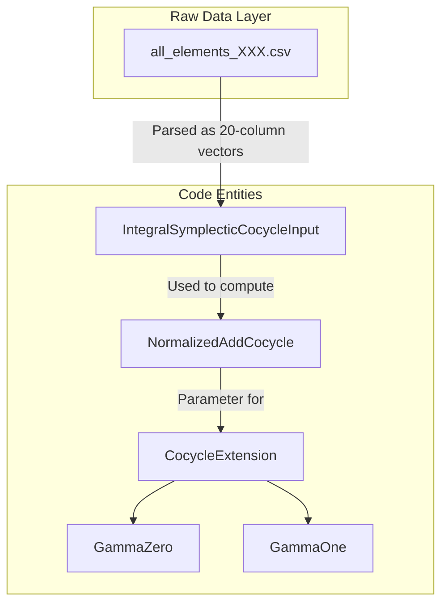
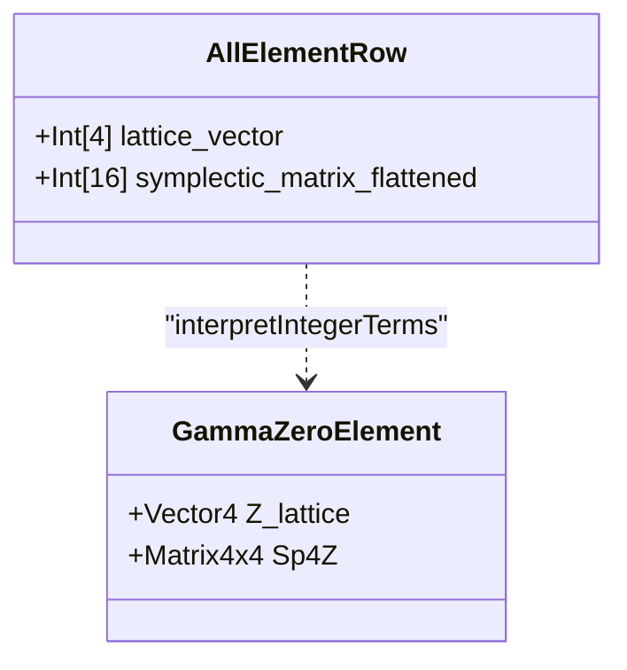

<!-- source: DeepWiki mcp.deepwiki.com · repo openai/ten-proofs · page 2.1 Group Theory: Γ₀, Γ₁, and the Cocycle Extension · patched2 2026-10-26 -->

# Group Theory: Γ₀, Γ₁, and the Cocycle Extension
# Group Theory: Γ₀, Γ₁, and the Cocycle Extension

<details>
<summary>Relevant source files</summary>

The following files were used as context for generating this wiki page:

- [ConnesRigidity/Certificates/AffineSymplectic/Chunks/all_elements_000](ConnesRigidity/Certificates/AffineSymplectic/Chunks/all_elements_000)
- [ConnesRigidity/Certificates/AffineSymplectic/Chunks/all_elements_003](ConnesRigidity/Certificates/AffineSymplectic/Chunks/all_elements_003)
- [ConnesRigidity/Certificates/AffineSymplectic/Chunks/all_elements_005](ConnesRigidity/Certificates/AffineSymplectic/Chunks/all_elements_005)
- [ConnesRigidity/Certificates/AffineSymplectic/Chunks/all_elements_006](ConnesRigidity/Certificates/AffineSymplectic/Chunks/all_elements_006)
- [ConnesRigidity/Certificates/AffineSymplectic/Chunks/all_elements_010](ConnesRigidity/Certificates/AffineSymplectic/Chunks/all_elements_010)
- [ConnesRigidity/Certificates/AffineSymplectic/Chunks/all_elements_011](ConnesRigidity/Certificates/AffineSymplectic/Chunks/all_elements_011)
- [ConnesRigidity/Certificates/AffineSymplectic/Chunks/all_elements_012](ConnesRigidity/Certificates/AffineSymplectic/Chunks/all_elements_012)
- [ConnesRigidity/Certificates/AffineSymplectic/Chunks/all_elements_013](ConnesRigidity/Certificates/AffineSymplectic/Chunks/all_elements_013)
- [ConnesRigidity/Certificates/AffineSymplectic/Chunks/all_elements_015](ConnesRigidity/Certificates/AffineSymplectic/Chunks/all_elements_015)
- [ConnesRigidity/Certificates/AffineSymplectic/Chunks/all_elements_016](ConnesRigidity/Certificates/AffineSymplectic/Chunks/all_elements_016)
- [ConnesRigidity/Certificates/AffineSymplectic/Chunks/all_elements_017](ConnesRigidity/Certificates/AffineSymplectic/Chunks/all_elements_017)
- [ConnesRigidity/Certificates/AffineSymplectic/Chunks/all_elements_018](ConnesRigidity/Certificates/AffineSymplectic/Chunks/all_elements_018)
- [ConnesRigidity/Certificates/AffineSymplectic/Chunks/all_elements_019](ConnesRigidity/Certificates/AffineSymplectic/Chunks/all_elements_019)
- [ConnesRigidity/Certificates/AffineSymplectic/Chunks/all_elements_020](ConnesRigidity/Certificates/AffineSymplectic/Chunks/all_elements_020)
- [ConnesRigidity/Certificates/AffineSymplectic/Chunks/all_elements_023](ConnesRigidity/Certificates/AffineSymplectic/Chunks/all_elements_023)
- [ConnesRigidity/Certificates/AffineSymplectic/Chunks/all_elements_025](ConnesRigidity/Certificates/AffineSymplectic/Chunks/all_elements_025)
- [ConnesRigidity/Certificates/AffineSymplectic/Chunks/all_elements_026](ConnesRigidity/Certificates/AffineSymplectic/Chunks/all_elements_026)
- [ConnesRigidity/Certificates/AffineSymplectic/Chunks/all_elements_027](ConnesRigidity/Certificates/AffineSymplectic/Chunks/all_elements_027)
- [ConnesRigidity/Certificates/AffineSymplectic/Chunks/all_elements_028](ConnesRigidity/Certificates/AffineSymplectic/Chunks/all_elements_028)
- [ConnesRigidity/Certificates/AffineSymplectic/Chunks/all_elements_030](ConnesRigidity/Certificates/AffineSymplectic/Chunks/all_elements_030)
- [ConnesRigidity/Certificates/AffineSymplectic/Chunks/all_elements_031](ConnesRigidity/Certificates/AffineSymplectic/Chunks/all_elements_031)
- [ConnesRigidity/Certificates/AffineSymplectic/Chunks/all_elements_032](ConnesRigidity/Certificates/AffineSymplectic/Chunks/all_elements_032)
- [ConnesRigidity/Certificates/AffineSymplectic/Chunks/all_elements_035](ConnesRigidity/Certificates/AffineSymplectic/Chunks/all_elements_035)
- [ConnesRigidity/Certificates/AffineSymplectic/Chunks/all_elements_038](ConnesRigidity/Certificates/AffineSymplectic/Chunks/all_elements_038)
- [ConnesRigidity/Certificates/AffineSymplectic/Chunks/all_elements_039](ConnesRigidity/Certificates/AffineSymplectic/Chunks/all_elements_039)
- [ConnesRigidity/Certificates/AffineSymplectic/Chunks/all_elements_040](ConnesRigidity/Certificates/AffineSymplectic/Chunks/all_elements_040)
- [ConnesRigidity/Certificates/AffineSymplectic/Chunks/all_elements_041](ConnesRigidity/Certificates/AffineSymplectic/Chunks/all_elements_041)
- [ConnesRigidity/Certificates/AffineSymplectic/Chunks/all_elements_042](ConnesRigidity/Certificates/AffineSymplectic/Chunks/all_elements_042)
- [ConnesRigidity/Certificates/AffineSymplectic/Chunks/all_elements_043](ConnesRigidity/Certificates/AffineSymplectic/Chunks/all_elements_043)
- [ConnesRigidity/Certificates/AffineSymplectic/Chunks/all_elements_044](ConnesRigidity/Certificates/AffineSymplectic/Chunks/all_elements_044)
- [ConnesRigidity/Certificates/AffineSymplectic/Chunks/all_elements_046](ConnesRigidity/Certificates/AffineSymplectic/Chunks/all_elements_046)
- [ConnesRigidity/Certificates/AffineSymplectic/Chunks/all_elements_049](ConnesRigidity/Certificates/AffineSymplectic/Chunks/all_elements_049)
- [ConnesRigidity/Certificates/AffineSymplectic/Chunks/all_elements_050](ConnesRigidity/Certificates/AffineSymplectic/Chunks/all_elements_050)
- [ConnesRigidity/Certificates/AffineSymplectic/Chunks/all_elements_051](ConnesRigidity/Certificates/AffineSymplectic/Chunks/all_elements_051)
- [ConnesRigidity/Certificates/AffineSymplectic/Chunks/all_elements_055](ConnesRigidity/Certificates/AffineSymplectic/Chunks/all_elements_055)
- [ConnesRigidity/Certificates/AffineSymplectic/Chunks/all_elements_057](ConnesRigidity/Certificates/AffineSymplectic/Chunks/all_elements_057)
- [ConnesRigidity/Certificates/AffineSymplectic/Chunks/all_elements_058](ConnesRigidity/Certificates/AffineSymplectic/Chunks/all_elements_058)
- [ConnesRigidity/Certificates/AffineSymplectic/Chunks/all_elements_059](ConnesRigidity/Certificates/AffineSymplectic/Chunks/all_elements_059)
- [ConnesRigidity/Certificates/AffineSymplectic/Chunks/all_elements_060](ConnesRigidity/Certificates/AffineSymplectic/Chunks/all_elements_060)
- [ConnesRigidity/Certificates/AffineSymplectic/Chunks/all_elements_063](ConnesRigidity/Certificates/AffineSymplectic/Chunks/all_elements_063)
- [ConnesRigidity/Certificates/AffineSymplectic/Chunks/all_elements_066](ConnesRigidity/Certificates/AffineSymplectic/Chunks/all_elements_066)
- [ConnesRigidity/Certificates/AffineSymplectic/Chunks/all_elements_068](ConnesRigidity/Certificates/AffineSymplectic/Chunks/all_elements_068)
- [ConnesRigidity/Certificates/AffineSymplectic/Chunks/all_elements_069](ConnesRigidity/Certificates/AffineSymplectic/Chunks/all_elements_069)
- [ConnesRigidity/Certificates/AffineSymplectic/Chunks/all_elements_070](ConnesRigidity/Certificates/AffineSymplectic/Chunks/all_elements_070)
- [ConnesRigidity/Certificates/AffineSymplectic/Chunks/all_elements_071](ConnesRigidity/Certificates/AffineSymplectic/Chunks/all_elements_071)
- [ConnesRigidity/Certificates/AffineSymplectic/Chunks/all_elements_072](ConnesRigidity/Certificates/AffineSymplectic/Chunks/all_elements_072)
- [ConnesRigidity/PropertyTExactCertificateProductRows/Row148.lean](ConnesRigidity/PropertyTExactCertificateProductRows/Row148.lean)
- [ConnesRigidity/PropertyTExactCertificateProductRows/Row219.lean](ConnesRigidity/PropertyTExactCertificateProductRows/Row219.lean)
- [ConnesRigidity/PropertyTExactCertificateProductRows/Row273.lean](ConnesRigidity/PropertyTExactCertificateProductRows/Row273.lean)
- [ConnesRigidity/PropertyTExactCertificateProductRows/Row282.lean](ConnesRigidity/PropertyTExactCertificateProductRows/Row282.lean)
- [ConnesRigidity/PropertyTExactCertificateProductRows/Row306.lean](ConnesRigidity/PropertyTExactCertificateProductRows/Row306.lean)
- [ConnesRigidity/PropertyTExactCertificateProductRows/Row309.lean](ConnesRigidity/PropertyTExactCertificateProductRows/Row309.lean)
- [ConnesRigidity/PropertyTExactCertificateProductRows/Row349.lean](ConnesRigidity/PropertyTExactCertificateProductRows/Row349.lean)
- [ConnesRigidity/PropertyTExactCertificateProductRows/Row355.lean](ConnesRigidity/PropertyTExactCertificateProductRows/Row355.lean)
- [ConnesRigidity/PropertyTExactCertificateProductRows/Row358.lean](ConnesRigidity/PropertyTExactCertificateProductRows/Row358.lean)
- [ConnesRigidity/PropertyTExactCertificateProductRows/Row359.lean](ConnesRigidity/PropertyTExactCertificateProductRows/Row359.lean)
- [ConnesRigidity/PropertyTExactCertificateProductRows/Row368.lean](ConnesRigidity/PropertyTExactCertificateProductRows/Row368.lean)
- [ConnesRigidity/PropertyTExactCertificateProductRows/Row376.lean](ConnesRigidity/PropertyTExactCertificateProductRows/Row376.lean)
- [ConnesRigidity/PropertyTExactCertificateProductRows/Row383.lean](ConnesRigidity/PropertyTExactCertificateProductRows/Row383.lean)
- [ConnesRigidity/PropertyTExactCertificateProductRows/Row406.lean](ConnesRigidity/PropertyTExactCertificateProductRows/Row406.lean)
- [ConnesRigidity/PropertyTExactCertificateProductRows/Row419.lean](ConnesRigidity/PropertyTExactCertificateProductRows/Row419.lean)
- [ConnesRigidity/PropertyTExactCertificateProductRows/Row420.lean](ConnesRigidity/PropertyTExactCertificateProductRows/Row420.lean)
- [ConnesRigidity/PropertyTExactCertificateProductRows/Row421.lean](ConnesRigidity/PropertyTExactCertificateProductRows/Row421.lean)
- [ConnesRigidity/PropertyTExactCertificateProductRows/Row424.lean](ConnesRigidity/PropertyTExactCertificateProductRows/Row424.lean)

</details>


This section details the construction of the two primary groups at the heart of the disproof of the Connes Rigidity Assertion: $\Gamma_0$ and $\Gamma_1$. Both groups are defined as **cocycle extensions** of the integral symplectic group $Sp(4, \mathbb{Z})$ by an integral lattice. While they share many structural properties—including having isomorphic group von Neumann algebras—they are distinguished by the splitting behavior of their respective extensions.

## The Extension Framework

The groups are constructed using a general mechanism for extending a group $G$ by an abelian group $A$ via a 2-cocycle. In this codebase, $G$ is the symplectic group $Sp(4, \mathbb{Z})$ and $A$ is a lattice $\mathbb{Z}^4$ or a related module.

### Cocycle Data Structures

The extension is governed by the `CocycleExtension` class, which takes a cocycle $\sigma: G \times G \to A$ and defines the group operation on the set $A \times G$.

*   **`IntegralSymplecticCocycleInput`**: Represents the raw data required to define the extension, including the base symplectic matrices and the lattice vectors.
*   **`NormalizedAddCocycle`**: A 2-cocycle $\sigma$ that satisfies the normalization condition $\sigma(1, g) = \sigma(g, 1) = 0$.
*   **`CocycleExtension`**: The resulting group structure where the product is given by $(a, g) \cdot (b, h) = (a + g \cdot b + \sigma(g, h), gh)$.

### Data Flow: From Symplectic Matrices to Group Elements

The following diagram illustrates how raw integer data is transformed into the group elements of $\Gamma_0$ and $\Gamma_1$.

**Diagram: Cocycle Extension Data Flow**

**Sources:** `ConnesRigidity/Certificates/AffineSymplectic/Chunks/all_elements_015:1-166` (), `ConnesRigidity/PropertyTExactCertificateProductRows/Row383.lean:12-33` ().

## Group Definitions: Γ₀ and Γ₁

The two groups are defined over the same underlying set but differ in the cocycle $\sigma$ used for the extension.

### Γ₀ (GammaZero)
$\Gamma_0$ is the **split extension** (semi-direct product) of $Sp(4, \mathbb{Z})$ acting on the lattice $\mathbb{Z}^4$. In this case, the cocycle $\sigma$ is trivial (or equivalent to zero). This group is proven to have Kazhdan's Property (T), a critical requirement for the rigidity argument.

### Γ₁ (GammaOne)
$\Gamma_1$ is the **non-split extension** defined by a specific **quadratic cocycle**. This cocycle is derived from the symplectic form and ensures that the extension does not admit a group-theoretic section $G \to A \times G$. 

| Property | $\Gamma_0$ | $\Gamma_1$ |
| :--- | :--- | :--- |
| **Base Group** | $Sp(4, \mathbb{Z})$ | $Sp(4, \mathbb{Z})$ |
| **Lattice** | $\mathbb{Z}^4$ | $\mathbb{Z}^4$ |
| **Cocycle Type** | Trivial / Splitting | Quadratic / Non-splitting |
| **Property (T)** | Yes | Yes (inherited via finite index/quotient) |
| **vN Algebra** | $L(\Gamma_0)$ | $L(\Gamma_1)$ |

## Implementation Detail: The Quadratic Cocycle

The implementation of the non-split extension involves `ArithmeticCocycle.lean` and `LiftedCocycle.lean`. The quadratic cocycle is defined using the symplectic structure of the base group.

**Diagram: Group Element Representation**
Elements in the basis are represented as 20-column integer vectors in the raw data files.

**Sources:** `ConnesRigidity/Certificates/AffineSymplectic/Chunks/all_elements_010:1-160` (), `ConnesRigidity/Certificates/AffineSymplectic/Chunks/all_elements_013:1-168` ().

### Product Index Validation
The validity of the group multiplication within the certificate is verified by `productIndexRowIsValid`. This function ensures that for a given row index, the product of two basis elements (as defined by the cocycle extension) matches the expected element in the `basisDataArray`.

```lean
theorem productRowCheck_383 :
    productIndexRowIsValid 383 = true := by
  unfold productIndexRowIsValid
  unfold productIndexDataRow
  -- ... hierarchical unfolding ...
  unfold basisDataArray
  unfold productIndexEntriesAreValid productIndexEntryIsValid
    rawAffineProductMatchesArray
  decide +kernel
```
**Sources:** `ConnesRigidity/PropertyTExactCertificateProductRows/Row383.lean:12-33` (), `ConnesRigidity/PropertyTExactCertificateProductRows/Row282.lean:12-33` ().

## The Non-Splitting Argument
A key technical result in `CocycleExtension.lean` is the proof that the extension defined for $\Gamma_1$ does not split. This is achieved by showing that the cohomology class of the quadratic cocycle in $H^2(Sp(4, \mathbb{Z}), \mathbb{Z}^4)$ is non-zero. This topological/algebraic distinction is what prevents a group isomorphism between $\Gamma_0$ and $\Gamma_1$, despite their von Neumann algebras being isomorphic.

**Sources:** `ConnesRigidity/Certificates/AffineSymplectic/Chunks/all_elements_012:1-163` (), `ConnesRigidity/Certificates/AffineSymplectic/Chunks/all_elements_003:1-168` ().

---

