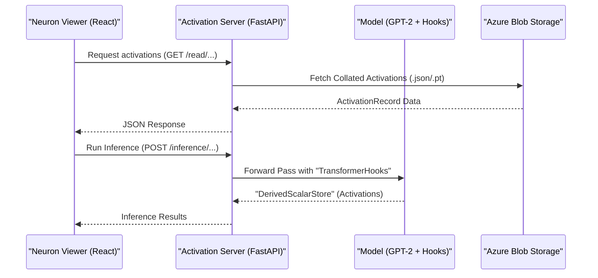

<!-- source: DeepWiki mcp.deepwiki.com · repo openai/transformer-debugger · page 1 Overview · fetched 2026-10-26 -->

# Overview

<details>
<summary>Relevant source files</summary>

The following files were used as context for generating this wiki page:

- [README.md](README.md)
- [datasets.md](datasets.md)
- [terminology.md](terminology.md)

</details>


The Transformer Debugger (TDB) is a tool developed by OpenAI's Superalignment team to support investigations into specific behaviors of small language models [README.md:1-5](). It combines automated interpretability techniques with sparse autoencoders to identify specific components—such as neurons, attention heads, and autoencoder latents—that contribute to model behavior [README.md:6-15]().

The tool allows users to intervene in the forward pass to see how it affects specific outputs, helping answer questions like "Why does the model output token A instead of token B?" [README.md:9-12]().

For detailed information about the system architecture, see [System Architecture](#1.1).
For setup instructions, see [Setup and Installation](#1.2).

## Core Components

The repository is organized into several primary functional areas:

| Component | Description | Key Code Entities |
| :--- | :--- | :--- |
| **Neuron Viewer** | A React frontend for TDB and individual model component pages [README.md:27](). | `neuron_viewer/src/` |
| **Activation Server** | A FastAPI backend that performs model inference and serves data from Azure [README.md:28](). | `neuron_explainer/activation_server/` |
| **Model Library** | Inference implementation for GPT-2 and sparse autoencoders with activation hooks [README.md:29](). | `neuron_explainer/models/` |
| **Datasets** | Collated top-activating examples for MLP neurons and attention heads [README.md:30](). | `datasets.md` |

**Sources:** [README.md:25-31](); [datasets.md:1-3]()

## Supported Models and Data

TDB primarily supports the **GPT-2** family of models. It provides pre-computed activation datasets stored on Azure Blob Storage [datasets.md:5-11]().

*   **GPT-2 Small:** Supports MLP neurons (12 layers, 3084 neurons/layer) and Attention heads (12 layers, 12 heads/layer) [datasets.md:15-18](). It also includes extensive **Sparse Autoencoder** latents for MLP and Attention layers [datasets.md:21-47]().
*   **GPT-2 XL:** Supports MLP neurons (48 layers, 6400 neurons/layer) [datasets.md:50-58]().

**Sources:** [datasets.md:7-58]()

## System Conceptual Map

The following diagram bridges high-level interpretability concepts to the specific code entities used in the system.

### Concept to Code Mapping
```mermaid
graph TD
    subgraph "Interpretability Concepts"
        [BehaviorAnalysis] -- "Why token A?" --> [Intervention]
        [Component] -- "What does it do?" --> [Explanation]
        [Circuit] -- "How do they connect?" --> [Tracing]
    end

    subgraph "Code Entity Space"
        [Intervention] --> [InteractiveModel]
        [Explanation] --> [TokenActivationPairExplainer]
        [Component] --> [NeuronRecord]
        [Tracing] --> [DerivedScalarType]
    end

    [InteractiveModel] --- "neuron_explainer/activation_server/interactive_model.py"
    [TokenActivationPairExplainer] --- "neuron_explainer/explanations/explainer.py"
    [NeuronRecord] --- "neuron_explainer/activations/activations.py"
    [DerivedScalarType] --- "neuron_explainer/activations/derived_scalars/scalar_deriver.py"
```
**Sources:** [README.md:9-15](); [terminology.md:3-36](); [neuron_explainer/activation_server/README.md]()

## Data Flow and Communication

The system operates as a client-server architecture where the frontend requests activation data or model inferences from the backend.

### High-Level Data Flow

**Sources:** [README.md:27-29](); [datasets.md:5-13](); [neuron_explainer/activation_server/README.md]()

## Terminology Reference

The project uses specific terminology to describe the mechanics of the debugger:
*   **Component:** An attention head, neuron, or autoencoder latent [terminology.md:3-5]().
*   **Node:** A specific invocation of a component at a specific token in a forward pass [terminology.md:13-15]().
*   **Ablate:** To turn off a node (zero-ablation) to observe downstream effects [terminology.md:36-41]().
*   **Latent:** A direction in activation space learned by a sparse autoencoder [terminology.md:31-33]().
*   **Direction of Interest:** The specific vector (e.g., logit difference between target and distractor tokens) used to calculate node importance [terminology.md:48-54]().

**Sources:** [terminology.md:1-102]()

---

