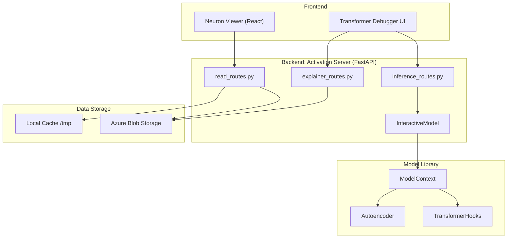
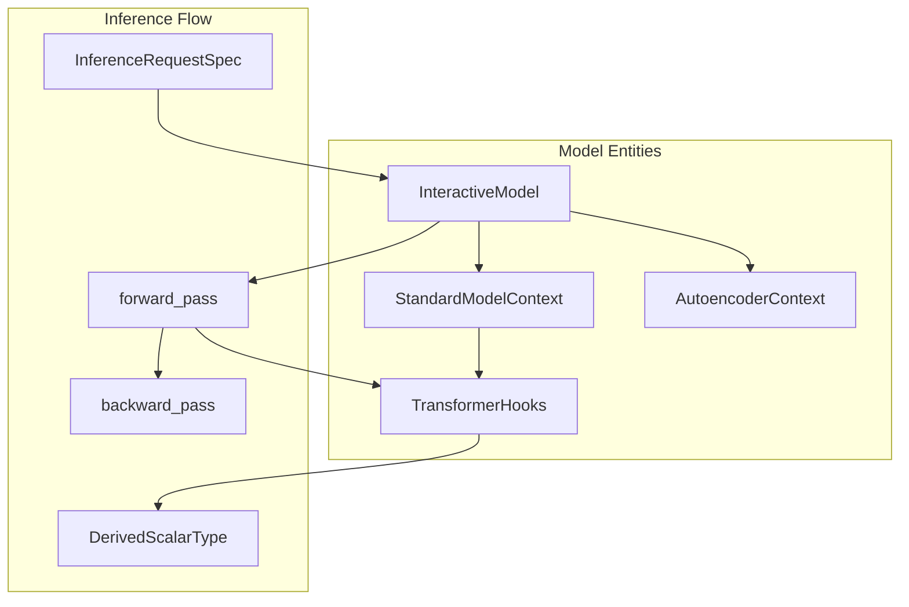
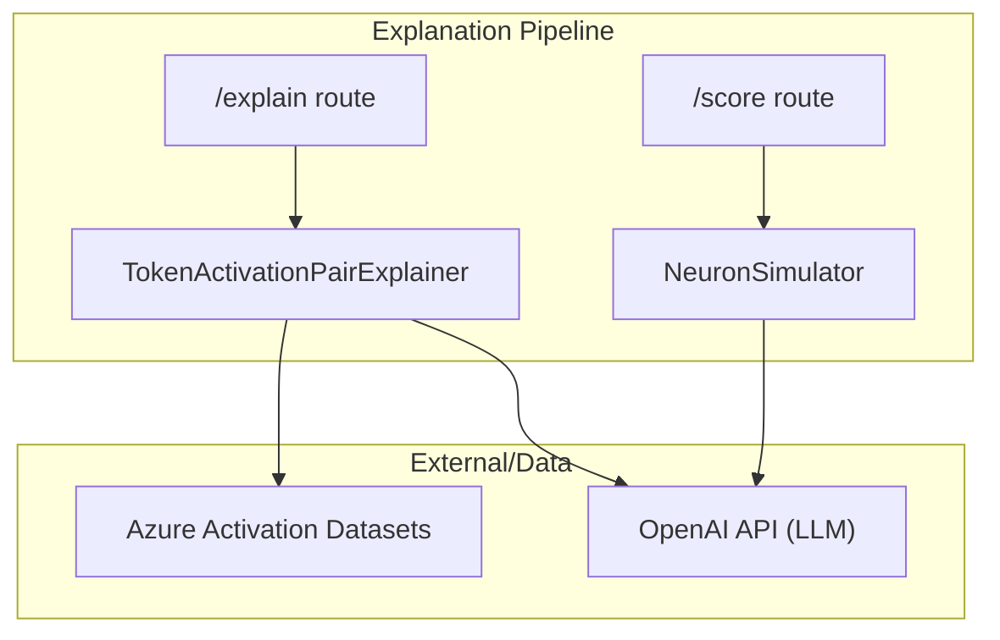
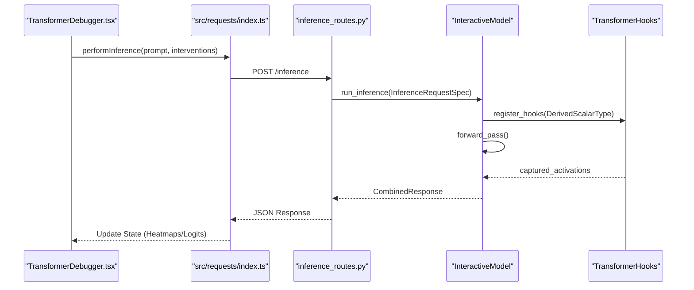
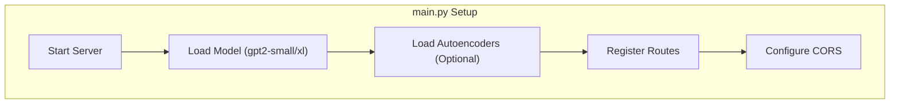

<!-- source: DeepWiki mcp.deepwiki.com · repo openai/transformer-debugger · page 1.1 System Architecture · fetched 2026-10-26 -->

# System Architecture

Relevant source files

The following files were used as context for generating this wiki page:

- [README.md](README.md)
- [neuron_explainer/activation_server/README.md](neuron_explainer/activation_server/README.md)
- [neuron_viewer/README.md](neuron_viewer/README.md)

## Purpose and Scope

This document provides a comprehensive overview of the Transformer Debugger (TDB) system architecture, describing its main components and how they interact. It covers the core systems that make up the application, their relationships, and data flow from model inference through the activation server to the frontend.

For information about setting up and installing the system, see [Setup and Installation](#1.2). For detailed information about specific subsystems, refer to their dedicated wiki pages: [Transformer Model System](#2), [Neuron Explanation System](#3), [Activation Data Management](#4), [Activation Server](#5), and [Neuron Viewer Frontend](#6).

## High-Level System Overview

The Transformer Debugger is a full-stack application consisting of a React-based frontend, a FastAPI backend, and a specialized transformer inference library.

### Core System Components

Sources: [README.md:25-31](), [neuron_explainer/activation_server/README.md:64-68](), [neuron_viewer/README.md:40-47]()

The system is divided into three primary layers:
1.  **Neuron Viewer Frontend**: A React application providing the TDB interface and individual node visualization pages [neuron_viewer/README.md:1-5]().
2.  **Activation Server Backend**: A FastAPI server that handles inference, data retrieval from Azure, and explanation generation [neuron_explainer/activation_server/README.md:1-8]().
3.  **Transformer Model Library**: A custom inference implementation for GPT-2 models and autoencoders with hooks for activation interception [README.md:29-29]().

## Detailed Component Architecture

### Model and Inference System

The Model System provides the interface for performing forward and backward passes while capturing internal activations.

Sources: [neuron_explainer/activation_server/main.py:129-154](), [neuron_explainer/activation_server/README.md:68-68](), [neuron_explainer/models/README.md:29-29]()

Key components include:
*   **InteractiveModel**: The primary orchestrator for inference requests, managing both the subject model and optional autoencoders [neuron_explainer/activation_server/main.py:149-154]().
*   **StandardModelContext**: Manages the lifecycle and weight loading of the transformer model [neuron_explainer/activation_server/main.py:129-131]().
*   **TransformerHooks**: A system for intercepting activations at specific points (e.g., MLP post-activations, attention scores) [README.md:29-29]().
*   **DerivedScalarType**: An enum defining the specific internal values to be captured during inference [neuron_explainer/activation_server/explainer_routes.py:137-156]().

### Neuron Explanation and Scoring

This system automates the generation of human-readable explanations for why specific components (neurons, latents) activate.

Sources: [neuron_explainer/activation_server/README.md:95-98](), [neuron_explainer/activation_server/explainer_routes.py:60-94]()

*   **TokenActivationPairExplainer**: Formats top-activating examples into prompts for an LLM to summarize behavior [neuron_explainer/activation_server/explainer_routes.py:60-70]().
*   **NeuronSimulator**: Uses an LLM to predict activations on new text based on a generated explanation to validate its accuracy [neuron_explainer/activation_server/README.md:97-98]().

## Data and Request Flow

The following diagram illustrates the end-to-end data flow when a user interacts with the Transformer Debugger UI.

Sources: [neuron_explainer/activation_server/README.md:68-68](), [neuron_viewer/README.md:42-45](), [neuron_explainer/activation_server/main.py:159-170]()

### Key Data Paths:
1.  **Inference Path**: Frontend sends a prompt and optional interventions (ablations) to the `/inference` endpoint. The `InteractiveModel` runs the model, captures `DerivedScalarType` values via `TransformerHooks`, and returns them for visualization [neuron_explainer/activation_server/README.md:5-5]().
2.  **Read Path**: Frontend requests pre-computed data (e.g., top-activating sequences for a neuron) via `/read`. The server fetches this from Azure Blob Storage using `CustomFileHandler` [neuron_explainer/activation_server/README.md:6-6]().
3.  **Explanation Path**: Frontend requests a new explanation via `/explain`. The server retrieves `NeuronRecord` data, formats it for an LLM, and returns the text explanation [neuron_explainer/activation_server/explainer_routes.py:318-350]().

## Server Initialization and Component Registration

The server entry point `main.py` is responsible for wiring these components together based on command-line arguments.

Sources: [neuron_explainer/activation_server/main.py:32-171](), [neuron_explainer/activation_server/README.md:11-24]()

*   **Autoencoder Integration**: If `--mlp_autoencoder_name` or `--attn_autoencoder_name` are provided, the server wraps the standard model with autoencoder latents, allowing the UI to toggle between neurons and latents [neuron_explainer/activation_server/README.md:17-28]().
*   **Client Generation**: The TypeScript client used by the frontend is automatically generated from the FastAPI schema to ensure type safety across the network boundary [neuron_explainer/activation_server/README.md:36-39]().

## Summary

The architecture is designed for interactive interpretability. By separating the heavy lifting of model inference and data management into a Python backend (`activation_server`) and providing a responsive React frontend (`neuron_viewer`), the system allows researchers to explore model internals, perform interventions, and view automated explanations in real-time.

---

