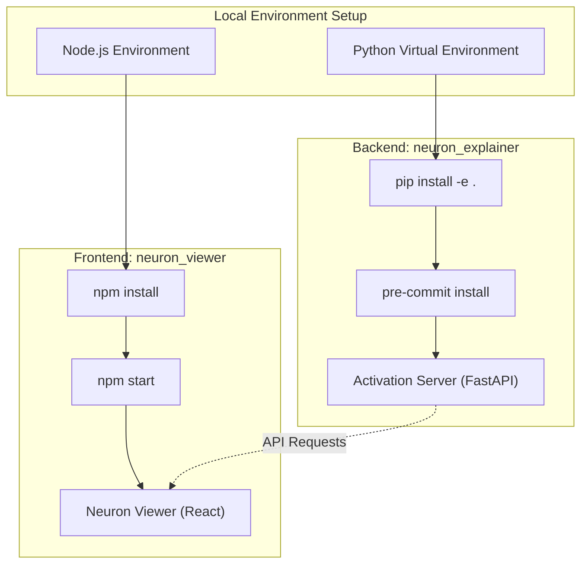
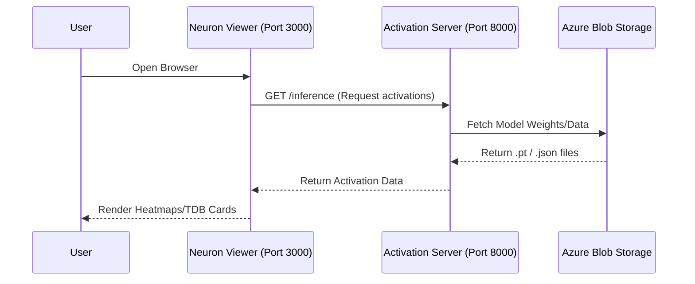

<!-- source: DeepWiki mcp.deepwiki.com · repo openai/transformer-debugger · page 1.2 Setup and Installation · fetched 2026-10-26 -->

# Setup and Installation

<details>
<summary>Relevant source files</summary>

The following files were used as context for generating this wiki page:

- [.pre-commit-config.yaml](.pre-commit-config.yaml)
- [README.md](README.md)
- [setup.py](setup.py)

</details>


This document provides technical instructions for setting up and installing the Transformer Debugger (TDB) repository. It covers the environment configuration for both the Python-based `neuron_explainer` backend and the React-based `neuron_viewer` frontend.

## Installation Overview

The installation process is divided into two main environments: the Python backend (Activation Server) and the Node.js frontend (Neuron Viewer).


Sources: [README.md:32-64](), [setup.py:1-30]()

## Prerequisites

The system requires the following base technologies:
- **Python**: Version 3.11 or higher is required [setup.py:29-29]().
- **Node.js & npm**: Required for the frontend [README.md:34-34]().
- **Virtual Environment**: Recommended to avoid dependency conflicts [README.md:36-45]().

## Backend Setup: neuron_explainer

The backend consists of the `neuron_explainer` package, which includes the inference engine, activation server, and explanation generation logic.

### 1. Environment and Dependencies
After cloning the repository, create a virtual environment and install the package in editable mode. This allows changes to the source code to be reflected immediately without re-installation.

```bash
python -m venv ~/.virtualenvs/transformer-debugger
source ~/.virtualenvs/transformer-debugger/bin/activate
pip install -e .
```
Sources: [README.md:42-53]()

The `setup.py` file defines the core dependencies, including:
- `fastapi==0.97` and `uvicorn` for the activation server [setup.py:11-25]().
- `torch>=1.13` for model inference [setup.py:24-24]().
- `tiktoken` for GPT-2 tokenization [setup.py:23-23]().
- `pydantic<2.0.0` for data validation [setup.py:18-18]().

### 2. Code Quality Tools
The project uses `pre-commit` to maintain code standards. The hooks are configured in `.pre-commit-config.yaml` and include:
- **Ruff**: For linting and automated fixes [ .pre-commit-config.yaml:2-7]().
- **Black**: For code formatting with a line length of 100 [ .pre-commit-config.yaml:9-13]().
- **isort**: For sorting imports [ .pre-commit-config.yaml:15-19]().

Install the hooks with:
```bash
pre-commit install
```
Sources: [README.md:56-56](), [.pre-commit-config.yaml:1-20]()

## Frontend Setup: neuron_viewer

The `neuron_viewer` is a React application that provides the UI for the Transformer Debugger and individual neuron pages.

```bash
cd neuron_viewer
npm install
```
Sources: [README.md:58-61]()

## Running the System

To use the full Transformer Debugger, both the backend server and frontend client must be running simultaneously.

### 1. Starting the Activation Server
The activation server serves model activations and explanation data. It acts as the bridge between the model weights (often hosted on Azure) and the UI. Detailed instructions for the server are located in `neuron_explainer/activation_server/README.md`.

### 2. Starting the Neuron Viewer
The frontend is started via npm. Detailed instructions for the viewer are located in `neuron_viewer/README.md`.


Sources: [README.md:27-30](), [README.md:64-64]()

## Verification and Testing

To ensure the installation was successful, run the following verification suite:

1.  **Backend Tests**: Use `pytest` to run the suite of backend tests [README.md:70-70]().
2.  **Type Checking**: Run `mypy` to verify type safety [README.md:71-71]().
3.  **Integration**: Launch both the server and viewer, then navigate to a local URL (e.g., `http://localhost:3000`) to confirm the TDB interface loads and can perform inference [README.md:72-73]().

Sources: [README.md:68-73]()

---

