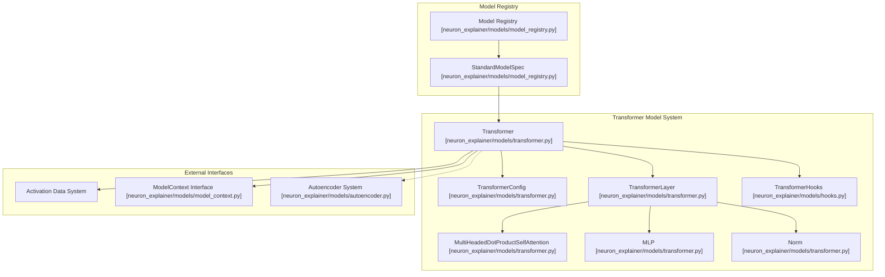
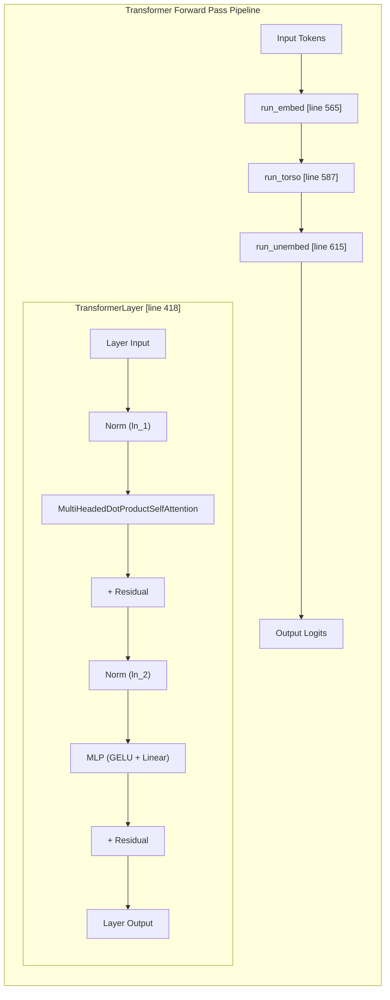

<!-- source: DeepWiki mcp.deepwiki.com · repo openai/transformer-debugger · page 2 Transformer Model System · fetched 2026-10-26 -->

# Transformer Model System

<details>
<summary>Relevant source files</summary>

The following files were used as context for generating this wiki page:

- [neuron_explainer/models/README.md](neuron_explainer/models/README.md)
- [neuron_explainer/models/transformer.py](neuron_explainer/models/transformer.py)
- [neuron_explainer/scripts/create_hf_test_data.py](neuron_explainer/scripts/create_hf_test_data.py)

</details>


The Transformer Model System provides the core transformer model implementation used throughout the Transformer Debugger. It defines a flexible implementation of the transformer architecture, supporting GPT-2 style models with hooks for introspection of internal activations. This system serves as the foundation for both running transformer models and analyzing their internal behavior.

For information about the autoencoder system that works with transformer activations, see [Autoencoder System](#2.1). For details on the unified interface to models, see [Model Context Interface](#2.2).

## System Overview

The Transformer Model System implements a standard transformer architecture with configurable parameters. It provides:

1. A complete transformer implementation with configurable parameters.
2. Support for GPT-2 family models (small, medium, large, XL).
3. A robust hooks system for capturing and manipulating internal activations via `TransformerHooks` [neuron_explainer/models/hooks.py:108-124]().
4. Utilities for sampling, caching, and processing.
5. Integration with the model loading registry.

### Architecture to Code Mapping
The following diagram bridges the conceptual transformer components to their specific class implementations in the codebase.



Sources:
- [neuron_explainer/models/transformer.py:496-512]() (Transformer class)
- [neuron_explainer/models/transformer.py:65-77]() (TransformerConfig class)
- [neuron_explainer/models/README.md:1-47]()

## Transformer Architecture

The Transformer Model System implements a standard decoder-only transformer architecture, following the design used in GPT-2. The implementation consists of:

1. Token and position embeddings via `run_embed` [neuron_explainer/models/transformer.py:565-585]().
2. Multiple transformer layers (`TransformerLayer`) [neuron_explainer/models/transformer.py:418-476]().
3. A final layer normalization and unembedding via `run_unembed` [neuron_explainer/models/transformer.py:615-628]().

Each `TransformerLayer` contains:
- Self-attention with configurable number of heads.
- MLP (feed-forward) component.
- Layer normalization and residual connections.



Sources:
- [neuron_explainer/models/transformer.py:418-476]() (TransformerLayer implementation)
- [neuron_explainer/models/transformer.py:496-628]() (Transformer implementation)

## Key Components

### TransformerConfig
The `TransformerConfig` class defines the parameters for the transformer model, including model dimensions (`d_model`), number of layers (`n_layers`), and context window size (`ctx_window`) [neuron_explainer/models/transformer.py:65-97]().

### Transformer
The `Transformer` class is the main implementation. It handles the model lifecycle, including loading via `Transformer.load` [neuron_explainer/models/transformer.py:691-757]() and execution via the `forward` method [neuron_explainer/models/transformer.py:514-542]().

### Attention and MLP
- **MultiHeadedDotProductSelfAttention**: Implements causal self-attention with query, key, and value projections [neuron_explainer/models/transformer.py:294-385]().
- **MLP**: Implements a two-layer feed-forward network with GELU activation [neuron_explainer/models/transformer.py:393-411]().

### Hooks System
The system uses `TransformerHooks` to intercept activations at various points (e.g., `mlp.post_act`, `attn.q_proj`) [neuron_explainer/models/hooks.py:108-124](). This is critical for the "Debugger" aspect of the repository, allowing for ablation or recording of internal states.

Sources:
- [neuron_explainer/models/transformer.py:334-382]() (Attention hooks usage)
- [neuron_explainer/models/transformer.py:406-410]() (MLP hooks usage)

## Model Loading and Usage

### Loading Models
Models can be loaded directly using `Transformer.load(path)` [neuron_explainer/models/transformer.py:691](). The system supports the following variants:
- GPT-2 Small, Medium, Large, and XL [neuron_explainer/scripts/create_hf_test_data.py:14-19]().

### Forward Pass and Sampling
The transformer implementation supports both standard forward pass and text generation through `sample` [neuron_explainer/models/transformer.py:630-689](). The sampling function supports temperature-based sampling and nucleus (top-p) sampling via `nucleus_sample` [neuron_explainer/models/transformer.py:187-206]().

## Integration with Other Systems

The Transformer Model System interacts with several subsystems to enable interpretability:

1. **Model Context Interface**: Provides a unified interface through `StandardModelContext` [neuron_explainer/models/model_context.py:102]().
2. **Activation Data System**: Captures `ActivationRecord` and `NeuronRecord` objects during inference [neuron_explainer/activations/activations.py:10-40]().
3. **Autoencoder System**: Uses `Autoencoder` to map activations into a more interpretable latent space [neuron_explainer/models/autoencoder.py:56]().

### Testing and Validation
The system is validated against Hugging Face reference models using scripts like `create_hf_test_data.py` [neuron_explainer/scripts/create_hf_test_data.py:37-100]() and regression tests in `test_against_data.py`.

Sources:
- [neuron_explainer/tests/test_against_data.py:1-124]()
- [neuron_explainer/scripts/create_hf_test_data.py:1-130]()

## Usage Example

```python
from neuron_explainer.models.transformer import Transformer
from neuron_explainer.models.hooks import TransformerHooks
import torch

# Load model [neuron_explainer/models/README.md:19]
device = torch.device("cuda" if torch.cuda.is_available() else "cpu")
model = Transformer.load("gpt2/small", device=device, dtype=torch.float32)

# Create hooks to capture activations [neuron_explainer/models/README.md:31-40]
activation_store = {}
def store_activation(x, layer, **kwargs):
    activation_store[layer] = x.detach().clone()
    return x

hooks = TransformerHooks()
hooks.mlp.post_act.append_fwd(store_activation)

# Run model sampling [neuron_explainer/models/README.md:43]
result = model.sample("The transformer architecture is", num_tokens=10, hooks=hooks)
```

Sources:
- [neuron_explainer/models/README.md:9-45]()

---

