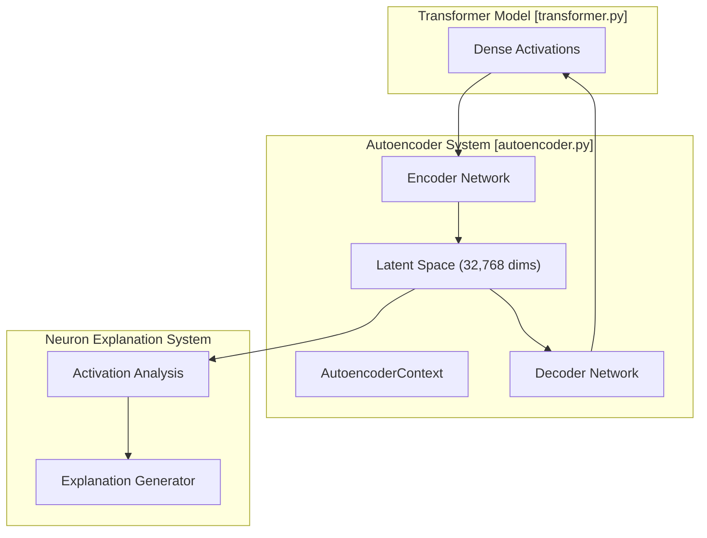
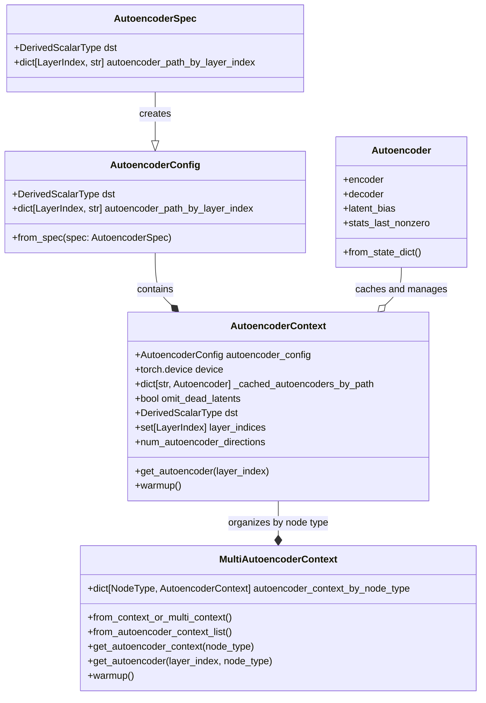
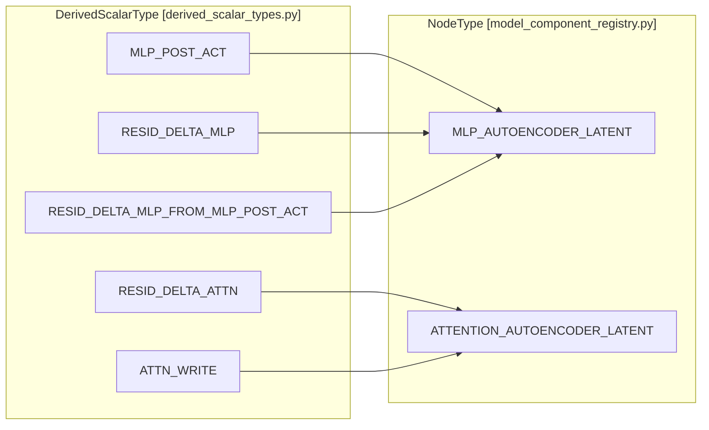
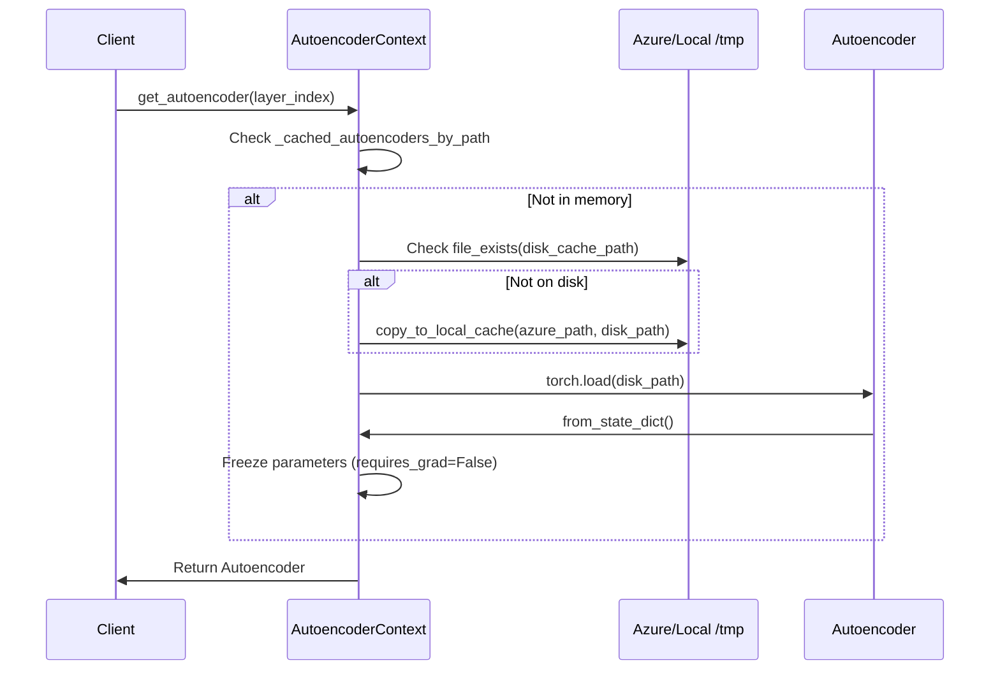

<!-- source: DeepWiki mcp.deepwiki.com · repo openai/transformer-debugger · page 2.1 Autoencoder System · fetched 2026-10-26 -->

# Autoencoder System

<details>
<summary>Relevant source files</summary>

The following files were used as context for generating this wiki page:

- [neuron_explainer/models/README.md](neuron_explainer/models/README.md)
- [neuron_explainer/models/autoencoder.py](neuron_explainer/models/autoencoder.py)
- [neuron_explainer/models/autoencoder_context.py](neuron_explainer/models/autoencoder_context.py)
- [neuron_explainer/scripts/create_hf_test_data.py](neuron_explainer/scripts/create_hf_test_data.py)

</details>


The Autoencoder System provides an essential component of the Transformer Debugger, designed to expand neural network activation spaces into higher-dimensional, more interpretable representations. This system transforms dense neural activations into sparse, overcomplete representations that are often more semantically meaningful than the original model's neurons.

For information about the overall Transformer Model System, see [Transformer Model System](#2). For details on how the Model Context interfaces with autoencoders, see [Model Context Interface](#2.2).

## System Purpose and Overview

The sparse autoencoders in Transformer Debugger are trained on specific activation types from a transformer model (particularly GPT-2). They serve several key functions:

1. Converting dense activations into sparse, higher-dimensional spaces.
2. Providing more interpretable "directions" in the activation space.
3. Enabling analysis of learned features that may be entangled in the original model.



Sources: [neuron_explainer/models/README.md:50-56](), [neuron_explainer/models/autoencoder_context.py:47-68](), [neuron_explainer/models/autoencoder.py:8-14]()

## Autoencoder System Architecture

The autoencoder system consists of several key components that work together to manage, load, and provide access to trained autoencoders.



Sources: [neuron_explainer/models/autoencoder_context.py:13-22](), [neuron_explainer/models/autoencoder_context.py:39-44](), [neuron_explainer/models/autoencoder_context.py:47-144](), [neuron_explainer/models/autoencoder_context.py:156-217](), [neuron_explainer/models/autoencoder.py:8-44]()

### Key Classes

1.  **AutoencoderSpec**: Parameters used in the construction of an `AutoencoderConfig` [neuron_explainer/models/autoencoder_context.py:14-18]().
2.  **AutoencoderConfig**: Specifies a set of autoencoders to load from disk for one or more layer indices [neuron_explainer/models/autoencoder_context.py:21-30]().
3.  **AutoencoderContext**: Manages the lifecycle and caching of `Autoencoder` instances for a specific `DerivedScalarType` [neuron_explainer/models/autoencoder_context.py:47-52](). It handles disk caching by copying files from Azure blob storage to `/tmp` [neuron_explainer/models/autoencoder_context.py:97-104]().
4.  **MultiAutoencoderContext**: A container that maps `NodeType` to `AutoencoderContext`, allowing the system to handle different types of latents (e.g., MLP vs. Attention) simultaneously [neuron_explainer/models/autoencoder_context.py:156-158]().
5.  **Autoencoder**: The core `nn.Module` implementing the sparse autoencoder logic [neuron_explainer/models/autoencoder.py:8-14]().

Sources: [neuron_explainer/models/autoencoder_context.py:13-217](), [neuron_explainer/models/autoencoder.py:8-111]()

## Supported Activation Types

The autoencoder system maps `DerivedScalarType` (the source activation) to `NodeType` (the resulting latent type).

| Derived Scalar Type | Node Type | Description |
| :--- | :--- | :--- |
| `MLP_POST_ACT` | `MLP_AUTOENCODER_LATENT` | MLP activations after activation function |
| `RESID_DELTA_MLP` | `MLP_AUTOENCODER_LATENT` | Change in residual stream from MLP |
| `RESID_DELTA_ATTN` | `ATTENTION_AUTOENCODER_LATENT` | Change in residual stream from attention |



Sources: [neuron_explainer/models/autoencoder_context.py:146-153](), [neuron_explainer/models/README.md:59-66]()

## Autoencoder Loading and Caching

`AutoencoderContext` implements a multi-tier loading strategy. It first checks an in-memory cache, then a local disk cache (`/tmp`), and finally fetches from Azure blob storage if necessary.



Sources: [neuron_explainer/models/autoencoder_context.py:86-115](), [neuron_explainer/file_utils.py:8-8]()

### Memory Optimization: Dead Latent Omission

To save memory, the system can omit "dead" latents—latents that never activate.

1.  **Warmup**: When `warmup()` is called, all configured autoencoders are loaded [neuron_explainer/models/autoencoder_context.py:117-120]().
2.  **Identification**: If `omit_dead_latents` is True, the system calculates the minimum number of dead latents across all layers to ensure consistent latent indices across the context [neuron_explainer/models/autoencoder_context.py:125-127]().
3.  **Omission**: The `omit_least_active_latents` function creates a new `Autoencoder` instance with reduced dimensions [neuron_explainer/models/autoencoder_context.py:131-133]().

Sources: [neuron_explainer/models/autoencoder_context.py:52-57](), [neuron_explainer/models/autoencoder_context.py:117-134](), [neuron_explainer/models/autoencoder_context.py:252-294]()

## Autoencoder Architecture and Training

The `Autoencoder` class implements a standard sparse autoencoder architecture [neuron_explainer/models/autoencoder.py:8-14]():

*   **Pre-bias**: A parameter subtracted from the input [neuron_explainer/models/autoencoder.py:27-27]().
*   **Encoder**: A linear layer mapping input to latents [neuron_explainer/models/autoencoder.py:28-28]().
*   **Latent Bias**: A bias added to encoded latents [neuron_explainer/models/autoencoder.py:29-29]().
*   **Activation**: Non-linearity (default `ReLU`, supports `TopK`) [neuron_explainer/models/autoencoder.py:30-30](), [neuron_explainer/models/autoencoder.py:139-152]().
*   **Decoder**: A linear layer reconstructing the input [neuron_explainer/models/autoencoder.py:34-34]().

### Statistical Tracking
The class maintains buffers to track latent usage:
*   `stats_last_nonzero`: Steps since last activation [neuron_explainer/models/autoencoder.py:39-39]().
*   `latents_activation_frequency`: Frequency of activation [neuron_explainer/models/autoencoder.py:40-42]().
*   `latents_mean_square`: Mean square of activations [neuron_explainer/models/autoencoder.py:43-43]().

Sources: [neuron_explainer/models/autoencoder.py:16-87](), [neuron_explainer/models/README.md:58-66]()

## Example Usage

### 1. Through the Model Registry
The `model_registry.py` provides a simplified interface to initialize these contexts.

```python
from neuron_explainer.models.model_registry import make_autoencoder_context
import torch

autoencoder_context = make_autoencoder_context(
    model_name="gpt2-small",
    autoencoder_name="ae-mlp-post-act-v4",
    device=torch.device("cuda"),
    omit_dead_latents=True
)
autoencoder_context.warmup()
```

### 2. Manual Inference
You can manually encode activations using the `Autoencoder` class:

```python
# activations: [batch, n_inputs]
latent_activations = autoencoder.encode(activations) # [batch, n_latents]
```

Sources: [neuron_explainer/models/autoencoder.py:58-63](), [neuron_explainer/models/model_registry.py:102-121](), [neuron_explainer/models/README.md:96-146]()

---

